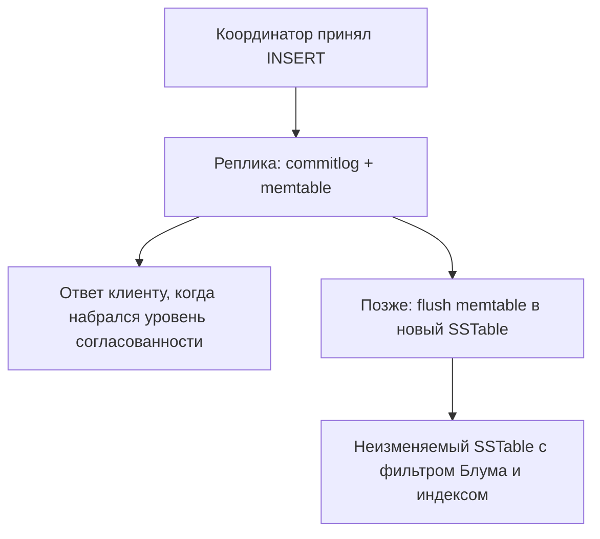

# 02. Путь записи и чтения

**Зачем это знать backend-разработчику.** Cassandra отвечает на запись быстро, потому что не ищет место среди старых файлов, а дописывает. Чтение поэтому собирает строку из памяти и нескольких файлов. Отсюда «запись быстрее чтения», лишние файлы после обновлений и то, что `SELECT` без ключа партиции (partition key) — не «забытый индекс», а полный обход.

> **Коротко:** запись сначала попадает в commitlog (commit log) на диске и в memtable в памяти, и только потом сбрасывается в неизменяемый SSTable. Чтение проверяет фильтр Блума (bloom filter), индекс партиции (partition index) и сливает memtable с SSTable: побеждает более новая метка времени (timestamp). Обновление — новая запись, а не правка байтов на месте. Координатор для уровней выше `ONE` сверяет реплики по дайджесту (digest).

Весь вывод ниже снят с живого контейнера `cassandra:5.0` (сервер `5.0.9`), Java сверена с `java-driver-core` 4.19.3.

## Оглавление

- [Запись: commitlog и memtable](#запись-commitlog-и-memtable)
- [Трассировка записи](#трассировка-записи)
- [Сброс в SSTable](#сброс-в-sstable)
- [Когда срабатывает flush](#когда-срабатывает-flush)
- [Формат SSTable: big и BTI](#формат-sstable-big-и-bti)
- [Чтение одной реплики](#чтение-одной-реплики)
- [Фильтр Блума и его цена](#фильтр-блума-и-его-цена)
- [Дайджест и несколько реплик](#дайджест-и-несколько-реплик)
- [Спекулятивное чтение: speculative_retry](#спекулятивное-чтение-speculative_retry)
- [Кэши](#кэши)
- [Метки времени](#метки-времени)
- [Java: запись и чтение глазами координатора](#java-запись-и-чтение-глазами-координатора)
- [Практика в репозитории](#практика-в-репозитории)
- [Типичные ошибки и заблуждения](#типичные-ошибки-и-заблуждения)
- [Итоги](#итоги)
- [Вопросы для самопроверки](#вопросы-для-самопроверки)
- [Источники](#источники)

## Запись: commitlog и memtable

**На пальцах** (аналогия). Кассир не правит толстую книгу: пишет строку в журнал (пережить отключение света) и кладёт в стопку на столе (быстро отдать). Толстую стопку уносят в архив пачкой. Журнал — commit log, стопка — memtable, пачка — SSTable.

**Commitlog** (commit log) — журнал на диске, куда запись дописывается последовательно. **Memtable** (memtable) — отсортированная в памяти структура тех же данных. Успех записи на реплике: данные в memtable, журнал сброшен так, как требует режим долговечности. Искать старую строку на диске не нужно, поэтому запись не читает SSTable.

Режим `commitlog_sync` решает, когда `fsync`. По умолчанию `periodic` с `commitlog_sync_period` 10000 мс: при внезапном отключении питания на этой реплике можно потерять до **10 секунд** последних записей, а не «доли секунды». Режим `group` синхронизирует пачку по таймеру `commitlog_sync_group_window` (по умолчанию 1000 мс); в `batch` fsync ждёт каждая мутация. Тот же компромисс, что `appendfsync` в Redis; цифра — в таблице [движков хранения](../../docs/00-foundations/07-storage-engines.md#2-wal-и-fsync).

Журнал нарезан на **сегменты** (commit log segment), выделяемые целиком заранее:

```
$ ls -la /var/lib/cassandra/commitlog/
-rw-r--r-- 1 cassandra cassandra 33554432 CommitLog-7-1791379939284.log
-rw-r--r-- 1 cassandra cassandra 33554432 CommitLog-7-1791379939285.log
```

33 554 432 байта — ровно 32 МиБ, `commitlog_segment_size: 32MiB`. Файлы видны сразу после старта пустого узла: место резервируется заранее, чтобы запись не ждала расширения. Отсюда «почему свежий узел занял 64 МБ, ничего не записав».

Координатор (coordinator) шлёт мутацию репликам и ждёт столько ответов, сколько требует **уровень согласованности** (consistency level): `ONE` — одного. Остальные догоняют асинхронно, недоступные — через hint (hinted handoff), см. [06](06-consistency-repair.md).

## Трассировка записи

**На пальцах** (аналогия). Посылке можно верить на слово, а можно открыть трек-номер и увидеть все отметки. `TRACING ON` — трек-номер одного CQL-запроса.

Включаем трассировку, делаем `INSERT`:

```
cqlsh> TRACING ON;
cqlsh> INSERT INTO guide.messages_by_chat (chat_id, sent_at, message_id, author_id, body)
       VALUES ('room-1', '2026-10-07 09:00:00+0000', uuid(), 'anna', 'privet');

 activity                                      | source     | source_elapsed
-----------------------------------------------+------------+----------------
 Execute CQL3 query                            | 172.17.0.4 |              0
 Parsing INSERT INTO guide.messages_by_chat ... | 172.17.0.4 |           2277
 Preparing statement                           | 172.17.0.4 |           2901
 Determining replicas for mutation             | 172.17.0.4 |           9312
 Appending to commitlog [MutationStage-10]     | 172.17.0.4 |          10033
 Adding to messages_by_chat memtable           | 172.17.0.4 |          10362
 Request complete                              | 172.17.0.4 |          12086
```

`source_elapsed` — микросекунды от начала запроса. Разбор и подготовка непрепарированного запроса съели 2,9 мс из 12 — поэтому [подготовленные запросы](10-java-driver.md) не придирка. Поиск реплик — ещё 6,4 мс на холодном пути. Работа с данными — `Appending to commitlog` и `Adding to memtable` — уложилась в **0,33 мс**, меньше 3 % запроса. Чтений SSTable нет вовсе.

`[MutationStage-10]` — имя потока: мутацию исполняет отдельный пул. При RF > 1 появятся строки `Sending mutation to /10.x.x.x` и `Mutation applied` с других адресов — по ним видно, сколько реплик ответили.

## Сброс в SSTable

**На пальцах** (аналогия). Стопку уносят в архив целой пачкой и там не правят: исправление — новый лист поверх. Поэтому архив растёт, и его периодически разбирают (уплотнение).

**SSTable** (sorted string table) — неизменяемый файл, строки упорядочены по ключу партиции (partition key) и кластерным колонкам (clustering columns). Memtable сбрасывается, когда кончается бюджет памяти, пришёл `nodetool flush` или узел выключается; соответствующий кусок commitlog тогда можно выбросить.

Файл не редактируют. Новое значение ячейки — новая запись с новой меткой, старое доживёт до уплотнения (compaction). «Обновление на месте» — иллюзия клиента: `UPDATE` и `INSERT` для обычной таблицы почти одно и то же, upsert.

Два `nodetool flush` подряд дают два независимых набора файлов:

```
$ ls -1 /var/lib/cassandra/data/guide/messages_by_chat-*/
nb-1-big-Data.db          nb-2-big-Data.db
nb-1-big-Filter.db        nb-2-big-Filter.db
nb-1-big-Index.db         nb-2-big-Index.db
nb-1-big-Summary.db       nb-2-big-Summary.db
nb-1-big-Statistics.db    nb-2-big-Statistics.db
nb-1-big-CompressionInfo.db  nb-2-big-CompressionInfo.db
```

Каждый SSTable — набор компонентов:

- `Data.db` — сами строки;
- `Filter.db` — **фильтр Блума** (bloom filter): «партиции в файле точно нет» или «возможно, есть»;
- `Index.db` — **индекс партиций** (partition index): где в файле лежит нужный ключ;
- `Summary.db` — **сводка индекса** (partition summary), разреженный указатель поверх индекса;
- `CompressionInfo.db` — смещения сжатых блоков;
- `Statistics.db` — минимумы и максимумы ключей, оценки, гистограммы.



LSM-подход — в [движках хранения](../../docs/00-foundations/07-storage-engines.md); слияние SSTable — тема [03](03-compaction.md).

## Когда срабатывает flush

**На пальцах** (аналогия). Стопку уносят не по расписанию, а когда она не помещается или когда закончился журнал приёма. Два повода, одно действие.

Первый повод — **память под memtable**:

```
# Total permitted memory to use for memtables. Cassandra will stop
# accepting writes when the limit is exceeded until a flush completes,
# and will trigger a flush based on memtable_cleanup_threshold
# If omitted, Cassandra will set both to 1/4 the size of the heap.
# memtable_heap_space: 2048MiB
```

Закомментировано — действует правило «четверть кучи». Контейнер запущен с `MAX_HEAP_SIZE=1G` (`nodetool info`: `Heap Memory (MB): 148.43 / 1024.00`), бюджет memtable — **256 МБ**. Порог `memtable_cleanup_threshold` по умолчанию равен `1 / (memtable_flush_writers + 1)`; писателей на каталог данных 2, то есть **1/3**: около 85 МБ — и самая «грязная» memtable уходит на диск. Важнее числа следствие: при превышении общего лимита узел **перестаёт принимать записи**, пока сброс не закончится. Всплеск задержек записи на ровном месте — обычно про это.

Второй повод — **место под commit log**:

```
# If space gets above this value, Cassandra will flush every dirty CF
# in the oldest segment and remove it.
# The default value is the smaller of 8192, and 1/4 of the total space
# of the commitlog volume.
# commitlog_total_space: 8192MiB
```

Журнал нельзя выбросить, пока его данные не в SSTable. При дорастании до лимита Cassandra принудительно сбрасывает все таблицы с незаписанным в **самом старом сегменте** и удаляет его. При 32 МиБ на сегмент 8 ГиБ — 256 сегментов; таблица с 1 КБ в секунду окажется «грязной» в очень старом сегменте и будет сброшена с ним, породив SSTable на десятки килобайт. Отсюда предупреждение: маленький `commitlog_total_space` плодит крошечные SSTable.

## Формат SSTable: big и BTI

**На пальцах** (аналогия). Справочник можно листать по алфавитному указателю в конце (сначала страница, потом строка) или по дереву разделителей на корешке, сразу ведущему в нужное место. Первое — формат `big`, второе — `BTI`.

Cassandra 5.0 умеет оба, но не выбирает автоматически; в образе действует режим совместимости:

```
$ grep -n "^storage_compatibility_mode" /etc/cassandra/cassandra.yaml
2320:storage_compatibility_mode: CASSANDRA_4
```

`CASSANDRA_4` — оставаться совместимым с линией 4.x по возможностям, форматам и версиям компонентов. Файлы называются `nb-1-big-*`, и `nodetool gossipinfo` сообщает это соседям: `SSTABLE_VERSIONS:6:big-nb`.

Проверка на отдельном контейнере показывает тонкость: **снятия режима совместимости недостаточно**. С `storage_compatibility_mode: NONE` формат остаётся `big`, версия поднимается до пятёрочной: файлы `oa-1-big-*`, gossip сообщает `big-oa`. Чтобы получить BTI, нужен отдельный блок в `cassandra.yaml`:

```yaml
sstable:
  selected_format: bti
```

После рестарта новый сброс даёт другой набор компонентов:

```
$ ls -1 /var/lib/cassandra/data/guide/t2-*/
da-1-bti-Data.db         da-1-bti-Partitions.db
da-1-bti-Filter.db       da-1-bti-Rows.db
da-1-bti-Statistics.db   da-1-bti-CompressionInfo.db

$ nodetool gossipinfo | grep -i sstable
  SSTABLE_VERSIONS:35:bti-da,big-oa
```

Сравните с `big`: `Index.db` и `Summary.db` исчезли, появились `Partitions.db` и `Rows.db`. **BTI** (big-trie-indexed) хранит индекс как префиксное дерево (trie), и разреженная сводка не нужна. Эффект: индекс занимает меньше памяти вне кучи и не упирается в ограничение `Summary.db` на больших таблицах. `bti-da,big-oa` в gossip показывает сосуществование форматов: старые файлы не переписываются, их перегонит уплотнение или `nodetool upgradesstables`.

В учебном репозитории действует `big`; BTI включают осознанно, после полного перехода кластера на 5.0.

## Чтение одной реплики

**На пальцах** (аналогия). Продавец смотрит и свежие записки на столе, и несколько архивных пачек: цену меняли в разное время. Из каждого места берёт версию и выбирает помеченную позже.

Реплика собирает строку так:

1. Смотрит memtable и все SSTable, которые ещё не уплотнены.
2. Фильтр Блума отсекает файлы, где партиции точно нет. Ложное «возможно, есть» бывает, ложного «точно нет» не бывает.
3. По индексу находит смещение и читает партицию.
4. Сливает версии ячеек. Побеждает большая метка времени. При равенстве меток сравниваются байты значения и остаётся большее по byte-order: два `INSERT` с одним `USING TIMESTAMP`, в любом порядке, оставляют `'zzz'`, а не `'aaa'`. Бизнес-логику на этом строить нельзя — это только стабильность слияния.

Шаги видны в трассировке. Партиция: три строки в двух SSTable, четвёртая ещё в memtable:

```
cqlsh> TRACING ON;
cqlsh> SELECT author_id, body FROM guide.messages_by_chat WHERE chat_id='room-1' LIMIT 3;

 activity                                                    | source_elapsed
--------------------------------------------------------------+----------------
 Execute CQL3 query                                          |              0
 Executing single-partition query on messages_by_chat        |           1485
 Acquiring sstable references                                |           1643
 Skipped 0/2 non-slice-intersecting sstables, included 0 ...  |           1905
 Partition index found for sstable 2, size = 0               |           2685
 Partition index found for sstable 1, size = 0               |           3425
 Merged data from memtables and 2 sstables                   |           3910
 Read 3 live rows and 0 tombstone cells                      |           4072
 Request complete                                            |           4668
```

`single-partition query` — ключ сузил работу до одной партиции; `Skipped 0/2` — ни один файл не отброшен по диапазону кластерных колонок; `Merged data from memtables and 2 sstables` — слияние трёх источников. Последняя строка — главный диагностический счётчик: когда надгробий станет в сотни раз больше живых строк, это видно здесь ([07](07-tombstones.md)).

То же для несуществующего ключа:

```
 Acquiring sstable references                                |           3261
 Skipped 0/0 non-slice-intersecting sstables, included 0 ...  |           3510
 Read 0 live rows and 0 tombstone cells                      |           3659
```

Строк `Partition index found` и `Merged data` нет, знаменатель — ноль: **фильтр Блума отбросил оба файла до открытия индекса**. Промах по несуществующему ключу стоит обращения в память, а не двух чтений с диска.

У широкой партиции (wide partition) шаг 4 дорогой даже при верном ключе: работу режут лимит и узкий диапазон кластерных колонок. Запрос без ключа партиции обходит все диапазоны, `ALLOW FILTERING` этого не отменяет ([05](05-query-first.md)).

## Фильтр Блума и его цена

**На пальцах** (аналогия). Перед коробкой смотрят на наклейку: «фамилий на С тут точно нет». Она иногда ошибается в сторону «может быть» — коробку откроют зря, — но не говорит «нет», если документ внутри. Чем подробнее наклейка, тем реже ошибки и тем больше места она занимает.

**`bloom_filter_fp_chance`** — целевая доля ложных «возможно, есть». Значение по умолчанию зависит от стратегии уплотнения:

```
cqlsh> SELECT table_name, bloom_filter_fp_chance FROM system_schema.tables WHERE keyspace_name='guide';

 table_name       | bloom_filter_fp_chance
------------------+------------------------
        lcs_probe |                    0.1
 messages_by_chat |                   0.01
        ucs_probe |                   0.01
```

У STCS (и UCS) — **0.01**, у LCS — **0.1**, в десять раз грубее. При LCS партиция живёт практически в одном файле на уровень, кандидатов мало, и платить памятью за точность незачем. При STCS кандидатов много, и каждый промах — лишнее чтение.

Сколько это в байтах: по 200 000 партиций в две таблицы, одинаковые кроме `bloom_filter_fp_chance`, каждая уплотнена в один файл:

```
$ nodetool tablestats guide.bf01            $ nodetool tablestats guide.bf10
	Number of partitions (estimate): 203145     Number of partitions (estimate): 203145
	Bloom filter space used: 253944             Bloom filter space used: 126984
```

Ровно вдвое: 1,27 байта на партицию при 0.01 и 0.63 байта при 0.1 (10,2 и 5,1 бита). Теория даёт −log₂(p)/ln2 бит на ключ, то есть 9,6 и 4,8 — сходится. На миллиард партиций это 1,3 ГБ против 630 МБ вне кучи.

Цена на чтении: по 1000 `SELECT` с заведомо отсутствующими ключами:

```
--- bf01                              --- bf10
Local read count: 1000                Local read count: 1000
Bloom filter false positives: 8       Bloom filter false positives: 96
Bloom filter false ratio: 0.00800     Bloom filter false ratio: 0.09600
```

0,8 % против 9,6 % — заявленные 0.01 и 0.1 воспроизвелись почти буквально. На миллион промахов в час грубый фильтр даёт 96 000 бесполезных чтений индекса вместо 8 000. Для проверок «есть ли такой ключ» фильтр стоит сделать точнее; если партиции всегда существуют, точность почти не влияет, и память лучше отдать кэшу ключей.

## Дайджест и несколько реплик

**На пальцах** (аналогия). Чтобы убедиться, что у трёх коллег одна версия документа, достаточно сверить контрольные суммы. Полный текст тянут у одного, остальные присылают «подпись».

При `QUORUM` координатор не тащит полную строку со всех реплик: одна присылает данные целиком, остальные — только **дайджест** (digest), короткий хеш строки. Совпали — ответ готов. Разошлись — координатор дочитывает полные версии, отдаёт победителя по метке времени и запускает **read repair**: отстающие реплики получают свежую версию.

Арифметика: строка на 2 КБ при RF = 3 и `QUORUM` без дайджестов стоила бы 4 КБ трафика, с дайджестами — 2 КБ плюс хеш в десятки байт. Счётчики расхождений — в `nodetool netstats`:

```
Read Repair Statistics:
Attempted: 0
Mismatch (Blocking): 0
Mismatch (Background): 0
```

Это чинит лишь прочитанные партиции в момент чтения; остальные дыры закроет `nodetool repair`.

## Спекулятивное чтение: speculative_retry

**На пальцах** (аналогия). Если курьер задерживается, отправляют второго другим маршрутом; чей ответ первый, тот годится. Цена — лишняя поездка.

**`speculative_retry`** — свойство таблицы: когда координатору перестать ждать «медленную» реплику и послать запрос дополнительной. Значение по умолчанию:

```
cqlsh> SELECT speculative_retry, additional_write_policy, read_repair
       FROM system_schema.tables WHERE keyspace_name='guide' AND table_name='messages_by_chat';

 speculative_retry | additional_write_policy | read_repair
-------------------+-------------------------+-------------
               99p |                     99p |    BLOCKING
```

`99p` — «подождать 99-й перцентиль времени чтения этой таблицы и только потом дублировать». Порог адаптивный: таблица сама считает гистограмму. Допустимы также `ALWAYS` (сразу), `NONE`, фиксированная задержка (`50ms`) и `XXpercentile`. Сервер проверяет значение:

```
cqlsh> ALTER TABLE guide.messages_by_chat WITH speculative_retry = 'sometimes';
ConfigurationException: Invalid value sometimes for option 'speculative_retry'

cqlsh> ALTER TABLE guide.messages_by_chat WITH speculative_retry = '50ms';
 speculative_retry | additional_write_policy
-------------------+-------------------------
              50ms |                     99p
```

`additional_write_policy` — то же для записи: когда разослать мутацию ещё одной реплике сверх необходимого. `ALTER` изменил только `speculative_retry` — свойства независимы.

Цена: при RF = 3, `QUORUM` и `99p` лишний запрос уходит примерно в 1 % чтений, нагрузка растёт на ~1 %, а хвост задержек (p99.9) падает в разы: одна подтормаживающая нода не держит клиента. При `ALWAYS` чтений в полтора раза больше — осмысленно только для маленьких таблиц с жёстким SLA. Спекуляция **таблицы** (`speculative_retry`) и **драйвера** (`speculative execution`, [10](10-java-driver.md)) — разные механизмы, они складываются; оба «на всякий случай» включать не надо.

## Кэши

**На пальцах** (аналогия). Библиотекарь помнит не содержание книг, а номера полок: дёшево и экономит обход зала. Помнить сами книги можно, но тогда поместится гораздо меньше.

- **Кэш ключей** (key cache) помнит, где в SSTable лежит партиция, и экономит чтение индекса. Включён по умолчанию, обычно полезен.
- **Кэш строк** (row cache) хранит саму строку; ест кучу и плохо дружит с широкими партициями, включают точечно.
- **Кэш счётчиков** (counter cache) и буферы сжатия — служебные.

Состояние — в `nodetool info`:

```
Key Cache     : entries 8, size 640 bytes, capacity 51 MiB, 80 hits, 87 requests,
                0.920 recent hit rate, 14400 save period in seconds
Row Cache     : entries 0, size 0 bytes, capacity 0 bytes, 0 hits, 0 requests,
                NaN recent hit rate, 0 save period in seconds
Counter Cache : entries 0, size 0 bytes, capacity 25 MiB, 0 hits, 0 requests
```

Кэш ключей получил 51 МиБ (около 5 % кучи в 1 ГБ) и уже даёт 92 % попаданий на восьми записях; кэш строк — `capacity 0 bytes`, выключен по умолчанию, и это правильный дефолт. `save period 14400`: кэш ключей периодически сохраняется на диск, чтобы после перезапуска узел не начинал с холодного.

Кэш приложения (карточка товара на 30 секунд) чаще живёт в Redis: Cassandra кэширует куски своих файлов, а не ответы API.

## Метки времени

**На пальцах** (аналогия). Два человека правят документ и присылают версии по почте: побеждает не чьё письмо пришло позже, а чья дата в документе позже. У кого часы врут вперёд, тот выигрывает всегда — свойство правила.

Клиент может передать метку сам; драйвер обычно ставит её по часам отправителя. При разъехавшихся на минуты часах «более позднее» по бизнесу значение проиграет. Хватает NTP и понимания, что побеждает метка, а не порядок прихода на координатор.

```sql
INSERT INTO guide.messages_by_chat (chat_id, sent_at, message_id, author_id, body)
VALUES ('room-1', '2026-09-23 12:00:00+0000', uuid(), 'anna', 'привет')
USING TIMESTAMP 1700000000000000;
```

`USING TIMESTAMP` — микросекунды; в учебном коде метку обычно ставит драйвер. Лёгкие транзакции (lightweight transaction, LWT) используют другой протокол и условие `IF`; они не заменяют метки времени для обычных `INSERT`, см. [08](08-lwt-batches-counters.md).

## Java: запись и чтение глазами координатора

**На пальцах** (аналогия). Трек-номер можно смотреть на сайте и в приложении — данные те же: `TRACING ON` в cqlsh и `setTracing(true)` в драйвере читают одну таблицу `system_traces`.

Запись с трассировкой:

```java
PreparedStatement insert = session.prepare("""
        INSERT INTO guide.messages_by_chat (chat_id, sent_at, message_id, author_id, body)
        VALUES (?, ?, ?, ?, ?)""");

QueryTrace trace = session.execute(
        insert.bind("room-1", Instant.now(), Uuids.timeBased(), "anna", "привет")
              .setConsistencyLevel(DefaultConsistencyLevel.LOCAL_QUORUM)
              .setTracing(true))
        .getExecutionInfo().getQueryTrace();

trace.getEvents().forEach(e -> System.out.printf("  %-40s %s +%d%n",
        e.getActivity(), e.getSource(), e.getSourceElapsedMicros()));
// Appending to commitlog               /172.17.0.4 +10033
// Adding to messages_by_chat memtable  /172.17.0.4 +10362
```

Чтение:

```java
ExecutionInfo info = session.execute(SimpleStatement.newInstance(
                "SELECT author_id, body FROM guide.messages_by_chat WHERE chat_id = ? LIMIT 3", "room-1")
            .setConsistencyLevel(DefaultConsistencyLevel.LOCAL_QUORUM))
        .getExecutionInfo();

System.out.println(info.getCoordinator().getEndPoint());
System.out.println("спекулятивных попыток: " + info.getSpeculativeExecutionCount());
info.getWarnings().forEach(System.out::println);
```

Что из этого видно про работу координатора:

- `getCoordinator()` — кто выполнял запрос;
- `getSpeculativeExecutionCount()` — сколько раз драйвер дублировал запрос; не ноль — медленная реплика;
- `getErrors()` — пары «узел → исключение» для провалившихся попыток: так объясняется «запрос занял 300 мс, хотя сервер отвечает за 2»;
- `getWarnings()` — серверные предупреждения, например о пороге надгробий;
- `getResponseSizeInBytes()` — размер ответа, для поиска «толстых» запросов.

Трассировку **не включают постоянно**: она сама пишет строки в `system_traces`; её включают на один запрос при разборе проблемы.

## 🔬 Глубже: что лежит рядом с данными в SSTable

Кроме фильтра Блума и индекса партиций, есть индекс кластерных строк внутри большой партиции и статистика минимумов и максимумов (`Statistics.db`). По ней реплика иногда понимает, что нужного диапазона `sent_at` в файле нет, — это строка `Skipped N/M non-slice-intersecting sstables` в трассировке. Сжатие (по умолчанию LZ4 блоками по 16 КБ, свойство `compression` таблицы) режет диск и заставляет читать блок целиком: выигрыш есть, пока CPU дешевле лишнего IO.

После `nodetool flush` снимок (`nodetool snapshot`) видит данные в SSTable, а не только в памяти. Снимок — жёсткие ссылки на файлы, а не логический дамп: пока он не удалён, уплотнение не удалит старый SSTable, и диск растёт. Забытый снимок — частая причина «данных мало, диск полный».

## Практика в репозитории

- [Задание 01](../tasks/01-chat-history.md) — чтение одной партиции с `LIMIT`, без сборки ленты в Java.
- [Задание 03](../tasks/03-sensor-metrics.md) — много записей, которые должны умирать целыми SSTable.
- [Задание 04](../tasks/04-timeline-paging.md) и [PagingDemo](../examples/src/main/java/dev/nosqlguide/cassandra/examples/driver/PagingDemo.java) — не вычитывать партицию одним `SELECT`.
- [Задание 07](../tasks/07-tunable-consistency.md) — трассировка на `QUORUM`: два ответа из трёх.
- Фон: [движки хранения](../../docs/00-foundations/07-storage-engines.md).

## Типичные ошибки и заблуждения

1. **«UPDATE дешевле INSERT, потому что меняет одну колонку.»** Для обычной таблицы оба — мутация в memtable; выигрыш в числе ячеек и ключе, а не в операторе.
2. **«Данные уже на диске, раз клиент получил ответ.»** Они в commitlog и памяти; SSTable — после flush.
3. **«Фильтр Блума иногда теряет строки.»** Он может только зря отправить читать файл; «строки нет, хотя она есть» он не говорит.
4. **«Read repair заменяет ночной repair.»** Он чинит прочитанное; непрочитанные расхождения копятся до `nodetool repair`.
5. **«Cassandra 5.0 — значит BTI.»** Нет: [нужны оба условия](#формат-sstable-big-и-bti); по умолчанию образ пишет `big`.
6. **«Поставлю `bloom_filter_fp_chance` 0.001 — станет быстрее.»** Станет больше памяти вне кучи; если ключи в основном существуют, выигрыша на чтении нет.
7. **«Включу трассировку на проде и буду смотреть.»** Она сама пишет в `system_traces` на каждый запрос — [включают точечно](#java-запись-и-чтение-глазами-координатора).

## Итоги

- Запись — append в commitlog и memtable: две строки трассировки и около 0,3 мс из 12 мс.
- Commit log — сегменты по 32 МиБ, выделяемые заранее; его переполнение — один из двух поводов для flush, второй — четверть кучи под memtable.
- SSTable неизменяем. В режиме `CASSANDRA_4` это формат `big` (`nb-*`); BTI (`da-*-bti-*`) требует и смены режима совместимости, и `sstable.selected_format`.
- Чтение сливает memtable и файлы; трассировка показывает `Skipped N/M`, `Merged data from … sstables`, `Read N live rows`.
- `bloom_filter_fp_chance` — 0.01 у STCS и 0.1 у LCS: 1,27 против 0,63 байта на партицию и 0,8 % против 9,6 % ложных срабатываний.
- `speculative_retry = 99p` дублирует около 1 % чтений и режет хвост; `additional_write_policy` — то же для записи.
- При кворуме реплики сравнивают дайджесты; расхождение запускает read repair.
- Key cache полезен, row cache выключен (`capacity 0 bytes`) — и это правильно.
- Конфликт обычных записей решает метка времени, поэтому часы клиентов важны.

## Вопросы для самопроверки

1. Почему запись не читает старые SSTable?
   <details><summary>Ответ</summary>Мутация дописывается в журнал и memtable. Старое значение лежит, пока уплотнение или чтение не выберет победителя по метке.</details>
2. `INSERT` при `ONE` успешен, и сразу узел убили питанием. Строка потеряется?
   <details><summary>Ответ</summary>При `periodic` (по умолчанию) fsync раз в 10 секунд, поэтому на этой реплике может пропасть до 10 секунд записей. Другие реплики при RF > 1 могли принять запись отдельно.</details>
3. В трассировке `Skipped 0/0 non-slice-intersecting sstables`, хотя на диске два SSTable. Что произошло?
   <details><summary>Ответ</summary>Фильтр Блума отбросил оба файла: ключа в них точно нет, поэтому нет ни `Partition index found`, ни `Merged data`.</details>
4. Зачем дайджест, если можно всегда прислать строку?
   <details><summary>Ответ</summary>Полную строку тянут с одной реплики, остальные присылают хеш: при RF = 3 примерно вдвое меньше трафика.</details>
5. Почему у LCS `bloom_filter_fp_chance` в десять раз грубее, чем у STCS?
   <details><summary>Ответ</summary>См. [раздел про фильтр](#фильтр-блума-и-его-цена): при LCS кандидатов мало, лишние 0,6 байта на партицию не окупаются; при STCS каждое ложное срабатывание — лишнее чтение.</details>
6. Два сервиса пишут разный `body` в одну ячейку без LWT. Что сохранится?
   <details><summary>Ответ</summary>Значение с большей меткой времени, а не «первый закоммитивший».</details>
7. `speculative_retry = ALWAYS` на таблице с RF = 3. Чем платим?
   <details><summary>Ответ</summary>Каждое чтение дублируется: примерно в полтора раза больше чтений. Оправдано для небольших таблиц с жёстким требованием к хвосту.</details>

## Источники

- Apache Cassandra docs 5.0: *Storage engine* (commit log, memtable, SSTable). https://cassandra.apache.org/doc/5.0/cassandra/architecture/storage-engine.html
- Apache Cassandra docs 5.0: *CREATE TABLE* — `bloom_filter_fp_chance`, `speculative_retry`, `additional_write_policy`. https://cassandra.apache.org/doc/5.0/cassandra/developing/cql/ddl.html
- `cassandra.yaml` образа `cassandra:5.0`: `commitlog_sync`, `commitlog_segment_size`, `commitlog_total_space`, `memtable_heap_space`, `storage_compatibility_mode`.
- DataStax Java Driver 4.19: `ExecutionInfo`, `QueryTrace`, `Statement.setTracing`. https://docs.datastax.com/en/developer/java-driver/4.19/
- Фон курса: [движки хранения](../../docs/00-foundations/07-storage-engines.md).

---

← [01. Архитектура](01-architecture.md) | [оглавление](README.md) | [03. Уплотнение](03-compaction.md) → | [словарь терминов](glossary.md)
