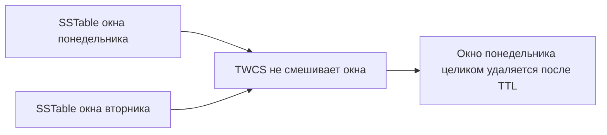

# 03. Уплотнение: STCS, LCS, TWCS и UCS

**Зачем это знать backend-разработчику.** Cassandra пишет быстро, потому что не склеивает файлы в момент запроса. Склеивание — отдельная работа, **уплотнение** (compaction). Выбранная стратегия решает, будет ли чтение открывать два файла или двадцать, хватит ли диска во время склейки и можно ли выбросить протухшие метрики, не трогая живые.

> **Коротко:** уплотнение сливает несколько SSTable в новые и выбрасывает проигравшие по метке времени (timestamp) ячейки и уже просроченные надгробия (tombstone). STCS группирует файлы похожего размера и бережёт запись ценой множества файлов на чтении. LCS держит уровни и бережёт чтение ценой лишней записи. TWCS режет время окнами и подходит метрикам с TTL. UCS в Cassandra 5 сводит идеи STCS и LCS к одному параметру масштаба.

## Оглавление

- [Зачем склеивать файлы](#зачем-склеивать-файлы)
- [Три усиления в числах](#три-усиления-в-числах)
- [STCS](#stcs)
- [LCS](#lcs)
- [TWCS](#twcs)
- [UCS](#ucs)
- [Пропускная способность и число потоков](#пропускная-способность-и-число-потоков)
- [Что смотреть, когда диск заполнен](#что-смотреть-когда-диск-заполнен)
- [Практика в репозитории](#практика-в-репозитории)
- [Типичные ошибки и заблуждения](#типичные-ошибки-и-заблуждения)
- [Итоги](#итоги)
- [Вопросы для самопроверки](#вопросы-для-самопроверки)
- [Источники](#источники)

## Зачем склеивать файлы

**На пальцах** (аналогия). Каждый сброс memtable (flush) — новая папка с бумагами. Пока папок мало, найти лист легко. Когда их сорок, кассир открывает сорок папок на один заказ. Ночь он тратит на то, чтобы переписать папки в одну и выкинуть устаревшие черновики.

Уплотнение читает несколько SSTable и пишет новый, где у каждой ячейки осталась победившая версия. Старые файлы удаляют, когда новый записан и читатели его отпустили. Отсюда три цены, их полезно называть по именам:

- **усиление записи** (write amplification) — во сколько раз байт переписывается на диске после первого flush;
- **усиление чтения** (read amplification) — сколько файлов открывает одно чтение;
- **усиление места** (space amplification) — сколько лишнего места занимают старые версии и надгробия, пока их не склеили.

Стратегия не меняет результат запроса. Она меняет, когда и какой ценой кластер придёт к одному файлу на диапазон.

Сколько файлов лежит прямо сейчас, видно в `nodetool tablestats`. Учебная таблица датчиков после загрузки трёх дневных бакетов по 500 точек:

```text
$ nodetool tablestats guide.sensor_readings
		SSTable count: 1
		Space used (live): 27287
		SSTable Compression Ratio: 0.55772
		Number of partitions (estimate): 3
		Compacted partition maximum bytes: 14237
```

Три партиции — это три бакета одного датчика, по одному на день. `SSTable count: 1` означает, что чтение открывает один файл: уплотнение уже сработало. Когда это число растёт до десятков, разговор о стратегии перестаёт быть теоретическим.



## Три усиления в числах

**На пальцах** (аналогия). Переезд: можно ставить коробки к стене (быстро въехали, потом не найти чайник), можно каждую сразу разбирать по полкам (легко искать, но вы весь вечер перекладываете вещи), а можно разбирать по сезонам. Три варианта — три разные цены: время на складывание, время на поиск, место в комнате.

Три усиления считают арифметикой, а не на глаз. Возьмём таблицу, в которую приложение пишет **10 МБ/с** полезных данных.

| Величина | STCS | LCS | TWCS (окно = сутки) |
|---|---|---|---|
| Усиление записи | ≈ 4–6× | ≈ 10–40× | ≈ 4–6× внутри окна, 1× между окнами |
| Файлов на точечное чтение | 4–15 | 1–3 | 1–3 внутри окна, × число окон при запросе через окна |
| Пик свободного места под склейку | до 50 % объёма таблицы | ≈ 10–20 % | размер одного окна |

Откуда берётся «4–6×» у STCS. При `min_threshold = 4` байт сначала садится во flush-файл, потом четыре такие файла сливаются в файл второго яруса, четыре файла второго — в третий и так далее. Яруса растут вчетверо: 160 МБ → 640 МБ → 2,5 ГБ → 10 ГБ, и чтобы байт дошёл до 10 ГБ, его перепишут 4 раза. При 10 МБ/с входа это 864 ГБ полезных данных в сутки и около **4 ТБ физической записи на диск** — с ресурсом SSD сравнивают именно эту цифру, а не 864 ГБ.

Конкретная склейка яруса: четыре файла по 100 МБ дают на выходе до 400 МБ (меньше, если часть ячеек проигравшие или протухшие). На время склейки на диске лежат и 400 МБ исходников, и до 400 МБ результата — 800 МБ вместо 400. Это и есть усиление места.

У LCS своя арифметика. `fanout_size = 10` означает, что каждый следующий уровень в десять раз больше, поэтому байт, переливающийся из L1 в L2, тянет за собой около 10 перезаписанных байт соседей — отсюда оценка «около 10× на уровень». Четыре уровня — усиление записи порядка 30–40× в худшем случае: те же 10 МБ/с превращаются в десятки терабайт в сутки, и на обычном диске LCS на таком потоке просто не успеет.

TWCS внутри активного окна ведёт себя как STCS, но закрытое окно не переписывается никогда. Метрики с TTL 14 дней и суточным окном: 14 живых окон, 13 из них уже не трогают. Усиление записи на горизонте двух недель близко к усилению одного дня, а не к сумме по всем дням.

## STCS

**На пальцах** (аналогия). Склад складывает поддоны в штабеля по размеру: мелкие с мелкими, крупные с крупными. Набралось четыре мелких — их перепаковывают в один крупный. Грузчикам легко, перепаковка редкая; кладовщику тяжело: один товар может лежать в штабеле мелких, средних и крупных одновременно.

**Size-tiered compaction strategy** (STCS, класс `SizeTieredCompactionStrategy`) складывает в одну группу SSTable близкого размера. Когда в группе набралось достаточно файлов (ориентир — `min_threshold`, по умолчанию 4), их сливают в один файл следующего размера. Верхнюю границу разово сливаемых файлов держит `max_threshold` (по умолчанию 32) — не даёт склеить за один проход слишком много сразу.

Запись почти не трогают повторно, пока файл не дорастёт до соседей. Зато чтение горячей строки может заглянуть во много файлов, а на диске одновременно лежат и исходные файлы, и результат склейки: свободного места должно быть с запасом, иначе уплотнение встанет и диск заполнится.

STCS терпим к записи «добавили и редко читаем» и плох для «часто обновляем одни и те же ключи»: старые версии живут в больших файлах долго. В Cassandra 5.0 это по-прежнему дефолт: таблица без явного `compaction` в `CREATE TABLE` получает `SizeTieredCompactionStrategy` — не «историческое наследие», а текущее поведение.

Как накопление файлов выглядит на живом узле. Таблица под STCS, в которую четырьмя заходами с `nodetool flush` между ними записали по 2000 строк, с выключенным автоуплотнением (`nodetool disableautocompaction`):

```text
$ nodetool tablestats guide.big_probe
		SSTable count: 4
		Space used (live): 16403325
		SSTable Compression Ratio: 1.00416
		Number of partitions (estimate): 5
```

Четыре файла, пять партиций — каждая партиция присутствует почти в каждом файле. Порог `min_threshold = 4` набран, и как только автоуплотнение вернут, STCS склеит эти четыре файла в один. Коэффициент сжатия `1.00416` больше единицы потому, что тела строк были случайными символами: LZ4 на случайных данных не сжимает, а добавляет служебные байты. На осмысленном тексте в том же кластере было `0.128` — почти восьмикратное сжатие.

## LCS

**На пальцах** (аналогия). Библиотека с жёстким порядком: на первой полке новинки лежат как попало, а дальше каждая полка в десять раз вместительнее предыдущей и внутри полки книги строго по алфавиту без пересечений. Найти книгу просто — заглянуть на каждую полку по разу. Цена — библиотекарь, который непрерывно переставляет книги, чтобы алфавит не ломался.

**Leveled compaction strategy** (LCS, класс `LeveledCompactionStrategy`) раскладывает данные по уровням. Уровень L0 принимает свежие сбросы. Дальше файлы уровня не пересекаются по ключам: на одном уровне партиция лежит в одном SSTable. Каждый следующий уровень примерно в десять раз больше предыдущего.

Чтение в устоявшемся режиме открывает мало файлов — часто по одному на уровень. Цена — запись: байт, который осел на нижнем уровне, по пути переписывался много раз. LCS любит диски с запасом IOPS и таблицы, где читают гораздо чаще, чем обновляют, и где обновления всё же есть (иначе переписывать нечего, а уровни всё равно поддерживаются).

На всплеске записи L0 раздувается, уровни не успевают, и чтение временно деградирует до «как STCS, только злее». Это не повод в панике менять стратегию на проде в час пик.

Вместимость уровней при `sstable_size_in_mb = 160` и `fanout_size = 10`: L1 — около 1,6 ГБ (10 файлов), L2 — 16 ГБ, L3 — 160 ГБ, L4 — 1,6 ТБ. Таблица на 300 ГБ заполнит уровни до L3, то есть точечное чтение откроет максимум четыре файла (L0 + L1 + L2 + L3), и часть из них отсечёт фильтр Блума (bloom filter). Под STCS та же таблица дала бы 10–15 файлов. Эту разницу и покупают усилением записи.

Оба параметра задают в `CREATE TABLE`, и имена важны: опечатка не проходит молча.

```text
cqlsh> CREATE TABLE guide.lcs_probe (k text PRIMARY KEY, v text) WITH compaction =
   ...  {'class':'LeveledCompactionStrategy','sstable_size_in_mb':'160','fanout_size':'10'};
cqlsh> CREATE TABLE guide.lcs_bad (k text PRIMARY KEY)
   ...  WITH compaction = {'class':'LeveledCompactionStrategy','fanout':'10'};
ConfigurationException: Properties specified [fanout] are not understood
by LeveledCompactionStrategy
```

## TWCS

**На пальцах** (аналогия). Архив по годам: папка «2024» закрыта и больше не перебирается, в «2026» ещё подшивают. Выбросить 2024-й по сроку хранения — вынести одну папку целиком. Если бы документы складывали по алфавиту, это означало бы перебор всего архива.

**Time-window compaction strategy** (TWCS, класс `TimeWindowCompactionStrategy`) группирует SSTable по времени окна, а не по размеру. Внутри активного окна работает уплотнение, похожее на STCS. Закрытые окна друг с другом не смешиваются.

Это сделано для рядов, которые пишутся один раз и умирают по TTL: метрики, события, логи. Когда все ячейки окна протухли, файл окна можно удалить целиком, не вычитывая его вперемешку с сегодняшним днём. Если бы те же данные жили под STCS, кусок понедельника склеился бы со средой, и удаление понедельника превратилось бы в переписывание огромного файла.

Окно задают единицами: `compaction_window_unit` и `compaction_window_size`. В задании 03 окно — один день, бакет (bucket) партиции — тоже календарный день. Совпадение не случайно: партиция и окно уплотнения должны быть устроены так, чтобы старые данные не перемешивались с новыми.

Опции TWCS у таблицы задания 03 видно в `system_schema.tables`. Обратите внимание на `min_threshold` и `max_threshold`: их никто не задавал — внутри активного окна TWCS работает по правилам STCS и наследует её пороги. Единицу окна сервер проверяет, допустимы `MINUTES`, `HOURS` и `DAYS`:

```text
cqlsh> SELECT compaction FROM system_schema.tables
   ...  WHERE keyspace_name='guide' AND table_name='sensor_readings';
 {'class': 'org.apache.cassandra.db.compaction.TimeWindowCompactionStrategy',
  'compaction_window_size': '1', 'compaction_window_unit': 'DAYS',
  'max_threshold': '32', 'min_threshold': '4'}

cqlsh> CREATE TABLE guide.twcs_bad (k text PRIMARY KEY) WITH compaction =
   ...  {'class':'TimeWindowCompactionStrategy','compaction_window_unit':'WEEKS',
   ...   'compaction_window_size':'1'};
ConfigurationException: WEEKS is not valid for compaction_window_unit
```

Арифметика выбора окна простая: живых окон должно быть немного, ориентир — **20–30 на весь срок жизни данных**. TTL 14 дней и окно в сутки дают 14 окон — нормально. Окно в час при том же TTL — 336 окон, и запрос «данные за день» открывает 24 файла вместо одного. TTL два года и окно в сутки — 730 окон: узел держит почти тысячу файлов на одну таблицу и упирается в дескрипторы и память под метаданные SSTable. На двух годах окно берут месячное.

TWCS ломается о частые обновления старых окон. Поздний `UPDATE` вчерашней строки создаёт файл «не в своём окне», и стратегия уже не может выбросить вчера одним удалением файла. Для таких таблиц смотрят LCS или UCS.

## UCS

**На пальцах** (аналогия). STCS, LCS и TWCS — три разные полки с тремя инструкциями. UCS — одна полка с регулятором: влево — складываем штабелями как STCS, вправо — раскладываем по уровням как LCS. И регулятор можно повернуть по-разному для нижних и верхних ярусов: наверху, где файлов мало и они огромные, выгодна экономия записи, внизу, где мелкие файлы мешают чтению, — порядок.

**Unified compaction strategy** (UCS) появилась в линейке Cassandra 5. Она не четвёртая несвязанная идея, а одна стратегия, которая параметром масштаба ведёт себя ближе к STCS (меньше переписывания, больше файлов) или ближе к LCS (больше переписывания, меньше файлов на чтении). Имя класса в опциях таблицы — `UnifiedCompactionStrategy`.

Имеет смысл выбирать её, когда вы сознательно настраиваете компромисс и читали документацию именно вашей сборки 5.0. Не включайте её только потому, что она «новее». На образе `cassandra:5.0` UCS доступна и включается прямым указанием класса:

```sql
CREATE TABLE guide.ucs_probe (k text PRIMARY KEY, v text)
  WITH compaction = {'class': 'UnifiedCompactionStrategy'};
```

`DESCRIBE TABLE` после этого покажет в опции `compaction` строку `'class': 'org.apache.cassandra.db.compaction.UnifiedCompactionStrategy'` — на 5.0.9 это обычный, ничем не защищённый класс. Учебная таблица датчиков `guide.sensor_readings` при этом явно задаёт TWCS: это выбор модели, а не ограничение сборки.

Главный параметр — `scaling_parameters`, тот самый «регулятор»: по одному значению на ярус, от нижнего к верхнему.

| Значение | Как себя ведёт | Аналог |
|---|---|---|
| `T4`, `T8`, `T10` | ярус копит файлы и сливает, когда набралось столько-то | STCS с `min_threshold` 4 / 8 / 10 |
| `L10`, `L4` | ярус держит непересекающийся набор, следующий в N раз больше | LCS с `fanout_size` 10 / 4 |
| `N` | «нейтральный» режим между T2 и L2 | середина компромисса |
| `-8` | то же, что `L8`, записанное числом | экономия чтения |

Угадывать формат не нужно: сервер печатает грамматику сам.

```text
cqlsh> CREATE TABLE guide.ucs_junk (k text PRIMARY KEY) WITH compaction =
   ...  {'class':'UnifiedCompactionStrategy','scaling_parameters':'Z9'};
ConfigurationException: Scaling parameter Z9 must match N|L[0-9]+|T[0-9]+|[+-]?[0-9]+
```

Если список короче числа ярусов, последнее значение действует для всех оставшихся. Поэтому `'scaling_parameters': 'L10, L10, T4, N'` читается так: два нижних яруса ведут себя как LCS (чтение дешёвое там, где файлов больше всего), третий — как STCS, дальше нейтрально. На `cassandra:5.0` такая строка принимается:

```text
cqlsh> CREATE TABLE guide.ucs_full (k text PRIMARY KEY) WITH compaction =
   ...  {'class':'UnifiedCompactionStrategy','scaling_parameters':'L10, L10, T4, N',
   ...   'base_shard_count':'4','target_sstable_size':'1GiB','sstable_growth':'0.333',
   ...   'min_sstable_size':'100MiB','expired_sstable_check_frequency_seconds':'600'};
cqlsh> DESCRIBE TABLE guide.ucs_full;
    ... AND compaction = {'base_shard_count': '4', 'class': 'org.apache.cassandra.db.
    compaction.UnifiedCompactionStrategy', 'scaling_parameters': 'L10, L10, T4, N', ...}
```

Остальные параметры отвечают за **шардирование** (sharding) — UCS режет диапазон токенов узла на части и уплотняет их независимо, чтобы одна склейка не держала терабайт:

- `base_shard_count` — сколько шардов на нижних ярусах; обязан быть положительным (`0` → `base_shard_count should be positive: 0`);
- `target_sstable_size` — к какому размеру файла стремиться (ориентир 1 ГиБ), `min_sstable_size` — ниже какого размера шардирование не применяется;
- `sstable_growth` — какая доля роста яруса уходит в размер файла, а какая в число шардов: `0` — файлы фиксированного размера и всё больше шардов, `1` — число шардов фиксировано и файлы растут. Выход за отрезок сервер ловит: `sstable_growth 2.0 must be between 0 and 1`;
- `expired_sstable_check_frequency_seconds` — как часто искать целиком протухшие файлы.

Параметров старых стратегий у UCS нет. Сервер отвергает и их, и просто незнакомые имена, включая `max_sstable_size`, которого в 5.0.9 не существует:

```text
ConfigurationException: Properties specified [fanout_size] are not understood
by UnifiedCompactionStrategy
ConfigurationException: Properties specified [max_sstable_size] are not understood
by UnifiedCompactionStrategy
```

Когда UCS уместнее классических стратегий. **Вместо STCS** — когда нижние ярусы плодят файлы и чтение проседает, но на полный LCS не хватает IOPS: `'scaling_parameters': 'L10, T4'` даёт порядок внизу и экономию наверху. **Вместо LCS** — когда та не успевает на всплесках и L0 раздувается: верхние ярусы в режиме `T` снимают часть усиления записи. **Вместо тюнинга STCS руками** — когда таблица выросла до терабайтов и одна склейка верхнего яруса занимает часы: шардирование режет её по `target_sstable_size`.

А TWCS UCS не заменяет: окна по времени и удаление протухшего файла целиком — отдельная механика, которой у UCS нет. Таблице метрик с TTL по-прежнему нужна TWCS, её задание 03 и задаёт.

## Пропускная способность и число потоков

**На пальцах** (аналогия). Уплотнение — грузчики в том же зале, где работают кассиры. Дать им неограниченную скорость — займут все тележки, и покупатели встанут в очередь. Дать слишком мало — к вечеру склад завален. `compaction_throughput` — «сколько тонн в час возить», `concurrent_compactors` — «сколько грузчиков».

Оба параметра живут в `cassandra.yaml`. На образе `cassandra:5.0`:

```text
$ grep -nE "compaction_throughput|concurrent_compactors" /etc/cassandra/cassandra.yaml
1225:# concurrent_compactors defaults to the smaller of (number of disks,
1230:# concurrent_compactors: 1
1251:compaction_throughput: 64MiB/s

$ nodetool getconcurrentcompactors
Current concurrent compactors in the system is:
2
```

`compaction_throughput: 64MiB/s` — предел на весь узел, включая валидационные склейки под repair. `concurrent_compactors` закомментирован: значение вычисляется как минимум из числа дисков и ядер, не меньше 2 и не больше 8; в контейнере вышло 2.

Комментарий в `cassandra.yaml` даёт правило: ставить пропускную способность **в 16–32 раза выше скорости вставки**. Поток 2 МБ/с полезной записи → 32–64 МБ/с на уплотнение, то есть дефолтные 64 МиБ/с его покрывают. На 10 МБ/с дефолта уже не хватает: это всего 6,4× от входа, очередь склеек начнёт расти, а с ней число файлов на чтении. Менять можно без перезапуска: `nodetool setcompactionthroughput 1`, затем `nodetool getcompactionthroughput` печатает `Current compaction throughput: 1 MB/s`. Значение `0` снимает ограничение — так делают при разовой перезаливке, не в рабочем режиме.

Ловушка с потоками: `concurrent_compactors` больше числа ядер не ускорит склейку, а отнимет CPU у чтения. В `cassandra.yaml` прямо сказано сначала смотреть на `compaction_throughput` и только потом трогать число потоков.

## Что смотреть, когда диск заполнен

**На пальцах** (аналогия). Чтобы перепаковать четыре коробки в одну, нужен пустой угол под новую, пока старые ещё стоят. Если комната забита, перепаковка не начнётся, коробки продолжат копиться, и новые вещи станет некуда класть вообще.

`nodetool compactionstats` показывает текущие склейки. `nodetool tablestats` — сколько SSTable у таблицы и какой у них объём. Если свободно меньше, чем размер самой большой склейки, STCS может не суметь записать результат: процесс уплотнения копит файлы, запись начинает отвергаться.

Вот как выглядит `compactionstats` во время работы. Чтобы склейку успеть застать, пропускная способность здесь была опущена до 1 МБ/с:

```text
$ nodetool compactionstats
concurrent compactors                2
pending tasks                        1
guide                                big_probe        1
compactions completed                18
data compacted                       52016723
compaction throughput (MiB/s)        1.0
id                                   compaction type  keyspace table     completed total    unit  progress
aba1b8e0-c254-11f1-ad45-7d10e7d21587 Major compaction guide    big_probe 6512077   16290381 bytes 39.97%
active compaction remaining time     0h00m09s
```

`pending tasks` — очередь: ноль хорошо, устойчивые десятки означают, что уплотнение не успевает за записью. `total` 16 290 381 байт — столько надо записать, и ровно столько свободного места нужно на пике, пока старые файлы ещё не удалены. `Major compaction` — ручная склейка всех файлов таблицы в один, запущенная `nodetool compact`; фоновые склейки называются `Compaction`. Когда уплотнений нет, таблицы с прогрессом в выводе просто не будет.

Те же опции драйвер отдаёт и без `cqlsh`:

```java
Map<CqlIdentifier, Object> options = session.getMetadata()
        .getKeyspace("guide").orElseThrow()
        .getTable("sensor_readings").orElseThrow()
        .getOptions();
System.out.println(options.get(CqlIdentifier.fromCql("compaction")));
// {class=org.apache.cassandra.db.compaction.TimeWindowCompactionStrategy,
//  compaction_window_size=1, compaction_window_unit=DAYS,
//  max_threshold=32, min_threshold=4}
```

Отдельный рычаг — `tombstone_threshold`: доля надгробий (tombstone), после которой файл хотят уплотнить вне обычного расписания. Это лечение симптома. Причина обычно в модели: слишком много удалений в живой таблице. См. [07](07-tombstones.md).

## 🔬 Глубже: пороги и смена стратегии

У STCS параметр `min_threshold` (обычно 4) — сколько файлов похожего размера нужно, чтобы запустить склейку. `max_threshold` не даёт склеить за раз слишком много. Если порог не набирается, мелкие SSTable копятся, и чтение открывает десятки файлов. Это нормально сразу после массовой загрузки и плохо, если так живёт горячая таблица сутками.

У LCS `sstable_size_in_mb` задаёт размер файла уровня (ориентир 160 МБ). Меньше размер — больше файлов и чаще склейки. Больше размер — длиннее одна склейка и тяжелее всплеск места. Параметр называется `fanout_size` (по умолчанию 10) и означает, что следующий уровень в десять раз вместительнее; имя `fanout` для этой опции не работает — `CREATE TABLE` с ним падает `ConfigurationException`. Эти числа не подбирают вслепую на проде: смотрят `compactionstats` и задержку чтения до и после.

TWCS имеет `unsafe_aggressive_sstable_expiration`. Имя честное: агрессивное удаление протухших окон может выбросить файл, в котором ещё лежит надгробие, нужное отставшей реплике. На RF > 1 его не включают «чтобы диск скорее освободился», пока плановый repair не укладывается в срок короче `gc_grace_seconds`.

Смена стратегии через `ALTER TABLE ... WITH compaction = {...}` не переписывает файлы мгновенно. Старые SSTable доживут до следующего уплотнения уже по новым правилам, а иногда их приходится трогать `nodetool compact` на таблице — это тяжёлая операция, её не запускают на всём keyspace в рабочий день.

Пока идёт крупная склейка, чтение обслуживается старыми файлами. Задержка растёт из-за диска, а не из-за того, что стратегия «сломала» результат. Имеет смысл смотреть `iowait` и очередь compaction вместе с медленными запросами, прежде чем поднимать уровень согласованности (consistency level): лишняя реплика не лечит перегруженный диск.

## Практика в репозитории

- [Задание 03](../tasks/03-sensor-metrics.md) создаёт таблицу с TWCS и окном в один день плюс TTL на запись.
- Путь, которым файлы вообще появляются, — [02](02-write-read-path.md).
- Фон про LSM — [движки хранения](../../docs/00-foundations/07-storage-engines.md).

## Типичные ошибки и заблуждения

1. **«Уплотнение — это бэкап.»** Это переписывание файлов ради чтения и уборки мусора. Копии на другой машине оно не делает.
2. **«TWCS ускоряет любые записи.»** Оно перестаёт смешивать окна. Выигрыш виден, когда данные умирают по времени. На профиле пользователей без TTL окно нечем выбрасывать.
3. **«LCS всегда быстрее.»** Быстрее бывает чтение. Запись и диск платят больше. На всплеске L0 чтение тоже проседает.
4. **«Можно сменить стратегию на лету без цены.»** Смена запускает переукладку уже лежащих файлов. На большой таблице это дни IO. Планируют её отдельно, не в момент инцидента «диск 95%».

## Итоги

- Уплотнение сливает SSTable и выкидывает проигравшие версии; запрос от стратегии не меняется.
- STCS бережёт запись и плодит файлы; на диске нужен запас под склейку.
- LCS бережёт чтение уровнями и усиливает запись.
- TWCS хранит время окнами и хорошо сочетается с TTL, если старые данные не обновляют.
- UCS в Cassandra 5 настраивает тот же компромисс через `scaling_parameters` и шардирование; «новее» не значит «включить всем таблицам», и TWCS она не заменяет.
- `compaction_throughput` по умолчанию 64 МиБ/с, ориентир — 16–32× от скорости вставки.
- Заполненный диск останавливает уплотнение и вслед за ним нормальную запись.

## Вопросы для самопроверки

1. Почему после миллиона `UPDATE` одной строки на диске может лежать больше одной копии?
   <details><summary>Ответ</summary>Каждый flush пишет новую версию в новый SSTable. Старые файлы исчезнут только после уплотнения.</details>
2. Метрики датчика пишутся раз в секунду и живут 14 дней. Какая стратегия уместна и почему не LCS?
   <details><summary>Ответ</summary>TWCS: окна можно выбросить целиком по TTL. LCS будет переписывать неизменяемые старые данные по уровням без пользы для чтения «последний час».</details>
3. Что случится с TWCS, если ночной job обновит измерение трёхдневной давности?
   <details><summary>Ответ</summary>Появится SSTable не в окне исходной записи. Окно трёхдневной давности уже нельзя просто удалить файлом: в нём или рядом останется живая правка.</details>
4. Зачем свободное место, если данные «и так сжаты»?
   <details><summary>Ответ</summary>Уплотнение пишет новый файл, не удаляя старые, пока новый не готов. Пиковая занятость заметно выше полезного объёма.</details>
5. Меняет ли стратегия ответ `SELECT` при одинаковых данных и метках времени?
   <details><summary>Ответ</summary>Нет. Меняются число открытых файлов, нагрузка на диск и скорость, с которой исчезают старые версии.</details>
6. Приложение пишет 10 МБ/с. Хватит ли дефолтных 64 МиБ/с на уплотнение?
   <details><summary>Ответ</summary>Нет: это всего 6,4× от входного потока, а ориентир из `cassandra.yaml` — 16–32×. Очередь склеек начнёт расти, SSTable копиться, чтение открывать всё больше файлов.</details>
7. TTL данных — два года, окно TWCS — сутки. В чём проблема?
   <details><summary>Ответ</summary>730 живых окон на одну таблицу: сотни файлов, дескрипторы и память под метаданные SSTable. Окно подбирают так, чтобы живых окон было порядка 20–30; для двух лет это месяц.</details>
8. `scaling_parameters = 'L10, T4'` — что это значит и чем отличается от просто LCS?
   <details><summary>Ответ</summary>Нижний ярус работает по правилам уровней (дешёвое чтение там, где файлов больше всего), все остальные — по правилам ярусов с порогом 4 (экономия записи наверху). Чистый LCS держал бы уровни на всей высоте и платил бы усилением записи везде.</details>

## Источники

- Apache Cassandra docs 5.0: *Compaction*. https://cassandra.apache.org/doc/5.0/cassandra/managing/operating/compaction/
- Опции таблицы: `compaction`, `compaction_window_unit`, `compaction_window_size`, класс `UnifiedCompactionStrategy` с `scaling_parameters`, `base_shard_count`, `target_sstable_size`, `sstable_growth`.
- Параметры узла: `compaction_throughput`, `concurrent_compactors` в `cassandra.yaml` (значения в тексте сняты с образа `cassandra:5.0`).
- Команды `nodetool compactionstats`, `nodetool tablestats`, `nodetool getcompactionthroughput`, `nodetool getconcurrentcompactors`.

---

← [02. Путь записи и чтения](02-write-read-path.md) | [оглавление](README.md) | [04. Модель данных](04-data-model.md) → | [словарь терминов](glossary.md)
