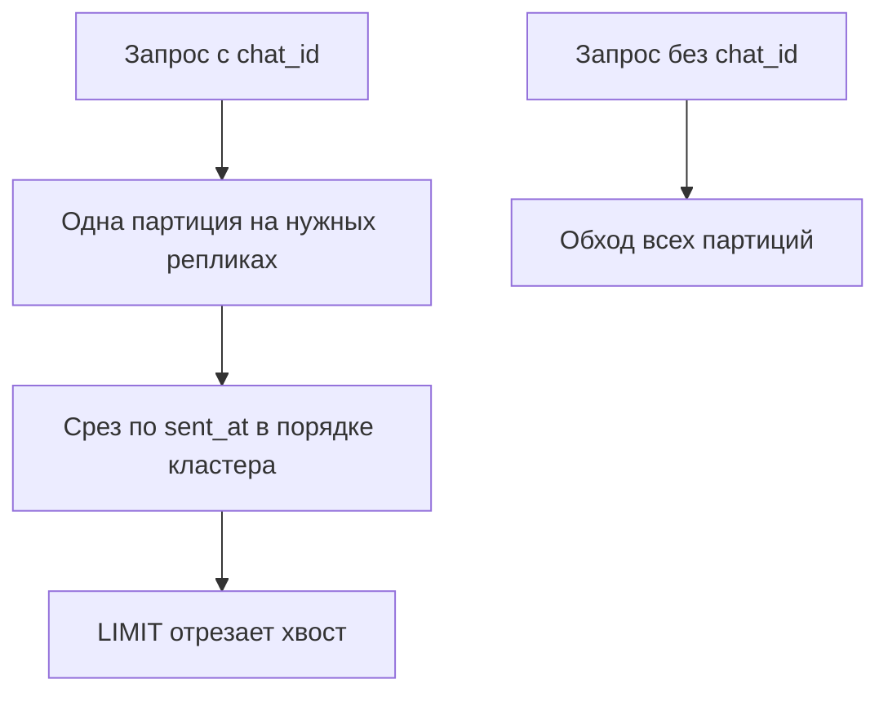

# 04. Модель данных: ключ партиции, кластерные колонки и широкие партиции

**Зачем это знать backend-разработчику.** В Cassandra схема — это план запроса, а не «таблицы, которые потом свяжем». Неверный ключ нельзя починить индексом на проде за пять минут. Широкая партиция (wide partition) не падает в день запуска: она копится месяцами и однажды делает `SELECT` по одному пользователю дороже, чем обход соседних.

> **Коротко:** первичный ключ (primary key) состоит из ключа партиции (partition key) и необязательных кластерных колонок (clustering columns). Партиция (partition) — единица хранения на узле; кластерные колонки задают порядок строк внутри неё. `WHERE` без полного ключа партиции не использует порядок кластера. Миллионы строк в одной партиции — ошибка модели, даже если запрос «по первичному ключу».

## Оглавление

- [Первичный ключ](#первичный-ключ)
- [Порядок внутри партиции](#порядок-внутри-партиции)
- [Что можно указать в WHERE](#что-можно-указать-в-where)
- [PER PARTITION LIMIT](#per-partition-limit)
- [Широкая партиция](#широкая-партиция)
- [Арифметика размера партиции](#арифметика-размера-партиции)
- [Бакет](#бакет)
- [Статические колонки](#статические-колонки)
- [UDT, кортежи и коллекции](#udt-кортежи-и-коллекции)
- [Практика в репозитории](#практика-в-репозитории)
- [Типичные ошибки и заблуждения](#типичные-ошибки-и-заблуждения)
- [Итоги](#итоги)
- [Вопросы для самопроверки](#вопросы-для-самопроверки)
- [Источники](#источники)

## Первичный ключ

**На пальцах** (аналогия). Адрес полки — это город и улица; в терминах Cassandra это ключ партиции (partition key). Порядковый номер папки на полке — кластерные колонки (clustering columns). Без города курьер не выедет, даже если вы помните номер папки.

В CQL первичный ключ пишут так:

```sql
PRIMARY KEY ((chat_id), sent_at, message_id)
```

Скобки вокруг `chat_id` означают: это весь ключ партиции. Если скобок нет и колонок несколько, первая колонка — ключ партиции, остальные — кластерные. Составной ключ партиции тоже бывает: `((sensor_id, bucket), recorded_at)`. Оба поля нужны, чтобы попасть в партицию. Одно `sensor_id` без бакета — уже другой запрос, под него нужна другая таблица.

Строка логически идентифицируется полным первичным ключом. Две записи с одним `chat_id` и разным `sent_at` — две строки одной партиции, а не две партиции.

Границу ключа драйвер отдаёт метаданными — в тесте видно, что миграция не переставила колонки.

```java
TableMetadata table = session.getMetadata()
        .getKeyspace("guide").orElseThrow()
        .getTable("sensor_readings").orElseThrow();
System.out.println(table.getPartitionKey().stream()
        .map(c -> c.getName().asCql(true)).toList());        // [sensor_id, bucket]
table.getClusteringColumns()
        .forEach((col, order) -> System.out.println(col.getName() + " " + order));
// recorded_at ASC
```

`getPartitionKey()` возвращает `List<ColumnMetadata>` в том порядке, в каком колонки стоят в скобках: порядок важен, токен считается от конкатенации значений именно в нём. `getClusteringColumns()` даёт `Map<ColumnMetadata, ClusteringOrder>` — колонку и направление сортировки. Для задания 03 это `(sensor_id, bucket)` и `recorded_at ASC`, как в `SensorReadings.ensureSchema()`.

В Spring Data Cassandra составной ключ описывают отдельным классом с `@PrimaryKeyClass`. Так сделано в решении задания 08:

```java
@PrimaryKeyClass
public class AuditEventKey implements Serializable {
    @PrimaryKeyColumn(name = "user_id", type = PrimaryKeyType.PARTITIONED, ordinal = 0)
    private String userId;

    @PrimaryKeyColumn(name = "occurred_at", type = PrimaryKeyType.CLUSTERED,
                      ordinal = 1, ordering = Ordering.DESCENDING)
    private Instant occurredAt;
    // конструкторы, геттеры, equals/hashCode
}
```

`ordinal` задаёт позицию внутри своей группы, `type` — партиция это или кластер, `ordering` — направление. Атрибут `name` обязателен, когда имя колонки не совпадает с именем поля: Spring Data берёт имя свойства как есть и `snake_case` сам не включает, так что без `name = "user_id"` колонка звалась бы `userid`. Класс ключа обязан быть `Serializable` и иметь честные `equals`/`hashCode`.

## Порядок внутри партиции

**На пальцах** (аналогия). Листы в папке подшиты по дате, сверху самый свежий. Читать можно сверху вниз или снизу вверх, но нельзя попросить «а теперь по фамилии автора»: для этого нужна вторая папка, подшитая иначе.

Кластерный порядок задают при создании таблицы:

```sql
WITH CLUSTERING ORDER BY (sent_at DESC, message_id DESC)
```

Хранение уже отсортировано. `ORDER BY` в запросе может только повторить этот порядок или его полный разворот, и только если указан ключ партиции. Произвольная сортировка по `author_id` внутри чата невозможна: колонки автора нет среди кластерных, а если бы и была, но не первой, по ней нельзя прыгнуть, пропустив `sent_at`.

Поэтому лента «сначала новые» — это `DESC` в схеме, как в задании 01, а не `Collections.sort` после чтения: разворот в Java прячет ошибку, пока в партиции десять сообщений.

```sql
SELECT sent_at, message_id, author_id, body
FROM guide.messages_by_chat
WHERE chat_id = ?
LIMIT ?
```

`LIMIT` обрезает уже упорядоченный поток. База не сортирует «все сообщения мира».

## Что можно указать в WHERE

**На пальцах** (аналогия). Адрес на конверте пишут сверху вниз: город, улица, дом, квартира. Почта доставит по «город + улица + дом», но не по «квартира 7» без всего остального. То же правило здесь: левая часть адреса обязана быть указана целиком, прежде чем уточнять правее.

Правила, которые ломают привычку к SQL:

- все колонки ключа партиции обязательны (или `IN` по ним, что бьёт в несколько партиций и легко становится **разбросанным** (scatter-gather) запросом);
- кластерные колонки задают слева направо, без дырок: нельзя фильтровать по `message_id`, не указав `sent_at`, если `sent_at` левее;
- неравенство (`>`, `<`) допустимо на последней указанной кластерной колонке;
- колонка вне ключа в `WHERE` требует вторичный индекс (secondary index) или `ALLOW FILTERING`.

`ALLOW FILTERING` читает лишнее и выбрасывает. На одной узкой партиции это ещё терпимо. На «всех пользователях, у кого город = Казань» это проход по кластеру.

Пришедшему из SQL полезнее всего узнавать ошибки в лицо. Реальные ответы `cassandra:5.0` на запросы к таблицам заданий 01 и 03:

```text
cqlsh> SELECT * FROM guide.messages_by_chat WHERE author_id = 'anna' LIMIT 3;
InvalidRequest: ... message="Cannot execute this query as it might involve data
filtering and thus may have unpredictable performance. If you want to execute this
query despite the performance unpredictability, use ALLOW FILTERING"

cqlsh> SELECT * FROM guide.sensor_readings WHERE sensor_id = 'sensor-7' LIMIT 2;
InvalidRequest: ... message="Cannot execute this query as it might involve data
filtering ... use ALLOW FILTERING"

cqlsh> SELECT * FROM guide.messages_by_chat
   ...  WHERE chat_id = 'room-5' AND message_id = 0000...0000;
InvalidRequest: ... message="PRIMARY KEY column "message_id" cannot be restricted
as preceding column "sent_at" is not restricted"

cqlsh> SELECT * FROM guide.messages_by_chat WHERE chat_id='room-5' ORDER BY author_id;
InvalidRequest: ... message="Order by is currently only supported on the clustered
columns of the PRIMARY KEY, got author_id"

cqlsh> SELECT * FROM guide.messages_by_chat ORDER BY sent_at DESC LIMIT 3;
InvalidRequest: ... message="ORDER BY is only supported when the partition key is
restricted by an EQ or an IN."
```

Первая ошибка — фильтр по неключевой `author_id`: под этот запрос в задании 02 заводят вторую таблицу `guide.log_by_author`. Вторая — тот же текст, но причина коварнее: `sensor_id` входит в ключ партиции, однако ключ составной, `(sensor_id, bucket)`, и без `bucket` партиция не определена. Лечится по-разному: там нужна другая таблица, здесь — дописать `bucket`. Третья называет пропущенную колонку прямым текстом. Четвёртая и пятая объясняют, почему `ORDER BY` здесь не то же, что в SQL: сортировать можно только по кластерным колонкам и только внутри выбранной партиции.

В драйвере все они приходят как `InvalidQueryException` с кодом `2200` и падают в тестах, а не в проде через месяц. Дописывать `ALLOW FILTERING` в ответ — почти всегда неверная реакция.



## PER PARTITION LIMIT

**На пальцах** (аналогия). `LIMIT 100` — «принеси сто писем, неважно от кого». `PER PARTITION LIMIT 1` — «принеси по одному письму от каждого отправителя». Второе из первого обрезанием не получить: если один отправитель написал сто раз, он займёт всю выдачу.

`PER PARTITION LIMIT` обрезает строки **внутри каждой партиции**, и только потом общий `LIMIT` режет результат целиком. Это единственный способ сказать в CQL «по N последних из каждой партиции» одним запросом.

```text
cqlsh> SELECT chat_id, sent_at, author_id FROM guide.messages_by_chat
   ...  PER PARTITION LIMIT 2 LIMIT 6;

 chat_id | sent_at                         | author_id
---------+---------------------------------+-----------
  room-5 | 2025-09-27 19:06:43.000000+0000 |      anna
  room-5 | 2025-09-27 19:06:42.000000+0000 |      anna
  room-1 | 2025-09-27 20:13:19.000000+0000 |      anna
  room-1 | 2025-09-27 20:13:18.000000+0000 |      anna
  room-2 | 2025-09-27 19:19:59.000000+0000 |      anna
  room-2 | 2025-09-27 19:19:58.000000+0000 |      anna

(6 rows)
```

Внутри каждой партиции взяты две самые новые строки (кластерный порядок `DESC`), хотя в `room-1` их 4000. Порядок самих партиций в выдаче — по токену, а не по имени: `room-5` раньше `room-1`, потому что так легли хеши. На это полагаться нельзя.

Два предупреждения. Во-первых, запрос без ключа партиции остаётся обходом всего кластера: `PER PARTITION LIMIT` уменьшает ответ, но не работу координатора. Полезная форма — вместе с `IN` по известным ключам:

```text
cqlsh> SELECT chat_id, sent_at FROM guide.messages_by_chat
   ...  WHERE chat_id IN ('room-4','room-5') PER PARTITION LIMIT 1;

 chat_id | sent_at
---------+---------------------------------
  room-4 | 2025-09-27 19:07:09.000000+0000
  room-5 | 2025-09-27 19:06:43.000000+0000
```

Во-вторых, это не замена таблице: «последнее сообщение каждого из двадцати чатов пользователя» через `IN` — рабочий запрос, «последнее сообщение каждого чата на свете» — нет.

## Широкая партиция

**На пальцах** (аналогия). Папку с делом нельзя разложить по двум шкафам в разных комнатах: она либо тут, либо там. Пока в ней сто листов, это неважно. Когда их миллион, любая операция с папкой становится событием на весь день, даже если нужен один лист сверху.

**Широкая партиция** (wide partition, в старых текстах wide row) — партиция, в которой кластерных строк накопилось столько, что её размер сам становится проблемой.

Партиция живёт целиком на реплике как единица владения и между узлами не делится. Миллион строк в кучу на каждый запрос не тащится — читается нужный срез. Страдает другое: служебные структуры, починка, уплотнение и чтение «с начала» партиции.

Практический ориентир, не магическое число из спецификации: партиции в десятки и сотни мегабайт уже рассматривают как проблему, гигабайтные — как инцидент. Симптомы: длинные паузы чтения одного ключа, тяжёлый repair, предупреждения в логах про большую партицию. Точные пороги смотрите в `nodetool tablestats` и логах вашей сборки, а не в чужой статье.

Чат без бакета за годы — классическая широкая партиция. Измерения датчика с ключом только `sensor_id` — тоже.

## Арифметика размера партиции

**На пальцах** (аналогия). Прежде чем заказывать шкаф, считают, сколько в него влезет: полок × длина полки × толщина книги. С партицией так же, только вместо книг строки, и счёт делают до `CREATE TABLE`, а не через полгода, когда шкаф лопается.

Формула: **размер ≈ строк в партиции × средний размер строки**, где строк в партиции = частота записи × горизонт бакета. Посчитаем три учебные таблицы.

| Таблица | Строк в партиции | Строка | Размер партиции |
|---|---|---|---|
| `guide.sensor_readings`, бакет — сутки, точка раз в минуту | 1440 | ≈ 28 Б | ≈ 40 КБ — хорошо |
| `guide.messages_by_chat`, чат без бакета, 50 сообщений в секунду, сутки | 4 320 000 | ≈ 200 Б | ≈ 864 МБ в сутки — инцидент |
| `guide.messages_by_chat`, тот же чат, бакет — час | 180 000 | ≈ 200 Б | ≈ 36 МБ — на верхней границе нормы |

Числа в колонке «Строка» не выдуманы: 500 точек датчика в бакете дали `Compacted partition maximum bytes: 14237` — 28 байт на точку; 4000 сообщений по 180 символов тела дали 943 127 байт — 236 байт на строку. Для прикидки округляют вверх. Второй ряд — тот же пример, что разбирают в [05](05-query-first.md#-глубже-что-дублировать-а-что-вычислять): 50 × 86400 × 200 Б ≈ 864 МБ за сутки в одной партиции. Часовой бакет делит это на 24.

Проверяют расчёт через `nodetool tablehistograms`: он показывает распределение по перцентилям, а не одно среднее. Таблица ниже — пять чатов на 4000, 800, 120, 30 и 4 сообщения.

```text
$ nodetool tablehistograms guide.messages_by_chat
Percentile      Read Latency     Write Latency          SSTables    Partition Size        Cell Count
                    (micros)          (micros)                             (bytes)
50%                   924.00             72.00              1.00             29521               258
75%                  1331.00             86.00              1.00            182785              1916
95%                  1597.00            149.00              1.00            943127              8239
Min                   373.00              9.00              1.00               771                 8
Max                  1597.00            310.00              1.00            943127              8239
```

`Partition Size` в 50-м перцентиле — 29 КБ, в 95-м — 943 КБ: разброс в тридцать раз. Поэтому среднее бесполезно — `Compacted partition mean bytes: 232645` из `tablestats` не описывает ни одну реальную партицию. Смотрят на `Max` и 95-й перцентиль: проблема придёт из хвоста. `SSTables: 1.00` — чтение открывает один файл; `Cell Count` — ячеек в партиции, то есть строк × колонок.

На предупреждения в логах полагаться нельзя: в `cassandra:5.0` сторожевые пороги по умолчанию выключены.

```text
$ grep -nE "partition_size_warn|partition_size_fail" /etc/cassandra/cassandra.yaml
2121:# partition_size_warn_threshold:
2122:# partition_size_fail_threshold:
```

Комментарий рядом говорит прямо: пороги по умолчанию `null`, то есть отключены, а проверка идёт только при записи SSTable — большая партиция, размазанная по нескольким файлам, не обнаружится вовсе. Пока порог не задан (например, `partition_size_warn_threshold: 100MiB`), узел молча растит гигабайтную партицию, и единственный источник правды — `tablestats` и `tablehistograms`.

## Бакет

**На пальцах** (аналогия). Вместо бесконечной папки «Переписка» заводят по папке на месяц. Письмо за март — одна папка; письма за год — двенадцать походов к шкафу.

**Бакет** (bucket) — искусственная часть ключа партиции, которая режет ряд по времени или по объёму. В задании 03 это календарный день UTC: `(sensor_id, bucket)`. Запрос «показания за день» попадает в одну партицию. Запрос «за год» — это 365 отдельных чтений, и это честная цена. Прятать её в одну партицию нельзя.

Бакет выбирают из оценки: строк в сутки, размер строки, самый частый запрос. Слишком мелкий плодит запросы, слишком крупный возвращает широкую партицию. Для суточных метрик день часто совпадает и с окном TWCS.

Часы бакета фиксируют. `LocalDate.ofInstant(recordedAt, ZoneOffset.UTC)` в решении задания 03 не зависит от пояса JVM. Если один сервис режет сутки по Москве, а другой по UTC, одна и та же точка попадёт в разные партиции.

## Статические колонки

**На пальцах** (аналогия). Имя клиента написано на коробке — один раз, а не на каждом листе внутри. Меняется имя — правят надпись на коробке, а не триста листов.

Статическая колонка (static column) — колонка с пометкой `STATIC`; она хранится один раз на партицию, а не в каждой кластерной строке: название чата не копируют в каждое из миллиона сообщений. Если по полю надо искать, вторую таблицу оно не заменяет — оно лишь не дублируется внутри партиции.

```sql
CREATE TABLE guide.chat_with_title (
  chat_id text,
  title text STATIC,
  sent_at timestamp,
  body text,
  PRIMARY KEY ((chat_id), sent_at)
);
```

Два следствия. Первое: статическую колонку можно записать **без кластерных колонок**, и партиция будет существовать без единой строки:

```text
cqlsh> INSERT INTO guide.chat_with_title (chat_id, title) VALUES ('room-1', 'Релиз');
cqlsh> SELECT chat_id, title, sent_at FROM guide.chat_with_title WHERE chat_id='room-1';

 chat_id | title | sent_at
---------+-------+---------
  room-1 | Релиз |    null
```

`sent_at` здесь `null` — строки нет, есть только заголовок партиции. Второе: когда строки появятся, `SELECT title` вернёт заголовок столько раз, сколько строк попало в срез. Значение одно, но приезжает с каждой строкой.

## UDT, кортежи и коллекции

**На пальцах** (аналогия). UDT — бланк с подписанными полями: «название», «размер», «превью». Кортеж — то же без подписей, по порядку: первое число широта, второе долгота, и все обязаны это помнить. Коллекция — конверт, в который докладывают листы: удобно, пока их десяток, беда, когда тысячи.

**Пользовательский тип** (user-defined type, UDT) объявляют отдельно и используют как обычный тип колонки. **Кортеж** (tuple) объявлять не надо — тип пишут прямо в колонке.

```sql
CREATE TYPE guide.attachment (name text, size_bytes int, preview text);

CREATE TABLE guide.msg_rich (
  chat_id text, sent_at timestamp, message_id uuid,
  att frozen<attachment>,
  geo tuple<double, double>,
  tags set<text>,
  PRIMARY KEY ((chat_id), sent_at, message_id)
);
```

```text
cqlsh> SELECT att, geo, tags FROM guide.msg_rich WHERE chat_id = 'room-1';

 att                                                          | geo                | tags
--------------------------------------------------------------+--------------------+--------------------
 {name: 'plan.pdf', size_bytes: 20480, preview: 'Q4 plan...'} | (55.7558, 37.6173) | {'urgent', 'work'}

cqlsh> SELECT att.name FROM guide.msg_rich WHERE chat_id = 'room-1';
 att.name
----------
 plan.pdf
```

Два наблюдения. Поле UDT читается точечной нотацией `att.name` — но само по себе это не делает поле индексируемым. А `set<text>` вернулся как `{'urgent', 'work'}`, хотя записывали `{'work','urgent'}`: множество хранится и отдаётся отсортированным, своего порядка у него нет.

В Java UDT получают из метаданных keyspace и заполняют через `newValue()`:

```java
UserDefinedType attType = session.getMetadata()
        .getKeyspace("guide").orElseThrow()
        .getUserDefinedType("attachment").orElseThrow();
UdtValue att = attType.newValue("plan.pdf", 20480, "Q4 plan...");
bound = bound.setUdtValue("att", att).setSet("tags", Set.of("work"), String.class);
// чтение
UdtValue back = row.getUdtValue("att");
String name = back.getString("name");
```

`newValue(Object...)` принимает значения в порядке объявления полей: если поля в `CREATE TYPE` переставят, код молча положит название в размер. Безопаснее `attType.newValue()` и затем `setString("name", ...)` по именам.

Ограничения. Незамороженная коллекция не может быть частью первичного ключа:

```text
cqlsh> CREATE TABLE guide.bad (k text, c set<text>, v text, PRIMARY KEY (k, c));
InvalidRequest: ... message="Invalid non-frozen collection type set<text> for
PRIMARY KEY column 'c'"
```

`frozen<set<text>>` в ключе уже допустим: замороженное значение для сервера — неделимый байтовый блок, как `blob`. Дальше размеры. Компоненты ключа партиции и кластерных колонок жёстко ограничены 65 535 байтами — так сказано в `cassandra.yaml` рядом с `column_value_size_warn_threshold`. Для обычных колонок и коллекций пороги настраиваемые и по умолчанию **выключены**: `collection_size_warn_threshold`, `items_per_collection_warn_threshold` (−1) и их `fail`-двойники. Сервер не остановит, когда `set` вырастет до десяти тысяч элементов, — он просто станет медленным.

Главная причина держать коллекции маленькими другая: незамороженная коллекция читается целиком, «последние 20 элементов списка» взять нельзя. А удаление элемента из `set` или `map` создаёт надгробие, которое содержит само значение элемента, был он там или нет. Правило: **десятки элементов — коллекция, сотни — кластерные строки**.

Ловушка `frozen`: замороженное поле заменяется только целиком — `UPDATE ... SET att = {...}` переписывает весь UDT, а отдельное поле сервер трогать не даст:

```text
cqlsh> UPDATE guide.msg_rich SET att.name = 'x' WHERE chat_id='room-1' AND ...;
InvalidRequest: ... message="Invalid operation (att.name = 'x') for frozen UDT column att"
```

Зато нет поэлементных надгробий и чтения-перед-записью. Снимок вложения, адрес, пара координат — кандидаты на `frozen`; живой список участников чата — нет.

## 🔬 Глубже: замороженные значения и коллекции

Коллекция в строке — не отдельная таблица: её элементы несут собственные метки времени, и список с постоянной вставкой в голову и удалением из хвоста становится мини-очередью со всеми болезнями из [07](07-tombstones.md). Замороженная коллекция к тому же не индексируется поэлементно так, как незамороженная, и SAI это учитывает отдельно.

`IN` по ключу партиции бьёт в несколько партиций за запрос. Десять известных чатов — приемлемо; тысяча идентификаторов — разбросанный запрос, который проще разбить на пачку подготовленных чтений. `IN` по последней кластерной колонке — фильтр внутри уже выбранной партиции: дешевле, но тоже не замена диапазону.

Пустой кластерный ключ и `NULL` в ключе не используют. Пустая строка `text` как ключ возможна и почти всегда ошибка: все «забытые» идентификаторы сольются в одну партицию.

Время в ключе хранят как `timestamp` (момент), а бакет — как `date`. Смешивать их в одном поле нельзя: бакет отвечает на вопрос «какая партиция», момент — на вопрос «какая строка внутри». Момент в ключе партиции сделает каждую точку своей партицией, и лента за день развалится на тысячи запросов. Один день в кластере лишит точки порядка внутри дня. В задании 03 оба поля на местах: `(sensor_id, bucket)` и `recorded_at`.

## Практика в репозитории

- [Задание 01](../tasks/01-chat-history.md) — одна партиция на чат, кластер `sent_at DESC`.
- [Задание 03](../tasks/03-sensor-metrics.md) — составной ключ партиции с дневным бакетом.
- [Задание 04](../tasks/04-timeline-paging.md) — та же модель ленты плюс постраничное чтение, чтобы не забирать партицию целиком.
- Как из запросов получить такой ключ — [05](05-query-first.md). Фон: [моделирование](../../docs/00-foundations/08-data-modeling.md).

## Типичные ошибки и заблуждения

1. **«Первичный ключ — это id, как в PostgreSQL.»** В Cassandra он ещё и адрес хранения и порядок на диске. Автоинкремент сюда не кладут.
2. **«Поставлю индекс на author_id и оставлю одну таблицу.»** Вторичный индекс не превращает Cassandra в СУБД с произвольными фильтрами. Для ленты автора нужна своя таблица. Индексы — в [09](09-indexes-sai.md).
3. **«LIMIT 20 после миллиона строк дешёвый, ведь вернулось 20.»** Дешевизна есть, только если эти 20 — префикс уже упорядоченной партиции. Если перед этим был `ALLOW FILTERING` по всему кластеру, база прочитала гораздо больше.
4. **«Составной ключ ((a, b), c) можно читать по a.»** Нельзя. `a` и `b` вместе выбирают партицию. Для запросов только по `a` проектируют другую таблицу.

## Итоги

- Скобки в `PRIMARY KEY` показывают границу партиции.
- Кластерный порядок — свойство таблицы, не запроса.
- Фильтры по кластеру идут слева направо.
- Партиция не делится между узлами; её раздувание — предел модели.
- Размер партиции считают до `CREATE TABLE` и сверяют по `nodetool tablehistograms`: медиана и 95-й перцентиль, а не среднее.
- Сторожевые пороги `partition_size_warn_threshold` в `cassandra:5.0` выключены по умолчанию — предупреждений в логах не будет.
- Бакет режет время ценой нескольких запросов вместо одной бездонной партиции.
- Статическая колонка живёт один раз на партицию и не является индексом.
- `PER PARTITION LIMIT` обрезает строки внутри каждой партиции до общего `LIMIT`.
- UDT и кортежи — структура внутри ячейки; коллекции читаются целиком, поэтому держатся на десятках элементов, а не на тысячах.

## Вопросы для самопроверки

1. Чем `PRIMARY KEY (chat_id, sent_at)` отличается от `PRIMARY KEY ((chat_id, sent_at))`?
   <details><summary>Ответ</summary>В первом `chat_id` — партиция, `sent_at` — кластер, внутри чата много строк. Во втором оба поля — ключ партиции, у пары `(chat_id, sent_at)` одна строка, а ленту чата целиком так не прочитать.</details>
2. Таблица с `CLUSTERING ORDER BY (sent_at DESC)`. Можно ли одним запросом получить самые старые сообщения?
   <details><summary>Ответ</summary>Да, развернув порядок: `ORDER BY sent_at ASC` при указанном ключе партиции. Нельзя отсортировать по другой колонке.</details>
3. Почему бакет дня считают в UTC, а не в зоне JVM?
   <details><summary>Ответ</summary>Иначе два сервиса в разных поясах разложат одну метку времени в разные партиции, и чтение «за этот день» будет дырявым.</details>
4. Пользователь написал 2 миллиона сообщений в один чат без бакета. Ключ в запросе есть. Почему это всё равно плохо?
   <details><summary>Ответ</summary>Партиция — один кусок владения реплики: уплотнение, починка и чтение диапазона работают с огромной единицей, даже если `LIMIT` вернул десять строк с края.</details>
5. Зачем в ключе сообщения ещё и `message_id`, если уже есть `sent_at`?
   <details><summary>Ответ</summary>Два сообщения одного чата могут получить одну и ту же метку времени. Без уникальной колонки вторая запись затрёт первую: полный первичный ключ совпадёт.</details>
6. `SELECT ... FROM guide.sensor_readings WHERE sensor_id = 'sensor-7'` возвращает ошибку про `ALLOW FILTERING`. Почему, если `sensor_id` входит в первичный ключ?
   <details><summary>Ответ</summary>Ключ партиции здесь составной — `(sensor_id, bucket)`. Без `bucket` партиция не определена, и запрос превращается в обход всех партиций. Лечится добавлением `bucket` в `WHERE`, а не послаблением.</details>
7. Нужно «по одному последнему сообщению из двадцати чатов пользователя». Один запрос или двадцать?
   <details><summary>Ответ</summary>Один: `WHERE chat_id IN (...) PER PARTITION LIMIT 1`. Ключи партиций известны, координатор сходит ровно в нужные реплики. Без `IN` тот же `PER PARTITION LIMIT` стал бы обходом всего кластера.</details>
8. Сообщение хранит список реакций. Когда `list<text>`, а когда кластерные строки?
   <details><summary>Ответ</summary>Десяток реакций — коллекция: читается вместе со строкой, одна ячейка. Тысячи — кластерные строки: коллекция читается целиком и не поддерживает срезов, а удаление элемента оставляет надгробие со значением элемента внутри.</details>
9. `tablehistograms` показывает 50 % = 29 КБ, 95 % = 943 КБ, Max = 943 КБ. Что это значит?
   <details><summary>Ответ</summary>Распределение сильно перекошено: несколько партиций в тридцать раз тяжелее медианной. Среднее по такой таблице бессмысленно. Расти проблема будет из «хвоста», и бакет надо подбирать под него, а не под медиану.</details>

## Источники

- Apache Cassandra docs 5.0: *Data modeling* и CQL `CREATE TABLE`. https://cassandra.apache.org/doc/5.0/cassandra/developing/data-modeling/index.html
- CQL 5.0: `SELECT` (`PER PARTITION LIMIT`, `ORDER BY`), `CREATE TYPE`, замороженные типы. https://cassandra.apache.org/doc/5.0/cassandra/developing/cql/dml.html
- Раздел про partition size в операционной документации Cassandra, вывод `nodetool tablestats` и `nodetool tablehistograms`.
- Guardrails в `cassandra.yaml`: `partition_size_warn_threshold`, `collection_size_warn_threshold`, `items_per_collection_warn_threshold` (значения и комментарии сняты с образа `cassandra:5.0`).
- DataStax java-driver-core 4.19.3: `TableMetadata.getPartitionKey()`, `UserDefinedType.newValue()`, `Row.getUdtValue()`.
- Фон курса: [моделирование](../../docs/00-foundations/08-data-modeling.md).

---

← [03. Уплотнение](03-compaction.md) | [оглавление](README.md) | [05. Моделирование от запроса](05-query-first.md) → | [словарь терминов](glossary.md)
