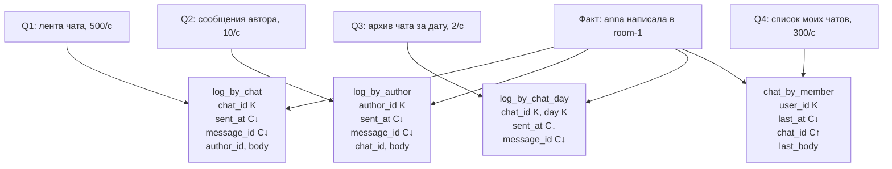

# 05. Моделирование от запроса

**Зачем это знать backend-разработчику.** Таблицу в Cassandra рисуют с конца: с экрана, который должен открыться за один запрос. Если начать с «сущности Пользователь» и внешних ключей, через месяц каждый экран потребует `ALLOW FILTERING` или фан-аут в приложении. Методология **Чеботко** (Chebotko) — моделирование от запроса (query-first modelling) — как раз формализует этот порядок, чтобы дублирование данных было решением, а не аварией.

> **Коротко:** сначала список запросов и их частота, потом таблицы «один запрос — одна таблица». Одни и те же данные лежат в нескольких таблицах с разными ключами. Приложение пишет во все копии. Дубль — осознанная **денормализация** (denormalization) и нормальная плата за предсказуемое чтение. `JOIN` нет. У метода два бумажных артефакта: таблица «запрос × частота × таблица» и диаграмма Чеботко, на которой у каждой таблицы подписаны ключ партиции и кластерные колонки.

## Оглавление

- [Почему не начинают с таблиц](#почему-не-начинают-с-таблиц)
- [Шаги Chebotko](#шаги-chebotko)
- [Артефакт первый: таблица запросов](#артефакт-первый-таблица-запросов)
- [Артефакт второй: диаграмма Чеботко](#артефакт-второй-диаграмма-чеботко)
- [Один факт, две таблицы](#один-факт-две-таблицы)
- [Сквозной пример: четыре таблицы одного чата](#сквозной-пример-четыре-таблицы-одного-чата)
- [Арифметика выбора бакета](#арифметика-выбора-бакета)
- [Java: парные INSERT через драйвер](#java-парные-insert-через-драйвер)
- [Что будет, если вторая запись не прошла](#что-будет-если-вторая-запись-не-прошла)
- [Чего не обещает дублирование](#чего-не-обещает-дублирование)
- [🔬 Глубже: что дублировать, а что вычислять](#-глубже-что-дублировать-а-что-вычислять)
- [Практика в репозитории](#практика-в-репозитории)
- [Типичные ошибки и заблуждения](#типичные-ошибки-и-заблуждения)
- [Итоги](#итоги)
- [Вопросы для самопроверки](#вопросы-для-самопроверки)
- [Источники](#источники)

## Почему не начинают с таблиц

**На пальцах** (аналогия). В реляционной базе вы ставите шкафы по типам вещей, а запрос — это маршрут кладовщика между шкафами. В Cassandra шкаф сразу сбивают под один маршрут: «всё, что нужно экрану чата, лежит в одном ящике в нужном порядке».

SQL позволяет описать данные один раз и задавать новые вопросы. Cassandra отвечает быстро, только если вопрос был известен при создании таблицы: ключ партиции (partition key) и кластерные колонки (clustering columns) уже стоят так, как пойдёт `WHERE`. Вопрос, не покрытый ключом, — это новая таблица или честное признание, что вопрос аналитический и ему здесь не место.

Вот как выглядит вопрос, под который таблицу рисовали: одна партиция, готовый порядок, никаких послаблений.

```text
cqlsh> SELECT chat_id, sent_at, author_id, body FROM guide.log_by_chat
   ...  WHERE chat_id='room-1' LIMIT 20;

 chat_id | sent_at                         | author_id | body
---------+---------------------------------+-----------+--------
  room-1 | 2026-10-13 09:00:00.000000+0000 |      anna | привет

(1 rows)
```

А вопрос «что писала anna во всех чатах» этой таблице задать нечем: `author_id` здесь обычная колонка, и сервер откажет — текст ошибки разобран в [04](04-data-model.md#что-можно-указать-в-where). Это частный случай идеи из [моделирования](../../docs/00-foundations/08-data-modeling.md): модель доступа важнее «единственной нормальной формы».

## Шаги Chebotko

**На пальцах** (аналогия). Ресторан не придумывает меню из того, что завезли. Сначала пишут меню, потом под него закупают продукты и ставят станции на кухне. Список запросов — это меню, таблицы — станции.

Методологию часто называют по фамилии её автора — Артёма Чеботко (Artem Chebotko). Практический скелет такой:

1. Выписать запросы словами, с оценкой частоты и ожидаемого размера ответа. «Лента чата, 500 раз в секунду, 20 строк», «мои сообщения, 10 раз в секунду, 20 строк», «поиск по подстроке тела, раз в день у саппорта, неизвестно сколько».
2. Свести их в **таблицу запросов** — первый артефакт метода (ниже).
3. Нарисовать **диаграмму Чеботко** (Chebotko diagram) — второй артефакт: по таблице на частый запрос, с подписанным ключом. Редкому аналитическому запросу таблицу в операционном кластере не дарят.
4. Отметить, какие поля дублируются между таблицами, и какие из них меняются после записи.
5. Проверить размер партиции на горизонте месяцев, а не на тестовых десяти строках, — арифметика в [04](04-data-model.md#арифметика-размера-партиции).
6. Решить, кто пишет дубли: приложение несколькими `INSERT` или редкий офлайн-пересчёт. Материализованное представление (materialized view) — отдельный и узкий инструмент, см. [09](09-indexes-sai.md).

Запрос саппорта «найти слово в теле всех сообщений» в этот список не входит. Его уносят в поиск, а не чинят индексом по `body`.

Результат шагов 3–6 — набор таблиц в keyspace, видимый одной командой. Четыре таблицы ниже — ровно четыре строки таблицы запросов:

```text
cqlsh:guide> DESCRIBE TABLES;

chat_by_member  log_by_author  log_by_chat  log_by_chat_day
```

## Артефакт первый: таблица запросов

**На пальцах** (аналогия). Перед ремонтом составляют смету: что делаем, сколько раз, чем платим. Без сметы «давайте ещё одну таблицу» звучит бесплатно, а в смете видно, что у неё появится цена на каждой записи.

Первый артефакт — таблица, где у каждого запроса есть частота, целевая таблица, ключ и размер ответа. Её держат рядом со схемой, а не в чьей-то голове.

| Запрос (словами) | Частота | Таблица | Ключ | Ответ |
|---|---|---|---|---|
| Лента чата, новые сверху | 500/с | `guide.log_by_chat` | `((chat_id), sent_at, message_id)` | 20 строк |
| Сообщения автора по всем чатам | 10/с | `guide.log_by_author` | `((author_id), sent_at, message_id)` | 20 строк |
| Архив чата за конкретную дату | 2/с | `guide.log_by_chat_day` | `((chat_id, day), sent_at, message_id)` | до 5000 строк |
| Список моих чатов с превью | 300/с | `guide.chat_by_member` | `((user_id), last_at, chat_id)` | 50 строк |
| Поиск слова в теле сообщений | 1/сутки | — (внешний поиск) | — | неизвестно |

Последняя строка важнее остальных: артефакт обязан содержать и то, для чего таблицы **не** будет. Иначе через квартал под этот запрос кто-нибудь включит `ALLOW FILTERING` на проде.

Самый частый запрос проверяют первым. «Список моих чатов» — 300 раз в секунду, одна партиция, порядок уже на диске:

```text
cqlsh> SELECT user_id, last_at, chat_id, last_body FROM guide.chat_by_member
   ...  WHERE user_id='anna' LIMIT 20;

 user_id | last_at                         | chat_id | last_body
---------+---------------------------------+---------+-----------
    anna | 2026-10-13 09:00:00.000000+0000 |  room-1 |    привет

(1 rows)
```

## Артефакт второй: диаграмма Чеботко

**На пальцах** (аналогия). На плане эвакуации не рисуют мебель — рисуют двери и стрелки. Диаграмма Чеботко тоже рисует не все поля, а только то, что определяет доступ: ключ партиции, кластерные колонки и их направление.

Нотация простая, она и есть весь смысл диаграммы:

| Пометка | Чтение |
|---|---|
| **K** | колонка входит в ключ партиции (partition key) |
| **C↑** | кластерная колонка, порядок по возрастанию |
| **C↓** | кластерная колонка, порядок по убыванию |
| **S** | статическая колонка (одна на партицию) |
| обычное имя | данные, в ключ не входят |
| стрелка `Q1 →` | запрос, который обслуживает эта таблица |
| стрелка между таблицами | один факт пишется в обе |



Диаграмма переводится в CQL механически: все **K** — в первые скобки `PRIMARY KEY`, все **C** — после них, направление — в `CLUSTERING ORDER BY`. Сервер потом печатает ровно то же самое:

```text
cqlsh> DESCRIBE TABLE guide.log_by_chat_day;

CREATE TABLE guide.log_by_chat_day (
    chat_id text,
    day date,
    sent_at timestamp,
    message_id uuid,
    author_id text,
    body text,
    PRIMARY KEY ((chat_id, day), sent_at, message_id)
) WITH CLUSTERING ORDER BY (sent_at DESC, message_id DESC)
```

Две **K** в скобках — составной ключ партиции: `day` здесь не фильтр, а часть адреса партиции, и запрос без него уже не точечный.

## Один факт, две таблицы

**На пальцах** (аналогия). Одно и то же письмо подшивают и в папку «переписка с клиентом», и в папку «исходящие за октябрь». Копий две, но ни одна папка не заставляет листать другую.

Сообщение «anna написала в room-1» нужно двум экранам. Ключи разные: партиция чата и партиция автора. Одной таблицей с ключом `chat_id` второй экран не обслужить.

```sql
-- лента чата
PRIMARY KEY ((chat_id), sent_at, message_id)
-- лента автора, те же поля плюс chat_id уже как обычная колонка
PRIMARY KEY ((author_id), sent_at, message_id)
```

Та же строка, прочитанная со второй стороны, — это и есть вторая копия, а не соединение:

```text
cqlsh> SELECT author_id, sent_at, chat_id, body FROM guide.log_by_author
   ...  WHERE author_id='anna' LIMIT 20;

 author_id | sent_at                         | chat_id | body
-----------+---------------------------------+---------+--------
      anna | 2026-10-13 09:00:00.000000+0000 |  room-1 | привет
```

Приложение делает два `INSERT`. Имена таблиц в задании 02 — `guide.log_by_chat` и `guide.log_by_author`, чтобы не делить схему с заданием 01. Смысл тот же, что у [QueryFirstDemo](../examples/src/main/java/dev/nosqlguide/cassandra/examples/driver/QueryFirstDemo.java).

Здесь сознательно **не** взят logged batch, хотя общая теория моделирования называет его штатным способом держать денормализованные таблицы в согласии (см. [денормализацию](../../docs/00-foundations/08-data-modeling.md#2-денормализация-выгоды-и-цена)). Оба утверждения верны, потому что говорят о разных вещах. **Logged batch** — не распределённая транзакция и не изоляция: координатор (coordinator) сначала пишет пакет в **batchlog** на двух репликах, потом рассылает мутации, а если упал на середине — после восстановления batchlog переигрывает недописанные. Это **eventual atomicity без изоляции**: пакет применится весь, рано или поздно, но читатель между его записями может увидеть одну таблицу без другой — то же окно, что и без batch, плюс лишняя мутация в batchlog.

В [решении задания 02](../solutions/src/main/java/dev/nosqlguide/cassandra/tasks/task02/MessageLog.java) взят более дешёвый путь: `post()` выполняет `insertChat` и `insertAuthor` как два отдельных `INSERT`. Партиции разные, координатор всё равно разошлёт мутации по разным репликам, а пакет добавил бы только запись в batchlog. Транзакции «либо обе ленты, либо ни одной» не даёт ни один из путей; разница — в том, что переживёт падение координатора на середине. Подробнее в [08](08-lwt-batches-counters.md).

## Сквозной пример: четыре таблицы одного чата

**На пальцах** (аналогия). У одной фотографии в фотоателье четыре отпечатка: в альбом события, в альбом автора, в архив по дате и в витрину «последние снимки». Негатив один, печать — четыре разных формата под четыре разных взгляда.

Двух таблиц для разбора мало: самое интересное начинается с третьей, когда у копий расходятся не только ключи, но и срок жизни и размер. Четыре таблицы диаграммы выше:

| Таблица | Зачем | Что в ней особенного |
|---|---|---|
| `log_by_chat` | лента чата | партиция растёт бесконечно, бакета нет — живёт на `LIMIT 20` |
| `log_by_author` | профиль автора | та же строка, другой ключ; тело дублируется целиком |
| `log_by_chat_day` | архив за дату | бакет `day` в ключе партиции; читается редко, можно держать с TTL |
| `chat_by_member` | список чатов | **не копия сообщения**, а последнее состояние: одна строка на чат |

Четвёртая таблица — та, где метод чаще всего ломают. `chat_by_member` хранит не историю, а «последнее сообщение чата», и `last_at` входит в кластерный ключ. Новое сообщение поэтому не обновляет строку, а добавляет новую с другим `last_at`, а старую надо удалить явно. Иначе список чатов покажет один чат пять раз — это не ошибка Cassandra, а неучтённый шаг 4 методики (какие поля меняются после записи).

Архивная таблица отвечает на запрос, недоступный двум первым: «что было в этом чате 13 октября». Бакет в ключе делает его точечным:

```text
cqlsh> SELECT chat_id, day, sent_at, body FROM guide.log_by_chat_day
   ...  WHERE chat_id='room-1' AND day='2026-10-13';

 chat_id | day        | sent_at                         | body
---------+------------+---------------------------------+--------
  room-1 | 2026-10-13 | 2026-10-13 09:00:00.000000+0000 | привет

(1 rows)
```

Цена четырёх таблиц честная: четыре мутации на сообщение и четыре объекта для repair. Поэтому пятую таблицу добавляют, только когда в артефакте появился пятый запрос с частотой, а не «на будущее».

## Арифметика выбора бакета

**На пальцах** (аналогия). Папку «Переписка» режут по месяцам не потому, что так красивее, а потому что считали: сколько писем в месяц и сколько папок придётся открыть на типичный вопрос. Слишком толстая папка не поднимается, слишком тонких — сто штук на один вопрос.

Размер партиции считают в [04](04-data-model.md#арифметика-размера-партиции). Здесь второй счёт, который делают от запроса: **сколько партиций прочитает экран**. У бакета два предела, и они тянут в разные стороны.

Возьмём чат на 50 сообщений в секунду и строку ≈ 200 байт.

| Бакет | Строк в партиции | Размер | Партиций на «за сутки» | Партиций на «за год» |
|---|---|---|---|---|
| нет | 4 320 000 в сутки и растёт | ≈ 864 МБ/сутки | 1 | 1 (нечитаемая) |
| сутки | 4 320 000 | ≈ 864 МБ | 1 | 365 |
| час | 180 000 | ≈ 36 МБ | 24 | 8760 |
| 10 минут | 30 000 | ≈ 6 МБ | 144 | 52 560 |

Правило выбора: смотреть **размер партиции и число партиций на самый частый запрос одновременно**. Суточный бакет даёт один поход за сутки, но 864 МБ — состоявшийся инцидент (см. [«широкую партицию»](04-data-model.md#широкая-партиция)). Десятиминутный даёт здоровые 6 МБ, но экран «день целиком» превращается в 144 чтения — фан-аут в приложении. Часовой — компромисс: 36 МБ и 24 чтения.

Запрос по нескольким бакетам пишут через `IN` по бакету (не по ключу вообще) — координатор превратит его в несколько точечных чтений:

```text
cqlsh> SELECT chat_id, day, sent_at FROM guide.log_by_chat_day
   ...  WHERE chat_id='room-1' AND day IN ('2026-10-12','2026-10-13');

 chat_id | day        | sent_at
---------+------------+---------------------------------
  room-1 | 2026-10-13 | 2026-10-13 09:00:00.000000+0000

(1 rows)
```

Пустой бакет (12 октября) ответа не добавил и ошибки не вызвал: читать «дырявый» диапазон бакетов безопасно. Но `IN` на 365 бакетов — это 365 запросов, которые координатор делает за клиента; такой горизонт честнее собирать постранично в приложении или не обслуживать операционным контуром вовсе.

## Java: парные INSERT через драйвер

**На пальцах** (аналогия). Курьер с двумя конвертами в разные районы не ждёт, пока первый адресат подпишется, чтобы поехать по второму адресу. Но и «один конверт вместо двух» не вариант: адреса разные.

В драйвере DataStax 4.19.3 парные вставки — это два подготовленных запроса (prepared statement) и два `execute`. Ровно так устроен `post()` в [MessageLog](../solutions/src/main/java/dev/nosqlguide/cassandra/tasks/task02/MessageLog.java):

```java
insertChat = session.prepare("""
        INSERT INTO guide.log_by_chat (chat_id, sent_at, message_id, author_id, body)
        VALUES (?, ?, ?, ?, ?)
        """);
insertAuthor = session.prepare("""
        INSERT INTO guide.log_by_author (author_id, sent_at, message_id, chat_id, body)
        VALUES (?, ?, ?, ?, ?)
        """);

public void post(String chatId, Instant sentAt, UUID messageId, String authorId, String body) {
    session.execute(insertChat.bind(chatId, sentAt, messageId, authorId, body));
    session.execute(insertAuthor.bind(authorId, sentAt, messageId, chatId, body));
}
```

Три детали, которые видно только в коде. Первая: порядок параметров в `bind` свой у каждой таблицы — в `log_by_chat` первым идёт `chat_id`, в `log_by_author` первым `author_id`, потому что это ключи партиции своих таблиц. Вторая: `messageId` приходит аргументом, а не из `uuid()` внутри CQL, — на этом держится идемпотентность повтора. Третья: `prepare` вызывают один раз в `ensureSchema()`, а не на каждое сообщение, см. [10](10-java-driver.md#подготовленные-запросы).

Третью и четвёртую таблицы дописывают теми же `execute`. Четыре последовательных `execute` — это четыре сетевых обхода на одно сообщение; тогда берут `executeAsync` и ждут все четыре вместе, а не по очереди.

## Что будет, если вторая запись не прошла

**На пальцах** (аналогия). Письмо подшили в одну папку, и в этот момент выключили свет. Во второй папке его нет. Правильный выход — подшить то же письмо тем же номером ещё раз, а не выписать второе письмо.

Первый `INSERT` успел, второй нет: чат показывает сообщение, лента автора — нет. Для переписки это обычно приемлемее, чем блокировать отправку двухфазным коммитом. Чинят так:

- повторная отправка идемпотентна, если первичный ключ тот же (`message_id` задаёт клиент, а не `uuid()` на каждой попытке);
- фоновый сверяльщик дописывает дыры, если бизнес требует полноты;
- пользовательский «отправить ещё раз» не плодит вторую строку.

Проверяется это на любом кластере в две команды: тот же `INSERT` с теми же `sent_at` и `message_id` выполняется повторно — и строка остаётся одна.

```text
cqlsh> INSERT INTO guide.log_by_chat (chat_id, sent_at, message_id, author_id, body)
   ...  VALUES ('room-1','2026-10-13 09:00:00+0000',
   ...          11111111-1111-1111-1111-111111111111,'anna','привет');
cqlsh> SELECT count(*) FROM guide.log_by_chat WHERE chat_id='room-1';

 count
-------
     1
```

`uuid()` внутри `INSERT` на каждой попытке ломает идемпотентность: повтор создаст новую строку. В заданиях идентификатор приходит снаружи, и для повтора его держат в «черновике отправки», а не создают заново в обработчике кнопки.

## Чего не обещает дублирование

**На пальцах** (аналогия). Две фотокопии одного документа сделаны в разные минуты. Через год по штампам видно, что они не идентичны, хотя текст тот же. Никакой «общей минуты» у двух копий не было.

Копии расходятся на короткое время. Читать «как в сериализуемой транзакции сразу после записи в обе таблицы» нельзя без дополнительного протокола. `QUORUM` на каждом `INSERT` уменьшает шанс потерять копию при падении реплики, но не связывает таблицы в транзакцию — см. [06](06-consistency-repair.md#уровни).

Расхождение видно даже на одном узле: у двух копий одного сообщения две разные **метки времени** (timestamp), каждая со своего `execute`.

```text
cqlsh> SELECT writetime(body) FROM guide.log_by_chat WHERE chat_id='room-1';
 1791876058163335
cqlsh> SELECT writetime(body) FROM guide.log_by_author WHERE author_id='anna';
 1791875836851809
```

Разница здесь 221 секунда просто потому, что вставки делались разными командами; в приложении это были бы миллисекунды. Важно другое: единой метки у «одного факта» нет. Если она нужна (сверяльщик сравнивает копии по метке, а не по телу), её ставят явно — `setQueryTimestamp(long)` в драйвере или `USING TIMESTAMP` в CQL, одинаковое значение на все вставки факта.

Не дублируют то, что часто меняется большим блоком и читается редко: проще пересчитать, чем ловить десять таблиц на каждое переименование. Каждая копия — ещё один объект удаления и починки (repair).

## 🔬 Глубже: что дублировать, а что вычислять

Не каждый экран заслуживает таблицу. Экран «число непрочитанных» можно держать счётчиком отдельно от ленты, а не копией всех непрочитанных тел. Экран «последние 20 сообщений» не требует копии всей истории: у таблицы ленты и так `LIMIT 20`, если порядок кластера совпал. Отдельная таблица нужна, когда другой ключ, другой порядок или другой срок жизни.

Поле, которое меняется редко и читается с каждым сообщением (ник автора на момент отправки), часто денормализуют (denormalization) в строку сообщения. Тогда лента не ходит во вторую таблицу профилей. Цена — старый ник в старых сообщениях. Если продукт показывает всегда текущий ник, денормализация врёт, и остаётся второй запрос по списку авторов. Это решение продукта, не техническая мелочь.

Оценку размера партиции — не станет ли она широкой (wide partition) — делают на бумаге до `CREATE TABLE`: 50 сообщений в секунду, 200 байт строка, бакет (bucket) сутки — это 50 × 86400 × 200 байт ≈ 864 МБ в одной партиции за сутки, то есть состоявшийся инцидент, а не «на грани». Арифметика выше в этом файле и в [04](04-data-model.md#арифметика-размера-партиции); методика без неё превращается в набор таблиц, которые через квартал всё равно широкие.

Редкие отчёты не тащат в те же таблицы «чтобы данные уже лежали». Выгрузка в аналитическое хранилище (пачками по времени, не `SELECT` без ключа) честнее, чем SAI на каждое поле отчёта.

Имена таблиц полезно брать от запроса, а не от сущности: `log_by_chat`, а не `message`. Через полгода по имени видно, какой экран кормит таблица и какой ключ в ней честный. Общие слова `data` и `events` прячут то, что в одной таблице уже смешали два доступа.

Когда запросов становится больше, чем команда готова сопровождать дублями, это сигнал сузить продукт, а не включить `ALLOW FILTERING`. Пять лент с ясными ключами дешевле, чем одна «универсальная» таблица и ночные инциденты. В учебном задании 02 сознательно всего два запроса: на них видно шов, не утонув в схеме.

Поле, которое не читает ни один экран, в дубль не копируют: лишняя копия только удорожает починку и диск. Тело вложения на мегабайт в ленте автора, если экран показывает первые восемьдесят символов, раздувает repair без пользы. В копию кладут превью и идентификатор, по которому полную версию можно достать отдельным точечным чтением, если пользователь открыл сообщение.

## Практика в репозитории

- [Задание 02](../tasks/02-messages-by-user.md) — две таблицы и два чтения одного факта.
- [QueryFirstDemo](../examples/src/main/java/dev/nosqlguide/cassandra/examples/driver/QueryFirstDemo.java) печатает `by chat:` и `by author:`.
- Границы ключа, без которых метод не на чем рисовать, — [04](04-data-model.md).
- Фон: [моделирование](../../docs/00-foundations/08-data-modeling.md).

## Типичные ошибки и заблуждения

1. **«Дубли — это плохо, как в третьей нормальной форме.»** В Cassandra дубль под известный запрос — цель. Плохо дублировать без запроса и без оценки размера.
2. **«Сначала одна таблица, индексы добавим, когда продукт скажет новые фильтры.»** Операционные фильтры добавляют таблицей и записью в неё. Индекс не замена ключу.
3. **«Batch сделает две ленты атомарными.»** Logged batch даёт eventual atomicity пакета (обе записи в итоге применятся, restart переигрывает их через batchlog), но не изоляцию и не транзакцию в SQL-смысле: между записями пакета читатель может увидеть одну ленту без другой. Он не бесплатен — лишняя запись в batchlog — и не обязателен: задание 02 обходится двумя `INSERT`.
4. **«Сгенерирую id на сервере при каждой попытке.»** Повтор запроса создаст второй факт. Ключ должен быть стабилен между попытками.
5. **«Диаграмма — это красивая картинка для презентации.»** Это единственное место, где видно, что два запроса пытаются жить на одном ключе. Без неё расхождение находят на проде.
6. **«Бакет поменьше — всегда безопаснее.»** Мелкий бакет режет партицию и тут же умножает число чтений на экран. Считают оба предела, а не один.

## Итоги

- Список запросов с частотой предшествует `CREATE TABLE`; у метода два артефакта — таблица запросов и диаграмма Чеботко.
- Нотация диаграммы: **K** — ключ партиции, **C↑**/**C↓** — кластерные колонки с направлением, **S** — статическая колонка.
- Частый запрос получает свою таблицу с подходящим ключом; редкий и тяжёлый поиск не тащат в операционные таблицы.
- Приложение пишет все копии; идентификатор стабилен между повторами, единой метки времени у копий нет.
- Бакет выбирают по двум числам сразу: размер партиции и число партиций на самый частый запрос.
- Logged batch между партициями даёт eventual atomicity ценой batchlog, а не SQL-транзакцию; задание 02 обходится без него.
- Дубль ограничен тем, что реально показывает экран.

## Вопросы для самопроверки

1. Экран «сообщения пользователя» тормозит. Таблица одна, ключ `chat_id`. Куда смотреть сначала?
   <details><summary>Ответ</summary>На модель: такого запроса ключ не обслуживает. Нужна таблица с партицией `author_id`, а не `ALLOW FILTERING` по всей базе.</details>
2. Почему в учебной записи два отдельных `INSERT`, а не logged batch?
   <details><summary>Ответ</summary>Партиции разные, и координатор всё равно разошлёт мутации по разным репликам. Batch дал бы только eventual atomicity — обе записи в итоге применятся через batchlog — ценой лишней записи на координаторе, а изоляции всё равно не было бы.</details>
3. Вторая вставка упала по таймауту. Что видит автор в своей ленте и как не получить дубль при повторе?
   <details><summary>Ответ</summary>Лента автора может не содержать сообщение, хотя чат уже содержит. Повтор с тем же `message_id` и тем же `sent_at` перезапишет ту же строку: `SELECT count(*)` так и остаётся 1.</details>
4. Что означают пометки `K`, `C↓` и `S` на диаграмме Чеботко?
   <details><summary>Ответ</summary>`K` — колонка входит в ключ партиции, `C↓` — кластерная колонка с порядком по убыванию, `S` — статическая колонка, одна на партицию. Всё остальное — данные, доступ к которым они определяют.</details>
5. Чат пишет 50 сообщений в секунду. Почему суточный бакет плох, а десятиминутный — тоже?
   <details><summary>Ответ</summary>Суточный даёт ≈ 864 МБ в партиции — инцидент. Десятиминутный даёт 6 МБ, но экран «за сутки» превращается в 144 чтения. Часовой — 36 МБ и 24 чтения, разумный компромисс.</details>
6. `chat_by_member` показывает один чат пятью строками. Что нарушено в методике?
   <details><summary>Ответ</summary>Шаг «какие поля меняются после записи». `last_at` входит в кластерный ключ, поэтому новое сообщение добавляет строку, а не заменяет её; старую надо удалять явно.</details>
7. Что выписать на шаге 1, кроме текста запроса?
   <details><summary>Ответ</summary>Частоту и ожидаемый размер результата. От этого зависят бакет, `LIMIT` и то, стоит ли вообще заводить таблицу.</details>

## Источники

- Apache Cassandra docs 5.0: *Data modeling methodology*. https://cassandra.apache.org/doc/5.0/cassandra/developing/data-modeling/data-modeling-methodology.html
- Apache Cassandra docs 5.0: *Logical data modeling* (нотация диаграмм: K, C↑, C↓, S). https://cassandra.apache.org/doc/5.0/cassandra/developing/data-modeling/data-modeling-logical.html
- Chebotko A., Kashlev A., Lu S. *A Big Data Modeling Methodology for Apache Cassandra* (обзорные материалы по query-first; исходная методичка 2015 года).
- DataStax Java Driver 4.19: `PreparedStatement`, `Statement.setQueryTimestamp`. https://docs.datastax.com/en/developer/java-driver/4.19/
- Вывод CQL в тексте снят с пробного контейнера `cassandra:5.0` (5.0.9).
- Фон курса: [моделирование](../../docs/00-foundations/08-data-modeling.md).

---

← [04. Модель данных](04-data-model.md) | [оглавление](README.md) | [06. Согласованность и починка](06-consistency-repair.md) → | [словарь терминов](glossary.md)
