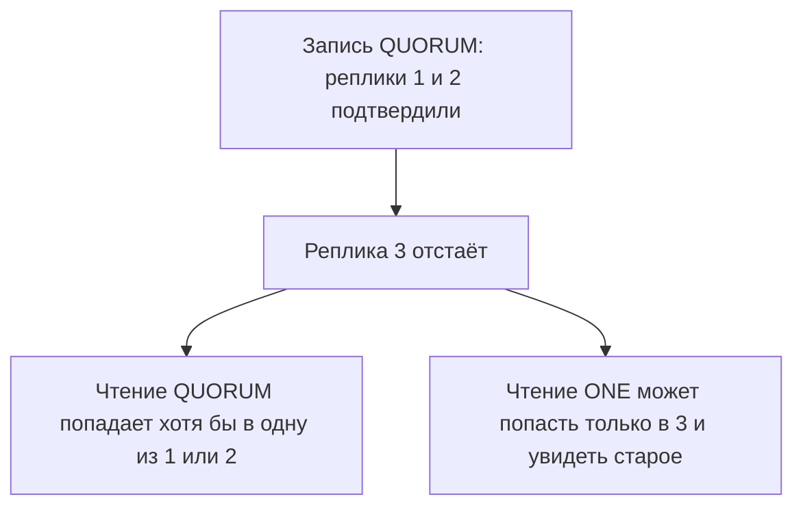

# 06. Согласованность и починка

**Зачем это знать backend-разработчику.** У Cassandra нет одного уровня «как у транзакции». Каждая запись и каждое чтение называют, скольких реплик ждать. Ошибка в этой цифре либо тормозит сервис ожиданием мёртвой ноды, либо молча отдаёт старую строку. Починка — отдельная работа: кластер сам не гарантирует, что непрочитанные реплики когда-нибудь сойдутся.

> **Коротко:** пересечение кворумов чтения и записи даёт правило R + W > RF: кворум записи и кворум чтения при факторе репликации (replication factor, RF) 3 — это 2 и 2. `ALL` не переживает потерю одной реплики. Hinted handoff догоняет короткий простой. Read repair чинит то, что прочитали, и настраивается свойством таблицы `read_repair`. Расхождения, к которым никто не обращался, закрывает `nodetool repair`, и его надо успеть до истечения `gc_grace_seconds`. Поверх всего этого висят часы: мутация с большей меткой времени побеждает, даже если она пришла из будущего по ошибке NTP.

## Оглавление

- [Уровни](#уровни)
- [Формула пересечения](#формула-пересечения)
- [Java: уровень и serial-уровень на запросе](#java-уровень-и-serial-уровень-на-запросе)
- [Hinted handoff](#hinted-handoff)
- [Read repair](#read-repair)
- [Опции таблицы: speculative_retry и additional_write_policy](#опции-таблицы-speculative_retry-и-additional_write_policy)
- [Anti-entropy repair](#anti-entropy-repair)
- [Таймаут записи против отказа записи](#таймаут-записи-против-отказа-записи)
- [Часы и метки времени](#часы-и-метки-времени)
- [Один дата-центр и LOCAL_QUORUM](#один-дата-центр-и-local_quorum)
- [🔬 Глубже: спекулятивные повторы и идемпотентность](#-глубже-спекулятивные-повторы-и-идемпотентность)
- [Практика в репозитории](#практика-в-репозитории)
- [Типичные ошибки и заблуждения](#типичные-ошибки-и-заблуждения)
- [Итоги](#итоги)
- [Вопросы для самопроверки](#вопросы-для-самопроверки)
- [Источники](#источники)

## Уровни

**На пальцах** (аналогия). Вы просите не «правду», а «ответь, когда откликнутся хотя бы двое из трёх хранителей». Третий может молчать. «Скольких ждать» — это и есть **уровень согласованности** (consistency level).

| Уровень | Сколько реплик ждать | Где применим |
|---|---|---|
| `ANY` | ни одной живой: сойдёт сохранённая подсказка (hint) | только запись |
| `ONE` / `LOCAL_ONE` | одну (во втором случае — в своём дата-центре) | чтение и запись |
| `TWO` / `THREE` | ровно две / ровно три, независимо от RF | чтение и запись |
| `QUORUM` | большинство реплик по всему кольцу (ring), `floor(RF / 2) + 1` | чтение и запись |
| `LOCAL_QUORUM` | большинство внутри локального дата-центра | чтение и запись |
| `EACH_QUORUM` | кворум в каждом дата-центре | только запись |
| `ALL` | все реплики, которые должны хранить партицию | чтение и запись |
| `SERIAL` / `LOCAL_SERIAL` | раунды Paxos, см. [08](08-lwt-batches-counters.md#условная-запись) | serial-уровень условной записи; на обычном `SELECT` — чтение, видящее незавершённое голосование |

Для RF = 3 **кворум** (quorum) — это 2. Запись `QUORUM` ждёт две реплики, чтение `QUORUM` тоже две. `ALL` ждёт три: одна остановленная нода превращает операцию в ошибку, хотя две копии живы.

`TWO` и `THREE` — абсолютные числа, а не доли RF. Их берут редко и осознанно: например, `TWO` при RF = 5 («мне достаточно двух, кворум из трёх дорог»). Опасность в том, что при RF = 3 `THREE` молча равен `ALL`, а при RF = 2 `TWO` тоже равен `ALL` — и доступность падает там, где её не ждали.

Уровень задают на запрос. В cqlsh это команда `CONSISTENCY`, которая печатает и текущее значение:

```text
cqlsh> CONSISTENCY;
Current consistency level is ONE.
cqlsh> CONSISTENCY QUORUM;
Consistency level set to QUORUM.
cqlsh> SELECT author_id, sent_at, chat_id FROM guide.log_by_author WHERE author_id='anna';

 author_id | sent_at                         | chat_id
-----------+---------------------------------+---------
      anna | 2026-10-13 09:00:00.000000+0000 |  room-1

(1 rows)
```

По умолчанию у сессии cqlsh уровень `ONE`; у драйвера для обычных запросов — `LOCAL_ONE`. На однонодовом кластере с RF = 1 `QUORUM` сходится к единственной копии, поэтому задания 01–06 разницу не показывают. Зато `TWO` и `THREE` сразу говорят правду — сервер считает живые реплики, а не узлы:

```text
cqlsh> CONSISTENCY TWO;
Consistency level set to TWO.
cqlsh> SELECT author_id FROM guide.log_by_author WHERE author_id='anna';
Unavailable: Error from server: code=1000 [Unavailable exception]
message="Cannot achieve consistency level TWO"
info={'consistency': 'TWO', 'required_replicas': 2, 'alive_replicas': 1}
```

`required_replicas` и `alive_replicas` в сообщении — то, что нужно для разбора инцидента: не «база упала», а «запрошен уровень, которого в этой топологии нет». С `THREE` то же сообщение и `required_replicas: 3`. А `ANY` на чтении сервер отвергает по смыслу:

```text
cqlsh> CONSISTENCY ANY;
cqlsh> SELECT author_id FROM guide.log_by_author WHERE author_id='anna';
InvalidRequest: Error from server: code=2200 [Invalid query]
message="ANY ConsistencyLevel is only supported for writes"
```

Запись с `ANY` в том же сеансе проходит молча: читать «ничего» нельзя, а записать «в конверт на потом» можно.

## Формула пересечения

**На пальцах** (аналогия). Два человека по отдельности опрашивают один и тот же совет из трёх старейшин. Если каждый поговорил хотя бы с двумя, у них гарантированно есть общий собеседник — через него новость и передастся. Если каждый поговорил с одним, они могли опросить разных людей и разойтись в показаниях.

Если числа реплик на чтении R и на записи W удовлетворяют условию **R + W > RF**, множества пересекаются: среди прочитанных есть хотя бы одна реплика, которая видела последнюю запись.

| RF | Пара (W, R) | R + W > RF | Что переживает |
|---|---|---|---|
| 3 | (2, 2) — `QUORUM`/`QUORUM` | 4 > 3 ✓ | потерю одной реплики на обеих сторонах |
| 3 | (3, 1) — `ALL`/`ONE` | 4 > 3 ✓ | быстрое чтение, но запись падает от одной мёртвой ноды |
| 3 | (1, 1) — `ONE`/`ONE` | 2 > 3 ✗ | ничего: можно прочитать реплику без записи |
| 5 | (3, 3) — `QUORUM`/`QUORUM` | 6 > 5 ✓ | потерю двух реплик |
| 5 | (2, 2) — `TWO`/`TWO` | 4 > 5 ✗ | ничего, хотя «две» звучит как кворум |

В [основах репликации](../../docs/00-foundations/04-replication.md) то же правило записано как **R + W > N** — Cassandra просто называет N фактором репликации.

Это про перекрывающиеся множества копий, не про блокировки. Две параллельные записи с кворумом всё равно разрешаются меткой времени (timestamp), а не «кто первый взял замок».



## Java: уровень и serial-уровень на запросе

**На пальцах** (аналогия). У посылки две галочки на бланке: «сколько получателей обязаны подписаться» и отдельно «нужно ли нотариально заверить очередь отправлений». Это разные галочки, и ставят их независимо.

В драйвере DataStax 4.19.3 уровень живёт на объекте запроса, а не на сессии и не на таблице. `Statement.setConsistencyLevel(ConsistencyLevel)` задаёт обычный уровень, `setSerialConsistencyLevel(ConsistencyLevel)` — только раунд Paxos у условной записи. Константы — в перечислении `DefaultConsistencyLevel` (`ANY`, `ONE`, `TWO`, `THREE`, `QUORUM`, `ALL`, `LOCAL_ONE`, `LOCAL_QUORUM`, `EACH_QUORUM`, `SERIAL`, `LOCAL_SERIAL`).

```java
// пара W = 2 и R = 2 при RF = 3: R + W = 4 > 3
session.execute(insert.bind(chatId, authorId, body)
        .setConsistencyLevel(DefaultConsistencyLevel.QUORUM));
session.execute(select.bind(chatId)
        .setConsistencyLevel(DefaultConsistencyLevel.QUORUM));

// условная запись: обычный уровень и serial-уровень ставят отдельно
BoundStatement claim = insertIfNotExists.bind(username, userId)
        .setConsistencyLevel(DefaultConsistencyLevel.LOCAL_QUORUM)        // коммит и чтение
        .setSerialConsistencyLevel(DefaultConsistencyLevel.LOCAL_SERIAL); // сам раунд Paxos
boolean claimed = session.execute(claim).wasApplied();
```

Уровень не хранится в таблице, поэтому один и тот же подготовленный запрос уходит с любым — так и сделано в [решении задания 07](../solutions/src/main/java/dev/nosqlguide/cassandra/tasks/task07/ReplicaProbe.java), где `put` и `get` принимают `ConsistencyLevel` аргументом.

## Hinted handoff

**На пальцах** (аналогия). Курьер не дозвонился в квартиру и оставил извещение у себя: «отдам, когда откроют». Пока жилец в отпуске три часа — сработает. Уехал на неделю — извещение выбросят, и посылку придётся заказывать заново.

Если координатор (coordinator) не достучался до реплики, он сохраняет **подсказку** — **hint**: «когда узел X очнётся, передай ему эту мутацию». Механизм целиком называется hinted handoff. Его настройки на образе `cassandra:5.0`:

```text
$ grep -nE "hinted_handoff_enabled|max_hint_window|hinted_handoff_throttle|max_hints_delivery_threads" \
    /etc/cassandra/cassandra.yaml
68:hinted_handoff_enabled: true
80:max_hint_window: 3h
88:hinted_handoff_throttle: 1024KiB
93:max_hints_delivery_threads: 2

$ nodetool statushandoff
Hinted handoff is running
$ nodetool disablehandoff && nodetool statushandoff
Hinted handoff is not running
```

`max_hint_window: 3h` — вот откуда «ориентир три часа». Узел, пролежавший дольше, hint уже не догонит. Тонкость 4.0+: при `hint_window_persistent_enabled: true` (умолчание) окно считают не по «сколько узел лежит», а по «нет ли сохранённого hint старше окна» — иначе у вечно перезапускающегося узла хинты копились бы бесконечно. Доставку ограничивает `hinted_handoff_throttle` (1 МиБ/с на узел), так что вернувшаяся реплика догоняет не мгновенно.

Hint не считается подтверждением ни для одного уровня, **кроме `ANY`**: `QUORUM` нельзя набрать «двумя живыми и одним конвертом на потом».

Важно, где hint лежит: **на координаторе**, а не в кластере, и при этом на диске, а не только в памяти. Из того же конфига:

```text
$ grep -nE "^(hints_flush_period|max_hints_file_size)" /etc/cassandra/cassandra.yaml
102:hints_flush_period: 10000ms
106:max_hints_file_size: 128MiB
```

Буфер сбрасывается в файлы каждые 10 секунд (в каталог `hints_directory`, по умолчанию `$CASSANDRA_HOME/data/hints`), поэтому перезапуск координатора хинты не убивает: поднявшись, он доиграет их из файлов. Опасность другая — хинты привязаны к **одному** узлу. Если координатор потерян безвозвратно (сгорел диск, узел вывели из кластера и заменили), сохранённые на нём хинты уходят вместе с ним, и расхождение закроет только repair. Сброс в файлы к тому же не делает fsync, поэтому при жёстком падении теряются последние секунды хинтов. Поэтому hint — смягчение короткого сбоя связи, а не замена repair.

## Read repair

**На пальцах** (аналогия). Два бухгалтера сверяют одну цифру. Расхождение заметили — и тут же правят ту книгу, которая отстала, не дожидаясь годовой ревизии. Книги, которые в этот раз не открывали, остаются неисправленными.

Когда координатор видит разные дайджесты, он дочитывает полные строки и отправляет победившую версию отстающим. Это **блокирующий read repair** конкретного чтения. Старый шанс случайно чинить при каждом чтении, `read_repair_chance`, с Cassandra 4.0 не настраивают вообще — свойство убрали:

```text
cqlsh> ALTER TABLE guide.log_by_author WITH read_repair_chance = 0.1;
SyntaxException: Unknown property 'read_repair_chance'
```

Вместо него у таблицы есть свойство `read_repair` с ровно двумя значениями. Третьего сервер не знает, и говорит это буквально — список допустимых значений вытаскивается из ошибки, а не из догадок:

```text
cqlsh> ALTER TABLE guide.log_by_author WITH read_repair = 'ASYNC';
Server error: java.lang.IllegalArgumentException: No enum constant
org.apache.cassandra.service.reads.repair.ReadRepairStrategy.ASYNC
```

`BLOCKING` (по умолчанию) — дочитать разошедшиеся реплики и дождаться их до ответа клиенту. `NONE` — не чинить на этом чтении вовсе; берут для таблиц, где важна только задержка, а сходимость целиком отдают плановому repair.

Итог для приложения: чтение кворумом чаще вернёт свежую строку и заодно подтянет отстающую реплику. Чтение, которого не было, не чинит ничего.

## Опции таблицы: speculative_retry и additional_write_policy

**На пальцах** (аналогия). Диспетчер звонит в три такси и ждёт ответа. Если первый водитель молчит дольше, чем молчат 99 из 100 обычных водителей, диспетчер набирает ещё одного, не отменяя первого. То же правило отдельно для «подтвердите получение заказа» — это и есть вторая опция.

Полный набор свойств согласованности у таблицы виден в `DESCRIBE TABLE`; значения ниже — дефолты `cassandra:5.0`, ничего не меняли:

```text
cqlsh> DESCRIBE TABLE guide.log_by_author;
...
    AND additional_write_policy = '99p'
    AND read_repair = 'BLOCKING'
    AND speculative_retry = '99p'
```

- **`speculative_retry`** — когда послать запрос ещё одной реплике, не дожидаясь медленной первой. `99p` — по 99-му перцентилю задержки самой таблицы; бывают `ALWAYS`, `NONE`, явное `50ms` и `2.0x` (кратно среднему).
- **`additional_write_policy`** — тот же принцип для записи: когда отправить мутацию дополнительной реплике, если часть не подтвердила вовремя.

Оба принимают одни и те же формы, и неизвестную сервер отвергает сразу:

```text
cqlsh> ALTER TABLE guide.log_by_author WITH speculative_retry = '95p'
   ...  AND additional_write_policy = 'ALWAYS' AND read_repair = 'NONE';
cqlsh> SELECT speculative_retry, additional_write_policy, read_repair FROM system_schema.tables
   ...  WHERE keyspace_name='guide' AND table_name='log_by_author';

 speculative_retry | additional_write_policy | read_repair
-------------------+-------------------------+-------------
               95p |                  ALWAYS |        NONE

cqlsh> ALTER TABLE guide.log_by_author WITH speculative_retry = 'sometimes';
ConfigurationException: Invalid value sometimes for option 'speculative_retry'
```

`ALWAYS` для записи стоит дорого: каждая мутация уходит лишней реплике. Это настройка для таблиц с жёстким требованием по хвосту задержки, а не общий «ускоритель».

## Anti-entropy repair

**На пальцах** (аналогия). Инвентаризация склада: не ждать, пока покупатель заметит недостачу, а сверить описи полностью. Сверяют не товары по одному, а контрольные суммы разделов — и спускаются в раздел только там, где суммы не совпали.

`nodetool repair` — это **анти-энтропийная починка** (anti-entropy repair): узлы строят **деревья Меркла** (Merkle tree) по диапазонам токенов (token range) и стримят расхождения. Это плановая работа кластера, не реакция на один запрос.

- **Инкрементальный** (incremental repair) после Cassandra 4 устроен вокруг анти-уплотнения (anti-compaction) и пометки уже сверенных данных; это режим по умолчанию, его гоняют регулярно.
- **Полный** (full repair) сверяет диапазон целиком и тяжелее.

Разница между командами видна в том, как сервер печатает принятые опции. Ключевые поля — `primary range` и `incremental`:

```text
$ nodetool repair -pr probe item
Starting repair command #1, repairing keyspace probe with repair options
  (parallelism: parallel, primary range: true, incremental: true, job threads: 1,
   ColumnFamilies: [item], ... # of ranges: 16, pull repair: false,
   force repair: false, repairPaxos: true, paxosOnly: false)

$ nodetool repair -full probe item
Starting repair command #2, repairing keyspace probe with repair options
  (parallelism: parallel, primary range: false, incremental: false, ...)
```

`-pr` (primary range) значит «чинить только диапазон, за который этот узел отвечает как первый в списке реплик», чтобы разные узлы не сверяли одно и то же дважды; `incremental: true` при этом остаётся. `-full` выключает инкрементальность и снимает ограничение диапазоном.

На одном узле сверять не с чем, и команда это говорит прямо — два разных сообщения для двух разных ситуаций:

```text
$ nodetool repair -pr guide log_by_author
Replication factor is 1. No repair is needed for keyspace 'guide'

$ nodetool repair -pr probe item      # RF = 3, узел один
Repair command #1 failed with error Nothing to repair for
(6984174734799085114,8603198030496128411] in probe - aborting
```

Без repair реплика, пролежавшая дольше окна hint, остаётся дырявой. Если дыру не закрыть до истечения `gc_grace_seconds` (по умолчанию десять суток), живая реплика уже выбросит надгробие (tombstone), а отставшая может воскресить удалённую строку. Связка repair и надгробий — в [07](07-tombstones.md).

## Таймаут записи против отказа записи

**На пальцах** (аналогия). Разница между «мне не ответили вовремя» и «мне ответили отказом». В первом случае заказ мог и уйти в работу, во втором точно нет. Повторять их надо по-разному.

Два серверных исключения драйвера выглядят похоже и означают разное.

- **`WriteTimeoutException`** — координатор не дождался нужного числа подтверждений за `write_request_timeout`. Реплики могли записать и ответить на миллисекунду позже. Запись **могла лечь**.
- **`WriteFailureException`** — реплики ответили **ошибкой** (кончилось место, упал диск, отвергнута мутация). Есть `getNumFailures()` и `getReasonMap()` — карта «адрес реплики → код причины».

Оба наследуют `QueryConsistencyException` с общими `getConsistencyLevel()`, `getBlockFor()` и `getReceived()` — «сколько требовалось» и «сколько получено»:

```java
try {
    session.execute(insert.bind(sku, qty).setConsistencyLevel(DefaultConsistencyLevel.QUORUM));
} catch (WriteTimeoutException e) {
    // получено меньше, чем требовалось; запись могла всё же примениться
    log.warn("timeout: received={} blockFor={} writeType={}",
            e.getReceived(), e.getBlockFor(), e.getWriteType());
    retryIfIdempotent();                       // для обычного INSERT повтор безопасен
} catch (WriteFailureException e) {
    log.error("failure: reasons={}", e.getReasonMap());   // повтор, скорее всего, не поможет
}
```

`getWriteType()` возвращает `SIMPLE`, `BATCH`, `UNLOGGED_BATCH`, `COUNTER`, `BATCH_LOG`, `CAS`, `VIEW` или `CDC` — по нему видно, что именно не дошло. `BATCH_LOG`, например, означает, что не удалось записать сам batchlog, то есть пакет даже не начал применяться. Таймауты узла на образе `cassandra:5.0`:

```text
$ nodetool gettimeout write
Current timeout for type write: 2000 ms
$ grep -nE "^(write_request_timeout|counter_write_request_timeout)" /etc/cassandra/cassandra.yaml
1330:write_request_timeout: 2000ms
1334:counter_write_request_timeout: 5000ms
```

Счётчикам (counter) дали 5 секунд не случайно: их запись читает текущее значение, и повторять её после таймаута нельзя — см. [08](08-lwt-batches-counters.md#счётчики).

## Часы и метки времени

**На пальцах** (аналогия). Два делопроизводителя ставят на документы штампы своими часами. Если у одного часы убежали на год вперёд, его приказ будет «новее» любого следующего приказа — и отменить его обычным способом не получится.

Конфликт обычных записей Cassandra разрешает по **метке времени** (timestamp) в микросекундах: побеждает бо́льшая. Метку по умолчанию ставит координатор (точнее, генератор метки в драйвере) по своим часам. Отсюда правило: расхождение часов — **clock skew** — ломает данные тише и надёжнее, чем падение узла.

Что происходит, видно на одном узле за две команды. Первая пишет с меткой из будущего (1 800 000 000 000 000 мкс — это январь 2027 года), вторая — обычный честный `UPDATE`:

```text
cqlsh> INSERT INTO probe.item (sku, qty) VALUES ('sku-9', 1) USING TIMESTAMP 1800000000000000;
cqlsh> UPDATE probe.item SET qty = 2 WHERE sku='sku-9';
cqlsh> SELECT sku, qty, writetime(qty) FROM probe.item WHERE sku='sku-9';

 sku   | qty | writetime(qty)
-------+-----+------------------
 sku-9 |   1 | 1800000000000000

(1 rows)
```

`UPDATE` выполнился без ошибки и ничего не изменил. Строка «залипла» до января 2027 года, и никакой уровень согласованности тут не поможет: кворум согласует именно эту версию. Удалить её тоже не получится — надгробие с меньшей меткой проиграет.

Практические следствия. NTP на узлах кластера обязателен, и это не формальность из чек-листа. `USING TIMESTAMP` в приложении — инструмент на один случай: когда метку надо взять из источника данных (например, при переливке), а не «чтобы точно победить». Метку из приложения ставят через `setQueryTimestamp(long)` у запроса — тогда она берётся из часов сервиса, а не координатора, и за их синхронность отвечаете уже вы. И `writetime(колонка)` — первое, что смотрят, когда «запись не применилась, хотя ошибки не было».

## Один дата-центр и LOCAL_QUORUM

**На пальцах** (аналогия). Совещание в филиале можно провести вчетвером из своего офиса, а можно требовать кворум по всей корпорации — тогда каждое решение ждёт коллег из другого часового пояса.

`QUORUM` считает реплики по всем дата-центрам. В схеме «RF = 3 в основном и RF = 3 в резервном» кворум от шести реплик (это 4) может ждать ответа из другого региона. `LOCAL_QUORUM` считает только свой дата-центр и поэтому предсказуем по задержке.

В этом репозитории дата-центр один, имя `datacenter1` — так его называет `nodetool status` и на пробном контейнере, и в `docker-compose.yml`:

```text
$ nodetool status
Datacenter: datacenter1
=======================
Status=Up/Down
|/ State=Normal/Leaving/Joining/Moving
--  Address     Load        Tokens  Owns (effective)  Host ID                               Rack
UN  172.17.0.4  113.47 KiB  16      100.0%            7abd04e8-604f-4a92-a1f0-00d830c191d7  rack1

cqlsh> CONSISTENCY LOCAL_QUORUM;
Consistency level set to LOCAL_QUORUM.
```

Разница `QUORUM` и `LOCAL_QUORUM` на таких тестах не проявляется. Путать их в проде с двумя регионами уже дорого. `EACH_QUORUM` на записи требует большинства в каждом дата-центре: сильный и медленный уровень, им не помечают обычную ленту сообщений.

## 🔬 Глубже: спекулятивные повторы и идемпотентность

Драйвер умеет послать запрос второй реплике, не дождавшись первой: это **спекулятивное исполнение** (speculative execution) — клиентский брат табличного `speculative_retry`. Для чтения это часто полезно. Для `UPDATE` счётчика и для неидемпотентной записи повтор выполнит операцию дважды, поэтому в драйвере 4.x защитой служит флаг `setIdempotent(Boolean)`: спекуляция и повтор записи достаются лишь идемпотентным запросам. Граница проходит не по «был таймаут», а по идемпотентности оператора: повтор `INSERT` с тем же ключом перезаписывает те же ячейки, повтор `views = views + 1` — нет.

`LOCAL_SERIAL` для лёгких транзакций (lightweight transaction, LWT) и `LOCAL_QUORUM` для обычной записи часто стоят парой: условная запись сериализуется локально, обычные чтения ленты не платят за Paxos. Поднимать все запросы до `SERIAL` «для спокойствия» умножает задержку на каждый `SELECT`, который в сериализации не нуждается. Подробнее про LWT и `wasApplied()` — в [08](08-lwt-batches-counters.md#условная-запись).

Расписание repair на практике — не один `nodetool repair` в воскресенье: полный проход большого кластера не влезает в окно и мешает уплотнению. Диапазоны делят (Reaper или свой планировщик), чтобы каждый успел свериться внутри `gc_grace_seconds`.

Отдельно следят за узлом, который долго висел в `nodetool status` как `DN` (down/normal) и вернулся. Hint за окно его не догонит, а клиенты с `ONE` уже могут читать его старые партиции. Пока repair диапазонов этого узла не прошёл, читать с него на `ONE` — лотерея. `QUORUM` в ту же минуту безопаснее, потому что одна отставшая реплика не набирает большинство.

## Практика в репозитории

- [Задание 07](../tasks/07-tunable-consistency.md) — RF = 3, три узла, `ALL` при всех живых, затем остановка третьего: `QUORUM` читает значение, `ALL` падает.
- [ReplicaProbe](../solutions/src/main/java/dev/nosqlguide/cassandra/tasks/task07/ReplicaProbe.java) — `ConsistencyLevel` аргументом у `put` и `get`.
- Таймаут запроса в том тесте короткий, чтобы не ждать таймаут драйвера по умолчанию на мёртвой реплике.
- Фон: [CAP](../../docs/00-foundations/03-cap-consistency.md), [репликация](../../docs/00-foundations/04-replication.md).

## Типичные ошибки и заблуждения

1. **«QUORUM — это большинство узлов кластера.»** Нет, большинство реплик данной партиции. В кластере из 30 узлов и RF = 3 кворум — два узла, не шестнадцать.
2. **«ALL надёжнее, поставлю его по умолчанию.»** Надёжнее для полноты ответа и хуже для доступности. Одна мёртвая реплика останавливает операцию.
3. **«TWO — это кворум для надёжности.»** Это абсолютное число. При RF = 3 `THREE` равен `ALL`, при RF = 5 пара `TWO`/`TWO` не даёт R + W > RF.
4. **«Hint заменяет repair.»** Окно hint — три часа по умолчанию, hint не голосует за кворум и лежит на одном узле: перезапуск координатора он переживёт (сброшен в файлы), безвозвратную потерю этого узла — нет.
5. **«Раз чтение прошло, все реплики уже одинаковые.»** Read repair подтягивает участников этого чтения. Остальные диапазоны ждут `nodetool repair`.
6. **«Таймаут записи — значит, не записалось.»** `WriteTimeoutException` ничего не отменяет. «Точно не применилось» означает `WriteFailureException` с причинами в `getReasonMap()`.
7. **«Часы — забота админов.»** Запись с меткой из будущего нельзя перезаписать и нельзя удалить, пока это будущее не наступит.

## Итоги

- Уровень согласованности — часть запроса, для RF = 3 кворум равен 2; `TWO`/`THREE` — абсолютные числа, а не доли RF.
- R + W > RF даёт пересечение кворумов; `ONE`/`ONE` его не даёт, как и `TWO`/`TWO` при RF = 5.
- `ANY` работает только на записи и засчитывает один сохранённый hint; на чтении сервер его отвергает.
- Hint живёт `max_hint_window` (3 часа) и лежит в файлах на координаторе: перезапуск переживает, безвозвратную потерю узла — нет.
- Read repair чинит прочитанное (`read_repair = BLOCKING` или `NONE` — третьего значения нет), `speculative_retry` и `additional_write_policy` по умолчанию `99p`.
- `nodetool repair` по умолчанию инкрементальный, `-pr` ограничивает диапазоном, `-full` выключает инкрементальность.
- `WriteTimeoutException` не отменяет запись, `WriteFailureException` — отменяет и называет причины.
- Побеждает бо́льшая метка времени, поэтому NTP — часть требований к согласованности.

## Вопросы для самопроверки

1. RF = 3, записали с `QUORUM`, читаем с `ONE`. Гарантировано ли свежее значение?
   <details><summary>Ответ</summary>Нет. 1 + 2 не больше 3. Чтение может попасть в единственную реплику, которая запись не подтвердила.</details>
2. Почему после `node3.stop()` в задании 07 падает `ALL`, но не `QUORUM`?
   <details><summary>Ответ</summary>`ALL` ждёт все три реплики. `QUORUM` ждёт две, они ещё живы и держат значение.</details>
3. RF = 5, пара `TWO` на запись и `TWO` на чтение. Что не так?
   <details><summary>Ответ</summary>2 + 2 = 4, это не больше 5: множества могут не пересечься. При RF = 5 кворум — три реплики.</details>
4. Реплика лежала сутки. Hint её починит?
   <details><summary>Ответ</summary>Нет: `max_hint_window` по умолчанию `3h`, дальше нужен repair. Перезапуск самого координатора хинтам не страшен — они сброшены в файлы и доиграются; страшна безвозвратная потеря узла, который их копил.</details>
5. Чем `nodetool repair -pr` отличается от `nodetool repair -full`?
   <details><summary>Ответ</summary>`-pr` сверяет только primary range этого узла и остаётся инкрементальным (`primary range: true, incremental: true` в выводе). `-full` сверяет весь диапазон и выключает инкрементальность.</details>
6. Запись вернула `WriteTimeoutException`. Повторять?
   <details><summary>Ответ</summary>Обычный `INSERT` или `UPDATE` с теми же значениями — да, он идемпотентен. Прибавление счётчика — нет: запись могла примениться, и повтор прибавит второй раз.</details>
7. `UPDATE` проходит без ошибки, но `SELECT` возвращает старое значение. Что проверить первым?
   <details><summary>Ответ</summary>`writetime(колонка)`. Если метка в будущем, кто-то записал с убежавшими часами или с явным `USING TIMESTAMP`, и честный `UPDATE` проигрывает по метке.</details>
8. Зачем чинить данные, которые никто не читает?
   <details><summary>Ответ</summary>Чтобы repair успел разнести надгробие, пока оно не истекло на живых репликах. Иначе после долгого отсутствия узел вернёт удалённую строку.</details>

## Источники

- Apache Cassandra docs 5.0: *Dynamo* (уровни согласованности, hinted handoff, read repair). https://cassandra.apache.org/doc/5.0/cassandra/architecture/dynamo.html
- Опции таблицы `read_repair`, `speculative_retry`, `additional_write_policy`; параметры `max_hint_window`, `hinted_handoff_throttle`, `write_request_timeout` в `cassandra.yaml` (значения сняты с образа `cassandra:5.0`, версия 5.0.9).
- Команды `nodetool repair`, `nodetool status`, `nodetool statushandoff`, `nodetool gettimeout`.
- DataStax Java Driver 4.19: `ConsistencyLevel`, `DefaultConsistencyLevel`, `Statement.setConsistencyLevel`, `setSerialConsistencyLevel`, `setQueryTimestamp`, `WriteTimeoutException`, `WriteFailureException`. https://docs.datastax.com/en/developer/java-driver/4.19/
- Фон курса: [CAP](../../docs/00-foundations/03-cap-consistency.md), [репликация](../../docs/00-foundations/04-replication.md).

---

← [05. Моделирование от запроса](05-query-first.md) | [оглавление](README.md) | [07. Надгробия](07-tombstones.md) → | [словарь терминов](glossary.md)
