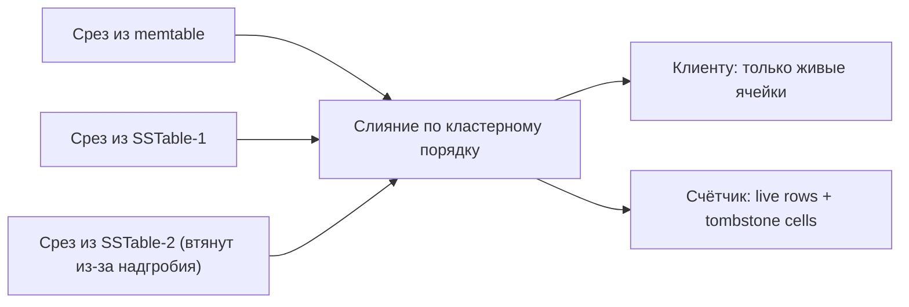
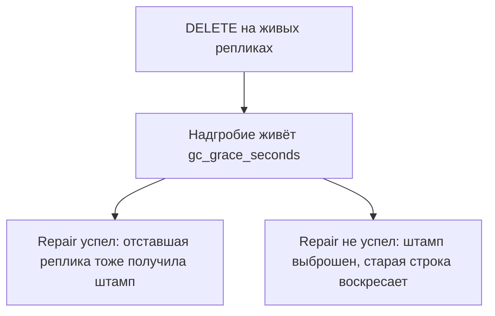

# 07. Надгробия, gc_grace_seconds и очередь как антипаттерн

**Зачем это знать backend-разработчику.** Удаление в Cassandra не стирает байты. Оно пишет **надгробие** (tombstone) — метку «этого больше нет». Пока метка жива, чтение таскает её вместе с данными. Если сделать из таблицы очередь, каждое «взял задачу» оставляет метку, и через неделю `SELECT` десяти живых строк читает сотни тысяч мёртвых. Отсюда же правило: repair нельзя откладывать дольше `gc_grace_seconds`, иначе удалённое воскресает.

> **Коротко:** `DELETE` и истёкший TTL оставляют надгробие. Реплики должны увидеть его до того, как живые узлы его выбросят. Срок ожидания по умолчанию — `gc_grace_seconds`, десять суток. Чтение считает надгробия и на 1000 за запрос предупреждает, на 100 000 обрывается (`tombstone_warn_threshold` и `tombstone_failure_threshold` в `cassandra.yaml`). Очередь «вставил и сразу удалил» копит надгробия в одной партиции. Для очереди берут другой инструмент, не таблицу задач в Cassandra.

## Оглавление

- [Что записывается вместо удаления](#что-записывается-вместо-удаления)
- [Четыре вида надгробий в данных](#четыре-вида-надгробий-в-данных)
- [Сколько стоит чтение через надгробия](#сколько-стоит-чтение-через-надгробия)
- [Зачем десять суток](#зачем-десять-суток)
- [Как безопасно понизить gc_grace_seconds](#как-безопасно-понизить-gc_grace_seconds)
- [TTL тоже оставляет метку](#ttl-тоже-оставляет-метку)
- [Очередь](#очередь)
- [Как заметить беду](#как-заметить-беду)
- [Пороги узла и ручная уборка](#пороги-узла-и-ручная-уборка)
- [Практика в репозитории](#практика-в-репозитории)
- [Типичные ошибки и заблуждения](#типичные-ошибки-и-заблуждения)
- [Итоги](#итоги)
- [Вопросы для самопроверки](#вопросы-для-самопроверки)
- [Источники](#источники)

## Что записывается вместо удаления

**На пальцах** (аналогия). В книге учёта не вырывают страницу: кто-то из филиалов ещё не знает, что счёт закрыт, и перепишет строку обратно. Вместо вырывания ставят штамп «закрыто» и держат его, пока все филиалы не сверятся.

Удаление — мутация с меткой времени (timestamp), как и запись. Реплика, которая её не видела, продолжит отдавать старую строку. Если живые реплики уже забыли штамп, а отставшая помнит данные, при починке данные победят: удалённая строка **воскреснет** (data resurrection, «зомби»). Штамп и нужен, чтобы этого не случилось.

Это видно на одной колонке. В `guide.log_by_author` (задание 02, `PRIMARY KEY ((author_id), sent_at, message_id)`) удалим только тело сообщения:

```sql
DELETE body FROM guide.log_by_author
WHERE author_id = 'a1' AND sent_at = '2020-01-01 10:00:00'
  AND message_id = 11111111-1111-1111-1111-111111111111;
SELECT sent_at, body FROM guide.log_by_author WHERE author_id = 'a1';
```

```
 sent_at                         | body
---------------------------------+------
 2020-01-05 10:00:00.000000+0000 | five
 2020-01-01 10:00:00.000000+0000 | null
```

Строка не исчезла: у неё остался первичный ключ и живая колонка `chat_id`, а `body` отдаётся как `null`. Клиент видит пустоту, диск — штамп, который пришлось прочитать и слить с данными.

## Четыре вида надгробий в данных

**На пальцах** (аналогия). Можно замазать одну графу в бланке, можно перечеркнуть весь бланк, можно наклеить одну полоску «дела с 3 по 4 января изъяты» на целый раздел папки, а можно шлёпнуть штамп на обложку папки. Четыре жеста — четыре разных объёма бумаги и четыре разные цены для того, кто потом ищет документ.

- **надгробие ячейки** (cell tombstone) — удалена одна колонка строки;
- **надгробие строки** (row tombstone) — удалена кластерная строка целиком;
- **надгробие диапазона** (range tombstone) — удалены все строки с кластерной колонкой в промежутке;
- **надгробие партиции** (partition tombstone) — удалено всё под ключом партиции (partition key).

Это не четыре слова, а четыре разных записи на диске. Сделаем все четыре в одной таблице (`DELETE body` выше, `DELETE` одной строки за 2 января, `DELETE ... WHERE sent_at >= '2020-01-03' AND sent_at <= '2020-01-04 23:00'`, `DELETE ... WHERE author_id = 'a2'`), сбросим memtable `nodetool flush` и прочитаем файл инструментом `sstabledump` из образа:

```json
{ "partition" : { "key" : [ "a2" ],
    "deletion_info" : { "marked_deleted" : "2026-10-13T07:17:30.809583Z" } },
  "rows" : [ ] }                                      // надгробие партиции
{ "type" : "range_tombstone_bound", "start" : { "type" : "inclusive",
    "clustering" : [ "2020-01-04 23:00:00.000Z", "*" ] } }   // граница диапазона
{ "type" : "row", "clustering" : [ "2020-01-02 10:00:00.000Z", "2222..." ],
  "deletion_info" : { "marked_deleted" : "..." }, "cells" : [ ] }   // надгробие строки
{ "type" : "row", "clustering" : [ "2020-01-01 10:00:00.000Z", "1111..." ],
  "cells" : [ { "name" : "body", "deletion_info" : { ... } },
              { "name" : "chat_id", "value" : "c1" } ] }      // надгробие ячейки
```

Видно главное: партиция `a2` занимает на диске один объект без строк; диапазон занимает **две** записи — открывающую и закрывающую границу, а не по штампу на каждую удалённую строку; надгробие строки — это строка с `deletion_info` и пустым списком ячеек; надгробие ячейки живёт внутри живой строки рядом с уцелевшей колонкой.

Отсюда практический вывод: один `DELETE` по диапазону вместо миллиона построчных — это 2 объекта вместо 1 000 000. Но при чтении диапазон всё равно обязан быть учтён, и если диапазонов накопилось много, они перекрываются и список границ приходится держать в памяти (параметры `initial_range_tombstone_list_allocation_size` и `range_tombstone_list_growth_factor` в `cassandra.yaml` — про рост именно этого списка).

`TRUNCATE` не пишет надгробий совсем: он помечает все SSTable таблицы как устаревшие, а при `auto_snapshot: true` (значение по умолчанию) сначала делает снимок. Учебные тесты вызывают `TRUNCATE` перед сценарием как раз чтобы не копить мусор между прогонами.

## Сколько стоит чтение через надгробия

**На пальцах** (аналогия). Запрос «дай десять последних живых дел» — это не «возьми десять папок». Это «иди по полке от начала, пропускай изъятые, пока не наберёшь десять». Если перед первым живым делом лежит тысяча изъятых, вы прошли тысячу и один раз, а вернули десять.

Чтение в Cassandra — слияние **срезов** (slice): координатор берёт по срезу из memtable и из каждого подходящего SSTable и сливает их по кластерному порядку, оставляя для каждой ячейки версию с наибольшей меткой времени. Надгробие участвует в слиянии как полноправная версия: его нужно прочитать с диска, разжать, сравнить метку и только потом выбросить из ответа. `LIMIT` считает живые строки, а не прочитанные, поэтому ограничить работу он не может.

Трассировка показывает оба числа. На пробном контейнере `cassandra:5.0` (5.0.9) после четырёх удалений из разделов выше:

```
cqlsh> TRACING ON;
cqlsh> SELECT sent_at, body FROM guide.log_by_author WHERE author_id = 'a1';

 Partition index found for sstable 1, size = 0                                  |  6537
 Skipped 0/1 non-slice-intersecting sstables, included 0 due to tombstones       |  7201
 Merged data from memtables and 1 sstables                                       |  8551
 Read 2 live rows and 4 tombstone cells                                          |  8731
```

`Read 2 live rows and 4 tombstone cells` — счётчик надгробий этого запроса. Строка `included 0 due to tombstones` про другое: файл может быть втянут в чтение не потому, что в нём есть нужные ключи, а потому, что в нём лежит надгробие, перекрывающее данные соседнего файла.

Арифметика, из которой видно, почему это не мелочь. Партиция очереди с 1500 удалёнными задачами и `LIMIT 10`:

```
Warnings :
Read 0 live rows and 1500 tombstone cells for query
SELECT * FROM guide.jobs WHERE queue = 'q1' LIMIT 10 ALLOW FILTERING;
token 245985528125734157 (see tombstone_warn_threshold)
```

Полезных строк — ноль, прочитанных объектов — 1500. На партиции в 200 000 удалений тот же запрос прочитает 200 000 объектов, то есть превысит `tombstone_failure_threshold` и упадёт. Деградация тут не плавная: пока партиция мала, запрос быстрый, а после перехода порога он перестаёт работать вовсе.



## Зачем десять суток

**На пальцах** (аналогия). Штамп «закрыто» нельзя снимать раньше, чем все филиалы сверились с центром. Срок сверки записан в регламенте, и это не «пока не надоест», а конкретное число дней, под которое выстроен график проверок.

`gc_grace_seconds` по умолчанию **864000** (10 суток). Столько надгробие обязано прожить, прежде чем уплотнение (compaction) имеет право его выбросить. За этот срок каждая реплика должна хотя бы раз получить удаление: через обычную репликацию, подсказку (hint) или `nodetool repair`.

```sql
cqlsh> ALTER TABLE guide.log_by_author WITH gc_grace_seconds = 3600;
cqlsh> SELECT gc_grace_seconds FROM system_schema.tables
   ...  WHERE keyspace_name='guide' AND table_name='log_by_author';
 gc_grace_seconds
------------------
             3600
```

Связка с [06](06-consistency-repair.md): подсказка живёт около трёх часов (`max_hint_window: 3h` на образе) и не заменяет repair. Десять суток grace как раз дают календарю repair запас, а не повод забыть про него на месяц.



## Как безопасно понизить gc_grace_seconds

**На пальцах** (аналогия). Сократить срок хранения штампа можно, но тогда сверку филиалов надо проводить чаще — и успевать даже в неделю, когда один филиал стоял без связи.

Понижение grace — это обещание сервера: «никакая реплика не отстанет дольше, чем на столько». Проверяют его арифметикой, а не на глаз:

1. Измерьте, сколько реально идёт полный цикл repair таблицы: `nodetool repair -pr` по всем узлам по очереди, с запасом на повтор упавшей сессии.
2. Новый grace должен быть **минимум в 2–3 раза больше** этого цикла. Цикл 8 часов → grace не ниже суток (86 400), а не 8 часов «ровно по замеру».
3. Отдельно проверьте, что grace больше окна подсказок (`max_hint_window`, по умолчанию 3 часа): узел, вернувшийся из перезагрузки, догоняется подсказками, и grace в один час этот путь обрезает.
4. После понижения заведите алерт на пропущенный repair. Grace без расписания repair — не настройка, а ставка.

Когда понижать осмысленно: таблица-журнал с TWCS и TTL, где удалений как таковых нет и штампы появляются только от истечения срока; таблица, которую приложение переписывает целиком раз в сутки. Когда нельзя: любая таблица, где в принципе бывает `DELETE` по пользовательскому действию, и RF > 1.

Ноль допустим только там, где воскрешать некому:

```sql
cqlsh> ALTER TABLE guide.log_by_author WITH gc_grace_seconds = 0;
-- система сама так и живёт: DESCRIBE TABLE system.paxos показывает gc_grace_seconds = 0
```

Односузловой учебный кластер (RF = 1) этот ноль прощает: реплика одна, расходиться не с кем. Тот же ноль на RF = 3 означает, что надгробие может быть выброшено первым же уплотнением, и короткий сетевой сбой вернёт удалённых пользователей.

## TTL тоже оставляет метку

**На пальцах** (аналогия). Срок годности на упаковке не заставляет товар испариться в полночь. Он лежит на полке, просто продавать его больше нельзя — и выносят его при следующей ревизии.

`INSERT ... USING TTL 2` через две секунды перестаёт читаться, но байты остаются. Проверка на контейнере: записали, подождали, сбросили на диск, прочитали файл:

```
cqlsh> SELECT k, v, TTL(v) FROM guide.ttl_probe WHERE k='t1';
 k  | v | ttl(v)
----+---+--------
 t1 | x |      2

-- через 4 секунды
cqlsh> SELECT k, v FROM guide.ttl_probe WHERE k='t1';
(0 rows)
```

```json
"liveness_info" : { "tstamp" : "...", "ttl" : 2,
                    "expires_at" : "2026-10-13T07:21:27Z", "expired" : true },
"cells" : [ { "name" : "v", "value" : "x" } ]
```

Значение `"x"` физически лежит в SSTable с флагом `"expired": true`. Клиенту его не отдадут, но место оно занимает и в слияние срезов входит — ровно как явное надгробие, и с теми же правилами grace.

В задании 03 TTL стоит на измерениях датчика (`guide.sensor_readings`, партиция `(sensor_id, bucket)`), а TWCS позволяет выбросить целое окно одним файлом, когда в нём не осталось живых данных ([03](03-compaction.md#twcs)). Это мягче, чем копить точечные надгробия внутри вечной партиции под STCS.

TTL ставят на запись, которую не собираются обновлять. Обновление с новым TTL отодвигает смерть; обновление без TTL оставляет ячейку жить вечно, хотя на экране настроек написано «храним 14 дней». Нулевой TTL в протоколе означает «без срока»: случайно передать 0, желая «удалить сразу», — это не удаление.

## Очередь

**На пальцах** (аналогия). Стопка заявок на столе, и каждый обработчик берёт верхнюю, а вместо выбрасывания кладёт на её место лист «эта заявка обработана». К вечеру сверху лежит пачка листов-заглушек, и чтобы добраться до живой заявки, надо перелистать всё, что сделали за день.

Антипаттерн выглядит невинно: одна партиция на всю очередь и кластерная колонка (clustering column) под порядок задач.

```sql
CREATE TABLE guide.jobs (queue text, job_id int, payload text,
                         PRIMARY KEY ((queue), job_id));
-- работник: SELECT ... LIMIT 10, затем DELETE взятых
DELETE FROM guide.jobs WHERE queue = 'q1' AND job_id = ?;
```

После 1500 таких удалений `SELECT ... LIMIT 10` по этой партиции и выдал предупреждение из раздела про стоимость чтения: ноль живых строк, 1500 прочитанных объектов.

Почему не лечится «просто чаще compact»:

- партиция одна, горячая, на неё же идёт repair;
- порядок «следующая задача» требует кластерных колонок, а удаление из середины порядка плодит дыры, которые ни один диапазон не склеит в один штамп;
- работники конкурируют, и без лёгкой транзакции (lightweight transaction, LWT) одну задачу возьмут двое, а LWT на горячей партиции упирается в Paxos ([08](08-lwt-batches-counters.md#борьба-за-один-ключ)).

Комментарий в самом `cassandra.yaml` рядом с порогами надгробий ссылается на статью про очереди как антипаттерн — это не фольклор сообщества, а предупреждение разработчиков сервера.

Очередь с подтверждением и повтором в этом курсе сделана на Redis Streams (задание Redis 07). Если «события на неделю» всё же нужны внутри Cassandra, это не очередь, а журнал: партиции по времени, TTL, TWCS, потребители запоминают своё состояние страницы (paging state) или время и не вычёркивают чужие строки.

## Как заметить беду

**На пальцах** (аналогия). Не ждите жалобы «склад не работает». Раз в день смотрите два числа: сколько заглушек перелистывают при обычном запросе и какая доля папки — заглушки.

В `nodetool tablestats` смотрят ровно четыре поля из длинного вывода:

```
$ nodetool tablestats guide.log_by_author
		Average live cells per slice (last five minutes): 2.0
		Maximum live cells per slice (last five minutes): 2
		Average tombstones per slice (last five minutes): 4.0
		Maximum tombstones per slice (last five minutes): 4
		Droppable tombstone ratio: 0.00000
```

Как их читать:

- **Average tombstones per slice** против **Average live cells per slice** — главное отношение. Здесь 4 к 2: на каждую отданную ячейку прочитано две мёртвых. Устойчивое отношение выше 1 — повод смотреть модель, а не железо.
- **Maximum tombstones per slice** ловит единичную больную партицию, которую среднее прячет. Окно у обоих — последние пять минут, поэтому ночной отчёт по ним снимать бессмысленно.
- **Droppable tombstone ratio** — доля надгробий, которые уже можно выбросить (grace истёк), но они ещё лежат в файлах. Ноль здесь означает либо «удалений нет», либо «grace ещё не прошёл». Высокое значение — сигнал, что файл стоит уплотнить вне очереди.

Остальные полезные признаки: рост задержки одного и того же `SELECT` по первичному ключу без роста числа живых строк и предупреждения `Read N live rows and M tombstone cells` в `system.log` узла.

Лечение — перестать удалять. Историю выносят в бакеты (bucket) с TTL, очередь выносят из Cassandra, а уже накопленный мусор ужимают уплотнением после того, как модель исправлена. Уплотнение без смены доступа возвращает те же надгробия на следующий день.

## Пороги узла и ручная уборка

**На пальцах** (аналогия). На складе два правила: «если за один заказ перелистали больше тысячи заглушек — записать в журнал» и «если больше ста тысяч — отказать в заказе, иначе кладовщик упадёт». Правила висят в инструкции склада, а не пишутся на каждой папке.

Пороги чтения живут в `cassandra.yaml`, в разделе `SAFETY THRESHOLDS`, и действуют на весь узел:

```
$ grep -nE "tombstone_(warn|failure)_threshold" /etc/cassandra/cassandra.yaml
1814:tombstone_warn_threshold: 1000
1815:tombstone_failure_threshold: 100000
```

Это не опции таблицы, и `ALTER TABLE` их не принимает:

```
cqlsh> ALTER TABLE guide.log_by_author WITH tombstone_warn_threshold = 2000;
SyntaxException: Unknown property 'tombstone_warn_threshold'
```

У таблицы есть свои рычаги, но другие и внутри стратегии уплотнения: `tombstone_threshold` (доля надгробий в файле, после которой его хотят уплотнить вне очереди) и `tombstone_compaction_interval` — **подсвойства** `compaction`, а не самостоятельные опции:

```sql
ALTER TABLE guide.log_by_author WITH compaction = {
  'class': 'SizeTieredCompactionStrategy',
  'tombstone_threshold': '0.2',
  'tombstone_compaction_interval': '86400'
};
```

Поднимать `tombstone_failure_threshold` «чтобы не падало» опасно: сервер держит прочитанные надгробия в куче координатора (coordinator), чтобы разослать их остальным репликам, и миллион штампов на запрос — это не медленный запрос, а длинные паузы сборщика мусора на всём узле. Комментарий в `cassandra.yaml` формулирует это как «подкрутите, если понимаете опасность».

Разовая уборка — `nodetool garbagecollect`. У неё две гранулярности, и справка сервера их различает:

```
$ nodetool help garbagecollect
    -g <granularity>, --granularity <granularity>
        Granularity of garbage removal. ROW (default) removes deleted
        partitions and rows, CELL also removes overwritten or deleted cells.
```

`ROW` (по умолчанию) убирает удалённые партиции и строки целиком. `CELL` дополнительно вычищает перекрытые и удалённые отдельные ячейки — дороже, потому что сравнивает каждую. Проверка на контейнере: после `gc_grace_seconds = 0` и `nodetool garbagecollect -g CELL guide log_by_author` в файле не осталось ни одного из четырёх надгробий — партиция `a2` исчезла, границы диапазона исчезли, у строки за 1 января остался только живой `chat_id` без штампа на `body`:

```json
{ "type" : "row", "clustering" : [ "2020-01-01 10:00:00.000Z", "1111..." ],
  "liveness_info" : { "tstamp" : "..." },
  "cells" : [ { "name" : "chat_id", "value" : "c1" } ] }
```

Это разовая операция после того, как модель перестали кормить удалениями, а не ежедневный cron: она читает и перезаписывает файлы целиком и конкурирует за `compaction_throughput` с обычным уплотнением.

## 🔬 Глубже: статика, коллекции и кто выбрасывает штампы

Выбросить надгробие вправе не только уплотнение таблицы, но и `nodetool compact` (ручная полная склейка) и `nodetool garbagecollect`. Все три проверяют одно: истёк ли `gc_grace_seconds` и не перекрывает ли штамп данные в файле, который в склейку не попал. Второе условие и есть причина, почему надгробие иногда «не выбрасывается, хотя grace прошёл»: инструмент `sstableexpiredblockers` из того же образа умеет показать, какой именно файл блокирует удаление протухшего.

Отдельный сюрприз — надгробия в коллекциях и статических колонках (static column). Удаление одного элемента `set` не удаляет строку, но оставляет штамп внутри неё. Хуже того, присваивание коллекции целиком (`SET tags = {...}`) сервер выполняет как «надгробие на всю коллекцию плюс новые элементы»: каждое обновление оставляет ещё один штамп. Коллекция, которую переписывают на каждый запрос, деградирует так же, как очередь. Если набор маленький и его всегда заменяют целиком, честнее `frozen<set<text>>` — он хранится одним значением и перезаписывается без надгробия.

Удаление по кластерному диапазону в конце бакета (старые сутки) здоровее, чем удаление отдельных «обработанных» строк из головы вечной партиции. Диапазон становится двумя границами, а бакет всё равно скоро выбросит TWCS. Очередь вычёркивает середину и голову постоянно, и никакой диапазон это не собирает в один штамп.

Наконец, `corrupted_tombstone_strategy` (по умолчанию `disabled` на образе) и `partition_tombstones_warn_threshold` (`-1`, то есть выключен) — это рычаги оператора, а не разработчика. Знать о них стоит затем, чтобы не искать в них решение проблемы, которая лежит в ключе партиции.

## Практика в репозитории

- [Задание 03](../tasks/03-sensor-metrics.md) — TTL и окно TWCS, чтобы срок жизни был свойством записи, а не ручным `DELETE` каждой точки.
- [Задание 02](../tasks/02-messages-by-user.md) — таблица `guide.log_by_author`, на которой сняты примеры этого файла.
- [Задание 06](../tasks/06-view-counters.md) не удаляет счётчик (counter), чтобы «обнулить»: у счётчиков свой протокол, и удаление с ними особенно легко сделать не так.
- Repair, без которого grace не работает, — [06](06-consistency-repair.md).
- Стратегии уплотнения, которые эти надгробия и выбрасывают, — [03](03-compaction.md).

## Типичные ошибки и заблуждения

1. **«DELETE сразу освобождает диск.»** Он пишет надгробие. Место вернётся после уплотнения и только когда grace позволит штамп выбросить.
2. **«TTL не создаёт надгробий, это же не DELETE.»** Создаёт. В дампе SSTable истёкшая ячейка лежит со своим значением и флагом `"expired": true`.
3. **«Очередь в Cassandra — просто таблица с датой.»** Если потребитель удаляет строки из горячей партиции, это очередь, и она деградирует. Журнал с TTL устроен иначе.
4. **«gc_grace можно обнулить на одноузловой разработке и забыть.»** На одном узле воскрешать некому, учебный ноль прощает. Тот же ноль на RF = 3 после короткого сетевого сбоя возвращает удалённых пользователей.
5. **«Подниму `tombstone_failure_threshold` до миллиона, и запросы перестанут падать.»** Падать перестанут, а куча координатора начнёт раздуваться: вместо одной ошибки получите паузы сборщика мусора на всём узле.
6. **«Надгробия — это опция таблицы, настрою `tombstone_warn_threshold` в `ALTER TABLE`.»** Сервер ответит `Unknown property`. Пороги чтения — в `cassandra.yaml`; у таблицы есть только подсвойства `compaction`.

## Итоги

- Удаление — запись надгробия, не стирание байтов; то же касается истёкшего TTL.
- Четыре вида надгробий — четыре разных объекта в файле: диапазон стоит две границы, партиция — один объект, ячейка живёт внутри живой строки.
- Чтение сливает срезы и платит за мёртвые ячейки; `LIMIT` считает живые строки, а не прочитанные.
- Пороги узла — 1000 на предупреждение и 100 000 на обрыв запроса; поднимать их вместо правки модели опасно.
- Десять суток grace — срок, за который repair должен разнести штамп; понижают его только вместе с замеренным циклом repair и запасом 2–3×.
- В `tablestats` смотрят отношение tombstones к live cells за слайс и `Droppable tombstone ratio`.
- `nodetool garbagecollect` убирает мусор разово: `ROW` — партиции и строки, `CELL` — ещё и отдельные ячейки.
- Очередь с частым `DELETE` в одной партиции — антипаттерн; журнал с бакетом и TTL решает другую задачу, и для неё Cassandra подходит.

## Вопросы для самопроверки

1. Почему отставшая реплика может вернуть удалённую строку?
   <details><summary>Ответ</summary>Она не видела надгробие, а живые реплики уже выбросили его по истечении grace. При сверке у данных нет штампа-победителя.</details>
2. Чем range tombstone лучше миллиона удалений строк и в чём он всё равно не бесплатен?
   <details><summary>Ответ</summary>В файле он занимает две записи-границы вместо миллиона штампов. Но при чтении его обязаны учесть, а много перекрывающихся диапазонов приходится держать списком в памяти.</details>
3. `SELECT ... LIMIT 10` вернул 0 строк и получил предупреждение «Read 0 live rows and 1500 tombstone cells». Почему `LIMIT` не ограничил работу?
   <details><summary>Ответ</summary>`LIMIT` считает живые строки ответа. Чтобы набрать их, слияние срезов проходит весь мёртвый префикс партиции — 1500 объектов.</details>
4. Задание 03 ставит TTL на измерение. Исчезнет ли точка ровно через TTL секунд из всех файлов?
   <details><summary>Ответ</summary>Для клиента ячейка перестаёт читаться сразу. В файле она остаётся со своим значением и флагом `expired` до уплотнения и истечения grace. TWCS помогает выбросить окно целиком, когда протухло всё окно.</details>
5. Полный цикл repair таблицы занимает 8 часов. Какой `gc_grace_seconds` допустим и почему не 8 часов ровно?
   <details><summary>Ответ</summary>Не ниже суток: нужен запас 2–3× на упавшую сессию repair и на окно подсказок (`max_hint_window`, 3 часа). Grace, равный замеру, не оставляет места ни одной задержке.</details>
6. Чем `nodetool garbagecollect -g CELL` отличается от режима по умолчанию?
   <details><summary>Ответ</summary>По умолчанию (`ROW`) убираются удалённые партиции и строки. `CELL` дополнительно вычищает перекрытые и удалённые отдельные ячейки, сравнивая их по одной, — дороже по IO и CPU.</details>
7. Можно ли заменить repair более высоким уровнем чтения?
   <details><summary>Ответ</summary>Нет. Уровень чтения влияет на ответ клиенту и может запустить read repair прочитанной партиции. Непрочитанные диапазоны и срок жизни надгробий он не закрывает.</details>
8. Какие два числа из `nodetool tablestats` показывают, что таблица больна надгробиями?
   <details><summary>Ответ</summary>`Average tombstones per slice` рядом с `Average live cells per slice` — отношение мёртвого к живому за последние пять минут. Плюс `Maximum tombstones per slice`, чтобы поймать одну больную партицию, которую среднее прячет.</details>

## Источники

- Apache Cassandra docs 5.0: *About deletes and tombstones*. https://cassandra.apache.org/doc/5.0/cassandra/developing/cql/dml.html
- Параметр таблицы `gc_grace_seconds` (по умолчанию 864000) и подсвойства `compaction`: `tombstone_threshold`, `tombstone_compaction_interval`.
- `cassandra.yaml`, раздел `SAFETY THRESHOLDS`: `tombstone_warn_threshold: 1000`, `tombstone_failure_threshold: 100000` (значения сняты с образа `cassandra:5.0`, версия 5.0.9).
- Команды `nodetool tablestats`, `nodetool garbagecollect`, `nodetool flush` и инструменты `sstabledump`, `sstableexpiredblockers` из образа.

---

← [06. Согласованность и починка](06-consistency-repair.md) | [оглавление](README.md) | [08. LWT, пакеты и счётчики](08-lwt-batches-counters.md) → | [словарь терминов](glossary.md)
