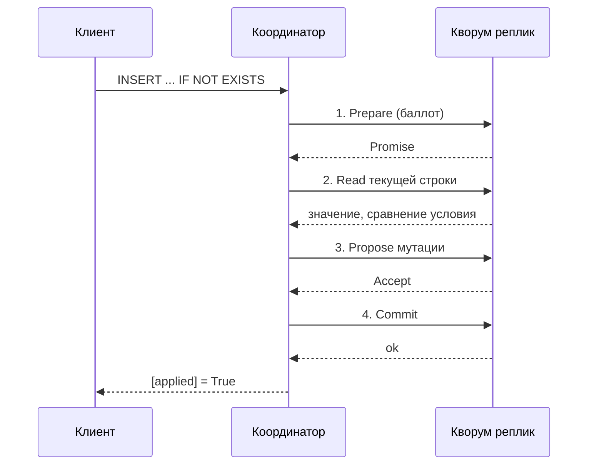

# 08. LWT, пакеты и счётчики

**Зачем это знать backend-разработчику.** Обычная запись в Cassandra не умеет «создай, только если пусто» и не умеет прибавить единицу без потери параллельных прибавлений. Для первого есть **лёгкая транзакция** (lightweight transaction, LWT) на Paxos, для второго — отдельный тип колонки **счётчик** (counter). Оба механизма дороже обычного `INSERT` и легко применяются не туда. Пакеты (batch) люди включают «чтобы было атомарно» и получают лишнюю задержку и не ту транзакцию, которую себе представляли.

> **Коротко:** `INSERT ... IF NOT EXISTS` и условный `UPDATE` идут через Paxos — четыре обхода сети вместо одного; успех смотрят по `wasApplied()`, а не по отсутствию исключения. У LWT два уровня согласованности: обычный и serial, и задавать стоит оба. Logged batch атомарен для набора мутаций, но не заменяет транзакцию между агрегатами, предупреждает на 5 КиБ и отвергается на 50 КиБ. Счётчик живёт в своей таблице, только меняется на дельту и не соседствует ни с обычными колонками, ни с условиями.

## Оглавление

- [Условная запись](#условная-запись)
- [Paxos по раундам](#paxos-по-раундам)
- [Таблица system.paxos](#таблица-systempaxos)
- [Борьба за один ключ](#борьба-за-один-ключ)
- [Что именно обещает Paxos](#что-именно-обещает-paxos)
- [LWT в Java: два уровня и разбор результата](#lwt-в-java-два-уровня-и-разбор-результата)
- [Пакеты](#пакеты)
- [Сколько весит пакет](#сколько-весит-пакет)
- [Счётчики](#счётчики)
- [Практика в репозитории](#практика-в-репозитории)
- [Типичные ошибки и заблуждения](#типичные-ошибки-и-заблуждения)
- [Итоги](#итоги)
- [Вопросы для самопроверки](#вопросы-для-самопроверки)
- [Источники](#источники)

## Условная запись

**На пальцах** (аналогия). Два человека одновременно хватают табличку с именем «anna». Обычный `INSERT` повесит табличку последнему по часам. Условный сначала спрашивает у кворума реплик: «табличка ещё без имени?» — и только потом вешает. Это несколько кругов сообщений, не одна дозапись в журнал.

В CQL условие — часть вставки, а ответ выглядит не как у обычного `INSERT`. Проверено на пробном контейнере `cassandra:5.0` (5.0.9):

```sql
cqlsh> INSERT INTO guide.usernames (username, user_id)
   ...  VALUES ('anna', 11111111-1111-1111-1111-111111111111) IF NOT EXISTS;

 [applied]
-----------
      True

cqlsh> INSERT INTO guide.usernames (username, user_id)
   ...  VALUES ('anna', 22222222-2222-2222-2222-222222222222) IF NOT EXISTS;

 [applied] | username | user_id
-----------+----------+--------------------------------------
     False |     anna | 11111111-1111-1111-1111-111111111111
```

Разница в самой форме ответа: при успехе одна служебная колонка `[applied]`, при проигрыше — `[applied] = False` **и текущее содержимое строки**, из-за которого условие не сошлось. Второй клиент сразу видит, что владелец имени — `1111...`, и ему не нужен отдельный `SELECT`. Исключения тут нет: занятое имя — нормальный ответ запроса.

## Paxos по раундам

**На пальцах** (аналогия). Чтобы совет директоров принял решение, нужно четыре круга переписки: разослать «я хочу поставить вопрос номер 7, не берите номер меньше» и собрать согласия; собрать текущее положение дел; разослать само предложение и собрать «принято»; разослать «решение в силе». Обычная запись — это одно письмо без голосования.

Cassandra использует Paxos в варианте, где один запрос `IF` раскладывается на четыре обхода сети (round trip) между координатором (coordinator) и кворумом реплик:

| Раунд | Что происходит | Что пишется |
|---|---|---|
| 1. Prepare / Promise | координатор предлагает **баллот** (ballot) — timeuuid, и реплики обещают не принимать меньший | `in_progress_ballot` |
| 2. Read | координатор читает текущее значение строки под этим баллотом и сравнивает условие | — |
| 3. Propose / Accept | координатор предлагает саму мутацию, кворум её принимает | `proposal`, `proposal_ballot` |
| 4. Commit | мутация применяется к таблице как обычная запись | `most_recent_commit` |

Арифметика задержки. Пусть обход внутри дата-центра — 1 мс. Обычный `INSERT` на `LOCAL_QUORUM` — один обход, около 1 мс. LWT — четыре, около 4 мс, и это без учёта того, что раунды 3 и 4 ещё пишут в commit log. Межрегиональный `SERIAL` при RTT 60 мс превращает захват ника в **240 мс** — вот почему уровень `LOCAL_SERIAL` в задании 05 выбран осознанно, а не «потому что короче».

Арифметика сообщений (модель для RF = 3). Обычная запись: координатор рассылает три мутации и ждёт двух подтверждений — около пяти сообщений. LWT: каждый из четырёх раундов — свой веер, то есть 4 × (3 запроса + 2 ожидаемых ответа) ≈ **20 сообщений** вместо пяти. Плюс лишний заход на диск: раунды пишут не только в целевую таблицу, но и в служебную `system.paxos` (следующий раздел). Отсюда рабочее правило: условная запись стоит примерно как четыре обычных по сети и как две по диску. Её ставят на редкие операции — захват ника, смену владельца, — а не на каждый `INSERT` в ленту.



На образе `cassandra:5.0` в конфигурации стоит `paxos_variant=v1`. В `cassandra.yaml` описан и `v2` с процедурой перехода («Set `paxos_variant: v2` on each node and rolling restart») — это выбор оператора, и включать его «потому что цифра больше» не нужно.

## Таблица system.paxos

**На пальцах** (аналогия). У совета директоров есть секретарь с журналом: какой вопрос последний поставлен, какое предложение на руках, какое решение уже вступило в силу. Журнал нужен ровно затем, чтобы после обрыва связи новый ведущий заседание не начал всё заново, а продолжил с места.

Состояние Paxos лежит не в воздухе, а в системной таблице, по строке на каждый ключ, за который голосовали:

```sql
cqlsh> DESCRIBE TABLE system.paxos;
CREATE TABLE system.paxos (
    row_key blob, cf_id uuid,
    in_progress_ballot timeuuid, in_progress_read_ballot timeuuid,
    most_recent_commit blob, most_recent_commit_at timeuuid,
    proposal blob, proposal_ballot timeuuid, ...
    PRIMARY KEY (row_key, cf_id)
) WITH comment = 'in-progress paxos proposals'
    AND compaction = {'class': '...LeveledCompactionStrategy', ...}
    AND gc_grace_seconds = 0
```

После одного успешного захвата имени `anna` там появилась одна строка:

```sql
cqlsh> SELECT row_key, in_progress_ballot, most_recent_commit_at FROM system.paxos;

 row_key    | in_progress_ballot                   | most_recent_commit_at
------------+--------------------------------------+--------------------------------------
 0x616e6e61 | 68c618f2-c6d6-11f1-65fe-f90f9fd887f2 | 68684182-c6d6-11f1-737a-f901f59961f8
```

`0x616e6e61` — это байты строки `anna`: ключ партиции целевой таблицы. `cf_id` — идентификатор самой таблицы, то есть `system.paxos` разделяет состояние по таблицам. Три вывода, которые отсюда полезно сделать:

- **LWT пишет дважды** — в `system.paxos` и в целевую таблицу. Именно поэтому условная запись дороже обычной не только по сети, но и по диску.
- `gc_grace_seconds = 0` и LCS у этой таблицы выбраны не случайно: состояние живёт недолго и перезаписывается, чтение должно открывать мало файлов ([03](03-compaction.md#lcs), [07](07-tombstones.md#как-безопасно-понизить-gc_grace_seconds)).
- Чистку состояния настраивают параметрами `paxos_purge_grace_period` (на образе `60s`) и `paxos_state_purging`. Это рычаги оператора; приложение в `system.paxos` не пишет и не читает.

## Борьба за один ключ

**На пальцах** (аналогия). Если за одну табличку хватаются двое, голосование проходит. Если двадцать, совет весь день переголосовывает: каждый новый баллот отменяет чужой почти принятый, и ни одно решение не доходит до силы. Проблема не в скорости сети, а в том, что претенденты мешают друг другу.

Paxos ведёт себя плохо не при высокой общей нагрузке, а при **конкуренции за одну партицию**. Пока претендентов двое, один выигрывает за четыре раунда. Когда их двадцать, баллоты старших отменяют предложения младших, раунды перезапускаются, и запрос может не успеть за отведённое время. Отведённое время названо отдельным параметром, не общим таймаутом записи:

```
$ grep -n "cas_contention_timeout" /etc/cassandra/cassandra.yaml
1339:cas_contention_timeout: 1000ms
```

Сервер в этом случае бросает `CasWriteTimeoutException` — отдельный класс исключения Cassandra, не обычный `WriteTimeoutException`. В Java-драйвере DataStax 4.19.3 отдельного класса с таким именем **нет** (проверено по содержимому `java-driver-core-4.19.3.jar`): серверная ошибка приходит как `WriteTimeoutException`, у которого `getWriteType()` равен `WriteType.CAS`. Есть и родственный случай — `CASWriteUnknownException`: кворум не собрался, и применилась мутация или нет, координатор не знает.

```java
try {
    boolean claimed = session.execute(claim).wasApplied();
} catch (WriteTimeoutException e) {
    if (e.getWriteType() == DefaultWriteType.CAS) {
        // спор за ключ: получено e.getReceived() из e.getBlockFor() ответов.
        // Повторять можно: IF NOT EXISTS идемпотентен — второй раз вернёт false,
        // если первая попытка всё же применилась.
    }
} catch (CASWriteUnknownException e) {
    // неизвестный исход: перечитать владельца SELECT и решить по данным
}
```

(классы `WriteTimeoutException.getWriteType()`, `WriteType.CAS`, `DefaultWriteType`, `CASWriteUnknownException` и методы `getReceived()`/`getBlockFor()` из `QueryConsistencyException` подтверждены `javap` на драйвере 4.19.3.)

Как не доводить до этого. Ключ LWT должен быть таким, чтобы претендентов на одну партицию было мало: `username` — хороший ключ, потому что на конкретное имя претендуют единицы. `queue_name` в очереди — плохой, потому что на одну партицию претендуют все работники. Повторять LWT можно только с экспоненциальной задержкой: немедленный повтор добавляет ещё один баллот в тот же спор.

## Что именно обещает Paxos

**На пальцах** (аналогия). Голосование решает судьбу одной таблички. Оно не делает запись в отделе кадров и выдачу пропуска одним неделимым действием — это три разных кабинета.

Лёгкая транзакция сравнивает условие и пишет **одну партицию**. Она не читает вторую таблицу и не откатывает соседний `INSERT`, который вы сделали строчкой выше в Java. Захват username не станет атомарным с созданием профиля в другой таблице, если только профиль не лежит в той же партиции и не обновляется той же условной мутацией — а так почти никогда не бывает.

Сервер это ограничение проверяет: условие и несколько партиций в одном запросе несовместимы, и ошибка приходит явным текстом:

```
cqlsh> BEGIN BATCH
   ...  INSERT INTO guide.usernames (username, user_id) VALUES ('bob', 3333...) IF NOT EXISTS;
   ...  INSERT INTO guide.usernames (username, user_id) VALUES ('carl', 4444...) IF NOT EXISTS;
   ...  APPLY BATCH;
InvalidRequest: Error from server: code=2200 [Invalid query]
message="Batch with conditions cannot span multiple partitions"
```

То есть «сделаю обе условные вставки атомарно» — не вопрос настройки, а запрещённая конструкция. Захват имени — отдельный запрос, запись профиля — следующий, уже без `IF`, со своим повтором. Линеаризуемость здесь про условную запись этой партиции, не про все таблицы keyspace. Общий фон консенсуса — [членство и консенсус](../../docs/00-foundations/06-consensus-membership.md), но gossip членства и Paxos одной строки — разные протоколы.

Второе, чего Paxos не обещает: изоляции от обычного чтения. Пока раунды идут, параллельный `SELECT` на `LOCAL_QUORUM` ничего про голосование не знает и отдаёт то, что уже закоммичено. Чтобы чтение увидело незавершённое предложение и помогло его дожать, его самого задают на serial-уровне — `setConsistencyLevel(DefaultConsistencyLevel.SERIAL)` на обычном `SELECT`. Это снова четыре раунда вместо одного, поэтому так читают только там, где важно «прочитать ровно то, на чём остановилось голосование», а не каждый экран приложения.

## LWT в Java: два уровня и разбор результата

**На пальцах** (аналогия). У голосования два разных регламента: по какому кворуму голосуют и по какому кворуму рассылают уже принятое решение. Это два пункта инструкции, и заполнять надо оба.

У LWT-запроса две настройки согласованности, а не одна. **Serial consistency level** (`SERIAL` или `LOCAL_SERIAL`) управляет только раундами Paxos — сравнением условия и голосованием. Обычный уровень согласованности (`setConsistencyLevel`) управляет коммитом и последующим чтением. Без явных значений драйвер возьмёт умолчания `reference.conf`: `LOCAL_ONE` и `SERIAL` — то есть серийный уровень окажется межрегиональным, а коммит, наоборот, слабым. Эталон задания 05 задаёт оба:

```java
BoundStatement claim = claimStatement.bind(username, userId)
        .setConsistencyLevel(DefaultConsistencyLevel.LOCAL_QUORUM)        // коммит и чтение
        .setSerialConsistencyLevel(DefaultConsistencyLevel.LOCAL_SERIAL); // раунды Paxos
boolean claimed = session.execute(claim).wasApplied();
```

Разбор проигрыша без второго запроса. `ResultSet.wasApplied()` — единственный булев метод этого интерфейса; строка результата при `false` содержит текущие значения:

```java
ResultSet rs = session.execute(claim);
if (!rs.wasApplied()) {
    Row current = rs.one();                                  // строка-победитель
    UUID owner = current.getUuid("user_id");                 // 1111-...
    List<String> cols = current.getColumnDefinitions().all().stream()
            .map(d -> d.getName().asInternal()).toList();     // [username, user_id]
    throw new IllegalStateException("Имя занято пользователем " + owner + " " + cols);
}
```

При успехе `rs.one()` отдаёт строку только со служебной колонкой `[applied]`: пользовательских значений там нет, потому что применилась ваша мутация. Поэтому `getUuid("user_id")` на успешном результате бросит исключение — проверять `wasApplied()` надо **до** чтения колонок. `DefaultConsistencyLevel` объявляет `SERIAL` и `LOCAL_SERIAL` наравне с остальными уровнями и различает их методом `isSerial()`; `setSerialConsistencyLevel` не принимает обычные уровни.

## Пакеты

**На пальцах** (аналогия). Пакет — это конверт с несколькими поручениями. Если все поручения в один кабинет, конверт экономит ходьбу. Если в разные кабинеты, курьер всё равно обойдёт все, а конверт лишь добавил регистрацию на входе.

**Пакет** (batch) отправляет несколько мутаций одним запросом. В драйвере это `BatchStatement.newInstance(DefaultBatchType.LOGGED)` и три типа — `LOGGED`, `UNLOGGED`, `COUNTER`:

- **Unlogged batch** имеет смысл для нескольких мутаций **одной** партиции: один поход по сети, одна работа memtable. На разных партициях он не даёт общей судьбы: часть может примениться, часть нет.
- **Logged batch** пишет пакет в batchlog, чтобы координатор дожал мутации после сбоя. Это про доведение набора записей, а не про откат уже видимых строк и не про изоляцию чтения. На разные партиции он медленный и почти всегда хуже двух обычных `INSERT` с повтором.
- **Counter batch** — только для счётчиков, отдельно от обычных мутаций.

Сервер не молчит, когда пакет использован не по назначению. Unlogged batch на 12 партиций:

```
Warnings :
Unlogged batch covering 12 partitions detected against table [guide.usernames].
You should use a logged batch for atomicity, or asynchronous writes for performance.
```

Порог этого предупреждения — отдельный параметр `unlogged_batch_across_partitions_warn_threshold: 10` в `cassandra.yaml`. Текст предупреждения честно называет обе альтернативы, и вторая («асинхронные записи») обычно и есть правильный ответ.

В задании 02 комментарий эталона говорит то же: два `INSERT` в ленту чата и ленту автора пакетом не склеивают. Повтор с тем же ключом идемпотентен и проще.

## Сколько весит пакет

**На пальцах** (аналогия). У конверта есть предел: на пухлом его регистрируют с замечанием, на совсем неподъёмном отказывают на входе. Пределы написаны в правилах почты, а не на конверте.

Два порога в `cassandra.yaml` ограничивают размер пакета по байтам, и заданы они в КиБ, а не в числе операторов:

```
$ grep -nE "batch_size_(warn|fail)_threshold" /etc/cassandra/cassandra.yaml
1840:batch_size_warn_threshold: 5KiB
1844:batch_size_fail_threshold: 50KiB
```

Пакет из 400 коротких `INSERT` в одну таблицу уже перешагнул предупреждение:

```
Warnings :
Batch for [guide.usernames] is of size 34400, exceeding specified threshold of 5120 by 29280.
```

А 700 таких же операторов (около 58 КиБ) сервер просто отверг:

```
InvalidRequest: Error from server: code=2200 [Invalid query] message="Batch too large"
```

Арифметика отсюда простая: 34 400 / 400 ≈ 86 байт на короткий `INSERT`, значит предупреждение наступает примерно на 60 таких операторов, а отказ — примерно на 600. На реальных строках по 500 байт это 10 и 100 операторов соответственно. Поэтому «залью выгрузку пакетами по 1000 строк» упирается в предел не на тысячной строке, а гораздо раньше, и упирается внезапно: до порога пакет работал.

Размер пакета можно посчитать на клиенте до отправки: `BatchStatement` в драйвере 4.19.3 объявляет `int computeSizeInBytes(DriverContext)`, а контекст берётся из самой сессии:

```java
BatchStatement batch = BatchStatement.newInstance(DefaultBatchType.LOGGED, first, second);
int bytes = batch.computeSizeInBytes(session.getContext()); // столько же байт увидит сервер
if (bytes > 5 * 1024) {                                    // batch_size_warn_threshold
    // дробим пакет сами, а не ловим предупреждение из лога сервера
}
// после отправки те же замечания доступны как список строк:
session.execute(batch).getExecutionInfo().getWarnings().forEach(System.out::println);
```

Комментарий в `cassandra.yaml` предупреждает, что поднимать `batch_size_fail_threshold` ведёт к нестабильности узла: координатор держит все мутации пакета в куче и рассылает их сам. Выгрузку режут на обычные асинхронные вставки ([10](10-java-driver.md#асинхронность-и-политики)), а не на пакеты побольше.

## Счётчики

**На пальцах** (аналогия). Турникет не спрашивает «сколько человек уже прошло, запишите на единицу больше». Он щёлкает. Два турникета, щёлкнувшие одновременно, дают два, а не один.

Колонка-счётчик (counter) только прибавляет и вычитает дельту. Её нельзя положить рядом с обычными колонками в той же таблице: протоколы конфликтов разные. Нельзя задать «пусть станет равно 10» обычным присваиванием.

```sql
CREATE TABLE guide.post_views (post_id text PRIMARY KEY, views counter);
UPDATE guide.post_views SET views = views + ? WHERE post_id = ?;
```

Отсутствующая строка читается как ноль. Два клиента, прибавившие 1, дают 2: это не чтение-изменение-запись в приложении. Если прибавлять в Java после `SELECT`, параллельные запросы потеряют инкременты. Так устроено задание 06.

Арифметика, зачем для этого отдельный тип колонки. Пусть пост смотрят 1000 раз в секунду. Вариант «прочитать и записать» в приложении — это 2000 запросов, и за 10 мс между `SELECT` и `UPDATE` успевают прочитать одно и то же число десятки клиентов: до базы доедет не 1000 просмотров, а порядка сотни. Вариант «счётчик» — 1000 запросов, каждый несёт дельту `+1`, реплика складывает их сама, и терять нечего. Вариант «LWT с `IF views = ?`» дал бы точность, но это 1000 × 4 раунда Paxos на **одну** партицию — ровно та борьба за ключ из раздела выше, и сервер его всё равно не разрешит.

Два ограничения сервер формулирует сам, и оба стоит увидеть до того, как они придут из продакшена:

```
cqlsh> UPDATE guide.post_views SET views = views + 1 WHERE post_id='p1' IF views = 0;
InvalidRequest: message="Conditions on counters are not supported"

cqlsh> BEGIN BATCH
   ...  UPDATE guide.post_views SET views = views + 1 WHERE post_id='p1';
   ...  INSERT INTO guide.usernames (username, user_id) VALUES ('dave', 5555...);
   ...  APPLY BATCH;
InvalidRequest: message="Counter and non-counter mutations cannot exist in the same batch"
```

Первая ошибка закрывает мысль «сделаю счётчик через LWT, чтобы было точно»: на счётчике условий нет вообще. Вторая — мысль «обновлю счётчик и профиль одним пакетом».

Остальное, о чём легко забыть:

- повтор того же `UPDATE views = views + 1` после таймаута прибавит ещё раз: операция не идемпотентна, и спекулятивное исполнение (speculative execution) драйвера на ней опасно;
- repair и восстановление счётчиков сложнее обычных ячеек;
- удаление счётчика и немедленное повторное создание в той же ячейке — известный способ получить мусор, его не делают в учебном коде;
- счётчик не хранит, *кто* смотрел. Для уникальных просмотров он не подходит (в курсе Redis для этого HyperLogLog).

## 🔬 Глубже: batchlog, фрагменты счётчика и порядок двух запросов

Batchlog живёт в системном keyspace и реплицируется. Координатор logged batch сначала фиксирует намерение, потом шлёт мутации, потом стирает намерение. Если координатор умер посередине, другой узел дожимает пакет; скорость этого дожатия регулируют `nodetool setbatchlogreplaythrottle` и `getbatchlogreplaythrottle` (на образе — 1024 КиБ/с, делится пропорционально числу узлов). Отсюда задержка даже когда все партиции на одной машине: лишние записи в batchlog. Для одной партиции unlogged batch этого круга не делает.

Счётчики внутри реплики хранят не одно число, а фрагменты, которые суммируют при чтении. Поэтому «починить счётчик копированием SSTable как обычную таблицу» нельзя той же процедурой, и поэтому удалить счётчик и тут же создать заново — плохая идея: старые фрагменты могут всплыть. Обнуление в учебном коде делают не удалением, а тем, что тест начинает с нового `post_id`. Отдельный кэш (`counter_cache_size`, `concurrent_counter_writes: 32`) существует именно потому, что запись счётчика на реплике — это чтение-изменение-запись внутри узла, а не слепая дозапись.

Условный `UPDATE ... IF user_id = ?` — compare-and-set одной партиции. Им делают редкую смену владельца. Он не заменяет счётчик: гонка «прочитать views и записать views + 1» через LWT сериализует строку ценой четырёх раундов Paxos на каждый просмотр.

Порядок двух запросов при регистрации имеет значение. Если профиль писать первым, а имя не захватить, в базе останется профиль без ника: повтор должен уметь дописать ник, а не создать второго пользователя. Стабильный `user_id`, сгенерированный клиентом до обоих запросов, делает этот повтор идемпотентным. Если же первым идёт захват имени и падает запись профиля, остаётся занятое имя без профиля — это лечат фоновым процессом, который освобождает имена без профиля старше N минут, и такой процесс честнее любой попытки сделать два запроса «атомарными».

## Практика в репозитории

- [Задание 05](../tasks/05-unique-username.md) и [Usernames](../solutions/src/main/java/dev/nosqlguide/cassandra/tasks/task05/Usernames.java) — `IF NOT EXISTS`, оба уровня согласованности, `wasApplied()`.
- Демо драйвера — [LightweightTransactionDemo](../examples/src/main/java/dev/nosqlguide/cassandra/examples/driver/LightweightTransactionDemo.java).
- [Задание 02](../tasks/02-messages-by-user.md) — два `INSERT` без пакета.
- [Задание 06](../tasks/06-view-counters.md) — отдельная таблица счётчика.
- Уровни обычной записи, которые LWT не заменяет, — [06](06-consistency-repair.md).

## Типичные ошибки и заблуждения

1. **«IF NOT EXISTS бросит исключение, если имя занято.»** Не бросит. Нужно `wasApplied()`. Исключение здесь — сбой протокола или таймаут, а не «занято».
2. **«Задал serial-уровень, обычный не нужен.»** Нужны оба: serial управляет раундами Paxos, обычный — коммитом и чтением. Умолчания драйвера — `SERIAL` и `LOCAL_ONE`, то есть не та пара, которую вы имели в виду.
3. **«Logged batch — это транзакция.»** Он дожимает мутации. Он не откатывает первую таблицу, если вторая проверка не прошла, и не прячет промежуточное состояние от читателей.
4. **«Сделаю две условные вставки одним пакетом.»** Сервер ответит `Batch with conditions cannot span multiple partitions`.
5. **«Прибавлю просмотры в Java, так понятнее.»** Два параллельных чтения одного числа запишут одно и то же следующее. Часть просмотров исчезнет.
6. **«Поставлю username уникальным вторичным индексом (secondary index).»** Индекс не сериализует вставку. Два `INSERT` с одним именем оба пройдут в разные партиции. Уникальность здесь — LWT на таблице, где имя и есть ключ.
7. **«`CasWriteTimeoutException` надо поймать в Java по имени класса.»** В драйвере 4.19.3 такого класса нет: ловят `WriteTimeoutException` и смотрят `getWriteType() == CAS`.

## Итоги

- Условная запись одной партиции идёт через Paxos — четыре обхода сети против одного у обычной записи — и проверяется `wasApplied()`.
- Состояние голосования лежит в `system.paxos` по строке на ключ; LWT пишет и туда, и в целевую таблицу.
- Проигравший результат несёт текущие значения колонок: второй `SELECT` не нужен.
- У LWT два уровня согласованности, и задание 05 задаёт оба явно: `LOCAL_QUORUM` и `LOCAL_SERIAL`.
- Спор многих клиентов за один ключ заканчивается серверным `CasWriteTimeoutException` (в драйвере — `WriteTimeoutException` с `WriteType.CAS`) по `cas_contention_timeout: 1000ms`.
- Пакет предупреждает на 5 КиБ, отвергается на 50 КиБ и ругается на unlogged batch больше 10 партиций.
- Счётчик — отдельная таблица, только дельта, повтор запроса прибавляет снова; условий на нём нет.

## Вопросы для самопроверки

1. Два клиента одновременно выполняют `INSERT ... IF NOT EXISTS` для `anna`. Сколько раз `wasApplied()` вернёт true и что увидит второй?
   <details><summary>Ответ</summary>Один раз. Второй получит `[applied] = False` и вместе с ним текущие `username` и `user_id` победителя — отдельное чтение не нужно.</details>
2. Сколько обходов сети стоит один `IF NOT EXISTS` и почему?
   <details><summary>Ответ</summary>Четыре: prepare/promise, чтение текущего значения, propose/accept, commit. Обычная запись — один.</details>
3. Что лежит в `system.paxos` и зачем у неё `gc_grace_seconds = 0`?
   <details><summary>Ответ</summary>По строке на ключ партиции, за который голосовали: баллот, предложение, последний коммит. Состояние короткоживущее и постоянно перезаписывается, поэтому держать надгробия десять суток незачем.</details>
4. 20 работников делают LWT на одну партицию очереди. Что они получат и почему это не лечится увеличением таймаута?
   <details><summary>Ответ</summary>`CasWriteTimeoutException` по `cas_contention_timeout`. Баллоты отменяют друг друга, поэтому больший таймаут лишь удлиняет спор. Лечится ключом, на который претендуют единицы, и экспоненциальной задержкой повтора.</details>
5. Почему захват имени и вставка профиля в другую таблицу не атомарны, даже если оба запроса успешны по отдельности?
   <details><summary>Ответ</summary>Это две партиции. LWT покрывает только условную мутацию своей партиции, а условный пакет между партициями сервер отвергает. Между запросами процесс может упасть.</details>
6. Когда unlogged batch уместен и на чём сервер предупредит?
   <details><summary>Ответ</summary>Несколько мутаций одной партиции — один поход по сети. Больше 10 партиций (`unlogged_batch_across_partitions_warn_threshold`) — предупреждение с советом взять logged batch или асинхронные записи.</details>
7. Пакет из 400 коротких `INSERT` весит 34 КиБ. Пройдёт ли пакет из 700 таких же?
   <details><summary>Ответ</summary>Нет: около 58 КиБ превышает `batch_size_fail_threshold: 50KiB`, и сервер ответит `Batch too large`. 400 проходят с предупреждением по порогу 5 КиБ.</details>
8. Клиент повторил `views = views + 1` после таймаута. Почему итог может быть на единицу больше, чем просмотров на экране, и почему LWT тут не спасёт?
   <details><summary>Ответ</summary>Первый запрос мог примениться, а ответ потеряться; у счётчика нет идемпотентного «поставь 5». Условия на счётчиках сервер не поддерживает вообще (`Conditions on counters are not supported`).</details>

## Источники

- Apache Cassandra docs 5.0: *Lightweight transactions*, batches, counters. https://cassandra.apache.org/doc/5.0/cassandra/developing/cql/dml.html
- `cassandra.yaml` образа `cassandra:5.0` (5.0.9): `cas_contention_timeout: 1000ms`, `batch_size_warn_threshold: 5KiB`, `batch_size_fail_threshold: 50KiB`, `unlogged_batch_across_partitions_warn_threshold: 10`, `paxos_variant`, `paxos_purge_grace_period`.
- Системная таблица `system.paxos` (`DESCRIBE TABLE` на том же образе).
- DataStax Java Driver 4.19.3: `ResultSet.wasApplied()`, `Statement.setSerialConsistencyLevel`, `WriteTimeoutException.getWriteType()`, `WriteType.CAS`, `CASWriteUnknownException` (состав классов проверен по jar). https://docs.datastax.com/en/developer/java-driver/4.19/
- Фон курса: [консенсус](../../docs/00-foundations/06-consensus-membership.md) — не путать с Paxos одной строки.

---

← [07. Надгробия](07-tombstones.md) | [оглавление](README.md) | [09. Индексы и SAI](09-indexes-sai.md) → | [словарь терминов](glossary.md)
