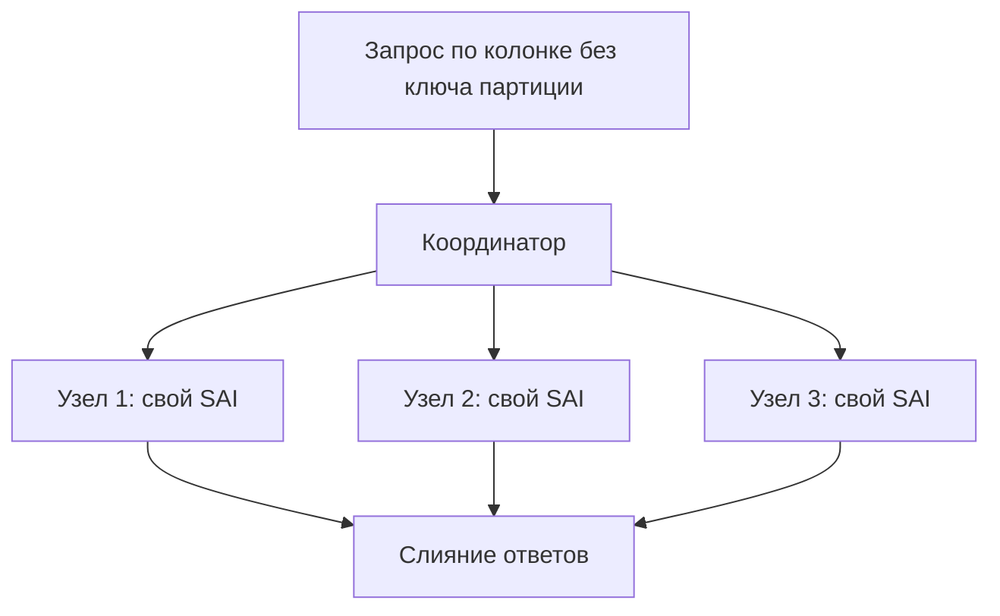
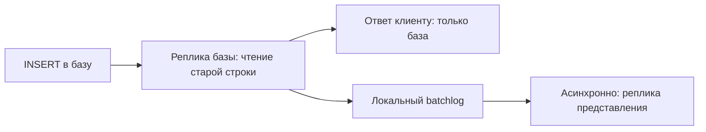

# 09. Индексы, SAI, векторный поиск и материализованные представления

**Зачем это знать backend-разработчику.** Когда продукт просит «ещё один фильтр», рука тянется к индексу. В Cassandra **вторичный индекс** (secondary index) не превращает таблицу в произвольный SQL: он либо честно дорог, либо уместен на низкой кардинальности. В 5.0 основной механизм такого индекса — SAI. Векторный поиск живёт рядом и тоже не заменяет ключ партиции. Чаще правильный ответ на новый экран — вторая таблица.

> **Коротко:** старый вторичный индекс (2i) держит скрытую таблицу и плохо переносит высокую кардинальность. SAI (Storage-Attached Index) хранит индекс рядом с данными SSTable — это тот вторичный индекс, который на Cassandra 5 и стоит создавать, но разброс запроса по кольцу он не отменяет. Поиск ближайших векторов (ANN) опирается на SAI и остаётся экспериментальным. Материализованное представление (materialized view) в образе `cassandra:5.0` выключено по умолчанию. Операционный путь курса — вторая таблица из приложения.

Примеры сняты на пробном контейнере `cassandra:5.0` (`release_version` = **5.0.9**, `num_tokens: 16`) на таблице проб `guide.ops (id int PRIMARY KEY, city text, age int, created timestamp, tags set<text>, props map<text,text>, flag boolean, note text, body text, v vector<float,3>)`.

## Оглавление

- [Почему индекс не ключ](#почему-индекс-не-ключ)
- [Старый вторичный индекс](#старый-вторичный-индекс)
- [SAI](#sai)
- [Операторы, которые SAI понимает на 5.0](#операторы-которые-sai-понимает-на-50)
- [2i против SAI на числах](#2i-против-sai-на-числах)
- [Векторный поиск](#векторный-поиск)
- [Материализованные представления](#материализованные-представления)
- [Когда всё-таки вторая таблица](#когда-всё-таки-вторая-таблица)
- [🔬 Глубже: селективность и запрос с ключом партиции](#-глубже-селективность-и-запрос-с-ключом-партиции)
- [Практика в репозитории](#практика-в-репозитории)
- [Типичные ошибки и заблуждения](#типичные-ошибки-и-заблуждения)
- [Итоги](#итоги)
- [Вопросы для самопроверки](#вопросы-для-самопроверки)
- [Источники](#источники)

## Почему индекс не ключ

**На пальцах** (аналогия). Ключ партиции (partition key) — адрес полки. Индекс — картотека «в каких полках встречается слово». Картотека помогает, если слово редкое и полок мало. Если слово «да» стоит на каждой полке, картотека превращается в обход склада.

Запрос по вторичному индексу без ключа партиции становится **разбросанным** (scatter-gather): координатор (coordinator) спрашивает много узлов. Это видно буквально — трассировка (`TRACING ON`) печатает не «пошёл в партицию», а обход **диапазонов токенов** (token range):

```
cqlsh> SELECT count(*) FROM guide.cmp_sai WHERE city = 'Perm';
 Computing ranges to query
 Submitting range requests on 17 ranges with a concurrency of 17
 ...
 Submitting range requests on 1 ranges with a concurrency of 1
```

Семнадцать диапазонов — это 16 диапазонов виртуальных узлов (vnode) плюс замыкающий. На кластере из 9 узлов с теми же `num_tokens: 16` диапазонов около 145, и координатор опросит практически все узлы (это расчёт, замер был на одном узле). Стоимость растёт с размером кольца (ring), а не с числом найденных строк: один и тот же `WHERE city = 'Perm'` на 3 узлах и на 30 — это до 3 и до 30 сетевых адресатов. Поэтому индекс — уточнение внутри уже известной партиции или редкий признак, а не способ «искать пользователя по городу» на весь каталог.

## Старый вторичный индекс

**На пальцах** (аналогия). У каждого филиала картотека **только своих** полок, и она в отдельном шкафу. Центр звонит во все филиалы; каждый идёт сначала к шкафу, потом по его подсказкам к полкам — два похода вместо одного.

Классический `CREATE INDEX ON table (city)` без `USING` — это 2i. Индекс физически оформлен как **скрытая таблица** внутри каталога базовой: 10 000 строк в `guide.cmp_2i` (10 различных городов, 152 363 байта данных) после `nodetool flush` дали

```
$ ls -la /opt/cassandra/data/data/guide/cmp_2i-*/.cmp_2i_city/
nb-1-big-Data.db  104404 | Statistics.db 4884 | Index.db 101 | Filter.db 24
                                                     всего 109691 байт
```

Полноценный набор SSTable со своим Data, Index, Filter и Statistics. Отсюда два похода на чтении:

```
 Executing read on guide.cmp_2i using index cmp_2i_city
 Executing single-partition query on cmp_2i.cmp_2i_city      <- скрытая таблица индекса
 Executing single-partition query on cmp_2i                  <- и только потом данные
 Submitting range requests on 17 ranges with a concurrency of 2 (56.25 rows per range expected)
```

Два числа в последней строке — механика деградации. Координатор **оценивает** по статистике индекса, сколько строк ждёт в диапазоне (`56.25`), и выводит из оценки параллельность `concurrency of 2`: диапазоны уходят волнами по два, а не разом (17, 15, 13… до 1).

Плохо работает при высокой кардинальности (адрес почты, `user_id`) — скрытая таблица получает партицию почти на каждую строку; когда одно значение сидит в огромной доле строк (флаг `active = true`); когда столбец часто обновляется — индекс переписывается, плюс надгробия (tombstone) в скрытой таблице ([07](07-tombstones.md#сколько-стоит-чтение-через-надгробия)). В новом коде на Cassandra 5 этот путь по умолчанию не выбирают.

## SAI

**На пальцах** (аналогия). Вместо шкафа в каждый ящик вклеен свой алфавитный указатель: ящик переупаковывают — указатель переклеивают вместе с ним. А если указателей несколько (по городу, по возрасту), общую «схему ящика» они используют одну.

**Storage-Attached Index** хранит структуры индекса вместе с SSTable. При уплотнении (compaction) индекс перестраивается вместе с файлом, и запрос может отсечь файлы, не ходя в каждый вслепую. Те же 10 000 строк в `guide.cmp_sai` с одним SAI по `city` дают файлы **рядом** с данными, без вложенного каталога:

```
nb-1-big-SAI+aa+RowToToken.db                 81016   \  общие на SSTable: 124271 байт
nb-1-big-SAI+aa+PartitionKeyBlocks.db         42140    > (+ PartitionKeyBlockOffsets, GroupMeta,
nb-1-big-SAI+aa+cmp_sai_city+PostingLists.db  10744   /  PartitionToSize, RowToPartition)
nb-1-big-SAI+aa+cmp_sai_city+TermsData.db       163      на колонку city: 11150 байт
```

Файлы без имени колонки (124 271 байт) — общая для всех SAI одного SSTable карта «номер строки → токен → ключ партиции». Файлы с именем индекса — 11 150 байт, из них 10 744 — списки вхождений (posting list). Значит **первый** SAI стоит 135 КБ, а **второй** добавит только свои файлы — порядка десятка КБ при похожей кардинальности, а не ещё 135. У 2i вторая колонка — вторая скрытая таблица целиком.

Первое искушение — навесить SAI на ключ партиции `guide.log_by_author` (`PRIMARY KEY ((author_id), sent_at, message_id)`, [задание 02](../tasks/02-messages-by-user.md)). Сервер это честно отклоняет:

```
cqlsh> CREATE CUSTOM INDEX log_by_author_idx ON guide.log_by_author (author_id) USING 'sai';
InvalidRequest: code=2200 "Cannot create secondary index on the only partition key column author_id"
```

Запрещено индексировать *единственную* колонку ключа; если ключ **составной** (composite partition key), одну из его колонок индексировать можно. В `guide.sensor_readings` ([задание 03](../tasks/03-sensor-metrics.md)) ключ — `(sensor_id, bucket)`, и `CREATE CUSTOM INDEX ... (bucket) USING 'sai'` проходит. Два индекса на одной колонке сервер не даст: `Cannot create more than one storage-attached index on the same column: v`.

Типы, которые SAI принял на 5.0.9 (девять `CREATE CUSTOM INDEX` без ошибки): `text`, `int`, `timestamp`, `boolean`, `set<text>`, `map<text,text>` в трёх формах (`KEYS`, `VALUES`, `ENTRIES`), `vector<float, 3>`, а также кластерная колонка (clustering column) и статическая колонка (static column). А из опций индекса понятны ровно три:

```
cqlsh> CREATE CUSTOM INDEX ops_body2 ON guide.ops (body) USING 'sai'
       WITH OPTIONS = {'case_sensitive': 'false', 'normalize': 'true', 'ascii': 'true'};
cqlsh> SELECT id FROM guide.ops WHERE body = 'RED LEATHER SOFA';   -- находит 'red leather sofa'
cqlsh> CREATE CUSTOM INDEX ops_body3 ON guide.ops (body) USING 'sai'
       WITH OPTIONS = {'index_analyzer': 'standard'};
ConfigurationException: Properties specified [index_analyzer] are not understood by StorageAttachedIndex
```

Ответ на вопрос «а полнотекст?»: **анализатор на этой сборке не подключается**. SAI (CEP-7) поставляется в открытом ядре именно с Apache Cassandra 5.0; до этого он жил только в коммерческих продуктах DataStax (DSE 6.8, Astra DB) — не переносите список операторов из их документации.



## Операторы, которые SAI понимает на 5.0

**На пальцах** (аналогия). Алфавитный указатель отвечает на «где слово ровно такое» и «где слова от Б до Д» — он отсортирован. На «где слово НЕ такое» он не отвечает: придётся перечитать ящик. А «где слово содержит такой слог» требует указателя слогов, которого в ящик не вклеили.

Перебор на `guide.ops` с SAI на `city`, `age`, `created`, `flag`, `tags`, `KEYS/VALUES/ENTRIES(props)` и `v`; колонка `note` специально оставлена **без** индекса.

| Запрос | Результат на 5.0.9 |
|---|---|
| `city = 'Moscow'`, `flag = true`, `created > '2026-01-15'` | работает |
| `age > 30`, `age <= 25`, `age >= 25 AND age < 44` | работает (два предела одной колонки) |
| `tags CONTAINS 'red'`, `props CONTAINS KEY 'tier'`, `props CONTAINS 'gold'` | работает |
| `props['tier'] = 'gold'` | работает, нужен индекс по `ENTRIES` |
| `city = 'Moscow' AND age > 30` | работает: два SAI пересекаются |
| `city IN ('Moscow','Omsk')`, `age IN (25, 31)` | **отклонён**, требует `ALLOW FILTERING` |
| `city > 'M'`, `city >= 'M' AND city <= 'O'` | **отклонён**, требует `ALLOW FILTERING` |
| `note = 'n1'` (колонка без SAI) | **отклонён**, требует `ALLOW FILTERING` |
| `city != 'Omsk'` | `Unsupported "!=" relation: city != 'Omsk'` |
| `age BETWEEN 25 AND 31`, `body : 'sofa'` | `SyntaxException` — таких операторов в CQL 5.0 нет |
| `city LIKE 'Mos%'` | `LIKE restriction is only supported on properly indexed columns` |
| `count(*) ... WHERE city = 'Moscow'` | работает с предупреждением `Aggregation query used without partition key` |
| `GROUP BY city` | `Group by is currently only supported on the columns of the PRIMARY KEY` |

Выводы.

**Диапазоны работают на числах и времени, но не на тексте.** `age > 30` проходит, `city > 'M'` требует `ALLOW FILTERING` — уже не сужение по индексу, а чтение с отбросом.

**`IN` по SAI-колонке не поддержан.** Неочевидно: `IN` по ключу партиции работает. С `ALLOW FILTERING` запрос пройдёт, но это чтение с отбросом, а не поиск по индексу. Замена — несколько запросов по `=` и объединение в приложении.

**`LIKE` и `:` недоступны.** `LIKE` в Cassandra — территория SASI, старого экспериментального индекса (здесь выключен: `sasi_indexes_enabled: false`); SAI на 5.0 его не обслуживает. Оператора `:` (полнотекст через анализатор) нет в грамматике.

**Частичная индексация не помогает.** `WHERE city = 'Moscow' AND note = 'n1'` отклоняется целиком: нужен либо `ALLOW FILTERING` на весь запрос, либо SAI на каждую колонку из `WHERE`.

## 2i против SAI на числах

**На пальцах** (аналогия). Два склада с одинаковым товаром. В первом картотека в отдельном шкафу, кладовщик ходит дважды, и бригадир пускает в проходы по двое. Во втором указатель вклеен в ящик, и бригадир отправляет всех разом.

Одна нагрузка: 10 000 строк, 10 различных городов (по 1000 на город), один узел, `num_tokens: 16`, `SELECT count(*) WHERE city = 'Perm'` после `nodetool flush`.

| Что сравниваем | 2i (`cmp_2i`) | SAI (`cmp_sai`) |
|---|---|---|
| Где живёт индекс | скрытая таблица в `.cmp_2i_city/` | файлы `SAI+aa+*` рядом с SSTable |
| Размер на 10 000 строк | 109 691 байт — 72 % от 152 363 байт данных | 135 421 байт, на колонку из них 11 150 |
| Второй столбец | +скрытая таблица, ~110 КБ | +11 КБ: карта строк общая |
| Чтений скрытой таблицы в трассировке | 11 | 0 |
| Диапазонов токенов в обходе | 17 | 17 |
| Параллельность | `concurrency of 2 (56.25 rows per range expected)` | `concurrency of 17` |

Число диапазонов у обоих одинаковое: **разброс по кольцу SAI не отменяет**. Выигрыш в другом: у 2i на каждый диапазон идёт лишнее чтение скрытой таблицы, обход дробится волнами по оценке строк (на 30 узлах с 16 токенами диапазонов около 480, и узкие волны там больнее), а Bloom-фильтр скрытой таблицы конкурирует за память с базовой; у SAI отдельного Bloom-фильтра на индекс нет вовсе.

Арифметика «индексов про запас» — расчёт по пропорции, не замер. Размер индекса растёт с числом строк, а не с объёмом данных: на миллиард строк пять SAI дают ≈ (124 271 + 5 × 11 150) × 10⁵ байт ≈ 18 ГБ, пять 2i — ≈ 5 × 109 691 × 10⁵ ≈ 55 ГБ и пять наборов SSTable на уплотнение. На широких строках доля индексов от диска меньше, соотношение примерно то же. И там и там каждая запись обновляет все пять индексов: усиление записи (write amplification) растёт кратно их числу.

## Векторный поиск

**На пальцах** (аналогия). Это картотека не «где слово», а «что похоже». Вопрос к ней — «дай десять самых близких»; без числа «десять» вопрос бессмысленен, потому что близко в той или иной степени всё.

В Cassandra 5.0 у SAI есть векторный режим: колонка-вектор и поиск ближайших по расстоянию (approximate nearest neighbor, ANN). При создании индекса сервер сам печатает список того, чего ANN ещё не умеет:

```
cqlsh> CREATE CUSTOM INDEX ops_v ON guide.ops (v) USING 'sai';
Warnings :
SAI ANN indexes on vector columns are experimental and are not recommended for production use.
They don't yet support SELECT queries with:
 * Consistency level higher than ONE/LOCAL_ONE.
 * Paging.
 * No LIMIT clauses.
 * PER PARTITION LIMIT clauses.
 * GROUP BY clauses.
 * Aggregation functions.
 * Filters on columns without a SAI index.
```

Оно печатается и на каждом `ALTER TABLE` этой таблицы. Точные тексты ошибок по пунктам (запрос, затем ответ сервера):

```sql
ORDER BY v ANN OF [0.1,0.2,0.3]
-- "Top-K queries must have a limit specified and the limit must be less than the query page size"
ORDER BY v ANN OF [0.1,0.2,0.3] LIMIT 6000
-- "Use of ANN OF in an ORDER BY clause requires a LIMIT that is not greater than 1000. LIMIT was 6000"
ORDER BY v ANN OF [...] PER PARTITION LIMIT 1 LIMIT 2
-- "Top-K queries do not support per-partition limits"
SELECT count(*) ... ORDER BY v ANN OF [...] LIMIT 2
-- "Top-K queries can not be run with aggregation"
WHERE note = 'n1' ORDER BY v ANN OF [...] LIMIT 2
-- "ANN ordering by vector requires all restricted column(s) to be indexed"
```

Главное число: **верхний предел `LIMIT` для ANN — 1000**. Приписка `ALLOW FILTERING` к запросу с неиндексированной колонкой не спасает, текст ошибки тот же.

Два пункта сервер не отклоняет, а молча исправляет — это опаснее явной ошибки:

```
cqlsh> CONSISTENCY QUORUM;
cqlsh> SELECT id FROM guide.ops ORDER BY v ANN OF [0.1, 0.2, 0.3] LIMIT 1;
Warnings : Top-K queries can only be run with consistency level ONE / LOCAL_ONE / NODE_LOCAL.
Consistency level QUORUM was requested. Downgrading the consistency level to ONE.

cqlsh> PAGING 2;
cqlsh> SELECT id FROM guide.ops ORDER BY v ANN OF [0.1, 0.2, 0.3] LIMIT 3;
Warnings : Top-K queries do not support paging and the page size is set to 2,
which is less than LIMIT 3. The page size has been set to 3 to match the LIMIT.
```

`QUORUM` на ANN превращается в `ONE` без ошибки, а размер страницы сервер поднимает до `LIMIT` сам. Приложение узнает об этом только из предупреждений ответа — их стоит логировать (`ExecutionInfo.getWarnings()`, см. [10](10-java-driver.md#метрики-и-слушатели-состояния)). Размерность и функция расстояния фиксируются схемой; точность ANN — компромисс с задержкой, а не гарантия абсолютного топа. В заданиях курса векторного поиска нет.

## Материализованные представления

**На пальцах** (аналогия). Договор с архивом: «кладу папку на свою полку — вы сами делаете копию на вторую полку, разложенную по другому признаку». Удобно, пока архив успевает. Если копия отстала, вы об этом не узнаете из расписки за первую папку.

**Материализованное представление** (materialized view) — таблица, которую Cassandra обновляет сама при записи в базовую. На образе `cassandra:5.0` они **выключены по умолчанию**, и флаг лежит в `cassandra.yaml` под говорящим заголовком:

```
cqlsh> CREATE MATERIALIZED VIEW guide.users_by_city AS ...;
InvalidRequest: code=2200 "Materialized views are disabled. Enable in cassandra.yaml to use."

$ grep -B3 "^materialized_views_enabled" /etc/cassandra/cassandra.yaml
# EXPERIMENTAL FEATURES #
# Materialized views are considered experimental and are not recommended for production use.
materialized_views_enabled: false
```

В том же разделе `sasi_indexes_enabled`, `transient_replication_enabled`, `drop_compact_storage_enabled`. После `true` и перезапуска узла представление создаётся, но с предупреждением `Materialized views are experimental and are not recommended for production use.`

Ограничения принципиальные, и каждое сервер формулирует сам. База — `guide.users (user_id uuid PRIMARY KEY, email text, city text, age int)`:

```
-- ключ представления без ключа базы
"Cannot create materialized view 'users_bad1' without primary key columns user_id from base table 'users'"
-- две обычные колонки в ключе
"Cannot include more than one non-primary key column in materialized view primary key (got city, email)"
-- забыли IS NOT NULL
"Primary key columns city, user_id must be restricted with 'IS NOT NULL' or otherwise"
-- попытка «частичного» представления условием
"Non-primary key columns can only be restricted with 'IS NOT NULL' (got: age restricted illegally)"
```

Из этих текстов складывается вся модель: ключ базы обязан входить в ключ представления (иначе сервер не найдёт строку при удалении), обычных колонок в ключ можно добавить **ровно одну**, фильтр — только `IS NOT NULL`. Уникальность «как LWT на другом ключе» представлением не появляется.

Рабочее представление ведёт себя так: `INSERT` в `guide.users` сразу виден в `SELECT ... FROM guide.users_by_city WHERE city = 'Moscow'`, а `UPDATE guide.users SET city = 'Omsk'` переносит строку — на `WHERE city = 'Moscow'` приходит `(0 rows)`, на `WHERE city = 'Omsk'` — `(1 rows)`. Писать в представление напрямую нельзя: `Cannot directly modify a materialized view`.

Лаг представления — штатное явление, а не авария. Работу делает не координатор, а **каждая реплика базы**: применяя запись, она читает прежнюю версию строки (read-before-write), вычисляет изменение представления, кладёт его в локальный batchlog (тот же механизм, что logged batch, [08](08-lwt-batches-counters.md#пакеты)) и **асинхронно** отправляет парной реплике представления. Уровень согласованности клиентского запроса эту вторую запись не ждёт. Темп задан узлом: `concurrent_materialized_view_writes: 32` на мутации и `concurrent_materialized_view_builders: 1` на первичную сборку — то есть на большой таблице сборка идёт одним потоком. Прогресс смотрят отдельно:

```
$ nodetool viewbuildstatus guide users_by_city
guide.users_by_city has finished building
$ nodetool tpstats | grep -i view
ViewBuildExecutor              0      0       80        0       0
```

Комментарий к `materialized_views_on_repair_enabled` договаривает неприятное: если его выключить, при потере больше кворума реплик часть данных может никогда не попасть в представление. Курс вместо этого пишет две таблицы из Java: сбой второй записи виден по её ответу, а не через отдельный мониторинг view.



## Когда всё-таки вторая таблица

**На пальцах** (аналогия). За товаром приходят каждый час — ему делают свою полку. Раз в месяц и известен отдел — хватит указателя в ящике. «Найди вообще где-нибудь» — вопрос не к складу, а к поисковой службе.

| Вопрос | Куда |
|---|---|
| Частый экран с известным ключом | Своя таблица, запись из приложения |
| Редкий фильтр умеренной кардинальности внутри открытой партиции | SAI |
| «Найди любые строки, где колонка = значение» на весь кластер | Другая модель или другой движок, не индекс «на вырост» |
| Подстрока, полнотекст | Не `cassandra:5.0`: `index_analyzer` сборка не понимает |
| Похожие векторы | SAI vector, `LIMIT` ≤ 1000 |
| Уникальность значения | LWT на таблице, где значение — ключ |

Индекс не даёт порядка ленты: «сначала новые» задаёт кластер таблицы, а не индекс.

## 🔬 Глубже: селективность и запрос с ключом партиции

Индекс почти всегда дешевле, если в запросе уже есть ключ партиции. Это видно по трассировке — с ключом партиции в ней нет ни `Computing ranges to query`, ни `Submitting range requests`, обход кольца просто не начинается. Пример живой: партиция — день метрик, SAI — на редкий код ошибки внутри дня. Пример мёртвый: SAI на код ошибки без дня, по всему кластеру за годы.

**Кардинальность** (cardinality) — число различных значений колонки; её оценивают до создания индекса. В замере выше 10 различных городов на 10 000 строк (отношение 0,001) дали список вхождений 10 744 байта. Если значений почти столько же, сколько строк, каждый ответ — одна строка ценой обхода кольца, и таблица с этим значением в ключе дешевле. Обратный край (почти все строки с одним значением) — индекс возвращает почти всё и проигрывает честному бакету (bucket). Середина и низкая частота значения — рабочая зона SAI.

Наконец, `ALLOW FILTERING` рядом с индексом не «включает индекс для IN», а **отключает защиту**: сервер соглашается прочитать больше, чем вернёт, см. [04](04-data-model.md#что-можно-указать-в-where).

## Практика в репозитории

- [Задание 02](../tasks/02-messages-by-user.md) — вторая таблица вместо индекса по автору.
- [Задание 05](../tasks/05-unique-username.md) — уникальность через ключ и LWT.
- Метод «сначала запрос» — [05](05-query-first.md).

## Типичные ошибки и заблуждения

1. **«CREATE INDEX сделает колонку уникальной.»** Нет, две строки с одним городом сосуществуют. Уникальность — LWT.
2. **«SAI можно вешать на каждый столбец про запас.»** Пять SAI на миллиард строк — порядка 18 ГБ индексных файлов и пятикратное усиление записи по индексам.
3. **«Материализованное представление — бесплатный второй INSERT.»** За него платит кластер, и платит ещё раз на repair.
4. **«SAI — как индекс в Postgres, можно писать IN и LIKE.»** На 5.0.9 `IN` требует `ALLOW FILTERING`, `LIKE` отвергается, `BETWEEN` в грамматике отсутствует, `index_analyzer` сборка не понимает.
5. **«Зато SAI не разбрасывает запрос.»** Разбрасывает: те же 17 диапазонов токенов, что у 2i.

## Итоги

- Запрос без ключа партиции разбросан по кольцу: 17 диапазонов токенов при `num_tokens: 16`, и у SAI их столько же, сколько у 2i.
- 2i держит скрытую таблицу (109 691 байт на 10 000 строк) и читает её отдельно; SAI кладёт файлы рядом с SSTable и переиспользует карту строк, поэтому второй индекс стоит 11 КБ, а не 135.
- На 5.0.9 SAI отвечает на `=`, числовые и временные диапазоны, `CONTAINS`, `CONTAINS KEY`, `props[...]` и пересечение индексов; `IN`, `!=`, текстовые диапазоны, `LIKE` и `BETWEEN` — нет, полнотекста нет вовсе.
- ANN экспериментален: `LIMIT` обязателен и не больше 1000, уровень выше `ONE` сервер молча понижает.
- Представления выключены флагом `materialized_views_enabled` в разделе `EXPERIMENTAL FEATURES`, ограничены одной неключевой колонкой в ключе и обновляются асинхронно.
- Частый экран в этом курсе закрывают второй таблицей из приложения.

## Вопросы для самопроверки

1. Почему индекс по `user_id`, если `user_id` уже ключ партиции, ничего не ускоряет?
   <details><summary>Ответ</summary>Запрос и так попадает в нужные реплики по токену (token). Сервер такой индекс и не создаст: `Cannot create secondary index on the only partition key column`.</details>
2. Чем путь SAI отличается от «спросить каждый узел про локальный 2i» и что у них одинаково?
   <details><summary>Ответ</summary>Одинаков обход кольца: 17 диапазонов токенов у обоих. Разное — у 2i на каждый диапазон идёт чтение скрытой таблицы `cmp_2i.cmp_2i_city`, а обход дробится волнами по два по оценке «56.25 строк на диапазон»; у SAI таких чтений ноль, параллельность равна числу диапазонов.</details>
3. Вы добавляете второй индексированный столбец. Сколько это стоит на диске?
   <details><summary>Ответ</summary>Для SAI — около 11 КБ на 10 000 строк: карта «строка → токен → ключ» (124 КБ) общая на SSTable. Для 2i — ещё одна скрытая таблица целиком, порядка 110 КБ со своим Bloom-фильтром.</details>
4. Продукт просит фильтр «город в списке из пяти». Пишем `WHERE city IN (...)` по SAI?
   <details><summary>Ответ</summary>Нет: на 5.0.9 сервер требует `ALLOW FILTERING`, то есть чтение с отбросом. Делают пять запросов по `=` и объединяют в приложении.</details>
5. Запрос ANN отправлен с `CONSISTENCY QUORUM` и `LIMIT 5000`. Что ответит сервер?
   <details><summary>Ответ</summary>На `LIMIT 5000` — ошибку `requires a LIMIT that is not greater than 1000`. С допустимым `LIMIT` запрос выполнится, но уровень молча понизится до `ONE` с предупреждением `Downgrading the consistency level to ONE`.</details>
6. Нужно представление «только пользователи старше 30». Как это задать?
   <details><summary>Ответ</summary>Никак: `Non-primary key columns can only be restricted with 'IS NOT NULL' (got: age restricted illegally)`. Фильтр по значению придётся делать своей таблицей.</details>

## Источники

- Apache Cassandra docs 5.0: *Secondary indexes* и SAI. https://cassandra.apache.org/doc/5.0/cassandra/developing/cql/indexing/sai.html
- Ограничения `CREATE MATERIALIZED VIEW`. https://cassandra.apache.org/doc/5.0/cassandra/developing/cql/mvs.html
- Тексты ошибок, размеры файлов и строки трассировки сняты на контейнере `cassandra:5.0` (5.0.9, `num_tokens: 16`): `cqlsh`, `TRACING ON`, `ls` каталога данных, `nodetool flush`, `viewbuildstatus`, `tpstats`.
- `cassandra.yaml` того же образа: раздел `EXPERIMENTAL FEATURES` и параметры `concurrent_materialized_view_writes`, `concurrent_materialized_view_builders`, `materialized_views_on_repair_enabled`.

---

← [08. LWT, пакеты и счётчики](08-lwt-batches-counters.md) | [оглавление](README.md) | [10. Java-драйвер](10-java-driver.md) → | [словарь терминов](glossary.md)
