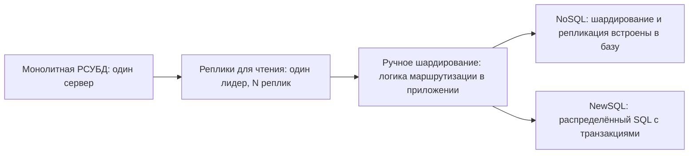

# 01. Зачем появился NoSQL

**Зачем это знать backend-разработчику.** Выбор хранилища — одно из самых дорогих решений в проекте: его почти невозможно поменять через год эксплуатации. Если понимать, *какие именно проблемы* реляционных баз решал NoSQL, легко ответить на вопрос «нужна ли нам MongoDB/Cassandra/Redis или хватит PostgreSQL». Если не понимать, выбор делается по моде, а потом команда годами борется с базой, которая не подходит под нагрузку.

> **Коротко:** NoSQL появился в конце 2000-х, когда веб-компании упёрлись в предел одного мощного сервера: реляционную базу трудно «размазать» по сотням машин, потому что join-ы и ACID-транзакции требуют координации между узлами. Google (Bigtable, 2006) и Amazon (Dynamo, 2007) пожертвовали частью возможностей SQL ради горизонтального масштабирования и доступности. Попутно NoSQL решил ещё две боли: несоответствие объектной и табличной моделей и жёсткую схему. Сегодня маятник качнулся обратно: NewSQL и PostgreSQL с JSONB/pgvector закрывают многие сценарии, и NoSQL нужен не «по умолчанию», а под конкретную нагрузку.

## Оглавление

- [Немного истории: Bigtable, Dynamo и слово «NoSQL»](#немного-истории-bigtable-dynamo-и-слово-nosql)
- [Пределы вертикального масштабирования](#пределы-вертикального-масштабирования)
- [Почему join и ACID плохо масштабируются горизонтально](#почему-join-и-acid-плохо-масштабируются-горизонтально)
- [Impedance mismatch: объекты против таблиц](#impedance-mismatch-объекты-против-таблиц)
- [Гибкость схемы: schema-on-write против schema-on-read](#гибкость-схемы-schema-on-write-против-schema-on-read)
- [OLTP, OLAP и нагрузка «много простых запросов по ключу»](#oltp-olap-и-нагрузка-много-простых-запросов-по-ключу)
- [Эволюция архитектуры хранения](#эволюция-архитектуры-хранения)
- [Обратный тренд: NewSQL и «просто PostgreSQL»](#обратный-тренд-newsql-и-просто-postgresql)
- [Как это выглядит в Redis / MongoDB / Cassandra](#как-это-выглядит-в-redis--mongodb--cassandra)
- [Типичные ошибки и заблуждения](#типичные-ошибки-и-заблуждения)
- [Итоги](#итоги)
- [Вопросы для самопроверки](#вопросы-для-самопроверки)
- [Источники](#источники)

## Немного истории: Bigtable, Dynamo и слово «NoSQL»

**На пальцах.** Представьте городскую библиотеку с одним гигантским каталогом. Пока читателей тысяча, всё работает. Когда их миллион, у каталога выстраивается очередь, и никакой «более быстрый библиотекарь» не поможет: нужно открыть много филиалов, каждый со своей частью книг. Именно это произошло с базами данных крупных интернет-компаний в 2000-х.

Ключевые вехи:

| Год | Событие | Что предложили |
|---|---|---|
| 2006 | Статья Google **Bigtable** (OSDI'06) | Распределённая «разреженная многомерная отсортированная карта» `(row, column, timestamp) → value` поверх тысяч дешёвых серверов. Нет SQL, нет join, нет транзакций между строками |
| 2007 | Статья Amazon **Dynamo** (SOSP'07) | Key-value хранилище для корзины покупателя: запись принимается *всегда*, даже при сбоях сети, ценой временной рассогласованности реплик |
| 2008 | Facebook открывает **Cassandra** | Гибрид: распределение данных и репликация от Dynamo, формат хранения от Bigtable |
| 2009 | Встреча в Сан-Франциско под хэштегом **#nosql** | Термин закрепился как название движения. Выходят первые версии MongoDB и Redis |

Слово «NoSQL» впервые использовал Карло Строцци в 1998 году для своей небольшой *реляционной* базы без языка SQL, но популярным оно стало только после встречи 2009 года, которую организовал Йохан Оскарссон (Last.fm), а имя предложил Эрик Эванс. Позже аббревиатуру стали расшифровывать как **Not Only SQL** («не только SQL»): NoSQL не отрицает SQL, а дополняет его.

**Пример.** Корзина Amazon из статьи Dynamo: требование бизнеса — «пользователь должен иметь возможность добавить товар в корзину, даже если часть дата-центра недоступна». Если две реплики приняли разные версии корзины (`[книга]` и `[книга, наушники]`), Dynamo хранит обе и при чтении отдаёт приложению, а приложение их *сливает*. Потерянный товар в корзине стоит дороже, чем лишний: удалённый товар иногда «воскресает», и Amazon сознательно принял этот компромисс.

## Пределы вертикального масштабирования

**На пальцах.** Есть два способа увеличить пропускную способность склада: построить один склад побольше (**вертикальное масштабирование**, scale-up) или открыть десять складов поменьше (**горизонтальное масштабирование**, scale-out).

- **Вертикальное масштабирование** (scale-up) — замена сервера на более мощный: больше ядер, памяти, быстрее диски.
- **Горизонтальное масштабирование** (scale-out) — добавление серверов (**узлов**, nodes) и распределение данных и нагрузки между ними.

У scale-up три потолка:

1. **Физический.** Самый большой сервер конечен. Можно купить машину на сотни ядер и несколько терабайт памяти, но не на порядок больше.
2. **Экономический.** На верхних конфигурациях цена растёт быстрее мощности: за последние проценты производительности платят непропорционально много.
3. **Надёжность.** Один сервер — одна **точка отказа** (single point of failure): сгорел блок питания — лежит весь сервис.

**Пример с числами.** Сервис хранит сессии пользователей: 200 млн сессий по ~2 КБ = ~400 ГБ, пиковая нагрузка 300 000 операций в секунду. Одна машина с 512 ГБ памяти формально вмещает данные, но на неё приходится 100% трафика. Если она перезагружается 10 минут, сервис недоступен 10 минут. Альтернатива — кластер из 10 узлов по 128 ГБ. Данные с одной копией-**репликой** (replica — полная копия данных на другом узле) занимают 400 × 2 = 800 ГБ, на узел — ~80 ГБ, остаётся запас на рост и служебную память. Каждый узел обслуживает ~30 000 оп/с, а отказ одного узла затрагивает лишь 10% ключей, и то только до переключения на реплику.

Проблема не в том, что реляционные базы «медленные» — один PostgreSQL обслуживает десятки тысяч транзакций в секунду. Проблема в том, что их классическая архитектура рассчитана на **один узел**, владеющий всеми данными.

## Почему join и ACID плохо масштабируются горизонтально

**На пальцах.** Пока все документы лежат в одном шкафу, сверить два из них — дело секунды. Когда шкафы стоят в разных городах, каждая сверка превращается в пересылку почтой.

Две главные «суперсилы» реляционной базы:

- **Join** — соединение строк нескольких таблиц по условию (например, заказы + товары).
- **ACID-транзакция** — группа операций, которая выполняется целиком или не выполняется вовсе (**атомарность**, Atomicity), переводит базу из корректного состояния в корректное (**согласованность**, Consistency), не видна параллельным транзакциям в промежуточном виде (**изоляция**, Isolation) и не теряется после подтверждения (**долговечность**, Durability).

На одном узле обе реализуются через общую память, общий журнал и локальные блокировки. Когда данные разрезаны на **шарды** (shards — части данных, каждая на своём узле), ситуация меняется.

**Пример: распределённый join.** Таблица `orders` (1 млрд строк) разбита по `user_id` на 8 шардов, таблица `products` — по `product_id`. Запрос «все заказы пользователя 42 с названиями товаров» сначала идёт точечно на один шард `orders` (ключ известен), но товары этих заказов лежат на разных шардах `products` — нужны второй раунд запросов и сборка результата по сети. Ещё хуже запрос «выручка по категориям товаров за вчера»: условие не содержит `user_id`, поэтому его приходится разослать на все 8 шардов `orders` и собрать ответы (**scatter-gather** — «разослать всем и собрать»), а потом соединить с `products`. Время ответа определяется самым медленным узлом.

**Пример: распределённая транзакция.** Перевод 100 ₽ со счёта A (шард 1) на счёт B (шард 2) требует **двухфазного коммита** (two-phase commit, 2PC):

| Шаг | Координатор | Шард 1 (счёт A) | Шард 2 (счёт B) |
|---|---|---|---|
| 1 | Отправляет PREPARE обоим | Блокирует A, пишет в журнал «готов списать 100» | Блокирует B, пишет «готов зачислить 100» |
| 2 | Получает два YES | Держит блокировку | Держит блокировку |
| 3 | Отправляет COMMIT | Списывает, снимает блокировку | Зачисляет, снимает блокировку |

Каждая транзакция — минимум два сетевых круга, и всё это время строки заблокированы.

### 🔬 Глубже: почему 2PC «блокирующий»

Если координатор упал после шага 2, но до шага 3, шарды не знают, коммитить или откатывать: они уже пообещали выполнить операцию и не имеют права решить сами. Блокировки висят до восстановления координатора. Современные системы (Spanner, CockroachDB) делают координатор отказоустойчивым через консенсус-репликацию (Raft/Paxos, см. [06](06-consensus-membership.md)), но цена — дополнительные задержки. Кроме того, по **теореме CAP** при сетевом разделении система должна выбрать между согласованностью и доступностью (подробно — в [03](03-cap-consistency.md)). Dynamo выбрал доступность.

Отсюда вывод ранних NoSQL-систем: **не давать** операций, которые требуют координации между узлами. Нет join — данные, нужные вместе, хранятся вместе (**денормализация** — намеренное дублирование данных ради чтения без join; см. [08](08-data-modeling.md)). Нет транзакций между ключами — атомарность гарантируется в пределах одного ключа, документа или **партиции** (partition — группа записей с общим ключом, хранящаяся на одном узле; см. [05](05-partitioning.md)).

## Impedance mismatch: объекты против таблиц

**На пальцах.** Вы собрали шкаф и хотите перевезти его. Реляционная база требует разобрать шкаф на доски, пронумеровать их и разложить по разным коробкам, а на новом месте — собрать обратно. Документная база позволяет перевезти шкаф целиком.

**Impedance mismatch** (объектно-реляционное несоответствие) — разрыв между тем, как данные устроены в коде (объекты с вложенными коллекциями, наследованием, ссылками), и тем, как они хранятся в реляционной базе (плоские таблицы и внешние ключи). Этот разрыв закрывают **ORM** (Object-Relational Mapping — библиотеки вроде Hibernate), но за это платят сложностью:
- **ленивая загрузка** (lazy loading) — связанные объекты подгружаются отдельным запросом при первом обращении, иногда уже после закрытия сессии;
- **проблема N+1** — 1 запрос за списком заказов и ещё N запросов за позициями каждого;
- **каскады** (cascades) — правила, какие связанные объекты сохранять или удалять вместе с родителем.

**Пример.** Заказ в Java-коде — один объект:

```java
// Заказ — единое целое с вложенными позициями и адресом
public record Order(
        String id,
        String customerId,
        Address shipping,
        List<OrderItem> items,
        Instant createdAt) {}

public record OrderItem(String sku, String title, int qty, BigDecimal price) {}

public record Address(String city, String street, String zip) {}
```

В реляционной модели это минимум три таблицы (`orders`, `order_items`, `addresses`), вставка — три `INSERT` в транзакции, чтение — join или несколько запросов. В документной базе это один документ, который читается и пишется одной операцией:

```json
{
  "_id": "ord-1001",
  "customerId": "cust-42",
  "shipping": { "city": "Казань", "street": "Баумана, 1", "zip": "420111" },
  "items": [
    { "sku": "BK-17", "title": "Designing Data-Intensive Applications", "qty": 1, "price": 3200 },
    { "sku": "HP-03", "title": "Наушники", "qty": 2, "price": 1500 }
  ],
  "createdAt": "2026-09-22T10:15:00Z"
}
```

Бонус для масштабирования: весь заказ лежит на одном узле, и его обновление атомарно без распределённой транзакции.

Обратная сторона: если нужен отчёт «сколько раз продавался товар HP-03 по всем заказам», таблица `order_items` с индексом удобнее. Модель данных подстраивается под *запросы*, а не наоборот.

## Гибкость схемы: schema-on-write против schema-on-read

**На пальцах.** Анкета в поликлинике со строгими полями — это schema-on-write: заполнить поле, которого нет в бланке, нельзя. Блокнот, куда врач пишет что угодно, — schema-on-read: структуру вы восстанавливаете, когда читаете запись.

- **Schema-on-write** (схема при записи) — база проверяет данные при записи по заранее объявленной схеме (`CREATE TABLE`). Изменение схемы — миграция (`ALTER TABLE`).
- **Schema-on-read** (схема при чтении) — база принимает данные произвольной структуры, а интерпретирует их код, который читает.

Термин «schemaless» («без схемы») вводит в заблуждение: схема *всегда* есть, вопрос только в том, где она проверяется — в базе или в приложении.

**Пример.** Нужно добавить поле `loyaltyLevel` пользователям. В реляционной базе на таблице в 500 млн строк `ALTER TABLE ... ADD COLUMN ... DEFAULT` в современных версиях PostgreSQL выполняется быстро, но изменение типа колонки или бэкфилл данных может занять часы и требует аккуратной процедуры. В MongoDB новые документы сразу пишутся с полем, старые остаются как есть, а код обрабатывает обе версии:

```java
// Чтение документа, в котором поле могло ещё не появиться
LoyaltyLevel level(Document user) {
    String raw = user.getString("loyaltyLevel");
    return switch (raw) {
        case null -> LoyaltyLevel.BASIC; // старые документы: поля нет
        case "SILVER" -> LoyaltyLevel.SILVER;
        case "GOLD" -> LoyaltyLevel.GOLD;
        default -> throw new IllegalStateException("Unknown level: " + raw);
    };
}
```

Цена гибкости: ответственность за корректность переезжает в код. Поэтому в продакшене документные базы обычно всё равно ограничивают схемой — например, MongoDB поддерживает `$jsonSchema`-валидацию коллекций, а Cassandra вообще требует объявлять таблицы через CQL.

## OLTP, OLAP и нагрузка «много простых запросов по ключу»

**На пальцах.** Кассир в магазине обслуживает тысячи коротких покупок в день — это OLTP. Бухгалтер раз в месяц сводит все покупки за квартал в отчёт — это OLAP.

- **OLTP** (Online Transaction Processing, обработка транзакций) — много коротких операций, каждая читает или меняет несколько записей по ключу: «показать профиль», «добавить в корзину», «списать баланс». Важны задержка (latency) и число операций в секунду.
- **OLAP** (Online Analytical Processing, аналитическая обработка) — редкие тяжёлые запросы, которые сканируют миллионы строк и агрегируют их: «выручка по регионам за год». Важна скорость сканирования.

Большинство NoSQL-систем, о которых идёт речь в этом гиде (Redis, MongoDB, Cassandra), — **OLTP-системы**, причём заточенные под особый профиль: огромное число простых запросов, где заранее известен ключ.

**Пример профиля нагрузки.** Мобильное приложение с 20 млн активных пользователей:

| Запрос | Частота | Форма |
|---|---|---|
| Получить сессию по `sessionId` | 150 000/с | GET по ключу |
| Лента пользователя (последние 50 событий) | 40 000/с | чтение одной партиции, отсортированной по времени |
| Записать событие активности | 80 000/с | вставка в партицию пользователя |
| Отчёт по retention за месяц | раз в сутки | полное сканирование — это задача OLAP-системы |

Первые три строки — идеальная нагрузка для NoSQL: каждый запрос попадает ровно на один узел (по ключу), не нужны join-ы, и добавление узлов линейно увеличивает пропускную способность. Четвёртую строку разумно отдать колоночной аналитической базе (см. врезку про ClickHouse в [02](02-classification.md)).

## Эволюция архитектуры хранения

**На пальцах.** Растущий бизнес сначала работает из одного офиса, потом открывает справочные киоски (они только отвечают на вопросы), потом делит клиентов между филиалами по алфавиту, а в конце строит сеть, где распределение клиентов делает сама система.

Типичный путь проекта:



**Пример с числами.**

| Этап | Нагрузка | Решение | Какая боль приводит к следующему этапу |
|---|---|---|---|
| 1 | 1 000 запросов/с, 50 ГБ | Один PostgreSQL | Чтения забивают CPU |
| 2 | 20 000 чтений/с | Лидер + 3 **реплики для чтения** (read replicas — копии, принимающие только чтения) | Записи всё ещё идут в один узел; реплики отстают, пользователь не видит свой только что созданный пост |
| 3 | 15 000 записей/с, 5 ТБ | 16 экземпляров PostgreSQL, `user_id % 16` в коде | Решардинг с 16 на 32 — месяцы работы; join между шардами пишутся руками |
| 4 | Рост дальше | Cassandra/MongoDB с встроенным шардированием, или CockroachDB/YugabyteDB | — |

Примерно на этапе 3 и возникает запрос на NoSQL. Это один из путей, а не точная история: Google строил Bigtable не на смену шардированной РСУБД, а сразу под свои масштабы. Логика та же: раз уж join и транзакции между шардами всё равно потеряны, пусть база сама распределяет данные, автоматически добавляет узлы и переживает их отказы (подробнее о репликации — в [04](04-replication.md), о партиционировании — в [05](05-partitioning.md)).

## Обратный тренд: NewSQL и «просто PostgreSQL»

**На пальцах.** Когда-то, чтобы доехать быстро, приходилось пересаживаться с удобной машины на мотоцикл. Потом появились быстрые машины — и мотоцикл нужен уже не всем.

**NewSQL** — класс распределённых баз данных, которые сохраняют SQL и ACID-транзакции, но масштабируются горизонтально, как NoSQL:

- **Google Spanner** (статья 2012 года) — глобально распределённая база с **внешне согласованными** (external consistency) транзакциями — порядок коммитов совпадает с порядком в реальном времени; использует **TrueTime** — API времени с ограниченной погрешностью на основе атомных часов и GPS.
- **CockroachDB** — вдохновлена Spanner, совместима с протоколом PostgreSQL, реплицирует данные через Raft.
- **YugabyteDB** — использует слой запросов PostgreSQL поверх распределённого хранилища.
- **TiDB** — совместима с MySQL.

Цена NewSQL — задержка: транзакция между регионами требует консенсуса и занимает десятки–сотни миллисекунд.

Параллельно **PostgreSQL** впитал многие «NoSQL-фишки»:

- **JSONB** — бинарный JSON с **GIN-индексами** (инвертированный индекс по ключам и значениям внутри JSON): можно хранить документы и искать по их полям;
- **pgvector** — расширение для хранения **эмбеддингов** (числовых векторов, описывающих смысл текста или картинки; см. [02](02-classification.md)) и векторного поиска (HNSW и IVFFlat);
- **секционирование** таблиц (partitioning — одна таблица разбита на части, например по месяцам), **логическая репликация** (передача изменений строк в другую базу, а не байтов страниц), расширения вроде Citus для шардирования.

**Пример: документы в PostgreSQL из Java (JDBC).**

```java
// Хранение документа в JSONB и поиск по вложенному полю
String sql = """
        SELECT data FROM orders
        WHERE data @> '{"shipping": {"city": "Казань"}}'::jsonb
        ORDER BY data->>'createdAt' DESC
        LIMIT 20
        """;
try (var ps = connection.prepareStatement(sql);
     var rs = ps.executeQuery()) {
    while (rs.next()) {
        String json = rs.getString("data"); // дальше — Jackson в record Order
    }
}
```

Оператор `@>` означает «JSON слева содержит JSON справа»: запрос найдёт заказы, у которых `shipping.city = "Казань"`, и может использовать GIN-индекс.

**Когда NoSQL не нужен:** данные помещаются на один сервер с запасом (а это сотни гигабайт и даже единицы терабайт), нагрузка — единицы–десятки тысяч операций в секунду, важны сложные запросы, join-ы и транзакции между сущностями. Для типичного CRUD-сервиса это описание подходит в большинстве случаев.

**Когда NoSQL оправдан:** нужна линейная масштабируемость записи (Cassandra), задержки в доли миллисекунды и богатые структуры в памяти (Redis), модель «агрегат = документ» с гибкой схемой и встроенным шардированием (MongoDB), работа в нескольких дата-центрах с записью в любом из них.

## Как это выглядит в Redis / MongoDB / Cassandra

Каждая из трёх СУБД этого гида отвечает на «боли» реляционных баз по-своему.

**Redis** — хранилище «ключ → структура данных» в оперативной памяти. Отвечает на боль задержки и простых запросов по ключу: операция выполняется за микросекунды. Горизонтальное масштабирование — **Redis Cluster**: пространство ключей делится на 16 384 **слота** (hash slots), каждый узел владеет частью слотов. Команды над несколькими ключами работают только если все ключи в одном слоте — прямое следствие отказа от координации между узлами.

```bash
redis-cli SET session:9f2c '{"userId":42,"roles":["user"]}' EX 1800
redis-cli GET session:9f2c
```

**MongoDB** — документная база. Отвечает на impedance mismatch (агрегат = документ) и гибкость схемы, а шардирование встроено: коллекция делится по **ключу шардирования** (shard key). Изначально атомарность была только на уровне одного документа; многодокументные транзакции появились в 4.0 (2018) для replica set и в 4.2 (2019) для шардированных кластеров — MongoDB «догнал» часть возможностей РСУБД.

```js
// mongosh
db.orders.insertOne({ _id: "ord-1001", customerId: "cust-42", items: [{ sku: "BK-17", qty: 1 }] })
db.orders.find({ customerId: "cust-42" })
```

**Cassandra** — прямой наследник обеих статей: кольцо узлов, репликация без лидера и настраиваемые **кворумы** (quorum — сколько реплик должны подтвердить запись или чтение; см. [04](04-replication.md)) от Dynamo, модель «партиция с отсортированными строками» и LSM-хранение от Bigtable (**LSM-дерево** — структура, где записи сначала копятся в памяти, а потом сбрасываются на диск большими отсортированными файлами; подробно — в [07](07-storage-engines.md)). Отвечает на боль масштабирования записи: добавили узел — выросла пропускная способность. Join-ов нет совсем, таблица проектируется под конкретный запрос.

```sql
-- cqlsh
CREATE TABLE activity_by_user (
    user_id  uuid,
    event_id timeuuid,   -- время + уникальная часть: два события в одну миллисекунду не перезапишут друг друга
    event    text,
    PRIMARY KEY ((user_id), event_id)
) WITH CLUSTERING ORDER BY (event_id DESC);

SELECT * FROM activity_by_user WHERE user_id = 5b6962dd-3f90-4c93-8f61-eabfa4a803e2 LIMIT 50;
```

Если бы ключом кластеризации был просто `timestamp`, два события с одинаковой миллисекундой получили бы один первичный ключ, и второе молча заменило бы первое (в Cassandra `INSERT` — это upsert).

## Типичные ошибки и заблуждения

1. **«NoSQL быстрее SQL».** Не бывает «быстрее вообще». Redis быстрее PostgreSQL на GET по ключу, но PostgreSQL на порядки удобнее для отчёта с пятью join-ами. Скорость — свойство пары «база + форма запроса».
2. **«NoSQL — значит без схемы».** Схема есть всегда; в schema-on-read она просто живёт в коде. Отсутствие валидации в базе приводит к «зоопарку» документов пяти разных форм.
3. **«Возьмём NoSQL на вырост».** Преждевременное масштабирование: команда теряет join-ы и транзакции ради нагрузки, которой может никогда не быть. Один PostgreSQL обслуживает очень большой объём.
4. **«NoSQL не поддерживает транзакции».** Устарело: MongoDB поддерживает многодокументные ACID-транзакции, Cassandra — облегчённые транзакции ([LWT](06-consensus-membership.md#paxos-и-лёгкие-транзакции) на базе Paxos), Redis — `MULTI/EXEC` и Lua-скрипты. Но их области действия и стоимость сильно отличаются от РСУБД. Например, `MULTI/EXEC` в Redis выполняет команды без вмешательства других клиентов, но **не откатывает** уже выполненные команды, если одна из них упала с ошибкой.
5. **«Перенесём схему из PostgreSQL в Cassandra таблица в таблицу».** Нормализованная модель в wide-column базе даёт запросы, которые либо невозможны, либо требуют сканирования всего кластера. Модель строится от запросов (query-first).

## Итоги

- NoSQL вырос из статей Google Bigtable (2006) и Amazon Dynamo (2007); термин закрепился в 2009 году.
- Главная причина — пределы вертикального масштабирования и дороговизна join/ACID между узлами.
- NoSQL-системы отказываются от операций, требующих координации узлов, и хранят вместе данные, которые читаются вместе.
- Побочные выгоды: модель «агрегат = документ» убирает impedance mismatch, schema-on-read ускоряет изменения схемы.
- NoSQL заточен под OLTP с множеством простых запросов по известному ключу; аналитика — задача других систем.
- NewSQL и PostgreSQL с JSONB/pgvector закрывают многие сценарии: NoSQL выбирают под конкретную нагрузку, а не по умолчанию.

## Вопросы для самопроверки

1. Какие две статьи считаются основой NoSQL-движения и какие идеи взял из каждой Cassandra?
   <details><summary>Ответ</summary>Google Bigtable (2006) и Amazon Dynamo (2007). Из Dynamo Cassandra взяла распределение данных по кольцу, репликацию без лидера и настраиваемые кворумы; из Bigtable — модель данных (строки в партиции, отсортированные колонки) и LSM-подход к хранению.</details>
2. Назовите три предела вертикального масштабирования.
   <details><summary>Ответ</summary>Физический (самый мощный сервер конечен), экономический (цена растёт быстрее мощности) и надёжность (один сервер — единая точка отказа).</details>
3. Почему распределённая транзакция через 2PC дороже локальной?
   <details><summary>Ответ</summary>Нужны минимум два сетевых круга (PREPARE и COMMIT), блокировки держатся всё это время на всех участниках, а при падении координатора между фазами участники остаются заблокированными до его восстановления.</details>
4. Что такое impedance mismatch и как его уменьшает документная модель?
   <details><summary>Ответ</summary>Разрыв между объектной моделью кода (вложенные объекты, коллекции) и плоскими реляционными таблицами. Документная модель хранит агрегат (например, заказ с позициями) одним документом, поэтому он читается и пишется одной операцией без раскладывания по таблицам.</details>
5. Чем schema-on-read отличается от schema-on-write и почему «schemaless» — неточный термин?
   <details><summary>Ответ</summary>При schema-on-write база проверяет структуру при записи по объявленной схеме; при schema-on-read база принимает любые данные, а интерпретирует их читающий код. Схема существует в обоих случаях, меняется только место, где она проверяется.</details>
6. Почему запрос «получить сессию по sessionId» хорошо масштабируется, а «отчёт по всем пользователям» — нет?
   <details><summary>Ответ</summary>Первый запрос по ключу попадает ровно на один узел, поэтому добавление узлов линейно увеличивает общую пропускную способность. Второй должен просканировать данные всех узлов и агрегировать их — это OLAP-нагрузка, для которой нужны другие системы.</details>
7. Команда делает CRUD-сервис на 5 000 запросов в секунду с 200 ГБ данных и сложными отчётами. Нужен ли NoSQL?
   <details><summary>Ответ</summary>Скорее всего нет: такая нагрузка и объём комфортно обслуживаются одним PostgreSQL (с репликами для отказоустойчивости), а сложные отчёты с join-ами в NoSQL реализовать труднее. NoSQL стоит рассматривать при необходимости линейно масштабировать запись, сверхнизких задержках или мульти-ДЦ записи.</details>

## Источники

- Chang F. et al. *Bigtable: A Distributed Storage System for Structured Data*. OSDI 2006. <https://research.google/pubs/bigtable-a-distributed-storage-system-for-structured-data/>
- DeCandia G. et al. *Dynamo: Amazon's Highly Available Key-value Store*. SOSP 2007. <https://www.allthingsdistributed.com/files/amazon-dynamo-sosp2007.pdf>
- Corbett J. et al. *Spanner: Google's Globally-Distributed Database*. OSDI 2012. <https://research.google/pubs/spanner-googles-globally-distributed-database-2/>
- Lakshman A., Malik P. *Cassandra — A Decentralized Structured Storage System*. 2009. <https://www.cs.cornell.edu/projects/ladis2009/papers/lakshman-ladis2009.pdf>
- Kleppmann M. *Designing Data-Intensive Applications*. O'Reilly, 2017 — главы 2 («Data Models and Query Languages») и 5–7.
- Fowler M. *NosqlDefinition*. <https://martinfowler.com/bliki/NosqlDefinition.html>
- Документация PostgreSQL: JSON Types. <https://www.postgresql.org/docs/current/datatype-json.html>
- pgvector. <https://github.com/pgvector/pgvector>
- MongoDB Manual: Transactions. <https://www.mongodb.com/docs/manual/core/transactions/>
- Redis Cluster specification. <https://redis.io/docs/latest/operate/oss_and_stack/reference/cluster-spec/>

---

[оглавление](README.md) | [02. Классификация NoSQL](02-classification.md) →
