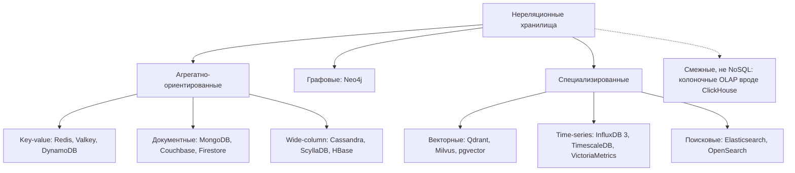

# 02. Классификация NoSQL-хранилищ

**Зачем это знать backend-разработчику.** «NoSQL» — не одна технология, а зонтик над очень разными базами. Классификация по **модели данных** — первый фильтр при выборе хранилища: по форме запросов (по ключу, по полю документа, по связям, «найди похожее») сразу видно, какой класс баз подходит, а какой будет мучением.

> **Коротко:** NoSQL-базы делят по модели данных: key-value (Redis, Valkey, DynamoDB), документные (MongoDB, Couchbase, Firestore), wide-column (Cassandra, ScyllaDB, HBase), графовые (Neo4j, язык Cypher, стандарт ISO GQL 2024), векторные (Qdrant, Milvus, pgvector), time-series (InfluxDB 3, TimescaleDB, VictoriaMetrics) и поисковые (Elasticsearch, OpenSearch). ClickHouse — не NoSQL, а колоночная аналитическая SQL-СУБД, и «колоночная» не равно «wide-column». Главный тренд 2020-х — мультимодельность: популярные базы добавляют к своей модели JSON, векторный и полнотекстовый поиск.

## Оглавление

- [Сводная таблица](#сводная-таблица)
- [Key-value](#key-value)
- [Документные базы](#документные-базы)
- [Wide-column](#wide-column)
- [Графовые базы](#графовые-базы)
- [Векторные базы](#векторные-базы)
- [Time-series и поисковые движки](#time-series-и-поисковые-движки)
- [Врезка: ClickHouse — не NoSQL](#врезка-clickhouse--не-nosql)
- [Мультимодельность как тренд](#мультимодельность-как-тренд)
- [Как это выглядит в Redis / MongoDB / Cassandra](#как-это-выглядит-в-redis--mongodb--cassandra)
- [Типичные ошибки и заблуждения](#типичные-ошибки-и-заблуждения)
- [Итоги](#итоги)
- [Вопросы для самопроверки](#вопросы-для-самопроверки)
- [Источники](#источники)

## Сводная таблица

**На пальцах.** Склад можно организовать по-разному: ячейки с номерами (ключ → коробка), папки с документами, картотека с разделителями, карта дорог между городами. Каждый способ удобен для своих вопросов.

**Модель данных** — способ, которым база представляет данные и отношения между ними, и набор операций над ними. Термины из таблицы: **blob** — непрозрачный набор байт; **rate limiting** — ограничение частоты запросов (например, не больше 100 в минуту на пользователя); **фасеты** (facets) — счётчики по категориям рядом с результатами поиска («Бренд: Sony (12), JBL (7)»).

| Тип | Модель данных | Типичные запросы | Представители (2026) | Сценарии |
|---|---|---|---|---|
| Key-value | ключ → значение (строка, blob или структура) | GET/SET по ключу | Redis, Valkey, DynamoDB | кэш, сессии, счётчики, rate limiting |
| Документные | ключ → JSON-подобный документ | по `_id`, по полям, агрегации | MongoDB, Couchbase, Firestore | каталоги, профили, CMS, заказы |
| Wide-column | партиция → отсортированные строки с колонками | по ключу партиции + диапазон | Cassandra, ScyllaDB, HBase | IoT, ленты, журналы событий, мессенджеры |
| Графовые | вершины и рёбра со свойствами | обход связей на N шагов | Neo4j, Amazon Neptune, Memgraph | соцсети, антифрод, рекомендации |
| Векторные | id → вектор + метаданные | k ближайших соседей | Qdrant, Milvus, pgvector | семантический поиск, RAG, рекомендации |
| Time-series | метрика + теги + время → значение | диапазон времени + агрегация | InfluxDB 3, TimescaleDB, VictoriaMetrics | мониторинг, телеметрия, биржевые котировки |
| Поисковые | документ → инвертированный индекс | полнотекстовый поиск, фасеты | Elasticsearch, OpenSearch | поиск по сайту, логи |



**Агрегатно-ориентированные** (aggregate-oriented) базы — термин Мартина Фаулера: KV, документные и wide-column хранят вместе «агрегат» — единицу данных, которая читается и меняется целиком (заказ с позициями). Агрегат — естественная единица шардирования. Графовые базы, наоборот, сильны в связях *между* сущностями.

**Пример выбора по форме запроса.** «Дай корзину пользователя 42» → KV. «Найди товары категории "ноутбуки" дешевле 80 000» → документная. «Последние 100 показаний датчика 17» → wide-column или time-series. «Кто из друзей моих друзей работает в Яндексе» → графовая. «Найди статьи, похожие по смыслу на этот вопрос» → векторная. «Найди "беспроводные наушнеки" с опечаткой» → поисковая.

## Key-value

**На пальцах.** Гардероб в театре: сдаёте пальто, получаете номерок. По номерку пальто выдают мгновенно, но спросить «дайте все синие пальто» нельзя — гардеробщик ищет только по номерку.

**Key-value хранилище** (KV, «ключ-значение») — база, где единственный способ адресовать данные — уникальный **ключ**. Значение для базы либо непрозрачно (blob), либо, как в Redis, является структурой данных (список, хеш, множество).

- **Redis** — KV в памяти с богатыми структурами. С 2024 года распространяется под source-available лицензиями RSALv2/SSPLv1; с Redis 8 (2025) добавлен вариант AGPLv3.
- **Valkey** — форк Redis 7.2 под лицензией BSD, развивается под эгидой Linux Foundation; совместим с Redis-протоколом и клиентами.
- **Amazon DynamoDB** — управляемый облачный KV/документный сервис AWS (наследник идей Dynamo, но не тот же код). Ключ = partition key (+ опциональный sort key).

**Пример (redis-cli).**

```bash
redis-cli SET cart:42 '{"items":["BK-17","HP-03"]}' EX 86400
redis-cli INCR ratelimit:user:42:2026-09-22T10:15
redis-cli HSET user:42 name "Анна" city "Казань"
redis-cli --raw HGET user:42 city   # Казань (без --raw кириллица выводится как \xd0\x9a...)
```

Запроса «все пользователи из Казани» в чистом KV нет — нужно самому вести индекс (например, множество `city:Казань`) или взять модуль поиска.

## Документные базы

**На пальцах.** Шкаф с папками. В каждой папке — анкета клиента целиком, с любыми вложенными листами. Папку можно найти по номеру, а можно попросить «все папки, где город = Казань» — у шкафа есть закладки-индексы.

**Документная база** (document store) — KV, где значение — структурированный **документ** (JSON или его бинарный вариант, например **BSON** в MongoDB). База «видит» поля документа, умеет индексировать их и фильтровать по ним.

- **MongoDB** (актуальная ветка — 8.x) — самая распространённая документная база: вторичные индексы, **агрегационный конвейер** (aggregation pipeline — цепочка шагов фильтрации, группировки и преобразования документов), транзакции, встроенное шардирование.
- **Couchbase** — документы + встроенный кэш в памяти + язык SQL++ (SQL для JSON).
- **Google Cloud Firestore** — управляемая документная база с real-time подписками, популярна в мобильной разработке.

**Пример (mongosh).**

```js
// mongosh: документ с вложенным массивом и запрос по полю вложенного документа
db.products.insertOne({
  _id: "NB-001", title: "Ноутбук Air 13", category: "ноутбуки",
  price: 79990, specs: { ram: 16, ssd: 512 }, tags: ["ультрабук", "2026"]
})
db.products.createIndex({ category: 1, price: 1 })
db.products.find({ category: "ноутбуки", price: { $lt: 80000 }, "specs.ram": { $gte: 16 } })
```

## Wide-column

**На пальцах.** Картотека: ящики подписаны фамилией (ключ партиции), внутри карточки строго отсортированы по дате (ключ кластеризации). Открыть нужный ящик и взять карточки за март — быстро. Перебрать все ящики в поисках «кто родился в марте» — очень медленно.

**Wide-column** (широкостолбцовая, «семейство колонок») база хранит данные в **партициях**: партиция — группа строк с одинаковым **ключом партиции** (partition key), лежащая целиком на одних и тех же узлах. Внутри партиции строки отсортированы по **ключу кластеризации** (clustering key). Разные строки могут иметь разный набор заполненных колонок, а партиция — много строк; отсюда «wide»: в модели Bigtable строка могла иметь тысячи динамических колонок. Но «широко» не значит «бесконечно»: партиции на миллионы строк — антипаттерн, на практике их держат в пределах ~100 МБ (подробнее — в [05](05-partitioning.md) и [08](08-data-modeling.md)).

- **Apache Cassandra** (5.0) — **leaderless** (без лидера: писать можно в любую реплику), **мульти-ДЦ** (одна база на несколько дата-центров), язык CQL; в 5.0 добавлены **Storage-Attached Indexes** (SAI — новый вид вторичных индексов, то есть индексов по неключевым колонкам) и векторный тип.
- **ScyllaDB** — совместимая с Cassandra реализация на C++ (архитектура **shard-per-core**: каждое ядро CPU владеет своей частью данных и работает без блокировок). В конце 2024 года компания объявила о прекращении open-source-редакции; с версии 2025.1 ScyllaDB распространяется под source-available лицензией.
- **Apache HBase** — открытая реализация модели Bigtable поверх HDFS (распределённой файловой системы Hadoop).

**Пример (cqlsh).** Показания датчиков: партиция = датчик + сутки, чтобы партиция не росла бесконечно.

```sql
CREATE TABLE readings (
    sensor_id  text,
    day        date,
    ts         timestamp,
    value      double,
    PRIMARY KEY ((sensor_id, day), ts)
) WITH CLUSTERING ORDER BY (ts DESC);

SELECT ts, value FROM readings
WHERE sensor_id = 'sensor-17' AND day = '2026-09-22' LIMIT 100;
```

Как это лежит физически:

| Партиция `(sensor-17, 2026-09-22)` | ts | value |
|---|---|---|
| строка 1 | 10:15:02 | 21.7 |
| строка 2 | 10:15:01 | 21.6 |
| … до 86 400 строк за сутки при шаге 1 с | … | … |

Запрос по `value > 30` без ключа партиции Cassandra по умолчанию отвергнет — пришлось бы сканировать весь кластер.

## Графовые базы

**На пальцах.** Карта метро: станции (вершины) и перегоны (рёбра). Вопрос «как доехать за две пересадки» решается движением по линиям, а не перебором таблицы всех станций.

**Графовая база** хранит **вершины** (nodes — сущности) и **рёбра** (relationships/edges — связи). Главная операция — **обход** (traversal): переход от вершины к соседям без join-ов по индексу. В **нативных** графовых базах (Neo4j, Memgraph) это обеспечивает свойство **index-free adjacency**: каждая вершина хранит прямые ссылки на свои рёбра. Не все графовые базы так устроены: например, Amazon Neptune хранит граф поверх собственного индексированного хранилища.

Две модели:

- **Property graph** (граф со свойствами) — у вершин есть метки (`:Person`), у вершин и рёбер — свойства `ключ: значение`. Используется в Neo4j, Memgraph, Amazon Neptune.
- **RDF** (Resource Description Framework) — стандарт W3C: всё описывается тройками «субъект — предикат — объект» (`:anna :knows :boris`), запросы на языке SPARQL. Сильна в семантическом вебе и онтологиях.

**Neo4j** — самая известная графовая база, язык **Cypher**. В 2024 году ISO опубликовал стандарт **GQL** (ISO/IEC 39075:2024) — первый со времён SQL новый стандартный язык запросов к базам данных; его синтаксис во многом вырос из Cypher. Родственный стандарт **SQL/PGQ** (часть SQL:2023) добавляет графовые запросы в SQL-базы.

**Пример: «друзья друзей».** Данные: Анна дружит с Борисом и Верой, Борис — с Глебом, Вера — с Глебом и Дашей.

```cypher
// Друзья друзей Анны, которые ещё не её друзья, с числом общих друзей
MATCH (me:Person {name: 'Анна'})-[:FRIEND]-(f:Person)-[:FRIEND]-(fof:Person)
WHERE fof <> me AND NOT (me)-[:FRIEND]-(fof)
RETURN fof.name AS candidate, count(DISTINCT f) AS mutual
ORDER BY mutual DESC;
```

Результат: Глеб (2 общих друга), Даша (1). В SQL это двойное самосоединение таблицы `friendships`. С индексом оно тоже касается только существующих строк; разница в цене шага. В SQL каждый шаг — поиск по [B-Tree-индексу](07-storage-engines.md#3-b-tree), примерно O(log n). В нативной графовой базе — переход по указателю, примерно O(1). Число найденных путей растёт экспоненциально с глубиной в обоих случаях: 100 друзей на 3 шагах — это уже до миллиона путей. Для обхода *переменной* глубины («на расстоянии до 5 рукопожатий») в SQL нужен рекурсивный запрос `WITH RECURSIVE`, а в Cypher достаточно `-[:FRIEND*1..5]-`.

## Векторные базы

**На пальцах.** Каждой песне ставят «координаты» на карте настроений: бодрость, грусть, громкость. Похожие песни оказываются рядом. Найти «что-то похожее» — значит найти ближайшие точки на карте.

- **Эмбеддинг** (embedding) — вектор чисел (обычно 384–3072 измерений), который нейросеть строит для текста, картинки или товара так, что близкие по смыслу объекты получают близкие векторы.
- **Мера близости** — чаще всего **косинусное сходство** (cosine similarity): косинус угла между векторами, от −1 до 1.
- **kNN** (k nearest neighbors) — поиск k ближайших векторов. Точный поиск сравнивает запрос со всеми векторами: 10 млн векторов × 1536 измерений ≈ 15 млрд умножений на запрос.
- **RAG** (Retrieval-Augmented Generation) — главный сценарий 2020-х: перед обращением к языковой модели найти в базе фрагменты текста, близкие по смыслу к вопросу, и передать их модели как контекст.
- **ANN** (Approximate Nearest Neighbors) — приближённый поиск: жертвует небольшой долей точности (**recall**, доля найденных истинных соседей, например 0,95) ради ускорения на порядки.

**Пример с числами.** Трёхмерные «эмбеддинги»: запрос `q = [0.9, 0.1, 0.0]`, документ A `[0.8, 0.2, 0.1]`, документ B `[0.1, 0.9, 0.3]`.

```java
// Косинусное сходство двух векторов
static double cosine(float[] a, float[] b) {
    double dot = 0, na = 0, nb = 0;
    for (int i = 0; i < a.length; i++) {
        dot += a[i] * b[i];
        na += a[i] * a[i];
        nb += b[i] * b[i];
    }
    return dot / (Math.sqrt(na) * Math.sqrt(nb));
}
// cosine(q, A) ≈ 0.98 — очень похожи; cosine(q, B) ≈ 0.21 — далеки
```

Представители: **Qdrant** (Rust), **Milvus** (распределённая, для миллиардов векторов), **pgvector** (расширение PostgreSQL). Векторный поиск стал функцией «обычных» баз: MongoDB (`$vectorSearch`; исторически — в Atlas, с 2025 года появляется и в самостоятельно развёрнутых редакциях), Redis (векторные индексы в Redis Query Engine, в Redis 8 — ещё и новый тип Vector Set), Cassandra 5.0 (тип `vector` + SAI-индекс).

### 🔬 Глубже: HNSW и IVF

- **HNSW** (Hierarchical Navigable Small World) — многослойный граф: верхние слои содержат мало вершин с «длинными» рёбрами, нижний — все вершины с короткими. Поиск начинается сверху, жадно идёт к ближайшей вершине и спускается вниз — как поездка «шоссе → улица → двор». Параметры: `M` (число связей у вершины) определяет размер индекса в памяти и качество графа, `ef` (ширина поиска при запросе) — компромисс «скорость против recall»: больше `ef` — точнее, но медленнее. Сложность поиска близка к логарифмической.
- **IVF** (Inverted File Index) — векторы кластеризуются k-means на, скажем, 4 096 кластеров; при поиске сравниваем запрос с центроидами и сканируем только `nprobe` ближайших кластеров (например, 16 из 4 096 — ~0,4% данных). Строится быстрее HNSW и занимает меньше памяти, но recall сильнее зависит от `nprobe`. Часто комбинируется с **квантованием** (Product Quantization, PQ) — сжатием векторов в короткие коды ценой небольшой потери точности.

## Time-series и поисковые движки

**На пальцах.** Time-series — бортовой журнал корабля: записи только добавляются, всегда с временем, а читают их диапазонами («что было с 10 до 11»). Поисковый движок — предметный указатель в конце книги: для каждого слова — список страниц.

**Time-series база** (база временных рядов) оптимизирована под поток точек `(метрика, теги, время, значение)`: сжатие соседних значений, партиционирование по времени, **downsampling** (прореживание: хранить посекундные данные неделю, а поминутные агрегаты — год) и **retention** (автоудаление старых данных).

- **InfluxDB 3** — переписана на Rust поверх Apache Arrow (колоночный формат данных в памяти), DataFusion (SQL-движок на Arrow) и Parquet (колоночный формат файлов на диске); запросы на SQL и InfluxQL.
- **TimescaleDB** — расширение PostgreSQL: **гипертаблицы** автоматически режутся на чанки по времени, запросы — обычный SQL.
- **VictoriaMetrics** — хранилище метрик, совместимое с Prometheus (язык MetricsQL), известно высоким сжатием.

**Пример точки** (line protocol InfluxDB): `cpu,host=web-01,region=eu usage=73.5 1790072100000000000`. 1 000 серверов × 50 метрик × 1 точка/10 с = 5 000 точек/с, ~430 млн в сутки — нагрузка, где сжатие и retention решают всё.

**Поисковый движок** строит **инвертированный индекс** (inverted index): словарь «термин → список документов, где он встречается». Текст при индексации проходит **анализ** (analysis): разбиение на слова, приведение к нижнему регистру, **стемминг** (отсечение окончаний: «наушники» → «наушник»). Стемминг делает не любой анализатор: стандартный анализатор Elasticsearch только режет текст на слова и приводит к нижнему регистру. Для примера ниже поле нужно объявить с языковым анализатором `russian`. Релевантность считается формулой **BM25**: документ тем выше, чем чаще в нём слово запроса и чем реже это слово во всей коллекции.

**Пример индекса.** Документы: 1 — «Беспроводные наушники», 2 — «Проводные наушники», 3 — «Беспроводная мышь».

| Термин (после анализатора `russian`; стеммер обрезает окончания, точные основы могут отличаться) | Документы |
|---|---|
| беспроводн | 1, 3 |
| проводн | 2 |
| наушник | 1, 2 |
| мыш | 3 |

Запрос «беспроводные наушники» при логике AND → пересечение списков `{1,3} ∩ {1,2} = {1}`. При логике OR (по умолчанию в Elasticsearch) найдутся все три документа, но документ 1 совпал по обоим терминам и окажется первым. Нечёткий поиск (fuzziness) найдёт и «наушнеки».

- **Elasticsearch** — на базе Apache Lucene; в 2021 году сменил лицензию Apache 2.0 на SSPL/Elastic License, в 2024 году добавил вариант AGPLv3.
- **OpenSearch** — форк Elasticsearch 7.10 под Apache 2.0, созданный AWS; с 2024 года развивается в OpenSearch Software Foundation (Linux Foundation).

## Врезка: ClickHouse — не NoSQL

**На пальцах.** Тетрадь, где каждая страница — одна покупка целиком, удобна кассиру. Тетрадь, где на одной странице выписаны все суммы подряд, на другой — все даты, удобна бухгалтеру: чтобы сложить суммы, достаточно одной страницы.

**ClickHouse** — **колоночная** (columnar) аналитическая **SQL**-СУБД: данные каждой колонки хранятся отдельно и сжимаются, поэтому `SUM(amount)` по миллиарду строк читает только колонку `amount`. Это OLAP (см. [01](01-why-nosql.md)): быстрые агрегации, но точечные обновления и частые запросы по одному ключу — не её профиль.

| | Wide-column (Cassandra) | Columnar (ClickHouse) |
|---|---|---|
| Единица хранения | строка внутри партиции | колонка целиком |
| Типичный запрос | «строки партиции X за диапазон» | «агрегат по колонке по миллиардам строк» |
| Нагрузка | OLTP: много мелких чтений/записей | OLAP: мало тяжёлых сканирований |
| Язык | CQL (без join) | SQL (с join) |

**Пример.** Запрос «выручка по дням за год» по 2 млрд заказов: в ClickHouse читаются две сжатые колонки (`date`, `amount`) — секунды. В Cassandra пришлось бы сканировать все партиции кластера целиком — такой запрос для неё противопоказан.

## Мультимодельность как тренд

**На пальцах.** Смартфон заменил фотоаппарат, плеер и навигатор: не лучший в каждой роли, но достаточно хороший и всегда под рукой.

**Мультимодельная база** (multi-model) поддерживает несколько моделей данных в одном движке. Границы классов размываются:

- **PostgreSQL**: реляционная + документная (JSONB) + векторная (pgvector) + time-series (TimescaleDB) + графовые запросы (расширение Apache AGE).
- **Redis 8**: KV + тип JSON + Query Engine (вторичные индексы, полнотекстовый и векторный поиск) + time series + **вероятностные структуры** (Bloom-фильтр, HyperLogLog и др.: приблизительные ответы при малом объёме памяти) — всё в основной поставке.
- **MongoDB**: документы + time series коллекции (с 5.0) + полнотекстовый и векторный поиск.
- **Cassandra 5.0**: wide-column + вторичные индексы SAI + векторный поиск.
- Изначально мультимодельные: ArangoDB, SurrealDB, Couchbase.

**Пример выгоды.** RAG-сервис (см. раздел о векторных базах) хранит статьи в MongoDB. Вместо отдельной векторной базы и синхронизации двух хранилищ он добавляет поле `embedding` и векторный индекс в ту же коллекцию: одна запись — одна операция, фильтр по `tenantId` и векторный поиск в одном запросе. Минус — специализированная база (Milvus, Qdrant) при сотнях миллионов векторов обычно даёт больше настроек и производительности.

## Как это выглядит в Redis / MongoDB / Cassandra

**Redis** — key-value со структурами данных. В Redis 8 JSON — отдельный встроенный тип данных (команды `JSON.SET`/`JSON.GET`). Query Engine строит вторичные, полнотекстовые и векторные индексы над хешами и JSON-документами. Поэтому Redis можно использовать и как документное, поисковое и векторное хранилище. Векторный KNN-запрос выглядит так; вектор передаётся бинарно, поэтому на практике — из Java, а не руками. Одинарные кавычки нужны, чтобы shell не подставил свою переменную `$vec`:

```bash
redis-cli FT.SEARCH idx:docs '*=>[KNN 5 @embedding $vec]' PARAMS 2 vec '<binary float32>' DIALECT 2
```

**MongoDB** — документная база, расширенная time series коллекциями и поиском:

```js
// mongosh: коллекция временных рядов
db.createCollection("metrics", { timeseries: { timeField: "ts", metaField: "host", granularity: "seconds" } })
```

**Cassandra** — wide-column с векторным поиском в 5.0:

```sql
CREATE TABLE articles (id uuid PRIMARY KEY, title text, embedding vector<float, 3>);
CREATE CUSTOM INDEX ON articles (embedding) USING 'StorageAttachedIndex';
SELECT title FROM articles ORDER BY embedding ANN OF [0.9, 0.1, 0.0] LIMIT 5;
```

## Типичные ошибки и заблуждения

1. **«Wide-column = колоночная».** Cassandra хранит строки внутри партиций и заточена под OLTP; ClickHouse хранит колонки и заточен под OLAP. Это противоположные профили нагрузки.
2. **«Документная база — это KV, куда можно сложить JSON».** Разница — в том, что база понимает структуру: индексы по полям, фильтры, агрегации, частичные обновления (`$set`, `$push`). Клиент отправляет только изменение, без цикла «прочитать → изменить в коде → записать целиком» и без гонки параллельных изменений. На диске [WiredTiger](07-storage-engines.md#3-b-tree) (движок хранения MongoDB) всё равно перезаписывает документ целиком.
3. **«Для векторного поиска нужна отдельная векторная база».** Для миллионов векторов часто достаточно pgvector, MongoDB, Redis или Cassandra 5.0 — рядом с остальными данными. Специализированная база оправдана на больших объёмах и при сложных требованиях к фильтрации и тюнингу.
4. **«Графовая база — для любых связанных данных».** Почти все данные связаны. Граф нужен, когда запросы — это обходы переменной глубины (друзья друзей, цепочки транзакций), а не «заказ и его позиции».
5. **«Elasticsearch можно использовать как основную базу».** Поисковый индекс обновляется с задержкой (near real-time), не даёт транзакций; правильная роль — вторичный индекс, наполняемый из основной базы.
6. **«Лицензия не меняется и ни на что не влияет».** Меняется, и влияет.
   - Redis был под BSD. В 2024 году он перешёл на source-available лицензии RSALv2/SSPLv1. В 2025 году, с Redis 8, вернулся в OSI open source через вариант AGPLv3.
   - AGPL — **копилефт** (copyleft): изменённый код сервиса, доступного по сети, нужно открывать. Это не то же самое, что разрешительная BSD, под которой остался Valkey.
   - Elasticsearch с 2024 года тоже предлагает вариант AGPLv3, а OpenSearch — Apache 2.0.
   - ScyllaDB распространяется под source-available лицензией.

   Перед выбором базы юрист или архитектор должен проверить актуальную лицензию и доступные альтернативы.

## Итоги

- NoSQL-базы классифицируют по модели данных: KV, документные, wide-column, графовые, векторные, time-series, поисковые.
- KV, документные и wide-column — агрегатно-ориентированные: хранят вместе то, что читается вместе, и хорошо шардируются.
- Графовые базы сильны в обходах связей; в 2024 году появился стандарт ISO GQL.
- Векторные базы ищут похожее через ANN-индексы (HNSW, IVF); векторный поиск встроен в MongoDB, Redis, Cassandra 5.0 и PostgreSQL.
- ClickHouse — колоночная OLAP SQL-СУБД, не NoSQL; columnar и wide-column — разные вещи.
- Тренд — мультимодельность, но основная модель базы по-прежнему определяет её сильные стороны.

## Вопросы для самопроверки

1. Какой тип базы подходит для запроса «последние 100 событий пользователя» и почему?
   <details><summary>Ответ</summary>Wide-column (Cassandra): события пользователя лежат в одной партиции, отсортированные по времени, поэтому запрос читает один узел и один непрерывный диапазон.</details>
2. Чем документная база отличается от key-value?
   <details><summary>Ответ</summary>В KV значение для базы непрозрачно (или является фиксированной структурой данных), а адресация — только по ключу. Документная база понимает структуру документа: индексирует и фильтрует по полям, поддерживает агрегации и частичные обновления.</details>
3. Чем property graph отличается от RDF?
   <details><summary>Ответ</summary>В property graph вершины имеют метки, а вершины и рёбра — свойства «ключ: значение» (Neo4j, Cypher, GQL). В RDF всё описывается тройками «субъект — предикат — объект», запросы — на SPARQL. В классическом RDF у связи-тройки нет собственных свойств: их моделируют через промежуточные узлы или **реификацию**. RDF 1.2 (RDF-star) позволяет делать утверждения о самих тройках, что сближает модели.</details>
4. Почему для векторного поиска используют ANN, а не точный kNN?
   <details><summary>Ответ</summary>Точный kNN сравнивает запрос с каждым вектором: на миллионах векторов высокой размерности это миллиарды операций на запрос. ANN-индексы (HNSW, IVF) проверяют малую часть данных, теряя немного recall, и работают на порядки быстрее.</details>
5. Как IVF-индекс ускоряет поиск и что регулирует параметр nprobe?
   <details><summary>Ответ</summary>Векторы заранее разбиваются на кластеры k-means; при поиске запрос сравнивается с центроидами и сканируются только nprobe ближайших кластеров. Больше nprobe — выше recall, но медленнее.</details>
6. Почему ClickHouse не относят к NoSQL, хотя он «колоночный»?
   <details><summary>Ответ</summary>ClickHouse — SQL-СУБД для OLAP, которая хранит данные по колонкам для быстрых агрегаций. Wide-column базы (Cassandra) хранят строки в партициях и обслуживают OLTP-нагрузку. Общее у них только слово «column».</details>
7. Как инвертированный индекс находит документы по запросу из двух слов?
   <details><summary>Ответ</summary>Для каждого термина запроса (после анализа — нижний регистр, стемминг) берётся список документов из индекса, списки пересекаются или объединяются, а результат ранжируется по релевантности (BM25).</details>

## Источники

- Sadalage P., Fowler M. *NoSQL Distilled*. Addison-Wesley, 2012 — агрегатно-ориентированные модели.
- Kleppmann M. *Designing Data-Intensive Applications*. O'Reilly, 2017 — глава 2 и глава 3 (колоночное хранение).
- ISO/IEC 39075:2024 *Information technology — Database languages — GQL*. <https://www.iso.org/standard/76120.html>
- Neo4j Cypher Manual. <https://neo4j.com/docs/cypher-manual/current/>
- W3C RDF 1.1 Concepts. <https://www.w3.org/TR/rdf11-concepts/>
- Malkov Y., Yashunin D. *Efficient and robust approximate nearest neighbor search using Hierarchical Navigable Small World graphs*. <https://arxiv.org/abs/1603.09320>
- Redis Docs: Vector search. <https://redis.io/docs/latest/develop/ai/search-and-query/vectors/>
- MongoDB Docs: Vector Search. <https://www.mongodb.com/docs/atlas/atlas-vector-search/vector-search-overview/>
- Apache Cassandra 5.0: Vector Search. <https://cassandra.apache.org/doc/latest/cassandra/developing/cql/indexing/sai/vector-search/overview.html>
- Valkey. <https://valkey.io/>
- OpenSearch Software Foundation. <https://foundation.opensearch.org/>
- ClickHouse Docs: What is a columnar database. <https://clickhouse.com/docs/en/intro>

---

← [01. Зачем появился NoSQL](01-why-nosql.md) | [оглавление](README.md) | [03. CAP и согласованность](03-cap-consistency.md) →
