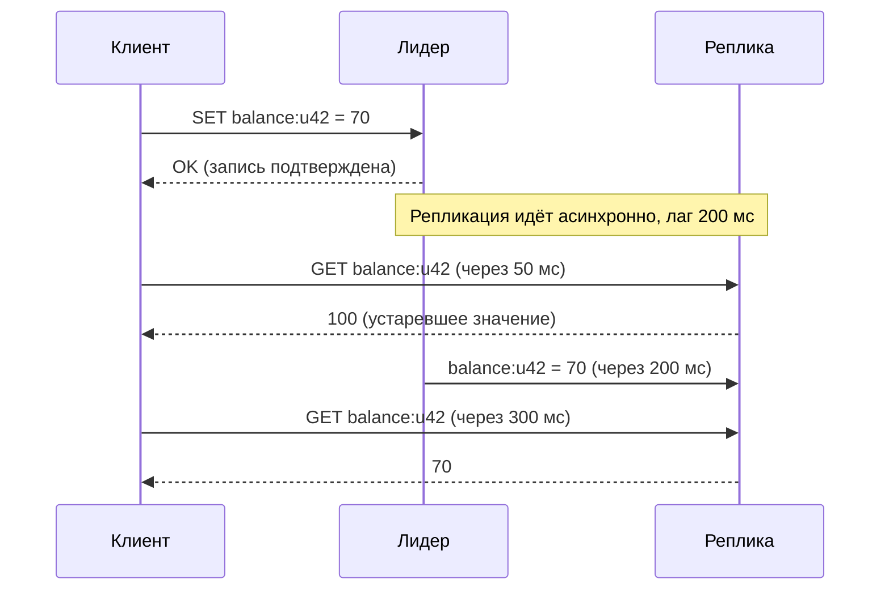
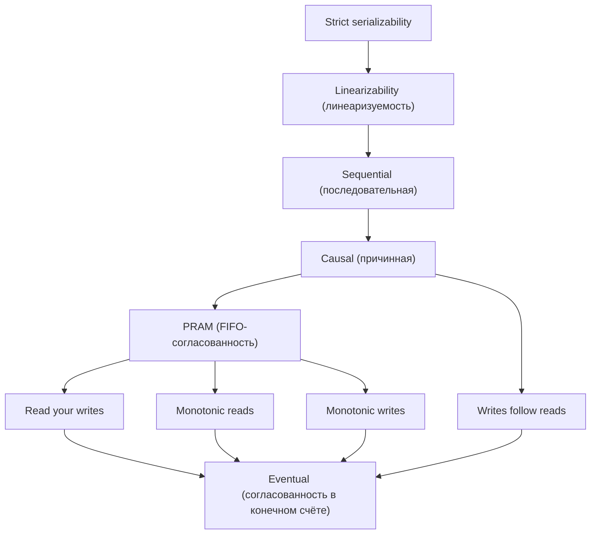

# 03. CAP, PACELC и модели согласованности

**Зачем это знать backend-разработчику.** Как только данные хранятся больше чем в одной копии, появляется вопрос: «что увидит пользователь, если прочитает сразу после записи?». От ответа зависит, получит ли клиент письмо «заказ оплачен», а потом страницу «заказ не найден». Настройки вроде `writeConcern`, `ConsistencyLevel.QUORUM` или `ReadFrom.REPLICA_PREFERRED` — это ручки именно этих компромиссов. Без теории их выставляют «на глаз», а ошибки проявляются только под нагрузкой и при сбоях.

> **Коротко:** Теорема CAP говорит: при разрыве сети (P) распределённая система должна выбрать между линеаризуемостью (C) и доступностью (A) — «выбрать два из трёх» нельзя, потому что разрывы сети не выбирают. PACELC добавляет, что и без сбоев есть выбор между задержкой (L) и согласованностью (C). Между «строго» и «когда-нибудь» есть целая лестница моделей согласованности: linearizable, sequential, causal, PRAM, eventual, а также клиентские гарантии вроде read-your-writes. «C» в ACID и «C» в CAP — разные вещи. MongoDB и Cassandra позволяют настраивать уровень согласованности на каждый запрос. У Redis ручек меньше: `WAIT`/`WAITAOF` и выбор узла для чтения на клиенте.

## Оглавление

- [Проблема: несколько копий одних данных](#проблема-несколько-копий-одних-данных)
- [Теорема CAP](#теорема-cap)
- [PACELC: компромисс есть и без сбоев](#pacelc-компромисс-есть-и-без-сбоев)
- [Модели согласованности](#модели-согласованности)
- [Клиентские гарантии (session guarantees)](#клиентские-гарантии-session-guarantees)
- [Две разные «C»: ACID против CAP](#две-разные-c-acid-против-cap)
- [BASE](#base)
- [Как это выглядит в Redis / MongoDB / Cassandra](#как-это-выглядит-в-redis--mongodb--cassandra)
- [Типичные ошибки и заблуждения](#типичные-ошибки-и-заблуждения)
- [Итоги](#итоги)
- [Вопросы для самопроверки](#вопросы-для-самопроверки)
- [Источники](#источники)

## Проблема: несколько копий одних данных

**На пальцах.** В библиотеке есть главный каталог и копии каталога в филиалах. Копии обновляют курьером раз в час. Читатель, пришедший в филиал через 5 минут после поступления новой книги, услышит «такой книги нет», хотя она уже есть. Каталог не «сломан» — он просто отстаёт.

**Реплика** (replica) — копия данных на отдельном узле (сервере). **Узел** (node) — один процесс СУБД в кластере. **Асинхронная репликация** (asynchronous replication) — лидер подтверждает запись клиенту сразу, а копии получают её позже. Подробно о репликации — в [04-replication.md](04-replication.md).

**Пример.** Баланс пользователя `u42` = 100. Клиент списывает 30. Лидер подтверждает запись, реплика получает её через 200 мс. Через 50 мс тот же пользователь открывает страницу, и чтение уходит на реплику:



Это аномалия **устаревшего чтения** (stale read): чтение вернуло значение, которое уже было перезаписано и подтверждено. Вся дальнейшая теория — о том, какие такие аномалии допустимы и чем приходится платить за их устранение.

## Теорема CAP

**На пальцах.** Два филиала банка связаны телефоном. Линия оборвалась. Клиент в филиале A хочет снять деньги. Есть два варианта: отказать («не можем проверить баланс» — жертвуем доступностью) или выдать деньги по своим данным (рискуя, что в филиале B с того же счёта уже сняли — жертвуем согласованностью). Третьего варианта нет.

**Формулировка.** Эрик Брюер (Eric Brewer) высказал гипотезу в докладе на PODC 2000, а Сет Гилберт (Seth Gilbert) и Нэнси Линч (Nancy Lynch) в 2002 году формально её доказали. В доказательстве термины строгие:

- **C — согласованность** (consistency) в смысле **линеаризуемости** (linearizability): система ведёт себя так, будто существует одна копия данных, и каждая операция мгновенно выполняется в какой-то момент между её началом и концом;
- **A — доступность** (availability): каждый запрос к *работающему* узлу получает ответ (не ошибку), пусть и не мгновенно;
- **P — устойчивость к разделению** (partition tolerance): система продолжает работать, когда сеть теряет произвольное количество сообщений между узлами. **Разделение сети** (network partition) — ситуация, когда группы узлов живы, но не видят друг друга.

Теорема: в асинхронной сети невозможно одновременно гарантировать C и A при наличии разделений.

**Почему «выбери 2 из 3» — упрощение.** Разделение сети — не свойство, которое можно «не выбрать», а событие, которое случается (сбой коммутатора, GC-пауза на 30 секунд — остановка процесса сборщиком мусора, пока узел «молчит», ошибка конфигурации firewall). «CA-система» на практике означает «система, которая при разделении ведёт себя непредсказуемо» или «система на одном узле». Корректнее говорить так: **когда происходит разделение, система выбирает между C и A**. Сам Брюер в статье «CAP Twelve Years Later» (2012) подчеркнул, что выбор делается не раз навсегда, а для каждой операции, и что вне разделений можно иметь и то и другое.

**Пример по шагам.** 5 узлов, сеть разделилась на группы {1, 2} и {3, 4, 5}. Клиент пишет в узел 1. В таблице `w: "majority"` — настройка MongoDB «подтверждать запись только после копирования на большинство узлов», `CL=ONE` — настройка Cassandra «достаточно ответа одной реплики».

| Шаг | CP-поведение (как MongoDB с `w: "majority"`) | AP-поведение (как Cassandra с `CL=ONE`) |
|---|---|---|
| 1 | Узел 1 видит только 2 из 5 узлов — меньше большинства | Узел 1 — одна из реплик ключа, он жив |
| 2 | Запись не может набрать большинство, клиент получает ошибку или таймаут | Запись принята локально, клиент получает OK |
| 3 | Группа {3, 4, 5} продолжает обслуживать запросы | Группа {3, 4, 5} тоже принимает записи в тот же ключ |
| 4 | После восстановления сети данные не расходятся | После восстановления нужно сливать расходящиеся версии |

### 🔬 Глубже: идея доказательства

Возьмём два узла G1 и G2 с регистром `x = v0` и полностью разорванной связью. Клиент пишет `x = v1` в G1. Из-за требования A узел G1 обязан ответить, не дожидаясь G2. Затем клиент читает `x` с G2. Из-за A узел G2 тоже обязан ответить, но о `v1` он не знает и вернёт `v0`. Чтение после завершённой записи вернуло старое значение — линеаризуемость нарушена. Важная деталь: CAP говорит только об одном виде сбоя (разделении) и одной модели (линеаризуемости). Система, которая «не CP и не AP» по CAP, может быть вполне полезной — например, с причинной согласованностью.

## PACELC: компромисс есть и без сбоев

**На пальцах.** Даже когда телефонная линия между филиалами работает, звонок в соседний город занимает время. Можно каждый раз звонить и сверяться (медленно, но точно) или отвечать по своим данным (быстро, но возможно устарело).

Даниэль Абади (Daniel Abadi) в 2012 году предложил **PACELC**: *if **P**artition — choose **A** or **C**; **E**lse — choose **L**atency or **C**onsistency*. **Задержка** (latency) — время от запроса до ответа. Разделения редки, а компромисс «задержка против согласованности» платится на каждом запросе, поэтому для повседневной работы он даже важнее.

**Пример с числами.** Реплики во Франкфурте и Вирджинии, сетевая задержка туда-обратно (RTT) около 90 мс. Если запись ждёт подтверждения от обоих дата-центров, она не может быть быстрее ~90 мс. Если подтверждает только локальная реплика — 1–2 мс, но заокеанский читатель какое-то время видит старые данные.

| Система | При разделении (P) | Иначе (E) | Комментарий |
|---|---|---|---|
| Cassandra | A | L | Уровень `ONE`/`LOCAL_QUORUM` отвечает без ожидания удалённых реплик. Можно сдвинуть к C через `QUORUM`/`ALL`, платя задержкой и доступностью |
| MongoDB (`w: "majority"`, чтение с primary) | C (для записей) | C | Сторона разделения без большинства не может подтвердить записи. Строгая C для чтений требует ещё `readConcern: "majority"` или `"linearizable"`. Чтение с secondary сдвигает к EL |
| Redis Cluster | A (частично) | L | Репликация асинхронная: мастер подтверждает запись до копирования на реплику, поэтому при failover подтверждённые записи могут потеряться |

Здесь **primary** — узел-лидер в MongoDB, **secondary** — его реплика, **failover** — автоматическое переключение на новый лидер при отказе старого. `ONE`, `LOCAL_QUORUM`, `QUORUM`, `ALL` — **уровни согласованности** Cassandra: сколько реплик должно ответить (одна, большинство в локальном дата-центре, большинство всех реплик, все).

Оговорка про MongoDB: по умолчанию чтения идут с `readConcern: "local"`. Изолированный старый primary, пока не понизил себя, продолжает отдавать такие чтения — в том числе данные, которые позже будут **откачены** (rollback — удалены при возвращении узла в кластер, см. [04-replication.md](04-replication.md)). Поэтому «PC/EC» по умолчанию верно для записей, а для чтений — только с `majority`/`linearizable`.

Классификация условна: она описывает настройки по умолчанию, а почти все системы позволяют сдвинуть поведение на уровне запроса. В статье Абади 2012 года MongoDB была отнесена к PA/EC — тогда её настройки по умолчанию были слабее (подтверждение записи только primary). С версии 5.0 по умолчанию действует `w: "majority"` (кроме конфигураций с арбитрами — голосующими узлами без данных).

Про Redis Cluster важно: он не строго AP. Сторона разделения, где оказалось меньшинство мастеров, через `cluster-node-timeout` перестаёт принимать запросы. Но до истечения таймаута мастер на стороне меньшинства ещё принимает записи, и они будут потеряны, когда на стороне большинства его реплику повысят до мастера.

## Модели согласованности

**На пальцах.** Модель согласованности (consistency model) — это договор между базой и программой: «вот какие результаты чтений ты можешь увидеть при таких-то записях». Чем строже договор, тем меньше сюрпризов и тем дороже его выполнять.



Вершина схемы, **strict serializability**, — сочетание сериализуемых транзакций и линеаризуемости (см. «🔬 Глубже» ниже). Стрелка «A → B» означает: «любое поведение, допустимое в A, допустимо и в B», то есть A строже. Разберём модели на одном примере: регистр `x = 0`, клиент Алиса пишет `x = 1`, затем `x = 2`; Боб и Вика читают.

- **Линеаризуемость** (linearizability, Herlihy & Wing, 1990). Все операции выглядят выполненными мгновенно в одном глобальном порядке, который согласован с реальным временем. Если запись `x = 2` завершилась в 12:00:00.000, любое чтение, начавшееся позже, вернёт 2 (или более новое значение). Нужна для блокировок, выборов лидера, уникальности логина.
- **Последовательная** (sequential consistency, Lamport, 1979). Есть один общий порядок всех операций, и операции каждого клиента в нём идут в его порядке, но порядок может не совпадать с реальным временем. Боб может прочитать 1, когда запись 2 уже завершилась, но все клиенты видят историю одинаково: никто не увидит 2, а потом 1.
- **Причинная** (causal consistency). Операции, связанные причинно («прочитал сообщение → написал ответ»), все видят в одном порядке. Несвязанные записи разные клиенты могут видеть в разном порядке. Вопрос «Кто идёт в кино?» и ответ «Я!» никто не увидит в обратном порядке.
- **PRAM** (Pipelined RAM, Lipton & Sandberg, 1988), она же FIFO-согласованность. Записи *одного* клиента все видят в порядке их выполнения: никто не увидит `x = 2`, а затем `x = 1`. Порядок записей разных клиентов не гарантирован.
- **Согласованность в конечном счёте** (eventual consistency). Если новые записи прекратятся, все реплики со временем сойдутся к одному значению. Сколько ждать и что можно увидеть по дороге — не обещается: Боб может прочитать 2, а потом 0.

### 🔬 Глубже: линеаризуемость ≠ сериализуемость

**Сериализуемость** (serializability) — свойство *транзакций* (групп операций над многими объектами): результат равен какому-то последовательному выполнению транзакций, но не обязательно в порядке реального времени. **Линеаризуемость** — свойство *отдельных операций над одним объектом* с учётом реального времени. Их комбинация — **strict serializability**. Ещё тонкость: eventual consistency — это свойство *живости* (liveness, «когда-нибудь случится»), а остальные модели — свойства *безопасности* (safety, «плохое никогда не случится»). Поэтому eventual на схеме внизу условно: формально она не «слабее» остальных, а про другое.

## Клиентские гарантии (session guarantees)

**На пальцах.** Пользователю неважно, что видят другие. Ему важно, чтобы *его собственный* опыт был логичным: поменял аватарку — видит новую; обновил страницу — комментарии не исчезли.

Терри (Douglas Terry) и соавторы в 1994 году сформулировали четыре гарантии в рамках **сессии** (session) — последовательности операций одного клиента:

| Гарантия | Смысл | Пример нарушения |
|---|---|---|
| **Read your writes** (читай свои записи) | Клиент видит свои подтверждённые записи | Сменил имя на «Иван», обновил страницу — снова «Ваня» |
| **Monotonic reads** (монотонное чтение) | Клиент не «откатывается» во времени | Первое чтение с реплики A показало 5 комментариев, второе с отстающей реплики B — 3 |
| **Monotonic writes** (монотонная запись) | Записи клиента применяются в его порядке | Сначала «создать папку», потом «положить файл», а на реплике файл появился раньше папки |
| **Writes follow reads** (запись следует за чтением) | Запись, сделанная после чтения, упорядочена после прочитанного | Ответ на комментарий виден на реплике, где самого комментария ещё нет |

**Пример с числами.** Пользователь обновил профиль в 12:00:00.000 (запись на primary), лаг secondary — 800 мс, и в 12:00:00.300 интерфейс читает профиль с secondary. Без гарантии read-your-writes пользователь увидит старые данные. Лечится тремя способами: читать свои данные с лидера N секунд после записи; передавать с запросом «метку времени последней записи» и ждать, пока реплика её догонит (так работают **причинно согласованные сессии** в MongoDB); читать **кворумом** (quorum — большинством реплик), пересекающимся с кворумом записи (Cassandra, подробно в [04-replication.md](04-replication.md)).

## Две разные «C»: ACID против CAP

**На пальцах.** «C» в ACID отвечает на вопрос «не нарушены ли правила бизнеса?» (остаток не ушёл в минус). «C» в CAP — на вопрос «все ли копии показывают одно и то же и в правильном порядке?».

- **ACID** — свойства транзакций: **Atomicity** (атомарность — всё или ничего), **Consistency** (согласованность — транзакция переводит данные из одного корректного состояния в другое по инвариантам приложения), **Isolation** (изоляция — параллельные транзакции не мешают друг другу), **Durability** (долговечность — подтверждённое не теряется).
- **Уровни изоляции** (isolation levels): read committed, repeatable read, snapshot isolation, serializable — про то, как пересекаются *параллельные транзакции*, даже на одном сервере.
- **Согласованность реплик** (CAP, модели выше) — про то, как *копии* одних данных видят историю изменений.

**Пример.** Перевод 30 с `acc:1` (100) на `acc:2` (0) в MongoDB-транзакции в replica set. Атомарность гарантирует, что не будет состояния «списали, но не зачислили». Изоляция гарантирует, что параллельная транзакция не прочитает промежуточное состояние. Но если после коммита читать с secondary с лагом, можно увидеть `acc:1 = 100` — это вопрос согласованности реплик, а не ACID. Эти оси независимы: система может иметь serializable-транзакции и асинхронные реплики одновременно.

## BASE

**На пальцах.** Счётчик лайков под видео. Если один пользователь видит 1 002 лайка, а другой — 1 005, ничего страшного не случится, лишь бы через пару секунд все увидели одно число.

**BASE** — неформальная противоположность ACID, популярная с конца 1990-х (Fox, Brewer и др.) и описанная Дэном Притчеттом (Dan Pritchett) в статье 2008 года:

- **Basically Available** (базовая доступность) — система отвечает даже при частичных сбоях, возможно, с неполными или устаревшими данными;
- **Soft state** (мягкое состояние) — состояние может меняться без новых записей (за счёт фоновой синхронизации реплик);
- **Eventual consistency** — реплики сходятся со временем.

**Пример.** Лайки хранятся в Cassandra-счётчике: запись с `CL=ONE`, чтение с `CL=ONE`. В 3 узлах в момент сбоя одного узла система продолжает принимать лайки, разные читатели кратко видят разные числа, после восстановления узла и **repair** (фоновой сверки и выравнивания реплик, см. [04-replication.md](04-replication.md)) значения сходятся. Тот же подход недопустим для остатка на счёте. BASE — это не «плохая ACID», а осознанный выбор для данных, где кратковременное расхождение дешевле недоступности.

## Как это выглядит в Redis / MongoDB / Cassandra

**Redis.** Репликация асинхронная. Команда `WAIT numreplicas timeout` блокирует клиента, пока указанное число реплик не подтвердит получение предыдущих записей этого соединения. Она уменьшает окно потерь, но **не делает Redis строго согласованным**: при failover может быть выбрана реплика, которая не получила запись, и подтверждённая запись потеряется. `WAIT` также не откатывает запись на мастере, если реплики не ответили.

```bash
$ redis-cli
127.0.0.1:6379> SET order:1001:status paid
OK
127.0.0.1:6379> WAIT 1 500
(integer) 1
```

`WAIT` учитывает только записи своего соединения, поэтому обе команды должны идти в одной сессии. Два отдельных вызова `redis-cli SET ...` и `redis-cli WAIT ...` — это два разных соединения, и второй ничего не говорит о первом. `(integer) 1` означает: одна реплика получила запись в пределах 500 мс.

```java
// Lettuce: чтение с реплик (допускаем устаревшие данные) и WAIT после важной записи
RedisClient client = RedisClient.create();
try (StatefulRedisMasterReplicaConnection<String, String> conn =
         MasterReplica.connect(client, StringCodec.UTF8, RedisURI.create("redis://localhost:6379"))) {
    conn.setReadFrom(ReadFrom.REPLICA_PREFERRED); // PACELC: выбираем L, а не C
    RedisCommands<String, String> redis = conn.sync();
    redis.set("order:1001:status", "paid");
    // WAIT уходит по тому же соединению к мастеру, что и SET, поэтому учитывает эту запись
    Long acked = redis.waitForReplication(1, 500); // ждём одну реплику до 500 мс
    if (acked < 1) {
        // запись есть только на мастере — риск потери при failover
    }
} finally {
    client.shutdown(); // освобождаем потоки и ресурсы клиента
}
```

**MongoDB.** Три ручки: **writeConcern** (сколько узлов должны подтвердить запись), **readConcern** (какую «версию» данных можно читать: `local`, `majority`, `linearizable`, `snapshot`) и **readPreference** (с какого узла читать). Сочетание `w: "majority"` + `readConcern: "majority"` + чтение с primary даёт чтение только данных, которые не будут откачены. `readConcern: "linearizable"` даёт линеаризуемое чтение одного документа с primary ценой дополнительной задержки. Причинно согласованные сессии дают все четыре клиентские гарантии при `majority` для записи и чтения.

```java
MongoCollection<Document> accounts = client.getDatabase("bank").getCollection("accounts")
        .withWriteConcern(WriteConcern.MAJORITY.withWTimeout(2, TimeUnit.SECONDS))
        .withReadConcern(ReadConcern.MAJORITY);

try (ClientSession session = client.startSession(
        ClientSessionOptions.builder().causallyConsistent(true).build())) {
    accounts.updateOne(session, Filters.eq("_id", "acc:1"), Updates.inc("balance", -30));
    // читаем с secondary, но в той же причинной сессии: увидим свою запись
    Document acc = accounts.withReadPreference(ReadPreference.secondaryPreferred())
            .find(session, Filters.eq("_id", "acc:1")).first();
}
```

**Cassandra.** **Настраиваемая согласованность** (tunable consistency): **уровень согласованности** (consistency level, CL) задаётся на каждый запрос — `ONE`, `LOCAL_ONE`, `QUORUM`, `LOCAL_QUORUM`, `ALL` и др. Для **лёгких транзакций** (lightweight transactions, LWT, `IF NOT EXISTS`) используется Paxos (алгоритм консенсуса, см. [06-consensus-membership.md](06-consensus-membership.md)) и уровни `SERIAL`/`LOCAL_SERIAL`. По умолчанию драйвер DataStax 4.x использует `LOCAL_ONE`.

```sql
-- cqlsh
CONSISTENCY QUORUM;
SELECT balance FROM bank.accounts WHERE id = 'acc:1';
```

```java
SimpleStatement read = SimpleStatement
        .newInstance("SELECT balance FROM bank.accounts WHERE id = ?", "acc:1")
        .setConsistencyLevel(DefaultConsistencyLevel.QUORUM); // при RF=3 ждём 2 реплики
Row row = session.execute(read).one();
```

## Типичные ошибки и заблуждения

1. **«Наша система CA».** Распределённая система не может отказаться от P. Если узлов больше одного, при разрыве сети придётся выбирать — лучше сделать это осознанно.
2. **«CAP-согласованность = согласованность в ACID».** Это разные свойства (см. раздел выше). Транзакции с serializable-изоляцией не спасают от устаревшего чтения с асинхронной реплики.
3. **«`WAIT` в Redis делает репликацию синхронной».** Нет: запись уже применена на мастере, а при failover может быть выбрана реплика без неё. Подтверждённая запись может потеряться.
4. **«Кворумное чтение и запись дают линеаризуемость».** Условие `R + W > N` даёт пересечение множеств реплик, но не линеаризуемость: мешают частично выполненные записи, конкурентные записи и расхождение часов (подробно — в [04-replication.md](04-replication.md)).
5. **«Eventual consistency означает "через миллисекунды"».** Модель не даёт никакой верхней границы. При перегрузке или сбое лаг может составлять минуты.
6. **«Выбор CP/AP делается один раз для всей системы».** В MongoDB и Cassandra он делается на каждую операцию: платёж — `QUORUM`/`majority`, лента новостей — `ONE`/secondary.

## Итоги

- CAP: при разделении сети система выбирает между линеаризуемостью и доступностью. P не выбирают — разделения случаются.
- PACELC: даже без сбоев есть ежедневный компромисс «задержка против согласованности».
- Модели от сильной к слабой: linearizable → sequential → causal → PRAM → eventual. Чем строже, тем дороже.
- Клиентские гарантии (read-your-writes, monotonic reads/writes, writes-follow-reads) часто важнее глобальной строгости и дешевле её.
- «C» в ACID — инварианты приложения, «C» в CAP — согласованность копий. Это независимые оси.
- Redis реплицирует асинхронно, MongoDB по умолчанию ближе к PC/EC для записей (строгие чтения требуют `readConcern: "majority"`/`"linearizable"`), Cassandra — PA/EL с настраиваемым уровнем на запрос.

## Вопросы для самопроверки

1. Почему формулировка «выберите два свойства из трёх» вводит в заблуждение?
   <details><summary>Ответ</summary>Разделение сети — не выбор, а событие, которое неизбежно случается в распределённой системе. Реальный выбор — как вести себя во время разделения: отказывать (C) или отвечать, возможно, устаревшими данными (A). Вне разделения можно иметь и C, и A.</details>
2. Что именно означает «C» в доказательстве Гилберта и Линч?
   <details><summary>Ответ</summary>Линеаризуемость (атомарную согласованность): система ведёт себя как одна копия, каждая операция вступает в силу мгновенно между своим началом и концом, в порядке реального времени.</details>
3. Чем последовательная согласованность отличается от линеаризуемости?
   <details><summary>Ответ</summary>Обе требуют единого порядка операций, видимого всем. Линеаризуемость дополнительно требует, чтобы этот порядок соответствовал реальному времени: операция, завершившаяся раньше начала другой, должна идти в порядке раньше. Последовательная допускает «отставание» от реального времени.</details>
4. Пользователь сменил аватар, обновил страницу и видит старый. Какая гарантия нарушена и как это исправить в MongoDB?
   <details><summary>Ответ</summary>Read your writes. Варианты: читать с primary; использовать причинно согласованную сессию (`causallyConsistent(true)`) с `majority` для чтения и записи — тогда secondary дождётся нужной операции перед ответом.</details>
5. Почему MongoDB в классификации Абади 2012 года была PA/EC, а сейчас её относят к PC/EC?
   <details><summary>Ответ</summary>В то время запись по умолчанию подтверждалась только primary, и при разделении старый primary мог принять записи, которые потом откатывались. С версии 5.0 по умолчанию `w: "majority"`: запись подтверждается только после репликации на большинство, а сторона без большинства не может их подтвердить. Для строго согласованных чтений нужен ещё `readConcern: "majority"` или `"linearizable"`: с `local` изолированный старый primary до понижения может отдать данные, которые потом откатятся.</details>
6. Как Redis Cluster может потерять запись, на которую клиент получил OK?
   <details><summary>Ответ</summary>Мастер подтверждает запись до того, как её получили реплики. Если мастер падает или оказывается в меньшинстве при разделении, одна из реплик без этой записи повышается до мастера — запись потеряна. `WAIT` лишь уменьшает вероятность.</details>
7. Чем BASE отличается от ACID и когда он уместен?
   <details><summary>Ответ</summary>BASE жертвует немедленной согласованностью ради доступности: система отвечает всегда, данные сходятся со временем. Уместен там, где кратковременное расхождение дешевле отказа: счётчики, ленты, аналитика, кэши. Не подходит для денег и уникальных ограничений.</details>

## Источники

- Brewer E. *Towards Robust Distributed Systems.* PODC keynote, 2000. https://people.eecs.berkeley.edu/~brewer/cs262b-2004/PODC-keynote.pdf
- Gilbert S., Lynch N. *Brewer's Conjecture and the Feasibility of Consistent, Available, Partition-Tolerant Web Services.* ACM SIGACT News, 2002. https://groups.csail.mit.edu/tds/papers/Gilbert/Brewer2.pdf
- Brewer E. *CAP Twelve Years Later: How the "Rules" Have Changed.* IEEE Computer, 2012. https://www.infoq.com/articles/cap-twelve-years-later-how-the-rules-have-changed/
- Abadi D. *Consistency Tradeoffs in Modern Distributed Database System Design.* IEEE Computer, 2012. https://www.cs.umd.edu/~abadi/papers/abadi-pacelc.pdf
- Herlihy M., Wing J. *Linearizability: A Correctness Condition for Concurrent Objects.* ACM TOPLAS, 1990.
- Terry D. et al. *Session Guarantees for Weakly Consistent Replicated Data.* PDIS, 1994.
- Pritchett D. *BASE: An Acid Alternative.* ACM Queue, 2008. https://queue.acm.org/detail.cfm?id=1394128
- Jepsen: *Consistency Models* (карта моделей). https://jepsen.io/consistency
- Kleppmann M. *Designing Data-Intensive Applications*, гл. 5 и 9. O'Reilly.
- Redis: *Scale with Redis Cluster* (раздел о согласованности) и команда `WAIT`. https://redis.io/docs/latest/operate/oss_and_stack/management/scaling/ , https://redis.io/docs/latest/commands/wait/
- MongoDB: *Read Concern*, *Write Concern*, *Causal Consistency*. https://www.mongodb.com/docs/manual/reference/read-concern/ , https://www.mongodb.com/docs/manual/reference/write-concern/ , https://www.mongodb.com/docs/manual/core/causal-consistency-read-write-concerns/
- Apache Cassandra: *Tunable consistency*. https://cassandra.apache.org/doc/latest/cassandra/architecture/dynamo.html

---

← [02. Классификация NoSQL](02-classification.md) | [оглавление](README.md) | [04. Репликация](04-replication.md) →
