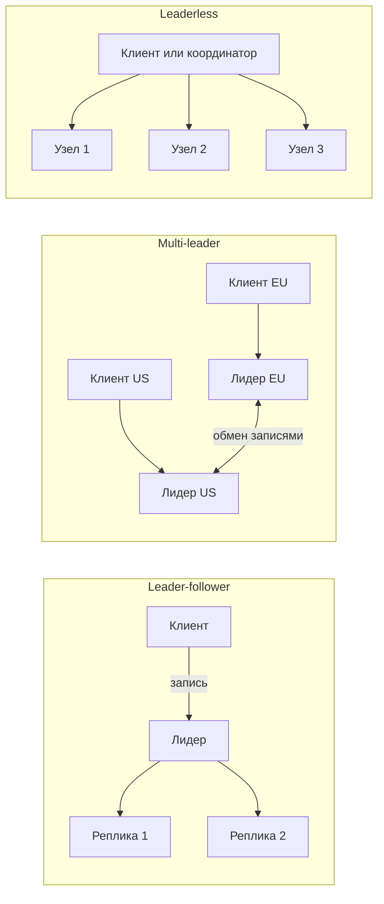
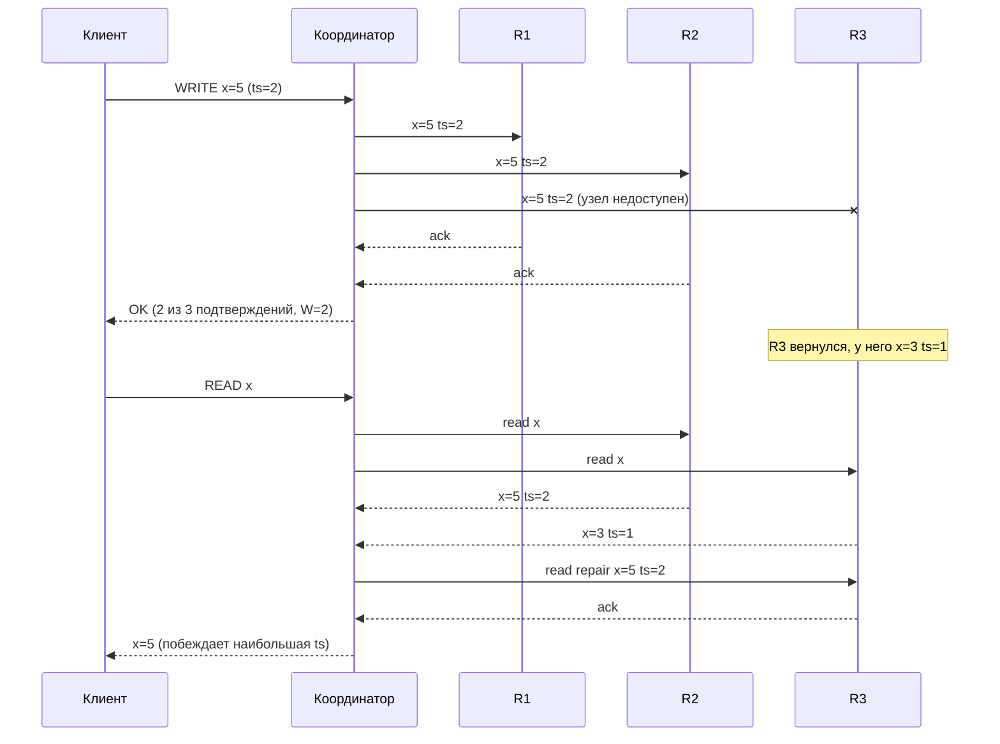

# 04. Репликация

**Зачем это знать backend-разработчику.** Почти каждая промышленная установка Redis, MongoDB или Cassandra хранит данные в нескольких копиях. От схемы репликации зависит, потеряются ли данные при падении сервера, увидит ли пользователь свою только что сделанную запись и что произойдёт с приложением во время переключения на новый лидер. Эти вопросы всплывают в инцидентах и на собеседованиях, а решаются настройками драйвера, которые пишет именно backend-разработчик.

> **Коротко:** Репликация — хранение копий данных на нескольких узлах ради отказоустойчивости, масштабирования чтения и близости к пользователям. Она бывает синхронной, асинхронной и полусинхронной, а асинхронная порождает лаг и аномалии чтения. Топологии: один лидер (MongoDB, Redis), несколько лидеров, без лидера (Cassandra, Dynamo). В системах без лидера используют кворумы `R + W > N`, но кворум не даёт линеаризуемости. Конфликты разрешают через LWW, векторные часы или CRDT, расхождения устраняют read repair и Merkle-деревья, а при failover нужно защищаться от split brain.

## Оглавление

- [Зачем реплицировать](#зачем-реплицировать)
- [Синхронная, асинхронная, полусинхронная](#синхронная-асинхронная-полусинхронная)
- [Replication lag и его аномалии](#replication-lag-и-его-аномалии)
- [Топологии: один лидер, много лидеров, без лидера](#топологии-один-лидер-много-лидеров-без-лидера)
- [Кворумы](#кворумы)
- [Разрешение конфликтов](#разрешение-конфликтов)
- [Anti-entropy: read repair и Merkle-деревья](#anti-entropy-read-repair-и-merkle-деревья)
- [Failover, split brain и fencing](#failover-split-brain-и-fencing)
- [Как это выглядит в Redis / MongoDB / Cassandra](#как-это-выглядит-в-redis--mongodb--cassandra)
- [Типичные ошибки и заблуждения](#типичные-ошибки-и-заблуждения)
- [Итоги](#итоги)
- [Вопросы для самопроверки](#вопросы-для-самопроверки)
- [Источники](#источники)

## Зачем реплицировать

**На пальцах.** Важный документ хранят в нескольких копиях: одна сгорит — останутся другие; копии можно раздать сотрудникам в разных офисах, чтобы не стоять в очереди к одному шкафу.

**Репликация** (replication) — поддержание копий одних и тех же данных на нескольких узлах. Три цели:

1. **Отказоустойчивость** (fault tolerance) — падение узла не приводит к потере данных и простою.
2. **Масштабирование чтения** (read scaling) — чтения распределяются по копиям.
3. **Геораспределённость** (geo-distribution) — копия ближе к пользователю, меньше задержка.

**Пример.** Сервис каталога: 20 000 чтений/с и 500 записей/с, один узел выдерживает ~8 000 чтений/с. Один лидер и 3 реплики дают 4 × 8 000 = 32 000 чтений/с. Если один узел упадёт, останется 24 000 — нагрузка всё ещё выдерживается. При этом записи не масштабируются: все 500/с идут на лидера и повторяются на каждой реплике. Для масштабирования записи нужно партиционирование ([05-partitioning.md](05-partitioning.md)).

## Синхронная, асинхронная, полусинхронная

**На пальцах.** Отправить письмо с уведомлением о вручении (ждём подтверждения, медленно, но надёжно) или обычным (бросили в ящик и ушли).

- **Синхронная** (synchronous) — лидер отвечает клиенту только после того, как запись подтвердили *все* указанные реплики. Данные не теряются при падении лидера, но одна медленная или упавшая реплика останавливает все записи.
- **Асинхронная** (asynchronous) — лидер отвечает сразу, реплики догоняют. Быстро, но при падении лидера последние записи теряются.
- **Полусинхронная** (semi-synchronous) — ждём подтверждения от *части* реплик (одной или большинства), остальные асинхронны. Компромисс, который используют почти все: `w: "majority"` в MongoDB, `QUORUM` в Cassandra.

**Пример с числами.** Лидер в одном дата-центре (ДЦ), реплики A (задержка 1 мс) и B (в другом регионе, 80 мс). Запись на диск лидера — 2 мс.

| Режим | Время ответа клиенту | Что теряется при падении лидера сразу после ответа |
|---|---|---|
| Асинхронный | ~2 мс | Все записи, которые не успели уйти на реплики |
| Полусинхронный (1 из 2) | ~3 мс (ждём быстрейшую, A) | Ничего: запись есть на A |
| Синхронный (обе) | ~82 мс, а при падении B — бесконечно | Ничего |

## Replication lag и его аномалии

**На пальцах.** Бухгалтерия в филиале получает сводки из центрального офиса с опозданием. Отчёты там «правильные», но на вчерашний день.

**Лаг репликации** (replication lag) — насколько реплика отстаёт от лидера, во времени или в количестве операций. Обычно это миллисекунды, но при перегрузке, долгих операциях или проблемах сети — секунды и минуты. Лаг порождает аномалии, описанные в [03-cap-consistency.md](03-cap-consistency.md):

| Аномалия | Сценарий (лаг реплики 2 с) | Как лечить |
|---|---|---|
| Нарушение read-your-writes | Пользователь добавил товар в корзину и при обновлении страницы читает с реплики — корзина пустая | Читать «свои» данные с лидера; причинные сессии MongoDB |
| Нарушение monotonic reads | Первый запрос ушёл на реплику с лагом 0,1 с (5 комментариев), второй — на реплику с лагом 2 с (3 комментария) | Привязать пользователя к одной реплике (например, по хешу `userId`) |
| Нарушение consistent prefix | Реплика видит ответ «В 18:00» раньше вопроса «Когда встреча?» (разные партиции реплицируются независимо) | Писать причинно связанные данные в одну партицию |

**Consistent prefix** (согласованный префикс) — гарантия, что читатель видит записи в том порядке, в каком они произошли, без «дыр» в середине.

## Топологии: один лидер, много лидеров, без лидера

**На пальцах.** Одна касса в магазине (очередь, но никаких расхождений); несколько касс, которые вечером сверяются (быстро, но бывают расхождения); покупатель сам пишет в несколько журналов и читает из нескольких (никакой центральной кассы).



- **Один лидер** (leader-follower, primary-secondary). Все записи идут на **лидера** (leader), он рассылает поток изменений **репликам** (followers). Порядок записей однозначен, конфликтов нет. Минус — лидер является узким местом для записи, а при его падении нужен failover. Так работают MongoDB replica set (primary + secondaries: secondaries сами забирают изменения из **oplog** — журнала операций primary) и Redis (master + replicas).
- **Несколько лидеров** (multi-leader). Запись принимает любой из лидеров (обычно по одному на дата-центр), лидеры обмениваются изменениями асинхронно. Записи локальны и быстры, но **одна и та же запись может быть изменена в двух местах одновременно** — возникают конфликты. Пример: Redis Software Active-Active (коммерческая версия, на CRDT), CouchDB.
- **Без лидера** (leaderless, Dynamo-style). Клиент или **координатор** (coordinator — узел, принявший запрос) отправляет запись на все реплики ключа и ждёт подтверждения от W из них. Чтение опрашивает R реплик. Нет failover — есть только недоступные реплики. Так работают Amazon Dynamo (статья 2007 года), Cassandra, Riak.

**Пример.** Приложение с пользователями в Европе и США, время передачи туда-обратно (round-trip time, RTT) между регионами 90 мс. Один лидер в Европе: запись из США — минимум 90 мс. Multi-leader: 2 мс в обоих регионах, но если пользователь одновременно правит профиль с телефона (US) и ноутбука (EU), лидеры получат две разные версии. Leaderless с `LOCAL_QUORUM` в Cassandra: запись подтверждают 2 из 3 реплик локального ДЦ, удалённый ДЦ догоняет асинхронно.

## Кворумы

**На пальцах.** В комиссии 3 человека. Решение записывается в протоколы как минимум двух членов. Если потом спросить любых двух, хотя бы один из них точно знает о решении.

Обозначения: **N** — **фактор репликации** (replication factor), число копий ключа; **W** — сколько реплик должны подтвердить запись; **R** — сколько реплик опрашивается при чтении. **Кворум** (quorum) — такое количество ответов, при котором `R + W > N`: множества записавших и прочитанных реплик обязательно пересекаются хотя бы в одном узле, и чтение увидит последнюю успешную запись (ответ с наибольшей версией/меткой времени).

**Пример: N=3, W=2, R=2.** Узел R3 недоступен. Диаграмма показывает поведение в духе Cassandra: при расхождении ответов координатор чинит отставшую реплику (**блокирующий read repair**) и только потом отвечает клиенту.



| Конфигурация (N=3) | Выдерживает отказ при записи | При чтении | Свойство |
|---|---|---|---|
| W=3, R=1 | 0 узлов | 2 узла | Быстрое чтение, хрупкая запись |
| W=2, R=2 | 1 узел | 1 узел | Сбалансированный кворум |
| W=1, R=1 | 2 узла | 2 узла | `R + W = 2 ≤ 3` — возможны устаревшие чтения |

**Sloppy quorum и hinted handoff.** Если при записи часть «своих» реплик недоступна, в Dynamo запись принимают **другие** узлы кластера — это **нестрогий кворум** (sloppy quorum). Такой узел хранит запись вместе с **подсказкой** (hint) «это для R3» и передаёт её, когда R3 вернётся — это **hinted handoff**. Доступность записи растёт, но гарантия пересечения пропадает: W узлов, принявших запись, могут не пересечься с R «правильными» репликами. В Cassandra hinted handoff есть, но хинты **не засчитываются** в уровень согласованности (кроме `CL=ANY`): при `QUORUM` нужны подтверждения настоящих реплик, так что это не sloppy quorum в смысле Dynamo.

### 🔬 Глубже: почему кворум ≠ линеаризуемость

Условие `R + W > N` гарантирует пересечение, но не линеаризуемость (см. [03-cap-consistency.md](03-cap-consistency.md)):

1. **Запись в процессе.** N=3, W=3. Запись `x=5` дошла до R1, но ещё не до R2 и R3. Читатель A (R=2) опрашивает R1 и R2 — получает 5. Затем читатель B опрашивает R2 и R3 — получает старое 3. Второе чтение началось после завершения первого, но вернуло более старое значение. Лечится синхронным read repair до ответа клиенту (Cassandra делает блокирующий read repair при расхождении), но ценой производительности.
2. **Неудавшаяся запись не откатывается.** Запись подтвердили только 1 из 2 нужных реплик — клиент получил ошибку, но значение осталось на R1 и может «всплыть» при следующем чтении или распространиться через repair.
3. **Конкурентные записи и часы.** При LWW (см. ниже) победитель определяется меткой времени, а не реальным порядком.
4. **Sloppy quorum** разрушает пересечение.

Для линеаризуемых операций нужен консенсус ([06-consensus-membership.md](06-consensus-membership.md)), например LWT в Cassandra (Paxos).

## Разрешение конфликтов

**На пальцах.** Два редактора одновременно правят один абзац в разных копиях документа. Можно оставить «последнюю по часам» правку, можно показать обе и попросить человека выбрать, можно придумать структуру, которую сливать безопасно (например, список «добавленных» пунктов).

**Last Write Wins (LWW)** — «побеждает последняя запись»: у каждой записи есть метка времени, при конфликте остаётся наибольшая. Просто, но теряет данные. Пример расхождения часов: часы узла A спешат на 3 с.

| Реальное время | Событие | Метка времени |
|---|---|---|
| 12:00:00.000 | Узел A пишет `status=cancelled` | 12:00:03.000 (часы спешат) |
| 12:00:01.000 | Узел B пишет `status=paid` | 12:00:01.000 |
| Итог | Остаётся `cancelled` | Более поздняя реальная запись потеряна «молча» |

Cassandra использует LWW на уровне отдельной ячейки (колонки) с метками в микросекундах. Драйвер DataStax 4.x по умолчанию генерирует метку на клиенте, поэтому синхронизация часов (NTP/chrony) обязательна на серверах (и на клиентах).

**Векторные часы** (vector clocks) — у каждой версии есть вектор счётчиков «по одному на узел». Пример: `{A:2, B:1}` новее (доминирует над) `{A:1, B:1}` — старую версию можно отбросить. А `{A:2, B:1}` и `{A:1, B:2}` несравнимы — это **конкурентные** (concurrent) записи, и система хранит обе версии (**siblings**) до разрешения приложением. Так работали Dynamo и Riak.

**CRDT** (Conflict-free Replicated Data Types, бесконфликтные реплицируемые типы данных) — структуры, у которых операция слияния коммутативна, ассоциативна и идемпотентна, поэтому реплики сходятся при любом порядке доставки. Пример — **G-Counter**: каждый узел считает свои инкременты `{A:5, B:3}` и `{A:4, B:7}`, слияние берёт максимум по узлу — `{A:5, B:7}`, значение 12. Никакие инкременты не потеряны.

## Anti-entropy: read repair и Merkle-деревья

**На пальцах.** Два библиотекаря время от времени сверяют каталоги: сначала сравнивают количество книг по разделам, и только в разделах с расхождением — список книг.

**Anti-entropy** (анти-энтропия) — фоновые механизмы, которые находят и устраняют расхождения реплик.

- **Read repair** — при чтении координатор сравнивает ответы реплик и отправляет свежую версию отставшим (последний шаг на диаграмме выше). Чинит только те ключи, которые кто-то читает.
- **Merkle-дерево** (Merkle tree, хеш-дерево) — дерево, в листьях которого хеши диапазонов данных, а в узлах — хеши детей. Две реплики сравнивают корни: совпали — данные одинаковы. Не совпали — спускаются только в отличающиеся ветки.

**Пример.** Диапазон ключей (в Cassandra — диапазон токенов, см. [05-partitioning.md](05-partitioning.md)) разбит на 4 листа. У реплик совпадают хеши листьев 1, 2, 4 и отличается лист 3. Сравнили корень (1 хеш), двух детей (2 хеша), двух внуков в «плохой» ветке (2 хеша) — и передаём только данные листа 3, то есть ~25% диапазона вместо всего. В Cassandra так работает `nodetool repair`: он строит Merkle-деревья на каждой реплике и стримит только отличающиеся диапазоны.

## Failover, split brain и fencing

**На пальцах.** Начальник отдела ушёл в отпуск без связи, отдел назначил нового. Старый вернулся и, не зная об этом, начал раздавать распоряжения. Сотрудники получают противоречивые указания.

- **Failover** — переключение на новый лидер после отказа старого: обнаружить отказ (по таймауту), выбрать реплику с самыми свежими данными, перенаправить клиентов.
- **Split brain** (раздвоение) — два узла одновременно считают себя лидерами и принимают записи. Результат — расходящиеся данные и потерянные записи.
- **Fencing** («ограждение») — механизм, который не даёт старому лидеру навредить. **Fencing token** — монотонно растущий номер, который выдаётся с каждым новым лидерством (эпоха, term). Хранилище отвергает запросы с номером меньше уже виденного.

**Пример пошагово** (MongoDB, 3 узла, старый primary P1 изолирован сетью):

| Шаг | Что происходит |
|---|---|
| 1 | P1 перестаёт видеть S2 и S3, не видит большинство и через несколько секунд сам понижает себя до secondary |
| 2 | S2 и S3 через `electionTimeoutMillis` (по умолчанию 10 с) выбирают S2 новым primary, term увеличивается с 5 до 6 |
| 3 | Записи с `w:1`, которые P1 успел подтвердить, но не реплицировать, при возвращении P1 **откатываются** (rollback) и сохраняются в rollback-файлы |
| 4 | Записи с `w: "majority"` не откатываются: они уже есть на S2 или S3 |

Благодаря большинству и номеру term двух primary с правом подтверждать `majority`-записи одновременно не бывает. В Redis аналогичную роль играет **Sentinel** — отдельный процесс, который следит за мастером. Кворум sentinel-ов лишь фиксирует недоступность мастера (состояние **ODOWN**); само переключение на новую реплику выполняет sentinel-лидер, избранный большинством голосов всех sentinel-ов (подробнее — [06. Консенсус, членство и время](06-consensus-membership.md)). Против split brain помогает `min-replicas-to-write 1` + `min-replicas-max-lag 10`: мастер перестаёт принимать записи, если нет ни одной реплики, ответившей за последние 10 с. Это ограничивает окно потерь, но не исключает их.

## Как это выглядит в Redis / MongoDB / Cassandra

**Redis** — один лидер, асинхронная репликация. Реплика подключается к мастеру, получает снимок (RDB) и затем поток команд. После кратковременного разрыва возможна частичная ресинхронизация (`PSYNC`) из **replication backlog** — кольцевого буфера на мастере (`repl-backlog-size`, по умолчанию 1 МБ). Реплики по умолчанию только для чтения (`replica-read-only yes`).

```bash
redis-cli -p 6380 REPLICAOF 127.0.0.1 6379
redis-cli INFO replication   # role, connected_slaves, master_repl_offset, смещения реплик
```

```java
// Lettuce: разводим чтение по репликам, после критичной записи ждём подтверждение
RedisClient client = RedisClient.create();
try (StatefulRedisMasterReplicaConnection<String, String> conn =
         MasterReplica.connect(client, StringCodec.UTF8, RedisURI.create("redis://localhost:6379"))) {
    conn.setReadFrom(ReadFrom.REPLICA_PREFERRED);
    RedisCommands<String, String> redis = conn.sync();
    redis.hset("cart:u42", "sku:777", "2");
    long replicas = redis.waitForReplication(1, 200); // 0 — запись пока только на мастере
} finally {
    client.shutdown();
}
```

**MongoDB** — replica set: один primary, до 50 участников, из них до 7 голосующих. Secondaries забирают записи из oplog. По умолчанию с версии 5.0 writeConcern — `majority` (есть исключение для конфигураций с **арбитрами** — голосующими участниками без данных). Lag смотрят через `rs.printSecondaryReplicationInfo()`.

```bash
mongosh --quiet --eval 'rs.printSecondaryReplicationInfo()'   # лаг каждого secondary
mongosh shop --eval 'db.orders.insertOne({ _id: 1001, status: "paid" }, { writeConcern: { w: "majority", wtimeout: 2000 } })'
```

```java
MongoCollection<Document> orders = client.getDatabase("shop").getCollection("orders")
        .withWriteConcern(WriteConcern.MAJORITY)                  // переживёт failover
        .withReadPreference(ReadPreference.secondaryPreferred()); // разгрузка primary, возможен лаг
orders.insertOne(new Document("_id", 1001).append("status", "paid"));
```

**Cassandra** — без лидера. Фактор репликации задаётся на keyspace и на каждый дата-центр, любой узел может быть координатором, консистентность выбирается на запрос. Механизмы anti-entropy: hinted handoff, read repair, `nodetool repair`.

```sql
CREATE KEYSPACE shop WITH replication =
  {'class': 'NetworkTopologyStrategy', 'dc1': 3, 'dc2': 3};
CONSISTENCY LOCAL_QUORUM;   -- в cqlsh: 2 из 3 реплик локального ДЦ
INSERT INTO shop.orders (id, status) VALUES (1001, 'paid');
```

```java
SimpleStatement insert = SimpleStatement
        .newInstance("INSERT INTO shop.orders (id, status) VALUES (?, ?)", 1001, "paid")
        .setConsistencyLevel(DefaultConsistencyLevel.LOCAL_QUORUM); // W=2 при RF=3 в ДЦ
session.execute(insert);
```

## Типичные ошибки и заблуждения

1. **«Реплика = бэкап».** Ошибочный `DELETE` или `FLUSHALL` мгновенно реплицируется на все копии. Резервное копирование нужно отдельно.
2. **«Больше реплик — быстрее запись».** Записи не масштабируются репликацией: каждая реплика повторяет каждую запись. Масштаб записи — партиционирование.
3. **«`R + W > N` даёт строгую согласованность».** Даёт пересечение множеств, но не линеаризуемость (см. «🔬 Глубже» выше).
4. **«LWW безопасен при NTP».** NTP уменьшает расхождение часов до миллисекунд, но не до нуля, и не спасает от конкурентных записей в одну миллисекунду: одна из них будет молча потеряна.
5. **«После failover в Redis ничего не теряется, если есть реплики».** Асинхронная репликация: всё, что мастер подтвердил, но не отправил, пропадает. `WAIT` уменьшает окно, но не гарантирует сохранность.
6. **«Чтение с secondary бесплатно разгружает primary».** Оно покупается устаревшими данными. Для «своих» данных после записи нужен primary или причинная сессия.

## Итоги

- Репликация даёт отказоустойчивость, масштаб чтения и близость к пользователю, но не масштаб записи.
- Асинхронная репликация быстрая, но теряет данные при failover и порождает лаг. Полусинхронная (большинство) — практичный компромисс.
- Три топологии: один лидер (MongoDB, Redis), много лидеров (Active-Active), без лидера (Cassandra, Dynamo).
- Кворум `R + W > N` обеспечивает пересечение реплик, но не линеаризуемость.
- Конфликты: LWW теряет данные, векторные часы обнаруживают конкурентность, CRDT сливаются автоматически.
- Расхождения чинят read repair (по ходу чтения) и Merkle-деревья (фоновый repair).
- Failover опасен split brain; защита — большинство, эпохи/term и fencing-токены.

## Вопросы для самопроверки

1. N=3, W=2, R=1. Гарантирует ли чтение последнюю подтверждённую запись?
   <details><summary>Ответ</summary>Нет: `R + W = 3`, что не больше N. Чтение может попасть на единственную реплику, которая запись не получила. Нужно R=2 (или W=3).</details>
2. N=3, W=2, R=2, один узел упал. Что происходит с записью и чтением? А если упали два?
   <details><summary>Ответ</summary>При одном упавшем узле оба продолжают работать: есть 2 живые реплики. При двух упавших запись и чтение с этим кворумом завершаются ошибкой (недостаточно реплик). Данные на живом узле есть, но гарантию кворума дать нельзя.</details>
3. Чем sloppy quorum отличается от обычного и как Cassandra обращается с хинтами?
   <details><summary>Ответ</summary>Sloppy quorum засчитывает подтверждения от «чужих» узлов, временно хранящих данные, поэтому пересечение с кворумом чтения не гарантировано. В Cassandra хинты не засчитываются в уровень согласованности (кроме `ANY`), они только ускоряют догон вернувшейся реплики.</details>
4. Почему LWW может потерять запись, сделанную позже по реальному времени?
   <details><summary>Ответ</summary>Победитель определяется меткой времени узла. Если часы узла, сделавшего более раннюю запись, спешат, его метка больше, и поздняя реальная запись будет отброшена без ошибки.</details>
5. Что делает Merkle-дерево в repair и в чём выигрыш?
   <details><summary>Ответ</summary>Реплики сравнивают хеши сверху вниз и спускаются только в отличающиеся ветки. В итоге передаются только расходящиеся диапазоны, а не весь набор данных.</details>
6. Как MongoDB предотвращает два одновременных primary и что происходит с записями `w:1` старого primary?
   <details><summary>Ответ</summary>Primary должен видеть большинство голосующих, иначе он понижает себя. Выборы требуют большинства голосов и увеличивают term. Записи `w:1`, не попавшие на большинство, откатываются при возвращении старого primary и попадают в rollback-файлы.</details>
7. Что такое fencing token и зачем он нужен?
   <details><summary>Ответ</summary>Монотонно растущий номер эпохи лидерства (или блокировки). Хранилище отвергает запросы с номером меньше уже виденного, поэтому «воскресший» старый лидер не сможет перезаписать данные после того, как выбран новый.</details>

## Источники

- DeCandia G. et al. *Dynamo: Amazon's Highly Available Key-value Store.* SOSP, 2007. https://www.allthingsdistributed.com/files/amazon-dynamo-sosp2007.pdf
- Kleppmann M. *Designing Data-Intensive Applications*, гл. 5 «Replication». O'Reilly.
- Kleppmann M. *How to do distributed locking* (fencing tokens), 2016. https://martin.kleppmann.com/2016/02/08/how-to-do-distributed-locking.html
- Shapiro M. et al. *Conflict-free Replicated Data Types.* SSS, 2011.
- Merkle R. *A Digital Signature Based on a Conventional Encryption Function.* CRYPTO, 1987.
- Redis: *Replication* и *High availability with Redis Sentinel*. https://redis.io/docs/latest/operate/oss_and_stack/management/replication/ , https://redis.io/docs/latest/operate/oss_and_stack/management/sentinel/
- MongoDB: *Replication*, *Rollbacks During Replica Set Failover*, *Default Write Concern*. https://www.mongodb.com/docs/manual/replication/ , https://www.mongodb.com/docs/manual/core/replica-set-rollbacks/ , https://www.mongodb.com/docs/manual/reference/write-concern/
- Apache Cassandra: *Dynamo* (архитектура), *Hints*, *Repair*. https://cassandra.apache.org/doc/latest/cassandra/architecture/dynamo.html , https://cassandra.apache.org/doc/latest/cassandra/managing/operating/hints.html , https://cassandra.apache.org/doc/latest/cassandra/managing/operating/repair.html
- DataStax Java Driver 4.x: *Consistency levels*. https://docs.datastax.com/en/developer/java-driver/latest/manual/core/consistency/

---

← [03. CAP, PACELC и модели согласованности](03-cap-consistency.md) | [оглавление](README.md) | [05. Партиционирование](05-partitioning.md) →
