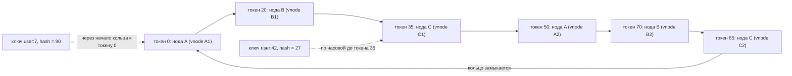
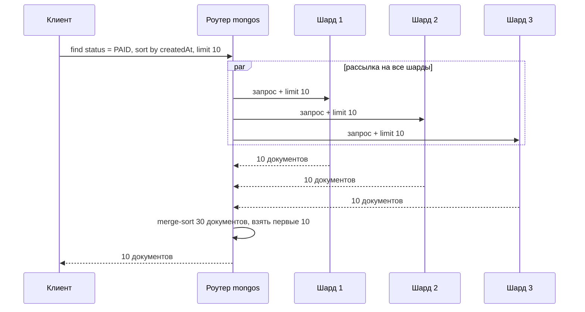

# 05. Партиционирование (шардирование)

**Зачем это знать backend-разработчику.** Пока данные помещаются на одну машину, вопрос «где лежит ключ» не стоит. Как только их становится больше, чем выдерживает один сервер по объёму, записи или чтению, данные режут на части и раскладывают по нодам (node, то же, что узел). От того, **по какому полю** и **каким способом** их режут, зависит всё: будет ли запрос обращаться к одной ноде или ко всем сразу, перегреется ли один сервер, пока остальные простаивают, и сколько данных придётся перегонять по сети при добавлении ноды. Ключ шардирования выбирает разработчик, и исправлять ошибку потом дорого.

> **Коротко:** Партиционирование делит данные на части (партиции) и распределяет их по нодам. Range-партиционирование хранит соседние ключи вместе и хорошо для запросов по диапазону, но склонно к перекосам; hash-партиционирование распределяет равномерно, но теряет порядок. Наивное `hash mod N` при добавлении ноды перемещает почти все ключи; consistent hashing с виртуальными нодами (Cassandra) и фиксированные слоты (Redis Cluster, 16384 слота) перемещают только малую долю. Горячие ключи лечатся «солью» и бакетированием, а запросы без ключа шардирования превращаются в дорогой scatter-gather.

## Оглавление

- [Что такое партиция и ключ партиционирования](#что-такое-партиция-и-ключ-партиционирования)
- [Range против hash](#range-против-hash)
- [Наивный hash mod N и проблема перебалансировки](#наивный-hash-mod-n-и-проблема-перебалансировки)
- [Consistent hashing и виртуальные ноды](#consistent-hashing-и-виртуальные-ноды)
- [Фиксированное число партиций: слоты и чанки](#фиксированное-число-партиций-слоты-и-чанки)
- [Горячие ключи и партиции](#горячие-ключи-и-партиции)
- [Вторичные индексы при шардировании](#вторичные-индексы-при-шардировании)
- [Ребалансировка и её стоимость](#ребалансировка-и-её-стоимость)
- [Как это выглядит в Redis / MongoDB / Cassandra](#как-это-выглядит-в-redis--mongodb--cassandra)
- [Типичные ошибки и заблуждения](#типичные-ошибки-и-заблуждения)
- [Итоги](#итоги)
- [Вопросы для самопроверки](#вопросы-для-самопроверки)
- [Источники](#источники)

## Что такое партиция и ключ партиционирования

**На пальцах.** Представьте библиотеку, которая выросла из одного зала. Книги развезли по пяти залам: в первом авторы на А–Г, во втором Д–К и так далее. Чтобы найти книгу, достаточно знать фамилию автора: она сразу говорит, в какой зал идти. Если же нужна «любая книга 1999 года», придётся обойти все залы.

**Определения.**
- **Партиция** (partition; в MongoDB — chunk, то есть диапазон значений shard key, в Cassandra — token range) — часть данных, которая целиком хранится на одной ноде (и её репликах). Каждая запись принадлежит ровно одной партиции. Не путайте с **шардом** (shard) в MongoDB: это replica set, который хранит много чанков.
- **Ключ партиционирования** (partition key, shard key) — поле или набор полей, по которым система решает, в какую партицию попадает запись.
- **Шардирование** (sharding) — практически синоним партиционирования в контексте распределённых БД.

Партиционирование почти всегда комбинируют с репликацией (см. [04. Репликация](04-replication.md)): каждая партиция хранится в нескольких копиях на разных нодах. Это две независимые оси: партиционирование отвечает за масштаб, репликация — за отказоустойчивость.

**Пример.** Таблица заказов на 3 ТБ, 6 нод по 1 ТБ диска. С ключом `customer_id` и равномерным распределением каждая нода хранит ~500 ГБ, а запрос «все заказы клиента 42» идёт на одну ноду. Запрос «все заказы за вчера» по этому ключу не маршрутизируется и уходит на все 6 нод.

## Range против hash

**На пальцах.** Range — это алфавитные залы библиотеки: соседние фамилии рядом. Hash — это когда фамилию прогоняют через «перемешивающую» формулу, и Иванов может оказаться в зале 3, а Ивановский — в зале 1.

**Range-партиционирование** (range partitioning) — каждой партиции назначается непрерывный диапазон ключей: `[a, f)`, `[f, m)` и т.д. Ключи внутри партиции отсортированы.
- Плюс: запрос по диапазону (`WHERE ts BETWEEN ...`, «все ключи с префиксом `user:42:`») читает одну или несколько соседних партиций.
- Минус: **перекос** (skew). Если ключ монотонно растёт (время, автоинкремент, ObjectId), все новые записи попадают в последнюю партицию — одна нода принимает 100% записи.

**Hash-партиционирование** (hash partitioning) — от ключа считается хеш-функция, и партиция выбирается по значению хеша. Хорошая хеш-функция (MurmurHash3, CRC16, MD5) превращает похожие ключи в далёкие числа.
- Плюс: равномерное распределение даже для монотонных ключей.
- Минус: соседние ключи разбросаны, поэтому запрос по диапазону ключа приходится отправлять на все партиции.

**Пример с числами.** Лог событий, ключ — timestamp, 4 ноды, 10 000 записей/с.

| Схема | Нагрузка на запись | Запрос «события за последний час» |
|---|---|---|
| Range по `ts` | ~10 000/с на одну ноду, ~0 на остальные три | 1 нода |
| Hash по `ts` | ~2 500/с на каждую | все 4 ноды |
| Составной: hash по `device_id`, внутри сортировка по `ts` | ~2 500/с на каждую | для одного устройства — 1 нода |

Третья строка — это то, как устроена Cassandra: **partition key** хешируется, а **clustering key** задаёт порядок строк внутри партиции. Так получаются и равномерность, и эффективные диапазонные запросы, но только в пределах одной партиции.

## Наивный hash mod N и проблема перебалансировки

**На пальцах.** Если раздавать письма по почтальонам правилом «номер дома по модулю числа почтальонов», то с приходом нового почтальона почти каждый дом получит другого почтальона. Всем придётся заново учить маршруты.

Самый простой способ: `node = hash(key) mod N`, где N — число нод. Пока N не меняется, всё отлично. Но при переходе от N к N+1 ключ остаётся на месте, только если `hash mod N == hash mod (N+1)`, а это выполняется примерно для доли `1/(N+1)` ключей. Значит, переезжает около `N/(N+1)` всех данных.

**Пример.** 4 ноды, 100 млн ключей, добавляем пятую.
- Идеально: на новую ноду должна переехать 1/5 данных = 20 млн ключей.
- С `hash mod N`: переезжает ~4/5 = 80 млн ключей, причём не только на новую ноду, но и между старыми.

Для кеша это массовый промах (cache miss) и шторм запросов в основную БД; для хранилища — часы сетевого трафика. Отсюда два решения: consistent hashing и фиксированное число партиций.

## Consistent hashing и виртуальные ноды

**На пальцах.** Представьте круглый циферблат. Ноды расставлены по нему в разных точках. Каждый ключ тоже попадает в точку на циферблате и «идёт по часовой стрелке» до первой встреченной ноды — она его и хранит. Добавили новую ноду — она забирает только кусочек дуги у одной соседки, остальных это не касается.

**Consistent hashing** (согласованное хеширование) предложили Karger и соавторы в 1997 году для распределённых веб-кешей. Пространство хешей замыкается в **кольцо** (ring), например от −2^63 до 2^63−1 у Cassandra. Каждая нода получает позицию — **токен** (token). Ключ принадлежит первой ноде, чей токен больше или равен хешу ключа; если такого нет, ключ достаётся первому токену (переход через начало кольца). При добавлении ноды в среднем перемещается лишь ~`1/(N+1)` ключей.

Проблема: при одном токене на ноду дуги получаются неравными (случайные точки на круге распределены неровно), а при добавлении ноды нагрузку отдаёт только одна соседка. Решение — **виртуальные ноды** (virtual nodes, vnodes): каждая физическая нода получает не один, а несколько токенов, разбросанных по кольцу.



Каждая физическая нода владеет несколькими небольшими дугами. Когда добавляется нода D со своими vnodes, она забирает по кусочку у многих нод сразу, и перенос данных идёт параллельно из нескольких источников.

**Сколько vnodes.** Раньше Cassandra по умолчанию ставила `num_tokens: 256`. Это давало ровное распределение, но замедляло repair (фоновую сверку реплик), увеличивало метаданные и повышало вероятность, что отказ любых двух нод затронет какой-то диапазон. С Cassandra 4.0 значение по умолчанию — **`num_tokens: 16`** вместе с алгоритмом распределения токенов (`allocate_tokens_for_local_replication_factor: 3`), который выбирает токены не случайно, а так, чтобы нагрузка была ровной даже при малом их числе.

**Пример на Java 21.** Минимальное кольцо с vnodes на `TreeMap`:

```java
import java.nio.charset.StandardCharsets;
import java.security.MessageDigest;
import java.util.*;

public final class HashRing {
    private final TreeMap<Long, String> ring = new TreeMap<>();
    private final int vnodes;

    public HashRing(int vnodes) { this.vnodes = vnodes; }

    public void addNode(String node) {
        // каждая физическая нода получает vnodes точек на кольце
        for (int i = 0; i < vnodes; i++) ring.put(hash(node + "#" + i), node);
    }

    public void removeNode(String node) {
        for (int i = 0; i < vnodes; i++) ring.remove(hash(node + "#" + i));
    }

    public String nodeFor(String key) {
        // первый токен >= hash(key); если такого нет — переход через начало кольца
        Map.Entry<Long, String> e = ring.ceilingEntry(hash(key));
        return (e != null ? e : ring.firstEntry()).getValue();
    }

    private static long hash(String s) {
        try {
            byte[] d = MessageDigest.getInstance("MD5").digest(s.getBytes(StandardCharsets.UTF_8));
            long h = 0;
            for (int i = 0; i < 8; i++) h = (h << 8) | (d[i] & 0xFF); // первые 8 байт как long
            return h;
        } catch (Exception ex) { throw new IllegalStateException(ex); }
    }
}
```

Если разложить 100 000 ключей по 4 нодам с `vnodes = 1`, доли нод легко получаются вроде 12% / 41% / 19% / 28%. С `vnodes = 100` они сближаются к 25% ± пара процентов. При добавлении пятой ноды меняют владельца ~20% ключей, а не 80%, как у `hash mod N`. Это легко проверить, посчитав `nodeFor` для всех ключей до и после `addNode`.

## Фиксированное число партиций: слоты и чанки

**На пальцах.** Вместо того чтобы двигать границы залов, библиотека заранее разбивает все книги на 1000 одинаковых коробок. Залы получают коробки целиком. Появился новый зал — ему передают по несколько коробок от каждого старого. Правило «книга → коробка» не меняется никогда.

Идея: число партиций P выбирается заранее и сильно больше числа нод. Ключ отображается в партицию стабильной формулой, а таблица «партиция → нода» меняется при ребалансировке.

**Redis Cluster** использует 16 384 **хеш-слота** (hash slots): `slot = CRC16(key) mod 16384`. Каждый мастер отвечает за набор слотов, например при 3 мастерах: 0–5460, 5461–10922, 10923–16383. Чтобы несколько ключей гарантированно попали в один слот (это нужно для `MULTI`, Lua-скриптов и многоключевых команд), используют **hash tag**: если в ключе есть `{...}`, хешируется только часть в фигурных скобках.

```
redis-cli -c CLUSTER KEYSLOT user:42:profile
(integer) 9133
redis-cli -c CLUSTER KEYSLOT {user:42}:profile
(integer) 15880
redis-cli -c CLUSTER KEYSLOT {user:42}:cart
(integer) 15880
```

Номер слота зависит только от строки ключа (или тега), поэтому у двух ключей с одинаковым тегом `{user:42}` он всегда совпадает, а у `user:42:profile` без тега — другой. Команда `MSET a 1 b 2` для ключей из разных слотов вернёт ошибку `CROSSSLOT`. В Java драйвер Lettuce считает слот сам (`io.lettuce.core.cluster.SlotHash.getSlot(key)`) и отправляет команду сразу нужному мастеру.

**MongoDB** делит шардированную коллекцию на **чанки** (chunks) — непрерывные диапазоны значений shard key (или его хеша). Размер чанка по умолчанию с MongoDB 6.0 — 128 МБ. Фоновый процесс **балансировщик** (balancer) переносит чанки между шардами; начиная с 6.0.3 он выравнивает шарды по объёму данных, а не по числу чанков. Маршрутизатор **mongos** хранит таблицу «диапазон → шард», полученную с config-серверов.

**Пример.** Redis Cluster из 3 мастеров, добавляем 4-й. Каждому старому мастеру достаточно отдать ~1365 слотов (16384 / 4 ≈ 4096 на мастер после). Ключи внутри переданных слотов переезжают командой `MIGRATE`; остальные ~75% ключей не трогаются.

## Горячие ключи и партиции

**На пальцах.** Даже при идеальном распределении книг по залам, если все читатели одновременно хотят один бестселлер, очередь выстроится в один зал.

**Горячий ключ** (hot key) — отдельный ключ, на который приходится непропорционально большая доля запросов. **Горячая партиция** (hot partition) — партиция, перегруженная из-за горячего ключа, перекоса данных или неудачного ключа шардирования. Хеширование тут не помогает: один и тот же ключ всегда попадает в одно место.

**Как обнаружить.**
- Метрики по нодам: одна нода с CPU 90%, остальные с 20%.
- Redis: `redis-cli --hotkeys` (требует LFU-политики вытеснения `maxmemory-policy allkeys-lfu`), `redis-cli --bigkeys` для больших ключей.
- Cassandra: `nodetool toppartitions`, `nodetool tablehistograms` (размеры партиций), предупреждения о больших партициях в логе.
- MongoDB: `sh.status()` и `db.collection.getShardDistribution()` показывают перекос по шардам.

**Как лечить.**
- **Соль** (salting): к ключу добавляется суффикс `0..K-1`. Запись идёт в случайный из K вариантов, чтение собирает все K. Нагрузка делится на K партиций (обычно они лежат на разных нодах, но не обязательно на K разных), а чтение становится в K раз дороже.
- **Бакетирование** (bucketing): партиция ограничивается по времени или размеру, например `(sensor_id, day)` вместо `sensor_id`. Это ограничивает рост одной партиции.
- **Кеширование** горячего ключа на стороне приложения или реплики для чтения.

**Пример.** Счётчик просмотров популярного видео получает 50 000 инкрементов/с, одна нода Cassandra выдерживает ~10 000 на партицию. Схема: ключ `(video_id, shard)` где `shard = ThreadLocalRandom.current().nextInt(8)`. Запись — в один из 8 шардов (~6 250/с на каждый), чтение — `SELECT ... WHERE video_id = ? AND shard IN (0, 1, 2, 3, 4, 5, 6, 7)` или 8 отдельных запросов, и суммирование на клиенте. В коде ниже 8 запросов выполняются параллельно через `executeAsync`.

```java
// запись: случайный шард из 8
int shard = ThreadLocalRandom.current().nextInt(8);
session.execute(incrementStmt.bind(videoId, shard));
// чтение: 8 асинхронных запросов параллельно, затем сумма
List<CompletableFuture<Long>> parts = IntStream.range(0, 8)
        .mapToObj(s -> session.executeAsync(readStmt.bind(videoId, s))
                .thenApply(rs -> {
                    Row row = rs.one();                        // в шард могло ещё ничего не записаться
                    return row == null ? 0L : row.getLong("views");
                })
                .toCompletableFuture())
        .toList();
long total = parts.stream().mapToLong(CompletableFuture::join).sum();
```

## Вторичные индексы при шардировании

**На пальцах.** Каталог «по жанрам» в многозальной библиотеке можно сделать двумя способами: в каждом зале свой маленький каталог только своих книг, или один большой каталог «детективы — залы 1, 3, 5», который тоже приходится где-то хранить и обновлять.

**Вторичный индекс** (secondary index) — индекс по полю, которое не является ключом партиционирования. Варианты:

- **Локальный индекс** (local, document-partitioned) — каждая партиция индексирует только свои документы. Запись дешёвая (индекс обновляется на той же ноде), но чтение по индексу — это **scatter-gather**: запрос рассылается на все партиции, а результаты сливаются. Так работают индексы MongoDB на шардах и в Cassandra — secondary indexes и **SAI** (Storage-Attached Indexes, индексы, встроенные в файлы данных, с 5.0).
- **Глобальный индекс** (global, term-partitioned) — индекс сам партиционирован по значению индексируемого поля. Чтение идёт в одну партицию индекса, но запись документа может затронуть индексные партиции на других нодах, поэтому глобальные индексы обычно обновляются асинхронно (например, GSI в DynamoDB — eventually consistent).



**Пример со стоимостью.** **p99** (99-й перцентиль) — время, в которое укладываются 99% запросов. 20 шардов, у каждого p99 = 5 мс. Targeted-запрос (по shard key) — одна нода, p99 ≈ 5 мс. Scatter-gather ждёт самого медленного из 20: вероятность, что все 20 уложатся в свой p99, равна 0.99^20 ≈ 0.82, то есть почти каждый пятый запрос будет «хвостовым». К тому же каждый запрос нагружает все 20 нод, и пропускная способность кластера по таким запросам не растёт при добавлении шардов.

### 🔬 Глубже: пагинация и сортировка в scatter-gather

`limit 10 skip 1000` при scatter-gather требует, чтобы каждый шард вернул 1010 документов, и роутер отсортирует 20 × 1010 = 20 200 документов ради 10. Поэтому для шардированных коллекций предпочитают keyset-пагинацию (`createdAt < lastSeen`), а не `skip`.

## Ребалансировка и её стоимость

**На пальцах.** Переезд части книг в новый зал — это грузчики, коридоры и время. Пока они носят коробки, читатели тоже ходят по тем же коридорам.

**Ребалансировка** (rebalancing) — перенос партиций между нодами при добавлении/удалении нод или при перекосе. Цели: равномерная нагрузка после переноса, работа системы во время переноса, перемещение минимума данных.

Стоимость складывается из:
- сетевого трафика и дискового I/O на отдающих и принимающих нодах (конкуренция с продовым трафиком);
- времени, в течение которого данные «в пути»: запросы к переезжающей партиции нужно перенаправлять (в Redis Cluster — ответы `ASK` и `MOVED`);
- риска: отказ ноды во время переноса, повторные попытки, неполные данные.

Поэтому ребалансировку делают ограниченной по скорости (throttling) и часто полуавтоматической: MongoDB позволяет задать окно работы балансировщика, в Cassandra добавление ноды (bootstrap) стримит данные с ограничением `stream_throughput_outbound`, а после — `nodetool cleanup` на старых нодах удаляет уже чужие данные.

**Пример.** Кластер 4 × 2 ТБ, добавляем пятую ноду. На неё должно переехать ~1.6 ТБ (по 400 ГБ с каждой). При ограничении 100 МБ/с суммарно это ≈ 1.6·10^6 МБ / 100 МБ/с ≈ 16 000 с ≈ 4.5 часа, в течение которых старые ноды тратят часть диска и сети на стриминг. Отсюда правило: масштабироваться заранее, а не когда ноды уже на 90% загружены.

## Как это выглядит в Redis / MongoDB / Cassandra

**Redis Cluster.** Фиксированные 16 384 слота, `CRC16(key) mod 16384`, hash tags `{...}` для группировки ключей. Клиент держит карту слотов (`CLUSTER SLOTS` / `CLUSTER SHARDS`); если слот переехал, нода отвечает `MOVED 15880 10.0.0.3:6379`, клиент обновляет карту. Во время миграции слота — `ASK`, одноразовый редирект. Решардинг выполняется вручную или через `redis-cli --cluster reshard` / `rebalance`. Вторичных индексов в кластере на уровне ядра нет (Redis Query Engine, в Redis 8 — встроенный, индексирует данные локально на каждом шарде). Односерверный Redis не партиционирован вовсе.

**MongoDB.** Шардирование по диапазонам (`{ createdAt: 1 }`), по хешу (`{ userId: "hashed" }`) или составной ключ; зоны (zone sharding) привязывают диапазоны к конкретным шардам, например по региону. Запрос, содержащий shard key, — **targeted** (идёт на один шард), без него — **broadcast** (scatter-gather). Начиная с 5.0 shard key можно сменить через `reshardCollection`, но это полное перекопирование коллекции.

```
// mongosh
sh.enableSharding("shop")
sh.shardCollection("shop.orders", { customerId: "hashed" })
db.orders.getShardDistribution()
```

**Cassandra.** Кольцо токенов, по умолчанию `Murmur3Partitioner` (диапазон −2^63..2^63−1), vnodes (`num_tokens: 16` с 4.0). Partition key хешируется, clustering columns сортируют строки внутри партиции. Узнать токен и владельцев:

```
-- cqlsh
SELECT token(user_id), user_id FROM shop.orders_by_user LIMIT 3;
-- nodetool (CLI Cassandra)
nodetool getendpoints shop orders_by_user 42
```

Запрос с фильтром по неиндексированной колонке без ограничения partition key отвергается, если не указать `ALLOW FILTERING`, что означает скан всего кластера. Запросы по secondary index или SAI принимаются и без partition key, но индексы локальны для ноды, поэтому такой запрос опрашивает много нод (scatter-gather).

## Типичные ошибки и заблуждения

1. **Монотонный shard key.** Шардирование MongoDB по `{ _id: 1 }` с ObjectId или по времени по диапазонам: вся запись идёт в «последний» чанк. Решение — hashed-ключ или составной ключ с высокой кардинальностью в начале.
2. **Ключ с низкой кардинальностью.** Шардирование по `country` при 90% пользователей из одной страны: одна партиция гигантская, и разделить её нельзя, потому что у всех документов одно значение ключа.
3. **«Hash-шардирование решает горячие ключи».** Нет: один ключ всегда хешируется в одно место. Нужны соль, бакеты или кеш.
4. **Ожидание, что вторичный индекс «бесплатен» в кластере.** Локальные индексы превращают запрос в scatter-gather по всем нодам; с ростом кластера такой запрос не ускоряется.
5. **Hash tag на всё.** `{app}:user:1`, `{app}:user:2` ... — все ключи в одном слоте, то есть на одном мастере. Тег должен группировать только то, что реально используется вместе.
6. **Неограниченная партиция в Cassandra.** Партиция `sensor_id` без бакета за год вырастает до гигабайт; ориентир — держать партиции в пределах ~100 МБ.

## Итоги

- Партиционирование масштабирует объём и запись; репликация — отказоустойчивость. Их используют вместе.
- Range сохраняет порядок и хорош для диапазонов, но страдает от перекоса; hash равномерен, но рассыпает диапазоны. Составной ключ (hash partition key + сортированный clustering key) даёт лучшее из двух в пределах партиции.
- `hash mod N` при изменении N перемещает почти все данные; consistent hashing и фиксированные слоты — лишь ~1/N.
- Cassandra: кольцо + vnodes (`num_tokens: 16` с 4.0); Redis Cluster: 16 384 слота и hash tags; MongoDB: чанки и балансировщик.
- Горячий ключ не лечится хешированием — только солью, бакетированием или кешем.
- Запрос без ключа шардирования — scatter-gather: дорог и плохо масштабируется. Ключ выбирают под главные запросы.
- Ребалансировка стоит сети, диска и времени; масштабируются заранее и с ограничением скорости.

## Вопросы для самопроверки

1. Почему range-партиционирование по timestamp создаёт горячую ноду, а hash — нет?
   <details><summary>Ответ</summary>Новые записи имеют наибольшие timestamp и попадают в последний диапазон, то есть на одну ноду. Хеш разбрасывает соседние значения по всему пространству, поэтому запись распределяется равномерно (ценой потери эффективных диапазонных запросов).</details>
2. Какая доля ключей переезжает при переходе с 9 на 10 нод при `hash mod N` и при consistent hashing?
   <details><summary>Ответ</summary>При `hash mod N` остаётся на месте ~1/10, переезжает ~90%. При consistent hashing переезжает ~1/10 (только то, что забирает новая нода).</details>
3. Зачем нужны виртуальные ноды и почему Cassandra 4.0 уменьшила `num_tokens` с 256 до 16?
   <details><summary>Ответ</summary>vnodes выравнивают распределение и позволяют новой ноде забирать данные у многих нод параллельно. 256 токенов давали накладные расходы на repair и метаданные и ухудшали доступность при двойных отказах; новый алгоритм выбора токенов даёт ровное распределение уже при 16.</details>
4. Ключи `order:1` и `order:1:items` нужно менять в одной транзакции `MULTI` в Redis Cluster. Как это сделать?
   <details><summary>Ответ</summary>Использовать hash tag: `{order:1}` и `{order:1}:items`. Тогда хешируется только `order:1`, оба ключа окажутся в одном слоте, и CROSSSLOT не будет.</details>
5. Чем локальный вторичный индекс отличается от глобального по стоимости чтения и записи?
   <details><summary>Ответ</summary>Локальный: запись локальная и дешёвая, чтение — scatter-gather по всем партициям. Глобальный: чтение в одну партицию индекса, но запись может затрагивать другие ноды и обычно обновляет индекс асинхронно.</details>
6. Счётчик получает 40 000 записей/с, а партиция выдерживает 10 000. Предложите схему.
   <details><summary>Ответ</summary>Соль: ключ `(counter_id, shard)` с 4–8 шардами, запись в случайный шард, чтение суммирует все шарды. Альтернатива — агрегировать инкременты в приложении и писать пачками.</details>
7. Почему scatter-gather по 20 шардам медленнее, чем запрос в один шард, даже если каждый шард быстрый?
   <details><summary>Ответ</summary>Ответ ждёт самого медленного шарда: вероятность попасть в «хвост» растёт с числом шардов (0.99^20 ≈ 0.82). Плюс каждый запрос нагружает все шарды, и роутеру нужно слить результаты.</details>

## Источники

- Karger D. et al. *Consistent Hashing and Random Trees: Distributed Caching Protocols for Relieving Hot Spots on the World Wide Web.* STOC 1997.
- DeCandia G. et al. *Dynamo: Amazon's Highly Available Key-value Store.* SOSP 2007.
- Kleppmann M. *Designing Data-Intensive Applications*, глава 6 «Partitioning». O'Reilly.
- Redis: Cluster specification — https://redis.io/docs/latest/operate/oss_and_stack/reference/cluster-spec/
- Redis: Scale with Redis Cluster — https://redis.io/docs/latest/operate/oss_and_stack/management/scaling/
- MongoDB: Sharding — https://www.mongodb.com/docs/manual/sharding/
- MongoDB: Choose a Shard Key — https://www.mongodb.com/docs/manual/core/sharding-choose-a-shard-key/
- Apache Cassandra: Dynamo (architecture) — https://cassandra.apache.org/doc/latest/cassandra/architecture/dynamo.html
- CASSANDRA-13701: Lower default num_tokens — https://issues.apache.org/jira/browse/CASSANDRA-13701

---

← [04. Репликация](04-replication.md) | [оглавление](README.md) | [06. Консенсус и членство](06-consensus-membership.md) →
