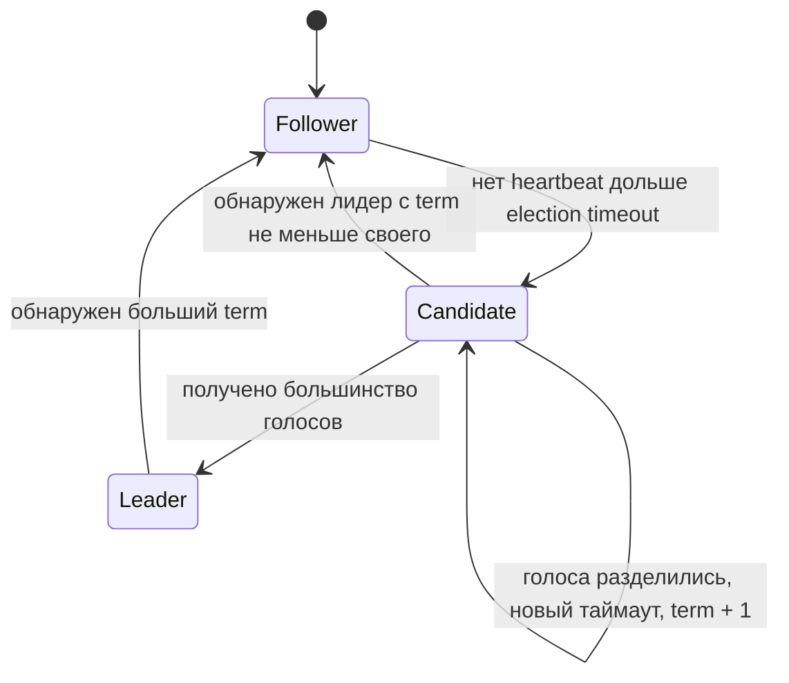
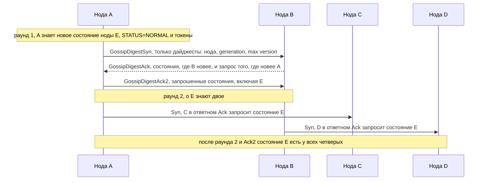

# 06. Консенсус, членство и время

**Зачем это знать backend-разработчику.** Когда в кластере падает лидер MongoDB или мастер Redis, приложение на несколько секунд получает ошибки записи, а потом «само» начинает работать с новым лидером. Что происходит в эти секунды, почему иногда выбираются два лидера, почему `IF NOT EXISTS` в Cassandra в разы медленнее обычной записи и почему сортировать события по `System.currentTimeMillis()` с разных серверов опасно — всё это вопросы консенсуса, членства в кластере и времени. Это знание нужно, чтобы правильно настроить таймауты и ретраи в драйвере.

> **Коротко:** Консенсус — это способ заставить несколько нод договориться об одном значении (кто лидер, какая запись следующая) даже при отказах. Raft решает это через выборы лидера по большинству голосов и репликацию лога; MongoDB использует Raft-подобный протокол pv1, Cassandra применяет Paxos для лёгких транзакций (LWT). Чтобы знать, кто жив, кластеры используют heartbeat и gossip, а Cassandra — адаптивный phi accrual детектор отказов. Физическим часам разных машин доверять нельзя: для упорядочивания событий нужны логические часы или протоколы консенсуса.

## Оглавление

- [Задача консенсуса и FLP](#задача-консенсуса-и-flp)
- [Raft: выборы лидера и репликация лога](#raft-выборы-лидера-и-репликация-лога)
- [Paxos и лёгкие транзакции](#paxos-и-лёгкие-транзакции)
- [Членство и обнаружение отказов](#членство-и-обнаружение-отказов)
- [Выбор нового мастера в Redis Sentinel и Redis Cluster](#выбор-нового-мастера-в-redis-sentinel-и-redis-cluster)
- [Часы: физические и логические](#часы-физические-и-логические)
- [Как это выглядит в Redis / MongoDB / Cassandra](#как-это-выглядит-в-redis--mongodb--cassandra)
- [Типичные ошибки и заблуждения](#типичные-ошибки-и-заблуждения)
- [Итоги](#итоги)
- [Вопросы для самопроверки](#вопросы-для-самопроверки)
- [Источники](#источники)

## Задача консенсуса и FLP

**На пальцах.** Пять друзей выбирают ресторан по переписке. Сообщения опаздывают, кто-то выключает телефон. Нужно, чтобы все пришли в один и тот же ресторан, предложенный кем-то из них.

**Консенсус** (consensus) — задача, в которой несколько процессов должны выбрать одно значение. Требования:
- **Согласие** (agreement): все корректные ноды решают одно и то же;
- **Корректность** (validity): решённое значение кем-то предложено;
- **Завершимость** (termination): каждая корректная нода рано или поздно принимает решение.

На консенсусе строятся выбор лидера, атомарная запись «только если не существует», упорядоченный лог операций (**replicated log**, реплицируемый журнал) — всё, где кластеру нужно «одно мнение».

**FLP-невозможность** (Fischer, Lynch, Paterson, 1985): в полностью **асинхронной** системе (нет верхней границы задержки сообщений) не существует детерминированного алгоритма консенсуса, гарантирующего завершение, если может отказать хотя бы один процесс. Причина: медленную ноду нельзя отличить от упавшей. Практический вывод: реальные протоколы (Raft, Paxos) всегда сохраняют безопасность (никогда не решают два разных значения), а завершимость гарантируют лишь «когда сеть ведёт себя прилично» — с помощью таймаутов и рандомизации.

**Большинство** (majority, quorum) — ключевой приём: решение принимается, если его подтвердили `floor(N/2) + 1` нод. Два любых большинства пересекаются хотя бы в одной ноде, поэтому два противоречивых решения невозможны. Это тот же кворум, что и в правиле `R + W > N` для чтения/записи (см. [04. Репликация](04-replication.md)); но параметр `quorum` у Redis Sentinel — не большинство, а лишь порог голосов для перехода мастера в состояние **SDOWN → ODOWN**, и сам по себе он не выбирает нового лидера.

**Пример.** Кластер из 5 нод: большинство — 3. Кластер переживает отказ 2 нод. Если сеть разделилась на 3 + 2, работать может только сторона из 3 нод; сторона из 2 не наберёт большинства и не сможет выбрать лидера. Кластер из 4 нод переживает лишь 1 отказ (большинство — 3), поэтому чётное число голосующих нод почти не даёт выигрыша.

| Голосующих нод | Большинство | Допустимо отказов |
|---|---|---|
| 3 | 2 | 1 |
| 4 | 3 | 1 |
| 5 | 3 | 2 |
| 7 | 4 | 3 |

## Raft: выборы лидера и репликация лога

**На пальцах.** В классе выбирают старосту. Каждый ученик ждёт случайное время, и если староста долго молчит, объявляет себя кандидатом и просит голоса. Кто первым набрал больше половины голосов — новый староста, и дальше только он записывает решения в общий журнал, диктуя их остальным.

**Raft** (Ongaro, Ousterhout, 2014) — алгоритм консенсуса, спроектированный ради понятности. Каждая нода находится в одной из трёх **ролей**:
- **Follower** (последователь) — пассивно принимает команды лидера;
- **Candidate** (кандидат) — просит голоса на выборах;
- **Leader** (лидер) — единственный, кто принимает записи и рассылает их.

Время разбито на **термы** (terms) — нумерованные эпохи. В каждом терме не больше одного лидера. Терм — это логические часы: нода, увидевшая больший терм, немедленно становится follower.



**Выборы лидера.**
1. Лидер регулярно шлёт followers **heartbeat** — пустые `AppendEntries`.
2. Если follower не слышит лидера дольше **election timeout** (в статье — случайное значение из 150–300 мс), он увеличивает терм, становится кандидатом, голосует за себя и шлёт `RequestVote` остальным.
3. Нода голосует не более одного раза за терм и только за кандидата, чей лог не отстаёт от её собственного. Это гарантирует, что лидер содержит все закоммиченные записи.
4. Случайный таймаут делает одновременные выдвижения редкими; если голоса всё-таки разделились, через новый таймаут выборы повторяются.

**Репликация лога.** Лидер добавляет команду в свой лог и рассылает её в `AppendEntries`. Запись считается **закоммиченной** (committed), когда она есть у большинства. Лидер ведёт **commit index** — номер последней закоммиченной записи — и передаёт его followers, которые применяют записи до этого номера к своей машине состояний (state machine).

**Пример «шаг → что происходит».** 3 ноды: A (лидер, term 5), B, C. Клиент пишет `x = 7`.

| Шаг | A | B | C |
|---|---|---|---|
| 1 | добавляет запись #10 `x=7` (term 5) в лог | — | — |
| 2 | шлёт AppendEntries #10 | получает, пишет в лог, отвечает OK | сеть тормозит |
| 3 | 2 из 3 (A, B) — большинство, commitIndex = 10, отвечает клиенту | — | — |
| 4 | следующий heartbeat несёт commitIndex = 10 | применяет #10 | получает #10 позже, применяет |
| 5 | A падает | через ~200 мс таймаут, term 6, RequestVote | голосует за B (лог B не хуже) |
| 6 | — | лидер term 6, запись #10 сохранена | follower |

### 🔬 Глубже: почему лидер не коммитит старые записи «по счётчику»

Лидер считает запись закоммиченной по большинству реплик только для записей **своего текущего терма**; записи прошлых термов коммитятся вместе с ними — иначе новый лидер мог бы затереть запись, уже лежащую на большинстве. Ещё деталь: чтение с лидера без проверки может вернуть устаревшие данные, если лидер уже смещён, но не знает об этом. Поэтому **линеаризуемое чтение** (linearizable read, см. [03. CAP и согласованность](03-cap-consistency.md)) требует подтверждения лидерства: раунд heartbeat с большинством либо **lease** (аренда) — гарантия, что в течение интервала никто другой лидером не станет.

**Откуда «два лидера».** Сеть разделилась: старый лидер A оказался в меньшинстве, а большинство выбрало B с термом выше; пока A не заметит потерю большинства, оба узла считают себя лидерами (это и есть **split brain**). Подробнее о причинах, рисках и защите (fencing-токены) — в [04. Репликация](04-replication.md#failover-split-brain-и-fencing).

**Raft в MongoDB.** Replica set MongoDB с версии 3.2 использует **protocol version 1 (pv1)** — протокол выборов, основанный на идеях Raft: термы, голосование большинством, запрет голосовать за отстающего кандидата. Отличия от «учебного» Raft:
- secondary **сами забирают** (pull) записи из **oplog** (журнал операций) источника синхронизации, а не получают их push-ом от лидера; источником может быть и другой secondary — **цепочечная репликация** (chained replication), при которой secondary копирует oplog у соседа, а не у primary;
- у членов есть **priority** (приоритет): нода с большим приоритетом, догнавшая primary, может инициировать выборы и занять место;
- таймаут выборов по умолчанию — `electionTimeoutMillis: 10000` (10 с), heartbeat — каждые 2 с;
- голосующих членов не больше 7, всего членов — до 50.

Запись с `writeConcern: "majority"` (значение по умолчанию с MongoDB 5.0) подтверждается только после попадания на большинство — ровно как «закоммиченная» запись Raft. Запись с `w: 1`, не дошедшая до большинства, при смене primary может быть откачена (**rollback**).

```java
// Java 21, MongoDB Java Driver: запись переживёт смену primary
MongoCollection<Document> orders = db.getCollection("orders")
        .withWriteConcern(WriteConcern.MAJORITY.withWTimeout(5, TimeUnit.SECONDS));
orders.insertOne(new Document("_id", 42).append("status", "PAID"));
```

## Paxos и лёгкие транзакции

**На пальцах.** Paxos похож на аукцион с номерками: чтобы предложить значение, сначала надо «застолбить» номер выше всех предыдущих у большинства участников, и лишь потом просить их принять само значение.

**Paxos** (Lamport; «The Part-Time Parliament», 1998, упрощённое изложение «Paxos Made Simple», 2001) — один из первых и самый известный алгоритм консенсуса (Viewstamped Replication, 1988, появился раньше). Роли: **proposer** (предлагает), **acceptor** (принимает), **learner** (узнаёт итог). Два этапа:
1. **Prepare/Promise**: proposer выбирает номер n и просит большинство acceptor-ов пообещать не принимать предложения с номером меньше n; в ответ они сообщают уже принятое ранее значение, если оно есть.
2. **Accept/Accepted**: proposer просит принять значение (своё или уже принятое кем-то ранее) с номером n; если большинство приняло — значение выбрано.

Базовый Paxos выбирает одно значение. **Multi-Paxos** — его расширение для последовательности значений (лога): устойчивый лидер проходит фазу Prepare один раз, а дальше выполняет только Accept для каждой записи. Raft и Multi-Paxos дают одинаковые гарантии; Raft проще объяснить и реализовать.

**Где встречается: LWT в Cassandra.** **Лёгкие транзакции** (lightweight transactions, LWT) — условные операции `INSERT ... IF NOT EXISTS`, `UPDATE ... IF balance = 100`. Обычная запись Cassandra идёт без консенсуса (last-write-wins), а LWT проходит раунды Paxos между репликами: prepare/promise, чтение текущего значения, propose/accept, commit. Исторически это 4 сетевых кругооборота против одного у обычной записи. В Cassandra 4.1 появилась улучшенная реализация Paxos v2 (параметр `paxos_variant: v2`), сокращающая число кругооборотов. По умолчанию и в 4.1, и в 5.0 остаётся `v1`, поэтому v2 нужно включать явно. В любом варианте LWT заметно дороже обычной записи.

```
-- cqlsh: регистрация уникального логина
INSERT INTO users (login, email) VALUES ('alice', 'a@example.com') IF NOT EXISTS;
--  [applied] | login | email
--      False | alice | old@example.com     <- уже занят, возвращено текущее значение
```

Уровень согласованности для Paxos-фазы задаётся отдельно: `SERIAL` (кворум по всем дата-центрам) или `LOCAL_SERIAL` (кворум в локальном дата-центре).

**Accord.** Для полноценных многопартиционных ACID-транзакций в Cassandra разрабатывается протокол **Accord** (CEP-15), основанный на leaderless-консенсусе с использованием синхронизированных (но не идеальных) часов для быстрого пути. Изначально его планировали к 5.0, но в релиз 5.0 он не вошёл; работа ведётся в основной ветке (trunk), и Accord планируется к следующему мажорному релизу (ожидаемо 6.0). На момент написания (2026) проверяйте статус в release notes Apache Cassandra: в `cassandra:5.0`, который используется в этом курсе, Accord-транзакций (`BEGIN TRANSACTION ... COMMIT TRANSACTION`) нет.

**Пример.** Два клиента одновременно выполняют `INSERT ... login='alice' IF NOT EXISTS` при коэффициенте репликации (RF) 3. Paxos гарантирует, что ровно один получит `[applied] = True`; второй увидит `False` и значение победителя. Без `IF NOT EXISTS` обе записи «успешны», и побеждает та, у которой больше timestamp.

## Членство и обнаружение отказов

**На пальцах.** В большом офисе никто не обзванивает всех коллег. Люди болтают у кулера с парой случайных коллег и пересказывают новости; через несколько таких раундов новость знают все.

**Членство** (membership) — знание каждой ноды о том, какие ноды есть в кластере и живы ли они. **Детектор отказов** (failure detector) — механизм, решающий, что нода недоступна.

- **Heartbeat** (сердцебиение) — периодическое сообщение «я жив». Нет сообщений дольше таймаута — нода считается упавшей. Просто, но при N нодах «все со всеми» — это O(N²) сообщений.
- **Gossip-протокол** (протокол сплетен, epidemic protocol) — раз в интервал каждая нода обменивается состоянием с несколькими случайными нодами. Информация распространяется экспоненциально: за O(log N) раундов её знают все.

В Cassandra gossip запускается каждую секунду: нода связывается с одной случайной живой нодой, иногда — с недоступной нодой и с **seed-нодой** (заранее известная точка входа). Состояние каждой ноды состоит из **heartbeat state** — **generation** (время старта) и **version** (счётчик, растущий с каждым heartbeat) — и **application state**: STATUS (NORMAL, LEAVING и т.п.), токены, версия схемы, адрес. При обмене побеждает более свежая версия. Вердикт «нода упала» через gossip **не передаётся**: каждая нода решает это сама, своим детектором отказов, по тому, растёт ли heartbeat version чужой ноды.



**Phi accrual failure detector** (Hayashibara и др., 2004). Вместо жёсткого таймаута детектор хранит историю интервалов между heartbeat каждой ноды и считает **φ (phi)** — насколько маловероятна текущая пауза с учётом этой истории. Нода объявляется недоступной, когда φ превышает порог `phi_convict_threshold` (в Cassandra по умолчанию 8). Так детектор сам подстраивается под сеть.

**Пример (модель из статьи, нормальное распределение).** Heartbeat от ноды B обычно приходит раз в 1 с (± 0.1 с). Пауза 1.5 с даёт высокий φ — слишком необычно. Для ноды C в другом дата-центре интервалы 1 ± 0.6 с, и та же пауза 1.5 с — ещё норма. Грубо, φ = 8 означает, что вероятность ошибиться, объявив ноду мёртвой, порядка 10^-8 при предположении о распределении интервалов.

**Как в Cassandra.** Cassandra использует упрощение: экспоненциальное распределение, для которого нужно только среднее значение интервала: `φ = t / (mean · ln 10)`, где t — время с последнего обновления heartbeat. При gossip раз в ~1 с φ = 8 достигается примерно через 8 · 2.3 ≈ 18 с тишины. То есть DOWN наступает не через 1.5 с, а примерно через 18 с.

## Выбор нового мастера в Redis Sentinel и Redis Cluster

**На пальцах.** Sentinel — это охранники, наблюдающие за главным сервером со стороны. Один охранник может ошибиться, поэтому тревогу поднимают, только если достаточно охранников согласны, а переключение проводит охранник, которого выбрало большинство.

**Redis Sentinel** — отдельные процессы, следящие за мастером и репликами в нераспределённой (не кластерной) установке.
1. Sentinel перестал получать ответ от мастера дольше `down-after-milliseconds` — помечает его **SDOWN** (subjectively down, «по моему мнению упал»).
2. Если число сентинелей, согласных с этим, достигает **quorum** (параметр в `sentinel monitor mymaster 10.0.0.1 6379 2`), мастер получает статус **ODOWN** (objectively down).
3. Для проведения failover один sentinel должен быть выбран лидером голосованием **большинства всех сентинелей** (с эпохой, похоже на терм Raft). Quorum нужен только для детектирования отказа, а авторизация failover требует большинства (или quorum, если он задан больше большинства).
4. Лидер-sentinel выбирает лучшую реплику (приоритет, наименьшее отставание по репликации), делает её мастером (`REPLICAOF NO ONE`) и перенастраивает остальные.

**Пример.** 3 сентинеля, quorum = 2. Один sentinel потерял связь с мастером — только SDOWN, ничего не происходит. Два согласны — ODOWN; из 3 сентинелей 2 голосуют за лидера (большинство), и failover идёт. Если живы только 2 из 5 сентинелей, ODOWN возможен при quorum = 2, но failover — нет: большинство 5 — это 3.

**Redis Cluster** обходится без сентинелей: мастера сами голосуют.
1. Нода, не получившая ответ от другой дольше `cluster-node-timeout` (по умолчанию 15 000 мс), помечает её **PFAIL** (possible failure) и сообщает об этом через gossip.
2. Если большинство мастеров сообщили PFAIL в пределах окна времени, нода помечается **FAIL**.
3. Реплики упавшего мастера ждут небольшую задержку (≈ 500 мс + случайные 0–500 мс + ранг × 1000 мс, где у самой актуальной реплики ранг 0) и запрашивают голоса у мастеров, увеличив **currentEpoch**.
4. Реплика, получившая голоса большинства мастеров, становится мастером с новым **configEpoch** и забирает слоты; конфликт решается в пользу большего configEpoch.

Следствие: кластеру нужно минимум 3 мастера, иначе нет устойчивого большинства для голосования.

## Часы: физические и логические

**На пальцах.** Если два человека записывают время событий по своим наручным часам, а у одного часы спешат на 2 минуты, по их записям нельзя понять, что случилось раньше.

**Физические часы** (wall clock, `System.currentTimeMillis()`) на разных машинах расходятся: кварц дрейфует, NTP корректирует их с точностью от долей до десятков миллисекунд, а при коррекции время может даже **прыгнуть назад**. Даже в пределах одной JVM для измерения длительности нужен `System.nanoTime()` — монотонный, но несравнимый между машинами.

**Пример проблемы.** Cassandra разрешает конфликты по принципу **last-write-wins** (LWW) по timestamp записи, и рассинхронизация часов клиентов молча теряет более позднюю по факту запись — подробный разбор LWW см. в [04. Репликация](04-replication.md#разрешение-конфликтов).

**Логические часы Лэмпорта** (Lamport clock, 1978) — счётчик, который не измеряет время, а упорядочивает события:
- перед каждым событием нода увеличивает счётчик;
- в каждое сообщение вкладывается текущее значение;
- получив сообщение, нода ставит `counter = max(counter, received) + 1`.

Гарантия: если A **произошло-до** (happened-before) B, то `L(A) < L(B)`. Обратное неверно: меньший счётчик не доказывает причинную связь (для этого нужны **векторные часы**, vector clocks).

```java
// Java 21: потокобезопасные часы Лэмпорта
import java.util.concurrent.atomic.AtomicLong;

public final class LamportClock {
    private final AtomicLong time = new AtomicLong();

    public long tick() { return time.incrementAndGet(); }          // локальное событие или отправка

    public long onReceive(long remote) {                            // получение сообщения
        return time.updateAndGet(local -> Math.max(local, remote) + 1);
    }
}
```

### 🔬 Глубже: гибридные часы

**Hybrid logical clock** (HLC) объединяет физическое время и логический счётчик: значение близко к реальному времени, но никогда не идёт назад и учитывает причинность. MongoDB использует похожий механизм — **cluster time** — для **причинной согласованности** (causal consistency: если операция B зависит от A, все видят A раньше B; см. [03. CAP и согласованность](03-cap-consistency.md)): драйвер передаёт `$clusterTime` и `operationTime` между запросами, и нода не отвечает «из прошлого» относительно того, что клиент уже видел.

## Как это выглядит в Redis / MongoDB / Cassandra

**Redis.** Нет консенсуса для данных: репликация асинхронная, при failover последние записи могут потеряться. Консенсус используется только для выбора мастера: в Sentinel — голосование сентинелей (quorum для ODOWN + большинство для лидера), в Cluster — голосование мастеров с эпохами. Членство в Cluster — gossip через cluster bus (порт данных + 10000).

```
redis-cli -p 26379 SENTINEL get-master-addr-by-name mymaster
redis-cli -c CLUSTER NODES
```

**MongoDB.** Replica set с Raft-подобным протоколом pv1: термы, выборы большинством, heartbeat каждые 2 с, `electionTimeoutMillis` 10 с. Записи коммитятся большинством (`w: "majority"`), иначе возможен rollback. Члены с `priority: 0` не становятся primary; **arbiter** голосует, но не хранит данные.

```
// mongosh
rs.status().term    // текущий терм выборов
rs.status().members.map(m => ({ name: m.name, state: m.stateStr }))
rs.stepDown(60)   // принудительные выборы для проверки поведения приложения
```

**Cassandra.** Leaderless: у данных нет лидера, обычные записи идут без консенсуса (LWW по timestamp). Членство и схема распространяются через gossip, отказы определяет phi accrual детектор. Для условных операций — Paxos (LWT, `SERIAL` / `LOCAL_SERIAL`; Paxos v2 с 4.1). Accord (CEP-15) — в разработке для релиза после 5.0.

```
-- nodetool (CLI Cassandra)
nodetool status          -- UN = Up/Normal, DN = Down/Normal
nodetool gossipinfo      -- generation, heartbeat version, статусы
```

## Типичные ошибки и заблуждения

1. **«Два узла надёжнее одного».** Для выборов лидера два голосующих узла хуже трёх: при потере любого из двух большинства нет. Нужно нечётное число голосующих: 3, 5, 7.
2. **Сортировка событий по `System.currentTimeMillis()` с разных серверов.** Часы расходятся и прыгают назад; используйте номер версии из БД, логические часы или порядок из единого лога.
3. **LWT на горячем пути.** `IF NOT EXISTS` на каждую запись снижает пропускную способность в разы и конфликтует под конкуренцией. LWT — для редких операций вроде регистрации логина.
4. **Слишком агрессивные таймауты.** Уменьшив `electionTimeoutMillis` или `cluster-node-timeout` до сотен миллисекунд, легко получить ложные failover на каждой GC-паузе (остановка процесса сборщиком мусора) или сетевом всплеске.
5. **Ожидание, что после failover ничего не потерялось.** В Redis (асинхронная репликация) и в MongoDB с `w: 1` подтверждённые записи могут исчезнуть.
6. **Quorum сентинелей = большинство.** Quorum определяет только ODOWN; failover всё равно требует большинства всех сентинелей.

## Итоги

- Консенсус нужен для выбора лидера, условных записей и единого лога; основан на пересечении большинств.
- FLP: в асинхронной сети гарантированного завершения нет, поэтому протоколы жертвуют «живостью» в плохие периоды, но не безопасностью.
- Raft: роли follower/candidate/leader, термы, случайные таймауты, коммит по большинству. MongoDB pv1 — Raft-подобные выборы с pull-репликацией oplog.
- Paxos — основа LWT в Cassandra; LWT дороги. Accord (CEP-15) — в разработке после 5.0.
- Членство: heartbeat и gossip; Cassandra использует адаптивный phi accrual детектор (`phi_convict_threshold` = 8).
- Redis Sentinel: quorum для ODOWN, большинство для failover; Redis Cluster: PFAIL → FAIL и голосование мастеров с эпохами.
- Физическим часам разных машин не доверяйте; для порядка — логические/гибридные часы или единый лог.

## Вопросы для самопроверки

1. Что утверждает FLP-невозможность и почему Raft всё равно работает на практике?
   <details><summary>Ответ</summary>В асинхронной системе с возможностью отказа хотя бы одного процесса нет детерминированного консенсуса с гарантией завершения. Raft всегда безопасен, а завершается благодаря таймаутам и рандомизации, когда сеть «достаточно синхронна».</details>
2. Почему в Raft используются случайные election timeout?
   <details><summary>Ответ</summary>Чтобы followers не выдвигались одновременно и не делили голоса бесконечно: чаще всего первым просыпается один кандидат и успевает набрать большинство.</details>
3. Когда запись в Raft считается закоммиченной и как это связано с `w: "majority"` в MongoDB?
   <details><summary>Ответ</summary>Когда запись текущего терма реплицирована на большинство. `w: "majority"` подтверждает запись клиенту по тому же принципу, поэтому она переживёт выборы и не будет откачена.</details>
4. Replica set из 4 нод: сколько отказов он переживает с сохранением записи? А из 5?
   <details><summary>Ответ</summary>4 ноды: большинство 3, переживает 1 отказ. 5 нод: большинство 3, переживает 2.</details>
5. Чем phi accrual детектор лучше фиксированного таймаута?
   <details><summary>Ответ</summary>Он учитывает историю интервалов heartbeat конкретной ноды и выдаёт непрерывную степень подозрения φ, поэтому сам адаптируется к задержкам сети и реже даёт ложные срабатывания.</details>
6. 5 сентинелей, quorum = 2, живы 2. Произойдёт ли failover при падении мастера?
   <details><summary>Ответ</summary>Нет. ODOWN наступит (2 ≥ quorum), но для выбора лидера-сентинеля нужно большинство от 5, то есть 3 голоса.</details>
7. Почему `INSERT ... IF NOT EXISTS` в Cassandra медленнее обычного INSERT?
   <details><summary>Ответ</summary>Обычный INSERT — одна запись на реплики без координации. LWT проходит несколько раундов Paxos (prepare, чтение, propose, commit) между репликами.</details>
8. Как работают часы Лэмпорта и что они не гарантируют?
   <details><summary>Ответ</summary>Счётчик растёт на каждом событии, передаётся в сообщениях, при приёме берётся max + 1. Если A произошло до B, то L(A) < L(B); но из L(A) < L(B) не следует причинная связь — для этого нужны векторные часы.</details>

## Источники

- Fischer M., Lynch N., Paterson M. *Impossibility of Distributed Consensus with One Faulty Process.* JACM, 1985.
- Ongaro D., Ousterhout J. *In Search of an Understandable Consensus Algorithm (Raft).* USENIX ATC 2014 — https://raft.github.io/raft.pdf
- Lamport L. *The Part-Time Parliament.* ACM TOCS, 1998; *Paxos Made Simple*, 2001.
- Lamport L. *Time, Clocks, and the Ordering of Events in a Distributed System.* CACM, 1978.
- Hayashibara N. et al. *The φ Accrual Failure Detector.* SRDS 2004.
- Kulkarni S. et al. *Logical Physical Clocks and Consistent Snapshots in Globally Distributed Databases* (HLC), 2014.
- Kleppmann M. *Designing Data-Intensive Applications*, главы 8–9. O'Reilly.
- MongoDB: Replica Set Elections — https://www.mongodb.com/docs/manual/core/replica-set-elections/
- MongoDB: Replica Set Protocol Version — https://www.mongodb.com/docs/manual/reference/replica-set-protocol-versions/
- Redis: High availability with Redis Sentinel — https://redis.io/docs/latest/operate/oss_and_stack/management/sentinel/
- Redis: Cluster specification — https://redis.io/docs/latest/operate/oss_and_stack/reference/cluster-spec/
- Apache Cassandra: Lightweight transactions / Gossip — https://cassandra.apache.org/doc/latest/
- CEP-15: General Purpose Transactions (Accord) — https://cwiki.apache.org/confluence/display/CASSANDRA/CEP-15%3A+General+Purpose+Transactions

---

← [05. Партиционирование](05-partitioning.md) | [оглавление](README.md) | [07. Движки хранения](07-storage-engines.md) →
