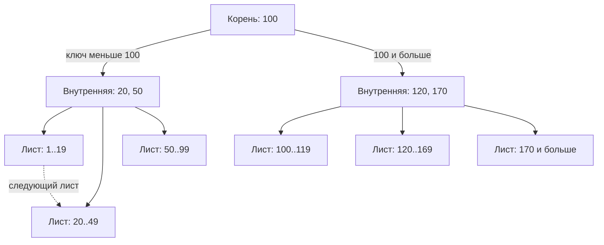
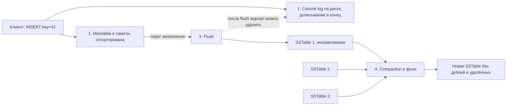

# 07. Движки хранения: WAL, B-Tree, LSM-Tree, MVCC

**Зачем это знать backend-разработчику.** Почему Cassandra быстро пишет, но «тормозит» на чтении после массового удаления? Почему MongoDB при `w:1` может подтвердить запись до того, как она попала на диск? Почему Redis может потерять последнюю секунду данных? Ответы — в **движке хранения** (storage engine). Понимая его, вы осознанно выбираете СУБД, настройки надёжности и схему данных.

> **Коротко:** Любой надёжный движок сначала пишет изменение в журнал (WAL) и только потом в основную структуру. Основных структур две: **B-Tree** обновляет страницы на месте и быстро читает, **LSM-Tree** только дописывает в конец и быстро пишет, но платит фоновым слиянием (compaction). Выиграть сразу по чтению, записи и месту нельзя (RUM-гипотеза). MVCC хранит несколько версий строки, чтобы читатели не блокировали писателей. Колоночное хранение ускоряет аналитику, строковое — операции с целыми записями.

## Оглавление

1. [Что делает движок хранения](#1-что-делает-движок-хранения)
2. [WAL и fsync](#2-wal-и-fsync)
3. [B-Tree](#3-b-tree)
4. [LSM-Tree](#4-lsm-tree)
5. [RUM-гипотеза: три вида амплификации](#5-rum-гипотеза-три-вида-амплификации)
6. [In-memory хранилища: Redis](#6-in-memory-хранилища-redis)
7. [MVCC и snapshot isolation](#7-mvcc-и-snapshot-isolation)
8. [Строковое и колоночное хранение](#8-строковое-и-колоночное-хранение)
9. [Как это выглядит в Redis / MongoDB / Cassandra](#как-это-выглядит-в-redis--mongodb--cassandra)
10. [Типичные ошибки и заблуждения](#типичные-ошибки-и-заблуждения) · [Итоги](#итоги) · [Вопросы для самопроверки](#вопросы-для-самопроверки) · [Источники](#источники)

## 1. Что делает движок хранения

**На пальцах.** Склад. Кладовщик (движок) решает, куда поставить коробку, как её быстро найти и что делать, если свет погас посреди работы.

**Движок хранения** (storage engine) — слой СУБД, отвечающий за формат данных на диске, индексы, кэш страниц, журнал и восстановление после сбоя. В MongoDB движок по умолчанию — WiredTiger.

Главное ограничение — разница скоростей. Порядок величин, который полезно помнить:

| Операция | Примерное время |
|---|---|
| Чтение из RAM | ~100 нс |
| Случайное чтение 4 КБ с NVMe SSD | ~20–100 мкс |
| Случайное чтение с HDD (поиск головки) | ~5–10 мс |
| fsync на SSD без защиты от потери питания | от сотен мкс до единиц мс |

Диск в тысячи раз медленнее памяти, а **последовательная** запись (в конец файла) намного дешевле **случайной** (в середину). Все структуры ниже — компромиссы вокруг этих фактов.

## 2. WAL и fsync

**На пальцах.** Бухгалтер, прежде чем переставлять папки в шкафу, записывает в тетрадь: «перенёс счёт №17 из ящика A в ящик B». Если его прервут, по тетради видно, что доделать.

**WAL** (Write-Ahead Log, журнал упреждающей записи) — файл, в который изменение дописывается **до** того, как оно применится к основным структурам данных. Правило одно: запись считается надёжной, когда её запись в журнале дошла до диска. После сбоя движок читает журнал и «проигрывает» (replay) изменения, которые не успели попасть в основные файлы.

Журнал только дописывается в конец — это быстро. Страницы данных сбрасываются на диск лениво и пачками во время **checkpoint** (контрольной точки), после которой старую часть журнала можно удалить.

**fsync** — системный вызов, заставляющий ОС сбросить данные из своего кэша (page cache) на физический носитель. Без него `write()` лишь кладёт байты в память ОС, и отключение питания их уничтожит. fsync дорогой: на обычном SSD это порядка миллисекунды. fsync на каждую транзакцию — это около 1000 транзакций в секунду на поток.

Поэтому СУБД используют **group commit** (групповую фиксацию): один fsync на пачку транзакций. Или делают fsync по таймеру, рискуя потерять последние миллисекунды–секунды.

**Пример: как три СУБД обращаются с fsync (настройки по умолчанию).**

| СУБД | Журнал | Когда fsync | Что можно потерять при падении одного узла |
|---|---|---|---|
| PostgreSQL | WAL | при каждом COMMIT (`synchronous_commit=on`) | ничего |
| MongoDB | журнал WiredTiger | каждые 100 мс, либо сразу при `j: true` | с `w:"majority"` (по умолчанию с 5.0) — ничего: запись ждёт журнала на большинстве реплик; с `w:1, j:false` — до 100 мс |
| Cassandra | commit log | `periodic`, раз в 10 с | до 10 с на этом узле (но есть реплики) |
| Redis | AOF (если включён, `appendonly yes`) | `appendfsync everysec` — раз в секунду | около 1 с |

В MongoDB надёжность управляется из Java через write concern:

```java
// ждём подтверждения большинства реплик И записи в журнал на диске
MongoCollection<Document> orders = db.getCollection("orders")
        .withWriteConcern(WriteConcern.MAJORITY.withJournal(true));
orders.insertOne(new Document("order_id", "o-1001").append("total", 59.90));
```

## 3. B-Tree

**На пальцах.** Энциклопедия в 30 томах. На корешках написано «А–Бел», «Бем–Вяз» и т.д. Вы сначала выбираете том, потом по колонтитулам страницу, потом строку. Три шага — и вы нашли одно слово из миллиона.

**B-Tree** (B-дерево, Bayer и McCreight, 1972) — сбалансированное дерево, где каждый узел — это **страница** (page) фиксированного размера: 8 КБ в PostgreSQL, 16 КБ в InnoDB. Внутренние страницы хранят ключи-разделители и ссылки на детей, **листовые** (leaf) — ключи и данные (или ссылки на них). Почти везде используется вариант **B+Tree**: данные только в листьях, листья связаны в список для перебора диапазона.



**Пример с числами.** Страница 8 КБ, ключ 8 байт плюс ссылка 8 байт — в страницу помещается около 500 ссылок. Это **коэффициент ветвления** (fanout). Тогда дерево глубины 4 адресует 500⁴ ≈ 62 млрд записей. Верхние два уровня (1 + 500 страниц ≈ 4 МБ) всегда в кэше, значит поиск любой записи — это 1–2 чтения с диска.

**Вставка и split.** Новый ключ кладётся в нужный лист. Если лист полон, происходит **split** (расщепление): половина ключей уезжает в новую страницу, а в родителя добавляется новый разделитель. Если переполнился и родитель, split поднимается выше; если корень — дерево вырастает на уровень. Путь от корня до любого листа всегда одной длины.

**Где используется:** индексы PostgreSQL (сами таблицы там лежат в неупорядоченной «куче», heap), таблицы и индексы MySQL InnoDB, WiredTiger в MongoDB.

### 🔬 Глубже: write amplification B-Tree и особенности WiredTiger

**Write amplification** (усиление записи) — во сколько раз записанных на диск байт больше, чем изменило приложение. Меняем поле в 100 байт — B-Tree пишет запись в WAL и позже всю страницу 8 КБ: усиление ~80 раз. При случайных вставках split'ы оставляют страницы заполненными примерно на 50–70%, что тратит место.

Поэтому монотонный ключ (автоинкремент, UUIDv7, ObjectId) удобен: он вставляется в «правый край» дерева без случайных split'ов. Случайный UUIDv4 разбрасывает вставки по всем листьям и ухудшает кэш.

WiredTiger сложнее классического B-Tree. Изменения копятся в памяти в виде цепочек обновлений, а при сбросе старый блок на диске не перезаписывается (**no-overwrite**): пишется новый блок. Раз в 60 секунд делается checkpoint — согласованный снимок на диске, журнал покрывает время между ними. Блоки коллекций сжимаются (по умолчанию snappy). LSM-режим в WiredTiger исторически был (позже его удалили), но MongoDB его не использовала.

## 4. LSM-Tree

**На пальцах.** Секретарь кидает письма в лоток (быстро!), а когда лоток полон — сортирует пачку и перевязывает резинкой. Раз в неделю пачки сливаются в одну, дубли и отменённые письма выбрасываются.

**LSM-Tree** (Log-Structured Merge-Tree, O'Neil и соавторы, 1996) — структура, которая никогда не переписывает данные на месте. Путь записи:

1. Изменение дописывается в **commit log** (это WAL).
2. Изменение кладётся в **memtable** — отсортированную структуру в памяти (обычно skip list или дерево).
3. Когда memtable достигает порога (например, 64–256 МБ), она сбрасывается на диск целиком как **SSTable** (Sorted String Table) — неизменяемый файл, отсортированный по ключу.
4. Фоновый процесс **compaction** (уплотнение) сливает несколько SSTable в одну, оставляя последнюю версию каждого ключа.



**Удаление** в LSM — тоже запись: пишется маркер **tombstone** («надгробие»). Данные физически исчезнут только при compaction.

**Чтение** сложнее записи: нужно проверить memtable, затем SSTable от новых к старым, пока ключ не найдётся. При 20 SSTable в худшем случае — 20 обращений.

**Где используется:** Cassandra, ScyllaDB, HBase, LevelDB, RocksDB (и системы поверх него, например TiKV).

### Compaction: size-tiered против leveled

**Size-tiered** (STCS, по размеру): когда накопилось ~4 SSTable похожего размера, они сливаются в одну крупнее. Записывает мало, но ключ может лежать в нескольких файлах разных «ярусов», а во время слияния нужно свободное место под старые и новые файлы одновременно — до 2x от объёма данных.

**Leveled** (LCS, по уровням; по умолчанию в RocksDB): данные разбиты на уровни L0, L1, L2…, каждый в ~10 раз больше предыдущего. Внутри уровня (кроме L0) SSTable не пересекаются по ключам, поэтому чтение проверяет не больше одного файла на уровень. Цена — каждая запись переписывается при переходе на каждый уровень.

**Пример с числами.** 1 ТБ данных, множитель уровней 10: уровни 1 ГБ → 10 ГБ → 100 ГБ → 1 ТБ.

| | STCS | LCS |
|---|---|---|
| Write amplification | низкая, ~ число ярусов (4–5) | высокая, до ~10 на уровень, суммарно десятки |
| Чтение ключа | может затронуть много SSTable | ~1 SSTable на уровень, 4–5 файлов |
| Лишнее место на диске | до 2x во время крупного слияния | ~10% |
| Когда выбирать | запись преобладает | чтение преобладает, частые обновления |

В Cassandra есть ещё **TWCS** (Time Window) для временных рядов с TTL, а в **Cassandra 5.0 появилась UCS** (Unified Compaction Strategy), которая параметрически покрывает поведение и STCS, и LCS. В конфигурации `cassandra_latest.yaml` из поставки 5.0 UCS выбрана по умолчанию.

### Bloom-фильтры

**На пальцах.** Охранник архива на вопрос «есть ли папка Иванова?» отвечает «точно нет» или «возможно, есть». Если «точно нет» — в архив не заходим.

**Bloom-фильтр** (Burton Bloom, 1970) — компактная вероятностная структура: битовый массив плюс k хеш-функций. Добавление ключа ставит k битов в 1. Проверка: если хоть один из k битов равен 0, ключа точно нет; если все 1 — ключ **возможно** есть (**false positive**, ложноположительный ответ). Ложноотрицательных ответов не бывает.

У каждой SSTable свой bloom-фильтр в памяти. Чтение ключа при 20 SSTable превращается в 20 проверок в RAM и, как правило, 1 реальное чтение с диска.

### 🔬 Глубже: сколько памяти нужно bloom-фильтру

Для доли ложных срабатываний p оптимально около `1.44 · log2(1/p)` бит на ключ и `k ≈ 0.69 · (бит на ключ)` хеш-функций. Для p = 1% это ~9,6 бита на ключ и 7 хеш-функций. На 1 млрд ключей — около 1,2 ГБ памяти. В Cassandra это параметр таблицы `bloom_filter_fp_chance` (по умолчанию 0.01 для STCS и 0.1 для LCS). Снижение до 0.001 стоит ~50% памяти сверху и в 10 раз сокращает лишние чтения.

Bloom-фильтр помогает только точечным запросам: для диапазона «ключи от A до F» он бесполезен.

## 5. RUM-гипотеза: три вида амплификации

**На пальцах.** «Быстро, дёшево, качественно — выберите два». У структур хранения то же самое.

**RUM-гипотеза** (RUM Conjecture, Athanassoulis и соавторы, 2016): структура доступа к данным может минимизировать не более двух из трёх накладных расходов — **R**ead (чтение), **U**pdate (обновление) и **M**emory (место). Их измеряют как амплификацию:

- **read amplification** — сколько страниц/файлов читается на один логический запрос;
- **write amplification** — сколько байт пишется на диск на один изменённый байт;
- **space amplification** — во сколько раз занятое место больше «полезных» данных.

**Пример: одна нагрузка, три структуры.** Точечное чтение по ключу из 1 млрд записей.

| Структура | Read amp | Write amp | Space amp |
|---|---|---|---|
| B-Tree, страница 8 КБ | ~1–2 чтения диска (верх в кэше) | ~десятки (страница целиком) | ~1.3–1.5 (недозаполненные страницы) |
| LSM + STCS | несколько SSTable, bloom спасает | низкая | до 2 |
| LSM + LCS | ~1 файл на уровень | высокая | ~1.1 |
| Хеш-индекс в памяти (Redis) | 1 обращение в RAM | 1 | высокая: всё в RAM + накладные расходы |

Вывод: «лучшего» движка нет. Логи, метрики, IoT — LSM. Каталог, который читают в 100 раз чаще, чем пишут, — B-Tree или LSM с leveled compaction.

## 6. In-memory хранилища: Redis

**На пальцах.** Повар держит всё на столе, а не в подвале: готовит мгновенно, но стол мал, а при пожаре уцелеет только то, что записано в тетрадь.

**In-memory хранилище** держит все данные в RAM; диск нужен только для **персистентности** (persistence) — восстановления после перезапуска. В Redis два механизма:

- **RDB** (снапшот): команда `BGSAVE` делает `fork()`; дочерний процесс пишет компактный бинарный снимок, а родитель продолжает обслуживать запросы. Память делится механизмом **copy-on-write**: страница копируется, только если родитель её меняет.
- **AOF** (Append Only File): каждая изменяющая команда дописывается в лог — это тот же WAL. Частота fsync задаётся `appendfsync`: `always`, `everysec` (по умолчанию), `no`. Лог периодически сжимается (**AOF rewrite**); с Redis 7 это базовый файл плюс инкрементальные (multi-part AOF).

В стандартном конфиге включены только RDB-снапшоты, AOF выключен (`appendonly no`). Если AOF включить, при `aof-use-rdb-preamble yes` (по умолчанию) базовый файл пишется в формате RDB — гибридный режим: быстрая загрузка и малые потери.

**Пример с числами.** Redis с 20 ГБ данных, запись в 10% ключей за время `BGSAVE`. Дочерний процесс видит снимок на момент fork, а copy-on-write скопирует минимум ~2 ГБ, на практике больше: копируется вся страница памяти 4 КБ, даже если в ней изменился один ключ. Если бы изменялись все ключи — понадобилось бы до 40 ГБ RAM. Поэтому на сервере Redis оставляют запас памяти.

```text
redis-cli CONFIG SET appendonly yes
redis-cli CONFIG GET appendfsync
1) "appendfsync"
2) "everysec"
redis-cli BGSAVE
Background saving started
```

## 7. MVCC и snapshot isolation

**На пальцах.** Каждый читатель библиотеки получает ксерокопию текущей редакции книги. Редактор правит оригинал, читатели читают свои копии — никто никого не ждёт. Ненужные копии потом утилизируют.

**MVCC** (Multi-Version Concurrency Control, многоверсионное управление конкурентным доступом) — движок хранит несколько версий записи, помеченных временем или номером транзакции. Читатель видит версии, актуальные на момент своего старта, поэтому **читатели не блокируют писателей, а писатели — читателей**.

**Snapshot isolation** (изоляция снимком) — уровень изоляции, который MVCC даёт естественно: транзакция видит согласованный снимок БД на момент начала. Если две транзакции меняют одну и ту же запись, вторая при коммите получает конфликт (правило **first-committer-wins**).

**Пример: баланс счёта, шаг за шагом.**

| Время | Транзакция T1 | Транзакция T2 | Версии записи `account:7` |
|---|---|---|---|
| t=10 | BEGIN, снимок на t=10 | | v@5: 100 |
| t=11 | читает → 100 | BEGIN, снимок на t=11 | v@5: 100 |
| t=12 | | пишет 50, COMMIT | v@5: 100, v@12: 50 |
| t=13 | снова читает → 100 (свой снимок) | | v@5: 100, v@12: 50 |
| t=14 | пытается записать 80 → конфликт, откат | | v@12: 50 |

Версию v@5 можно удалить только когда завершатся все транзакции, стартовавшие раньше t=12. Это **сборка мусора версий**: VACUUM в PostgreSQL, history store и вытеснение старых версий в WiredTiger. Долгая транзакция мешает очистке, и база «пухнет».

### 🔬 Глубже: чего snapshot isolation не защищает

Snapshot isolation допускает аномалию **write skew** (перекос записи). Классика: правило «хотя бы один врач на дежурстве». Дежурят двое. T1 и T2 одновременно читают «дежурных 2», каждая снимает с дежурства *своего* врача и коммитит. Записи разные — конфликта нет, а в итоге дежурных 0. Защита — явные блокировки (`SELECT ... FOR UPDATE`), материализация конфликта в одной записи или уровень Serializable (в PostgreSQL — Serializable Snapshot Isolation).

В MongoDB мульти-документные транзакции работают со snapshot isolation, и write skew там тоже возможен.

## 8. Строковое и колоночное хранение

**На пальцах.** Анкеты можно хранить по людям (карточка — все ответы человека) или по вопросам (папка «возраст» со всеми возрастами). Для «анкета Иванова» удобнее первое, для «средний возраст» — второе.

**Строковое хранение** (row-oriented): все поля записи лежат рядом. Удобно для OLTP — прочитать или обновить заказ целиком. Так работают PostgreSQL и MongoDB (документ — единый BSON-блок).

**Колоночное хранение** (column-oriented): значения одного столбца лежат рядом. Запрос читает только нужные столбцы, а однотипные соседние значения отлично сжимаются (часто в 5–10 раз). Так устроены ClickHouse, Apache Parquet, Snowflake. Любопытно, что движок MergeTree в ClickHouse — родственник LSM: данные пишутся неизменяемыми кусками (parts), которые сливаются в фоне.

**Пример с числами.** Таблица заказов: 1 млрд строк, 100 столбцов, в среднем 1 КБ на строку. Запрос `SELECT sum(total) FROM orders`:

- строковое хранение читает всю таблицу — ~1 ТБ;
- колоночное читает только столбец `total`: 8 байт × 1 млрд = 8 ГБ, после сжатия ~1–2 ГБ.

Важная ловушка названий: **wide-column** СУБД (Cassandra, HBase) — это **не** колоночные; подробное сравнение — в [02. Классификация](02-classification.md#врезка-clickhouse--не-nosql).

## Как это выглядит в Redis / MongoDB / Cassandra

**Redis.** Данные в RAM, основная структура — хеш-таблица ключей. Персистентность — RDB-снапшоты через `fork()` (включены по умолчанию) и опциональный AOF с `appendfsync everysec`. MVCC нет: команды исполняются одним потоком по очереди, поэтому каждая атомарна.

**MongoDB.** Движок WiredTiger: B-Tree для коллекций и индексов, сжатие блоков, кэш (по умолчанию больше из двух значений: 50% от (RAM − 1 ГБ) или 256 МБ), checkpoint раз в 60 с, журнал с fsync раз в 100 мс или сразу при `j: true`. MVCC: в памяти хранятся цепочки версий, более старые версии, нужные долгим транзакциям, вытесняются в history store. Транзакции — snapshot isolation.

**Cassandra.** Классический LSM: commit log → memtable → SSTable → compaction (STCS, LCS, TWCS, в 5.0 — UCS). У каждой SSTable bloom-фильтр, индекс партиций и сжатие. Удаления — tombstones, которые физически исчезают при compaction после `gc_grace_seconds` (по умолчанию 10 дней). MVCC нет: у каждой ячейки есть timestamp, и при чтении версии сливаются по правилу **last-write-wins** (побеждает больший timestamp).

## Типичные ошибки и заблуждения

1. **«LSM быстрее B-Tree».** Быстрее на запись и хуже на чтение и при удалениях. Много tombstones в Cassandra могут сделать чтение партиции в разы медленнее.
2. **«Запись подтверждена — значит, она на диске».** `w:1, j:false` в MongoDB, `periodic` commit log в Cassandra, `everysec` в Redis подтверждают запись до fsync. Надёжность там во многом держится на репликации.
3. **«Удалил данные — место освободилось».** В LSM удаление добавляет tombstone и временно *увеличивает* объём, место вернётся после compaction.
4. **«Wide-column = колоночная СУБД».** Это не так, см. [02. Классификация](02-classification.md#врезка-clickhouse--не-nosql).
5. **«Snapshot isolation = Serializable».** Snapshot isolation допускает write skew.
6. **Случайные UUIDv4 как первичный ключ B-Tree.** Вставки разбрасываются по всему дереву, растут split'ы и промахи кэша; монотонные ключи (UUIDv7, ObjectId) ведут себя лучше.

## Итоги

- Сначала журнал (WAL), потом данные; fsync дорог, поэтому его группируют или делают по таймеру.
- B-Tree обновляет страницы на месте и читает за 3–4 уровня; это PostgreSQL-индексы и WiredTiger (MongoDB).
- LSM-Tree делает запись последовательной и платит compaction'ом; это Cassandra, ScyllaDB, RocksDB.
- Bloom-фильтр отсекает ненужные SSTable при чтении по ключу за ~10 бит на ключ.
- RUM-гипотеза: из чтения, записи и места оптимизируется не больше двух.
- Redis хранит всё в RAM и сохраняется через RDB-снапшоты и AOF.
- MVCC даёт snapshot isolation без блокировок читателей, но требует сборки мусора версий и не спасает от write skew.

## Вопросы для самопроверки

1. Почему запись в WAL быстрее, чем немедленное обновление страниц данных?
   <details><summary>Ответ</summary>WAL дописывается в конец файла (последовательная запись), а страницы разбросаны по диску (случайная запись). Плюс много транзакций фиксируются одним fsync (group commit), а страницы сбрасываются позже пачкой.</details>
2. Дерево с fanout 500 и глубиной 3 — сколько записей оно адресует и сколько чтений диска нужно для поиска?
   <details><summary>Ответ</summary>500³ = 125 млн записей. Максимум 3 чтения, а на практике корень и второй уровень в кэше, поэтому обычно 1 чтение листа.</details>
3. Почему чтение в LSM-Tree может быть медленным и что это исправляет?
   <details><summary>Ответ</summary>Ключ может быть в memtable и в любой из многих SSTable, их надо проверять от новых к старым. Помогают bloom-фильтры (пропускают SSTable без ключа), compaction (уменьшает число файлов) и leveled-стратегия (не больше одного файла на уровень).</details>
4. Bloom-фильтр ответил «ключ возможно есть». Какие два исхода возможны при чтении SSTable?
   <details><summary>Ответ</summary>Ключ действительно найден, либо это ложноположительный ответ и чтение диска было лишним. Ответ «ключа нет» всегда точен.</details>
5. Сервис пишет 200 тыс. событий в секунду и почти не читает их, кроме редких отчётов. Какую структуру и стратегию compaction вы выберете?
   <details><summary>Ответ</summary>LSM-Tree: запись последовательная и дешёвая. Стратегия с низкой write amplification — STCS, а если события имеют TTL и пишутся по времени — TWCS (или UCS в Cassandra 5.0 с соответствующими параметрами).</details>
6. Redis настроен с `appendfsync everysec`. Сервер потерял питание. Сколько данных может пропасть и почему?
   <details><summary>Ответ</summary>Около последней секунды записей: AOF дописывается в page cache ОС, а fsync выполняется раз в секунду. Всё, что не попало на диск до сбоя, теряется.</details>
7. Две транзакции при snapshot isolation изменили разные строки, нарушив общий инвариант. Как называется аномалия и как её предотвратить?
   <details><summary>Ответ</summary>Write skew. Лечится блокировкой читаемых строк (`SELECT ... FOR UPDATE`), выносом инварианта в одну запись, которую обе транзакции обязаны изменить, или уровнем Serializable.</details>
8. Почему `SELECT avg(total)` по миллиарду заказов в ClickHouse быстрее, чем в Cassandra?
   <details><summary>Ответ</summary>ClickHouse читает только сжатый столбец `total`. Cassandra хранит строки целиком и прочитала бы все партиции всех узлов.</details>

## Источники

- R. Bayer, E. McCreight. *Organization and Maintenance of Large Ordered Indexes*, 1972.
- P. O'Neil et al. *The Log-Structured Merge-Tree (LSM-Tree)*, Acta Informatica, 1996.
- B. H. Bloom. *Space/Time Trade-offs in Hash Coding with Allowable Errors*, CACM, 1970.
- M. Athanassoulis et al. *Designing Access Methods: The RUM Conjecture*, EDBT 2016.
- H. Berenson et al. *A Critique of ANSI SQL Isolation Levels*, SIGMOD 1995.
- M. Kleppmann. *Designing Data-Intensive Applications*, гл. 3 и 7.
- PostgreSQL: [Write-Ahead Logging](https://www.postgresql.org/docs/current/wal-intro.html)
- MongoDB: [WiredTiger Storage Engine](https://www.mongodb.com/docs/manual/core/wiredtiger/), [Journaling](https://www.mongodb.com/docs/manual/core/journaling/)
- Apache Cassandra: [Compaction](https://cassandra.apache.org/doc/latest/cassandra/managing/operating/compaction/index.html), [Unified Compaction Strategy](https://cassandra.apache.org/doc/latest/cassandra/managing/operating/compaction/ucs.html)
- Redis: [Persistence](https://redis.io/docs/latest/operate/oss_and_stack/management/persistence/)
- RocksDB Wiki: [Leveled Compaction](https://github.com/facebook/rocksdb/wiki/Leveled-Compaction)
- ClickHouse: [MergeTree](https://clickhouse.com/docs/engines/table-engines/mergetree-family/mergetree)

---

← [06. Консенсус, членство и время](06-consensus-membership.md) | [оглавление](README.md) | [08. Моделирование данных: от запросов, а не от сущностей](08-data-modeling.md) →
