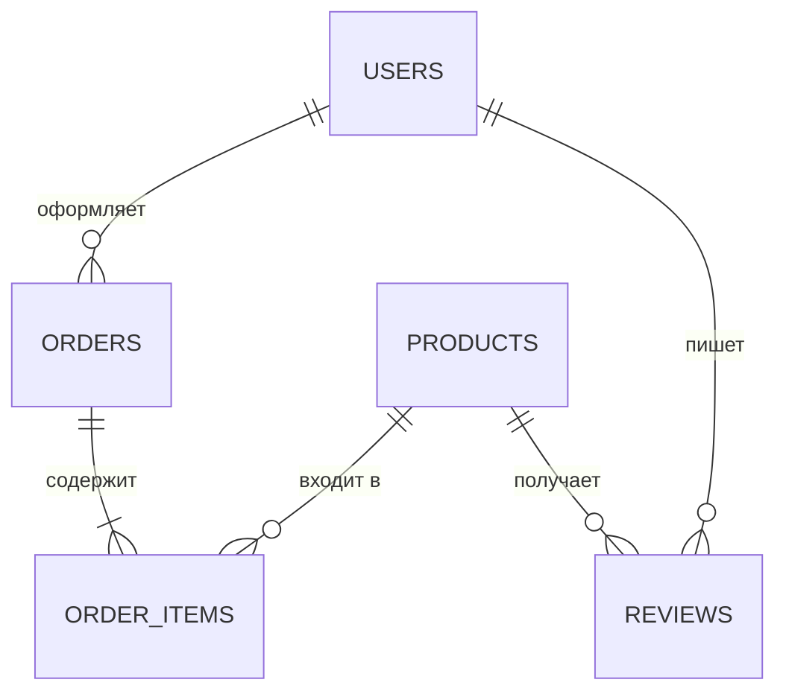
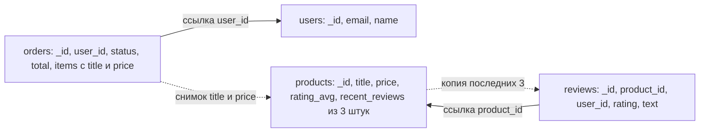

# 08. Моделирование данных: от запросов, а не от сущностей

**Зачем это знать backend-разработчику.** В реляционной СУБД плохую схему спасают JOIN и индексы. В NoSQL схема, спроектированная «как в SQL», превращается в десятки запросов на одну страницу, бесконечно растущие документы и партиции на гигабайты. Моделирование — главный навык при работе с Redis, MongoDB и Cassandra: хорошая модель делает быстрым каждый частый запрос, плохую не исправит никакое железо.

> **Коротко:** В SQL схему строят от сущностей и нормализуют, а запросы собирают JOIN'ами. В NoSQL схему строят от запросов (query-first): сначала список access patterns, потом структура, отвечающая на каждый запрос одним чтением. Для этого данные денормализуют — копируют туда, где их читают, и платят сложностью обновления копий. Что вкладывать внутрь документа, а что хранить ссылкой, решает кардинальность связи; границу документа или партиции удобно проводить по агрегату из DDD. Схема всё равно меняется, поэтому документы версионируют и мигрируют лениво.

## Оглавление

1. [Два подхода: от сущностей и от запросов](#1-два-подхода-от-сущностей-и-от-запросов)
2. [Денормализация: выгоды и цена](#2-денормализация-выгоды-и-цена)
3. [Embedding против referencing](#3-embedding-против-referencing)
4. [Агрегат как граница документа и партиции](#4-агрегат-как-граница-документа-и-партиции)
5. [Сквозной пример: интернет-магазин](#5-сквозной-пример-интернет-магазин)
6. [Эволюция схемы](#6-эволюция-схемы)
7. [Как это выглядит в Redis / MongoDB / Cassandra](#как-это-выглядит-в-redis--mongodb--cassandra)
8. [Типичные ошибки и заблуждения](#типичные-ошибки-и-заблуждения) · [Итоги](#итоги) · [Вопросы для самопроверки](#вопросы-для-самопроверки) · [Источники](#источники)

## 1. Два подхода: от сущностей и от запросов

**На пальцах.** Библиотекарь-теоретик расставляет книги строго по каталогу: каждая книга в одном месте, а для ответа на вопрос читателя бегает по залу. Библиотекарь-практик сначала выясняет, что спрашивают чаще всего, и держит у стойки готовые подборки — иногда одна книга есть в двух подборках.

**Моделирование от сущностей** (entity-first) — классический путь SQL. Рисуем **ER-диаграмму** (Entity-Relationship: сущности и связи), затем **нормализуем** — раскладываем данные так, чтобы каждый факт хранился ровно один раз. Запросы появляются потом и собираются JOIN'ами. Плюс: модель не зависит от запросов, любой новый отчёт можно написать позже.

**Моделирование от запросов** (query-first, query-driven) — путь NoSQL. Сначала выписываем **access patterns** (шаблоны доступа): какие запросы, с какими параметрами, как часто, с каким допустимым временем ответа. Затем под каждый частый запрос строим структуру, которая отвечает **одним чтением** по ключу. В Cassandra это формализовано методологией Чеботько (Chebotko): концептуальная модель → поток запросов приложения → логическая модель «таблица на запрос» → физическая.

**Пример с числами.** Страница «Мои заказы» открывается 5 000 раз в секунду.

- От сущностей: `orders JOIN order_items JOIN products` — на каждый заказ из 3 позиций это чтения из трёх таблиц. На одном сервере PostgreSQL с индексами это нормально. Но если таблицы разнесены по 20 шардам, JOIN превращается в запросы к нескольким шардам.
- От запросов: таблица `orders_by_user`, где заказы пользователя лежат в одной партиции, отсортированные по дате. Один запрос к одной ноде, независимо от числа шардов.

Цена query-first: новый запрос, которого не было в списке, может потребовать новую таблицу или индекс и перенос данных.

## 2. Денормализация: выгоды и цена

**На пальцах.** Номер телефона начальника записан у каждого сотрудника в блокноте. Звонить быстро, но когда номер меняется, надо обойти всех.

**Денормализация** — сознательное дублирование данных ради быстрого чтения. Выгода: запрос читает одно место вместо нескольких. Цена двойная:

- **согласованность копий**: при изменении оригинала копии нужно обновить, а между обновлениями они расходятся;
- **write amplification** на уровне приложения: одно бизнес-изменение превращается в несколько физических записей.

**Пример.** В магазине 1 000 товаров, у популярного — 20 000 отзывов. Карточка товара показывает имя автора рядом с каждым из 3 последних отзывов.

| Решение | Чтение карточки | Пользователь сменил имя |
|---|---|---|
| Хранить только `user_id` | 1 + 3 чтения пользователей | 1 запись |
| Копировать `name` в отзыв | 1 чтение | 1 + N записей (все его отзывы) |

Второй вариант выгоден, если имя меняют редко, а карточку читают постоянно. Ещё важный вопрос: **нужно ли вообще обновлять копию?** Название и цена товара внутри заказа — это не устаревшая копия, а исторический факт: покупатель заплатил 59.90, даже если завтра товар стоит 69.90. Такую копию обновлять нельзя.

### 🔬 Глубже: как поддерживать копии

Три стратегии, от строгой к мягкой:

1. **В той же транзакции** — мульти-документная транзакция MongoDB. Копии всегда совпадают, но транзакция дороже одиночной записи.
2. **Атомарная пачка** — **logged batch** в Cassandra: гарантирует, что все записи пачки *в итоге* применятся, но не даёт изоляции, и читатель может на миг увидеть одну копию без другой.
3. **Асинхронно по событиям** — через **Change Streams** (поток изменений MongoDB) или **outbox** (таблица исходящих событий, которую читает отдельный обработчик). Копии догоняют оригинал за миллисекунды–секунды: это конечная согласованность (eventual consistency).

Для копии, которую можно пересчитать, одна запись может быть атомарной сама по себе. Например, добавление отзыва во встроенный список трёх последних (приём **subset pattern**, см. раздел 3):

```js
// mongosh: добавить отзыв, оставить 3 самых новых, увеличить счётчик — одна атомарная операция
db.products.updateOne({ _id: 1001 }, {
  $push: { recent_reviews: { $each: [ review ], $sort: { created_at: -1 }, $slice: 3 } },
  $inc: { reviews_count: 1 }
})
```

## 3. Embedding против referencing

**На пальцах.** Паспорт вклеен в личное дело (embedding) или в деле лежит записка «паспорт в сейфе №3» (referencing). Вклеенный доступен сразу, но дело толстеет.

**Embedding** (встраивание) — связанные данные лежат внутри родительского документа (массив или вложенный объект). **Referencing** (ссылка) — хранится идентификатор, данные читаются отдельным запросом (или `$lookup` — аналогом LEFT JOIN в MongoDB).

Решение зависит от **кардинальности** (сколько дочерних объектов на одного родителя) и от того, читаются ли они вместе:

| Связь | Пример из магазина | Решение |
|---|---|---|
| 1:1 | пользователь → адрес доставки по умолчанию | embed: читаются вместе |
| 1:few (до десятков) | заказ → позиции (обычно 1–20) | embed: часть агрегата, меняются атомарно |
| 1:many (сотни–тысячи) | товар → отзывы | reference: отзывы отдельно с `product_id`; в товар встроить только 3 последних (**subset pattern**) |
| 1:squillions (миллионы) | товар → события просмотров | только ссылка от ребёнка к родителю, либо агрегат в другом хранилище (счётчик в Redis) |
| many:many | товары ↔ теги | массив id на одной стороне (`tags` в товаре), если список короткий |

Термин **1:squillions** ввёл William Zola из MongoDB: связь, где детей так много, что даже массив их id в родителе не поместится.

**Пример с числами.** Лимит документа MongoDB — 16 МБ. Отзыв ~500 байт, значит в товаре теоретически уместится ~30 000 отзывов. Но задолго до лимита каждое добавление отзыва будет переписывать весь многомегабайтный документ, а чтение карточки — тащить по сети все отзывы, хотя показываются 3. Правило: **не встраивайте массивы, которые растут без ограничения**.

## 4. Агрегат как граница документа и партиции

**На пальцах.** Заказ в интернет-магазине — как посылка: коробка с товарами и накладной. Её собирают, пересчитывают и отправляют целиком. Никто не пересылает по почте «половину позиций».

**Агрегат** (aggregate, из Domain-Driven Design, Эрик Эванс, 2003) — группа объектов, которая меняется как одно целое и охраняет свои **инварианты** (правила, которые всегда должны выполняться, например «сумма заказа = сумма позиций»). У агрегата есть **корень** (aggregate root) — единственная точка входа. Правила Вона Вернона: один агрегат — одна транзакция; другие агрегаты — только ссылкой по id.

Это идеально ложится на NoSQL: **агрегат = документ MongoDB = партиция Cassandra = значение по ключу Redis**. Внутри одного документа или одной партиции запись атомарна без распределённых транзакций.

**Пример: агрегат `Order` на Java 21.** В хранилище поля в snake_case (`user_id`), в Java — camelCase (`userId`). Кодек записей MongoDB-драйвера по умолчанию имена не переводит: нужны аннотации на компонентах (`@BsonId` на `orderId`, чтобы он стал `_id`, `@BsonProperty("user_id")` на `userId` и т.д.) либо свой кодек. В DataStax-драйвере для Cassandra аналогично — `@CqlName("user_id")` в Object Mapper или ручной разбор `Row`.

```java
public enum OrderStatus { NEW, PAID, SHIPPED, CANCELLED }

// Позиция хранит снимок title и price на момент покупки
public record OrderItem(long productId, String title, BigDecimal price, int quantity) {
    public OrderItem {
        if (quantity <= 0) throw new IllegalArgumentException("quantity must be positive");
    }
    public BigDecimal subtotal() { return price.multiply(BigDecimal.valueOf(quantity)); }
}

// Корень агрегата: всё, что меняется вместе, хранится одним документом / одной партицией
public record Order(long orderId, long userId, OrderStatus status, Instant createdAt, List<OrderItem> items) {
    public Order {
        items = List.copyOf(items); // неизменяемая копия, инвариант не обойти снаружи
        if (items.isEmpty()) throw new IllegalArgumentException("order must have items");
    }

    // Инвариант: total всегда равен сумме позиций; в БД сохраняется как вычисленное поле
    public BigDecimal total() {
        return items.stream().map(OrderItem::subtotal).reduce(BigDecimal.ZERO, BigDecimal::add);
    }

    public Order pay() {
        if (status != OrderStatus.NEW) throw new IllegalStateException("only NEW order can be paid");
        return new Order(orderId, userId, OrderStatus.PAID, createdAt, items);
    }
}
```

`Product` и `User` — отдельные агрегаты: заказ ссылается на них по `productId` и `userId`, а не встраивает целиком.

## 5. Сквозной пример: интернет-магазин

**На пальцах.** Один и тот же магазин можно «разложить по полкам» четырьмя способами — в зависимости от того, какой склад (СУБД) у вас есть.

Сущности: пользователи (`users`), товары (`products`), заказы (`orders`) с позициями (`order_items`), отзывы (`reviews`).



**Access patterns** (с этого начинается query-first):

| # | Запрос | Частота |
|---|---|---|
| Q1 | Карточка товара: цена, средний рейтинг, 3 последних отзыва | 20 000/с |
| Q2 | История заказов пользователя, новые сверху | 5 000/с |
| Q3 | Заказ целиком по `order_id` | 2 000/с |
| Q4 | Все отзывы товара постранично, новые сверху | 500/с |
| Q5 | Корзина и счётчик просмотров товара | 30 000/с |

Тестовые данные везде одинаковые: пользователь 42 (Анна), товары 1001 «Кофемолка ручная» за 59.90 и 1002 «Кофе в зёрнах 1 кг» за 19.90, заказ 5001: две кофемолки и одна пачка кофе, итого 139.70.

### SQL: нормализованная схема

```sql
CREATE TABLE users (user_id BIGINT PRIMARY KEY, email TEXT UNIQUE NOT NULL, name TEXT NOT NULL);
CREATE TABLE products (product_id BIGINT PRIMARY KEY, title TEXT NOT NULL,
                       price NUMERIC(10,2) NOT NULL, category TEXT NOT NULL);
CREATE TABLE orders (order_id BIGINT PRIMARY KEY, user_id BIGINT NOT NULL REFERENCES users,
                     status TEXT NOT NULL, created_at TIMESTAMPTZ NOT NULL);
CREATE TABLE order_items (order_id BIGINT REFERENCES orders, product_id BIGINT REFERENCES products,
                          title TEXT NOT NULL, price NUMERIC(10,2) NOT NULL, quantity INT NOT NULL,
                          PRIMARY KEY (order_id, product_id));
CREATE TABLE reviews (review_id BIGINT PRIMARY KEY, product_id BIGINT NOT NULL REFERENCES products,
                      user_id BIGINT NOT NULL REFERENCES users, rating SMALLINT NOT NULL,
                      text TEXT, created_at TIMESTAMPTZ NOT NULL);
```

Каждый факт хранится один раз (`title` и `price` в `order_items` — название и цена на момент покупки: это отдельные исторические факты, а не копии текущих значений). Рейтинг и `total` вычисляются запросом. Q1 — это JOIN `products` + агрегат по `reviews` + JOIN `users`.

### MongoDB: документы по агрегатам

```js
// mongosh
db.orders.insertOne({
  _id: 5001, user_id: 42, status: "PAID",
  created_at: ISODate("2026-09-20T10:15:00Z"), total: NumberDecimal("139.70"),
  items: [
    { product_id: 1001, title: "Кофемолка ручная", price: NumberDecimal("59.90"), quantity: 2 },
    { product_id: 1002, title: "Кофе в зёрнах 1 кг", price: NumberDecimal("19.90"), quantity: 1 }
  ]
})
db.products.insertOne({
  _id: 1001, title: "Кофемолка ручная", price: NumberDecimal("59.90"), category: "kitchen",
  rating_avg: 4.6, reviews_count: 128,
  recent_reviews: [   // subset pattern: только 3 последних, с копией имени автора
    { review_id: 9001, user_id: 42, name: "Анна", rating: 5, text: "Мелет ровно",
      created_at: ISODate("2026-09-21T08:00:00Z") }
  ]
})
db.reviews.createIndex({ product_id: 1, created_at: -1 })   // Q4
db.orders.createIndex({ user_id: 1, created_at: -1 })       // Q2
```

`_id` играет роль `order_id` и `product_id`. Q1 и Q3 — одно чтение по `_id`, Q2 и Q4 — по индексу. Новый отзыв: вставка в `reviews` плюс обновление `recent_reviews`, `reviews_count` и `rating_avg` в `products` — две записи вместо одной.



### Cassandra: таблица на запрос

```sql
-- cqlsh
CREATE TYPE order_item (product_id bigint, title text, price decimal, quantity int);

CREATE TABLE products_by_id (product_id bigint PRIMARY KEY, title text, price decimal,
    category text, rating_avg double, reviews_count int);                        -- Q1

CREATE TABLE orders_by_user (user_id bigint, created_at timestamp, order_id bigint,
    status text, total decimal,
    PRIMARY KEY ((user_id), created_at, order_id))
    WITH CLUSTERING ORDER BY (created_at DESC, order_id ASC);                    -- Q2

CREATE TABLE orders_by_id (order_id bigint PRIMARY KEY, user_id bigint, status text,
    created_at timestamp, total decimal, items list<frozen<order_item>>);       -- Q3

CREATE TABLE reviews_by_product (product_id bigint, created_at timestamp, review_id bigint,
    user_id bigint, name text, rating int, text text,
    PRIMARY KEY ((product_id), created_at, review_id))
    WITH CLUSTERING ORDER BY (created_at DESC, review_id ASC);                   -- Q1 (LIMIT 3) и Q4
```

**UDT** (User-Defined Type, пользовательский тип) `order_item`, созданный через `CREATE TYPE`, — структура из нескольких полей, которую можно хранить внутри столбца. **`frozen<…>`** означает, что значение сериализуется целиком как одно неделимое: его можно только перезаписать полностью, но не менять по полю. Так позиции заказа лежат прямо в строке `orders_by_id`, как массив `items` в документе MongoDB.

Первичный ключ `((user_id), created_at, order_id)` состоит из **partition key** `user_id` (определяет ноду и партицию: все заказы пользователя лежат вместе) и **clustering columns** `created_at, order_id` (порядок строк внутри партиции). JOIN'ов нет, поэтому данные заказа записаны в две таблицы. Оформление заказа 5001 — logged batch из двух INSERT: в `orders_by_user` и `orders_by_id`. Q1 — два запроса по ключу: `products_by_id` и `reviews_by_product ... LIMIT 3`.

### Redis: ключи под горячие запросы

```text
# redis-cli; текст после # — пояснения, не часть команды
HSET product:1001 title "Кофемолка ручная" price "59.90" rating_avg "4.6"
EXPIRE product:1001 3600          # кэш карточки для Q1 на час
HSET cart:42 1001 2 1002 1        # корзина: product_id -> quantity
INCR product:1001:views           # счётчик просмотров (1:squillions)
ZADD products:top_rated 4.6 1001  # рейтинг товаров для витрины
```

Redis обычно не основное хранилище заказов, а слой для самых частых и простых операций Q5 и кэш Q1. Схема ключей `тип:id[:поле]` — тоже модель, её проектируют заранее.

## 6. Эволюция схемы

**На пальцах.** Бланк заявления поменяли: добавили графу «e-mail». Старые заявления в архиве никто не переписывает — их дополняют, когда кто-то достаёт папку.

У NoSQL нет обязательной схемы в БД, но она есть в коде (**schema-on-read**: структура проверяется при чтении). Когда структура меняется, в базе одновременно живут старые и новые документы. Два приёма:

- **Версионирование документов** (schema versioning pattern): поле `schema_version` в каждом документе, код умеет читать все живые версии.
- **Ленивая миграция** (lazy migration): документ приводится к новой версии при чтении и сохраняется обратно. Холодные документы можно добить фоновой задачей.

**Пример.** Магазин вышел на рынок Казахстана, в заказах нужна валюта. Старые 50 млн заказов — рубли, версия 1; новые пишутся с `currency` и `schema_version: 2`.

```java
// Ленивая миграция при чтении (статические импорты: Filters.and/eq/exists, Updates.combine/set)
static Document readOrder(MongoCollection<Document> orders, long orderId) {
    Document order = orders.find(eq("_id", orderId)).first();
    if (order != null && !order.containsKey("schema_version")) { // нет поля — значит версия 1
        // Точечный $set, а не replaceOne: дописываем только новые поля
        orders.updateOne(and(eq("_id", orderId), exists("schema_version", false)),
                combine(set("currency", "RUB"), set("schema_version", 2)));
        order.put("currency", "RUB");
        order.put("schema_version", 2);
    }
    return order;
}
```

Почему не `replaceOne` всего документа: между чтением и записью другой запрос мог изменить, например, `status`, и замена устаревшей копией молча стёрла бы это изменение (**lost update**, потерянное обновление). `$set` трогает только `currency` и `schema_version`, а условие `exists("schema_version", false)` делает миграцию идемпотентной: повторный вызов ничего не изменит.

В Cassandra добавление столбца (`ALTER TABLE orders_by_id ADD currency text`) дешёвое: старые строки просто вернут `null`. Смена первичного ключа невозможна — нужна новая таблица и перенос данных. В Redis версию часто кладут в имя ключа (`product:v2:1001`), и старые ключи исчезают сами по TTL.

## Как это выглядит в Redis / MongoDB / Cassandra

**Redis.** Модель — это схема имён ключей и выбор структуры (String, Hash, ZSet, Set) под операцию. JOIN'ов нет, и автоматических вторичных индексов над базовыми структурами тоже нет. С Redis 8 в Redis Open Source входит Query Engine (`FT.CREATE`, `FT.SEARCH`), который умеет индексировать Hash и JSON. Но базовая модель остаётся прежней: данные находят по известному ключу, поэтому денормализация — норма (например, отдельный ZSet как «индекс» по рейтингу).

**MongoDB.** Документ = агрегат. Главный выбор — embedding или referencing по кардинальности; на помощь приходят паттерны subset, extended reference (копия нескольких полей связанной сущности), computed (`rating_avg`), schema versioning. Есть `$lookup` и мульти-документные транзакции, но частые запросы должны обходиться без них.

**Cassandra.** Строго query-first: одна таблица на запрос, первичный ключ = partition key (куда класть) + clustering columns (как сортировать внутри). Денормализация между таблицами — обязательна, согласованность поддерживается logged batch. Размер партиции нужно ограничивать: ориентир — до ~100 МБ и сотен тысяч строк, иначе бакетировать (например, `(user_id, year)`).

## Типичные ошибки и заблуждения

1. **Перенос нормализованной SQL-схемы в NoSQL «один в один».** Коллекция на каждую таблицу и `$lookup` на каждом запросе — это РСУБД без её оптимизатора.
2. **Бесконечно растущий встроенный массив.** Отзывы, логи, комментарии внутри родителя упираются в 16 МБ и замедляют каждую запись задолго до лимита.
3. **«Денормализация бесплатна».** Каждую копию нужно обновлять и следить за расхождениями; без плана обновления копии «гниют».
4. **Обновление исторических снимков.** Цена в заказе не должна меняться при смене цены товара.
5. **Моделирование без списка запросов.** В Cassandra запрос не по partition key и без индекса (SAI) требует `ALLOW FILTERING` и полного сканирования.
6. **Смена схемы без версии.** Код падает на старых документах, где нет нового поля.

## Итоги

- SQL: от сущностей и нормализации; NoSQL: от access patterns, одно чтение на частый запрос.
- Денормализация ускоряет чтение ценой согласованности копий и лишних записей.
- Embed — для 1:1 и 1:few, которые читаются вместе; reference — для 1:many, 1:squillions и many:many.
- Агрегат DDD — естественная граница документа, партиции или ключа.
- Одна и та же предметная область даёт разные схемы в SQL, MongoDB, Cassandra и Redis.
- Схема меняется всегда: версионируйте документы и мигрируйте лениво.

## Вопросы для самопроверки

1. Чем query-first отличается от entity-first и что нужно сделать первым шагом?
   <details><summary>Ответ</summary>Entity-first строит нормализованную модель по сущностям, запросы собираются JOIN'ами позже. Query-first начинается со списка access patterns (запрос, параметры, частота, латентность) и строит структуру, отвечающую на каждый частый запрос одним чтением.</details>
2. Почему название товара в заказе не нужно обновлять при переименовании товара?
   <details><summary>Ответ</summary>Это не копия текущего состояния, а исторический снимок: что именно и по какой цене купил клиент. Его изменение исказило бы историю.</details>
3. У поста в блоге в среднем 5 тегов, у товара — до 100 000 отзывов, у пользователя — 1 адрес. Что встроить, а что вынести?
   <details><summary>Ответ</summary>Теги и адрес — встроить (1:few и 1:1). Отзывы — отдельная коллекция со ссылкой `product_id`, в товаре максимум несколько последних (subset pattern).</details>
4. Какие правила агрегата DDD и как они помогают в NoSQL?
   <details><summary>Ответ</summary>Агрегат меняется целиком в одной транзакции, охраняет инварианты, на другие агрегаты ссылается по id. Агрегат = документ или партиция, а запись внутри них атомарна без распределённых транзакций.</details>
5. Зачем в Cassandra две таблицы `orders_by_user` и `orders_by_id` и как их не рассинхронизировать?
   <details><summary>Ответ</summary>Каждая отвечает на свой запрос одним чтением по partition key: Q2 и Q3. Записываются вместе logged batch'ем, который гарантирует, что обе записи в итоге будут применены.</details>
6. Как добавить поле `currency` в 50 млн документов без остановки сервиса?
   <details><summary>Ответ</summary>Ввести `schema_version`, научить код читать обе версии, при чтении старого документа дополнять его и сохранять (lazy migration) с условием, что он ещё не мигрирован; остаток добить фоновой задачей.</details>
7. Почему добавление отзыва в модели MongoDB из примера — это две записи и что будет, если вторая не выполнится?
   <details><summary>Ответ</summary>Отзыв вставляется в `reviews`, а `recent_reviews` и `rating_avg` обновляются в `products`. Если вторая запись упала, карточка временно покажет старые данные; лечится транзакцией, повтором или асинхронным пересчётом по событию.</details>

## Источники

- E. Evans. *Domain-Driven Design*, 2003; V. Vernon. [Effective Aggregate Design](https://www.dddcommunity.org/library/vernon_2011/), 2011.
- M. Fowler. [DDD Aggregate](https://martinfowler.com/bliki/DDD_Aggregate.html)
- A. Chebotko, A. Kashlev, S. Lu. *A Big Data Modeling Methodology for Apache Cassandra*, IEEE BigData Congress, 2015.
- W. Zola. [6 Rules of Thumb for MongoDB Schema Design](https://www.mongodb.com/blog/post/6-rules-of-thumb-for-mongodb-schema-design-part-1)
- MongoDB: [Data Modeling](https://www.mongodb.com/docs/manual/data-modeling/), [Schema Versioning Pattern](https://www.mongodb.com/docs/manual/data-modeling/design-patterns/data-versioning/schema-versioning/)
- Apache Cassandra: [Data Modeling](https://cassandra.apache.org/doc/latest/cassandra/developing/data-modeling/index.html)
- Redis: [Keys and values](https://redis.io/docs/latest/develop/using-commands/keyspace/)
- M. Kleppmann. *Designing Data-Intensive Applications*, гл. 2.

---

← [07. Движки хранения: WAL, B-Tree, LSM-Tree, MVCC](07-storage-engines.md) | [оглавление](README.md)
