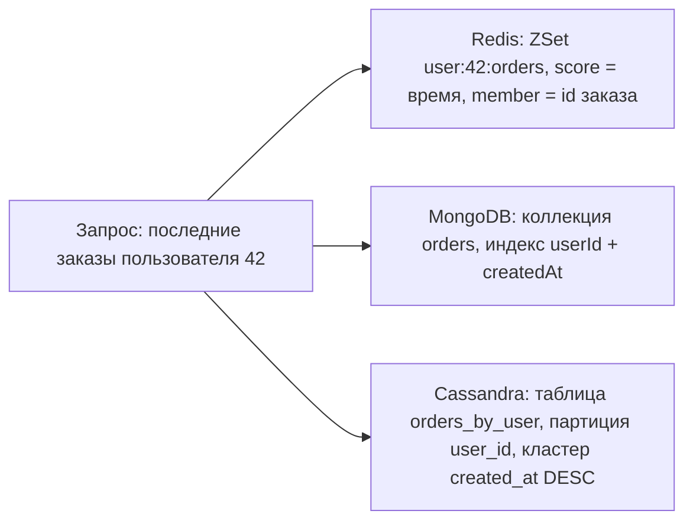
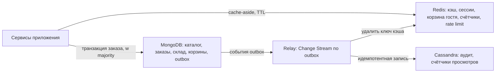

# 99. Сравнение Redis, MongoDB и Cassandra и итоговое задание

**Зачем это знать backend-разработчику.** На архитектурном ревью спрашивают не «как работает oplog», а «почему здесь Cassandra, а не MongoDB» и «что будет с корзиной, если Redis упадёт». Ответить можно, только видя три СУБД рядом: гарантии, пределы и цену каждой. Файл сводит три раздела в одну картину и заканчивается заданием на архитектуру маркетплейса.

> **Коротко:** Redis — структуры данных в памяти с атомарными командами: самый быстрый ответ по известному ключу, но объём ограничен RAM, а асинхронная репликация может потерять подтверждённую запись. MongoDB — документы с индексами, агрегациями и транзакциями: универсальное основное хранилище агрегатов с гибкой схемой. Cassandra — leaderless-кольцо с LSM и настраиваемой согласованностью: масштабируемые запись и чтение по ключу партиции, но только для запросов, заложенных в таблицы. В реальной системе их не выбирают «одну на всё», а раскладывают данные по задачам.

Теория здесь не повторяется — ссылки ведут в разделы: [Redis](../redis/theory/README.md), [MongoDB](../mongodb/theory/README.md), [Cassandra](../cassandra/theory/README.md); общие понятия — в [00. Общая теория](00-foundations/README.md).

## Оглавление

1. [Модели данных](#1-модели-данных)
2. [Согласованность и репликация](#2-согласованность-и-репликация)
3. [Партиционирование](#3-партиционирование)
4. [Атомарность и транзакции](#4-атомарность-и-транзакции)
5. [Типичные запросы и антипаттерны](#5-типичные-запросы-и-антипаттерны)
6. [Цена эксплуатации](#6-цена-эксплуатации)
7. [Какую СУБД взять под задачу](#7-какую-субд-взять-под-задачу)
8. [Итоговое задание: архитектура маркетплейса](#8-итоговое-задание-архитектура-маркетплейса)
9. [Типичные ошибки и заблуждения](#типичные-ошибки-и-заблуждения) · [Итоги](#итоги) · [Вопросы для самопроверки](#вопросы-для-самопроверки) · [Источники](#источники)

## 1. Модели данных

**На пальцах.** Redis — шкафчики в раздевалке: знаешь номер — открыл за секунду, но шкафчиков столько, сколько влезло в комнату. MongoDB — папки, где лежит всё про один заказ, плюс картотека-индекс по любому полю. Cassandra — архив с заранее пронумерованными полками: по номеру полки читаешь подряд, а «найти все красные папки» архивариус откажется.

| | Redis | MongoDB | Cassandra |
|---|---|---|---|
| Класс по [классификации](00-foundations/02-classification.md) | key-value со структурами данных | документная | wide-column |
| Единица данных | ключ → значение одного типа: String, Hash, List, Set, ZSet, Stream, JSON ([03](../redis/theory/03-data-structures.md)) | документ BSON до 16 МБ, `_id` обязателен ([01](../mongodb/theory/01-document-bson.md)) | строка внутри партиции; первичный ключ = partition key + clustering columns ([04](../cassandra/theory/04-data-model.md)) |
| Где лежат данные | в RAM, на диск — снимки и журнал ([05](../redis/theory/05-persistence.md)) | B-деревья WiredTiger на диске + кэш ([02](../mongodb/theory/02-wiredtiger.md)) | LSM: commitlog → memtable → SSTable ([02](../cassandra/theory/02-write-read-path.md)) |
| Схема | нет; «схема» — соглашение об именах ключей | гибкая, версия в документе, `$jsonSchema` по желанию ([03](../mongodb/theory/03-data-modeling.md)) | строгая таблица, но одна таблица на запрос ([05](../cassandra/theory/05-query-first.md)) |
| Вторичные индексы | нет у базовых структур; Query Engine в Redis 8 индексирует Hash и JSON ([10](../redis/theory/10-ecosystem-java.md)) | полноценные: составные, multikey, partial, TTL ([04](../mongodb/theory/04-indexes.md)) | SAI, но запрос без partition key всё равно идёт по кольцу ([09](../cassandra/theory/09-indexes-sai.md)) |

Один и тот же запрос — три разных ответа на вопрос «как мы будем это читать»:



В Redis ZSet — самодельный индекс из id; в MongoDB заказ — документ, а выборку отдаёт индекс по ESR; в Cassandra «заказ по id» потребует ещё одну таблицу — см. [08. Моделирование данных](00-foundations/08-data-modeling.md).

## 2. Согласованность и репликация

**На пальцах.** Redis-начальник говорит «принято» и лишь потом пересылает копию заместителям: заболел до пересылки — поручение потеряно. MongoDB-начальник по просьбе ждёт подписей большинства отдела. В Cassandra начальника нет: вы сами решаете, сколько сотрудников должны расписаться.

| | Redis | MongoDB | Cassandra |
|---|---|---|---|
| Схема репликации ([04](00-foundations/04-replication.md)) | один мастер, асинхронно | replica set: один primary, secondary тянут oplog | leaderless, RF на keyspace и дата-центр |
| Ручка согласованности | `WAIT`, `WAITAOF`, `min-replicas-to-write` сужают окно потерь, но не закрывают | `writeConcern` / `readConcern` / `readPreference`, умолчание записи — `majority` ([07](../mongodb/theory/07-read-write-concerns.md)) | consistency level на каждый запрос; R + W > RF ([06](../cassandra/theory/06-consistency-repair.md)) |
| Может ли пропасть подтверждённая запись | да, при failover | при `w: 1` — да, rollback; при `majority` — нет | при `ONE` — да, если единственная реплика с записью потеряла диск до hints и repair; LWW молча перекрывает запись со старым timestamp |
| Конфликт двух записей | невозможен: один поток на мастере | невозможен: пишет только primary | last-write-wins по timestamp; часы решают ([06](../cassandra/theory/06-consistency-repair.md)) |
| Место в PACELC ([03](00-foundations/03-cap-consistency.md)) | PA (частично) / EL: мастер подтверждает до копирования | PC/EC для записей с `majority`; чтение с secondary сдвигает к EL | PA/EL по умолчанию, `QUORUM`/`ALL` сдвигают к C |

**Пример.** Три реплики; записали платёж, и сразу упал принявший его узел.

- Redis: `OK` ушёл до копирования; повысят реплику без записи — платёж исчез.
- MongoDB с `w: "majority"`: `OK` пришёл, когда запись на 2 из 3 узлов; голосующий отказывает кандидату со старым oplog, а любое большинство содержит узел с записью — избранный primary её имеет.
- Cassandra с `QUORUM` (2 из 3): чтение с `QUORUM` гарантированно заденет реплику с записью. С `ONE` + `ONE` (1 + 1 < 3) — может и не задеть.

## 3. Партиционирование

**На пальцах.** Redis заранее нарезал 16 384 почтовые ячейки и раздал почтальонам; MongoDB режет алфавит на диапазоны и переносит переполненный ящик соседу; Cassandra бросает письмо на круг по хешу адреса, а у каждого почтальона несколько дуг круга.

| | Redis Cluster | MongoDB sharding | Cassandra |
|---|---|---|---|
| Механизм ([05](00-foundations/05-partitioning.md)) | 16 384 хеш-слота, `CRC16(key) mod 16384` | чанки — диапазоны shard key (ranged или hashed), по умолчанию 128 МБ ([09](../mongodb/theory/09-sharding.md)) | кольцо токенов Murmur3, vnodes (`num_tokens: 16`) ([01](../cassandra/theory/01-architecture.md)) |
| Кто маршрутизирует | клиент по карте слотов, редиректы `MOVED` / `ASK` | `mongos` по карте из config servers | любой узел-координатор; драйвер выбирает реплику по токену |
| Ребалансировка | перенос слотов вручную или `redis-cli --cluster` | балансировщик переносит чанки сам | новый узел забирает диапазоны токенов, данные стримятся |
| Запрос по нескольким ключам | только в одном слоте; hash tags `{...}` | targeted по shard key, иначе scatter-gather по всем шардам | одна партиция — дёшево; SAI без ключа — опрос многих узлов |

Главный вопрос у всех трёх один: **какой ключ раскладывает нагрузку равномерно и есть в частых запросах**. Монотонный ключ в range-шардинге MongoDB создаёт горячий шард; партиция Cassandra «все события пользователя за всё время» растёт без границы и требует бакета `(user_id, month)` ([арифметика размера](../cassandra/theory/04-data-model.md)); в Redis Cluster огромный ZSet целиком живёт на одном мастере.

## 4. Атомарность и транзакции

**На пальцах.** У Redis одна касса: пока обслуживают вас, никто не влезет, но отменить уже пробитое нельзя. MongoDB пробивает несколько покупок одним чеком и может отменить его целиком. Cassandra обещает, что пачка квитанций рано или поздно будет проведена вся, но сосед может увидеть её наполовину проведённой.

| | Redis ([06](../redis/theory/06-atomicity-scripting.md)) | MongoDB ([08](../mongodb/theory/08-transactions.md)) | Cassandra ([08](../cassandra/theory/08-lwt-batches-counters.md)) |
|---|---|---|---|
| Атомарность «из коробки» | каждая команда атомарна (один поток) | изменение одного документа атомарно | запись в одну партицию (в т.ч. batch в одну партицию) атомарна и изолирована; между партициями — нет |
| Условное изменение | `SET NX`, `WATCH` + `MULTI/EXEC`, Lua | условный `updateOne` / `findOneAndUpdate` с фильтром | LWT `IF NOT EXISTS` / `IF col = ?` через Paxos, четыре обхода сети |
| Несколько объектов | `MULTI/EXEC` без отката; Lua атомарен, но блокирует всех | мульти-документная транзакция, snapshot isolation, лимит жизни 60 с на образе | logged batch: атомарность без изоляции, предупреждение на 5 КиБ, отказ на 50 КиБ |
| Счётчик | `INCR` / `HINCRBY` | `$inc` | `counter` в отдельной таблице, неидемпотентен |
| Между шардами | только в одном слоте | двухфазный коммит, дороже | batch по разным партициям — дорого и без изоляции |

**Пример: не продать больше, чем есть на складе.** Остаток 5, десять покупателей одновременно.

- MongoDB: `updateOne({_id: sku, stock: {$gte: 1}}, {$inc: {stock: -1}})` — атомарно без транзакции. Транзакция нужна для нескольких SKU и заказа вместе ([задание 05](../mongodb/tasks/05-checkout-transaction.md)).
- Redis: Lua атомарен, но остаток в памяти с асинхронной репликацией — не источник правды.
- Cassandra: LWT `IF stock = 5` корректен, но десять конкурентов за одну партицию — десять раундов Paxos и повторы проигравших.

## 5. Типичные запросы и антипаттерны

**На пальцах.** Молотком можно закрутить шуруп, но криво. Каждая СУБД хороша в своём типе запроса и становится молотком для шурупов на чужом.

| | Хорошо умеет | Антипаттерн |
|---|---|---|
| Redis | ключ за доли миллисекунды; топ-N в ZSet; счётчики; TTL; Streams; HyperLogLog | `KEYS *` на большом keyspace и O(N)-команды на больших ключах блокируют весь сервер ([01](../redis/theory/01-architecture.md)); Redis как единственное хранилище денег; одинаковый TTL у миллионов ключей — лавина промахов ([04](../redis/theory/04-expiration-eviction.md)); Pub/Sub там, где нужна доставка ([07](../redis/theory/07-pubsub-streams.md)) |
| MongoDB | агрегат одним чтением; фильтры и сортировки по индексам; отчёты ([05](../mongodb/theory/05-aggregation.md)); поток изменений ([10](../mongodb/theory/10-change-streams-java.md)) | растущий без границы массив; коллекция на каждую SQL-таблицу и `$lookup` везде; тысячи пустых коллекций ([03](../mongodb/theory/03-data-modeling.md)); пагинация через большой `skip` |
| Cassandra | огромный поток записей; чтение среза партиции в порядке кластера; временные ряды с TTL (TWCS, [03](../cassandra/theory/03-compaction.md)) | запрос не по partition key и `ALLOW FILTERING`; партиция без верхней границы; очередь «вставил — удалил» и лавина надгробий ([07](../cassandra/theory/07-tombstones.md)); read-before-write вместо счётчика или LWT |

Проверка — десять самых частых запросов. «По ключу, очень быстро, можно пересчитать» — Redis. Запросы разнообразны и меняются, данные — агрегаты — MongoDB. Запросов мало и они известны, а записей миллиарды и нужны несколько ДЦ — Cassandra.

## 6. Цена эксплуатации

**На пальцах.** Цена машины — не только покупка, но и бензин, техосмотр и ремонт. С СУБД так же.

| | Redis | MongoDB | Cassandra |
|---|---|---|---|
| Главный ресурс | RAM: все данные в памяти плюс запас под `fork()` ([05](../redis/theory/05-persistence.md)) | RAM под кэш WiredTiger и диск ([02](../mongodb/theory/02-wiredtiger.md)) | диск и I/O под compaction, JVM-память |
| Минимальная отказоустойчивая установка | мастер + реплика + 3 процесса Sentinel | replica set из трёх узлов; для шардов ещё config servers и `mongos` | три узла, RF = 3 |
| Регулярная рутина | память, `maxmemory-policy` (умолчание `noeviction`), `SLOWLOG` | индексы и `explain()`, окно oplog | `nodetool repair` чаще, чем `gc_grace_seconds` (10 суток), стратегия compaction, надгробия |
| Что ломается внезапно | кончилась память, failover съел записи, O(N)-команда остановила всех | запросы без индекса (`COLLSCAN`), rollback при `w: 1`, jumbo-чанки | широкая партиция, `TombstoneOverwhelmingException`, рассинхрон часов |

Отдельная статья — люди: в Cassandra модель продумывают до первой строки кода, а её переделка — перенос данных в новые таблицы.

## 7. Какую СУБД взять под задачу

**На пальцах.** Не спорят, что лучше — дрель или пила, а спрашивают, что надо сделать.

| Задача | СУБД | Почему |
|---|---|---|
| Кэш карточек, ответов API | Redis | ответ из памяти, TTL, LRU/LFU; потеря кэша не теряет данных ([09](../redis/theory/09-patterns.md)) |
| Сессии, корзина гостя | Redis | Hash + скользящий TTL, общий для всех экземпляров ([09](../redis/theory/09-patterns.md)) |
| Rate limiting, блокировка ради экономии работы | Redis | `INCR`, `SET NX PX`, Lua; для корректности нужен fencing token |
| Уникальные посетители | Redis | HyperLogLog: погрешность около 0,81 % в 12 КБ |
| Каталог товаров с разными атрибутами | MongoDB | polymorphic + attribute pattern, индексы по атрибутам ([03](../mongodb/theory/03-data-modeling.md)) |
| Заказы, оплата, списание склада | MongoDB | агрегат в одном документе, транзакции, `majority` ([08](../mongodb/theory/08-transactions.md)) |
| Событие «изменилось» для других систем | MongoDB | outbox + Change Streams с resume token ([10](../mongodb/theory/10-change-streams-java.md)) |
| Журнал аудита, история действий | Cassandra | только добавление, срез по пользователю по времени, бакеты ([05](../cassandra/theory/05-query-first.md)) |
| Долговечные счётчики просмотров | Cassandra | `counter` без чтения перед записью ([08](../cassandra/theory/08-lwt-batches-counters.md)); горячий счётчик «сейчас» — Redis |

Частая конструкция — **источник правды + производные копии**: MongoDB хранит заказ, Cassandra получает событие в журнал, Redis — кэш. Копию можно пересчитать из источника, обратное неверно.

## 8. Итоговое задание: архитектура маркетплейса

**На пальцах.** Задача архитектора: нарисовать, где что лежит, и объяснить, что будет при сбое каждой части. Код не обязателен — механики отработаны в заданиях.

### Условие

Маркетплейс: 5 млн товаров у 20 000 продавцов, 2 млн активных покупателей в день, в пике — 30 000 просмотров карточек в секунду и 300 заказов в секунду. Нужно спроектировать хранение для шести подсистем:

1. **Каталог.** Товары с разными атрибутами (у ноутбука — диагональ, у платья — размер и цвет); фильтр по категории и атрибутам, сортировка по цене.
2. **Корзина и сессии.** Сессия входа, корзина гостя и залогиненного пользователя; корзина переживает перезапуск приложения.
3. **Заказы.** Оформление заказа из нескольких товаров с проверкой остатка, без перепродажи; история заказов покупателя; заказы продавца по статусу.
4. **Журнал аудита.** Действия с заказами и входы в аккаунт пишутся в журнал; служба безопасности смотрит действия пользователя от новых к старым за 12 месяцев.
5. **Счётчики.** Просмотры карточки (показывать «сейчас смотрят» и общее число), уникальные посетители за день, ограничение 100 запросов в минуту на API-клиента.
6. **Кэш.** Карточки товаров и главная страница; цена в кэше не должна отставать от правки продавца больше чем на минуту.

Для каждой подсистемы укажите СУБД, схему (ключи, документы и индексы, таблицы), гарантию согласованности, поведение при отказе узла и путь данных между СУБД. Нарисуйте схему потоков.

### Критерии оценки

| Критерий | Что проверяется |
|---|---|
| Выбор обоснован гарантиями | для каждой подсистемы названа нужная гарантия и где СУБД её даёт (ссылка на теорию) |
| Источник правды один | у каждого факта одно хранилище-оригинал, остальное — пересчитываемые копии |
| Схема под запросы | каждый частый запрос обслуживает ключ или индекс, число чтений ограничено и посчитано; нет `ALLOW FILTERING`, `KEYS *`, `COLLSCAN` |
| Отказы продуманы | что теряется при падении Redis, failover MongoDB, отказе узла Cassandra |
| Нет перепродажи | конкурентная покупка последней единицы описана корректно |
| Межсистемная доставка | событие не теряется при сбое между двумя записями (outbox, идемпотентность) |
| Рост ограничен | ни массив, ни партиция, ни ключ не растут без границы |

Зачёт — 6 из 7, причём «Источник правды один» и «Нет перепродажи» обязательны. Ниже один из правильных вариантов; возможны и другие, если обоснованы.

### Разбор-эталон

<details><summary>Разбор-эталон (откройте после своей попытки)</summary>

**Общая схема.**



**1. Каталог — MongoDB.** Коллекция `products`: общие поля (`_id`, `sellerId`, `category`, `title`, `price` в `Decimal128`, `stock`) плюс атрибуты по attribute pattern: `attrs: [{k: "diagonal", v: 15.6}, {k: "color", v: "red"}]` ([03](../mongodb/theory/03-data-modeling.md), [задание 01](../mongodb/tasks/01-catalog-polymorphic.md)). Индексы по ESR ([04](../mongodb/theory/04-indexes.md), [задание 02](../mongodb/tasks/02-esr-indexes.md)): `{category: 1, price: 1}` для «категория, сортировка по цене» и `{category: 1, "attrs.k": 1, "attrs.v": 1, price: 1}` — multikey для фильтра по атрибутам; запрос обязан брать `$elemMatch`, иначе границы `k` и `v` не пересекаются, а диапазон по `v` перед сортировкой по `price` даст `SORT` в памяти. Отзывы — отдельная коллекция, в товаре последние 3 (subset) и `ratingAvg` (computed). Не Cassandra: фильтры разнообразны и меняются, таблица на каждое сочетание атрибутов невозможна. Не Redis: 5 млн товаров в RAM ради горячего меньшинства — дорого. Оценка: 5 млн × ~2 КБ ≈ 10 ГБ — помещается в один replica set, шардирование не обязательно; если понадобится — `{_id: "hashed"}`, а не монотонное время ([09](../mongodb/theory/09-sharding.md)).

**2. Корзина и сессии — Redis.** `session:{id}` — Hash с `userId`, скользящий TTL 30 минут; `user:{userId}:sessions` — Set для «выйти на всех устройствах», тоже с TTL, продлеваемым при входе ([09](../redis/theory/09-patterns.md), [задание 06](../redis/tasks/06-sessions-analytics.md)). Корзина гостя — `cart:{sessionId}` Hash `sku → количество`, `HINCRBY` атомарен; источник правды — Redis, и потерю последних секунд при failover ([08](../redis/theory/08-replication-cluster.md)) мы принимаем явно: гость добавит товар заново. Перезапуск переживают AOF с `appendfsync everysec` ([05](../redis/theory/05-persistence.md)) и реплика. Корзина залогиненного — документ в MongoDB `carts` (`_id = userId`, `w: "majority"`), каждое изменение пишется туда сразу; Redis для неё только кэш. При входе гостевая корзина сливается в документ.

**3. Заказы — MongoDB, источник правды.** `orders`: документ с позициями и снимком `title` и `price` на момент покупки ([08. Моделирование данных](00-foundations/08-data-modeling.md)). Оформление — транзакция с `w: "majority"` ([08](../mongodb/theory/08-transactions.md), [задание 05](../mongodb/tasks/05-checkout-transaction.md)): для каждой позиции `updateOne({_id: sku, stock: {$gte: qty}}, {$inc: {stock: -qty}})`, если `modifiedCount = 0` — откат; затем `insertOne` заказа и `insertOne` события в `outbox`. Если двое берут последнюю единицу одновременно, второй получит `WriteConflict`, `withTransaction` повторит его тело, и он увидит `stock = 0`; если первый уже закоммитил — сразу `modifiedCount = 0`. 300 заказов в секунду по силам одному primary. Смена статуса — `findOneAndUpdate` с проверкой версии ([задание 07](../mongodb/tasks/07-optimistic-locking.md)). Индексы: `{userId: 1, createdAt: -1}` — история покупателя; `{sellerId: 1, status: 1, createdAt: -1}` — заказы продавца по статусу. При failover транзакция прервётся с `TransientTransactionError`, и `withTransaction` повторит её целиком на новом primary (до 120 с); подтверждённый `majority`-коммит не откатится ([06](../mongodb/theory/06-replica-set.md)). `outbox` чистит TTL-индекс через 7 суток. Если заказы придётся шардировать по `{userId: "hashed"}`, история покупателя останется targeted, а «заказы продавца» станут scatter-gather — приемлемо для редкого запроса.

**4. Журнал аудита — Cassandra.** Журнал только растёт, запрос известен заранее — случай query-first ([05](../cassandra/theory/05-query-first.md), [задание 08](../cassandra/tasks/08-audit-log.md)):

```sql
CREATE TABLE market.audit_by_user (
  user_id text, month text, occurred_at timestamp, event_id uuid, action text, details text,
  PRIMARY KEY ((user_id, month), occurred_at, event_id)
) WITH CLUSTERING ORDER BY (occurred_at DESC, event_id DESC)
  AND default_time_to_live = 34128000;
```

Бакет по месяцу ограничивает партицию ([04](../cassandra/theory/04-data-model.md)); «12 месяцев» — до 13 чтений по известным партициям, а TTL ≈ 395 суток удаляет старое без `DELETE`. Данным с TTL подходит TWCS ([03](../cassandra/theory/03-compaction.md)). Запись и чтение — `LOCAL_QUORUM` при RF = 3: отказ узла не мешает ни тому, ни другому. Все события, включая входы в аккаунт, идут через outbox: relay читает Change Stream по `outbox`, пишет в Cassandra и сохраняет resume token ([10](../mongodb/theory/10-change-streams-java.md), [задание 08](../mongodb/tasks/08-outbox-change-streams.md)). Доставка at-least-once (в [задании 08](../mongodb/tasks/08-outbox-change-streams.md) токен фиксируется в `poll` до обработки, это упрощение; настоящее at-least-once сохраняет токен после обработки), поэтому `event_id` (UUID) и `occurred_at` создаются при вставке в outbox, а не часами relay: повтор перезаписывает ту же строку. Не Redis Streams: год истории в RAM дорог ([07](../redis/theory/07-pubsub-streams.md)).

**5. Счётчики.** Все Redis-счётчики — на экземпляре с `noeviction`: вытеснение молча сбросило бы лимит.
- «Сейчас смотрят» — `INCR views:{sku}:{minute}` с TTL 10 минут.
- Общее число — Cassandra `market.product_views (sku text PRIMARY KEY, views counter)` ([08](../cassandra/theory/08-lwt-batches-counters.md), [задание 06](../cassandra/tasks/06-view-counters.md)). Просмотр делает `INCR views:delta:{sku}` и `SADD views:dirty {sku}`; раз в минуту задача забирает SKU из `views:dirty` и `GETDEL` дельты, прибавляя их в Cassandra. Failover Redis потеряет несброшенные дельты, повтор `UPDATE` после таймаута прибавит лишнее — для просмотров допустимо, для денег нет.
- Уникальные за день — HyperLogLog `uv:{sku}:{date}` с TTL 2 суток.
- Rate limit — `INCR` + `EXPIRE` или скользящее окно на ZSet ([задание 03](../redis/tasks/03-rate-limiter.md)).

**6. Кэш — Redis.** Cache-aside: `product:{sku}` String с JSON, TTL 40 с плюс случайные 0–10 с (максимум 50 с, запас до минуты на разрыв между чтением и `SET`) против лавины промахов ([04](../redis/theory/04-expiration-eviction.md), [задание 01](../redis/tasks/01-product-cache.md)); несуществующий товар кэшируется пустым ответом. «Не больше минуты» гарантирует сам TTL (< 60 с), даже если relay стоит или удаление проиграло гонку cache-aside ([09](../redis/theory/09-patterns.md)). Быстрый путь — правка товара пишет событие в outbox, relay удаляет ключ (удаляют, а не обновляют). Горячая карточка перечитывается из MongoDB раз в 40–50 с — копейки на фоне 30 000 просмотров в секунду. Главную пересчитывает один запрос под блокировкой ([задание 02](../redis/tasks/02-cache-stampede.md)); тот же single-flight закрывает и ключи горячих карточек, иначе при истечении TTL они разом ударят по MongoDB. Кэш — на экземпляре с `allkeys-lfu`, сессии, корзины и счётчики — на экземпляре с `noeviction`.

**Что будет при отказах.**

| Отказ | Последствие | Почему не катастрофа |
|---|---|---|
| Redis кэша упал целиком | все чтения идут в MongoDB; блокировка stampede жила в том же Redis | локальный кэш процесса и single-flight на экземпляре, circuit breaker и лимит запросов к MongoDB, главная — из статического снимка |
| Failover Redis сессий | гостевые корзины теряют последние секунды правок | принято явно; корзины залогиненных живут в MongoDB |
| Failover primary MongoDB | ~10 с без записи | `withTransaction` повторит транзакцию, `majority`-коммит не откатится |
| Relay остановлен | события копятся в oplog, кэш отстаёт до TTL (< 60 с) | алерт на отставание relay; дольше окна oplog — `ChangeStreamHistoryLost` ([10](../mongodb/theory/10-change-streams-java.md)), нужна сверка outbox с Cassandra |
| Упал узел Cassandra | ничего заметного | `LOCAL_QUORUM` 2 из 3; hinted handoff и repair догонят узел |
| Relay упал между записью в Cassandra и сохранением токена | событие придёт ещё раз | запись по `event_id` идемпотентна |

</details>

## Типичные ошибки и заблуждения

1. **«Одна СУБД на всё» или «три СУБД с первого дня».** Для небольшой системы одна MongoDB — правильный выбор; ошибка — не заметить, когда кэшу нужна память, а журналу — линейная запись.
2. **«Redis с AOF — надёжная база».** AOF защищает от перезапуска, но не от асинхронной репликации: при failover подтверждённая запись может исчезнуть ([08](../redis/theory/08-replication-cluster.md)).
3. **Двойная запись без outbox.** «Сначала в MongoDB, потом в Cassandra» теряет событие при падении между записями; событие пишут в ту же транзакцию ([10](../mongodb/theory/10-change-streams-java.md)).
4. **Счётчик через чтение и запись.** `GET` + `SET` или `SELECT` + `UPDATE` теряют инкременты; нужны `INCR`, `$inc`, `counter`.
5. **Транзакции «на всякий случай».** Документ MongoDB атомарен и без них ([08](../mongodb/theory/08-transactions.md)).

## Итоги

- Redis — память и атомарные команды по ключу: кэш, сессии, счётчики, но не единственное хранилище важных данных.
- MongoDB — агрегаты с индексами и транзакциями; источник правды для каталога и заказов.
- Cassandra — leaderless-кольцо для огромного потока записей и известных запросов: журналы, ленты, временные ряды.
- `WAIT` в Redis лишь сужает окно потерь, `majority` в MongoDB защищает от rollback, consistency level в Cassandra выбирают на запрос.
- Ключ партиционирования должен быть в частых запросах и распределять нагрузку; монотонный ключ и бесконечная партиция ломают все три.
- Один источник правды на факт; копии доставляются идемпотентно и пересчитываемы.

## Вопросы для самопроверки

1. Почему корзину гостя можно хранить только в Redis, а заказ — нет?
   <details><summary>Ответ</summary>Репликация Redis асинхронная: при failover подтверждённая запись может пропасть. Потеря корзины гостя неприятна, потеря оплаченного заказа — нарушение обязательств; поэтому заказ — в MongoDB с `w: "majority"`.</details>
2. Какой запрос Cassandra выполнит хуже MongoDB и почему?
   <details><summary>Ответ</summary>Любой, не заложенный в первичный ключ: «товары категории дешевле X цвета red». Без partition key это `ALLOW FILTERING` или SAI с опросом многих узлов; в MongoDB — составной индекс.</details>
3. Как не продать последнюю единицу товара дважды в MongoDB без транзакции?
   <details><summary>Ответ</summary>Условным обновлением одного документа: `updateOne({_id: sku, stock: {$gte: 1}}, {$inc: {stock: -1}})`. Проверка и изменение атомарны; второй покупатель получит `modifiedCount = 0`. Транзакция нужна для нескольких SKU вместе с заказом.</details>
4. Почему журнал аудита в Cassandra бакетируют по месяцу, а не кладут в одну партицию пользователя?
   <details><summary>Ответ</summary>Без бакета партиция растёт всю жизнь аккаунта и становится широкой. Бакет ограничивает размер, а «12 месяцев» — несколько чтений по известным партициям.</details>
5. Как в эталоне доставляется событие заказа в Cassandra и что будет, если relay упадёт посередине?
   <details><summary>Ответ</summary>Событие пишется в `outbox` в транзакции заказа; relay читает Change Stream, пишет в Cassandra, затем сохраняет resume token (в боевой схеме — после обработки, в отличие от упрощённого задания 08). Упал до сохранения — событие придёт снова и перезапишет строку с тем же `event_id`.</details>
6. Почему кэш и сессии в эталоне разнесены по разным экземплярам Redis?
   <details><summary>Ответ</summary>Кэшу нужно вытеснение (`allkeys-lfu`), а сессиям, корзинам и лимитам — нет: под `allkeys-*` Redis выбросит корзину ради карточки. Экземпляр с `noeviction` при переполнении даёт явную ошибку записи вместо тихой потери.</details>

## Источники

- M. Kleppmann. *Designing Data-Intensive Applications*, гл. 2, 5, 6, 7, 11.
- Redis: [Documentation](https://redis.io/docs/latest/), [Replication](https://redis.io/docs/latest/operate/oss_and_stack/management/replication/), [Persistence](https://redis.io/docs/latest/operate/oss_and_stack/management/persistence/)
- MongoDB: [Manual](https://www.mongodb.com/docs/manual/), [Transactions](https://www.mongodb.com/docs/manual/core/transactions/), [Sharding](https://www.mongodb.com/docs/manual/sharding/)
- Apache Cassandra: [Documentation](https://cassandra.apache.org/doc/latest/), [Data Modeling](https://cassandra.apache.org/doc/latest/cassandra/developing/data-modeling/index.html)
- C. Richardson. [Pattern: Transactional outbox](https://microservices.io/patterns/data/transactional-outbox.html)

---

← [08. Моделирование данных](00-foundations/08-data-modeling.md) | [главная](../README.md) | разделы: [Redis](../redis/README.md) · [MongoDB](../mongodb/README.md) · [Cassandra](../cassandra/README.md)
