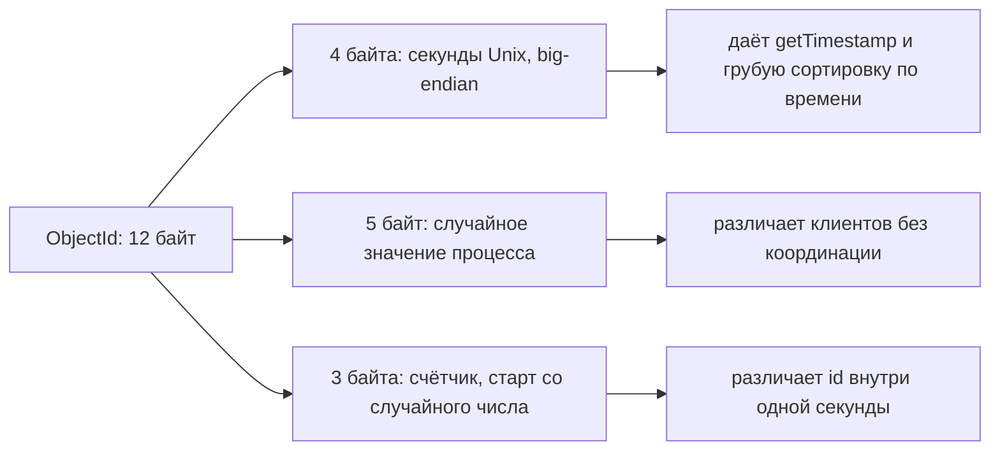

# 01. Документ и BSON

**Зачем это знать backend-разработчику.** В MongoDB нет схемы таблицы, которая проверяла бы каждую строку. Её роль играет формат одного документа. Если не знать, что сервер различает `int` и `double`, деньги начинают «терять копейки», а поиск по `"42"` не находит `42`. Если не знать про лимит в 16 МБ, «бесконечный» массив комментариев однажды роняет запись в проде. Если не знать, что атомарна ровно одна запись документа, ловишь списание денег, которое прошло наполовину.

> **Коротко:** документ MongoDB хранится в **BSON** — двоичном формате с явными типами: `int`, `long`, `double`, `decimal`, `date`, `objectId` и другими. Сервер сравнивает числа разных типов по значению, а строку с числом — никогда. Деньги хранят в `Decimal128`, время — в BSON `date` (миллисекунды UTC, без часового пояса). Один документ не больше 16 777 216 байт. `_id` обязателен и неизменяем, а ObjectId — это 4 байта времени, 5 случайных байтов процесса и 3 байта счётчика: он «примерно» растёт, но не является точной меткой порядка. Любое изменение одного документа атомарно, изменение нескольких — нет.

## Оглавление

- [Документ и коллекция](#документ-и-коллекция)
- [BSON: зачем не JSON](#bson-зачем-не-json)
- [Числа: int, long, double, Decimal128](#числа-int-long-double-decimal128)
- [Даты и время](#даты-и-время)
- [Лимит 16 МБ](#лимит-16-мб)
- [Поле _id и ObjectId](#поле-_id-и-objectid)
- [Порядок полей](#порядок-полей)
- [Атомарность одного документа](#атомарность-одного-документа)
- [🔬 Глубже: как документ лежит в байтах](#-глубже-как-документ-лежит-в-байтах)
- [Практика в репозитории](#практика-в-репозитории)
- [Типичные ошибки и заблуждения](#типичные-ошибки-и-заблуждения)
- [Итоги](#итоги)
- [Вопросы для самопроверки](#вопросы-для-самопроверки)
- [Источники](#источники)

## Документ и коллекция

**На пальцах** (аналогия). Реляционная таблица — это бланк с фиксированными графами: в каждую строку вписывают одно и то же. Коллекция MongoDB — папка с анкетами: у каждой анкеты свои поля, вложенные листы и списки, но все анкеты лежат в одной папке и ищутся одними и теми же запросами.

**Документ** (document) — упорядоченный набор пар «имя поля — значение», где значением может быть скаляр, вложенный документ или массив. **Коллекция** (collection) — именованный набор документов внутри **базы данных** (database). Обязательной схемы у коллекции нет. Проверку можно включить отдельно (`$jsonSchema`-валидатор), но по умолчанию сервер примет любой корректный документ.

Пример заказа, где позиции живут внутри самого заказа:

```text
guide> db.orders.insertOne({
  orderNo: "ORD-2026-0000042",
  customer: { id: "c-17", name: "Анна" },
  items: [ { sku: "book-1", qty: 2 }, { sku: "pen-3", qty: 1 } ],
  total: NumberDecimal("1490.00"),
  createdAt: new Date()
})
{
  acknowledged: true,
  insertedId: ObjectId('6ad629644f6feb05e7a51e2b')
}
```

`_id` в документе не было, его сгенерировал клиент (mongosh), а не сервер. Об этом подробнее в разделе про [ObjectId](#поле-_id-и-objectid). Одна вставка заменила здесь три строки в двух таблицах реляционной схемы (заказ и две позиции). Когда так делать стоит, а когда нет, разбирает [03. Моделирование](03-data-modeling.md). Общая идея документной модели — в [основах](../../docs/00-foundations/02-classification.md).

Поля адресуют **точечной нотацией** (dot notation): `"customer.name"`, `"items.sku"`, `"items.0.qty"`. Это важно запомнить уже сейчас: и запросы, и индексы, и обновления работают с путями, а не только с полями верхнего уровня.

## BSON: зачем не JSON

**На пальцах** (аналогия). JSON — письмо от руки: прочитать может каждый, но чтобы найти пятый абзац, надо прочитать первые четыре. BSON — та же бумага в скоросшивателе с закладками: у каждого раздела написана длина, и ненужный раздел можно пролистнуть, не читая.

**BSON** (Binary JSON) — двоичный формат сериализации документов. Каждый элемент записан как «байт типа + имя поля + значение», а каждый документ и строка начинаются со своей длины. Отсюда три причины, почему MongoDB не хранит обычный JSON:

| Чего нет в JSON | Что даёт BSON | Зачем это базе |
|---|---|---|
| Типов чисел — только «number» | `int` (32 бит), `long` (64 бит), `double`, `decimal` (128 бит) | точные деньги, большие счётчики, предсказуемые сравнения |
| Типа «дата», бинарных данных, ObjectId | `date`, `binData`, `objectId`, `timestamp`, `regex` | дата не превращается в строку, UUID не раздувается в hex |
| Длины перед значением | длина документа и строки в префиксе | сервер пропускает поле, не разбирая его, и быстро ищет путь `a.b.c` |

BSON не про компактность. Размер на сервере можно посчитать функцией `bsonsize()` в mongosh, и для мелкого документа BSON даже больше JSON:

```text
guide> JSON.stringify({a: 1}).length
7
guide> print(bsonsize({}), bsonsize({a: 1}), bsonsize({a: 1.5}), bsonsize({a: "x"}))
5 12 16 14
guide> print(bsonsize({a: new Date(0)}), bsonsize({a: NumberDecimal("1")}), bsonsize({a: ObjectId()}))
16 24 20
```

Пустой документ — 5 байт: 4 байта длины и завершающий ноль. `{a: 1}` — 12 байт, `{a: 1.5}` — 16: целое ушло в 4-байтный `int`, дробное — в 8-байтный `double`. Расшифровка байтов — в разделе [🔬 Глубже](#-глубже-как-документ-лежит-в-байтах).

В Java два основных представления документа. `org.bson.Document` — удобная `Map<String, Object>`, которую драйвер кодирует в BSON. `RawBsonDocument` хранит уже готовые байты (`getByteBuffer()`) и декодирует их лениво — полезно, когда документ надо переложить без разбора:

```java
Document order = new Document("orderNo", "ORD-2026-0000042")
        .append("customer", new Document("id", "c-17").append("name", "Анна"))
        .append("items", List.of(new Document("sku", "book-1").append("qty", 2)))
        .append("total", new BigDecimal("1490.00"))   // BigDecimalCodec -> BSON decimal
        .append("createdAt", Instant.now());           // InstantCodec  -> BSON date
orders.insertOne(order);
ObjectId id = order.getObjectId("_id");                // драйвер дописал _id в сам объект
```

`BigDecimalCodec` и `InstantCodec` входят в реестр кодеков драйвера 5.8.1 по умолчанию (`ValueCodecProvider` и `Jsr310CodecProvider` в `MongoClientSettings`). Отображение POJO и record на документ разбирает [10. Java-драйвер и Spring Data](10-change-streams-java.md).

## Числа: int, long, double, Decimal128

**На пальцах** (аналогия). `double` — линейка с делениями в двоичных долях: 0,1 на ней отметить нельзя, есть только «почти 0,1». `Decimal128` — линейка с десятичными делениями: 0,1 на ней ровно 0,1, но она тяжелее.

**double** — 64-битное число с плавающей точкой IEEE 754 (binary64). **Decimal128** — 128-битное десятичное число IEEE 754-2008, 34 значащие цифры. **int** и **long** — целые на 32 и 64 бита. Разницу видно на одном сложении:

```text
guide> 0.1 + 0.2
0.30000000000000004
guide> db.money.insertOne({_id: 1, d: 0.1, m: NumberDecimal("0.1")})
guide> db.money.aggregate([{$project: {_id: 0,
         dsum: {$add: ["$d", 0.2]}, msum: {$add: ["$m", NumberDecimal("0.2")]}}}])
[ { dsum: 0.30000000000000004, msum: Decimal128('0.3') } ]
```

В `double` вылез хвост, в `Decimal128` — ровно 0,3. Правило для денег: `Decimal128` или целые копейки в `long`. Передавайте строку: `NumberDecimal("0.1")`. С числом mongosh печатает «Warning: NumberDecimal: specifying a number as argument is deprecated and may lead to loss of precision». `NumberDecimal(0.1)` на образе дал ровно `Decimal128('0.1')`, а `NumberDecimal(0.1 + 0.2)` — `Decimal128('0.30000000000000004')`: погрешность вычисленного `double` переезжает в decimal. В Java ловушка опаснее: `new BigDecimal(19.99)` даёт `19.98999999999999843…`, правильно — `new BigDecimal("19.99")` или `BigDecimal.valueOf(19.99)`.

Тип числа выбирает клиент, и у разных клиентов привычки разные. Проверка на образе `mongo:8.0` (mongosh 2.x):

```text
guide> db.t.insertMany([{_id: 1, v: 42}, {_id: 2, v: NumberInt(42)}, {_id: 3, v: NumberLong("42")},
                        {_id: 4, v: NumberDecimal("42")}, {_id: 5, v: "42"}])
guide> db.t.aggregate([{$project: {t: {$type: "$v"}}}])
[ { _id: 1, t: 'int' }, { _id: 2, t: 'int' }, { _id: 3, t: 'long' },
  { _id: 4, t: 'decimal' }, { _id: 5, t: 'string' } ]
guide> db.t.insertOne({_id: 6, v: Double(42)})
guide> db.t.aggregate([{$match: {_id: 6}}, {$project: {t: {$type: "$v"}}}])
[ { _id: 6, t: 'double' } ]
```

Литерал `42` mongosh записал как `int`, чтобы получить `double`, понадобился `Double(42)`. В Java тип следует из типа объекта: `Integer` → `int`, `Long` → `long`, `Double` → `double`, `BigDecimal` и `Decimal128` → `decimal`.

Сравнение чисел сервер делает по значению, через типы. Строка в эту семью не входит:

| Запрос (до вставки `_id: 6`) | Результат | Почему |
|---|---|---|
| `countDocuments({v: 42})` | 4 | `int`, `int`, `long` и `decimal` равны 42 как числа |
| `countDocuments({v: {$type: "double"}})` | 0 | ни одно значение не было `double` |
| `countDocuments({v: {$type: "number"}})` | 4 | `"number"` — псевдоним всех числовых типов |

Документ со строкой `"42"` не нашёлся ни одним числовым запросом. Это частая причина «пропавших» записей после импорта из CSV.

## Даты и время

**На пальцах** (аналогия). BSON-дата — секундомер, запущенный 1 января 1970 года по Гринвичу. Он показывает только «сколько миллисекунд прошло», а в каком городе вы на него смотрите, не знает.

**BSON date** — 64-битное целое со знаком: миллисекунды от Unix-эпохи в UTC. Часового пояса внутри нет. Отдельный тип **timestamp** (`Timestamp({t, i})`, секунды плюс порядковый номер) служит для внутренних нужд репликации, например `operationTime` в ответах сервера. Для дат в приложении его не используют.

```text
guide> db.ev.insertOne({_id: 1, at: ISODate("2026-10-19T09:30:00+03:00"), s: "2026-10-19T09:30:00+03:00"})
guide> db.ev.findOne()
{ _id: 1, at: ISODate('2026-10-19T06:30:00.000Z'), s: '2026-10-19T09:30:00+03:00' }
guide> db.ev.aggregate([{$project: {_id: 0, ta: {$type: "$at"}, ts: {$type: "$s"},
         h: {$hour: "$at"}, hm: {$hour: {date: "$at", timezone: "Europe/Moscow"}}}}])
[ { ta: 'date', ts: 'string', h: 6, hm: 9 } ]
guide> db.ev.countDocuments({at: {$gte: ISODate("2026-10-19T00:00:00Z")}})
1
guide> db.ev.countDocuments({s: {$gte: ISODate("2026-10-19T00:00:00Z")}})
0
```

По шагам:

1. Смещение `+03:00` сервер применил и выбросил: хранится момент 06:30 UTC.
2. `$hour` без пояса отвечает в UTC (6). С `timezone` — по-московски (9). Пояс — параметр запроса, а не свойство данных.
3. Строку с датой диапазон по датам не нашёл: строка и дата — разные типы.

В Java для момента времени берут `Instant`. Драйвер хранит миллисекунды, поэтому наносекунды `Instant.now()` после чтения пропадут. К тому же `Document` вернёт BSON `date` как `java.util.Date`, а `decimal` — как `Decimal128`; `Instant` и `BigDecimal` на чтении дают POJO- и record-кодеки. У `LocalDateTime` пояса нет, «это UTC» остаётся договорённостью кода; пояс пользователя хранят отдельным полем (`tz: "Europe/Moscow"`).

## Лимит 16 МБ

**На пальцах** (аналогия). Почтовая посылка не больше определённого веса. Пианино разбирают на ящики или везут грузом.

Максимальный размер одного BSON-документа — 16 МБ. Его сообщает сам сервер в ответе `hello`:

```text
guide> const h = db.hello(); print(h.maxBsonObjectSize, h.maxMessageSizeBytes, h.maxWriteBatchSize)
16777216 48000000 100000
```

16 777 216 байт — это ровно 16 МиБ, лимит одного документа. 48 000 000 — лимит одного сетевого сообщения, 100 000 — сколько операций влезает в один пакет записи (драйвер режет большие `insertMany` сам). Что бывает при превышении:

```text
guide> db.big.insertOne({_id: 1, blob: "x".repeat(16 * 1024 * 1024)})
MongoServerError: object to insert too large. size in bytes: 16777241, max size: 16777216
guide> db.big.insertOne({_id: 2, blob: "x".repeat(16 * 1024 * 1024 - 100)})
guide> bsonsize(db.big.findOne({_id: 2}))
16777141
guide> db.big.updateOne({_id: 2}, {$set: {more: "y".repeat(200)}})
MongoServerError: Resulting document after update is larger than 16777216
```

Обе ошибки — код 10334. Вторая опаснее: документ давно живёт в базе, и падает не вставка, а очередной `$push`. Лимит — про рост: массив, куда каждый день добавляют событие, однажды упрётся в потолок. Лечение — в моделировании: паттерны bucket и subset, ссылки вместо встраивания ([03](03-data-modeling.md)). Файлы больше лимита хранят через **GridFS** — спецификацию драйверов, которая режет файл на куски (chunks) по 255 КБ в коллекции `fs.chunks`.

В `bson` 5.8.1 есть `BsonMaximumSizeExceededException`: слишком большой документ может отвергнуть ещё драйвер, до сервера. Поэтому ловят и её, и `MongoWriteException` с кодом 10334.

Ещё один предел — вложенность: документация называет 100 уровней (на образе параметр `maxBSONDepth` равен 200, и 101 уровень вставился). Опираться на это не стоит: глубина в десятки уровней — признак ошибки модели.

## Поле _id и ObjectId

**На пальцах** (аналогия). Номер паспорта выдают один раз, и поменять его нельзя — можно только получить новый паспорт. ObjectId похож на номер, который сам себе печатает каждый паспортный стол: первые цифры — дата выдачи, потом код стола, потом порядковый номер.

**`_id`** — обязательное поле каждого документа, первичный ключ коллекции. По нему всегда есть уникальный индекс `_id_`. Тип любой, кроме массива, regex и `undefined`: можно взять строку, число, `UUID` или составной документ.

```text
guide> db.acc.insertOne({_id: "a1", balance: 100})
guide> db.acc.insertOne({_id: "a1"})
MongoServerError: E11000 duplicate key error collection: guide.acc index: _id_ dup key: { _id: "a1" }
guide> db.acc.updateOne({_id: "a1"}, {$set: {_id: "a2"}})
MongoServerError: Performing an update on the path '_id' would modify the immutable field '_id'
guide> db.acc.insertOne({_id: [1, 2]})
MongoServerError: The '_id' value cannot be of type array
```

Коды: 11000 (дубликат), 66 (неизменяемое поле), 53 (недопустимый тип). В Java дубликат ловят так:

```java
try {
    accounts.insertOne(new Document("_id", "a1"));
} catch (MongoWriteException e) {
    if (e.getError().getCategory() == ErrorCategory.DUPLICATE_KEY) {
        // ключ занят: идемпотентный повтор или конфликт бизнес-ключа
    }
}
```

**ObjectId** — 12-байтное значение, которое обычно генерирует драйвер, если `_id` не задан (при upsert со вставкой и в ряде серверных путей — сам сервер). Разрежем на части три подряд созданных id:

```text
guide> for (let i = 0; i < 3; i++) { const x = new ObjectId().toHexString();
         print(x, x.substr(0, 8), x.substr(8, 10), x.substr(18, 6)) }
6ad627ad4c77982a5ade95b7 6ad627ad 4c77982a5a de95b7
6ad627ad4c77982a5ade95b8 6ad627ad 4c77982a5a de95b8
6ad627ad4c77982a5ade95b9 6ad627ad 4c77982a5a de95b9
guide> ObjectId("671fa2b0c3a1e5f4d2b90e11").getTimestamp()
ISODate('2024-10-28T14:41:52.000Z')
guide> ObjectId.createFromTime(1792411200)
ObjectId('6ad606400000000000000000')
```



Что из этого следует для backend-кода:

- **Монотонность — только в пределах одного процесса** (пока часы не идут назад и счётчик не переполнился). Внутри одного клиента счётчик растёт: `…b7`, `…b8`, `…b9`. Два сервиса в одну секунду дают id с разными 5 случайными байтами, и порядок между ними произволен.
- **Время — часы клиента.** При обычной вставке id генерирует драйвер. Сервис с убежавшими часами выдаёт id «из будущего», и сортировка по `_id` перестаёт означать «по времени вставки».
- **Точность — секунда.** `getTimestamp()` вернёт `14:41:52.000`, миллисекунд там нет. Для точного порядка нужно отдельное поле `createdAt`.
- **Счётчик конечен.** 3 байта — 16 777 216 значений по кругу, так что «ObjectId строго растёт» — наблюдение, а не гарантия.
- **`createFromTime` — граница диапазона, а не id.** Его используют в запросе «всё, что создано после полудня»: `{_id: {$gte: ObjectId.createFromTime(...)}}`. В Java аналог — `ObjectId.getSmallestWithDate(Date)`.

Растущий ObjectId хорош для B-дерева `_id`: новые ключи идут в правый край ([02](02-wiredtiger.md)). Но для range-ключа шардирования тот же рост — минус: все вставки идут на один шард; hashed-ключ это лечит ([09](09-sharding.md)).

## Порядок полей

**На пальцах** (аналогия). Два списка покупок «хлеб, молоко» и «молоко, хлеб» для человека одинаковы. Для сканера штрих-кодов, который сравнивает листы побайтово, — нет.

BSON-документ — упорядоченный список полей, и порядок сохраняется. Обычно это ни на что не влияет, кроме одного места: **точного сравнения вложенного документа**.

```text
guide> db.fo.insertOne({_id: 1, size: {h: 14, w: 21}})
guide> db.fo.countDocuments({size: {h: 14, w: 21}})
1
guide> db.fo.countDocuments({size: {w: 21, h: 14}})
0
guide> db.fo.countDocuments({"size.w": 21, "size.h": 14})
1
```

Запрос `{size: {...}}` — это «поле `size` равно вот этому документу», побайтно и с порядком. Точечная нотация сравнивает поля по отдельности, и порядок ей безразличен. Вывод: вложенные документы ищут через пути, а точное равенство оставляют для случаев, когда порядок гарантирован кодом.

Два правила о порядке, которые сервер навязывает сам:

```text
guide> db.fo.insertOne({name: "no id first", _id: 7})
guide> db.fo.findOne({_id: 7})
{ _id: 7, name: 'no id first' }
guide> db.fo.updateOne({_id: 1}, {$set: {a: 1, z: 2}, $unset: {size: ""}})
guide> db.fo.updateOne({_id: 1}, {$set: {size: {h: 1, w: 1}, b: 0}})
guide> db.fo.findOne({_id: 1})
{ _id: 1, a: 1, z: 2, b: 0, size: { h: 1, w: 1 } }
```

1. `_id` сервер ставит первым полем, где бы его ни передали.
2. Новые поля из одного `$set` добавляются в конец, но между собой в лексикографическом порядке имён: `b` раньше `size`, хотя в запросе `size` шёл первым. Так операторы обновления работают начиная с MongoDB 5.0.

## Атомарность одного документа

**На пальцах** (аналогия). Кассир либо проводит чек целиком — товар, скидку, бонусы, — либо не проводит вовсе. Полчека не бывает. Но два разных чека — две отдельные операции, и сбой между ними возможен.

Любая операция записи над **одним документом атомарна**: все изменения внутри него, включая вложенные документы и массивы, применяются целиком или не применяются. Читатель не увидит промежуточное состояние. Операция над несколькими документами (`updateMany`, `insertMany`) атомарна только по каждому документу в отдельности.

Отсюда главный приём документной модели: держать вместе то, что меняется вместе, и проверять условие в фильтре той же операции.

```text
guide> db.acc.insertOne({_id: "a1", balance: 100, history: []})
guide> db.acc.findOneAndUpdate(
         {_id: "a1", balance: {$gte: 30}},
         {$inc: {balance: -30}, $push: {history: {op: "debit", amount: 30}}},
         {returnDocument: "after"})
{ _id: 'a1', balance: 70, history: [ { op: 'debit', amount: 30 } ] }
guide> db.acc.findOneAndUpdate({_id: "a1", balance: {$gte: 300}}, {$inc: {balance: -300}},
         {returnDocument: "after"})
null
```

| Шаг | Что делает сервер | Что видят другие |
|---|---|---|
| 1 | находит `a1` и проверяет `balance >= 30` | старый документ |
| 2 | применяет `$inc` и `$push` к одной версии документа | всё ещё старый |
| 3 | фиксирует новую версию | сразу 70 и запись в `history` |
| 4 | второй вызов: условие `>= 300` ложно | ничего не меняется, ответ `null` |

Проверка и изменение здесь — одна операция, поэтому два параллельных списания не уведут баланс в минус: второе просто не найдёт документ под условием. Тот же код на Java 21 и драйвере 5.8.1:

```java
Document after = accounts.findOneAndUpdate(
        Filters.and(Filters.eq("_id", "a1"), Filters.gte("balance", 30)),
        Updates.combine(
                Updates.inc("balance", -30),
                Updates.push("history", new Document("op", "debit").append("amount", 30))),
        new FindOneAndUpdateOptions().returnDocument(ReturnDocument.AFTER));
if (after == null) {
    // денег не хватило или документа нет: ничего не изменилось
}
```

Когда в операции участвуют два документа — перевод с `a1` на `b7`, — атомарности одного документа мало. Нужна многодокументная транзакция ([08](08-transactions.md)) или модель, в которой операция укладывается в один документ. Отдельный частный случай — оптимистическая блокировка через поле версии, её отрабатывает задание 07.

## 🔬 Глубже: как документ лежит в байтах

Разберём `{a: 1}` — 12 байт:

| Байты (hex) | Значение |
|---|---|
| `0c 00 00 00` | длина документа: 12, little-endian `int32` |
| `10` | тип элемента: `0x10` — `int32` |
| `61 00` | имя поля `"a"` как C-строка с нулём в конце |
| `01 00 00 00` | значение 1 |
| `00` | конец документа |

С `double` код типа `0x01` и 8 байт значения — отсюда 16. Строка (`0x02`) хранит ещё 4 байта своей длины и завершающий ноль: `"x"` занимает 4 + 1 + 1, весь документ — 14. `date` — `0x09` и 8 байт, `decimal` — `0x13` и 16, `objectId` — `0x07` и 12. Массив (`0x04`) — это документ с ключами `"0"`, `"1"`, `"2"`: поэтому имя поля и путь `items.0.qty` работают одинаково.

Два практических следствия:

1. **Имена полей хранятся в каждом документе.** Поле `customerShippingAddressLine1` в миллионе документов — это мегабайты одних только имён. WiredTiger сжимает блоки ([02](02-wiredtiger.md)), и повторяющиеся имена сжимаются хорошо, но в кэше документы лежат несжатыми.
2. **Длины в префиксе дают быстрый пропуск.** Чтобы найти `items` в документе, сервер читает тип и имя каждого элемента и перепрыгивает через значение по его длине.

Тип в сравнениях и сортировке тоже упорядочен: при сортировке поля с разными типами сервер сначала раскладывает значения по классам — `null`, числа, строки, документы, массивы, `binData`, `ObjectId`, `bool`, даты и так далее, — и только внутри класса сравнивает значения. Поэтому `{s: {$gte: ISODate(...)}}` не находит строку: строка и дата в разных классах, и оператор диапазона за границу класса не выходит.

## Практика в репозитории

- [Задание 01](../tasks/01-catalog-polymorphic.md) — каталог с документами разной формы в одной коллекции, POJO-кодеки и типы полей.
- [Задание 07](../tasks/07-optimistic-locking.md) — атомарное изменение одного документа через `findOneAndUpdate` с условием на версию.
- [CrudDemo](../examples/src/main/java/dev/nosqlguide/mongodb/examples/driver/CrudDemo.java) — вставка `Document`, генерация `_id`, чтение и обновление по пути.
- Фон: [классификация NoSQL и документная модель](../../docs/00-foundations/02-classification.md), [моделирование данных](../../docs/00-foundations/08-data-modeling.md).

## Типичные ошибки и заблуждения

1. **«MongoDB хранит JSON.»** Хранит BSON с типами. `42`, `Long('42')`, `Decimal128('42')` и `"42"` — четыре разных значения, и последнее числовой запрос не найдёт.
2. **«Деньги можно в double, округлим при выводе.»** Ошибка накапливается в `$sum` и `$inc`: `0.1 + 0.2` уже `0.30000000000000004`. Берите `Decimal128` или целые копейки.
3. **«Дату удобно хранить строкой ISO.»** Строка не участвует в диапазонах по датам и в `$hour`, а строки с разными смещениями сравниваются как текст, а не как моменты времени.
4. **«ObjectId — точная метка времени вставки.»** Это время на часах клиента с точностью до секунды. Между процессами порядок внутри секунды произволен.
5. **«16 МБ — с запасом, у нас документы по килобайту.»** Документ растёт: массив событий без предела однажды упадёт на `Resulting document after update is larger than 16777216`.
6. **«`updateMany` — это одна атомарная операция.»** Атомарен каждый документ. При сбое на середине часть документов уже изменена.

## Итоги

- Документ — упорядоченный набор полей с вложенными документами и массивами, коллекция схему не навязывает.
- BSON хранит тип каждого значения и длины в префиксе: это ради типов и быстрого обхода, а не ради размера.
- Деньги — `Decimal128` (или `long` в копейках), время — BSON `date` в UTC, пояс — параметр запроса или отдельное поле.
- Лимит документа — 16 777 216 байт; падает и вставка, и обновление, которое документ раздувает.
- `_id` обязателен, уникален и неизменяем; ObjectId = 4 байта секунд + 5 байт процесса + 3 байта счётчика, генерируется клиентом.
- Порядок полей сохраняется и важен для точного равенства вложенных документов; `_id` всегда первый.
- Атомарна запись одного документа; несколько документов — транзакция или другая модель.

## Вопросы для самопроверки

1. Почему `bsonsize({a: 1})` равен 12, а `bsonsize({a: 1.5})` — 16?
   <details><summary>Ответ</summary>mongosh записал целое как `int32` (4 байта значения), дробное — как `double` (8 байт). Остальные 8 байт одинаковы: длина документа, байт типа, имя `"a"` с нулём и завершающий ноль.</details>
2. В коллекции лежат `{v: 42}`, `{v: Long('42')}` и `{v: "42"}`. Сколько документов вернёт `find({v: 42})`?
   <details><summary>Ответ</summary>Два. Числа разных типов сравниваются по значению, а строка `"42"` к числам не относится.</details>
3. Как сохранить цену 19,99 без ошибки округления, и чем плох `new BigDecimal(19.99)` в Java?
   <details><summary>Ответ</summary>`NumberDecimal("19.99")` в mongosh или `new BigDecimal("19.99")` / `BigDecimal.valueOf(19.99)` / `Decimal128.parse("19.99")` в Java. Конструктор от `double` берёт точное двоичное значение `19.98999999999999843…`, и в базу уйдёт оно. В mongosh числовой аргумент `NumberDecimal` устарел: для литерала он даёт точный результат, но для вычисленного числа переносит погрешность `double`.</details>
4. Записали `ISODate("2026-10-19T09:30:00+03:00")`. Что хранится и что вернёт `$hour` без пояса?
   <details><summary>Ответ</summary>Хранится момент 06:30 UTC в миллисекундах от эпохи, смещение не сохраняется. `$hour` вернёт 6; с `timezone: "Europe/Moscow"` — 9.</details>
5. Можно ли по `_id` типа ObjectId надёжно восстановить порядок вставок из трёх сервисов?
   <details><summary>Ответ</summary>Нет. Время в ObjectId — секунды по часам клиента, внутри секунды id разных процессов различаются случайными байтами, а не порядком. Для порядка нужно отдельное поле или серверная метка.</details>
6. Документ весит 16,7 МБ, в него раз в минуту делают `$push`. Что случится и как это исправить?
   <details><summary>Ответ</summary>Очередной `$push` упадёт с кодом 10334 «Resulting document after update is larger than 16777216». Исправляют моделью: выносят события в отдельную коллекцию или в документы-«корзины» (bucket), а не увеличивают лимит — его не меняют.</details>
7. Почему запрос `{size: {w: 21, h: 14}}` не нашёл документ с `size: {h: 14, w: 21}`, и как переписать запрос?
   <details><summary>Ответ</summary>Равенство вложенного документа сравнивает его целиком, с порядком полей. Пишут через пути: `{"size.w": 21, "size.h": 14}`.</details>
8. Как списать 30 с баланса, чтобы два параллельных запроса не увели его в минус, без транзакции?
   <details><summary>Ответ</summary>Одной операцией над одним документом с условием в фильтре: `findOneAndUpdate({_id, balance: {$gte: 30}}, {$inc: {balance: -30}})`. Проверка и изменение атомарны; если денег не хватило, ответ `null` и ничего не меняется.</details>

## Источники

- MongoDB Manual 8.0: *Documents*, *BSON Types*, *Comparison/Sort Order*, *MongoDB Limits and Thresholds*. https://www.mongodb.com/docs/manual/core/document/ , https://www.mongodb.com/docs/manual/reference/bson-types/ , https://www.mongodb.com/docs/manual/reference/limits/
- MongoDB Manual: *Model Monetary Data*, *Atomicity and Transactions*, *Update Operators* (порядок полей с 5.0), *GridFS*. https://www.mongodb.com/docs/manual/
- BSON Specification 1.1. https://bsonspec.org/spec.html
- Спецификация ObjectId для драйверов. https://github.com/mongodb/specifications/blob/master/source/bson-objectid/objectid.md
- IEEE 754-2008 (binary64, decimal128).
- MongoDB Java Driver 5.8.1 (jar проверены `javap`): `org.bson.Document`, `RawBsonDocument`, `ObjectId` (`getTimestamp`, `getDate`, `getSmallestWithDate`), `Decimal128` (`parse`, `bigDecimalValue`), `BsonMaximumSizeExceededException`, `MongoWriteException`, `ErrorCategory.DUPLICATE_KEY`, `FindOneAndUpdateOptions`, `ReturnDocument.AFTER`. https://www.mongodb.com/docs/drivers/java/sync/current/
- Все выводы mongosh сняты на образе `mongo:8.0` (сервер 8.0.32, replica set из одного узла).

---

[оглавление](README.md) | [02. WiredTiger](02-wiredtiger.md) → | [словарь терминов](glossary.md)
