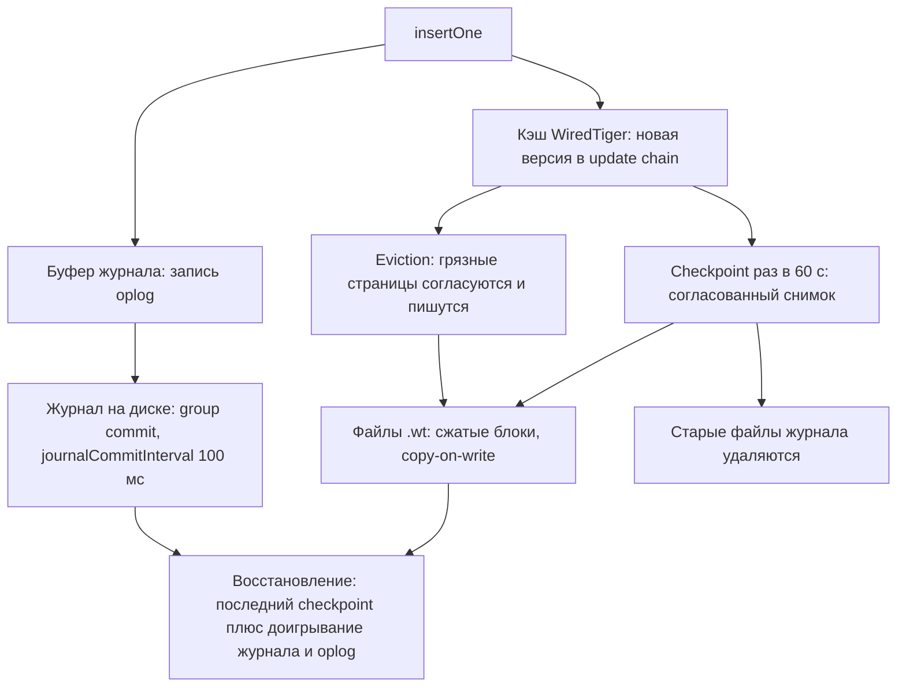

# 02. WiredTiger: как MongoDB хранит данные

**Зачем это знать backend-разработчику.** Почти все «странности» производительности MongoDB объясняются движком хранения. Почему запрос летает на тесте и тормозит в проде, когда данные перестали влезать в память. Почему после удаления половины коллекции диск не освободился. Почему два контейнера с MongoDB на одной машине мешают друг другу. И что на самом деле гарантирует `writeConcern` с `j: true`. Всё это — WiredTiger, движок по умолчанию с версии 3.2 и единственный дисковый движок в 8.0 (in-memory движок есть только в Enterprise).

> **Коротко:** каждая коллекция и каждый индекс — отдельное B-дерево в своём файле `.wt`. Читатели и писатели не блокируют друг друга благодаря MVCC: у документа есть цепочка версий, а старые версии уходят в history store. Данные живут в кэше WiredTiger: по умолчанию 50 % от (RAM − 1 ГБ), но не меньше 256 МБ, и считается от памяти, которую видит контейнер. Раз в 60 секунд checkpoint записывает согласованный снимок на диск, а между checkpoint'ами изменения защищает журнал с группировкой записи раз в 100 мс. Коллекции сжимаются snappy, индексы — префиксной компрессией.

## Оглавление

- [Место WiredTiger в mongod](#место-wiredtiger-в-mongod)
- [B-дерево: страницы на диске и в памяти](#b-дерево-страницы-на-диске-и-в-памяти)
- [MVCC и снимки](#mvcc-и-снимки)
- [Кэш WiredTiger](#кэш-wiredtiger)
- [Вытеснение](#вытеснение)
- [Checkpoint](#checkpoint)
- [Журнал](#журнал)
- [Компрессия](#компрессия)
- [🔬 Глубже: путь одной записи](#-глубже-путь-одной-записи)
- [Практика в репозитории](#практика-в-репозитории)
- [Типичные ошибки и заблуждения](#типичные-ошибки-и-заблуждения)
- [Итоги](#итоги)
- [Вопросы для самопроверки](#вопросы-для-самопроверки)
- [Источники](#источники)

## Место WiredTiger в mongod

**На пальцах** (аналогия). `mongod` — ресторан: официанты принимают заказы (сеть, разбор запросов, планировщик), а кухня хранит продукты и готовит (движок хранения). Скорость кухни решает, сколько ждёт гость.

**Движок хранения** (storage engine) — слой, который отвечает за то, как документы и индексы лежат в памяти и на диске. Над ним MongoDB строит язык запросов, репликацию и шардирование. **WiredTiger** — движок, который MongoDB купила в 2014 году; сравнение с другими подходами (B-Tree против LSM, WAL) — в [основах](../../docs/00-foundations/07-storage-engines.md).

На образе `mongo:8.0` (сервер 8.0.32) это видно сразу:

```text
test> db.serverStatus().storageEngine   // выдержка
{ name: 'wiredTiger', supportsCommittedReads: true, supportsSnapshotReadConcern: true, persistent: true, ... }
```

И на диске, в `/data/db`:

```text
$ ls /data/db | grep -v "^collection-\|^index-"
WiredTiger
WiredTiger.lock
WiredTiger.turtle
WiredTiger.wt
WiredTigerHS.wt
_mdb_catalog.wt
diagnostic.data
journal
mongod.lock
sizeStorer.wt
storage.bson
$ ls /data/db | grep -c "^collection-"; ls /data/db | grep -c "^index-"
34
42
$ ls -la /data/db/journal
-rw------- 1 mongodb mongodb 104857600 Oct 19 14:23 WiredTigerLog.0000000001
-rw------- 1 mongodb mongodb 104857600 Oct 19 14:20 WiredTigerPreplog.0000000001
```

| Файл | Что внутри |
|---|---|
| `collection-N-….wt` | одна коллекция — одно B-дерево |
| `index-N-….wt` | один индекс — одно B-дерево |
| `_mdb_catalog.wt` | каталог MongoDB: какая коллекция в каком файле |
| `WiredTiger.wt`, `WiredTiger.turtle` | метаданные движка и указатель на последний checkpoint |
| `WiredTigerHS.wt` | history store: старые версии документов (см. [MVCC](#mvcc-и-снимки)) |
| `sizeStorer.wt` | счётчики документов и размеров коллекций, чтобы `count()` без фильтра не обходил дерево |
| `journal/WiredTigerLog.*` | журнал упреждающей записи, файлы по 100 МБ |

## B-дерево: страницы на диске и в памяти

**На пальцах** (аналогия). Библиотечный каталог: на верхнем ящике написано «А–К» и «Л–Я», внутри — более мелкие разделы, в самом низу карточки. Чтобы найти книгу, открываете три-четыре ящика, а не перебираете весь фонд.

**B-дерево** (B-Tree) — сбалансированное дерево страниц: **внутренние страницы** (internal pages) хранят ключи-разделители и ссылки вниз, **листовые** (leaf pages) — сами записи. Глубина растёт логарифмически, поэтому поиск по миллиарду ключей — это несколько страниц.

В WiredTiger два вида деревьев, и их настройки видны в строке создания таблицы:

```text
guide> db.books.stats().wiredTiger.creationString
access_pattern_hint=none,allocation_size=4KB,...,block_compressor=snappy,...,format=btree,...,
internal_page_max=4KB,key_format=q,...,leaf_page_max=32KB,leaf_value_max=64MB,log=(enabled=false),...,
memory_page_max=10m,...,prefix_compression=false,...,split_pct=90,...,value_format=u,...
guide> db.books.stats({indexDetails: true}).indexDetails._id_.creationString   // выдержка
block_compressor= prefix_compression=true key_format=u leaf_page_max=16k log=(enabled=false) internal_page_max=16k
```

| Параметр | Коллекция | Индекс | Что значит |
|---|---|---|---|
| `key_format` | `q` (64-битное целое) | `u` (байты) | ключ коллекции — внутренний **RecordId**, ключ индекса — закодированные значения полей |
| `value_format` | `u` | — | значение — BSON документа как массив байтов |
| `leaf_page_max` | 32 КБ | 16 КБ | максимальный размер листовой страницы на диске |
| `internal_page_max` | 4 КБ | 16 КБ | у коллекции внутренние страницы маленькие, поэтому дерево широкое и неглубокое |
| `block_compressor` | `snappy` | пусто (нет) | сжатие блоков на диске |
| `prefix_compression` | `false` | `true` | сжатие общих префиксов ключей |

Итак, коллекция — дерево «RecordId → документ», индекс — дерево «значение поля → RecordId». Запрос по индексу проходит оба дерева, поэтому покрывающий запрос (covered query), которому коллекция не нужна, дешевле — см. [04. Индексы](04-indexes.md).

Важная особенность: страница на диске и страница в памяти — разные вещи. На диске страница сжата и неизменяема. Прочитанная в кэш, она разворачивается в структуру для поиска и изменений, а изменения копятся рядом с ней. Перевод страницы из памяти вместе с её цепочками изменений в дисковый формат называется **reconciliation** (согласование страницы). Результат пишется в новый блок, старый не перезаписывается — **copy-on-write**.

## MVCC и снимки

**На пальцах** (аналогия). Вики-статья с историей правок. Пока вы читаете версию от 10:00, кто-то сохраняет правку. Вы дочитываете свою версию до конца, новый читатель сразу получает свежую. Никто никого не ждёт.

**MVCC** (multi-version concurrency control, многоверсионное управление конкурентностью) — схема, при которой запись создаёт новую версию данных, не трогая старую. **Снимок** (snapshot) — набор версий, видимых транзакции на определённый момент. В WiredTiger у изменённого документа в памяти висит **цепочка обновлений** (update chain): новые версии сверху, каждая со своей меткой времени. Старые версии, которые ещё могут понадобиться читателям, при записи страницы уходят в **history store** — файл `WiredTigerHS.wt`.

Посмотрим на прошлое документа, прочитав его на старый момент кластерного времени:

```text
guide> db.stock.insertOne({_id: "sku-1", qty: 10})
guide> const t0 = db.runCommand({update: "stock", updates: [{q: {_id: "sku-1"}, u: {$set: {qty: 10}}}]}).operationTime
guide> print("t0 =", t0)
t0 = Timestamp({ t: 1792419796, i: 2 })
guide> db.stock.updateOne({_id: "sku-1"}, {$set: {qty: 7}})
guide> db.stock.findOne()
{ _id: 'sku-1', qty: 7 }
guide> db.runCommand({find: "stock", filter: {_id: "sku-1"},
         readConcern: {level: "snapshot", atClusterTime: t0}}).cursor.firstBatch
[ { _id: 'sku-1', qty: 10 } ]
guide> db.runCommand({find: "stock", filter: {},
         readConcern: {level: "snapshot", atClusterTime: Timestamp({t: t0.t - 3600, i: 1})}})
MongoServerError: Read timestamp Timestamp(1792416196, 1) is older than the oldest available timestamp.
```

Обычное чтение вернуло 7, снимок на момент `t0` — старое 10. А на час назад сервер отказал: такой истории он не хранит. Сколько истории держать, задаёт параметр:

```text
test> db.adminCommand({getParameter: 1, minSnapshotHistoryWindowInSeconds: 1}).minSnapshotHistoryWindowInSeconds
300
```

Пять минут — это окно для снимочных чтений с `readConcern: "snapshot"`; транзакции ограничены 60 с ([08](08-transactions.md)). Это минимум, а не потолок для читателя: снимочное чтение старше окна может получить ошибку. Историю держит открытая многодокументная транзакция — до `transactionLifetimeLimitSeconds` — пока она жива, растут history store и кэш. Обычный курсор с `readConcern` `local` или `majority` отпускает снимок между `getMore` и историю не копит.

Два следствия MVCC для приложения:

1. **Конкурентность на уровне документа** (document-level concurrency). Писатели разных документов не мешают друг другу, читатели не ждут писателей.
2. **Конфликт записи.** Если два писателя меняют один документ одновременно, второй получает внутренний **WriteConflict**. Одиночную операцию сервер повторит сам, клиент заметит только задержку. Внутри многодокументной транзакции конфликт прерывает транзакцию, и повторять её должно приложение (или `withTransaction` драйвера; `TransientTransactionError`, см. [08](08-transactions.md)).

## Кэш WiredTiger

**На пальцах** (аналогия). Рабочий стол и архив. На столе лежат папки, с которыми работаете сейчас; за остальными идёте в архив. Стол большой — работа быстрая. Если стол меньше, чем нужно на сегодня, вы постоянно ходите в архив.

**Кэш WiredTiger** (WiredTiger cache) — область памяти процесса, где живут страницы B-деревьев в развёрнутом, несжатом виде. Размер по умолчанию — большее из двух значений: 50 % от (RAM − 1 ГБ) или 256 МБ. Ключевой вопрос — какую RAM видит процесс. Проверим на двух контейнерах:

```text
# контейнер без ограничения памяти (replica set для этой главы)
test> print(db.hostInfo().system.memSizeMB, db.hostInfo().system.memLimitMB)
Long('15814') Long('15814')
test> db.serverStatus().wiredTiger.cache["maximum bytes configured"]
Long('7754219520')

# такой же образ, запущенный с docker run --memory 2g
test> print(db.hostInfo().system.memSizeMB, db.hostInfo().system.memLimitMB)
Long('15814') Long('2048')
test> db.serverStatus().wiredTiger.cache["maximum bytes configured"]
536870912
```

| Контейнер | Память, которую учёл mongod | Расчёт | Кэш |
|---|---|---|---|
| без `--memory` | 15 814 МБ (вся память хоста) | 0,5 × (15 814 − 1024) = 7395 МБ | 7 754 219 520 байт, в логе `cache_size=7395M` |
| `--memory 2g` | 2048 МБ (лимит cgroup) | 0,5 × (2048 − 1024) = 512 МБ | 536 870 912 байт, в логе `cache_size=512M` |

`memLimitMB` — лимит памяти контейнера, и `mongod` считает кэш от него. Без лимита каждый контейнер думает, что вся машина его. Три контейнера MongoDB на ноутбуке с 16 ГБ без `--memory` — это три кэша по 7,4 ГБ в теории, и под нагрузкой ОС начнёт убивать процессы. Решения: ограничить контейнер или задать кэш явно — `--wiredTigerCacheSizeGB 1` (или `storage.wiredTiger.engineConfig.cacheSizeGB` в конфиге).

Остальная память не пропадает: файловый кэш ОС держит сжатые «тёплые» страницы `.wt`, кэш WiredTiger — несжатые «горячие».

Состояние кэша — в `serverStatus` (после того как в эксперименте из раздела про компрессию вставлено 500 000 документов):

```text
bytes currently in the cache = 354708419
tracked dirty bytes in the cache = 2466012
pages read into cache = 458
pages written from cache = 4214
bytes belonging to the history store table in the cache = 317856
```

Главное — помещается ли в кэш **рабочий набор** (working set): документы и индексы, нужные каждую секунду. Если да, `pages read into cache` растёт медленно; если нет, выборки превращаются в чтение с диска.

## Вытеснение

**На пальцах** (аналогия). Стол заполнен. Чтобы положить новую папку, надо убрать старую. Чистую папку можно просто вернуть на полку, а с исписанной сначала снять копию в архив — это дольше.

**Вытеснение** (eviction) — удаление страниц из кэша, чтобы освободить место. **Чистая** страница (clean) не менялась с момента чтения — её просто выбрасывают. **Грязная** (dirty) содержит изменения — её сначала надо согласовать и записать на диск.

Вытеснение делают фоновые потоки. В строке открытия движка из лога `mongod` видно, сколько их:

```text
"msg":"Opening WiredTiger","attr":{"config":"create,cache_size=7395M,session_max=33000,
eviction=(threads_min=4,threads_max=4),config_base=false,statistics=(fast),
log=(enabled=true,remove=true,path=journal,compressor=snappy),
builtin_extension_config=(zstd=(compression_level=6)),..."}
```

Пороги в этой строке не переопределены, значит, действуют значения WiredTiger по умолчанию (по документации WiredTiger, а не из вывода на образе):

| Порог | По умолчанию | Что происходит |
|---|---|---|
| `eviction_target` | 80 % кэша | фоновые потоки начинают вытеснять |
| `eviction_trigger` | 95 % кэша | к вытеснению привлекаются потоки приложения |
| `eviction_dirty_target` | 5 % кэша | фоновые потоки начинают сбрасывать грязные страницы |
| `eviction_dirty_trigger` | 20 % кэша | потоки приложения сбрасывают грязные сами |

Пока кэш ниже порогов, вытеснение невидимо для запросов. Когда фоновые потоки не успевают, к работе привлекают **потоки приложения** (application threads) — то есть потоки, которые выполняют ваши запросы. Запрос, который должен был занять миллисекунду, сначала пишет чужие грязные страницы на диск. Так выглядят «хвосты» p99 при массовой загрузке. Счётчики в `serverStatus().wiredTiger.cache` с `application threads` в названии показывают, что это началось.

## Checkpoint

**На пальцах** (аналогия). Сохранение в компьютерной игре. Пока вы играете, прогресс в памяти. Раз в минуту игра делает сохранение на диск, и после сбоя вы начинаете с последнего сохранения, а не с начала.

**Checkpoint** (контрольная точка) — согласованный снимок всех B-деревьев, записанный на диск. Новый checkpoint пишется рядом со старым (copy-on-write), и только когда он полностью готов, `WiredTiger.turtle` начинает указывать на него. Поэтому на диске всегда есть хотя бы один целый checkpoint, даже если `mongod` убили посреди записи.

Интервал задаёт параметр `syncdelay`:

```text
test> db.adminCommand({getParameter: 1, syncdelay: 1, journalCommitInterval: 1})
{ journalCommitInterval: 100, syncdelay: 60, ok: 1, ... }
```

Проверка на живом сервере: номер поколения checkpoint'ов до и после паузы в 125 секунд:

```text
test> const g = () => db.serverStatus().wiredTiger.checkpoint
test> print(new Date().toISOString(), g().generation); sleep(125000); print(new Date().toISOString(), g().generation)
2026-10-19T14:23:38.282Z 9
2026-10-19T14:25:43.295Z 11
test> for (const k of ["min time (msecs)", "max time (msecs)", "most recent time (msecs)"]) print(k, "=", g()[k])
min time (msecs) = 16
max time (msecs) = 754
most recent time (msecs) = 30
```

Два checkpoint'а за две минуты — интервал 60 секунд. Самый долгий (754 мс) пришёлся на массовую вставку: чем больше грязных данных, тем дольше checkpoint.

## Журнал

**На пальцах** (аналогия). Кассир между инвентаризациями записывает каждую продажу в тетрадь. Если склад сгорит, его восстановят по последней инвентаризации плюс записям тетради.

**Журнал** (journal) — журнал упреждающей записи (write-ahead log, WAL) WiredTiger. Каждое изменение сначала дописывается в журнал, а уже потом рано или поздно попадает в B-дерево на диске при checkpoint'е или вытеснении. После сбоя сервер берёт последний checkpoint и проигрывает журнал после него.

Записи журнала копятся в буфере и сбрасываются с `fsync` группами — **групповой коммит** (group commit). `journalCommitInterval` — 100 мс: период фонового сброса для записей без `j`. Запись с `j: true` запускает немедленный сброс и отвечает после `fsync`: на образе 50 вставок `{w: 1, j: true}` подряд заняли в среднем 7,14 мс, с `j: false` — 2,6 мс. Это цена одного `fsync`, а не ожидание до 100 мс. Журнал сжат snappy (`compressor=snappy` в строке выше), файлы по 100 МБ, старые удаляются после checkpoint'а (`remove=true`).

Связь с `writeConcern`:

| Write concern | Когда ответ клиенту | Что потеряется при аварии (ОС, питание; при `kill -9` обычно меньше) |
|---|---|---|
| `{w: 1}` | изменение применено в памяти primary | до 100 мс подтверждённых записей |
| `{w: 1, j: true}` | журнал с этой записью сброшен на диск | ничего на этом узле |
| `{w: "majority"}` | записано на большинстве узлов; по умолчанию с журналом | ничего, если выжило большинство |

```text
test> db.adminCommand({getDefaultRWConcern: 1}).defaultWriteConcern
{ w: 'majority', wtimeout: 0 }
guide> db.stock.insertOne({_id: "sku-2", qty: 5}, {writeConcern: {w: 1, j: true}})
{ acknowledged: true, insertedId: 'sku-2' }
```

С 5.0 default write concern на replica set — `majority` (с арбитрами в части конфигураций — `w: 1`). В Java: `WriteConcern.MAJORITY` и `WriteConcern.W1.withJournal(true)` — ровно `w: 1, j: true`. Осторожно с `WriteConcern.JOURNALED`: в драйвере 5.8.1 это `ACKNOWLEDGED.withJournal(true)`, то есть `{j: true}` без `w`, и `w` берётся из умолчания сервера — на replica set это `majority`.

```java
MongoCollection<Document> stock = db.getCollection("stock")
        .withWriteConcern(WriteConcern.W1.withJournal(true));   // w: 1 и немедленный сброс журнала
stock.insertOne(new Document("_id", "sku-2").append("qty", 5));
```

Тонкость replica set, которую видно в строках создания таблиц:

```text
guide> db.books.stats().wiredTiger.creationString.match(/log=\([^)]*\)/)[0]
log=(enabled=false)
local> db.oplog.rs.stats().wiredTiger.creationString.match(/log=\([^)]*\)/)[0]
log=(enabled=true)
# тот же образ, запущенный без --replSet (standalone)
guide> db.x.stats().wiredTiger.creationString.match(/log=\([^)]*\)/)[0]
log=(enabled=true)
```

На члене replica set пользовательские коллекции в журнал WiredTiger не пишутся, пишется **oplog** — журнал операций репликации ([06](06-replica-set.md)). Каждая запись в коллекцию сопровождается записью в oplog в той же транзакции движка, а при восстановлении сервер берёт последний стабильный checkpoint и доигрывает oplog. Гарантия `j: true` от этого не меняется: подтверждённая запись переживёт падение, просто путь восстановления идёт через oplog. На standalone-сервере, как видно в выводе, журналируются все коллекции.

## Компрессия

**На пальцах** (аналогия). Архив вакуумных пакетов: на полке вещи занимают втрое меньше места, но перед тем как надеть, пакет надо вскрыть. Чем плотнее упаковка, тем дольше вскрывать.

WiredTiger сжимает три вещи по-разному:

1. **Блоки коллекций** (block compression) — по умолчанию `snappy`, можно `zlib`, `zstd` или `none`.
2. **Индексы** — **префиксная компрессия** (prefix compression): у соседних ключей в отсортированной странице общий префикс хранится один раз.
3. **Журнал** — `snappy`.

Блочное сжатие (snappy, zlib, zstd) в кэше снято: оно касается только диска и файлового кэша ОС. Префиксная компрессия ключей индекса сохраняется и в памяти. Сравним на одинаковых 100 000 заказах (средний документ 231 байт):

```text
guide> for (const c of ["none", "snappy", "zlib", "zstd"])
         db.createCollection("c_" + c, {storageEngine: {wiredTiger: {configString: "block_compressor=" + c}}})
// ... insertMany тех же 100 000 документов в каждую, createIndex({orderNo: 1}), db.adminCommand({fsync: 1})
none   size= 23153000 storageSize= 25382912 orderNo_idx= 1204224 id_idx= 2547712
snappy size= 23153000 storageSize=  4370432 orderNo_idx= 1204224 id_idx= 2547712
zlib   size= 23153000 storageSize=  2633728 orderNo_idx= 1204224 id_idx= 2547712
zstd   size= 23153000 storageSize=  1765376 orderNo_idx= 1204224 id_idx= 2547712
```

| Компрессор | `storageSize` | Сжатие относительно `size` | Цена |
|---|---|---|---|
| `none` | 24,2 МБ | 0,9× (место под заголовки страниц и запас) | ноль CPU |
| `snappy` | 4,2 МБ | 5,3× | очень быстрый, дефолт |
| `zlib` | 2,5 МБ | 8,8× | заметно дороже по CPU |
| `zstd` | 1,7 МБ | 13,1× | уровень 6 на образе (`zstd=(compression_level=6)`), лучший компромисс для холодных данных |

`size` — несжатый BSON, одинаков у всех. Данные синтетические и очень повторяющиеся, поэтому коэффициенты выше реальных. На живых данных разница между `snappy` и `zstd` обычно меньше, но порядок тот же. Индексы при этом одинаковы во всех четырёх коллекциях: `block_compressor` коллекции на них не влияет.

Префиксная компрессия индекса — отдельный эксперимент на тех же данных:

```text
guide> db.c_noprefix.createIndex({orderNo: 1},
         {storageEngine: {wiredTiger: {configString: "prefix_compression=false"}}})
prefix=false idx= 2584576 default snappy coll idx= 1204224
```

Ключи вида `ORD-2026-0000042` отличаются последними цифрами, и с префиксной компрессией индекс вдвое меньше: 1,15 МБ против 2,46 МБ. Меньше индекс — больше его помещается в кэш. Это главный аргумент не отключать её.

В Java настройки движка передаются документом, которые драйвер прокидывает как есть (`CreateCollectionOptions.storageEngineOptions` и `IndexOptions.storageEngine` в 5.8.1):

```java
Document zstd = new Document("wiredTiger", new Document("configString", "block_compressor=zstd"));
db.createCollection("archive_orders", new CreateCollectionOptions().storageEngineOptions(zstd));
db.getCollection("archive_orders").createIndex(Indexes.ascending("orderNo"));
```

Дефолт для всех новых коллекций сервера меняют параметром `--wiredTigerCollectionBlockCompressor zstd`.

## 🔬 Глубже: путь одной записи

Что происходит при `insertOne({_id: "sku-2", qty: 5})` с `w: 1` на replica set:

| Шаг | Где | Что происходит |
|---|---|---|
| 1 | сервер запросов | проверка документа, `_id`, лимит 16 МБ |
| 2 | WiredTiger, транзакция движка | открывается снимок; документ получает RecordId |
| 3 | кэш | новая версия добавляется в update chain листа коллекции, ключи — в листья индексов |
| 4 | кэш | в той же транзакции пишется запись в `local.oplog.rs` |
| 5 | журнал | запись oplog попадает в буфер журнала (у коллекции `log=(enabled=false)`) |
| 6 | commit | транзакция движка фиксируется, версия получает метку времени |
| 7 | клиент | `w: 1` отвечает сразу; `j: true` запускает немедленный сброс журнала и отвечает после `fsync` |
| 8 | фон | eviction со временем согласует грязные страницы и пишет блоки |
| 9 | фон | не позже чем через 60 с checkpoint записывает согласованный снимок, старые файлы журнала удаляются |



## Практика в репозитории

- [Задание 06](../tasks/06-iot-telemetry.md) — телеметрия: bucket-документы и TTL, удобно посмотреть `storageSize` и сжатие на одинаковых данных разной формы.
- [Задание 02](../tasks/02-esr-indexes.md) — индексы и `explain`: размеры индексов с префиксной компрессией, `totalDocsExamined` против `totalKeysExamined`.
- [Задание 05](../tasks/05-checkout-transaction.md) — транзакция с повтором: WriteConflict и снимки на практике.
- [CrudDemo](../examples/src/main/java/dev/nosqlguide/mongodb/examples/driver/CrudDemo.java) — вставка, обновление и удаление через драйвер (write concern по умолчанию).
- Фон: [движки хранения: WAL, B-Tree, LSM, MVCC](../../docs/00-foundations/07-storage-engines.md).

## Типичные ошибки и заблуждения

1. **«Кэш MongoDB подстроится под контейнер сам.»** Только под лимит cgroup. Без `--memory` на машине с 16 ГБ каждый контейнер получает 7,4 ГБ.
2. **«Чем больше кэш, тем лучше, дам 90 % RAM.»** Остальной памяти нужны соединения, сортировки и файловый кэш ОС, где лежат сжатые страницы. Дефолт около половины выбран не случайно.
3. **«`w: 1` — значит, запись на диске.»** Значит, в памяти primary. На диске — после фонового сброса журнала (раз в 100 мс) или после checkpoint'а. Для гарантии — `j: true` (немедленный `fsync` журнала) или `majority`.
4. **«Удалил данные — освободил диск.»** На образе после `deleteMany` половины из 100 000 заказов и `fsync` `size` упал с 23,1 до 11,7 МБ, а `storageSize` вырос с 4,4 до 9,6 МБ: copy-on-write записал изменённые страницы в новые блоки, 4,4 МБ помечены как `file bytes available for reuse`. Место переиспользуется внутри коллекции, ОС его не получает; `compact` на primary без `force: true` отказывается работать, а на этих данных даже с `force: true` освободил 0 байт. В 8.0 есть и фоновый `autoCompact` (команда принята на образе).
5. **«Открытая транзакция ничего не стоит.»** Пока транзакция открыта, WiredTiger держит все видимые ей версии: растут history store и кэш. Обычный курсор так не делает — между `getMore` он отпускает снимок, а снимочное чтение старше окна `minSnapshotHistoryWindowInSeconds` (300 с) просто получит ошибку.

## Итоги

- Коллекция и каждый индекс — отдельные B-деревья: «RecordId → BSON» и «ключ → RecordId».
- MVCC: версии в update chain и history store, читатели не ждут писателей; окно снимков на образе — 300 секунд.
- Кэш по умолчанию — max(50 % × (RAM − 1 ГБ), 256 МБ) от памяти контейнера: 7395 МБ без лимита и 512 МБ при `--memory 2g`.
- Вытеснение сначала фоновое (4 потока), а при переполнении — силами потоков запросов, это источник хвостовых задержек.
- Checkpoint — каждые 60 с (`syncdelay`), журнал — group commit раз в 100 мс (`journalCommitInterval`), snappy-сжатие.
- Компрессия: коллекции snappy (опции zlib, zstd уровня 6), индексы — префиксная компрессия, на диске до 2× меньше индекс.
- Удаление не уменьшает файл: copy-on-write оставляет свободные блоки внутри `.wt` для новых записей.

## Вопросы для самопроверки

1. Почему у коллекции `key_format=q`, а у индекса `key_format=u`?
   <details><summary>Ответ</summary>Ключ коллекции — внутренний 64-битный RecordId, а ключ индекса — байтовая строка из закодированных значений полей. Индекс ссылается на документ через RecordId.</details>
2. Контейнер `mongo:8.0` на машине с 32 ГБ запущен без `--memory`. Какой будет кэш и чем это опасно?
   <details><summary>Ответ</summary>0,5 × (32 768 − 1024) ≈ 15,5 ГБ. С соседними контейнерами — путь к OOM. Ограничивают `--memory` или `--wiredTigerCacheSizeGB`.</details>
3. Клиент получил подтверждение `w: 1`, через 50 мс у сервера пропало питание. Может ли запись пропасть?
   <details><summary>Ответ</summary>Да: без `j` журнал сбрасывается фоном раз в 100 мс, запись могла ещё не пройти `fsync`. При `kill -9` самого процесса окно обычно меньше: то, что уже отдано ОС, переживёт. С `j: true` сервер сразу сбрасывает журнал и отвечает после `fsync` — запись переживёт сбой.</details>
4. Что такое checkpoint и почему после сбоя нужен ещё и журнал?
   <details><summary>Ответ</summary>Checkpoint — согласованный снимок деревьев на диске, раз в 60 с. Всё, что изменилось после него, есть только в журнале (и oplog на replica set), поэтому восстановление = последний checkpoint + доигрывание журнала.</details>
5. Запросы иногда «залипают» на сотни миллисекунд во время массового импорта, хотя индексы правильные. Какая гипотеза про WiredTiger?
   <details><summary>Ответ</summary>Грязных страниц больше порога `eviction_dirty_trigger`, фоновые потоки не успевают, и вытеснение выполняют потоки приложения — запрос сначала пишет чужие страницы. Смотрят счётчики `application threads` в `serverStatus().wiredTiger.cache`.</details>
6. Чем отличается сжатие коллекции от префиксной компрессии индекса?
   <details><summary>Ответ</summary>Сжатие коллекции — блочный компрессор (snappy, zlib, zstd) для страниц на диске. Префиксная компрессия убирает повторяющиеся начала соседних ключей индекса и работает в том числе в памяти, поэтому больше индекса помещается в кэш.</details>

## Источники

- MongoDB Manual 8.0: *WiredTiger Storage Engine*, *Journaling*, *FAQ: Concurrency*, *Production Notes* (размер кэша в контейнерах). https://www.mongodb.com/docs/manual/core/wiredtiger/ , https://www.mongodb.com/docs/manual/core/journaling/
- MongoDB Manual: параметры `syncdelay`, `journalCommitInterval`, `minSnapshotHistoryWindowInSeconds`, `--wiredTigerCacheSizeGB`, `--wiredTigerCollectionBlockCompressor`; команды `serverStatus`, `compact`, `fsync`. https://www.mongodb.com/docs/manual/reference/parameters/
- WiredTiger Developer Documentation: *Cache and eviction tuning* (пороги `eviction_target`, `eviction_trigger`, `eviction_dirty_target`, `eviction_dirty_trigger`), *Checkpoints*, *Compression*, *Durability*. https://source.wiredtiger.com/
- Исходный код: https://github.com/wiredtiger/wiredtiger , https://github.com/mongodb/mongo (`src/mongo/db/storage/wiredtiger`).
- MongoDB Java Driver 5.8.1 (проверено `javap`): `WriteConcern.JOURNALED`, `WriteConcern.withJournal`, `CreateCollectionOptions.storageEngineOptions`, `IndexOptions.storageEngine`.
- Все выводы сняты на образе `mongo:8.0` (сервер 8.0.32): replica set из одного узла и для сравнения — standalone с `--memory 2g`.

---

← [01. Документ и BSON](01-document-bson.md) | [оглавление](README.md) | [03. Моделирование данных](03-data-modeling.md) → | [словарь терминов](glossary.md)
