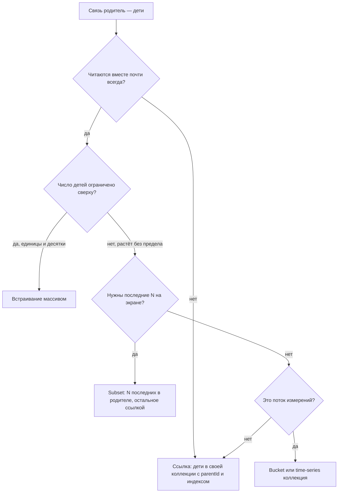

# 03. Моделирование данных в MongoDB

**Зачем это знать backend-разработчику.** В MongoDB схема живёт не в `CREATE TABLE`, а в форме документов, и ошибку формы не исправить индексом. Карточка товара, которая тащит за собой 30 000 отзывов, будет медленной при любом железе. Тысяча коллекций «по одной на клиента» съест память и диск, хотя данных в них на килобайты. Паттерны моделирования — готовые ответы на типовые нагрузки.

> **Коротко:** документ — единица атомарности и единица чтения, поэтому в него кладут то, что читается и меняется вместе. Что встраивать, а что выносить ссылкой, решают кардинальность связи и рост: массив без верхней границы встраивать нельзя. Паттерны держат документы маленькими, а частые запросы — одноразовыми. Версия схемы хранится в самом документе, а `$jsonSchema` ловит мусор при записи. Антипаттерны измеримы: рост массива замедлил `$push` в 5 раз, а 1000 почти пустых коллекций заняли 61 МБ под 29 КБ данных.

Выводы сняты на пробном контейнере `mongo:8.0` (сервер 8.0.32, replica set из одного узла, база `guide`). Общая теория (подход «от запросов», денормализация, таблица кардинальностей, ленивая миграция) — в [основах](../../docs/00-foundations/08-data-modeling.md); здесь — то, как это выглядит в MongoDB и сколько стоит.

## Оглавление

- [Встраивание или ссылка](#встраивание-или-ссылка)
- [Паттерн subset](#паттерн-subset)
- [Паттерн computed](#паттерн-computed)
- [Паттерн extended reference](#паттерн-extended-reference)
- [Паттерн bucket](#паттерн-bucket)
- [Паттерн outlier](#паттерн-outlier)
- [Паттерны polymorphic и attribute](#паттерны-polymorphic-и-attribute)
- [Версия схемы и валидация](#версия-схемы-и-валидация)
- [Антипаттерны](#антипаттерны)
- [🔬 Глубже: почему большой документ дорог даже при маленьком изменении](#-глубже-почему-большой-документ-дорог-даже-при-маленьком-изменении)
- [Практика в репозитории](#практика-в-репозитории)
- [Типичные ошибки и заблуждения](#типичные-ошибки-и-заблуждения)
- [Итоги](#итоги)
- [Вопросы для самопроверки](#вопросы-для-самопроверки)
- [Источники](#источники)

## Встраивание или ссылка

**На пальцах** (аналогия). Ингредиенты рецепта печатают прямо на странице — это встраивание. Отзывы читателей там же печатать глупо: через год страница станет томом, поэтому их кладут в папку, а на странице пишут «отзывы — папка №7».

**Встраивание** (embedding) — дочерние данные лежат внутри родительского документа: вложенный объект или массив. **Ссылка** (referencing) — в документе хранится `_id` другого документа, и связанные данные читаются вторым запросом или стадией `$lookup`. Таблица «1:1, 1:few, 1:many, 1:squillions» разобрана в [основах](../../docs/00-foundations/08-data-modeling.md#3-embedding-против-referencing). В MongoDB к ней добавляются три конкретных довода:

1. **Атомарность.** Одна запись атомарна в пределах одного документа ([01](01-document-bson.md#атомарность-одного-документа)). Заказ с позициями меняется одним `updateOne` без транзакции.
2. **Документ читается целиком.** Проекция уменьшает то, что уходит по сети, но сервер всё равно поднимает в кэш весь документ ([02](02-wiredtiger.md#кэш-wiredtiger)).
3. **Рост.** Лимит 16 МБ — жёсткая стена ([01](01-document-bson.md#лимит-16-мб)), но производительность падает задолго до неё (замер в [антипаттернах](#антипаттерны)).



Принцип, который повторяет документация MongoDB: «данные, которые читаются вместе, хранятся вместе». Но вторая половина правила важнее: **массив, у которого нет верхней границы, не встраивают**. Отсюда и почти все паттерны ниже.

## Паттерн subset

**На пальцах** (аналогия). На витрине магазина лежат три самых свежих журнала, остальные — на складе. Покупатель видит витрину сразу, а за подшивкой идёт отдельно.

**Паттерн subset** (subset pattern, «подмножество») — в родительском документе хранится небольшое ограниченное подмножество детей, нужное для частого экрана; полный набор живёт в отдельной коллекции. Классика — карточка товара с тремя последними отзывами при сотнях отзывов всего.

Ключевой инструмент — `$push` с модификаторами `$each`, `$sort` и `$slice`: элемент добавляется, массив пересортировывается и обрезается **в одной атомарной операции**. Заодно в том же обновлении живёт паттерн computed (следующий раздел):

```text
guide> db.reviews.insertOne(r)          // полный отзыв — в свою коллекцию
guide> db.items.updateOne({_id: 1001}, {
  $inc:  {reviewsCount: 1, ratingSum: r.rating},
  $push: {lastReviews: {$each: [{author: r.author, rating: r.rating, at: r.at}],
                        $sort: {at: -1}, $slice: 3}}})
```

После пяти отзывов документ товара такой:

```text
guide> db.items.findOne({_id: 1001})
{
  _id: 1001,
  name: 'Наушники',
  priceCents: Long('499000'),
  reviewsCount: 5,
  ratingSum: 15,
  lastReviews: [
    { author: 'user5', rating: 1, at: ISODate('2026-10-05T00:00:00.000Z') },
    { author: 'user4', rating: 5, at: ISODate('2026-10-04T00:00:00.000Z') },
    { author: 'user3', rating: 4, at: ISODate('2026-10-03T00:00:00.000Z') }
  ]
}
```

Пять отзывов лежат в `reviews`, в товаре — ровно три, и массив не вырастет. В копию кладут только поля витрины, без полного текста. Экран «все отзывы» читает `reviews` по индексу `{itemId: 1, at: -1}` постранично — это [задание 04](../tasks/04-comments-paging.md).

Java (driver-sync 5.8.1, сигнатуры проверены `javap`):

```java
// статические импорты: Filters.eq, Updates.combine/inc/pushEach, Sorts.descending
reviews.insertOne(review);
items.updateOne(eq("_id", itemId), combine(
        inc("reviewsCount", 1),
        inc("ratingSum", review.getInteger("rating")),
        pushEach("lastReviews",
                List.of(new Document("author", review.getString("author"))
                        .append("rating", review.getInteger("rating"))
                        .append("at", review.getDate("at"))),
                new PushOptions().sortDocument(descending("at")).slice(3))));
```

Цена — две записи вместо одной: при падении между ними копия разойдётся с оригиналом. Для витрины это приемлемо (следующий отзыв всё исправит); иначе — транзакция или фоновая сверка.

## Паттерн computed

**На пальцах** (аналогия). Кассир не пересчитывает все чеки при каждом вопросе начальника — он держит на листке текущую сумму и прибавляет каждый новый чек.

**Паттерн computed** (computed pattern, «вычисленное значение») — результат дорогого вычисления хранится в документе и обновляется при записи, а не считается при каждом чтении. В примере выше хранятся `reviewsCount: 5` и `ratingSum: 15`, и средний рейтинг 15 / 5 = 3,0 получается без агрегации по отзывам.

Почему сумма и счётчик, а не готовое `avgRating`: `$inc` коммутативен. Два параллельных отзыва с оценками 5 и 1 дадут `ratingSum += 6`, `reviewsCount += 2` в любом порядке. Готовое среднее пришлось бы читать, пересчитывать и записывать — классическое потерянное обновление (lost update).

| Чтений на запись | Что выгоднее |
|---|---|
| 1000 : 1 (рейтинг на карточке) | computed при записи |
| 1 : 1000 (поток кликов, отчёт раз в день) | считать при чтении или периодически батчем |
| нужна точность до последней записи | computed в той же операции, что и запись |

Дорогие значения («уникальные покупатели за месяц») считают фоновой агрегацией по расписанию с `$merge` ([05](05-aggregation.md)) — тот же паттерн с отложенной точностью.

## Паттерн extended reference

**На пальцах** (аналогия). На посылке пишут не только номер клиента в базе, но и имя с адресом. Курьеру не нужно звонить в офис ради каждой коробки.

**Паттерн extended reference** («расширенная ссылка») — вместе с `_id` связанного документа копируются его поля, нужные в частом запросе. Заказ хранит `customer: {_id, name}`, и список заказов показывается без обращения к коллекции клиентов:

```text
guide> db.orders3.findOne({}, {_id: 1, customer: 1, total: 1})
{ _id: 0, customer: { _id: 0, name: 'Клиент 0' }, total: 0 }
```

Сравнение на 50 000 заказов и 5000 клиентов: 20 раз прочитать 1000 последних заказов с именем клиента.

| Вариант | Время 20 × 1000 | Что делает сервер |
|---|---|---|
| ссылка + `$lookup` | 336 мс | 1000 точечных поисков по `_id_` в `customers` |
| extended reference | 134 мс | один проход по индексу `at_-1` |

План `$lookup` на 8.0 показывает, что соединение выполняется вложенным циклом по индексу — **SBE** (slot-based engine, новый исполнитель запросов) встраивает `$lookup` прямо в план курсора:

```text
EQ_LOOKUP(_id_)[IndexedLoopJoin] <- LIMIT <- PROJECTION_SIMPLE <- FETCH <- IXSCAN(at_-1)
docs 2000 keys 2000 n 1000
```

2000 документов вместо 1000: тысяча заказов плюс тысяча клиентов. `$lookup` по индексированному полю — не катастрофа, но в 2,5 раза дороже, и на шардированной коллекции он ещё и ходит по сети ([09](09-sharding.md)).

Копируют поля, которые **редко меняются** и нужны **для показа**: имя — да, остаток бонусов — нет. Иногда устаревание и есть правильная семантика: адрес в отправленном заказе не должен меняться вслед за профилем. Если копию нужно обновлять, это `updateMany({'customer._id': id}, {$set: {'customer.name': newName}})` — с индексом на `customer._id`.

## Паттерн bucket

**На пальцах** (аналогия). Почтальон не ходит к вам с каждым письмом отдельно — он складывает письма за день в одну пачку. Писем столько же, а походов в десятки раз меньше.

**Паттерн bucket** («корзина») — мелкие однотипные записи (показания датчика, события, точки трека) группируются в один документ по ключу и окну: «датчик s3, не больше 200 показаний». В документе-корзине хранятся массив измерений и сводка: счётчик, минимум, максимум, сумма — по сути computed для корзины.

Корзина заполняется одним `upsert`: условие `count < 200` находит незаполненную корзину датчика, а когда её нет — создаётся новая (два параллельных upsert дадут две неполные корзины — это безвредно).

```text
guide> db.buckets.updateOne(
  {sensorId: d.sensorId, count: {$lt: 200}},
  {$push: {readings: {ts: d.ts, temp: d.temp}},
   $inc: {count: 1, sumTemp: d.temp},
   $min: {startTs: d.ts, minTemp: d.temp}, $max: {endTs: d.ts, maxTemp: d.temp}},
  {upsert: true})
guide> db.buckets.findOne({sensorId: 's3'}, {readings: {$slice: 2}})
{
  _id: ObjectId('6ad62c6522c17c22ae1a5e06'),
  sensorId: 's3',
  count: 200,
  endTs: ISODate('2026-10-01T00:33:10.000Z'),
  maxTemp: 29.9,
  minTemp: 20,
  readings: [
    { ts: ISODate('2026-10-01T00:00:00.000Z'), temp: 20.3 },
    { ts: ISODate('2026-10-01T00:00:10.000Z'), temp: 21 }
  ],
  startTs: ISODate('2026-10-01T00:00:00.000Z'),
  sumTemp: 4990
}
```

Среднее корзины — `sumTemp / count` без чтения массива. Сравнение на одних и тех же 100 000 показаниях (10 датчиков × 10 000 показаний раз в 10 секунд):

| Модель | Документов | `size`, байт | Размер индексов, байт |
|---|---|---|---|
| документ на показание | 100 000 | 6 460 000 | 3 620 864 |
| bucket по 200 | 500 | 3 577 000 | 114 688 |
| time-series коллекция | 280 корзин | 403 152 | 32 768 |

Корзины почти вдвое компактнее (`_id` и `sensorId` не повторяются в каждой записи), а индексы меньше в 30 раз: ключ один на 200 показаний. Индекс должен жить в кэше, поэтому эта цифра важнее всего.

Третья строка — **time-series коллекция** (time series collection): встроенная реализация того же паттерна. Сервер сам режет поток по `metaField` и окну (`granularity: 'seconds'` дало `bucketMaxSpanSeconds: 3600`), сжимает данные по колонкам и строит индекс `{sensorId: 1, ts: 1}`. Запрос пишется как к обычным документам, а в плане видна распаковка:

```text
guide> db.getCollection('system.buckets.ts').findOne()   // внутренняя коллекция, вывод сокращён
{ _id: ..., control: { version: 2, min: { ts: ... }, max: { ts: ... }, count: 360 }, meta: 's0', data: ... }
guide> db.ts.explain().aggregate([{$match: {sensorId: 's3', ts: {...}}}, {$group: ...}])   // цепочка стадий из winningPlan.queryPlan
... GROUP <- UNPACK_TS_BUCKET <- FETCH <- IXSCAN({meta: 1, control.min.ts: 1, control.max.ts: 1})
```

Ручной bucket нужен, когда измерения меняют поштучно (на 8.0 update в time-series фильтрует только по `metaField`), корзина — бизнес-сущность («события заказа за день») или нужна своя сводка. Для телеметрии на 8.0 по умолчанию берите time-series. Оба варианта — в [задании 06](../tasks/06-iot-telemetry.md).

```java
// time-series коллекция из Java (CreateCollectionOptions.timeSeriesOptions, проверено javap)
db.createCollection("ts", new CreateCollectionOptions()
        .timeSeriesOptions(new TimeSeriesOptions("ts")
                .metaField("sensorId")
                .granularity(TimeSeriesGranularity.SECONDS))
        .expireAfter(30, TimeUnit.DAYS));   // старые корзины удалит TTL
```

## Паттерн outlier

**На пальцах** (аналогия). В раздевалке у каждого ученика крючок. Музыканту с контрабасом дают шкаф в подсобке, а на крючке — записка «остальное в шкафу 12». Ради одного контрабаса раздевалку не перестраивают.

**Паттерн outlier** («выброс») — модель рассчитана на типичный документ, а редкие гиганты обрабатываются особо: флаг `hasOverflow: true` и продолжение в отдельной коллекции. Пример: книги хранят массив покупателей, у 99,9 % книг это десятки записей, а у бестселлера — сотни тысяч.

```text
guide> db.books.find({}, {title: 1, hasOverflow: 1, n: {$size: '$buyers'}})
[ { _id: 'b1', title: 'Обычная книга', n: 3 },
  { _id: 'b2', title: 'Бестселлер', hasOverflow: true, n: 1000 } ]
guide> db.books_overflow.aggregate([{$project: {_id: 0, page: 1, n: {$size: '$buyers'}}}])
[ { page: 1, n: 1000 }, { page: 2, n: 2 } ]
guide> db.books.updateOne({_id: 'b2', 'buyers.999': {$exists: false}}, {$push: {buyers: 'u2002'}})
// matchedCount: 0 — в основном документе 1000 элементов, пишем в overflow
```

Условие `'buyers.999': {$exists: false}` значит «в массиве меньше 1000 элементов» и делает проверку частью атомарной операции: если `matchedCount` равен 0, приложение ставит флаг и пишет в `books_overflow`. Размер документов разошёлся на два порядка: 97 байт у обычной книги и 13 856 у бестселлера с 1000 покупателями в основном документе — без паттерна там были бы мегабайты.

В отличие от subset, outlier не трогает 99,9 % обычных документов: сложная ветка включается только по флагу.

## Паттерны polymorphic и attribute

**На пальцах** (аналогия). В одной картотеке библиотеки лежат карточки книг, журналов и дисков. У всех есть название и шифр, а дальше поля разные. Шкаф на каждый вид заставил бы искать «всё про Пушкина» в трёх местах.

**Паттерн polymorphic** («полиморфный») — документы разной формы, но с общим ядром лежат в **одной коллекции**, а вид хранится в **поле-дискриминаторе** (discriminator), например `type: 'book'`. Поиск по общим полям идёт по одному индексу, а POJO-кодек драйвера сам пишет дискриминатор и читает нужный подкласс ([10](10-change-streams-java.md), [задание 01](../tasks/01-catalog-polymorphic.md)). Индекс на поле одного вида делают частичным: `createIndex({pages: 1}, {partialFilterExpression: {type: 'book'}})` ([04](04-indexes.md#уникальные-и-частичные-индексы)).

**Паттерн attribute** («атрибут») решает другую проблему: у товаров десятки разных характеристик для фильтров, и индекс на каждую невозможен (на пробе 64-й индекс коллекции, считая `_id`, создался, а 65-й — нет: `too many indexes`, code 67; и каждый индекс стоит на записи). Характеристики превращают в массив пар:

```text
guide> db.catalog.insertMany([
  {_id: 1, type: 'book',   name: 'SICP', attributes: [{k: 'color', v: 'red'},   {k: 'cover', v: 'hard'}]},
  {_id: 2, type: 'laptop', name: 'X1',   attributes: [{k: 'color', v: 'black'}, {k: 'size',  v: 'red'}]},
  {_id: 3, type: 'kettle', name: 'K2',   attributes: [{k: 'color', v: 'white'}, {k: 'volume', v: '1.7'}]}])
guide> db.catalog.createIndex({'attributes.k': 1, 'attributes.v': 1}, {name: 'attributes_k_v'})
```

Один составной индекс обслуживает любую характеристику. Но запрос нужно писать через `$elemMatch`, и вот почему:

```text
guide> db.catalog.find({'attributes.k': 'color', 'attributes.v': 'red'}, {_id: 1})
[ { _id: 2 }, { _id: 1 } ]          // ноутбук X1 найден ошибочно: color — один элемент, red — другой
guide> db.catalog.find({attributes: {$elemMatch: {k: 'color', v: 'red'}}}, {_id: 1})
[ { _id: 1 } ]
```

Без `$elemMatch` условия по массиву проверяются **независимо**, и у ноутбука они выполнились в разных элементах. Explain показывает и разницу в цене:

| Запрос | Границы индекса по `attributes.v` | Ключей / документов / найдено |
|---|---|---|
| два независимых условия | `[MinKey, MaxKey]` | 3 / 3 / 2 |
| `$elemMatch` | `["red", "red"]` | 1 / 1 / 1 |

Без `$elemMatch` сервер не имеет права связать границы двух полей одного multikey-индекса и сканирует все `color` (подробнее про multikey — [04](04-indexes.md#multikey-индексы)). В Java это `Filters.elemMatch("attributes", and(eq("k", k), eq("v", v)))`.

Минус attribute — все значения становятся одного «вида»: сравнивать `v` как число можно, только если числа и хранятся числами. Строка `'1.7'` в примере не найдётся запросом `{v: {$gt: 1}}` (типы сравниваются по классам, [01](01-document-bson.md#-глубже-как-документ-лежит-в-байтах)).

## Версия схемы и валидация

**На пальцах** (аналогия). На бланке анкеты в углу напечатано «форма № 2, ред. 2026». Старые анкеты никто не переписывает, но по номеру формы сразу ясно, как их читать.

**Паттерн schema versioning** («версионирование схемы») — каждый документ хранит номер своей формы, например `schemaVersion: 2`, а код умеет читать все живые версии и при желании дописывает документ до новой при чтении (ленивая миграция и её код на Java — в [основах](../../docs/00-foundations/08-data-modeling.md#6-эволюция-схемы)).

**Валидатор** (validator) коллекции проверяет документы при вставке и обновлении, чаще всего через `$jsonSchema`. На 8.0 ответ сервера объясняет, какое правило нарушено:

```text
guide> db.createCollection('profiles', {validator: {$jsonSchema: {bsonType: 'object',
         required: ['schemaVersion', 'email'],
         properties: {schemaVersion: {enum: [1, 2]},
                      email: {bsonType: 'string', pattern: '^.+@.+$'},
                      phones: {bsonType: 'array', maxItems: 5}}}},
       validationLevel: 'moderate'})
guide> db.profiles.insertOne({_id: 1, schemaVersion: 3, email: 'ann'})
MongoServerError: Document failed validation   (code 121)
errInfo: {"failingDocumentId":1,"details":{"operatorName":"$jsonSchema","schemaRulesNotSatisfied":[
  {"operatorName":"properties","propertiesNotSatisfied":[
    {"propertyName":"schemaVersion","details":[{"operatorName":"enum","reason":"value was not found in enum","consideredValue":3}]},
    {"propertyName":"email","details":[{"operatorName":"pattern","reason":"regular expression did not match","consideredValue":"ann"}]}]}]}}
guide> db.profiles.aggregate([{$group: {_id: '$schemaVersion', n: {$sum: 1}}}, {$sort: {_id: 1}}])
[ { _id: 1, n: 1 }, { _id: 2, n: 1 } ]
```

Версия 1 хранит один `phone`, версия 2 — массив `phones`; `maxItems` — дешёвая страховка от неограниченного массива. **`validationLevel: 'moderate'`** проверяет все вставки и обновления валидных документов; уже «кривые» документы можно обновлять, пока их не мигрировали. По умолчанию уровень `strict`. `validationAction: 'warn'` пишет нарушение в лог вместо отказа. В Java это `CreateCollectionOptions.validationOptions(new ValidationOptions().validator(...))`.

## Антипаттерны

**На пальцах** (аналогия). Сложить все бумаги в одну папку или завести папку на каждую бумагу удобно, пока бумаг мало.

**Антипаттерн** (anti-pattern) — частое решение, которое ведёт к измеримой деградации. Ниже — пять из официального списка MongoDB с цифрами с пробы.

**1. Неограниченный массив** (unbounded array). Документ с массивом из 100 000 событий весит 3 088 923 байта. 500 операций `$push` в маленький документ заняли 3026 мс, в большой — 16 311 мс (в 5,4 раза дольше). 200 чтений `findOne` — 424 и 7222 мс. Индекс на поле внутри массива получает ключ на каждое различное значение: индекс `events.t` на двух документах содержит 100 500 ключей. Лечение — subset, bucket, ссылка, `maxItems` в валидаторе.

**2. Огромное число коллекций** (massive number of collections). Модель «коллекция на клиента» на 1000 клиентов с одной записью и одним вторичным индексом:

```text
created 1000 collections in 154162 ms
data handles before/after 402 5446
collections 1000  indexes 2000  dataSize 29000  storageSize 20480000  indexSize 40960000
$ ls /data/db/*.wt | wc -l      # было 198
3134
```

29 КБ данных заняли 61 МБ на диске: каждая коллекция и каждый индекс — отдельный файл `.wt` со своим B-деревом ([02](02-wiredtiger.md#место-wiredtiger-в-mongod)), и у каждого открытого файла есть **data handle** (дескриптор, структура в памяти). Число дескрипторов выросло с 402 до 5446. Правильно — одна коллекция с полем `customerId` в начале индекса.

**3. Раздутые документы** (bloated documents). В карточку встроили описание на 50 КБ и историю цен, а список товаров показывает имя и цену. Каждое чтение поднимает в кэш весь документ, и товаров в кэше помещается в сотни раз меньше. Редкие тяжёлые части выносят в отдельную коллекцию с тем же `_id`.

**4. Лишний `$lookup`** (unnecessary `$lookup`). Если два документа почти всегда читаются вместе, их соединение при каждом запросе — плата за нормализацию, которая в документной модели не нужна. Выше `$lookup` оказался в 2,5 раза дороже extended reference.

**5. Регистронезависимый поиск без collation-индекса** (case-insensitive query without case-insensitive index). Поиск `ann`, `Ann`, `ANN` по 20 004 документам:

```text
guide> db.people.find({name: /^ann$/i}).explain('executionStats')
FETCH <- IXSCAN(name_1)   nReturned 3, totalKeysExamined 20004, totalDocsExamined 3
guide> db.people.createIndex({name: 1}, {name: 'name_ci', collation: {locale: 'en', strength: 2}})
guide> db.people.find({name: 'ann'}).collation({locale: 'en', strength: 2}).explain('executionStats')
FETCH <- IXSCAN(name_ci)  nReturned 3, totalKeysExamined 3, totalDocsExamined 3
```

Регулярное выражение с флагом `i` формально идёт по индексу, но перебирает **все** ключи. **Collation** (правила сравнения строк для языка) со `strength: 2` считает регистр несущественным, и индекс с такой collation даёт точный поиск по трём ключам. Запрос должен указать ту же collation, иначе сервер выберет обычный индекс.

## 🔬 Глубже: почему большой документ дорог даже при маленьком изменении

Последняя запись `$push` в большой массив в oplog выглядит так:

```text
{"$v":2,"diff":{"sevents":{"a":true,"u100499":{"t":499,"k":"click"}}}}   bsonsize 358
```

Это **дифф** (diff): «в массиве `events` установить элемент 100 499». Репликация получает 358 байт, а не 3 МБ. Почему же запись в 5 раз медленнее? Дифф — формат oplog, а не хранения. WiredTiger хранит документ одним значением в B-дереве коллекции ([02](02-wiredtiger.md#b-дерево-страницы-на-диске-и-в-памяти)), и сервер всё равно:

1. разбирает BSON до конца массива из 100 000 элементов и применяет изменение;
2. сверяет и обновляет ключи всех индексов, затронутых полем `events`;
3. при записи страницы на диск (reconciliation) пишет документ **целиком**, все 3 МБ (в памяти небольшое изменение может храниться дельтой в цепочке версий);
4. на чтении без проекции собирает и отправляет клиенту весь документ.

Стоимость операции растёт с размером документа, а не изменения: горячие документы держите в пределах десятков килобайт.

## Практика в репозитории

- [Задание 01](../tasks/01-catalog-polymorphic.md) — polymorphic и attribute: товары разных видов в одной коллекции, массив `{k, v}`, индекс `attributes_k_v` и `$elemMatch`.
- [Задание 04](../tasks/04-comments-paging.md) — subset и постраничное чтение комментариев отдельной коллекции по индексу.
- [Задание 06](../tasks/06-iot-telemetry.md) — bucket вручную и time-series коллекция с TTL для телеметрии.
- [CrudDemo](../examples/src/main/java/dev/nosqlguide/mongodb/examples/driver/CrudDemo.java) — базовые `insertOne`, `find`, `updateOne`, на которых строятся все паттерны раздела.
- Фон: [моделирование данных](../../docs/00-foundations/08-data-modeling.md), [классификация NoSQL](../../docs/00-foundations/02-classification.md).

## Типичные ошибки и заблуждения

1. **«В MongoDB всё встраивают, ссылки — это SQL-мышление.»** Ссылка нужна для любой связи без верхней границы. Встраивание 100 000 событий замедлило запись в 5 раз задолго до лимита 16 МБ.
2. **«Запрос `{'a.k': x, 'a.v': y}` ищет пару в одном элементе.»** Условия на массив проверяются независимо; пару в одном элементе находит только `$elemMatch`.
3. **«Копия поля в extended reference всегда должна быть свежей.»** Копируют то, что меняется редко, а иногда устаревание — нужная семантика (адрес в отправленном заказе).
4. **«Коллекция на клиента — это изоляция и порядок.»** Это файл и дескриптор на каждую коллекцию и индекс: 61 МБ диска на 29 КБ данных и рост дескрипторов в 13 раз.
5. **«Без схемы валидация невозможна.»** `$jsonSchema` проверяет каждую запись и на 8.0 объясняет, какое правило нарушено; `moderate` и `warn` позволяют вводить её на живой базе.

## Итоги

- Документ — единица атомарности и чтения: в нём то, что читается и меняется вместе, а неограниченно растущее — ссылкой.
- Subset держит в родителе витрину фиксированного размера (`$push` с `$each`, `$sort`, `$slice`), computed — счётчики и суммы через коммутативный `$inc`.
- Extended reference копирует редко меняющиеся поля и избавляет от `$lookup`; в замере — 134 мс против 336.
- Bucket сокращает документы и индексы в разы; time-series коллекция делает то же самостоятельно и сжимает лучше.
- Outlier — особая ветка для редких гигантов, polymorphic — одна коллекция с дискриминатором, attribute — массив `{k, v}` под одним индексом.
- `schemaVersion` в документе и `$jsonSchema` с `maxItems` — эволюция схемы и защита от мусора.
- Антипаттерны измеримы: `bsonsize`, `stats()` и `explain()` вместо интуиции.

## Вопросы для самопроверки

1. Почему в паттерне computed хранят `ratingSum` и `reviewsCount`, а не готовое среднее?
   <details><summary>Ответ</summary>`$inc` коммутативен: параллельные отзывы складываются в любом порядке без чтения. Среднее пришлось бы читать, пересчитывать и записывать, и параллельные обновления теряли бы друг друга.</details>
2. Каким одним обновлением добавить отзыв в витрину «три последних»?
   <details><summary>Ответ</summary>`$push` с `$each: [review]`, `$sort: {at: -1}`, `$slice: 3` — добавление, сортировка и обрезка выполняются атомарно в одной операции над документом.</details>
3. Запрос `{'attributes.k': 'color', 'attributes.v': 'red'}` вернул лишний товар. Почему и как исправить?
   <details><summary>Ответ</summary>Условия на массив проверяются независимо: `color` и `red` нашлись в разных элементах. Нужен `{attributes: {$elemMatch: {k: 'color', v: 'red'}}}` — он к тому же сужает границы индекса до одной пары.</details>
4. Когда ручной bucket лучше time-series коллекции?
   <details><summary>Ответ</summary>Когда измерения меняют поштучно, корзина — бизнес-сущность или нужна своя сводка. Для обычной телеметрии проще и компактнее time-series.</details>
5. Что не так с моделью «коллекция `events_<customerId>` на каждого клиента»?
   <details><summary>Ответ</summary>Каждая коллекция и индекс — отдельный файл `.wt` и data handle: на пробе 61 МБ на 29 КБ данных. Правильно — одна коллекция с `customerId` первым полем индекса.</details>
6. `$push` в большой массив пишет в oplog дифф на 358 байт. Почему запись всё равно медленная?
   <details><summary>Ответ</summary>Дифф — только формат репликации. Сервер разбирает и обновляет весь документ, перестраивает затронутые ключи индексов и при записи страниц пишет документ целиком.</details>

## Источники

- MongoDB Manual 8.0: *Data Modeling*, *Embedded Data Versus References*, *Schema Design Patterns* (subset, computed, extended reference, bucket, outlier, polymorphic, attribute, schema versioning). https://www.mongodb.com/docs/manual/data-modeling/
- MongoDB Manual: *Schema Design Anti-Patterns* (unbounded arrays, massive number of collections, bloated documents, unnecessary `$lookup`, case-insensitive queries without case-insensitive indexes). https://www.mongodb.com/docs/manual/data-modeling/design-antipatterns/
- MongoDB Manual: *Time Series Collections*, *Schema Validation* (`$jsonSchema`, `validationLevel`, `validationAction`), `$push` с модификаторами `$each`/`$sort`/`$slice`, *Collation*. https://www.mongodb.com/docs/manual/core/timeseries-collections/ , https://www.mongodb.com/docs/manual/core/schema-validation/
- MongoDB Blog: *Building with Patterns* (серия о паттернах); William Zola, *6 Rules of Thumb for MongoDB Schema Design*.
- MongoDB Java Driver 5.8.1 (проверено `javap`): `Updates.pushEach(String, List, PushOptions)`, `PushOptions.sortDocument/slice`, `Filters.elemMatch`, `CreateCollectionOptions.timeSeriesOptions/validationOptions`, `TimeSeriesOptions`, `ValidationOptions`.
- Все выводы сняты на образе `mongo:8.0` (сервер 8.0.32), replica set из одного узла.

---

← [02. WiredTiger](02-wiredtiger.md) | [оглавление](README.md) | [04. Индексы](04-indexes.md) → | [словарь терминов](glossary.md)
