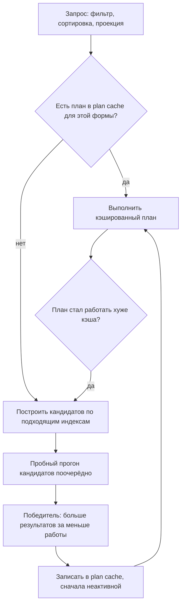

# 04. Индексы и explain()

**Зачем это знать backend-разработчику.** Почти каждая жалоба «MongoDB тормозит» заканчивается одной из двух фраз: «нет подходящего индекса» или «индекс есть, но поля в нём не в том порядке». Отличить одно от другого и доказать, что исправление сработало, позволяет только `explain()`. А у каждого индекса есть цена: он замедляет запись и занимает кэш.

> **Коротко:** индекс MongoDB — B-дерево, где ключ — значения полей, а значение — ссылка на документ. Порядок полей составного индекса подбирают по правилу ESR: сначала равенство, потом сортировка, потом диапазон; в замере это 195 просмотренных ключей вместо 2000 и никакой сортировки в памяти. Multikey-индекс разворачивает массив в ключи, но в составном индексе массивом может быть только одно поле. Главные цифры `explain('executionStats')` — `nReturned`, `totalKeysExamined`, `totalDocsExamined` и наличие стадий `SORT` или `COLLSCAN`.

Выводы сняты на пробном контейнере `mongo:8.0` (сервер 8.0.32, replica set из одного узла). Основной стенд — коллекция `guide.orders` из 100 000 заказов: `status` одно из пяти значений по кругу, `amount = (i·37) mod 1000`, `createdAt` — минута за минутой, `customerId = i mod 5000`.

## Оглавление

- [Индекс и explain(): как читать план](#индекс-и-explain-как-читать-план)
- [Составной индекс и правило ESR](#составной-индекс-и-правило-esr)
- [Покрывающие запросы](#покрывающие-запросы)
- [Multikey-индексы](#multikey-индексы)
- [Уникальные и частичные индексы](#уникальные-и-частичные-индексы)
- [TTL-индексы](#ttl-индексы)
- [Wildcard, text и 2dsphere](#wildcard-text-и-2dsphere)
- [Скрытые индексы и пересечение индексов](#скрытые-индексы-и-пересечение-индексов)
- [Цена индекса на запись](#цена-индекса-на-запись)
- [🔬 Глубже: как планировщик выбирает план и что такое SBE](#-глубже-как-планировщик-выбирает-план-и-что-такое-sbe)
- [Практика в репозитории](#практика-в-репозитории)
- [Типичные ошибки и заблуждения](#типичные-ошибки-и-заблуждения)
- [Итоги](#итоги)
- [Вопросы для самопроверки](#вопросы-для-самопроверки)
- [Источники](#источники)

## Индекс и explain(): как читать план

**На пальцах** (аналогия). Индекс — предметный указатель в конце учебника: термины по алфавиту, у каждого номера страниц. Без указателя ищут, листая книгу целиком. `explain()` — отчёт помощника: сколько строк указателя он прочитал, сколько страниц открыл и сколько нужного нашёл.

**Индекс** (index) — отдельное B-дерево WiredTiger ([02](02-wiredtiger.md#b-дерево-страницы-на-диске-и-в-памяти)), в котором ключ — закодированные значения полей, а значение — RecordId документа. Ключи упорядочены, поэтому индекс обслуживает равенство, диапазон и сортировку. **`explain()`** — команда, которая показывает выбранный план запроса (**winning plan**) и отвергнутые (**rejected plans**). Режим `queryPlanner` только строит план, `executionStats` ещё и выполняет его со счётчиками, `allPlansExecution` добавляет счётчики пробного прогона всех кандидатов.

План — дерево **стадий** (stages), каждая отдаёт документы родителю:

| Стадия | Что делает | Хорошо или плохо |
|---|---|---|
| `COLLSCAN` | читает всю коллекцию | плохо на больших коллекциях |
| `IXSCAN` | идёт по диапазону ключей индекса | хорошо, смотрите `indexBounds` |
| `FETCH` | по RecordId достаёт документ | нормально, если документов мало |
| `SORT` | сортирует в памяти (до 100 МБ, дальше на диск) | признак неудачного индекса |
| `PROJECTION_COVERED` | отдаёт поля прямо из индекса | лучший случай |
| `LIMIT`, `SORT_MERGE` | обрезка; слияние отсортированных потоков | нормально |

Три числа из `executionStats` решают почти всё: **`nReturned`** (сколько вернули), **`totalKeysExamined`** (сколько ключей индекса просмотрели), **`totalDocsExamined`** (сколько документов прочитали). Идеал — все три равны. Запрос на 20 новых заказов с суммой от 900 без индекса:

```text
guide> db.orders.find({status: 'NEW', amount: {$gte: 900}}).sort({createdAt: -1}).limit(20)
         .explain('executionStats')
SORT <- COLLSCAN   nReturned 20, totalKeysExamined 0, totalDocsExamined 100000, executionTimeMillis 38
```

Прочитано 100 000 документов ради 20. Здесь и дальше цепочка стадий выписана из `winningPlan` от корня к листу; полный вывод — вложенный JSON (пример ниже). Лимит памяти сортировки на образе — `internalQueryMaxBlockingSortMemoryUsageBytes: 104857600` (100 МБ); `allowDiskUseByDefault: true`, поэтому большой `SORT` не падает, а уходит на диск — тихо и медленно.

В Java план берут у того же `FindIterable` (driver-sync 5.8.1, проверено `javap`):

```java
Document plan = orders.find(and(eq("status", "NEW"), gte("amount", 900)))
        .sort(descending("createdAt")).limit(20)
        .explain(ExplainVerbosity.EXECUTION_STATS);
Document stats = plan.get("executionStats", Document.class);
int keys = stats.getInteger("totalKeysExamined");
int docs = stats.getInteger("totalDocsExamined");
// в тестах: assertThat(docs).isLessThanOrEqualTo(stats.getInteger("nReturned"))
```

## Составной индекс и правило ESR

**На пальцах** (аналогия). Телефонный справочник отсортирован по фамилии, потом по имени. Найти всех «Ивановых» и выписать их по имени — легко: они подряд и уже в нужном порядке. Найти всех с именем «Анна» — придётся листать весь справочник.

**Составной индекс** (compound index) — индекс по нескольким полям, упорядоченный сначала по первому, внутри — по второму и так далее. Отсюда **правило префикса**: индекс `{a, b, c}` обслуживает запросы по `a`, по `a, b` и по `a, b, c`, но не по одному `b`. **Правило ESR** (Equality, Sort, Range) говорит, в каком порядке ставить поля: сначала поля с **равенством**, затем поля **сортировки**, затем **диапазоны**.

Проверим на запросе выше: равенство `status`, сортировка `createdAt`, диапазон `amount`. Создаём два индекса с разным порядком:

```text
guide> db.orders.createIndex({status: 1, amount: 1, createdAt: -1}, {name: 'ERS'})
guide> db.orders.createIndex({status: 1, createdAt: -1, amount: 1}, {name: 'ESR'})
```

| Индекс | План | Ключей | Документов | Найдено | Время |
|---|---|---|---|---|---|
| нет | `SORT <- COLLSCAN` | 0 | 100 000 | 20 | 38 мс |
| ERS | `FETCH <- SORT <- IXSCAN(ERS)` | 2000 | 20 | 20 | 2 мс |
| ESR | `LIMIT <- FETCH <- IXSCAN(ESR)` | 195 | 20 | 20 | 1 мс |

Почему так. В ERS внутри `status = 'NEW'` ключи упорядочены по `amount`, поэтому сервер честно выбирает все 2000 заказов с суммой от 900 (20 значений суммы × 100 заказов) и сортирует их в памяти по дате, чтобы оставить 20. В ESR внутри `NEW` ключи уже идут по убыванию даты. Сервер идёт по ним, отбрасывает ключи с суммой меньше 900 прямо в индексе и останавливается на двадцатом подходящем. Стадии `SORT` нет вообще. Вот как это выглядит в полном выводе:

```text
      stage: 'IXSCAN',
      nReturned: 20,
      keyPattern: { status: 1, createdAt: -1, amount: 1 },
      indexName: 'ESR',
      isMultiKey: false,
      indexBounds: {
        status: [ '["NEW", "NEW"]' ],
        createdAt: [ '[MaxKey, MinKey]' ],
        amount: [ '[900, inf.0]' ]
      },
      keysExamined: 195,
      seeks: 176,
```

`createdAt: [MaxKey, MinKey]` — весь диапазон дат в обратном порядке, `amount: [900, inf.0]` — граница проверяется на каждом ключе. `seeks: 176` — сколько раз сервер «перепрыгнул» по дереву через неподходящие суммы вместо последовательного чтения. Когда оба индекса существуют, планировщик сам выбрал ESR (`rejectedPlans` — 1 план).

Если равенство превращается в `$in`, ESR всё ещё работает, но иначе: для `status: {$in: ['NEW', 'PAID']}` план стал `LIMIT <- FETCH <- SORT_MERGE <- [IXSCAN(ESR) | IXSCAN(ESR)]` и просмотрел 217 ключей. Сервер сканирует два отсортированных потока и сливает их, а не сортирует. Сортировать по полю после диапазона ESR не может — поэтому S стоит раньше R.

```java
orders.createIndex(Indexes.compoundIndex(
        Indexes.ascending("status"), Indexes.descending("createdAt"), Indexes.ascending("amount")),
        new IndexOptions().name("ESR"));
```

В Spring Data MongoDB 5.1.1 тот же индекс объявляют аннотацией `@CompoundIndex(name = "ESR", def = "{'status': 1, 'createdAt': -1, 'amount': 1}")` на классе `@Document`. Автоматическое создание индексов по аннотациям по умолчанию выключено (`MongoMappingContext.isAutoIndexCreation()` — `false`, проверено по байткоду 5.1.1), поэтому в проде индексы чаще создают явно при старте или миграцией. Упражнение — [задание 02](../tasks/02-esr-indexes.md).

## Покрывающие запросы

**На пальцах** (аналогия). Чтобы узнать, на какой странице термин, не нужно открывать саму страницу — номер написан в указателе.

**Покрывающий запрос** (covered query) — запрос, все поля фильтра, сортировки и проекции которого есть в индексе. Сервер отвечает из индекса и не читает документы. Ловушка — `_id`: он попадает в результат по умолчанию, а в индексе ESR его нет.

```text
guide> db.orders.find({status: 'NEW', amount: {$gte: 900}}, {_id: 0, status: 1, createdAt: 1, amount: 1})
         .sort({createdAt: -1}).limit(20).explain('executionStats')
LIMIT <- PROJECTION_COVERED <- IXSCAN(ESR)          keys 195, docs 0
guide> ... тот же запрос с проекцией {status: 1, createdAt: 1, amount: 1}
LIMIT <- PROJECTION_SIMPLE <- FETCH <- IXSCAN(ESR)  keys 195, docs 20
```

`totalDocsExamined: 0` — ни одного документа не прочитано. Документация оговаривает, что индекс по массиву (multikey) не покрывает запросы по полю-массиву: в его ключе только один элемент, а не весь массив.

## Multikey-индексы

**На пальцах** (аналогия). Книга с тремя темами попадает в предметный указатель три раза — под каждой темой.

**Multikey-индекс** (multikey index) — индекс по полю, которое хотя бы в одном документе является массивом. Сервер создаёт ключ на каждый элемент и помечает индекс многоключевым сам, отдельной опции нет:

```text
guide> db.posts.insertMany([{_id: 1, tags: ['mongodb', 'java', 'index'], authors: ['ann', 'bob']},
                            {_id: 2, tags: ['redis'], authors: ['ann']}, {_id: 3, tags: ['mongodb'], authors: 'cid'}])
guide> db.posts.createIndex({tags: 1})
guide> db.posts.find({tags: 'mongodb'}).explain('executionStats')
IXSCAN  isMultiKey: true, multiKeyPaths: {"tags":["tags"]}   nReturned 2, keys 2, docs 2
guide> db.posts.validate({full: true}).keysPerIndex
{"_id_":3,"tags_1":5}        // 3 документа, 5 ключей: 3 + 1 + 1
```

Одинаковые значения внутри одного документа дают один ключ: в главе [03](03-data-modeling.md#антипаттерны) индекс `events.k` на массиве из 100 000 событий двух видов содержал 3 ключа, а индекс `events.t` с уникальными значениями — 100 500.

Главное ограничение: **в составном multikey-индексе массивом может быть не больше одного поля** в каждом документе. Иначе ключей было бы декартово произведение элементов:

```text
guide> db.posts.createIndex({tags: 1, authors: 1})       // у документа 1 оба поля — массивы
MongoServerError: Index build failed: ... cannot index parallel arrays [authors] [tags]  (code 171)
guide> db.posts2.createIndex({tags: 1, author: 1})       // пока author — строка, индекс создаётся
tags_1_author_1
guide> db.posts2.insertOne({_id: 2, tags: ['a', 'b'], author: ['ann', 'bob']})
MongoServerError: cannot index parallel arrays [author] [tags]  (code 171)
```

Второй случай опаснее: падает обычная вставка в проде. Ещё одна тонкость — запрос по двум полям элементов массива: без `$elemMatch` границы второго поля не сужаются (замер с `attributes.k`/`attributes.v` в [03](03-data-modeling.md#паттерны-polymorphic-и-attribute)).

## Уникальные и частичные индексы

**На пальцах** (аналогия). Уникальный индекс — гардероб, где на номерок вешают одно пальто. Частичный — указатель только по главам, отмеченным звёздочкой: он тоньше, но про остальные главы ничего не знает.

**Уникальный индекс** (unique index) отвергает второй документ с тем же ключом. Отсутствующее поле индексируется как `null`, поэтому второй документ без поля тоже дубликат:

```text
guide> db.users.createIndex({email: 1}, {unique: true})
guide> db.users.insertOne({_id: 2, email: 'ann@example.com'})
MongoServerError: E11000 duplicate key error collection: guide.users index: email_1 dup key: { email: "ann@example.com" }
guide> db.users.insertOne({_id: 4})           // документ _id 3 без email уже есть
MongoServerError: E11000 duplicate key error collection: guide.users index: email_1 dup key: { email: null }
guide> db.users.dropIndex('email_1')       // иначе конфликт имени и тот же E11000
{ nIndexesWas: 2, ok: 1 }
guide> db.users.createIndex({email: 1}, {unique: true, partialFilterExpression: {email: {$exists: true}}})
guide> db.users.insertOne({_id: 5})
{ acknowledged: true, insertedId: 5 }
```

**Частичный индекс** (partial index) содержит только документы, подходящие под `partialFilterExpression`. Индекс активных заказов клиента:

```text
guide> db.orders.createIndex({customerId: 1, createdAt: -1},
         {name: 'active_by_customer', partialFilterExpression: {status: {$in: ['NEW', 'PAID']}}})
guide> db.orders.find({customerId: 40, status: 'NEW'}).sort({createdAt: -1})       // есть условие фильтра
FETCH <- IXSCAN(active_by_customer)   nReturned 20, keys 20, docs 20
guide> db.orders.find({customerId: 40}).sort({createdAt: -1})                      // нет условия
SORT <- COLLSCAN   nReturned 20, keys 0, docs 100000
```

Индекс занимает 495 616 байт и держит 40 % заказов. Но планировщик возьмёт его, только если из запроса **следует** условие индекса: без `status` сервер не может доказать, что все нужные документы в индексе, и сканирует коллекцию. В Java: `new IndexOptions().unique(true).partialFilterExpression(Filters.exists("email"))`. Частичный индекс удобен и в полиморфной коллекции — индекс по полю одного вида ([03](03-data-modeling.md#паттерны-polymorphic-и-attribute)).

## TTL-индексы

**На пальцах** (аналогия). Продавец обходит полки раз в час и убирает просроченное молоко; пакет, истёкший пять минут назад, ещё может стоять на полке.

**TTL-индекс** (time to live) — индекс по одному полю-дате с опцией `expireAfterSeconds`; фоновый **TTL monitor** периодически удаляет документы, у которых `поле + expireAfterSeconds` в прошлом. Интервал обхода на образе:

```text
guide> db.adminCommand({getParameter: 1, ttlMonitorSleepSecs: 1, ttlMonitorEnabled: 1})
{ ttlMonitorEnabled: true, ttlMonitorSleepSecs: 60, ok: 1 }
```

Эксперимент: TTL 30 секунд на `createdAt` и индекс `{expireAt: 1}` с `expireAfterSeconds: 0` (срок задаётся прямо в документе):

| Время | Что в коллекции |
|---|---|
| 14:40:29 | вставлены `old` (час назад), `fresh` (сейчас), `str` (дата строкой `'2020-01-01'`), `exp` (`expireAt` в прошлом) |
| 14:41:33 | остались `fresh` и `str`; `metrics.ttl.deletedDocuments: 2` |
| 14:44:02 | остался только `str` |

Через 64 секунды `fresh` был старше 30 секунд, но ещё жил: удаление происходит на ближайшем проходе монитора, а не в момент истечения. Документ `str` не удалится никогда — TTL работает только с датой (или массивом дат, тогда по самой ранней). TTL — уборка, а не бизнес-логика: «сессия истекла» приложение проверяет само (`expireAt > now`).

```java
sessions.createIndex(Indexes.ascending("createdAt"),
        new IndexOptions().expireAfter(30L, TimeUnit.MINUTES));    // expireAfter(Long, TimeUnit)
sessions.createIndex(Indexes.ascending("expireAt"),
        new IndexOptions().expireAfter(0L, TimeUnit.SECONDS));     // срок в самом документе
```

В Spring Data — `@Indexed(expireAfterSeconds = 1800)` на поле. Удаления выполняет primary и реплицирует как обычные `delete` — массовое истечение нагружает запись и oplog. У time-series коллекций свой `expireAfterSeconds`, удаляющий корзины целиком ([задание 06](../tasks/06-iot-telemetry.md)).

## Wildcard, text и 2dsphere

**На пальцах** (аналогия). Wildcard — указатель «по всему, что встретится», text — алфавитный указатель слов с учётом их форм, 2dsphere — карта с сеткой квадратов, по которой ищут «что рядом».

**Wildcard-индекс** (wildcard index) индексирует все поля под путём — для документов, где набор полей заранее неизвестен:

```text
guide> db.products.createIndex({'specs.$**': 1})
guide> db.products.find({'specs.ramGb': {$gte: 16}}).explain('executionStats')
FETCH <- IXSCAN(specs.$**_1)  keyPattern {"$_path":1,"specs.ramGb":1}
  indexBounds {"$_path":["[\"specs.ramGb\", \"specs.ramGb\"]"],"specs.ramGb":["[16, inf.0]"]}  keys 1, docs 1
guide> db.products.find({'specs.color': 'white'}).sort({name: 1})
SORT <- FETCH <- IXSCAN(specs.$**_1)
```

Ключ — пара «путь, значение»: 3 товара дали 8 ключей. Wildcard хорош для фильтра по произвольному полю, но не сортирует по другим. На 8.0 доступны и составные wildcard-индексы: `createIndex({type: 1, 'specs.$**': 1})` создался. Для заранее известных характеристик чаще лучше паттерн attribute.

**Text-индекс** (text index) разбивает строки на слова со стеммингом (stemming, приведение к основе) и стоп-словами для языка:

```text
guide> db.articles.createIndex({title: 'text', body: 'text'}, {default_language: 'russian', weights: {title: 5}})
guide> db.articles.find({$text: {$search: 'индексы'}}, {score: {$meta: 'textScore'}, title: 1})
         .sort({score: {$meta: 'textScore'}})
[ { _id: 1, title: 'Индексы в MongoDB', score: 4.375 },
  { _id: 2, title: 'Кэш WiredTiger', score: 0.625 } ]     // нашлось «индекс» в body
guide> db.articles.createIndex({title: 'text'}, {name: 'second_text'})
MongoServerError: An equivalent index already exists with a different name and options. ...  (code 85)
```

Text-индекс на коллекции один (документированный лимит; ключ любого из них — `{_fts: 'text', _ftsx: 1}`, отсюда code 85). Продвинутая релевантность, опечатки (fuzzy), подсветка — это **Atlas Search**, которого на `mongo:8.0` нет ([10](10-change-streams-java.md)).

**2dsphere** индексирует GeoJSON на сфере. Координаты — `[долгота, широта]`, именно в этом порядке:

```text
guide> db.shops.createIndex({loc: '2dsphere'})
guide> db.shops.aggregate([{$geoNear: {near: {type: 'Point', coordinates: [37.6173, 55.7558]},
         distanceField: 'meters', maxDistance: 5000}}, {$project: {_id: 0, name: 1, meters: {$round: ['$meters', 0]}}}])
[ { name: 'Тверская', meters: 1282 }, { name: 'Арбат', meters: 1701 } ]          // Химки дальше 5 км
guide> db.shops.insertOne({_id: 4, name: 'bad', loc: {type: 'Point', coordinates: [200, 95]}})
MongoServerError: Can't extract geo keys: ... Longitude/latitude is out of bounds, lng: 200 lat: 95  (code 16755)
```

План `$near` — `GEO_NEAR_2DSPHERE`, который обходит ячейки сетки кольцами от центра. В Java: `Indexes.geo2dsphere("loc")`, `Filters.near("loc", point, 5000.0, null)`.

## Скрытые индексы и пересечение индексов

**На пальцах** (аналогия). Скрытый индекс — указатель, который убрали в шкаф, но продолжают пополнять: если без него стало плохо, его достают за секунду, а не пишут заново.

**Скрытый индекс** (hidden index) не используется планировщиком, но поддерживается при каждой записи (и уникальность продолжает проверяться). Так безопасно проверяют, нужен ли индекс, перед удалением:

```text
guide> db.orders.hideIndex('ESR')
guide> db.orders.find({status: 'NEW', amount: {$gte: 900}}).sort({createdAt: -1}).limit(20).explain('executionStats')
FETCH <- SORT <- IXSCAN(ERS)   keys 2000, docs 20
guide> db.orders.getIndexes().filter(i => i.name == 'ESR')
[ { v: 2, key: { status: 1, createdAt: -1, amount: 1 }, name: 'ESR', hidden: true } ]
guide> db.orders.unhideIndex('ESR')
```

Перестроение большого индекса — минуты и часы, `unhideIndex` — мгновенно. Кандидатов на удаление ищут через `$indexStats` (счётчик `accesses.ops` на этом узле с его старта — проверяйте каждого члена replica set).

**Пересечение индексов** (index intersection) — план, который сканирует два индекса и пересекает RecordId. Он существует, но выигрывает редко:

```text
guide> db.inter.createIndex({a: 1}); db.inter.createIndex({b: 1})     // 50 000 документов
guide> db.inter.find({a: 7, b: 7}).explain('allPlansExecution')
winner:   FETCH <- IXSCAN(b_1)                                  nReturned 100, keys 200, docs 200
rejected: FETCH <- IXSCAN(a_1) || FETCH <- AND_SORTED <- [IXSCAN(a_1) | IXSCAN(b_1)]
guide> db.inter.createIndex({a: 1, b: 1}); db.inter.find({a: 7, b: 7})...
FETCH <- IXSCAN(a_1_b_1)                                        nReturned 100, keys 100, docs 100
```

На образе `internalQueryPlannerEnableIndexIntersection: true`, но `internalQueryPlannerEnableHashIntersection: false`: пересечение через хеш-таблицу выключено, остаётся `AND_SORTED` для точных равенств. Вывод: два одиночных индекса — не замена составному.

## Цена индекса на запись

**На пальцах** (аналогия). Новая книга в библиотеке — это ещё и карточка в каждом каталоге. Чем больше каталогов, тем дольше принимать книгу.

Каждая вставка добавляет ключ в каждый индекс, каждое обновление индексированного поля — удаляет старый ключ и вставляет новый. Замер: 100 000 документов по 6 полей, вставка пачками по 1000, медиана трёх прогонов:

| Вторичных индексов | Время вставки | `totalIndexSize` | Данные (`size`) |
|---|---|---|---|
| 0 (только `_id`) | 1345 мс | 3 194 880 | 10 177 560 |
| 3 | 1607 мс (+19 %) | 10 121 216 | 10 177 560 |
| 6 | 2152 мс (+60 %) | 19 079 168 | 10 177 560 |

При шести индексах сами индексы почти вдвое больше данных — и всё это претендует на кэш WiredTiger ([02](02-wiredtiger.md#кэш-wiredtiger)). Рабочее правило: индекс под каждый частый запрос, ни одного «на всякий случай»; на коллекции не больше 64 индексов (на пробе 65-й, считая `_id`, отвергнут с `too many indexes`, code 67).

## 🔬 Глубже: как планировщик выбирает план и что такое SBE



Когда для запроса подходит несколько индексов, **планировщик** (query planner) строит планы-кандидаты (до `internalQueryPlannerMaxIndexedSolutions: 64`) и запускает их по очереди мелкими шагами — **works**. Пробный прогон кончается, когда какой-то план вернул `internalQueryPlanEvaluationMaxResults: 101` документ или кандидаты потратили `max(10000, 0.3 × число документов)` шагов (`internalQueryPlanEvaluationWorks`, `internalQueryPlanEvaluationCollFraction`; на 100 000 заказов это 30 000) — все значения сняты `getParameter` на образе. Побеждает план с лучшим соотношением результата и работы, и он попадает в **plan cache** по **форме запроса** (query shape: структура без конкретных значений):

```text
guide> db.orders.aggregate([{$planCacheStats: {}}])
[ { planCacheShapeHash: '677F3991', planCacheKey: '5F1279B2', isActive: true, works: Long('195'),
    cachedPlan: { inputStage: { inputStage: { indexName: 'ESR' } } } } ]      // вывод сокращён проекцией
```

`works: 195` совпадает с числом ключей ESR. Новая запись сначала неактивна и становится активной при повторном запросе той же формы (на пробе `isActive: false`, затем `true`). Если кэшированный план не уложился в 10 × works из кэша (`internalQueryCacheEvictionRatio: 10`), запись вытесняется и отбор повторяется. Отсюда «запрос иногда медленный»: план формы хорош для одних значений и плох для других.

**SBE** (slot-based execution engine) — новый исполнитель запросов. На 8.0 `internalQueryFrameworkControl: 'trySbeRestricted'`: SBE включается для запросов с `$group`, `$lookup` и некоторыми другими стадиями, простой `find` идёт классическим движком. Это видно по `explainVersion`:

```text
guide> db.orders.find({status: 'NEW'}).explain().explainVersion
1
guide> db.orders.explain('executionStats').aggregate([{$match: {status: 'NEW'}},
         {$group: {_id: '$customerId', total: {$sum: '$amount'}}}])
explainVersion: '2', winningPlan: { isCached, queryPlan, slotBasedPlan }
queryPlan: GROUP <- FETCH <- IXSCAN(ERS)
slotBasedPlan.stages: "[4] project [s14 = newBsonObj(\"_id\", s11, \"total\", s13)] \n[4] project [s13 = doubleDoubleSumFinalize(s12)] \n[4] group [s11] [s12 = aggDoubleDoubleSum(s8)] ..."
```

В версии 2 `queryPlan` — привычное дерево стадий, а `slotBasedPlan` — низкоуровневая программа SBE со «слотами» `s1, s2…`. Счётчики `totalKeysExamined`/`totalDocsExamined` есть в обоих форматах. Аналогично `$lookup` в SBE превращается в стадию `EQ_LOOKUP` со стратегией `IndexedLoopJoin` ([03](03-data-modeling.md#паттерн-extended-reference)).

## Практика в репозитории

- [Задание 02](../tasks/02-esr-indexes.md) — порядок полей по ESR и проверка `explain()`: `IXSCAN` без `SORT` и `totalDocsExamined` не больше `nReturned + limit`.
- [Задание 01](../tasks/01-catalog-polymorphic.md) — составной multikey-индекс `attributes_k_v` и запрос через `$elemMatch`.
- [Задание 04](../tasks/04-comments-paging.md) — индекс под постраничное чтение по ключу вместо `skip`.
- [Задание 06](../tasks/06-iot-telemetry.md) — TTL для телеметрии и индексы time-series коллекции.
- [CrudDemo](../examples/src/main/java/dev/nosqlguide/mongodb/examples/driver/CrudDemo.java) — базовые операции, к которым подбираются индексы.
- Фон: [движки хранения и B-деревья](../../docs/00-foundations/07-storage-engines.md), [моделирование от запросов](../../docs/00-foundations/08-data-modeling.md).

## Типичные ошибки и заблуждения

1. **«`IXSCAN` в плане — значит, всё хорошо.»** Индекс ERS давал `IXSCAN`, но просматривал 2000 ключей и сортировал в памяти. Смотрите отношение `totalKeysExamined` к `nReturned` и наличие `SORT`.
2. **«Два одиночных индекса заменят составной.»** Пересечение индексов почти никогда не выигрывает: планировщик выбрал один индекс и дочитал 200 документов вместо 100.
3. **«Диапазон ставим перед сортировкой, он же сильнее фильтрует.»** После диапазона индекс уже не упорядочен по следующему полю, и появляется `SORT`. Порядок — ESR.
4. **«TTL удалит документ ровно в срок.»** Монитор проходит раз в 60 секунд и удаляет пачками; строка вместо даты не удалится никогда.
5. **«Уникальный индекс по необязательному полю разрешит много документов без поля.»** Отсутствие поля — это `null`, и второй такой документ получит E11000. Нужен частичный уникальный индекс.
6. **«Скрытый индекс ничего не стоит.»** Он поддерживается на каждой записи; скрывают временно, чтобы безопасно проверить удаление.

## Итоги

- Индекс — B-дерево по значениям полей; план читают через `explain('executionStats')`: `nReturned`, `totalKeysExamined`, `totalDocsExamined`, стадии `COLLSCAN` и `SORT`.
- ESR — равенство, сортировка, диапазон: на стенде 195 ключей и ни одной сортировки против 2000 ключей и `SORT`.
- Покрывающий запрос отвечает из индекса (`PROJECTION_COVERED`, 0 документов), если исключить `_id` или включить его в индекс.
- Multikey-индекс — ключ на каждый различный элемент массива; в составном индексе массивом может быть только одно поле.
- Частичный индекс используется, только если из запроса следует его фильтр; уникальный по необязательному полю делают частичным.
- TTL удаляет на проходе монитора раз в 60 секунд; wildcard, text (один на коллекцию) и 2dsphere решают частные задачи.
- Каждый индекс стоит на записи (+60 % времени вставки при шести) и в кэше; лишний сначала скрывают, потом удаляют.

## Вопросы для самопроверки

1. Запрос `find({userId: X, createdAt: {$gte: D}}).sort({score: -1})`. Какой индекс построить?
   <details><summary>Ответ</summary>По ESR: `{userId: 1, score: -1, createdAt: 1}`. Равенство, затем сортировка, затем диапазон — тогда план идёт по индексу в нужном порядке без стадии `SORT`.</details>
2. В плане `IXSCAN`, `nReturned: 20`, `totalKeysExamined: 2000`, `totalDocsExamined: 20`, есть `SORT`. Что не так?
   <details><summary>Ответ</summary>Индекс фильтрует, но не даёт порядок: сервер выбирает 2000 ключей и сортирует в памяти. Обычно это диапазон перед полем сортировки; переставить поля по ESR.</details>
3. Почему запрос с проекцией `{status: 1, amount: 1}` не стал покрывающим, хотя оба поля в индексе?
   <details><summary>Ответ</summary>`_id` возвращается по умолчанию, а в индексе его нет — нужен `FETCH`. Добавьте `_id: 0` в проекцию.</details>
4. Индекс `{tags: 1, author: 1}` создан успешно, а через месяц вставки стали падать с code 171. Почему?
   <details><summary>Ответ</summary>Появились документы, где `author` тоже массив. Составной multikey-индекс допускает массив только в одном поле документа (`cannot index parallel arrays`).</details>
5. Частичный индекс с фильтром `status: {$in: ['NEW', 'PAID']}` не используется запросом `{customerId: 40}`. Почему?
   <details><summary>Ответ</summary>Из запроса не следует фильтр индекса: подходящие документы могут иметь другой статус и в индексе отсутствовать. Нужно добавить в запрос условие по `status`, покрытое фильтром.</details>
6. Как безопасно проверить, что индекс не нужен, перед удалением?
   <details><summary>Ответ</summary>Посмотреть `$indexStats`, затем `hideIndex` и понаблюдать за планами и задержками. Если стало хуже — `unhideIndex` мгновенно, без перестроения.</details>
7. Чем отличаются `explainVersion: '1'` и `'2'`?
   <details><summary>Ответ</summary>1 — классический движок (простой `find`), 2 — SBE: в `winningPlan` есть `queryPlan` и `slotBasedPlan`.</details>

## Источники

- MongoDB Manual 8.0: *Indexes* (*Compound*, *Multikey*, *Text*, *Wildcard*, *2dsphere*, *Unique*, *Partial*, *TTL*, *Hidden*), *Index Properties*. https://www.mongodb.com/docs/manual/indexes/
- MongoDB Manual: *The ESR (Equality, Sort, Range) Guideline*, *Query Plans*, *Explain Results*, *Analyze Query Performance*, *Plan Cache*, `$planCacheStats`, `$indexStats`. https://www.mongodb.com/docs/manual/tutorial/equality-sort-range-guideline/ , https://www.mongodb.com/docs/manual/reference/explain-results/
- MongoDB Manual: *Slot-Based Query Execution Engine*, параметры `internalQueryFrameworkControl`, `ttlMonitorSleepSecs`, `internalQueryMaxBlockingSortMemoryUsageBytes`. https://www.mongodb.com/docs/manual/reference/parameters/
- Исходный код планировщика: https://github.com/mongodb/mongo (`src/mongo/db/query`).
- MongoDB Java Driver 5.8.1 и Spring Data MongoDB 5.1.1 (проверено `javap`): `Indexes.compoundIndex/geo2dsphere/text`, `IndexOptions.unique/partialFilterExpression/expireAfter/hidden/collation/wildcardProjection`, `FindIterable.explain(ExplainVerbosity)`, `@CompoundIndex(def, partialFilter, collation)`, `@Indexed(expireAfterSeconds)`.
- Все выводы сняты на образе `mongo:8.0` (сервер 8.0.32), replica set из одного узла.

---

← [03. Моделирование данных](03-data-modeling.md) | [оглавление](README.md) | [05. Aggregation Pipeline](05-aggregation.md) → | [словарь терминов](glossary.md)
