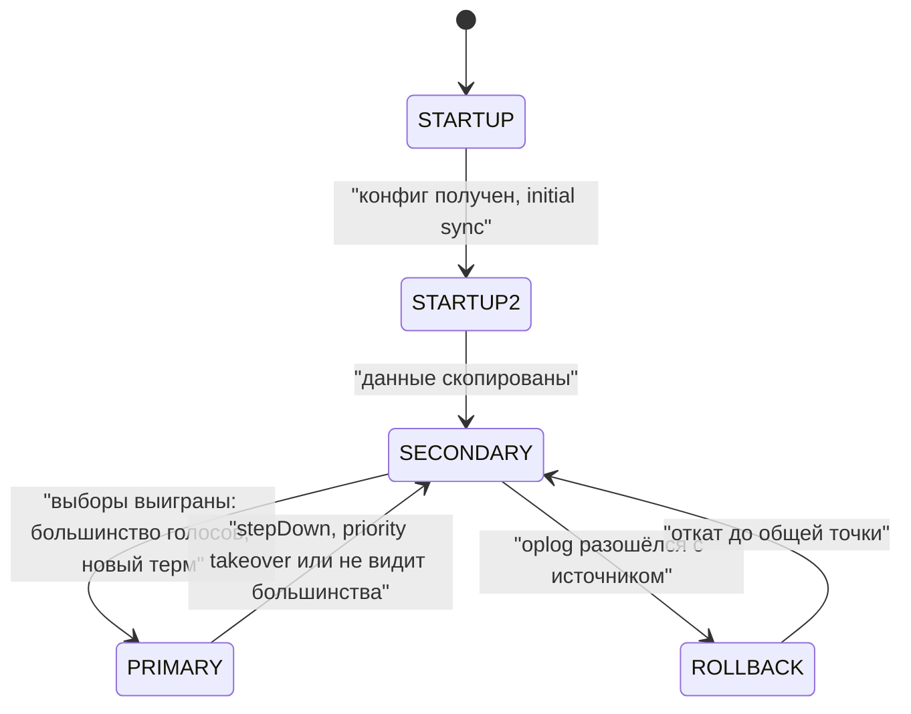

# 06. Replica set: выборы, oplog, rollback

**Зачем это знать backend-разработчику.** В продакшене MongoDB почти всегда работает как replica set, и приложение регулярно переживает смену primary: обновление, перезагрузка узла, сбой сети. Сколько секунд записи недоступны и может ли подтверждённая запись исчезнуть — решает механика выборов, oplog и rollback. Общая теория — в основах ([04. Репликация](../../docs/00-foundations/04-replication.md), [06. Консенсус](../../docs/00-foundations/06-consensus-membership.md)); здесь — как это устроено в MongoDB 8.0 и что видно на живом кластере.

> **Коротко:** replica set — один primary и несколько secondary, которые сами забирают у него **oplog** — журнал идемпотентных операций. Узлы обмениваются heartbeat раз в 2 с; если primary молчит `electionTimeoutMillis` (10 с на образе), secondary начинает выборы по Raft-подобному протоколу pv1: термы, голоса большинства; побеждает кандидат, чей oplog не старее, чем у большинства. На пробном кластере после `kill` primary новый появился через 10,4 с, а после `replSetStepDown` — примерно через 30 мс. Записи, которые старый primary принял, но не передал большинству, при его возвращении откатываются (**rollback**) в файл; защищает от этого только `w: "majority"`.

## Оглавление

- [Участники и их роли](#участники-и-их-роли)
- [Heartbeat и обнаружение отказа](#heartbeat-и-обнаружение-отказа)
- [Выборы по протоколу pv1](#выборы-по-протоколу-pv1)
- [Приоритеты, stepDown и catchup](#приоритеты-stepdown-и-catchup)
- [Oplog: формат и идемпотентность](#oplog-формат-и-идемпотентность)
- [Размер и окно oplog](#размер-и-окно-oplog)
- [Initial sync](#initial-sync)
- [Rollback: когда подтверждённая запись исчезает](#rollback-когда-подтверждённая-запись-исчезает)
- [Арбитры, hidden и delayed](#арбитры-hidden-и-delayed)
- [Что делает драйвер Java](#что-делает-драйвер-java)
- [🔬 Глубже: чем pv1 отличается от учебного Raft](#-глубже-чем-pv1-отличается-от-учебного-raft)
- [Практика в репозитории](#практика-в-репозитории)
- [Типичные ошибки и заблуждения](#типичные-ошибки-и-заблуждения)
- [Итоги](#итоги)
- [Вопросы для самопроверки](#вопросы-для-самопроверки)
- [Источники](#источники)

## Участники и их роли

**На пальцах** (аналогия). Редакция газеты: главный редактор (primary) единственный принимает правки, корректоры (secondary) держат полные копии и переписывают каждую правку из его журнала. Пропал главный — корректоры голосуют, кто его заменит.

**Replica set** (набор реплик) — группа процессов `mongod` с одними данными. **Primary** принимает все записи. **Secondary** копирует данные и может обслуживать чтение, если клиент разрешил ([07](07-read-write-concerns.md)). Участников — до 50, голосующих — до 7.

Примеры главы сняты на пробном кластере `mongo:8.0` (8.0.32) из контейнеров `ma`, `mb`, `mc` в отдельной docker-сети; у `ma` — `priority: 2`. Конфигурация после `rs.initiate`:

```text
rs6 [direct: primary] test> rs.conf()   // выдержка
{ _id: 'rs6', version: 1, term: 1,
  members: [ { _id: 0, host: 'ma:27017', arbiterOnly: false, hidden: false, priority: 2, secondaryDelaySecs: Long('0'), votes: 1 },
             { _id: 1, host: 'mb:27017', ..., priority: 1, votes: 1 }, { _id: 2, host: 'mc:27017', ..., priority: 1, votes: 1 } ],
  protocolVersion: Long('1'),
  settings: { chainingAllowed: true, heartbeatIntervalMillis: 2000, heartbeatTimeoutSecs: 10,
              electionTimeoutMillis: 10000, catchUpTimeoutMillis: -1, catchUpTakeoverDelayMillis: 30000, ... } }
```

| Поле | Что значит |
|---|---|
| `priority` | желание быть primary; `0` — никогда |
| `votes` | 1 — голосует и входит в «большинство» |
| `hidden` | не виден клиентам в `hello`; требует `priority: 0` |
| `secondaryDelaySecs`, `arbiterOnly` | delayed-участник и арбитр, см. [ниже](#арбитры-hidden-и-delayed) |

**Большинство** (majority) считается от голосующих: из 3 — 2, из 5 — 3. Поэтому голосующих делают нечётное число: из 4 большинство — 3, и четвёртый узел устойчивости не добавляет.

## Heartbeat и обнаружение отказа

**На пальцах** (аналогия). Корректоры каждые две секунды окликают друг друга и главного: «ты здесь?». Молчит десять секунд — пропал.

**Heartbeat** — служебный запрос, который каждый участник шлёт каждому раз в `heartbeatIntervalMillis` (2000 мс на образе); в ответе — состояние, терм, позиция в oplog. Нет ответа `heartbeatTimeoutSecs` (10 с) — участник недоступен. Secondary, не видящий primary дольше `electionTimeoutMillis` (10 000 мс), начинает выборы. Primary, не видящий большинства, сам уходит в SECONDARY, чтобы не принимать записи, которые не станут majority.

Не путайте с **мониторингом драйвера**: драйвер сам опрашивает узлы командой `hello` раз в `heartbeatFrequency` (10 000 мс в 5.8.1, см. [драйвер](#что-делает-драйвер-java)), на выборы это не влияет.

## Выборы по протоколу pv1

**На пальцах** (аналогия). Кандидат объявляет: «Созыв номер 2, голосуйте за меня». В одном созыве каждый голосует один раз и только за того, чей журнал не старее его собственного. Набрал большинство — новый главный.

**Протокол версии 1** (protocol version 1, pv1) — Raft-подобный алгоритм. **Терм** (term) — номер «созыва», растёт с каждыми выборами. Кандидат увеличивает терм и просит голоса; участник голосует, если ещё не голосовал в этом терме и oplog кандидата не отстаёт от его собственного. Перед выборами кандидат проводит **dry run** — пробное голосование без увеличения терма. Raft разобран в [основах](../../docs/00-foundations/06-consensus-membership.md#raft-выборы-лидера-и-репликация-лога), отличия — в [🔬 Глубже](#-глубже-чем-pv1-отличается-от-учебного-raft).

Настоящие выборы: с `mb` раз в 250 мс печатается состояние, а в 14:55:30.18 primary `ma` убит `docker kill`:

```text
14:55:27.882 term=1 ma:PRIMARY mb:SECONDARY mc:SECONDARY
14:55:30.673 term=1 ma:(not reachable/healthy) mb:SECONDARY mc:SECONDARY
14:55:40.551 term=2 ma:(not reachable/healthy) mb:SECONDARY mc:PRIMARY
```

| Момент | Что произошло |
|---|---|
| 14:55:30.18 | процесс `ma` убит |
| 14:55:30.67 | `mb` видит `ma` недоступным: соединение отвергнуто сразу |
| до 14:55:40.51 | выборов нет: ждут `electionTimeoutMillis` с последнего контакта с primary |
| 14:55:40.51 | лог `mc`: `Starting an election, since we've seen no PRIMARY in election timeout period` |
| 14:55:40.52 | `Election succeeded, assuming primary role`, терм 2 |
| 14:55:40.64 | `wMajorityWriteAvailabilityDate` — majority-записи снова возможны |

Записи были недоступны около 10,4 с — это почти ровно `electionTimeoutMillis`, сами выборы заняли миллисекунды:

```text
rs6 [direct: primary] test> rs.status().electionCandidateMetrics   // на mc, выдержка
{ lastElectionReason: 'electionTimeout', electionTerm: Long('2'), numVotesNeeded: 2, priorityAtElection: 1,
  electionTimeoutMillis: Long('10000'), numCatchUpOps: Long('0'), newTermStartDate: ISODate('2026-10-19T14:55:40.539Z') }
```

`numVotesNeeded: 2` — большинство из трёх: свой голос и голос `mb` (у `mb` в `electionParticipantMetrics` — `votedForCandidate: true`). `electionId` в ответе `hello` нового primary — `ObjectId('7fffffff0000000000000002')` (был `...0001`): хвост совпадает с термом. Драйвер по нему отличает новый primary от старого, который ещё не узнал о новом терме. Выиграл `mc`, а не `mb`, потому что его таймер (рандомизированный, как в Raft) истёк первым.



## Приоритеты, stepDown и catchup

**На пальцах** (аналогия). Пока главный болел, его замещал корректор. Главный вернулся, догнал журнал и забрал кресло: у него выше «приоритет».

Запускаем `ma` снова, наблюдаем с `mc`:

```text
14:56:30.594 term=2 ma:(not reachable/healthy) mb:SECONDARY mc:PRIMARY
14:56:34.411 term=2 ma:SECONDARY mb:SECONDARY mc:PRIMARY
14:56:44.790 term=3 ma:PRIMARY mb:SECONDARY mc:SECONDARY
rs6 [direct: primary] test> rs.status().electionCandidateMetrics   // на ma, выдержка
{ lastElectionReason: 'priorityTakeover', electionTerm: Long('3'), numVotesNeeded: 2, priorityAtElection: 2 }
```

**Priority takeover** — участник с более высоким приоритетом, догнав primary, сам начинает выборы. Предсказуемость (primary в нужном дата-центре) стоит ещё одного переключения при каждом возвращении узла.

**`replSetStepDown`** (`rs.stepDown()`) — вежливая передача роли: primary перестаёт принимать записи, ждёт, пока secondary догонит, и просит его сразу начать выборы. На кластере из пяти участников (о нём ниже) Java-клиент вызвал `replSetStepDown` и сразу сделал вставку: новый primary появился примерно через 30 мс по событиям драйвера (`lastElectionReason: 'stepUpRequestSkipDryRun'`, терм 6), вставка с повтором заняла 38 мс (код — в [разделе про драйвер](#что-делает-драйвер-java)). Поэтому плановые работы делают через `stepDown`, а не остановкой primary.

**Catchup** (догоняние) — фаза после победы: новый primary дотягивает записи, которые есть у других участников и новее его собственных, и лишь потом принимает запись. `catchUpTimeoutMillis: -1` — ждать без ограничения, `catchUpTakeoverDelayMillis: 30000` — когда более свежий secondary может перехватить роль. В экспериментах `numCatchUpOps: 0`.

## Oplog: формат и идемпотентность

**На пальцах** (аналогия). В журнале записано не «прибавить 3», а «теперь здесь 7». Такую запись можно применить дважды — результат не изменится.

**Oplog** (operations log) — capped-коллекция `local.oplog.rs`: primary пишет туда описание изменения в той же транзакции движка, что и саму запись ([02](02-wiredtiger.md#журнал)), secondary читают и повторяют. Четыре операции на primary:

```text
rs6 [direct: primary] shop> db.stock.insertOne({_id: "sku-1", qty: 10})
rs6 [direct: primary] shop> db.stock.updateOne({_id: "sku-1"}, {$inc: {qty: -3}})
rs6 [direct: primary] shop> db.stock.insertMany([{_id: "sku-2", qty: 1}, {_id: "sku-3", qty: 1}])
rs6 [direct: primary] shop> db.stock.deleteMany({qty: 1})
rs6 [direct: primary] shop> db.getSiblingDB("local").oplog.rs.find({ns: "shop.stock"})   // запись update, выдержка
{ lsid: { id: UUID('f034afd7-...'), ... }, txnNumber: Long('2'),
  op: 'u', ns: 'shop.stock', ui: UUID('7250ba60-0d19-43c5-a626-fc198f2112cb'),
  o: { '$v': 2, diff: { u: { qty: 7 } } }, o2: { _id: 'sku-1' },
  stmtId: 0, ts: Timestamp({ t: 1792421690, i: 3 }), t: Long('1'), v: Long('2'), wall: ISODate('2026-10-19T14:54:50.982Z'), ... }
```

| Поле | Значение |
|---|---|
| `op` | `i` — insert, `u` — update, `d` — delete, `c` — команда, `n` — no-op |
| `ns`, `ui` | коллекция по имени и по UUID |
| `o`, `o2` | что сделать и с каким `_id` |
| `ts` | метка времени (секунды + счётчик), монотонный номер записи; вместе с `t` — **optime** |
| `t` | терм primary, сделавшего запись |
| `lsid`, `txnNumber`, `stmtId` | сессия retryable write: по ним сервер узнаёт повтор и не выполняет его дважды |

Главное — **идемпотентность** (idempotency): `$inc: {qty: -3}` записан как `diff: {u: {qty: 7}}` — «установить 7». Повторное применение даст те же 7, а не 4. По той же причине `deleteMany({qty: 1})` хранится не как фильтр, а как удаления конкретных `_id`:

```text
{ op: 'c', ns: 'admin.$cmd', o: { applyOps: [
    { op: 'd', ns: 'shop.stock', ui: UUID('7250ba60-...'), o: { _id: 'sku-3' } },
    { op: 'd', ns: 'shop.stock', ui: UUID('7250ba60-...'), o: { _id: 'sku-2' } } ] },
  ts: Timestamp({ t: 1792421691, i: 1 }), t: Long('1'), v: Long('2') }
```

`insertMany` тоже лёг одной записью `applyOps` с двумя `op: 'i'`. Следствие: `updateMany` по миллиону документов — миллион операций, съедающих окно oplog. Без записей primary раз в `periodicNoopIntervalSecs` (10 с на образе) пишет `op: 'n'` (`periodic noop`), чтобы optime и commit point двигались и на простаивающем наборе (на этом держатся лаг, causal reads, change streams).

## Размер и окно oplog

**На пальцах** (аналогия). Журнал — тетрадь фиксированной толщины; когда она кончается, старые страницы вырывают. Корректор, уехавший дольше, чем хватает тетради, нужной страницы не найдёт.

Oplog — capped-коллекция: при заполнении старые записи удаляются. **Окно oplog** (oplog window) — время между первой и последней записью: сколько secondary может отсутствовать и догнать без полной пересинхронизации.

```text
rs6 [direct: primary] test> rs.printReplicationInfo()   // выдержка
actual oplog size
'41945.469482421875 MB'
log length start to end
'60 secs (0.02 hrs)'
rs6 [direct: primary] test> rs.printSecondaryReplicationInfo()   // выдержка
source: mb:27017
{ syncedTo: 'Mon Oct 19 2026 14:54:51 GMT+0000 (Coordinated Universal Time)', replLag: '0 secs (0 hrs) behind the primary ' }
```

Размер по умолчанию — 5 % свободного места на диске (по документации — не меньше 990 МБ и не больше 50 ГБ). У тома в контейнере было 820 ГБ свободных, 5 % — те самые 41 945 МБ. Окно в 60 секунд — потому что кластеру минута от роду: окно определяет **скорость записи**, а не размер. 41 ГБ при 10 МБ/с oplog — около 70 минут, при массовой загрузке — минуты.

От окна зависит:

- secondary, отключённый дольше окна, становится stale: застревает в `RECOVERING`, и его надо вручную пересинхронизировать (очистить данные → initial sync);
- **change streams** возобновляются по resume token, только пока токен в окне ([10](10-change-streams-java.md), [задание 08](../tasks/08-outbox-change-streams.md));
- размер меняют на лету (`replSetResizeOplog`), а `oplogMinRetentionHours` не даёт удалять записи моложе заданного возраста.

## Initial sync

**На пальцах** (аналогия). Новый корректор сначала переписывает всю газету, а потом — всё, что поменялось, пока он переписывал.

**Initial sync** (начальная синхронизация) — как пустой участник получает данные: копирует коллекции с **источника синхронизации** (sync source), строит индексы, затем применяет oplog, накопившийся за время копирования. Всё это время участник в `STARTUP2`. Добавим пустой `me` после вставки 200 000 документов:

```text
rs6 [direct: primary] shop> rs.add({host: "me:27017"})   // затем опрос состояния me раз в 500 мс
14:59:21.178 STARTUP
14:59:21.682 STARTUP2
...
14:59:25.204 SECONDARY
# лог me, выдержка
"msg":"Initial sync status and statistics","attr":{"status":"successful","statistics":{"method":"logical",
"totalInitialSyncElapsedMillis":2233,"initialSyncAttempts":[{"durationMillis":1110,"status":"OK","syncSource":"ma:27017",...}],
"approxTotalDataSize":48201302,"approxTotalBytesCopied":48001402,...
```

48 МБ — за 2,2 с. Метод `logical` (`initialSyncMethod: 'logical'` на образе) — копирование документов запросами; копирование файлов (`fileCopyBased`) есть только в Enterprise. На терабайтах логический initial sync идёт часами, и всё это время у набора на одну здоровую копию меньше. Окно oplog должно быть заметно больше длительности initial sync, иначе новый участник не догонит источник.

## Rollback: когда подтверждённая запись исчезает

**На пальцах** (аналогия). Главного редактора отрезали от редакции, а он продолжал принимать правки; редакция тем временем выбрала нового. Вернувшись, старый вырезал правки, которых никто не видел, и сложил их в папку «отклонённое».

**Rollback** (откат) — отмена записей, которые участник применил, будучи primary, но которые не дошли до большинства до смены primary. Касается только записей, подтверждённых без `w: "majority"`. Эксперимент на трёх узлах, `ma` — primary:

```text
shop> db.orders.insertOne({_id: 1, status: "paid"}, {writeConcern: {w: "majority"}})   // до разрыва
# 14:57:33 docker network disconnect: ma отрезан от mb и mc
shop> db.hello().isWritablePrimary
true
shop> db.orders.insertOne({_id: 2, status: "paid", note: "w1 during partition"}, {writeConcern: {w: 1}})
{ acknowledged: true, insertedId: 2 }
shop> db.orders.insertOne({_id: 3, status: "paid", note: "majority during partition"},
                          {writeConcern: {w: "majority", wtimeout: 3000}})
// ошибка, codeName | message: WriteConcernFailed | waiting for replication timed out (code 64, errInfo.wtimeout: true)
shop> db.orders.countDocuments()
3
```

| Время | `ma` (отрезан) | `mb`, `mc` |
|---|---|---|
| 14:57:33–34 | ещё primary: `_id: 2` (`w: 1`) — успех, `_id: 3` (majority) — таймаут, но документ записан | не видят `ma` |
| 14:57:43.08 | `Can't see a majority of the set, relinquishing primary` | |
| 14:57:44.55 | | `mc` выигрывает выборы, терм 4; на него пишется `_id: 4` |
| 14:58:07 | сеть возвращена: `OplogStartMissing: the sync source's oplog and our oplog have diverged, going into rollback` | |
| 14:58:07.26–.62 | `ROLLBACK`: общая точка, `Rolling back to the stable timestamp`, `Operations reverted by rollback: insert: 2` | |

Состояние после возвращения:

```text
shop> db.orders.find()
[ { _id: 1, status: 'paid' }, { _id: 4, status: 'new', note: 'on new primary' } ]
$ bsondump /data/db/rollback/e6e5643d-5dae-43c4-a888-4f69629b23dc/removed.2026-10-19T14-58-07.0.bson
{"_id":{"$numberInt":"3"},"status":"paid","note":"majority during partition"}
{"_id":{"$numberInt":"2"},"status":"paid","note":"w1 during partition"}
```

1. **Запись с `w: 1` и `acknowledged: true` исчезла.** Клиент получил успех, а `_id: 2` есть только в rollback-файле; вернуть его — ручная работа.
2. **Таймаут `w: "majority"` не отменяет запись.** `_id: 3` был записан и откатился, а `_id: 1`, подтверждённый majority до разрыва, выжил. `wtimeout` значит лишь «не дождался подтверждения».

В 8.0 rollback идёт методом `recoverToStableTimestamp` (строка `Rollback using 'recoverToStableTimestamp' method` в логе): WiredTiger откатывает данные к последней стабильной (majority-committed) метке, участник доигрывает свой oplog до общей точки, обрезает расходящийся хвост (`Marking to truncate all oplog entries … greater than common point` в логе) и дальше тянет oplog нового primary. Подробнее о write concern — [07](07-read-write-concerns.md), практика — [задание 05](../tasks/05-checkout-transaction.md).

## Арбитры, hidden и delayed

**На пальцах** (аналогия). Арбитр — член комиссии, который голосует, но газету не хранит. Hidden — корректор в архиве: копия есть, читатели к нему не ходят. Delayed — корректор, который нарочно отстаёт: если кто-то стёр полосу, у него она ещё есть.

Расширим кластер до пяти: арбитр `md`, знакомый `me`, а `mc` сделаем скрытым с задержкой 60 с:

```text
rs6 [direct: primary] shop> rs.addArb("md:27017").ok
1
rs6 [direct: primary] shop> const c = rs.conf(); const m = c.members.find(x => x.host === "mc:27017")
rs6 [direct: primary] shop> m.priority = 0; m.hidden = true; m.secondaryDelaySecs = 60; c.version++; rs.reconfig(c).ok
1
rs6 [direct: primary] shop> db.hello().hosts
[ 'ma:27017', 'mb:27017', 'me:27017' ]
rs6 [direct: primary] shop> db.orders.insertOne({_id: "delayed-probe", at: new Date()})
# через 3 с, прямое подключение к mc
shop> db.orders.countDocuments({_id: "delayed-probe"})
0
```

`mc` пропал из `hosts`, которые видит драйвер, — чтения туда не пойдут. Свежего документа на нём ещё нет: `rs.printSecondaryReplicationInfo()` в этот момент показал у `mc` отставание 16 с, растущее к заданным 60.

| Тип | Данные | Голос | Зачем |
|---|---|---|---|
| **арбитр** (arbiter) | нет | да | дешёвый голос для нечётности |
| **hidden** (`priority: 0`) | да | по желанию | бэкапы, аналитика без влияния на чтения |
| **delayed** (`hidden`, `priority: 0`) | с задержкой | лучше `votes: 0` | защита от ошибочного `deleteMany` |

С арбитрами связан **неявный write concern по умолчанию** (implicit default write concern): сервер выводит его из конфигурации — `majority`, но `{w: 1}`, если есть арбитры, а голосующих участников с данными не больше, чем большинство голосующих. Попробуем удалить `mc` (сейчас 4 узла с данными + арбитр):

```text
rs6 [direct: primary] shop> rs.remove("mc:27017")
// ошибка, codeName | message: NewReplicaSetConfigurationIncompatible | Reconfig attempted to install a config that would change
the implicit default write concern. Use the setDefaultRWConcern command to set a cluster-wide write concern and try the reconfig again.
rs6 [direct: primary] shop> db.adminCommand({getDefaultRWConcern: 1})   // выдержка
{ defaultWriteConcern: { w: 'majority', wtimeout: 0 }, defaultWriteConcernSource: 'implicit' }
```

После удаления осталось бы 4 голосующих (большинство — 3), из них 3 с данными: 3 ≤ 3, и дефолт молча стал бы `w: 1`. Сервер отказался менять гарантию без явного решения. Классический PSA (primary + secondary + arbiter) по этой формуле живёт с `w: 1`, а при падении secondary majority-запись в нём невозможна — поэтому предпочитают три узла с данными.

## Что делает драйвер Java

**На пальцах** (аналогия). Курьер сам следит, кто сейчас главный редактор, и если отнёс правку не тому, один раз переносит её новому.

Выборы, oplog и rollback — работа сервера. Драйвер 5.8.1 только мониторит топологию, выбирает узел и повторяет операцию при переключении. Код эксперимента со `stepDown`:

```java
MongoClientSettings settings = MongoClientSettings.builder()
        .applyConnectionString(new ConnectionString("mongodb://ma:27017,mb:27017/?replicaSet=rs6"))
        .applyToClusterSettings(b -> b.addClusterListener(new ClusterListener() {
            @Override
            public void clusterDescriptionChanged(ClusterDescriptionChangedEvent e) {
                String primary = e.getNewDescription().getServerDescriptions().stream()
                        .filter(ServerDescription::isPrimary)
                        .map(d -> d.getAddress().toString()).findFirst().orElse("нет");
                System.out.println(LocalTime.now() + " primary=" + primary);
            }
        }))
        .writeConcern(WriteConcern.MAJORITY)
        .build();
System.out.println("retryWrites=" + settings.getRetryWrites()
        + " serverSelectionTimeoutMs=" + settings.getClusterSettings().getServerSelectionTimeout(TimeUnit.MILLISECONDS)
        + " heartbeatFrequencyMs=" + settings.getServerSettings().getHeartbeatFrequency(TimeUnit.MILLISECONDS));
try (MongoClient client = MongoClients.create(settings)) {
    MongoCollection<Document> c = client.getDatabase("shop").getCollection("failover");
    c.insertOne(new Document("n", 0));
    client.getDatabase("admin").runCommand(new Document("replSetStepDown", 20));
    Instant t = Instant.now();
    c.insertOne(new Document("n", 1));   // драйвер найдёт новый primary и повторит
    System.out.println("insert after stepDown took " + Duration.between(t, Instant.now()).toMillis() + " ms");
}
```

```text
retryWrites=true serverSelectionTimeoutMs=30000 heartbeatFrequencyMs=10000
# выдержка: из 13 событий ClusterListener оставлены моменты смены primary
15:00:27.901050280 primary=ma:27017
15:00:28.053187712 primary=нет
15:00:28.084587437 primary=mb:27017
insert after stepDown took 38 ms
```

Умолчания драйвера: `retryWrites` (как и `retryReads`) — `true`, одна повторная попытка при сетевой ошибке или смене primary; `serverSelectionTimeout` — 30 000 мс до `MongoTimeoutException`; `heartbeatFrequency` — 10 000 мс. После `docker kill` primary нового нет около 10 с — меньше 30 с, поэтому запись не падает, а дожидается нового primary. Повтор один: если и он неудачен, исключение получает приложение. Новый primary от устаревшего драйвер отличает по `ServerDescription.getElectionId()` и `getSetVersion()`.

## 🔬 Глубже: чем pv1 отличается от учебного Raft

| | Учебный Raft | MongoDB pv1 |
|---|---|---|
| Доставка лога | лидер рассылает `AppendEntries` | secondary сами **тянут** oplog с источника (pull) |
| Топология | все получают от лидера | **цепочки** (chaining): secondary тянет у другого secondary (`chainingAllowed: true`) |
| Коммит | лидер считает реплики | **commit point** (majority-committed optime) расходится в метаданных ответов и heartbeat |
| Выбор кандидата | любой со свежим логом | плюс **приоритеты** и priority takeover |
| После выборов | лидер сразу работает | **catchup**: дотянуть записи, которые есть у других |
| Расхождение лога | лидер перезаписывает хвост последователя | **rollback** через `recoverToStableTimestamp` и rollback-файлы |

Модель pull видна в `rs.status()`: у `mb` после первых выборов `syncSourceHost` стал `mc:27017` — источник secondary выбирает сам (здесь это primary; при chaining может быть и secondary). Терм есть в каждой записи oplog (поле `t`), optime — пара (терм, метка времени); записи старого primary после разрыва оказались «чужой веткой» по терму и откатились, хотя по часам почти совпадали с записями нового.

## Практика в репозитории

- [Задание 08](../tasks/08-outbox-change-streams.md) — outbox и change streams: resume token работает, только пока он внутри окна oplog.
- [Задание 05](../tasks/05-checkout-transaction.md) — транзакция оформления заказа с `w: "majority"` и повтором: запись, которая переживёт смену primary без rollback.
- [Задание 07](../tasks/07-optimistic-locking.md) — `findOneAndUpdate` с версией: повтор после таймаута должен быть идемпотентным.
- [TransactionDemo](../examples/src/main/java/dev/nosqlguide/mongodb/examples/driver/TransactionDemo.java) — `WriteConcern.MAJORITY` в параметрах транзакции и `withTransaction`, который повторяет тело при временных ошибках.
- Фон: [репликация, кворумы, failover и split brain](../../docs/00-foundations/04-replication.md), [Raft, членство и время](../../docs/00-foundations/06-consensus-membership.md).

## Типичные ошибки и заблуждения

1. **«`acknowledged: true` — запись навсегда.»** С `w: 1` — нет: на пробном кластере такая запись откатилась и осталась только в rollback-файле. Навсегда — подтверждённое `w: "majority"`.
2. **«Таймаут `w: "majority"` — запись не прошла.»** Прошла на primary и может выжить или откатиться. Повтор должен быть идемпотентным.
3. **«Failover мгновенный.»** `stepDown` — десятки миллисекунд, падение primary — около `electionTimeoutMillis` (10,4 с на пробном кластере).
4. **«Арбитр — бесплатная замена третьему узлу.»** В PSA при падении secondary majority-записи невозможны, а неявный default write concern — `w: 1`.
5. **«Большой oplog — большое окно.»** Окно — размер, делённый на скорость записи; массовый `updateMany` сжимает его за минуты.

## Итоги

- Один primary, secondary тянут oplog; большинство считается от голосующих (их до 7).
- На образе: heartbeat 2 с, `heartbeatTimeoutSecs` 10, `electionTimeoutMillis` 10 000, `catchUpTimeoutMillis` −1.
- Выборы pv1: новый терм, голоса большинства за кандидата с oplog не старее, чем у них; после `kill` primary — 10,4 с без записи, после `stepDown` — около 30 мс.
- Oplog идемпотентен (`$inc` хранится итоговым значением, `deleteMany` — удалениями по `_id`); размер по умолчанию — 5 % свободного диска, окно зависит от скорости записи.
- Rollback откатывает записи, не дошедшие до большинства (даже таймаутнувший majority), в `/data/db/rollback`.
- Арбитр голосует без данных и может перевести неявный write concern в `w: 1`.
- Драйвер не участвует в выборах: мониторит топологию (10 с), ждёт primary до 30 с и один раз повторяет операцию.

## Вопросы для самопроверки

1. Primary убит `kill -9`. Почему запись недоступна около 10 секунд, а не мгновение?
   <details><summary>Ответ</summary>Secondary начинают выборы, только не видя primary `electionTimeoutMillis` (10 000 мс); сами выборы — миллисекунды. При `stepDown` primary сам просит secondary начать выборы, поэтому там десятки миллисекунд.</details>
2. Почему `$inc: {qty: -3}` лежит в oplog как `diff: {u: {qty: 7}}`?
   <details><summary>Ответ</summary>Ради идемпотентности: запись oplog может быть применена повторно, и «установить 7» даст тот же результат, а «вычесть 3» — нет.</details>
3. Клиент записал документ с `w: 1`, получил успех, а через минуту документа нет. Как и где его искать?
   <details><summary>Ответ</summary>Primary был отрезан от большинства и принял запись, затем выбрали новый primary без неё. Вернувшись, старый откатил её и сохранил в `/data/db/rollback/<uuid коллекции>/removed.*.bson`.</details>
4. Почему 41 ГБ oplog не гарантируют окно в сутки?
   <details><summary>Ответ</summary>Окно — время между первой и последней записью oplog, то есть размер, делённый на скорость записи. При интенсивной записи 41 ГБ заполняются за минуты.</details>
5. Почему сервер отказал в `rs.remove()` с ошибкой про implicit default write concern?
   <details><summary>Ответ</summary>С арбитром после удаления участников с данными осталось бы не больше большинства голосующих, и неявный default сменился бы с `majority` на `w: 1`. Сервер требует сначала явно задать `setDefaultRWConcern`.</details>

## Источники

- MongoDB Manual 8.0: *Replication*, *Replica Set Elections*, *Replica Set Members*, *Replica Set Oplog*, *Rollbacks During Replica Set Failover*, *Replica Set Data Synchronization*, *Replica Set Configuration*. https://www.mongodb.com/docs/manual/replication/
- MongoDB Manual: *Default MongoDB Read Concerns/Write Concerns* (implicit default с арбитрами), `replSetStepDown`, `replSetResizeOplog`. https://www.mongodb.com/docs/manual/reference/mongodb-defaults/
- Исходный код: `src/mongo/db/repl` (выборы, `rollback_impl.cpp`, `initial_syncer.cpp`). https://github.com/mongodb/mongo
- Zhou, Mu. *Fault-Tolerant Replication with Pull-Based Consensus in MongoDB*, NSDI 2021. Ongaro, Ousterhout. *In Search of an Understandable Consensus Algorithm*, USENIX ATC 2014.
- MongoDB Java Driver 5.8.1 (проверено `javap` и запуском): `MongoClientSettings`, `ClusterListener`, `ServerDescription`.
- Все выводы сняты на `mongo:8.0` (8.0.32): пробный replica set из 3, затем 5 контейнеров в отдельной docker-сети.

---

← [05. Aggregation Pipeline](05-aggregation.md) | [оглавление](README.md) | [07. Read и write concerns](07-read-write-concerns.md) → | [словарь терминов](glossary.md)
