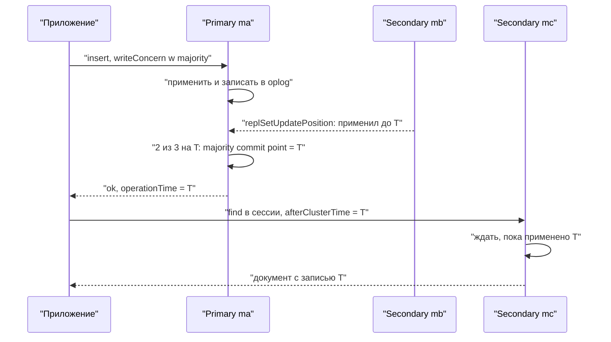

# 07. Read concern, write concern и read preference

**Зачем это знать backend-разработчику.** Ответ `acknowledged: true` ещё не значит, что запись переживёт падение primary. Чтение с secondary может не показать пользователю его же правку, сделанную секунду назад. Три настройки драйвера решают, сколько узлов подтверждают запись, какую версию данных читать и с какого узла. Неверный выбор не виден на тесте, а в проде даёт «пропавшие» платежи после выборов.

> **Коротко:** **write concern** — сколько узлов подтверждают запись (`w: 1`, `"majority"`, число, режим по тегам), с журналом ли (`j`) и сколько ждать (`wtimeout`); умолчание с 5.0 — `majority`, а с арбитрами может стать `w: 1`. **Read concern** — какую версию читать: `local`/`available` — всё на узле, `majority` — неоткатываемое, `linearizable` — свежее любой majority-записи, `snapshot` — снимок. **Read preference** выбирает узел, а **причинно согласованная сессия** заставляет secondary дождаться ваших записей. Запись с `w: 1` может исчезнуть при rollback, с `majority` — нет.

## Оглавление

- [Стенд и общая картина](#стенд-и-общая-картина)
- [Write concern: сколько узлов подтверждают запись](#write-concern-сколько-узлов-подтверждают-запись)
- [Умолчание majority и оговорка про арбитров](#умолчание-majority-и-оговорка-про-арбитров)
- [wtimeout: ошибка не отменяет запись](#wtimeout-ошибка-не-отменяет-запись)
- [Read concern: какую версию данных читать](#read-concern-какую-версию-данных-читать)
- [Read preference: с какого узла читать](#read-preference-с-какого-узла-читать)
- [Причинная согласованность: читать свои записи с secondary](#причинная-согласованность-читать-свои-записи-с-secondary)
- [Rollback и w: 1](#rollback-и-w-1)
- [Java: где задаются настройки](#java-где-задаются-настройки)
- [🔬 Глубже: majority commit point и откуда берётся 90 секунд](#-глубже-majority-commit-point-и-откуда-берётся-90-секунд)
- [Практика в репозитории](#практика-в-репозитории)
- [Типичные ошибки и заблуждения](#типичные-ошибки-и-заблуждения)
- [Итоги](#итоги)
- [Вопросы для самопроверки](#вопросы-для-самопроверки)
- [Источники](#источники)

## Стенд и общая картина

**На пальцах** (аналогия). Главная книга (primary) и две копии в филиалах (secondary). Write concern — сколько подписей нужно под проводкой, прежде чем сказать «готово»; read concern — показывать ли черновые записи; read preference — в какой филиал идти за справкой.

Все выводы в этой главе сняты на replica set `rs0` из трёх узлов `mongo:8.0` (сервер 8.0.32). Узлы `ma` и `mb` помечены тегом `dc: "msk"`, узел `mc` — `dc: "spb"`, у `ma` приоритет 2, поэтому он обычно primary. Механика выборов и oplog — в [06. Replica set](06-replica-set.md), общая теория — в [основах](../../docs/00-foundations/03-cap-consistency.md).

Отставание реплики в примерах моделируется командой `db.fsyncLock()`: узел отвечает на чтения, но перестаёт применять oplog — так выглядит перегруженный или далёкий secondary. Коды ошибок и время напечатаны через `try { … } catch (e) { print(e.code, e.codeName, e.message) }` и `Date.now()`.



## Write concern: сколько узлов подтверждают запись

**На пальцах** (аналогия). Курьер ждёт одну подпись (`w: 1`), подписи большинства жильцов (`majority`) или подписи из двух разных подъездов (режим по тегам). Больше подписей — дольше, но надёжнее.

**Write concern** (гарантия записи) — требование к подтверждению записи, которое клиент передаёт вместе с операцией. Сервер выполняет запись на primary в любом случае, а write concern определяет, **когда** он ответит клиенту:

| Параметр | Значение | Когда ответ |
|---|---|---|
| `w: 0` | без подтверждения | сразу, драйвер даже не ждёт ответа |
| `w: 1` | primary | запись применена на primary (в памяти, журнал сбрасывается фоном, см. [02](02-wiredtiger.md#журнал)) |
| `w: 2`, `w: 3` | число узлов | запись применили столько узлов с данными, включая primary |
| `w: "majority"` | большинство | запись применило большинство голосующих узлов с данными |
| `w: "<режим>"` | **режим по тегам** (tag set write concern) | выполнено правило из `settings.getLastErrorModes` |
| `j: true` | журнал | запись в журнале на диске на каждом из узлов, требуемых `w` |
| `wtimeout: N` | мс | сколько ждать репликации, прежде чем вернуть ошибку |

Режим по тегам задаётся в конфигурации набора. Правило `twoDC: {dc: 2}` означает «запись есть на узлах хотя бы с двумя разными значениями тега `dc`», то есть в двух датацентрах:

```text
test> const c = rs.conf(); c.settings.getLastErrorModes = {twoDC: {dc: 2}}; rs.reconfig(c).ok
1
guide> db.wc.insertOne({_id: 1}, {writeConcern: {w: 1}})
{ acknowledged: true, insertedId: 1 }
guide> db.wc.insertOne({_id: 2}, {writeConcern: {w: "majority"}})
{ acknowledged: true, insertedId: 2 }
guide> db.wc.insertOne({_id: 3}, {writeConcern: {w: 3, wtimeout: 2000}})
{ acknowledged: true, insertedId: 3 }
guide> db.wc.insertOne({_id: 4}, {writeConcern: {w: "twoDC"}})
{ acknowledged: true, insertedId: 4 }
guide> db.wc.insertOne({_id: 5}, {writeConcern: {w: "threeDC"}})
MongoWriteConcernError[UnknownReplWriteConcern]: No write concern mode named 'threeDC' found in replica set configuration
Result: { n: 1, writeConcernError: { code: 79, codeName: 'UnknownReplWriteConcern', ... }, ok: 1, ... }
guide> db.wc.insertOne({_id: 6}, {writeConcern: {w: 4}})
MongoWriteConcernError[UnsatisfiableWriteConcern]: Not enough data-bearing nodes
Result: { n: 1, writeConcernError: { code: 100, codeName: 'UnsatisfiableWriteConcern', ... }, ok: 1, ... }
```

Две последние ошибки — ошибки write concern, а не записи. Это важно, и к этому мы вернёмся в разделе про [wtimeout](#wtimeout-ошибка-не-отменяет-запись).

Что выбрать: `majority` — для всего, что жалко потерять (деньги, заказы), такая запись не откатится при выборах ([ниже](#rollback-и-w-1)); `w: 1` — для того, что можно пересчитать (счётчики, логи); режим по тегам — когда важна география; `w: 0` — почти никогда, вы не узнаете даже о нарушении уникального индекса. С `writeConcernMajorityJournalDefault: true` (так в `rs.conf()` на образе) `majority` уже подразумевает журнал, отдельный `j: true` имеет смысл только с числовым `w`.

## Умолчание majority и оговорка про арбитров

**На пальцах** (аналогия). Правило «нужны подписи большинства» хорошо, пока большинство — живые люди. Если один из трёх членов комиссии — наблюдатель без права подписи, то «большинство» из двух подписантов означает «оба», и любой отпуск останавливает работу. Поэтому для таких комиссий правило по умолчанию мягче.

**Default write concern** (write concern по умолчанию) — значение, которое сервер применяет, если клиент `w` не передал. С 5.0 оно вычисляется сервером (**implicit default**), если администратор не задал его явно командой `setDefaultRWConcern`. Посмотреть — `getDefaultRWConcern`:

```text
test> db.adminCommand({getDefaultRWConcern: 1})   // rs0: три узла с данными
{ defaultReadConcern: { level: 'local' },
  defaultWriteConcern: { w: 'majority', wtimeout: 0 },
  defaultWriteConcernSource: 'implicit', defaultReadConcernSource: 'implicit', ... }
```

Правило из документации: если в наборе есть арбитры и число голосующих узлов с данными не больше голосующего большинства, неявное умолчание — `{w: 1}`, иначе — `majority`. Проверим на отдельном наборе `rs1` из primary, secondary и арбитра (PSA):

```text
test> db.adminCommand({getDefaultRWConcern: 1})
{ defaultReadConcern: { level: 'local' },
  defaultWriteConcernSource: 'implicit', defaultReadConcernSource: 'implicit', ... }
// поля defaultWriteConcern нет: неявное умолчание w: 1
// узел md остановлен db.fsyncLock(), пишем на primary me:
guide> db.t.insertOne({_id: 2})                     // без writeConcern
true                                                 // ответ за 45 мс
guide> db.t.insertOne({_id: 3}, {writeConcern: {w: "majority", wtimeout: 1500}})
64 WriteConcernFailed                                // через 1520 мс
```

В PSA-наборе голосующих три, большинство — два, и узлов с данными тоже два: `majority` требовал бы обоих, и отказ secondary остановил бы все записи. Поэтому умолчание — `w: 1`, и запись без `writeConcern` прошла при стоящем втором узле. Цена — риск rollback.

Ещё две детали. Поле `getLastErrorDefaults: { w: 1, wtimeout: 0 }` в `rs.conf().settings` с 5.0 умолчание не задаёт (другое значение сервер не примет). А `WriteConcern.ACKNOWLEDGED` в Java — это `{}` без `w`, решает сервер; `WriteConcern.W1` явно отправляет `w: 1` и перекрывает серверное `majority`.

## wtimeout: ошибка не отменяет запись

**На пальцах** (аналогия). Почта говорит: «уведомление о вручении за два дня не пришло». Это не значит, что письмо вернули: скорее всего, оно уже у адресата, вы просто не дождались подтверждения.

**`wtimeout`** — предел ожидания репликации в миллисекундах. Если за это время write concern не выполнен, сервер возвращает **write concern error** (`writeConcernError`, код 64 `WriteConcernFailed`). Сама запись на primary при этом **уже применена**, и ошибка её не отменяет (откатить её может только rollback, [ниже](#rollback-и-w-1)).

Остановим `mc` и повторим записи:

```text
mc> db.fsyncLock().lockCount
Long('1')
guide> db.wc.insertOne({_id: 7}, {writeConcern: {w: 3, wtimeout: 2000}})
MongoWriteConcernError 64 WriteConcernFailed waiting for replication timed out
errInfo: { wtimeout: true, writeConcern: { w: 3, wtimeout: 2000, provenance: 'clientSupplied' } }
// через 2034 мс
guide> db.wc.insertOne({_id: 8}, {writeConcern: {w: "twoDC", wtimeout: 2000}})
MongoWriteConcernError 64 WriteConcernFailed       // через 2013 мс: в spb никого нет
guide> db.wc.insertOne({_id: 9}, {writeConcern: {w: "majority", wtimeout: 2000}})
{ acknowledged: true, insertedId: 9 }              // через 11 мс: ma + mb = 2 из 3
guide> db.wc.countDocuments({_id: {$in: [5, 6, 7, 8]}})
4
```

Все четыре «неудачные» записи лежат в коллекции. Значит, ошибку write concern нельзя считать «запись не прошла» и слепо повторять неидемпотентную операцию — получится дубль или двойное списание. А без `wtimeout` (0 — ждать бесконечно) запись с `w: 3` при упавшем узле повиснет; в Java вместо него удобнее общий **CSOT** (client-side operation timeout) — `MongoClientSettings.Builder.timeout(...)`. При этом `majority` с одним отставшим узлом ответил за 11 мс: большинству не нужны все.

## Read concern: какую версию данных читать

**На пальцах** (аналогия). Редакция выдаёт статью: черновик (`local` — быстро, но могут переписать), версию, одобренную большинством редакторов (`majority`), или версию после звонка главному редактору «вы всё ещё главный?» (`linearizable`).

**Read concern** (гарантия чтения) — какую версию данных узел может вернуть; узел выбирает [read preference](#read-preference-с-какого-узла-читать).

| Уровень | Что возвращает | Может ли прочитанное откатиться |
|---|---|---|
| `local` | последние данные на этом узле | да, при rollback |
| `available` | на replica set — как `local`; на шардах может вернуть **орфанные документы** (orphaned documents) | да |
| `majority` | данные, подтверждённые большинством (на majority commit point) | нет |
| `linearizable` | как `majority`, но гарантированно не старее любой записи, подтверждённой с `majority` до начала чтения; только primary | нет |
| `snapshot` | согласованный снимок на одну метку времени; вне транзакции — majority-снимок | нет |

Остановим оба secondary и запишем документ с `w: 1`. Majority commit point застрял, и уровни начинают различаться:

```text
mb> db.fsyncLock().ok                 // mc уже стоит
1
guide> db.acct.insertOne({_id: "a1", balance: 100}, {writeConcern: {w: 1}})
{ acknowledged: true, insertedId: 'a1' }
guide> db.acct.find({_id: "a1"}).readConcern("local").toArray()
[{"_id":"a1","balance":100}]
guide> db.acct.find({_id: "a1"}).readConcern("majority").toArray()
[]
guide> db.runCommand({find: "acct", filter: {_id: "a1"}, readConcern: {level: "linearizable"}, maxTimeMS: 2000})
50 MaxTimeMSExpired                   // через 2003 мс
guide> db.runCommand({find: "acct", filter: {}, readConcern: {level: "snapshot"}}).cursor.firstBatch
[]
guide> const o = db.adminCommand({replSetGetStatus: 1}).optimes
guide> print(o.lastCommittedOpTime.ts, o.appliedOpTime.ts)
Timestamp({ t: 1792422589, i: 1 })  Timestamp({ t: 1792422596, i: 1 })
mc> db.runCommand({find: "acct", filter: {}, readConcern: {level: "linearizable"}})
10107 NotWritablePrimary cannot satisfy linearizable read concern on non-primary node
```

Что видно:

- `local` (и `available`, проверено так же) показывает документ, которого нет больше нигде: упадёт primary — и пользователь видел то, чего «не было».
- `majority` вернул пустоту: commit point (`lastCommittedOpTime`) отстаёт от применённого (`appliedOpTime`) на 7 секунд.
- `linearizable` должен убедиться через majority-подтверждение, что `ma` всё ещё primary, и ждёт до `maxTimeMS` — задавайте его **всегда**. Гарантия даётся только на primary и для фильтра, который однозначно выбирает один документ.
- `snapshot` вне транзакции прочитал majority-снимок; в транзакции — снимок на момент первой операции ([08](08-transactions.md)).

Цена: `majority` почти бесплатен (MVCC, [02](02-wiredtiger.md#mvcc-и-снимки)), `linearizable` — majority-подтверждение на каждое чтение.

## Read preference: с какого узла читать

**На пальцах** (аналогия). Справочная служба с центральным офисом и филиалами. Можно звонить только в центр (`primary`), в центр, а если занято — в филиал (`primaryPreferred`), только в филиал, чтобы разгрузить центр (`secondary`), или в ближайший по времени отклика офис (`nearest`).

**Read preference** (предпочтение чтения) — правило, по которому **драйвер** выбирает узел для чтения (server selection).

| Режим | Узел | Когда применять |
|---|---|---|
| `primary` (по умолчанию) | только primary | свежие данные, read-your-writes без сессий |
| `primaryPreferred` | primary, без него — secondary | чтение переживает выборы |
| `secondary` | только secondary | отчёты, аналитика |
| `secondaryPreferred` | secondary, без них — primary | то же, без отказа |
| `nearest` | любой в окне `localThresholdMS` (15 мс) от самого быстрого | география |

Уточнения:

- **Теги** (tag sets) фильтруют узлы: `secondary` с тегом `{dc: "spb"}` читает только с узлов в Петербурге. Список наборов тегов проверяется по порядку, пустой набор `{}` в конце означает «любой». С режимом `primary` теги не сочетаются: в Java у `ReadPreference.primary()` нет перегрузки с `TagSet`.
- **`maxStalenessSeconds`** исключает secondary, которые по оценке драйвера отстали больше заданного. Минимум — 90 секунд, проверяет драйвер:

```text
$ mongosh "mongodb://ma,mb,mc/guide?replicaSet=rs0&readPreference=secondary&maxStalenessSeconds=30"
MongoInvalidArgumentError: Option "maxStalenessSeconds" must be at least 90 seconds
$ mongosh "mongodb://ma,mb,mc/guide?replicaSet=rs0&readPreference=secondary&maxStalenessSeconds=90"
guide> db.payments.find().explain().serverInfo.host
mc
```

Java-драйвер 5.8.1 проверяет то же при выборе сервера (сообщение «Max staleness (%d sec) must be at least 90 seconds» в `TaggableReadPreference`). Почему именно 90 — в [🔬 Глубже](#-глубже-majority-commit-point-и-откуда-берётся-90-секунд).

Чтение с secondary **по определению** может вернуть старые данные: `maxStalenessSeconds` отсекает только тех, кто отстал больше заданного порога (а он не меньше 90 с). Его берут ради разгрузки или географии, а не «для согласованности».

## Причинная согласованность: читать свои записи с secondary

**На пальцах** (аналогия). Вы сдали документы в окно №1 и получили талон с номером. Идёте в окно №2 за справкой и показываете талон. Если окно №2 ещё не получило ваши документы, оператор не говорит «у нас вас нет», а ждёт, пока они придут.

**Причинно согласованная сессия** (causally consistent session) — сессия клиента, в которой операции упорядочены по причинности. Она даёт четыре **клиентские гарантии** (session guarantees, подробно — в [основах](../../docs/00-foundations/03-cap-consistency.md#клиентские-гарантии-session-guarantees)): read your writes, monotonic reads, monotonic writes, writes follow reads.

Механизм — две метки: **`operationTime`** (логическое время последней операции сессии, сервер возвращает его в каждом ответе) и **`$clusterTime`** — **кластерное время** (cluster time), гибридные логические часы, которые клиент пересылает между узлами. Следующее чтение в сессии драйвер отправляет с `readConcern: {afterClusterTime: <operationTime>}`, и узел, не применивший oplog до этой метки, ждёт.

Покажем на отстающем `mc` (fsyncLock) через подключение ко всему набору:

```text
guide> db.profile.insertOne({_id: "u1", name: "Анна"}, {writeConcern: {w: "majority"}})
guide> db.profile.find({_id: "u1"}).readPref("secondary", [{dc: "spb"}]).toArray()
[]                                                // mc отстаёт, документа там ещё нет
guide> const s = db.getMongo().startSession({causalConsistency: true})
guide> const sdb = s.getDatabase("guide")
guide> sdb.profile.updateOne({_id: "u1"}, {$set: {name: "Анна К."}})
guide> s.getOperationTime()
Timestamp({ t: 1792422579, i: 3 })
guide> sdb.profile.find({_id: "u1"}).readPref("secondary", [{dc: "spb"}]).maxTimeMS(2000).toArray()
50 MaxTimeMSExpired Error waiting for optime { ts: Timestamp(1792422579, 3), t: -1 },
   current relevant optime is { ts: Timestamp(1792422549, 1), t: 1 }. :: caused by :: operation exceeded time limit
guide> sdb.profile.find({_id: "u1"}).readPref("secondary", [{dc: "msk"}]).toArray()
[ { _id: 'u1', name: 'Анна К.' } ]
```

Без сессии `mc` молча отдал устаревшее состояние. В сессии он честно ждал метку `1792422579, 3` и отказал по таймауту, а здоровый `mb` сразу вернул свежую версию. Лучше задержка или ошибка, чем «моя правка пропала».

То же в Java. В драйвере 5.8.1 явная сессия причинно согласована по умолчанию (`null` в `ClientSessionOptions` трактуется как `true`). Программа сама останавливает `mc`:

```java
import com.mongodb.*;
import com.mongodb.client.*;
import com.mongodb.client.model.Filters;
import com.mongodb.client.model.Updates;
import org.bson.Document;
import java.util.concurrent.TimeUnit;

public class CausalReadDemo {
    public static void main(String[] args) {
        try (MongoClient client = MongoClients.create("mongodb://ma:27017,mb:27017,mc:27017/?replicaSet=rs0");
             MongoClient spbNode = MongoClients.create("mongodb://mc:27017/?directConnection=true")) {

            MongoCollection<Document> profiles = client.getDatabase("guide").getCollection("profile");
            MongoCollection<Document> fromSpb = profiles.withReadPreference(
                    ReadPreference.secondary(new TagSet(new Tag("dc", "spb"))));

            // Эмулируем отставание: узел mc перестаёт применять oplog
            spbNode.getDatabase("admin").runCommand(new Document("fsync", 1).append("lock", true));

            try (ClientSession session = client.startSession(
                    ClientSessionOptions.builder().causallyConsistent(true).build())) {
                profiles.updateOne(session, Filters.eq("_id", "u1"), Updates.set("name", "Анна Петрова"));
                System.out.println("operationTime сессии: " + session.getOperationTime());

                Document stale = fromSpb.find(Filters.eq("_id", "u1")).first();
                System.out.println("без сессии:          " + stale.getString("name"));

                try {
                    fromSpb.find(session, Filters.eq("_id", "u1")).maxTime(1, TimeUnit.SECONDS).first();
                } catch (MongoExecutionTimeoutException e) {
                    System.out.println("в сессии, mc стоит:  код " + e.getCode() + ", ждали afterClusterTime");
                }

                spbNode.getDatabase("admin").runCommand(new Document("fsyncUnlock", 1));
                long t0 = System.nanoTime();
                Document fresh = fromSpb.find(session, Filters.eq("_id", "u1")).first();
                System.out.printf("в сессии после unlock: %s (%d мс)%n",
                        fresh.getString("name"), (System.nanoTime() - t0) / 1_000_000);
            }
        }
    }
}
```

```text
operationTime сессии: Timestamp{value=7698397225000370177, seconds=1792422781, inc=1}
без сессии:          Анна К.
в сессии, mc стоит:  код 50, ждали afterClusterTime
в сессии после unlock: Анна Петрова (2 мс)
```

Ограничения:

1. **Гарантии — внутри одной сессии.** Если следующий запрос обслуживает другой экземпляр сервиса, передайте `operationTime` и `clusterTime` (например, в заголовке) и вызовите `advanceOperationTime(...)` и `advanceClusterTime(...)` у новой сессии.
2. **При сбоях — только с `majority`.** Все четыре гарантии переживают выборы и rollback, если чтения и записи сессии идут с `majority`; с `w: 1` или `local` — только пока нет отказов.
3. `ClientSession` не потокобезопасна: одна сессия — один поток за раз.

## Rollback и w: 1

**На пальцах** (аналогия). Старший смены записал заказ в свою тетрадь и ушёл, не переписав его в общий журнал. Пока его не было, выбрали нового старшего. Вернувшись, он вырезает свою запись и кладёт в папку «спорное».

**Rollback** (откат) — отмена на бывшем primary записей, которые не успели попасть на большинство до его отключения. Подробная механика — в [06. Replica set](06-replica-set.md#rollback-когда-подтверждённая-запись-исчезает). Здесь — связь с write concern, проверенная на `rs0`:

| Шаг | Что сделали | Результат |
|---|---|---|
| 1 | `docker network disconnect` отрезали `ma` (primary) от сети | `ma` пока ещё считает себя primary (`isWritablePrimary: true`) |
| 2 | `insertOne({_id: "p-1", amount: 500}, {writeConcern: {w: 1}})` на `ma` | `{ acknowledged: true, insertedId: 'p-1' }` |
| 3 | `mb` и `mc` выбрали `mb` primary, туда записали `p-2` | на `mb`: `[{"_id":"p-2","amount":700}]` |
| 4 | вернули `ma` в сеть | лог: `Transition to ROLLBACK`, `Rollback summary` с `rollbackCommandCounts: {insert: 1, create: 1}` |
| 5 | смотрим `payments` | `[{"_id":"p-2","amount":700}]` — `p-1` исчез |

```text
$ bsondump --quiet /data/db/rollback/1ac70a93-…/removed.2026-10-19T15-11-52.0.bson
{"_id":"p-1","amount":{"$numberInt":"500"}}
```

Клиент получил «успех» за платёж, которого в базе больше нет: документ лежит только в файле rollback. С `w: "majority"` шаг 2 не получил бы подтверждения (ошибка по `wtimeout` или при сложении полномочий primary): `p-1` так же откатился бы, но клиент не считал бы платёж проведённым. Majority-запись не откатывается никогда: новый primary обязан её иметь.

## Java: где задаются настройки

**На пальцах** (аналогия). Настройки как правила в компании: общий устав (клиент), правила отдела (база, коллекция) и разовое распоряжение (сессия, транзакция). Ближний уровень перекрывает дальний.

Все три настройки задаются в `MongoClientSettings`, переопределяются на `MongoDatabase` и `MongoCollection` методами `with…` (объекты неизменяемы, метод возвращает копию), а для транзакций — в `TransactionOptions`:

```java
MongoClientSettings settings = MongoClientSettings.builder()
        .applyConnectionString(new ConnectionString("mongodb://ma:27017,mb:27017,mc:27017/?replicaSet=rs0"))
        .writeConcern(WriteConcern.MAJORITY)
        .readConcern(ReadConcern.MAJORITY)
        .timeout(5, TimeUnit.SECONDS)                       // CSOT: потолок для любой операции
        .build();
try (MongoClient client = MongoClients.create(settings)) {
    MongoDatabase db = client.getDatabase("guide");
    db.getCollection("views").withWriteConcern(WriteConcern.W1)         // счётчики: потеря допустима
            .insertOne(new Document("page", "/"));
    db.getCollection("audit").withWriteConcern(new WriteConcern("twoDC")) // режим по тегам
            .insertOne(new Document("event", "payment p-3"));
    long n = db.getCollection("views")
            .withReadPreference(ReadPreference.secondaryPreferred(90, TimeUnit.SECONDS))
            .countDocuments();
}
```

Константы 5.8.1 (проверено `javap`): `W1`, `W2`, `W3`, `MAJORITY`, `ACKNOWLEDGED` (`{}`), `UNACKNOWLEDGED` (`w: 0`), `JOURNALED` (`{j: true}` без `w`, [02](02-wiredtiger.md#журнал)); `ReadConcern.DEFAULT` (ничего не отправлять), `LOCAL`, `MAJORITY`, `LINEARIZABLE`, `SNAPSHOT`, `AVAILABLE`. В Spring Data — `MongoTemplate.setWriteConcern(...)` и `setReadPreference(...)`.

## 🔬 Глубже: majority commit point и откуда берётся 90 секунд

**Majority commit point.** Каждый secondary сообщает источнику синхронизации, до какой метки oplog он применил и записал в журнал данные. Метка, которой достигло большинство голосующих узлов с данными, — `lastCommittedOpTime` (вывод `replSetGetStatus` выше). Ответ на `w: "majority"` уходит, когда commit point догнал метку записи, а чтение `majority` идёт по снимку на нём — поэтому WiredTiger держит версии от commit point до текущего момента. Если большинство стоит, commit point застревает и растёт кэш; документация отдельно предупреждает об этом для PSA-наборов с упавшим secondary.

**Почему `maxStalenessSeconds` не меньше 90.** Точного лага драйвер не знает: он оценивает его по heartbeat (`heartbeatFrequencyMS`, 10 с), сравнивая `lastWriteDate` secondary с primary. Чтобы `lastWriteDate` не застывал без нагрузки, primary раз в `periodicNoopIntervalSecs` пишет в oplog пустую операцию (no-op):

```text
test> db.adminCommand({getParameter: "*"}).periodicNoopIntervalSecs
10
```

Погрешность оценки — около 10 + 10 с, и спецификация Max Staleness задаёт порог 90 с с запасом, чтобы шум не отключал все secondary.

## Практика в репозитории

- [Задание 05](../tasks/05-checkout-transaction.md) — `MAJORITY`, `SNAPSHOT` и `primary()` в `TransactionOptions` заказа.
- [Задание 07](../tasks/07-optimistic-locking.md) — условное обновление по `version` на primary без транзакции.
- [Задание 08](../tasks/08-outbox-change-streams.md) — outbox: событие пишется с `majority`, change stream не покажет откатившееся.
- [TransactionDemo](../examples/src/main/java/dev/nosqlguide/mongodb/examples/driver/TransactionDemo.java) — `TransactionOptions` с `ReadConcern.SNAPSHOT` и `WriteConcern.MAJORITY` в коде.
- Фон: [CAP, PACELC и клиентские гарантии](../../docs/00-foundations/03-cap-consistency.md), [репликация, кворумы, лаг](../../docs/00-foundations/04-replication.md).

## Типичные ошибки и заблуждения

1. **«Получил ошибку write concern — запись не прошла, повторю.»** На стенде все записи с `WriteConcernFailed`, `UnknownReplWriteConcern` и `UnsatisfiableWriteConcern` остались в коллекции. Повторять можно только идемпотентные операции (upsert по ключу, `$set`), остальное — сначала проверить.
2. **«`w: 1` с `j: true` так же надёжен, как `majority`.»** Журнал защищает от падения узла, но не от выборов: запись есть только на старом primary и уйдёт в rollback, как `p-1` выше.
3. **«Читаю с secondary — снимаю нагрузку и ничего не теряю.»** Теряю read-your-writes: без причинной сессии отстающий `mc` вернул пустоту вместо документа, записанного с `majority`.
4. **«В PSA-наборе по умолчанию `majority`.»** Нет: неявное умолчание там `w: 1`. Нужен `majority` — задайте явно и учтите, что записи встанут при отказе secondary.

## Итоги

- Write concern определяет момент ответа, а не факт записи: ошибка write concern запись не отменяет.
- Умолчание без арбитров — `majority` (implicit), в PSA — `w: 1`; проверяйте `getDefaultRWConcern`.
- Read concern выбирает версию: `local`/`available` — всё на узле, `majority` — неоткатываемое, `linearizable` — свежее любой majority-записи, `snapshot` — снимок.
- Read preference — выбор узла драйвером; secondary может отставать, `maxStalenessSeconds` — от 90 с.
- Причинная сессия шлёт `afterClusterTime`, и отстающий узел ждёт; при сбоях гарантия держится только с `majority`.
- Запись `w: 1` может исчезнуть при rollback, majority-запись — никогда.

## Вопросы для самопроверки

1. Запись с `{w: 3, wtimeout: 2000}` вернула `WriteConcernFailed`. Есть ли документ на primary?
   <details><summary>Ответ</summary>Да. Сервер применил запись и только не дождался третьего узла. Повторять можно лишь идемпотентную операцию.</details>
2. Почему в наборе primary + secondary + арбитр неявное умолчание — `w: 1`?
   <details><summary>Ответ</summary>Голосующих три, большинство — два, и узлов с данными тоже два: `majority` требовал бы обоих, и отказ secondary остановил бы записи. Правило: есть арбитры и голосующих узлов с данными не больше голосующего большинства — умолчание `{w: 1}`.</details>
3. Оба secondary стоят. Что вернут `local`, `majority` и `linearizable` для свежей `w: 1` записи на primary?
   <details><summary>Ответ</summary>`local` вернёт документ, `majority` — пусто (commit point отстаёт), `linearizable` будет ждать majority-подтверждения до `maxTimeMS` и вернёт `MaxTimeMSExpired`.</details>
4. Пользователь сохранил профиль, а следующий запрос читает с `secondaryPreferred`. Как гарантировать, что он увидит свою правку?
   <details><summary>Ответ</summary>Запись и чтение — в одной причинно согласованной сессии (или перенос `operationTime`/`clusterTime` через `advanceOperationTime`/`advanceClusterTime`): чтение уйдёт с `afterClusterTime`, и secondary дождётся записи. Для устойчивости к выборам — `majority`. Альтернатива — читать с primary.</details>
5. Почему `maxStalenessSeconds` не может быть 30?
   <details><summary>Ответ</summary>Лаг драйвер оценивает по heartbeat (10 с) и `lastWriteDate`, который на простое обновляется no-op записями раз в 10 с. Погрешность — десятки секунд, поэтому спецификация задаёт минимум 90 с; драйвер отвергает меньшее значение.</details>
6. Платёж записан с `w: 1`, через секунду primary отрезан от сети. Что увидит бухгалтер после восстановления?
   <details><summary>Ответ</summary>Если запись не успела на большинство, бывший primary при возвращении сделает rollback: документа в коллекции не будет, он окажется в файле `rollback/…/removed.*.bson`. С `majority` клиент получил бы ошибку вместо ложного «успеха».</details>

## Источники

- MongoDB Manual 8.0: *Write Concern*, *Default MongoDB Read Concerns/Write Concerns* (правило для арбитров), *Read Concern* и страницы уровней `local`, `available`, `majority`, `linearizable`, `snapshot`. https://www.mongodb.com/docs/manual/reference/write-concern/ , https://www.mongodb.com/docs/manual/reference/read-concern/
- MongoDB Manual: *Read Preference*, *Read Preference maxStalenessSeconds*, *Causal Consistency and Read and Write Concerns*, *Rollbacks During Replica Set Failover*. https://www.mongodb.com/docs/manual/core/read-preference/ , https://www.mongodb.com/docs/manual/core/causal-consistency-read-write-concerns/
- MongoDB Specifications: *Server Selection*, *Causal Consistency*, *Read and Write Concern*. https://github.com/mongodb/specifications
- MongoDB Java Driver 5.8.1 (проверено `javap`): `WriteConcern`, `ReadConcern`, `ReadPreference`, `TaggableReadPreference`, `ClientSessionOptions`, `MongoClientSettings.Builder.timeout`.
- D. Terry et al. *Session Guarantees for Weakly Consistent Replicated Data*, PDIS 1994.
- Все выводы сняты на `mongo:8.0` (сервер 8.0.32): replica set `rs0` из трёх узлов и PSA-набор `rs1`.

---

← [06. Replica set](06-replica-set.md) | [оглавление](README.md) | [08. Транзакции](08-transactions.md) → | [словарь терминов](glossary.md)
