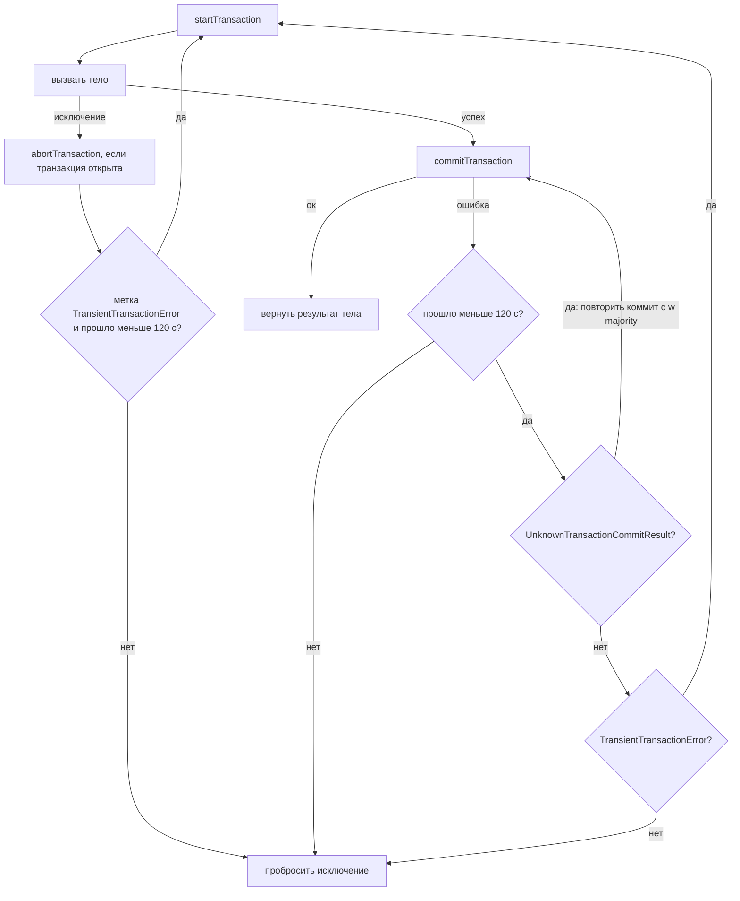

# 08. Транзакции

**Зачем это знать backend-разработчику.** «Списать остаток и создать заказ» — две записи в двух коллекциях, и между ними сервис может упасть. Транзакции MongoDB решают это, но по своим правилам: конфликт записи сразу прерывает транзакцию, драйвер сам повторяет её тело, транзакция живёт не дольше минуты, а пока она открыта, её снимок и изменения занимают кэш. Кто этого не знает, получает дубли побочных эффектов, `TransientTransactionError` под нагрузкой и давление на кэш. А кто знает, часто обходится без транзакции.

> **Коротко:** запись одного документа атомарна и без транзакции — сначала ищут модель, где хватает одного документа или условного обновления. Транзакция даёт **snapshot isolation**: чтения видят один снимок, а второй писатель того же документа сразу получает `WriteConflict` с меткой `TransientTransactionError`. `withTransaction` в драйвере 5.8.1 повторяет тело при этой метке и коммит при `UnknownTransactionCommitResult` в течение 120 секунд, без пауз. Сервер прерывает транзакцию старше `transactionLifetimeLimitSeconds` (60 с на образе). Цена — блокировки до конца транзакции, закреплённый снимок и невытесняемые изменения в кэше, majority-коммит.

## Оглавление

- [Сначала — можно ли без транзакции](#сначала--можно-ли-без-транзакции)
- [Сессия и жизненный цикл транзакции](#сессия-и-жизненный-цикл-транзакции)
- [Snapshot isolation](#snapshot-isolation)
- [WriteConflict и метки ошибок](#writeconflict-и-метки-ошибок)
- [withTransaction или core API](#withtransaction-или-core-api)
- [Время жизни и блокировки](#время-жизни-и-блокировки)
- [Ограничения: DDL, команды, размер, шарды](#ограничения-ddl-команды-размер-шарды)
- [Цена транзакции](#цена-транзакции)
- [🔬 Глубже: транзакция в oplog и двухфазный коммит](#-глубже-транзакция-в-oplog-и-двухфазный-коммит)
- [Практика в репозитории](#практика-в-репозитории)
- [Типичные ошибки и заблуждения](#типичные-ошибки-и-заблуждения)
- [Итоги](#итоги)
- [Вопросы для самопроверки](#вопросы-для-самопроверки)
- [Источники](#источники)

## Сначала — можно ли без транзакции

**На пальцах** (аналогия). Чтобы перенести вещи из одной комнаты в другую «атомарно», можно нанять охрану, которая перекроет обе комнаты. А можно сложить всё в один чемодан и нести его целиком. Чемодан дешевле.

**Атомарность одного документа** (single-document atomicity) — любая операция записи над одним документом, включая вложенные массивы и поддокументы, применяется целиком или не применяется ([01](01-document-bson.md#атомарность-одного-документа)). На ней строятся приёмы, которые закрывают большинство задач без транзакций:

| Задача | Приём без транзакции | Почему работает |
|---|---|---|
| заказ с позициями | позиции встроены в документ заказа ([03](03-data-modeling.md#встраивание-или-ссылка)) | одна запись — один документ |
| «списать, если хватает» | **условное обновление** (conditional update): `updateOne({_id, available: {$gte: qty}}, {$inc: {available: -qty}})` | проверка и изменение — одна атомарная операция; `matchedCount: 0` значит «не хватило» |
| «не затереть чужую правку» | **оптимистическая блокировка** (optimistic locking): поле `version` в фильтре `findOneAndUpdate` | правка проходит, только если версия не изменилась |
| «записать и уведомить» | **outbox** в том же документе или транзакции + change stream ([10](10-change-streams-java.md)) | событие и данные фиксируются вместе |

Условное обновление в Java — одна строка вместо транзакции:

```java
UpdateResult r = inventory.updateOne(
        Filters.and(Filters.eq("_id", "sku-1"), Filters.gte("available", 2)),
        Updates.inc("available", -2));
boolean reserved = r.getMatchedCount() == 1;   // false: товара меньше двух
```

Транзакция нужна, когда «всё или ничего» должно охватить **несколько документов**, которые нельзя разумно объединить: остаток на складе и новый заказ, два счёта при переводе, запись и событие в outbox-коллекции.

## Сессия и жизненный цикл транзакции

**На пальцах** (аналогия). Банковская ячейка: сначала берёте ключ у сотрудника (сессия), открываете ячейку (начало транзакции), кладёте и забираете что угодно, а потом либо закрываете с подписью (commit), либо возвращаете всё как было (abort).

**Многодокументная транзакция** (multi-document transaction) — группа операций над несколькими документами, коллекциями и базами, которая фиксируется атомарно. Она живёт внутри **логической сессии** (logical session, `lsid`): с каждой операцией драйвер шлёт `lsid`, номер транзакции `txnNumber` и `autocommit: false`, а первая несёт `startTransaction: true` и `readConcern`. Транзакции есть на replica set и шардированном кластере, на standalone — нет. Завершается транзакция **commit** или **abort** (явным, по ошибке или по таймауту); read и write concern задаются на транзакцию целиком.

```text
guide> db.stock.drop(); db.stock.insertOne({_id: "sku-1", qty: 10})
guide> const s = db.getMongo().startSession()
guide> s.startTransaction({readConcern: {level: "snapshot"}, writeConcern: {w: "majority"}})
guide> s.getDatabase("guide").stock.updateOne({_id: "sku-1"}, {$inc: {qty: -1}})
guide> s.commitTransaction()
guide> db.stock.findOne().qty
9
// позже, после опытов этой главы:
guide> db.serverStatus().transactions   // выдержка
{ currentActive: Long('0'), currentInactive: Long('0'), currentOpen: Long('0'),
  totalAborted: Long('8'), totalCommitted: Long('3'), totalStarted: Long('11'), totalPrepared: Long('0'), ... }
```

Счётчики `serverStatus().transactions` — первое, что смотрят при разборе проблем: высокий `totalAborted` относительно `totalCommitted` означает конфликты или таймауты.

Read concern транзакции — обычно **`snapshot`** вместе с `w: "majority"`: тогда снимок гарантированно majority-подтверждён ([задание 05](../tasks/05-checkout-transaction.md), уровни — в [07](07-read-write-concerns.md#read-concern-какую-версию-данных-читать)). Read preference транзакции с чтениями — только `primary`, и проверяет это драйвер ещё до отправки:

```text
guide> s.startTransaction({readPreference: {mode: "secondary"}}); s.getDatabase("guide").stock.findOne()
Uncaught MongoTransactionError: Read preference in a transaction must be primary, not: secondary
```

## Snapshot isolation

**На пальцах** (аналогия). Вы сфотографировали склад в 10:00 и считаете по фото, хотя в 11:00 коробки перевезли. Пока только считаете — всё хорошо. Решите передвинуть уже передвинутую коробку — начальник остановит: «фото устарело».

**Snapshot isolation** (изоляция снимков) — уровень изоляции, при котором транзакция читает данные из одного **снимка** (snapshot) на момент первой операции транзакции, а при записи проверяется, не изменил ли кто-то тот же документ после этого момента. Реализация — MVCC WiredTiger ([02](02-wiredtiger.md#mvcc-и-снимки)).

```text
guide> db.stock.drop(); db.stock.insertOne({_id: "sku-1", qty: 10})
guide> const sA = db.getMongo().startSession(); const a = sA.getDatabase("guide").stock
guide> sA.startTransaction({readConcern: {level: "snapshot"}, writeConcern: {w: "majority"}})
guide> a.findOne({_id: "sku-1"}).qty
10
guide> db.stock.updateOne({_id: "sku-1"}, {$set: {qty: 7}})           // вне транзакции
guide> a.findOne({_id: "sku-1"}).qty
10                                                                  // снимок не изменился
guide> a.updateOne({_id: "sku-1"}, {$inc: {qty: -1}})
Uncaught MongoServerError[WriteConflict]: Caused by :: Write conflict during plan execution and yielding is disabled. :: Please retry your operation or multi-document transaction.
guide> sA.commitTransaction()
Uncaught MongoServerError[NoSuchTransaction]: Transaction with { txnNumber: 2 } has been aborted.
guide> db.stock.findOne().qty
7
```

Коды и метки этих ошибок (поля `e.code` и `e.errorLabels` в `try/catch`): `112 WriteConflict ["TransientTransactionError"]` и `251 NoSuchTransaction ["TransientTransactionError"]`.

Снимок держит 10 и после внешней записи 7, а изменение документа, изменённого после снимка, даёт `WriteConflict`. **Потерянного обновления** (lost update) нет.

Snapshot isolation — **не сериализуемость** (serializability). Классическая аномалия — **write skew** (перекос записи): две транзакции читают одно и то же, а пишут в разные документы. Правило больницы — «на дежурстве хотя бы один врач»:

```text
guide> db.oncall.insertMany([{_id: "alice", onCall: true}, {_id: "bob", onCall: true}])
// T1 и T2 открыты с readConcern snapshot
T1 видит дежурных: 2  T2 видит: 2
// T1: alice.onCall = false;  T2: bob.onCall = false;  оба commit
после двух коммитов дежурных: 0
```

Обе транзакции проверили правило на своём снимке и записали разные документы — конфликта нет. Лечится материализацией конфликта: обе транзакции обновляют общий документ (например, `{_id: "shift-2026-10-19", version: n}` с `$inc`), и тогда вторая получит `WriteConflict`, как в примере выше.

## WriteConflict и метки ошибок

**На пальцах** (аналогия). Двое взялись править одну строку общего документа. Второго не ставят в очередь, а сразу говорят: «строку уже правят, начните заново». Это временная проблема — повторить можно.

**WriteConflict** (код 112) — конфликт записи: транзакция пытается изменить документ, который изменила другая, ещё не зафиксированная или зафиксированная после снимка транзакция. Внутри многодокументной транзакции сервер не ждёт и не повторяет: он прерывает транзакцию. Чтобы клиент понял, что делать, ошибки получают **метки** (error labels):

| Метка | Смысл | Что делать |
|---|---|---|
| **`TransientTransactionError`** | транзакция прервана по временной причине: конфликт, выборы, сеть до коммита, превышение времени жизни | повторить **всю транзакцию** с начала |
| **`UnknownTransactionCommitResult`** | неизвестно, зафиксирован ли коммит: сеть, выборы, таймаут write concern при коммите | повторить **только** `commitTransaction` (это безопасно, коммит идемпотентен) |

Две транзакции и один документ:

```text
guide> db.stock.drop(); db.stock.insertOne({_id: "sku-1", qty: 10})
guide> const sA = db.getMongo().startSession(), sB = db.getMongo().startSession()
guide> const a = sA.getDatabase("guide").stock, b = sB.getDatabase("guide").stock
guide> sA.startTransaction(); sB.startTransaction()
guide> a.updateOne({_id: "sku-1"}, {$inc: {qty: -1}})
{ acknowledged: true, insertedId: null, matchedCount: 1, modifiedCount: 1, upsertedCount: 0 }
guide> b.updateOne({_id: "sku-1"}, {$inc: {qty: -2}})
Uncaught MongoServerError[WriteConflict]: Caused by :: Write conflict during plan execution and yielding is disabled. :: Please retry your operation or multi-document transaction.
guide> db.runCommand({update: "stock", updates: [{q: {_id: "sku-1"}, u: {$inc: {qty: -5}}}], maxTimeMS: 1500})
Uncaught MongoServerError[MaxTimeMSExpired]: operation exceeded time limit
guide> sA.commitTransaction()
guide> db.stock.findOne().qty
9
```

По замерам в `try/catch`: B получила `112 WriteConflict ["TransientTransactionError"]` через 4 мс — «первый писатель выигрывает» (first writer wins). А обычная запись **вне транзакции** не падает, а ждёт, пока транзакция A не завершится, и сдалась только по `maxTimeMS` через 1506 мс (итог 9: прошёл лишь `$inc: -1` от A). В отдельном опыте A держала документ 3 секунды, и одиночный `$inc: -5` дождался коммита за 1362 мс, после чего применился (`10 − 1 − 5 = 4`). Одна долгая транзакция подвешивает все одиночные записи в «горячий» документ.

`UnknownTransactionCommitResult` воспроизводится таймаутом write concern при коммите. Узел `mc` остановлен `db.fsyncLock()`:

```text
guide> const s = db.getMongo().startSession(); const st = s.getDatabase("guide").stock
guide> s.startTransaction({writeConcern: {w: 3, wtimeout: 1500}})
guide> st.updateOne({_id: "sku-1"}, {$set: {qty: 100}})
guide> s.commitTransaction()
Uncaught:
MongoWriteConcernError[WriteConcernFailed]: waiting for replication timed out
Additional information: { wtimeout: true, writeConcern: { w: 3, wtimeout: 1500, provenance: 'clientSupplied' } }
guide> db.stock.findOne({_id: "sku-1"}).qty
100
```

Метки ошибки (`e.errorLabels`): `["UnknownTransactionCommitResult"]`.

Коммит **прошёл** — данные видны, — а клиент получил ошибку. Именно поэтому для этой метки повторяют только коммит, а не всю транзакцию: повтор тела списал бы остаток дважды.

В Java на core API тот же конфликт ловится как `MongoException` с кодом 112: `e.hasErrorLabel(MongoException.TRANSIENT_TRANSACTION_ERROR_LABEL)` на стенде вернул `true` (константы обеих меток есть в `MongoException` 5.8.1), после чего вызывают `abortTransaction()` и повторяют транзакцию.

## withTransaction или core API

**На пальцах** (аналогия). Можно самому дозваниваться в доставку и решать, когда сдаться, а можно поручить секретарю: «звони две минуты, потом сдавайся». Секретарь — `withTransaction`.

**Core API** — ручное управление: `startTransaction`, операции с явной сессией, `commitTransaction`/`abortTransaction`, свой цикл повторов по меткам. **Callback API** — `ClientSession.withTransaction(TransactionBody, TransactionOptions)`: драйвер сам начинает транзакцию, вызывает тело, коммитит и повторяет.

Логика `withTransaction` в драйвере 5.8.1 (прочитана в байткоде `ClientSessionImpl`, константа `MAX_RETRY_TIME_LIMIT_MS = 120000`):



Что видно в коде: повторы идут **без паузы** (ни `sleep`, ни backoff); повтор коммита — с `majority` (`applyMajorityWriteConcernToTransactionOptions`); `MongoOperationTimeoutException` (CSOT) и `MongoExecutionTimeoutException` при коммите не повторяются. Исключение из тела без метки — например, `OutOfStockException` — даёт `abortTransaction` и пробрасывается наружу: так [задание 05](../tasks/05-checkout-transaction.md) откатывает заказ.

Проверим на стенде: чужая транзакция держит документ 300 мс, а `withTransaction` пытается его изменить:

```java
ClientSession holder = client.startSession();
holder.startTransaction(TX);
stock.updateOne(holder, eq("_id", "sku-1"), inc("qty", -1));
CompletableFuture.runAsync(() -> { holder.commitTransaction(); holder.close(); },
        CompletableFuture.delayedExecutor(300, TimeUnit.MILLISECONDS));

AtomicInteger attempts = new AtomicInteger();
long t0 = System.nanoTime();
try (ClientSession s = client.startSession()) {
    s.withTransaction(() -> {
        attempts.incrementAndGet();
        return stock.updateOne(s, eq("_id", "sku-1"), inc("qty", -1));
    }, TX);
}
System.out.printf("withTransaction: попыток тела %d, %d мс, qty = %d%n", attempts.get(),
        (System.nanoTime() - t0) / 1_000_000, stock.find().first().getInteger("qty"));
```

```text
withTransaction: попыток тела 22, 342 мс, qty = 7     // первый запуск
withTransaction: попыток тела 17, 318 мс, qty = 7     // второй запуск
```

`TX` — `SNAPSHOT`/`MAJORITY`/`primary()`; в той же программе перед этим уже был конфликт двух сессий core API (`qty`: 10 − 1 − 1 − 1 = 7). Тело выполнилось 17–22 раза за 300 мс. Отсюда правила для тела:

1. **Никаких побочных эффектов вне базы** — письма, HTTP-вызовы, отправка в Kafka повторятся столько же раз. Их выносят после `withTransaction` или в outbox ([задание 08](../tasks/08-outbox-change-streams.md)).
2. **Каждая операция получает сессию** явным аргументом. `stock.updateOne(filter, update)` без `s` выполнится вне транзакции и не откатится.
3. **Тело короткое**: повторы без паузы на горячем документе нагружают сервер, а каждая попытка дольше `transactionLifetimeLimitSeconds` будет прервана сервером.

Core API берут, когда нужен свой контроль: backoff с джиттером, другой бюджет, метрики по попыткам. Тогда цикл повторов пишется по тем же двум меткам.

## Время жизни и блокировки

**На пальцах** (аналогия). Переговорную бронируют максимум на час, засидевшихся выставляют — иначе одна забытая встреча занимает комнату на весь день.

**`transactionLifetimeLimitSeconds`** — сколько секунд транзакция может быть открыта; по истечении её прерывает фоновый поток сервера. **`maxTransactionLockRequestTimeoutMillis`** — сколько операция в транзакции ждёт блокировку (например, при конфликте с DDL), прежде чем прервать транзакцию.

```text
test> db.adminCommand({getParameter: 1, transactionLifetimeLimitSeconds: 1, maxTransactionLockRequestTimeoutMillis: 1})
{ maxTransactionLockRequestTimeoutMillis: 5, transactionLifetimeLimitSeconds: 60, ok: 1, ... }
```

Чтобы не ждать минуту, на стенде временно уменьшим лимит до 5 секунд:

```text
guide> db.adminCommand({setParameter: 1, transactionLifetimeLimitSeconds: 5}).ok
1
guide> const s = db.getMongo().startSession(); const st = s.getDatabase("guide").stock
guide> s.startTransaction(); st.updateOne({_id: "sku-1"}, {$inc: {qty: -1}}).modifiedCount
1
guide> sleep(12000)
guide> st.updateOne({_id: "sku-1"}, {$inc: {qty: -1}})
Uncaught MongoServerError[NoSuchTransaction]: Transaction with { txnNumber: 1 } has been aborted.
guide> s.commitTransaction()
Uncaught MongoServerError[NoSuchTransaction]: Transaction with { txnNumber: 1 } has been aborted.
guide> db.adminCommand({setParameter: 1, transactionLifetimeLimitSeconds: 60}).was
5
// в логе сервера:
"msg":"Aborting transaction because it has been running for longer than 'transactionLifetimeLimitSeconds'"
```

Код ошибки — 251, метка — `TransientTransactionError`, и `withTransaction` начал бы заново. Но если тело само длиннее лимита, каждый повтор будет прерван: правильный ответ — дробить работу, а не поднимать лимит.

Блокировки транзакции: каждая операция берёт **intent-блокировки** (intent locks) на базу и коллекцию и держит их **до конца транзакции**. Операции с данными друг другу не мешают (конфликты решаются на уровне документа), но DDL на той же коллекции — `createIndex`, `drop`, `collMod` — ждёт эксклюзивную блокировку, пока транзакция не завершится. В обратную сторону транзакция ждёт DDL не больше 5 мс (`maxTransactionLockRequestTimeoutMillis`) и прерывается. Проверка на стенде: транзакция A изменила `stock` и держится 5 секунд, следом пришёл `collMod` на `stock` и встал в очередь, а затем транзакция B попробовала вставку в `stock`:

```text
B: 24 LockTimeout ["TransientTransactionError"] 18 мс
Unable to acquire IX lock on '{Collection : guide.stock}' within 5ms. opId: 791556, op: conn426, connId: 426.
A commit
collMod ждал 3325 мс
```

Одна долгая транзакция плюс один DDL — и все новые транзакции на этой коллекции падают, пока DDL не пройдёт. Поэтому миграции схемы и построение индексов не смешивают с пиком транзакционной нагрузки.

## Ограничения: DDL, команды, размер, шарды

**На пальцах** (аналогия). В примерочной можно мерить любую одежду, но нельзя перекрашивать стены магазина. Транзакция меняет данные, а структуру — только в узких пределах.

Проверено на replica set `mongo:8.0` (8.0.32):

| Операция в транзакции | Результат на образе |
|---|---|
| вставка в несуществующую коллекцию | ok и со `snapshot`: коллекция создаётся неявно (с 4.4) |
| `createCollection` | ok только с readConcern `local` (или без него); со `snapshot` — 72 `InvalidOptions` |
| `createIndex` на коллекции, созданной в этой же транзакции | ok при `local`, `"a_1"`; со `snapshot` — 72 |
| `createIndex` на существующей коллекции | 263 `OperationNotSupportedInTransaction`: Cannot create new indexes on existing collection … |
| `drop` | 263: Cannot run 'drop' in a multi-document transaction |
| команда `count` | 263; вместо неё `countDocuments` (это агрегация) — ok |
| `$out` | 263: $out cannot be used in a transaction |
| чтение `system.*` | 263: Cannot run command against the 'guide.system.views' collection in a transaction |
| read preference не `primary` | отказ драйвера до отправки |

**Размер.** Отдельного лимита на число операций нет, а лимит 16 МБ относится к **одной записи oplog**, а не к транзакции. С 4.2 большая транзакция пишется цепочкой записей. Вставим 20 документов по 1 МБ одной транзакцией:

```text
guide> s.startTransaction(); for (let i = 0; i < 20; i++) b.insertOne({_id: i, pad}); s.commitTransaction()
guide> db.big.countDocuments()
20
local> // подсчёт записей local.oplog.rs с applyOps для guide.big (скрипт):
oplog entries: 2 sizes MB: 15.0,5.0 prevOpTime chain: 2 partialTxn: 1
test> db.serverStatus().transactions.lastCommittedTransaction   // operationCount, oplogOperationBytes
Long('20') Long('20979020')
```

Две записи `applyOps` (15 и 5 МБ), связанные полем `prevOpTime`; первая помечена `partialTxn`. Практический предел другой — кэш: незафиксированные изменения живут в кэше WiredTiger и не вытесняются. Если под давлением кэша WiredTiger откатывает транзакцию, а её грязные данные больше доли `transactionTooLargeForCacheThreshold` (0.75 на образе) от бюджета грязного кэша, сервер возвращает 388 `TransactionTooLargeForCache` **без** метки `TransientTransactionError` — повтор бесполезен. На стенде с кэшем 0,25 ГБ так упала транзакция после 106 вставок по 1 МБ (`errorLabels: []`, «transaction is too large and will not fit in the storage engine cache»).

**Шардированный кластер.** Транзакции работают и там (с 4.2, **распределённые транзакции**, distributed transactions), но:

- транзакция, которая пишет на несколько шардов, коммитится **двухфазным коммитом** (two-phase commit) через шард-координатор — это дороже ([🔬 Глубже](#-глубже-транзакция-в-oplog-и-двухфазный-коммит));
- по документации, создание коллекций и индексов внутри транзакции допустимо, только если она не пишет на несколько шардов;
- read concern `snapshot` у распределённой транзакции берёт общую метку времени для всех шардов; детали шардирования — в [09](09-sharding.md).

## Цена транзакции

**На пальцах** (аналогия). Долгая транзакция — тележка, которую покупатель катает по складу: неоплаченные коробки занимают проход (изменения в кэше), полки с ними закрыты для других (конфликты записи), а через 60 с охрана тележку разбирает.

| Ресурс | Что тратит транзакция |
|---|---|
| **Кэш** | незафиксированные изменения нельзя вытеснить; закреплённый снимок держит старые версии ([02](02-wiredtiger.md#mvcc-и-снимки)) |
| **Блокировки** | intent-блокировки до конца; DDL ждёт, новые транзакции получают `LockTimeout` |
| **Задержка коммита** | ожидание majority, у шардов — двухфазный коммит |
| **Конфликты** | каскад `WriteConflict` и повторов (17–22 попытки за 300 мс) |
| **Чужие записи** | одиночные записи в занятый документ ждут (1362 мс выше) |

Частое заблуждение — «транзакция заставляет хранить историю». Старые версии сервер хранит и без неё: окно `minSnapshotHistoryWindowInSeconds` на образе — 300 с (history store на диске). Без всякой транзакции `find` с `readConcern {level: "snapshot", atClusterTime: <время вставки>}` вернул `[{"_id":1,"n":0}]` при текущем `n = 5`. Цена долгой транзакции — закреплённый снимок и незафиксированные изменения, которые нельзя вытеснить из кэша: на нагруженной базе это давление на кэш, а в пределе 388. Отсюда правило: **транзакция должна быть короткой** — миллисекунды, а не секунды; никаких ожиданий пользователя или внешних сервисов внутри.

## 🔬 Глубже: транзакция в oplog и двухфазный коммит

**Oplog.** Пока транзакция не зафиксирована, в oplog ничего не пишется — изменения живут только в транзакции движка на primary. На коммите сервер пишет одну запись `applyOps` со всеми операциями (или цепочку `partialTxn` → … → финальная запись, связанную `prevOpTime`, как в опыте с 20 МБ). Secondary применяют цепочку атомарно, поэтому читатели на secondary тоже не видят половину транзакции. В записи есть `lsid` и `txnNumber`, а в `config.transactions` хранится состояние сессии — так сервер распознаёт повтор `commitTransaction` и отвечает, не выполняя коммит второй раз.

**Двухфазный коммит на шардах.** Если транзакция писала на несколько шардов, `mongos` отправляет `coordinateCommitTransaction` со списком участников первому шарду транзакции, он становится **координатором** (transaction coordinator):

1. Координатор сохраняет (с majority) список участников и рассылает им `prepareTransaction`.
2. Каждый участник пишет в oplog запись **prepare** с majority write concern и отвечает своей **prepare timestamp**.
3. Координатор выбирает commit timestamp — максимум из prepare-меток, — сохраняет решение и рассылает `commitTransaction` с этой меткой.

Между шагами 2 и 3 документы подготовленной транзакции заблокированы: читатель с `snapshot`, `linearizable` или `afterClusterTime` (причинная сессия) ждёт решения координатора, как и писатели этих документов, а `local` и `majority` читают версию до транзакции. Счётчики `totalPrepared` в `serverStatus().transactions` (на replica set — 0) показывают, сколько таких транзакций прошло. Если транзакция затронула один шард, двух фаз нет — обычный коммит.

## Практика в репозитории

- [Задание 05](../tasks/05-checkout-transaction.md) — оформление заказа: `withTransaction` с `SNAPSHOT`/`MAJORITY`/`primary`, условный `$inc` с `$gte`, откат по `OutOfStockException`, 10 параллельных покупателей.
- [Задание 07](../tasks/07-optimistic-locking.md) — оптимистическая блокировка через `version` и `findOneAndUpdate` — как обойтись без транзакции.
- [Задание 08](../tasks/08-outbox-change-streams.md) — outbox: запись данных и события в одной транзакции, доставка через change stream.
- [TransactionDemo](../examples/src/main/java/dev/nosqlguide/mongodb/examples/driver/TransactionDemo.java) — `withTransaction` для фиксации, `startTransaction(TX)` для отката.
- Фон: [CAP и модели согласованности](../../docs/00-foundations/03-cap-consistency.md), [репликация](../../docs/00-foundations/04-replication.md).

## Типичные ошибки и заблуждения

1. **«Операция без сессии внутри `withTransaction` тоже в транзакции.»** Нет: `collection.updateOne(filter, update)` без `session` выполняется сразу и не откатится при abort.
2. **«Тело `withTransaction` выполнится один раз.»** На стенде — 17–22 раза за 300 мс. Письма и HTTP-вызовы из тела повторятся столько же.
3. **«Получил ошибку коммита — повторю всю транзакцию.»** При `UnknownTransactionCommitResult` коммит мог пройти (на стенде `qty` стал 100). Повторяют только коммит; `withTransaction` так и делает.
4. **«Snapshot isolation — это serializable.»** Write skew проходит: две транзакции сняли с дежурства обоих врачей. Конфликт надо материализовать в общем документе.
5. **«В транзакции нельзя создать коллекцию.»** Старое ограничение. С 4.4 можно создать коллекцию (явно — только с readConcern `local`, вставкой — и со `snapshot`) и индекс на новой коллекции; на шардах — если транзакция не пишет на несколько шардов. Нельзя — `drop`, индекс на существующей коллекции, `count`, `$out`.
6. **«Лучше одна большая транзакция, чем много маленьких.»** Большая и долгая держит снимок и невытесняемые изменения в кэше, блокирует DDL и одиночные записи и при 60-секундном лимите прерывается целиком.

## Итоги

- Один документ атомарен без транзакции: сначала встраивание, условные обновления, `version`.
- Транзакция живёт в сессии, читает из снимка, фиксируется атомарно; read preference — только `primary`.
- Второй писатель документа — сразу `WriteConflict` (112) с `TransientTransactionError`; запись вне транзакции ждёт.
- `TransientTransactionError` — повторить транзакцию, `UnknownTransactionCommitResult` — только коммит.
- `withTransaction` 5.8.1 повторяет 120 с без пауз; тело — без внешних эффектов.
- Лимиты на образе: время жизни 60 с, ожидание блокировки 5 мс, 16 МБ на запись oplog (транзакция может быть больше), порог грязного кэша на транзакцию 0.75.
- Цена — снимок и изменения в кэше, блокировки, majority- и двухфазный коммит: транзакции должны быть короткими.

## Вопросы для самопроверки

1. Почему для «списать, если хватает» одного SKU не нужна транзакция?
   <details><summary>Ответ</summary>Условное обновление с `{available: {$gte: qty}}` в фильтре и `$inc` проверяет и меняет документ одной атомарной операцией; `matchedCount: 0` — товара не хватило. Транзакция нужна, только если в ту же единицу входит другой документ, например заказ.</details>
2. Транзакция A прочитала `qty = 10`, вне её записали 7, A делает `$inc: -1`. Что произойдёт?
   <details><summary>Ответ</summary>`WriteConflict` (112) с меткой `TransientTransactionError`, транзакция прервана, commit даст `NoSuchTransaction`. В базе 7, потерянного обновления нет; транзакцию повторяют с начала.</details>
3. Коммит вернул `WriteConcernFailed` с меткой `UnknownTransactionCommitResult`. Что делать?
   <details><summary>Ответ</summary>Повторить только `commitTransaction` (с `majority`): коммит идемпотентен, и сервер распознает повтор по `lsid`/`txnNumber`. Повторять тело нельзя — коммит мог уже пройти, на стенде данные были видны.</details>
4. Что делает `withTransaction` в драйвере 5.8.1, если тело бросило `IllegalStateException` вашего кода?
   <details><summary>Ответ</summary>Вызывает `abortTransaction` (если транзакция открыта) и пробрасывает исключение: у него нет метки `TransientTransactionError`, поэтому повтора нет.</details>
5. Опишите write skew на примере и способ защиты.
   <details><summary>Ответ</summary>Две транзакции на своих снимках видят двух дежурных врачей и каждая снимает с дежурства своего — пишут разные документы, конфликта нет, в итоге дежурных 0. Защита — материализовать конфликт: обе транзакции обновляют общий документ (например, документ смены), и вторая получит `WriteConflict`.</details>
6. Транзакция вставляет 20 МБ данных. Превысит ли она лимит 16 МБ?
   <details><summary>Ответ</summary>Нет. 16 МБ — предел одной записи oplog, а с 4.2 транзакция пишется цепочкой `applyOps` (на стенде — 15 и 5 МБ). Практический предел — кэш: при превышении `transactionTooLargeForCacheThreshold` транзакцию прервут с 388 без метки повтора.</details>

## Источники

- MongoDB Manual 8.0: *Transactions*, *Production Considerations*, *Operations in Transactions* (DDL, ограничения команд), *Drivers API* (метки ошибок, callback и core API). https://www.mongodb.com/docs/manual/core/transactions/ , https://www.mongodb.com/docs/manual/core/transactions-production-consideration/ , https://www.mongodb.com/docs/manual/core/transactions-operations/
- MongoDB Manual: параметры `transactionLifetimeLimitSeconds`, `maxTransactionLockRequestTimeoutMillis`, `transactionTooLargeForCacheThreshold`; `serverStatus.transactions`. https://www.mongodb.com/docs/manual/reference/parameters/
- MongoDB Specifications: *Transactions*, *Convenient API for Transactions* (`withTransaction`, 120 с). https://github.com/mongodb/specifications
- MongoDB Java Driver 5.8.1 (проверено `javap`): `ClientSession.withTransaction`, `ClientSessionImpl` (`MAX_RETRY_TIME_LIMIT_MS = 120000`), `TransactionOptions`, `MongoException` (константы меток).
- Исходный код сервера: https://github.com/mongodb/mongo (`src/mongo/db/transaction`, `src/mongo/db/s/transaction_coordinator*`).
- H. Berenson et al. *A Critique of ANSI SQL Isolation Levels*, SIGMOD 1995 (snapshot isolation и write skew).
- Все выводы сняты на `mongo:8.0` (сервер 8.0.32), replica set из трёх узлов; Java-примеры — драйвер 5.8.1 на JDK 21.

---

← [07. Read и write concerns](07-read-write-concerns.md) | [оглавление](README.md) | [09. Шардирование](09-sharding.md) → | [словарь терминов](glossary.md)
