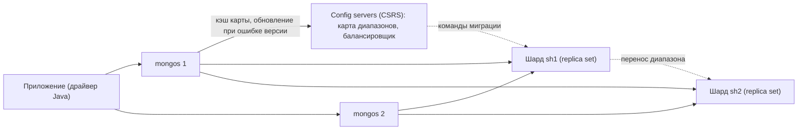

# 09. Шардирование

**Зачем это знать backend-разработчику.** Шардирование включают, когда один replica set упирается в диск, память или поток записи. Но ключ шардирования выбирает разработчик, и ошибка в нём дорогая: все новые записи бьют в один шард, запросы без ключа опрашивают весь кластер, а смена ключа — это перекладка всей коллекции. Общая теория — в основах ([05. Партиционирование](../../docs/00-foundations/05-partitioning.md)); здесь — как это устроено в MongoDB 8.0 и что видно на живом кластере.

> **Коротко:** шардированный кластер — это шарды (каждый — replica set), config servers (тоже replica set) с картой «диапазон ключа → шард» и маршрутизаторы `mongos`, через которые ходит приложение. Коллекция режется на **чанки** — непрерывные диапазоны значений **ключа шардирования**; балансировщик переносит их между шардами, когда разница в объёме данных превышает три размера чанка (по умолчанию чанк — 128 МБ, проверено на образе). Запрос с ключом идёт на один шард (`SINGLE_SHARD`), без ключа — на все (`SHARD_MERGE`). Хороший ключ: много значений, равномерная частота, не монотонный; проверять кандидата лучше командой `analyzeShardKey`. Ключ меняют `reshardCollection` (с 5.0), а в 8.0 коллекцию можно вернуть в нешардированное состояние `unshardCollection`.

## Оглавление

- [Устройство кластера: mongos, config servers, шарды](#устройство-кластера-mongos-config-servers-шарды)
- [Ключ шардирования: кардинальность, частота, монотонность](#ключ-шардирования-кардинальность-частота-монотонность)
- [Hashed, ranged и составной ключ](#hashed-ranged-и-составной-ключ)
- [Чанки и балансировщик](#чанки-и-балансировщик)
- [Jumbo-чанки](#jumbo-чанки)
- [Targeted и scatter-gather запросы](#targeted-и-scatter-gather-запросы)
- [Зоны](#зоны)
- [Смена ключа и перенос коллекций](#смена-ключа-и-перенос-коллекций)
- [Транзакции через несколько шардов](#транзакции-через-несколько-шардов)
- [🔬 Глубже: миграция диапазона и орфанные документы](#-глубже-миграция-диапазона-и-орфанные-документы)
- [Практика в репозитории](#практика-в-репозитории)
- [Типичные ошибки и заблуждения](#типичные-ошибки-и-заблуждения)
- [Итоги](#итоги)
- [Вопросы для самопроверки](#вопросы-для-самопроверки)
- [Источники](#источники)

## Устройство кластера: mongos, config servers, шарды

**На пальцах** (аналогия). Библиотека с несколькими корпусами. Читатель подходит к любой справочной стойке (`mongos`), там по каталогу (config servers) видят, в каком корпусе (шарде) лежит нужный стеллаж, и отправляют запрос туда. Каталог и каждый корпус продублированы.

**Шардированный кластер** (sharded cluster) — три роли:

| Роль | Что делает | Как развёрнута |
|---|---|---|
| **Шард** (shard) | хранит часть данных | всегда replica set ([06](06-replica-set.md)) |
| **Config servers** (CSRS, config server replica set) | хранят метаданные: какие коллекции шардированы, их ключи, карту диапазонов, зоны; на primary работает балансировщик | replica set с `configsvr: true` |
| **`mongos`** | маршрутизатор: держит кэш карты, отправляет запрос нужным шардам, сливает ответы | процесс без данных, обычно рядом с приложением |

Примеры главы сняты на пробном мини-кластере `mongo:8.0` (8.0.32) в отдельной docker-сети: config server replica set `cfg` из одного узла, два шарда `sh1` и `sh2` — каждый replica set из одного узла, и один `mongos`. В продакшене в каждом replica set минимум три узла; для маршрутизации и балансировки хватает и одного.

```text
[direct: mongos] test> db.hello().msg
isdbgrid
[direct: mongos] test> sh.status()   // выдержка
shards
[ { _id: 'sh1', host: 'sh1/p0910x-sh1:27018', state: 1, ... },
  { _id: 'sh2', host: 'sh2/p0910x-sh2:27018', state: 1, ... } ]
active mongoses
[ { '8.0.32': 1 } ]
balancer
{ 'Currently enabled': 'yes', 'Currently running': 'no', ... }
```

`isdbgrid` — так `mongos` отвечает на `hello`; по этому признаку драйвер понимает, что перед ним маршрутизатор, а не replica set.



В строке подключения перечисляют несколько `mongos` без параметра `replicaSet`: драйвер выбирает среди них подходящий по задержке и переключается, если один пропал.

```java
try (MongoClient client = MongoClients.create("mongodb://mongos1:27017,mongos2:27017/shop")) {
    // работа как с обычной базой: маршрутизацию делает mongos
}
```

У каждой базы есть **основной шард** (primary shard): там создаются её нешардированные коллекции. На пробном кластере у `shop` это `sh1`. В 8.0 нешардированную коллекцию можно перенести на другой шард — см. [ниже](#смена-ключа-и-перенос-коллекций).

## Ключ шардирования: кардинальность, частота, монотонность

**На пальцах** (аналогия). Раскладываем письма по ящикам. По полу адресата — два ящика, остальные пустуют. По дате отправки — все сегодняшние письма падают в последний ящик. По номеру клиента — письма расходятся по всем ящикам.

**Ключ шардирования** (shard key) — поля документа, по значению которых MongoDB выбирает шард. Для ключа нужен индекс, который с этого ключа начинается. Три свойства решают всё:

| Свойство | Что значит | Плохо, когда |
|---|---|---|
| **Кардинальность** (cardinality) | сколько разных значений | мало значений: чанк нельзя разделить мельче одного значения |
| **Частота** (frequency) | как часто встречается одно значение | одно значение у большой доли документов — горячий неделимый чанк |
| **Монотонность** (monotonicity) | растёт ли значение со временем | `ObjectId`, дата, счётчик: все вставки идут в последний диапазон |

С 7.0 кандидата можно проверить на реальных данных командой `analyzeShardKey`. На пробной коллекции `shop.orders` (20 000 заказов, 2000 клиентов, 3 статуса, `createdAt` растёт с каждой вставкой):

```text
[direct: mongos] shop> db.adminCommand({ analyzeShardKey: "shop.orders", key: { customerId: 1 },
                                         keyCharacteristics: true, readWriteDistribution: false })
// выдержка keyCharacteristics по трём кандидатам
{customerId:1}  numDistinctValues: 2000   mostCommonValues[0].frequency: 10    monotonicity: 'not monotonic' (0.1009536654)
{status:1}      numDistinctValues: 3      mostCommonValues[0].frequency: 6667  monotonicity: 'not monotonic' (0.3365444059)
{createdAt:1}   numDistinctValues: 20000  mostCommonValues[0].frequency: 1     monotonicity: 'monotonic' (1)
```

Читаем: у `status` три значения — больше трёх чанков не будет. `createdAt` уникален, но монотонен (корреляция с порядком записей ровно 1): все новые заказы — в последний диапазон. `customerId` — хороший кандидат. Для `keyCharacteristics` нужен индекс, начинающийся с ключа-кандидата (в пробе их создали уже после замеров `explain` ниже). `readWriteDistribution: true` оценивает ещё и долю адресных запросов, но требует предварительной выборки запросов (`configureQueryAnalyzer`).

Вторая сторона — запросы: ключ должен быть в фильтре самых частых из них, иначе они станут [scatter-gather](#targeted-и-scatter-gather-запросы). Логика та же, что при выборе первого поля составного индекса ([04](04-indexes.md#составной-индекс-и-правило-esr)): равенство по полю, которое есть почти в каждом запросе.

## Hashed, ranged и составной ключ

**На пальцах** (аналогия). Ranged — книги стоят по алфавиту: удобно взять полку «А–В», но новые книги на «Я» копятся в последнем шкафу. Hashed — книги расставлены по остатку от хэша названия: нагрузка ровная, но «все книги на А» разбросаны по всем шкафам.

**Ranged-ключ** (ranged sharding) — чанки покрывают диапазоны самих значений. Запросы по диапазону (`$gte`/`$lt`) идут на минимум шардов, но монотонный ключ создаёт **горячий шард** (hot shard). **Hashed-ключ** (hashed sharding, `{ field: "hashed" }`) — диапазоны строятся по 64-битному хэшу значения: монотонный `_id` разлетается равномерно, но запрос по диапазону значений обходит все шарды. Подробнее о компромиссе — в [основах](../../docs/00-foundations/05-partitioning.md#range-против-hash).

```text
[direct: mongos] shop> sh.shardCollection("shop.orders", { customerId: "hashed" })
[direct: mongos] shop> db.getSiblingDB("config").chunks.find({ uuid: <uuid shop.orders> }, { min: 1, max: 1, shard: 1 })
{ min: { customerId: MinKey() },   max: { customerId: Long('0') }, shard: 'sh2' }
{ min: { customerId: Long('0') },  max: { customerId: MaxKey() },  shard: 'sh1' }
```

На пустой коллекции с hashed-ключом 8.0 сразу создала по одному чанку на шард, и после вставки 20 000 документов `getShardDistribution()` показал 10 380 на `sh1` и 9620 на `sh2`. Границы — хэши, а не значения `customerId`.

**Составной ключ** (compound shard key) объединяет плюсы: `{ customerId: 1, createdAt: 1 }` — первое поле даёт адресность и кардинальность, второе позволяет делить «крупного» клиента на несколько чанков. В составном ключе можно сделать хэшированным одно поле, например `{ region: 1, userId: "hashed" }`.

## Чанки и балансировщик

**На пальцах** (аналогия). Склад делит товар на одинаковые коробки. Если в одном корпусе коробок заметно больше, погрузчик перевозит несколько коробок в пустой корпус. Слишком большую коробку перед перевозкой разрезают.

**Чанк** (chunk; в документации 8.0 чаще — **диапазон**, range) — непрерывный диапазон значений ключа `[min, max)`, целиком принадлежащий одному шарду. Карта чанков лежит в `config.chunks`. Размер по умолчанию на образе:

```text
[direct: mongos] shop> db.adminCommand({ balancerCollectionStatus: "shop.orders" })
{ chunkSize: 128, balancerCompliant: true, ok: 1, ... }
```

**Балансировщик** (balancer) — фоновый процесс на primary config servers. С 6.0.3 он сравнивает **объём данных** коллекции на шардах, а не число чанков, и начинает переносить диапазоны, когда разница между самым загруженным и самым пустым шардом превышает три размера чанка (по документации). Тогда же исчезло автоматическое разбиение чанков при вставке: диапазон делится, когда его нужно перенести. Строка `autosplit: Currently enabled: yes` в `sh.status()` 8.0, по документации, ни на что не влияет.

Проверим на коллекции `shop.events` с монотонным ranged-ключом `{ ts: 1 }`. Чтобы не заливать гигабайты, размер чанка для коллекции уменьшен до 1 МБ, затем вставлено ещё 8000 документов по ~1 КБ с растущим `ts`:

```text
[direct: mongos] shop> db.adminCommand({ configureCollectionBalancing: "shop.events", chunkSize: 1 })
[direct: mongos] shop> db.adminCommand({ balancerCollectionStatus: "shop.events" })
{ chunkSize: 1, balancerCompliant: false, firstComplianceViolation: 'chunksImbalance', ok: 1, ... }
// config.changelog, группировка по what
moveChunk.start 6, moveChunk.to 6, moveChunk.commit 6, moveChunk.from 6   (09:21:02.881 – 09:21:09.532)
// карта диапазонов после балансировки
sh2 MinKey                     -> 2026-10-01T00:51:41.000Z
sh2 ...                           (ещё 4 диапазона)
sh2 2026-10-01T04:18:25.000Z   -> 2026-10-01T05:10:06.000Z
sh1 2026-10-01T05:10:06.000Z   -> MaxKey
```

| Шаг | Что произошло |
|---|---|
| 1 | все данные в одном чанке на `sh1`; после смены `chunkSize` коллекция стала «несбалансированной» |
| 2 | за 7 секунд балансировщик отрезал и перенёс на `sh2` шесть диапазонов со старыми событиями |
| 3 | на `sh1` остался диапазон `[05:10:06, MaxKey)`, а в него попадает каждое новое событие |

Строка 3 — суть проблемы монотонного ключа: сколько диапазонов ни переноси, вставки бьют в один шард.

Балансировщик можно остановить (`sh.stopBalancer()`), ограничить окном времени (`activeWindow` в `config.settings`) или выключить для одной коллекции (`sh.disableBalancing`). По документации, шард одновременно участвует не больше чем в одной миграции.

## Jumbo-чанки

**На пальцах** (аналогия). Коробка, в которой лежит один огромный шкаф: разрезать нельзя, на погрузчик не помещается. Так и стоит.

**Jumbo-чанк** (jumbo chunk) — диапазон больше допустимого размера, который нельзя разделить, потому что внутри одно значение ключа. Воспроизведём: коллекция `shop.hot` с ключом `{ tenant: 1 }`, чанк 1 МБ, 5000 документов по ~2 КБ, все с `tenant: "big"`.

```text
// лог шарда sh1
"Error while doing moveChunk", "error":"ChunkTooBig: Cannot move chunk: the maximum number of documents
for a chunk is 1020, the maximum chunk size is 1048576, average document size is 2055. Found 5000 documents
in chunk  ns: shop.hot { tenant: MinKey } -> { tenant: MaxKey }"
// config.chunks
{ min: { tenant: MinKey() }, max: { tenant: MaxKey() }, shard: 'sh1', jumbo: true }
// лог config server, каждые 10 с
"Shard has only jumbo chunks for this collection and cannot be balanced", "numJumboChunks":1
```

Предел в сообщении — 1020 документов: 2 × 1 048 576 / 2055. Балансировщик пометил чанк `jumbo: true` и больше его не трогает. Лечение — добавить к ключу поле, которое делит это значение: `refineCollectionShardKey` ([ниже](#смена-ключа-и-перенос-коллекций)). После уточнения ключа до `{ tenant: 1, n: 1 }` флаг `jumbo` исчез, и через несколько минут на `sh2` было 4 чанка `shop.hot`, на `sh1` — 1.

## Targeted и scatter-gather запросы

**На пальцах** (аналогия). Спросить «где заказ клиента 42?» — справочная знает корпус. Спросить «все оплаченные заказы» — придётся звонить во все корпуса и сводить ответы.

**Адресный запрос** (targeted query) — `mongos` по фильтру вычисляет, какие диапазоны затронуты, и отправляет запрос только их шардам. **Scatter-gather** (broadcast) — фильтр не ограничивает ключ, запрос уходит на все шарды, а `mongos` сливает ответы. В `explain()` это видно по корневой стадии: `SINGLE_SHARD` — один шард, `SHARD_MERGE` — несколько, `SHARD_MERGE_SORT` — несколько с сортировкой слиянием. Коллекция `shop.orders` с ключом `{ customerId: "hashed" }`:

```text
// поля выбраны вспомогательной функцией: стадия, шарды, nReturned, totalDocsExamined по шардам
[direct: mongos] shop> db.orders.find({ customerId: 42 }).explain("executionStats")
{ stage: 'SINGLE_SHARD', shards: [ 'sh2:FETCH' ], nReturned: 10, perShardExamined: [ 'sh2=10' ] }
[direct: mongos] shop> db.orders.find({ status: "paid", total: { $gt: 490 } }).explain("executionStats")
{ stage: 'SHARD_MERGE', shards: [ 'sh1:SHARDING_FILTER', 'sh2:SHARDING_FILTER' ], nReturned: 120,
  perShardExamined: [ 'sh1=10380', 'sh2=9620' ] }
[direct: mongos] shop> db.orders.find({ customerId: { $gte: 10, $lt: 20 } }).explain("executionStats")
{ stage: 'SHARD_MERGE', ..., nReturned: 100, perShardExamined: [ 'sh2=9620', 'sh1=10380' ] }
[direct: mongos] shop> db.orders.find({ customerId: { $in: [1, 2, 3, 4, 5, 6] } }).explain("executionStats")
{ stage: 'SHARD_MERGE', ..., nReturned: 60, perShardExamined: [ 'sh2=20', 'sh1=40' ] }
[direct: mongos] shop> db.orders.find({}).sort({ createdAt: -1 }).limit(5).explain().queryPlanner.winningPlan.stage
SHARD_MERGE_SORT
```

| Запрос | Маршрут | Почему |
|---|---|---|
| `customerId: 42` | один шард, 10 документов прочитано | равенство по ключу → один хэш → один диапазон |
| `status` + `total` | все шарды, прочитаны все 20 000 | ключа в фильтре нет; индекса по `status` на момент замера тоже не было |
| диапазон `customerId` | все шарды, полный проход | диапазон значений не переводится в диапазон хэшей; hashed-индекс диапазон не обслуживает |
| `$in` из 6 клиентов | оба шарда, но адресно по индексу (60 документов) | каждое значение адресуется отдельно, хэши попали на оба шарда |

`SHARDING_FILTER` — стадия, которой шард отбрасывает **орфанные документы** (не принадлежащие ему по карте, см. [🔬 Глубже](#-глубже-миграция-диапазона-и-орфанные-документы)). Редкий отчёт через scatter-gather допустим; плохо, когда так работает самый частый запрос: его задержка — это задержка самого медленного шарда, а нагрузка растёт с каждым шардом. Пагинация и сортировка в scatter-gather разобраны в [основах](../../docs/00-foundations/05-partitioning.md#-глубже-пагинация-и-сортировка-в-scatter-gather).

Из Java маршрут проверяется тем же `explain`:

```java
static void route(MongoCollection<Document> orders, String label, Bson filter) {
    Document plan = orders.find(filter).explain(ExplainVerbosity.QUERY_PLANNER);
    Document winning = plan.get("queryPlanner", Document.class).get("winningPlan", Document.class);
    List<String> shards = winning.getList("shards", Document.class).stream()
            .map(s -> s.getString("shardName")).toList();
    System.out.println(label + ": " + winning.getString("stage") + " " + shards);
}
// route(orders, "by customerId", eq("customerId", 42));
// route(orders, "by status", eq("status", "paid"));
// route(orders, "by customerId list", in("customerId", 1, 1500));
```

Вывод на том же кластере уже после смены ключа на ranged `{ customerId: 1, _id: 1 }` ([ниже](#смена-ключа-и-перенос-коллекций)):

```text
by customerId: SINGLE_SHARD [sh1]
by status: SHARD_MERGE [sh1, sh2]
by customerId list: SINGLE_SHARD [sh2]
```

`in("customerId", 1, 1500)` теперь адресный: оба значения попали в диапазоны одного шарда. Записи тоже маршрутизируются: `insertOne` всегда адресный (ключ есть в документе), а `updateOne({ status: "paid", total: 499 }, ...)` без ключа на 8.0 выполнился (`matchedCount: 1`) — по документации, это разрешено с 7.1, но внутри `mongos` сначала ищет документ на всех шардах, поэтому такой вызов дороже адресного.

## Зоны

**На пальцах** (аналогия). У библиотеки два корпуса — в Европе и в Америке. Правило: книги европейских читателей ставить только в европейский корпус. Погрузчик соблюдает правило при любой перестановке.

**Зона** (zone, zone sharding) — именованная метка, которая связывает диапазон ключа с набором шардов. Балансировщик держит чанки диапазона только на шардах этой зоны. Примеры: данные пользователей ЕС — на шардах в ЕС; архив — на дешёвых дисках. Ключ должен начинаться с поля зоны — здесь `{ region: 1, userId: 1 }`:

```text
[direct: mongos] shop> sh.addShardToZone("sh1", "EU"); sh.addShardToZone("sh2", "US")
[direct: mongos] shop> sh.updateZoneKeyRange("shop.users", { region: "EU", userId: MinKey() }, { region: "EU", userId: MaxKey() }, "EU")
[direct: mongos] shop> sh.updateZoneKeyRange("shop.users", { region: "US", userId: MinKey() }, { region: "US", userId: MaxKey() }, "US")
[direct: mongos] shop> sh.shardCollection("shop.users", { region: 1, userId: 1 })
// 1000 пользователей, половина EU, половина US
[direct: mongos] shop> db.users.find({ region: "EU" }).explain().queryPlanner.winningPlan.shards.map(s => s.shardName)
[ 'sh1' ]
[direct: mongos] shop> db.users.find({ region: "US" }).explain().queryPlanner.winningPlan.shards.map(s => s.shardName)
[ 'sh2' ]
```

Зоны заданы до `shardCollection`, поэтому 8.0 сразу создала пять чанков: по одному на зону и три промежутка вне зон; зональные чанки сразу легли на свои шарды.

## Смена ключа и перенос коллекций

**На пальцах** (аналогия). Решили расставлять книги не по автору, а по жанру: библиотека не закрывается, но ночами переписывает весь каталог и перевозит полки. Дёшево — только уточнить правило: «по автору, а внутри — по году».

Три операции, все проверены на 8.0.32:

| Команда | Что делает | Цена |
|---|---|---|
| `refineCollectionShardKey` (с 4.4) | добавляет поля в **конец** ключа: `{ tenant: 1 }` → `{ tenant: 1, n: 1 }` | только метаданные; нужен индекс на новый ключ |
| `reshardCollection` (с 5.0) | полностью новый ключ | копирование всей коллекции в новую раскладку |
| `moveCollection` / `unshardCollection` (с 8.0) | перенести нешардированную коллекцию на другой шард / вернуть шардированную в нешардированное состояние на указанном шарде | тот же механизм копирования |

`refineCollectionShardKey` меняет только метаданные — им вылечен [jumbo-чанк](#jumbo-чанки). `reshardCollection` устроен как «тень»: шарды-получатели копируют данные в новую раскладку, догоняют изменения по oplog, затем короткая **критическая секция** блокирует записи и коллекция переключается. По документации, нужно свободное место не меньше 1,2 размера коллекции. Параметры config server: `reshardingMinimumOperationDurationMillis: 300000` (минимальная длительность, 5 минут) и `reshardingCriticalSectionTimeoutMillis: 5000` (предел блокировки записей). Для опыта минимум уменьшен до 5000 мс:

```text
[direct: mongos] shop> db.adminCommand({ reshardCollection: "shop.orders", key: { customerId: 1, _id: 1 } })
ok 1  ms 36830
[direct: mongos] shop> db.orders.getShardDistribution()   // выдержка
Shard sh1: docs: 10134, chunks: 45     Shard sh2: docs: 9866, chunks: 45
[direct: mongos] shop> db.adminCommand({ moveCollection: "shop.audit", toShard: "sh2" })
moveCollection ok 1  35723 ms
[direct: mongos] shop> db.adminCommand({ unshardCollection: "shop.events", toShard: "sh2" })
unshardCollection ok 1  35636 ms
[direct: mongos] shop> db.getSiblingDB("config").collections.findOne({ _id: "shop.events" }, { key: 1, unsplittable: 1, _id: 0 })
{ key: { _id: 1 }, unsplittable: true }
```

На маленьких коллекциях (единицы мегабайт) каждая операция заняла 36–37 секунд: копировать почти нечего, так что время, по-видимому, ушло на фазы протокола (поэтапно не замерялось). На коллекции в сотни гигабайт — часы нагрузки на все шарды, поэтому ключ выбирают до шардирования, с `analyzeShardKey` на копии данных.

## Транзакции через несколько шардов

**На пальцах** (аналогия). Перевод между счетами в одном корпусе — одна подпись. Между корпусами — нотариус: сначала оба корпуса подтверждают «готов», потом нотариус объявляет «исполнено».

Транзакция в одном шарде коммитится как на replica set. Если она **писала** на несколько шардов, `mongos` запускает **двухфазный коммит** (two-phase commit): первый шард-участник становится координатором, участники фиксируют «prepare», координатор записывает решение и рассылает коммит. Механика и блокировки подготовленных документов — в [08](08-transactions.md#-глубже-транзакция-в-oplog-и-двухфазный-коммит).

Замер на пробном кластере: по 100 транзакций из двух `updateOne` с `w: "majority"` — в первой серии оба документа зоны EU (шард `sh1`), во второй один EU, другой US. Счётчики `db.serverStatus().transactions.commitTypes` на `mongos` (разница до и после серии):

```text
singleShard     + 100   avg commit us 4519    wall ms per txn 11.17
twoPhaseCommit  + 100   avg commit us 20134   wall ms per txn 27.64
```

Коммит через два шарда занял в 4,5 раза больше, а вся транзакция — в 2,5 раза, и это на одной машине без сетевых задержек. Правило: моделируйте данные так, чтобы частые транзакции оставались в одном шарде — например, общий префикс ключа у документов, которые меняются вместе.

## 🔬 Глубже: миграция диапазона и орфанные документы

Перенос одного диапазона (`moveRange`, раньше `moveChunk`) по шагам:

1. Config server командует шарду-донору перенести `[min, max)` на получателя.
2. Получатель копирует документы диапазона, донор продолжает принимать записи и копит их изменения.
3. Получатель догоняет накопленные изменения; когда остаток мал, донор входит в **критическую секцию** — записи (а на шаге фиксации и чтения) в этот диапазон ненадолго ждут.
4. Новая принадлежность диапазона фиксируется в `config.chunks`, **версия коллекции** увеличивается.
5. Донор удаляет свою копию — но не сразу.

На шаге 5 копия на доноре становится **орфанными документами** (orphaned documents). На образе `orphanCleanupDelaySecs: 900`: удаление отложено на 15 минут, чтобы досчитались запросы, начатые по старой карте. После балансировки `shop.events` на `sh1` в `config.rangeDeletions` лежали 6 задач с `whenToClean: 'delayed'`, а `getShardDistribution()` показывал на `sh1` все 28 000 документов коллекции — статистика коллекции орфанов не вычитает. Запросы их не видят: шард отфильтровывает их стадией `SHARDING_FILTER`. Исключение — read concern `available` ([07](07-read-write-concerns.md)), который фильтр пропускает.

Как `mongos` узнаёт о переезде? Он не подписан на изменения карты. Каждый запрос к шарду несёт версию карты из кэша `mongos`; шард, у которого версия новее, отвечает ошибкой устаревшей конфигурации, `mongos` перечитывает карту с config servers и повторяет запрос.

## Практика в репозитории

- Отдельного задания на шардирование нет: мини-кластер поднимается вручную по командам главы.
- [`../tasks/02-esr-indexes.md`](../tasks/02-esr-indexes.md) — выбор первого поля составного индекса по частому равенству; та же логика у ключа шардирования.
- [`../tasks/05-checkout-transaction.md`](../tasks/05-checkout-transaction.md) — транзакция с retry; на шардах она станет двухфазной, если документы окажутся на разных шардах.
- [Основы: 05. Партиционирование](../../docs/00-foundations/05-partitioning.md) — range против hash, горячие ключи, ребалансировка, scatter-gather.

## Типичные ошибки и заблуждения

1. **«Шардирование ускорит любой запрос».** Только запросы с ключом; без ключа — scatter-gather, и с каждым шардом дороже ([explain выше](#targeted-и-scatter-gather-запросы)).
2. **«`_id` или дата — нормальный ranged-ключ».** Монотонный ключ отправляет все вставки в последний диапазон на одном шарде; балансировщик только перевозит хвост ([пример](#чанки-и-балансировщик)). Нужен hashed или составной ключ с немонотонным префиксом.
3. **«Hashed решает всё».** Равномерность ценой диапазонных запросов: диапазон `customerId` на hashed-ключе прошёл оба шарда целиком.
4. **«Ключ с малым числом значений можно потом разбить».** Чанк неделим внутри одного значения: получаем jumbo. Лечится только уточнением или сменой ключа.
5. **«Можно писать в шард напрямую, так быстрее».** Записи в обход `mongos` ломают маршрутизацию и создают документы вне своего диапазона.

## Итоги

1. Кластер — шарды и config servers (все — replica set) плюс `mongos`, через который ходит приложение.
2. Ключ шардирования оценивают по кардинальности, частоте и монотонности; `analyzeShardKey` (7.0+) считает это на реальных данных.
3. Ranged даёт диапазонные запросы, hashed — равномерные вставки, составной ключ сочетает адресность и делимость.
4. Чанк по умолчанию 128 МБ; балансировщик с 6.0.3 сравнивает объём данных, а неделимый диапазон становится jumbo.
5. `SINGLE_SHARD` в `explain` — адресный запрос, `SHARD_MERGE` — scatter-gather; самые частые запросы должны быть адресными.
6. Ключ меняют `refineCollectionShardKey` и `reshardCollection`, в 8.0 есть `moveCollection` и `unshardCollection`; всё, кроме refine, копирует данные.
7. Транзакция, писавшая на несколько шардов, коммитится двухфазно — на пробе в 4,5 раза дольше.

## Вопросы для самопроверки

1. Почему `{ status: 1 }` с тремя значениями — плохой ключ, даже если запросы всегда фильтруют по статусу?
<details><summary>Ответ</summary>Кардинальность 3: данные нельзя разделить больше чем на три чанка, каждый растёт без предела и становится jumbo. Шардов больше трёх использовать невозможно, а частота каждого значения — треть коллекции.</details>

2. Ключ `{ createdAt: 1 }`, ranged. Что будет со вставками и что покажет `analyzeShardKey`?
<details><summary>Ответ</summary>Монотонность: <code>monotonicity.type: 'monotonic'</code> (коэффициент 1 на пробе). Все вставки попадают в диапазон <code>[последняя граница, MaxKey)</code> на одном шарде; балансировщик лишь переносит старые диапазоны, горячий шард остаётся.</details>

3. Почему `find({ customerId: { $gte: 10, $lt: 20 } })` на hashed-ключе идёт на все шарды и читает все документы?
<details><summary>Ответ</summary>Соседние значения дают несвязанные хэши, поэтому диапазон значений нельзя перевести в диапазон чанков; hashed-индекс тоже не обслуживает диапазон, и каждый шард проходит свою часть коллекции.</details>

4. Что такое jumbo-чанк и как его вылечить без полной перекладки коллекции?
<details><summary>Ответ</summary>Диапазон больше допустимого размера, который нельзя разделить, потому что внутри одно значение ключа; балансировщик помечает его <code>jumbo: true</code> и не переносит. Лечение — <code>refineCollectionShardKey</code> с дополнительным полем в конце ключа: появляется возможность делить, флаг снимается.</details>

5. Почему после переноса диапазона документы ещё 15 минут лежат на доноре и почему запросы их не видят?
<details><summary>Ответ</summary>Удаление отложено на <code>orphanCleanupDelaySecs</code> (900 с на образе), чтобы досчитались запросы по старой карте. Запросы отфильтровывают орфанов стадией <code>SHARDING_FILTER</code>; исключение — read concern <code>available</code>.</details>

6. Чем дорога транзакция, писавшая на два шарда?
<details><summary>Ответ</summary>Двухфазным коммитом: prepare на каждом участнике, запись решения координатором, затем commit; каждая фаза ждёт majority. На пробе средний коммит — 20 мс против 4,5 мс для одного шарда.</details>

## Источники

- MongoDB Manual: [Sharding](https://www.mongodb.com/docs/manual/sharding/), [Choose a Shard Key](https://www.mongodb.com/docs/manual/core/sharding-choose-a-shard-key/), [analyzeShardKey](https://www.mongodb.com/docs/manual/reference/command/analyzeShardKey/).
- MongoDB Manual: [Data Partitioning with Chunks](https://www.mongodb.com/docs/manual/core/sharding-data-partitioning/), [Sharded Cluster Balancer](https://www.mongodb.com/docs/manual/core/sharding-balancer-administration/), [Jumbo Chunks](https://www.mongodb.com/docs/manual/core/sharding-data-partitioning/#jumbo-chunks).
- MongoDB Manual: [Zones](https://www.mongodb.com/docs/manual/core/zone-sharding/), [Reshard a Collection](https://www.mongodb.com/docs/manual/core/sharding-reshard-a-collection/), [refineCollectionShardKey](https://www.mongodb.com/docs/manual/reference/command/refineCollectionShardKey/), [moveCollection](https://www.mongodb.com/docs/manual/reference/command/moveCollection/), [unshardCollection](https://www.mongodb.com/docs/manual/reference/command/unshardCollection/).
- MongoDB Manual: [Query Routing / Targeted Operations](https://www.mongodb.com/docs/manual/core/sharded-cluster-query-router/), [Transactions in sharded clusters](https://www.mongodb.com/docs/manual/core/transactions-sharded-clusters/).
- Исходники сервера: [`src/mongo/db/s/balancer/`](https://github.com/mongodb/mongo/tree/r8.0.0/src/mongo/db/s/balancer), [`src/mongo/db/s/resharding/`](https://github.com/mongodb/mongo/tree/r8.0.0/src/mongo/db/s/resharding).
- Все выводы сняты на `mongo:8.0` (8.0.32): config server replica set и два шарда по одному узлу, один `mongos`, отдельная docker-сеть; Java — драйвер 5.8.1.

---

← [08. Транзакции](08-transactions.md) | [оглавление](README.md) | [10. Change Streams и Java](10-change-streams-java.md) → | [словарь терминов](glossary.md)
