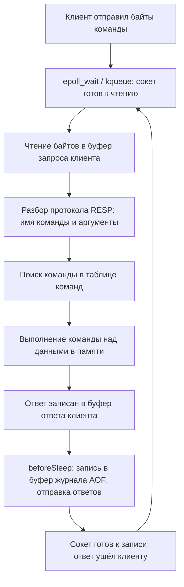

# 01. Архитектура Redis: один поток, event loop и латентность

**Зачем это знать backend-разработчику.** Redis обычно отвечает за доли миллисекунды, и к этому быстро привыкаешь. А потом один `KEYS *` в проде или удаление ключа на миллион элементов «замораживает» сервер на полсекунды, и таймауты сыплются у всех сервисов сразу. Чтобы такого не допускать, нужно понимать одну вещь: команды в Redis выполняет **один поток**. Отсюда следуют и скорость Redis, и его главная уязвимость, и правила вроде «`SCAN` вместо `KEYS`», «`UNLINK` вместо `DEL`», «не храните гигантские ключи».

> **Коротко:** Redis выполняет команды в одном главном потоке, внутри цикла событий (event loop), который через `epoll`/`kqueue` узнаёт, какие сокеты готовы. Благодаря этому не нужны блокировки и каждая команда атомарна, но медленная команда задерживает всех клиентов сразу. I/O-потоки (с 6.0) берут на себя чтение и запись сокетов, но не выполнение команд, а фоновые потоки освобождают память (`UNLINK`, lazyfree) и делают `fsync`. Для диагностики есть `SLOWLOG`, `LATENCY DOCTOR` и `redis-cli --latency`.

## Оглавление

- [Однопоточное ядро и цикл событий](#однопоточное-ядро-и-цикл-событий)
- [Почему один поток — это быстро](#почему-один-поток--это-быстро)
- [I/O-потоки: что распараллеливается, а что нет](#io-потоки-что-распараллеливается-а-что-нет)
- [Фоновые потоки и дочерние процессы](#фоновые-потоки-и-дочерние-процессы)
- [Протокол RESP2 и RESP3](#протокол-resp2-и-resp3)
- [Латентность и опасные O(N)-команды](#латентность-и-опасные-on-команды)
- [Диагностика: SLOWLOG и LATENCY](#диагностика-slowlog-и-latency)
- [Практика в репозитории](#практика-в-репозитории)
- [Типичные ошибки и заблуждения](#типичные-ошибки-и-заблуждения)
- [Итоги](#итоги)
- [Вопросы для самопроверки](#вопросы-для-самопроверки)
- [Источники](#источники)

## Однопоточное ядро и цикл событий

**На пальцах.** Представьте кассира в кофейне, у которого десятки окошек. Он не стоит у одного окошка, пока клиент думает. Он смотрит на табло: «в окошке 7 готов заказ». Подходит к окошку 7, быстро пробивает заказ, затем смотрит на табло снова. Кассир один, но обслуживает всех, потому что никогда не ждёт.

**Цикл событий** (event loop) — бесконечный цикл, который спрашивает у операционной системы: «какие из моих сокетов готовы к чтению или записи?», а затем обрабатывает только готовые. **Сокет** (socket) — конец сетевого соединения, через который идут байты клиента. **Мультиплексирование ввода-вывода** (I/O multiplexing) — механизм ОС, позволяющий одним вызовом следить за тысячами сокетов: `epoll` в Linux, `kqueue` в macOS и BSD. В исходниках Redis цикл событий называется `ae` (файлы `ae.c`, `ae_epoll.c`, `ae_kqueue.c`), а для систем без них есть запасной вариант на `select`.

Цикл обрабатывает два вида событий:

- **файловые** (file events) — сокет клиента готов: пришли байты команды или можно отправить ответ;
- **временные** (time events) — прежде всего `serverCron`. Он выполняется `hz` раз в секунду (по умолчанию `hz 10`) и делает фоновую уборку: удаляет часть истёкших ключей, продвигает рехеширование, проверяет, не пора ли делать снапшот.

Путь одного запроса показан ниже. В схеме встречаются два сокращения: **RESP** (REdis Serialization Protocol) — формат, в котором клиент присылает команды, а сервер отвечает (разбирается [ниже](#протокол-resp2-и-resp3)); **AOF** (Append Only File) — журнал изменяющих команд на диске (подробно — в [05. Персистентность](05-persistence.md)).



Главное здесь — шаг F. Пока одна команда выполняется, никакая другая не выполняется. Поэтому любая отдельная команда **атомарна** (atomic): никто не увидит её «наполовину выполненной».

**Пример.** Два клиента одновременно выполняют `INCR views`:

| Время | Клиент A | Клиент B | Значение `views` |
|---|---|---|---|
| t0 | отправил `INCR views` | отправил `INCR views` | 10 |
| t1 | главный поток выполняет INCR A | ждёт в очереди готовых сокетов | 11 |
| t2 | получил `11` | главный поток выполняет INCR B | 12 |
| t3 | — | получил `12` | 12 |

«Потерянного обновления», как при `read → +1 → write` в приложении, не бывает: чтение и запись внутри `INCR` — одна неделимая операция.

## Почему один поток — это быстро

**На пальцах.** Библиотекарь, который работает один, не тратит время на согласование с коллегами: «ты эту полку не трогаешь? я беру». А если книги стоят прямо на столе, а не в подвале, то большинство запросов он выполняет за секунду.

Точные причины:

1. **Данные в оперативной памяти.** Обращение к RAM занимает порядка сотни наносекунд, к SSD — десятки–сотни микросекунд. Команда `GET` — это поиск в хеш-таблице плюс копирование нескольких байт.
2. **Нет блокировок.** **Блокировка** (lock, mutex) — механизм, не пускающий два потока к одним данным одновременно. Её захват, ожидание и переключение контекста стоят дорого. Одному потоку блокировки не нужны вообще.
3. **Простые операции.** Большинство команд имеют сложность O(1) или O(log N). **O(N)** — время растёт пропорционально числу элементов N; для `GET` N не важно, для `LRANGE 0 -1` важно.
4. **Узкое место — не CPU, а сеть.** Для типичной команды основное время уходит на системные вызовы `read`/`write` и путь пакета по сети. **RTT** (round-trip time) — время «туда и обратно» между клиентом и сервером: в одном дата-центре это обычно 0,1–0,5 мс, тогда как `GET` на сервере выполняется за единицы микросекунд.

**Пример с числами.** Пусть RTT = 0,2 мс, а выполнение команды — 2 мкс. Если отправлять 10 000 команд по одной и ждать каждого ответа, это 10 000 × 0,2 мс ≈ 2 с. Почти всё это время сервер простаивает. С **pipelining** (отправкой пачки команд без ожидания ответов, подробно — в [06. Атомарность](06-atomicity-scripting.md)) те же 10 000 команд укладываются в десятки миллисекунд. Отсюда вывод: сначала экономьте сетевые обходы, а о ядрах CPU думайте потом.

```java
// Lettuce: асинхронный API сам «конвейеризует» команды в одном соединении
RedisClient client = RedisClient.create("redis://localhost:6379");
try (StatefulRedisConnection<String, String> conn = client.connect()) {
    RedisAsyncCommands<String, String> async = conn.async();
    List<RedisFuture<String>> futures = new ArrayList<>();
    for (int i = 0; i < 10_000; i++) {
        futures.add(async.set("key:" + i, "v" + i)); // не ждём ответа
    }
    LettuceFutures.awaitAll(Duration.ofSeconds(5), futures.toArray(new RedisFuture[0]));
} finally {
    client.shutdown();
}
```

🔬 **Глубже.** Один поток использует одно ядро. Для горизонтального роста Redis масштабируют процессами: несколько шардов в **Redis Cluster** (данные разбиты на 16384 слота, см. [08. Репликация, Sentinel и Cluster](08-replication-cluster.md)) или несколько экземпляров на одной машине.

## I/O-потоки: что распараллеливается, а что нет

**На пальцах.** Кассиру наняли помощников. Они принимают заказы у окошек, разбирают почерк и выдают готовые стаканы. Но варит кофе по-прежнему один бариста, строго по очереди.

**I/O-потоки** (I/O threads) появились в Redis 6.0 и включаются параметром `io-threads N` (по умолчанию `1`, то есть выключены). Они распараллеливают:

- чтение байтов из сокетов и разбор протокола RESP;
- запись ответов в сокеты.

Они **не** распараллеливают выполнение команд: команда всё так же выполняется в главном потоке, поэтому атомарность и модель «одна команда за раз» сохраняются.

| Что | Главный поток | I/O-потоки (`io-threads > 1`) |
|---|---|---|
| `read()` из сокета, разбор RESP | да, если I/O-потоков нет | да |
| Выполнение `SET`, `ZADD`, Lua | всегда | никогда |
| `write()` ответа в сокет | да, если I/O-потоков нет | да |

**Когда это помогает.** Когда клиентов много, а команды дешёвые, и главный поток занят системными вызовами больше, чем командами. Если медленная сама команда (`SMEMBERS` на миллион элементов), I/O-потоки не помогут.

🔬 **Глубже.** В 6.x–7.x чтение в I/O-потоках надо было включать отдельно (`io-threads-do-reads yes`). В Redis 8.0 реализацию I/O-потоков переработали: клиенты распределяются между потоками, которые сами читают, разбирают и отвечают, а главный поток только выполняет команды. На `redis:8.2` параметр `io-threads-do-reads` в `CONFIG GET` уже не отображается. Точные цифры прироста зависят от нагрузки. Проверяйте на своей нагрузке через `redis-benchmark`, а не по пресс-релизам.

```
127.0.0.1:6379> CONFIG GET io-threads
1) "io-threads"
2) "1"
```

## Фоновые потоки и дочерние процессы

**На пальцах.** Кассир не выносит мусор сам. Он ставит мешок у двери, и уборщик уносит его, когда может. Кассир тут же обслуживает следующего клиента.

Кроме главного потока, в Redis есть **фоновые потоки** (background threads, модуль `bio` в исходниках). Они берут на себя долгие операции, результат которых клиенту ждать не нужно:

- **освобождение памяти** (lazy free) — удаление больших объектов;
- **`fsync` AOF-файла** — сброс журнала изменяющих команд на диск в режиме `appendfsync everysec` (подробно — в [05. Персистентность](05-persistence.md));
- **закрытие файлов** — например, старого AOF после перезаписи.

**`UNLINK`** — удаляет ключ из пространства ключей мгновенно, а память освобождает в фоне. Для маленьких объектов Redis освобождает память сразу: передача в фон стоила бы дороже. **`DEL`** освобождает всё синхронно, в главном потоке. Для строки разницы нет, а для Hash на миллион полей она огромна.

**Пример** (Redis 8.2 в Docker, Hash на 1 000 000 полей, около 64 МБ по `MEMORY USAGE`):

```
$ time redis-cli DEL bighash       # ≈ 430 мс: всё это время сервер не отвечал никому
(integer) 1
$ time redis-cli UNLINK bighash2   # ≈ 3 мс, из них почти всё — запуск redis-cli
(integer) 1
```

Цифры с конкретной машины. Важен порядок разницы, а не точные миллисекунды.

**Параметры lazyfree** переводят в фон неявные удаления:

| Параметр | Что делает асинхронным |
|---|---|
| `lazyfree-lazy-user-del` | `DEL` ведёт себя как `UNLINK` |
| `lazyfree-lazy-expire` | удаление истёкших ключей |
| `lazyfree-lazy-eviction` | вытеснение при `maxmemory` |
| `lazyfree-lazy-server-del` | неявные удаления (например, `RENAME` поверх существующего ключа) |
| `lazyfree-lazy-user-flush` | `FLUSHALL`/`FLUSHDB` без явного `ASYNC` |

На `redis:8.2` все они по умолчанию `no` (проверено `CONFIG GET lazyfree*`). В форках, например в Valkey, значения по умолчанию могут отличаться. `FLUSHALL ASYNC` и `FLUSHDB ASYNC` работают асинхронно всегда.

**Дочерние процессы** — это не потоки. Для снапшота **RDB** (Redis Database file — бинарный слепок всех данных на момент времени) и перезаписи AOF Redis вызывает `fork()`: копия процесса пишет данные на диск, а родитель продолжает обслуживать клиентов. Сам `fork()` на большом наборе данных может занять миллисекунды и больше: ОС копирует таблицы страниц. Время последнего fork показывает `INFO stats` в поле `latest_fork_usec`.

```java
// Удаление большого ключа без блокировки сервера
Long removed = commands.unlink("report:2026-09"); // 1 — ключ был, 0 — не было
```

## Протокол RESP2 и RESP3

**На пальцах.** Клиент и сервер договорились о формате конверта: первый символ говорит, что внутри (строка, число, массив), затем идёт длина, затем содержимое. Такой конверт легко разобрать, не угадывая, где кончается сообщение.

**RESP** (REdis Serialization Protocol) — текстово-бинарный протокол поверх TCP. Каждое значение начинается с байта-типа и заканчивается `\r\n`. Команда `SET user:1 Ann` уходит на сервер как массив из трёх **bulk strings** (строк с явной длиной, в них допустимы любые байты):

```
*3\r\n$3\r\nSET\r\n$6\r\nuser:1\r\n$3\r\nAnn\r\n
```

| Префикс | Тип RESP2 | Пример ответа |
|---|---|---|
| `+` | простая строка | `+OK\r\n` |
| `-` | ошибка | `-ERR unknown command\r\n` |
| `:` | целое | `:42\r\n` |
| `$` | bulk string | `$3\r\nAnn\r\n`, `$-1\r\n` = nil |
| `*` | массив | `*2\r\n...` |

**RESP3** появился в Redis 6.0. Клиент включает его командой `HELLO 3`. В RESP3 добавлены настоящие типы: **map** (`%`), **set** (`~`), **null** (`_`), **boolean** (`#`), **double** (`,`), **big number** (`(`) и **push** (`>`) — внеочередные сообщения от сервера. Пример разницы: в RESP2 `HGETALL` возвращает плоский массив `[поле, значение, поле, значение]`, а в RESP3 — map. Push-сообщения позволяют получать Pub/Sub-сообщения и уведомления **client-side caching** (инвалидации локального кэша клиента) в том же соединении, где идут обычные команды.

```
127.0.0.1:6379> HELLO 3
 1# "server" => "redis"
 2# "version" => "8.2.10"
 3# "proto" => (integer) 3
 ...
```

Lettuce (6.x и 7.x) по умолчанию пытается договориться о RESP3 через `HELLO`, а если сервер не умеет, откатывается на RESP2. Версию протокола можно зафиксировать явно:

```java
RedisClient client = RedisClient.create("redis://localhost:6379");
client.setOptions(ClientOptions.builder()
        .protocolVersion(ProtocolVersion.RESP2) // например, для старого прокси
        .build());
```

🔬 **Глубже.** Разбирать RESP дёшево: длины известны заранее, текст не нужно сканировать в поисках разделителей. Поэтому pipelining эффективен: сервер вычитывает из буфера сразу много команд подряд.

## Латентность и опасные O(N)-команды

**На пальцах.** Если один покупатель выкладывает на кассу тысячу товаров, вся очередь стоит. С одним кассиром «долгий» клиент — проблема всех.

**Латентность** (latency) — время от отправки команды до получения ответа. В однопоточном сервере она складывается из ожидания своей очереди и собственного выполнения. Команда на 400 мс добавляет до 400 мс *всем*, кто пришёл во время её выполнения.

Опасные команды и их безопасные замены:

| Опасно | Почему | Вместо этого |
|---|---|---|
| `KEYS pattern` | O(N) по всем ключам базы | `SCAN 0 MATCH pattern COUNT 1000` |
| `DEL` большого ключа | O(M) освобождение M элементов | `UNLINK` |
| `FLUSHALL` | синхронная очистка всей памяти | `FLUSHALL ASYNC` |
| `HGETALL`, `SMEMBERS`, `LRANGE 0 -1` на больших коллекциях | O(M) и огромный ответ | `HSCAN`/`SSCAN`, `LRANGE` страницами |
| `ZRANGE 0 -1` на большом ZSet | O(log N + M) | `ZRANGE` с `LIMIT`/по диапазону |
| долгий Lua-скрипт | блокирует сервер целиком | короткие скрипты, см. [06](06-atomicity-scripting.md) |

**`SCAN`** — итерация по ключам с **курсором** (cursor): числом, которое сервер возвращает, чтобы вы продолжили с того же места. Каждый вызов делает немного работы, и между вызовами сервер обслуживает других. Правила:

- итерация закончена, когда вернулся курсор `0`;
- `COUNT` — подсказка, а не точный размер страницы;
- `MATCH` фильтрует *после* выборки, поэтому страница может прийти пустой при ненулевом курсоре;
- ключ, существовавший всё время обхода, будет возвращён хотя бы раз, но возможны дубликаты.

```
127.0.0.1:6379> SCAN 0 MATCH session:* COUNT 5
1) "2"
2) 1) "session:15"
   2) "session:5"
   3) "session:2"
   4) "session:14"
   5) "session:18"
127.0.0.1:6379> SCAN 2 MATCH session:* COUNT 5
...
```

То же на Lettuce: обходим ключи по страницам и удаляем их через `UNLINK`.

```java
ScanArgs args = ScanArgs.Builder.matches("session:*").limit(500); // limit = COUNT
KeyScanCursor<String> cursor = commands.scan(args);
long removed = 0;
while (true) {
    List<String> keys = cursor.getKeys();
    if (!keys.isEmpty()) {
        removed += commands.unlink(keys.toArray(String[]::new));
    }
    if (cursor.isFinished()) break;     // сервер вернул курсор "0"
    cursor = commands.scan(cursor, args);
}
System.out.println("Удалено ключей: " + removed);
```

🔬 **Глубже.** `SCAN` не пропускает элементы даже при рехешировании: курсор перебирает бакеты в «обратном двоичном» порядке, поэтому рост или сжатие таблицы не ломает обход (см. [02. Внутренние кодировки](02-internal-encodings.md)). Из-за этого курсор выглядит как случайное число.

## Диагностика: SLOWLOG и LATENCY

**На пальцах.** Чтобы найти, кто задерживает очередь, нужен журнал «кто сколько стоял у кассы» и отдельный датчик «когда касса вообще замирала».

**`SLOWLOG`** — журнал команд, чьё *выполнение* (без сети и ожидания в очереди) превысило порог `slowlog-log-slower-than` в микросекундах (по умолчанию `10000` = 10 мс). Журнал хранит последние `slowlog-max-len` записей (по умолчанию 128) в памяти. После `DEL` миллионного Hash он показывает:

```
127.0.0.1:6379> SLOWLOG GET 1
1) 1) (integer) 1              # id записи
   2) (integer) 1790083225     # unix-время
   3) (integer) 429010         # длительность, мкс (≈ 0,43 с)
   4) 1) "DEL"
      2) "bighash"
   5) "127.0.0.1:41402"        # адрес клиента
   6) ""                       # имя клиента (CLIENT SETNAME)
```

**LATENCY monitor** — подсистема, записывающая *события* задержки: медленные команды, `fork`, `fsync` AOF, истечение ключей. По умолчанию она выключена (`latency-monitor-threshold 0`). Включается порогом в миллисекундах:

```
127.0.0.1:6379> CONFIG SET latency-monitor-threshold 100
OK
127.0.0.1:6379> LATENCY LATEST      # последнее и максимальное значение по каждому событию
127.0.0.1:6379> LATENCY HISTORY command
127.0.0.1:6379> LATENCY DOCTOR      # отчёт с советами на английском
```

`LATENCY DOCTOR` не только перечисляет события, но и даёт советы. Например, на свежем `redis:8.2` в Docker он предупредил о включённых **transparent huge pages** (THP) — механизме ядра Linux, который увеличивает задержки при `fork`.

Со стороны клиента: `redis-cli --latency` в цикле пингует сервер и показывает min/avg/max, а `redis-cli --bigkeys` и `--memkeys` находят самые большие ключи через `SCAN`, не блокируя сервер.

```java
// Lettuce: прочитать 10 последних медленных команд
List<Object> slow = commands.slowlogGet(10);
slow.forEach(entry -> System.out.println(entry)); // вложенные List<Object>, как в redis-cli
```

## Практика в репозитории

- [../tasks/03-rate-limiter.md](../tasks/03-rate-limiter.md) — атомарность отдельной команды (`INCR` + `EXPIRE`) и Lua-скрипт для скользящего окна: работает, потому что сервер однопоточный.
- [../tasks/04-distributed-lock.md](../tasks/04-distributed-lock.md) — `SET NX PX` как атомарная операция и fencing-токены.
- [../tasks/06-sessions-analytics.md](../tasks/06-sessions-analytics.md) — массовые операции над сессиями: здесь уместны `SCAN` вместо `KEYS`.
- [../tasks/02-cache-stampede.md](../tasks/02-cache-stampede.md) — что происходит с латентностью, когда тысячи клиентов бьют в один ключ.
- [BasicsDemo](../examples/src/main/java/dev/nosqlguide/redis/examples/driver/BasicsDemo.java) — подключение через `RedisClient`, `StatefulRedisConnection`, синхронный API.
- [PipeliningDemo](../examples/src/main/java/dev/nosqlguide/redis/examples/driver/PipeliningDemo.java) — сколько экономит pipelining на RTT, в цифрах.
- [LuaScriptingDemo](../examples/src/main/java/dev/nosqlguide/redis/examples/driver/LuaScriptingDemo.java) — скрипт выполняется атомарно, но и блокирует сервер на время работы.
- Общая теория: [01. Зачем NoSQL](../../docs/00-foundations/01-why-nosql.md), [07. Движки хранения](../../docs/00-foundations/07-storage-engines.md) (журнал и `fsync`), [05. Партиционирование](../../docs/00-foundations/05-partitioning.md) (как масштабировать за пределы одного ядра).

## Типичные ошибки и заблуждения

1. **«Redis однопоточный, значит, внутри нет потоков».** Потоки есть: фоновые (`bio`: lazy free, `fsync`, закрытие файлов) и, по желанию, I/O-потоки. Однопоточно только *выполнение команд*.
2. **«Включу `io-threads 8`, и тяжёлые команды ускорятся».** I/O-потоки ускоряют только сетевой ввод-вывод. `SMEMBERS` на миллион элементов выполняется в главном потоке так же долго.
3. **«`KEYS` можно, у нас мало ключей».** Сегодня мало, через год их 50 миллионов, и «разовая» админская команда останавливает прод. Используйте `SCAN` всегда.
4. **«`SLOWLOG` пуст — значит, латентности нет».** `SLOWLOG` меряет только выполнение команды. Время в очереди за чужой медленной командой, сеть, `fork` и `fsync` в него не попадают. Смотрите `LATENCY`, метрики клиента и `redis-cli --latency`.
5. **«Pipelining = транзакция».** Pipelining лишь экономит RTT. Между командами пачки могут выполниться команды других клиентов. Атомарность дают `MULTI/EXEC` и Lua.
6. **«Раз атомарна каждая команда, то и последовательность GET → SET атомарна».** Нет: между вашими `GET` и `SET` вклинится другой клиент. Нужна одна команда (`INCR`, `SET NX`) или скрипт.

## Итоги

- Команды выполняет один главный поток внутри цикла событий на `epoll`/`kqueue`. Отсюда атомарность каждой команды без блокировок.
- Скорость дают данные в RAM, отсутствие блокировок и дешёвые операции. Узкое место обычно сеть, поэтому экономьте RTT через pipelining.
- I/O-потоки (с 6.0, переработаны в 8.0) параллелят чтение, разбор и запись сокетов, но не команды.
- Фоновые потоки освобождают память (`UNLINK`, `FLUSHALL ASYNC`, `lazyfree-*`) и делают `fsync`. RDB и перезапись AOF выполняют дочерние процессы через `fork()`.
- RESP — простой протокол с префиксами типов. RESP3 добавляет map, set, null, boolean и push-сообщения.
- Любая O(N)-команда на большом N задерживает всех: `KEYS` → `SCAN`, `DEL` → `UNLINK`, `HGETALL` → `HSCAN`.
- Диагностика: `SLOWLOG GET`, `LATENCY DOCTOR` (после `latency-monitor-threshold`), `redis-cli --latency`, `--bigkeys`.

## Вопросы для самопроверки

1. Почему два одновременных `INCR` на одном ключе никогда не теряют обновление?
   <details><summary>Ответ</summary>Команды выполняет один поток строго по одной. `INCR` читает, увеличивает и записывает значение внутри одной команды, и ни одна другая команда не может выполниться посередине.</details>
2. Что делают I/O-потоки и почему они не ускоряют `SUNION` двух огромных множеств?
   <details><summary>Ответ</summary>Они читают байты из сокетов, разбирают RESP и пишут ответы. Сама команда `SUNION` выполняется в главном потоке, её стоимость O(N) остаётся прежней. Потоки могут разве что быстрее отправить большой ответ.</details>
3. Чем `UNLINK` отличается от `DEL` и когда разницы нет?
   <details><summary>Ответ</summary>`UNLINK` сразу убирает ключ из пространства ключей, а память крупного объекта освобождает фоновый поток. `DEL` освобождает всё синхронно. Для маленьких значений (строка, небольшой Hash) разницы практически нет: Redis освобождает их сразу в обоих случаях.</details>
4. Вы выполнили `SCAN 0 MATCH order:* COUNT 100` и получили курсор `1536` и пустой список. Обход закончен?
   <details><summary>Ответ</summary>Нет. Обход закончен только когда вернулся курсор `0`. Пустая страница — нормальная ситуация: `MATCH` отфильтровал все ключи, просмотренные на этом шаге.</details>
5. Сервис жалуется на таймауты, а `SLOWLOG` пуст. Где искать?
   <details><summary>Ответ</summary>Включить `latency-monitor-threshold` и посмотреть `LATENCY LATEST`/`LATENCY DOCTOR` (fork, fsync AOF, истечение ключей). Проверить сеть и клиент: `redis-cli --latency`, размер пула, пропускную способность. Проверить `INFO stats` → `latest_fork_usec`, THP, свопинг. Помнить, что `SLOWLOG` не учитывает время ожидания в очереди.</details>
6. Зачем RESP3, если RESP2 работает?
   <details><summary>Ответ</summary>RESP3 передаёт типы явно (map, set, double, boolean, null): клиенту не нужно угадывать, что плоский массив `HGETALL` — это пары. Push-сообщения позволяют получать Pub/Sub и инвалидации client-side caching в том же соединении, где идут обычные команды.</details>
7. Сколько займут 5 000 последовательных `GET` при RTT 0,5 мс и как это улучшить?
   <details><summary>Ответ</summary>Около 5 000 × 0,5 мс = 2,5 с, почти всё — ожидание сети. Pipelining (асинхронный API Lettuce) или `MGET` сокращают это до одного или нескольких RTT плюс время выполнения — единицы-десятки миллисекунд.</details>

## Источники

- Redis docs: *Redis latency problems troubleshooting*, *Latency monitoring*. https://redis.io/docs/latest/operate/oss_and_stack/management/optimization/latency/ , https://redis.io/docs/latest/operate/oss_and_stack/management/optimization/latency-monitor/
- Redis docs: *Redis serialization protocol specification* (RESP2/RESP3). https://redis.io/docs/latest/develop/reference/protocol-spec/
- Redis docs: *Pipelining*. https://redis.io/docs/latest/develop/use/pipelining/
- Redis commands: `SCAN`, `UNLINK`, `SLOWLOG GET`, `LATENCY DOCTOR`, `HELLO`. https://redis.io/docs/latest/commands/
- Пример конфигурации `redis.conf` (разделы THREADED I/O, LAZY FREEING). https://github.com/redis/redis/blob/unstable/redis.conf
- Исходники: `src/ae.c`, `src/ae_epoll.c`, `src/networking.c`, `src/bio.c`, `src/lazyfree.c`. https://github.com/redis/redis
- Lettuce Reference Guide: *Pipelining and command flushing*, *Client options* (`protocolVersion`). https://redis.github.io/lettuce/
- Sanfilippo S. (antirez). *Lazy Redis is better Redis* (2015). http://antirez.com/news/93

---

[оглавление](README.md) | [02. Внутренние кодировки](02-internal-encodings.md) →
