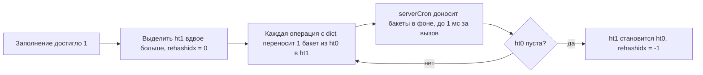

# 02. Внутренние кодировки

**Зачем это знать backend-разработчику.** Один и тот же Hash из 100 полей может занимать 2 КБ, а после добавления одного длинного поля — 6,7 КБ. Разница больше чем втрое, хотя данных добавилось на 65 байт. Если у вас 10 миллионов профилей пользователей, это десятки гигабайт RAM, то есть деньги. Redis незаметно выбирает для каждого значения внутреннее представление — **кодировку**. Кто понимает кодировки, тот знает, почему «маленькие» коллекции экономны, где пороги и как не перескочить их одним неудачным полем.

> **Коротко:** Каждое значение в Redis — это `redisObject` с типом (String, Hash, ...) и кодировкой (как именно лежат байты). Маленькие коллекции хранятся компактно в **listpack** (сплошной массив байт, заменил ziplist в 7.0) или **intset**. Большие хранятся в быстрых, но «толстых» структурах: **hashtable**, **quicklist**, **skiplist + dict**. Переход происходит автоматически, когда превышен порог по числу элементов или по длине элемента, и обратно, как правило, не выполняется. Посмотреть кодировку можно командой `OBJECT ENCODING`, память — `MEMORY USAGE`.

## Оглавление

- [redisObject и OBJECT ENCODING](#redisobject-и-object-encoding)
- [SDS: строки Redis](#sds-строки-redis)
- [Кодировки строк: int, embstr, raw](#кодировки-строк-int-embstr-raw)
- [listpack и пороги](#listpack-и-пороги)
- [quicklist: большие списки](#quicklist-большие-списки)
- [intset: множества целых чисел](#intset-множества-целых-чисел)
- [hashtable и инкрементальный rehashing](#hashtable-и-инкрементальный-rehashing)
- [ZSet: skiplist + dict](#zset-skiplist--dict)
- [Как посмотреть память](#как-посмотреть-память)
- [Разбор: Hash из 100 полей переходит в hashtable](#разбор-hash-из-100-полей-переходит-в-hashtable)
- [Практика в репозитории](#практика-в-репозитории)
- [Типичные ошибки и заблуждения](#типичные-ошибки-и-заблуждения)
- [Итоги](#итоги)
- [Вопросы для самопроверки](#вопросы-для-самопроверки)
- [Источники](#источники)

## redisObject и OBJECT ENCODING

**На пальцах.** На складе у каждой коробки есть этикетка: «что внутри» (обувь) и «как упаковано» (в пакете или в жёстком кейсе). Покупателю важно только первое. Складу важно второе: от упаковки зависит, сколько места занимает коробка и как быстро её вскрыть.

**`redisObject`** (в исходниках `robj`) — заголовок каждого значения. В классическом виде (до Redis 7.x включительно) это 16 байт:

| Поле | Размер | Смысл |
|---|---|---|
| `type` | 4 бита | логический тип: string, list, set, zset, hash, stream |
| `encoding` | 4 бита | физическое представление: int, embstr, listpack, ... |
| `lru` | 24 бита | время последнего доступа (LRU) или счётчик частоты (LFU) для вытеснения |
| `refcount` | 32 бита | счётчик ссылок: объект можно разделять |
| `ptr` | 8 байт | указатель на данные (или само число для `int`) |

В Redis 8 структура дополнена (например, ключ может храниться в том же блоке памяти, что и объект), но идея «тип + кодировка + данные» не изменилась.

**Тип** (type) — то, что видит пользователь: команда `TYPE`. **Кодировка** (encoding) — то, как Redis хранит этот тип внутри: команда `OBJECT ENCODING`. Кодировки для каждого типа (проверено на `redis:8.2`):

| Тип | Маленькое значение | Большое значение |
|---|---|---|
| String | `int`, `embstr` | `raw` |
| List | `listpack` | `quicklist` |
| Set | `intset` (только целые), `listpack` | `hashtable` |
| Hash | `listpack` | `hashtable` |
| ZSet | `listpack` | `skiplist` |
| Stream | `stream` (радикс-дерево из listpack-узлов) | — |

```
127.0.0.1:6379> SET counter 12345
OK
127.0.0.1:6379> TYPE counter
string
127.0.0.1:6379> OBJECT ENCODING counter
"int"
127.0.0.1:6379> SADD si 1 2 3
(integer) 3
127.0.0.1:6379> OBJECT ENCODING si
"intset"
127.0.0.1:6379> SADD si x
(integer) 1
127.0.0.1:6379> OBJECT ENCODING si
"listpack"
```

## SDS: строки Redis

**На пальцах.** Обычная строка в C похожа на рулон бумаги без метки длины: чтобы узнать длину, её надо размотать до конца (до нулевого байта). SDS — рулон с наклейкой «длина 120 см, влезает ещё 80».

**SDS** (Simple Dynamic String) — собственная реализация строк в Redis. Перед байтами строки лежит заголовок:

- `len` — текущая длина (узнать длину — O(1), `STRLEN` не сканирует строку);
- `alloc` — сколько байт выделено (разница — запас под дописывание);
- `flags` — какой вариант заголовка используется: `sdshdr5/8/16/32/64`. Для короткой строки длина хранится в 1 байте, для длинной — в 8.

Свойства:

1. **Бинарная безопасность** (binary safety). Длина берётся из `len`, а не ищется по нулевому байту, поэтому внутри могут быть любые байты: JPEG, сериализованный Java-объект, protobuf.
2. **Преаллокация** (preallocation). При росте Redis выделяет память с запасом: пока новая длина меньше 1 МБ, выделяется вдвое больше нужного, дальше — плюс 1 МБ. Серия `APPEND` не вызывает realloc на каждый байт.
3. **Совместимость с C.** В конце всё равно стоит `\0`, чтобы строку можно было передать стандартным функциям C.

**Пример.** `SET greeting "Hi"`, затем `APPEND greeting " there"`:

| Шаг | len | alloc | Что произошло |
|---|---|---|---|
| `SET greeting "Hi"` | 2 | 2 | выделено ровно под строку |
| `APPEND ... " there"` | 8 | 16 | нужно 8, выделено 2 × 8 = 16 |
| `APPEND ... "!!"` | 10 | 16 | влезло в запас, без realloc |

(Схема упрощена: аллокатор jemalloc округляет размеры до своих классов.)

## Кодировки строк: int, embstr, raw

**На пальцах.** Число «42» проще записать прямо на этикетке коробки, короткую записку — вложить в ту же коробку, а толстую папку — хранить на отдельной полке и указать на этикетке номер полки.

- **`int`** — значение является целым числом в диапазоне 64-битного `long` со знаком и записано «канонически» (без пробелов и ведущих нулей). Число лежит прямо в поле `ptr`, отдельной памяти не нужно. `9223372036854775807` будет `int`, а `9223372036854775808` и `" 12"` — уже строки. 🔬 Числа от 0 до 9999 Redis держит заранее созданными **разделяемыми объектами** (shared integers), если только не выбрана LRU/LFU-политика вытеснения: у общих объектов не может быть собственного времени доступа.
- **`embstr`** (embedded string) — короткая строка. `redisObject` и SDS размещаются **одной** аллокацией, подряд. Это меньше памяти, один `malloc` вместо двух и лучше для кэша процессора. Embstr неизменяем: `APPEND` превращает его в `raw`.
- **`raw`** — `redisObject` и SDS лежат в двух отдельных блоках памяти. Используется для длинных строк и строк, которые меняли.

**Откуда классическая граница в 44 байта.** jemalloc выделяет блоки фиксированных размеров, один из них — 64 байта. 64 − 16 (redisObject) − 3 (заголовок `sdshdr8`) − 1 (`\0`) = 44. Так было в Redis 3.2–7.x.

**В Redis 8 граница «плавает».** На `redis:8.2` в тот же блок встраивается ещё и ключ, поэтому допустимая длина значения зависит от длины ключа. Замер:

| Ключ | Значение 20 байт | 30 байт | 40 байт | 44 байта |
|---|---|---|---|---|
| `a` | embstr (48 Б) | embstr (56 Б) | embstr (64 Б) | raw (72 Б) |
| `keykeykeykey` | embstr (56 Б) | raw (64 Б) | raw (80 Б) | raw (80 Б) |

В скобках — `MEMORY USAGE`. Вывод для практики: не полагайтесь на точное число 44, полагайтесь на идею «короткое — дешевле».

```java
// cmd — RedisCommands<String, String> из connection.sync(), см. 01-architecture.md
cmd.set("n", "100");
cmd.set("s", "hello");
cmd.set("long", "x".repeat(200));
for (String key : List.of("n", "s", "long")) {
    // OBJECT ENCODING и MEMORY USAGE доступны прямо в Lettuce
    System.out.printf("%s -> %s, %d байт%n", key, cmd.objectEncoding(key), cmd.memoryUsage(key));
}
// n -> int, ...   s -> embstr, ...   long -> raw, ...
```

## listpack и пороги

**На пальцах.** Небольшой список покупок удобнее написать на одном листке подряд, чем заводить отдельную карточку на каждый товар со ссылкой на следующую. Найти «молоко» в списке из 20 строк можно глазами, указатели не нужны.

**listpack** — компактная сериализованная последовательность элементов в **одном непрерывном блоке памяти**:

```
[всего байт: 4][число элементов: 2][элемент 1][элемент 2]...[0xFF — конец]
элемент = [кодировка + данные][длина этого элемента (backlen)]
```

- Нет указателей: у хеш-таблицы на каждую пару приходится узел `dictEntry` в 24 байта (три указателя) плюс отдельные аллокации SDS для поля и значения, здесь — только полезные байты и 1–2 байта служебных.
- Маленькие целые хранятся очень компактно: число от 0 до 127 занимает 1 байт данных плюс 1 байт `backlen`.
- Поиск — линейный проход, O(N). Но N маленькое, а данные лежат подряд и хорошо попадают в кэш процессора, поэтому на практике это быстро.
- `backlen` в конце элемента позволяет идти и назад (нужно для `LRANGE` с отрицательными индексами, `RPOP`).

**Почему заменили ziplist (Redis 7.0).** Ziplist хранил в каждом элементе длину *предыдущего* элемента (1 или 5 байт). Если элемент вырастал за 254 байта, у соседа поле длины расширялось с 1 до 5 байт, сосед сам мог «перерасти» границу, и так по цепочке. Это **каскадное обновление** (cascade update): в худшем случае O(N²). Listpack хранит только собственную длину, поэтому изменение затрагивает один элемент. Старые имена параметров (`hash-max-ziplist-entries` и т. п.) остаются псевдонимами новых.

**Пороги.** Коллекция хранится в listpack, пока выполняются **оба** условия: элементов не больше `*-max-listpack-entries` и каждый элемент не длиннее `*-max-listpack-value` байт.

| Параметр | Значение по умолчанию на `redis:8.2` |
|---|---|
| `hash-max-listpack-entries` / `-value` | 512 / 64 |
| `zset-max-listpack-entries` / `-value` | 128 / 64 |
| `set-max-listpack-entries` / `-value` | 128 / 64 (listpack для Set — с 7.2) |
| `set-max-intset-entries` | 512 |
| `list-max-listpack-size` | −2 (узел до 8 КБ) |

⚠️ В документации и старых версиях для Hash часто указано 128, а `redis:8.2` в `CONFIG GET` показывает 512. Значения меняются между версиями, поэтому всегда проверяйте на своём сервере:

```
127.0.0.1:6379> CONFIG GET hash-max-listpack-*
1) "hash-max-listpack-value"
2) "64"
3) "hash-max-listpack-entries"
4) "512"
```

Для Hash на `redis:8.2` проверено: 512 коротких полей — `listpack` (12 312 байт), 513 полей — `hashtable` (37 000 байт).

## quicklist: большие списки

**На пальцах.** Длинный список покупок на одном огромном свитке неудобен: чтобы вставить строку в середину, надо переписать всё после неё. Разумнее тетрадь: каждый лист — маленький список, листы сшиты по порядку.

**quicklist** — **двусвязный список** (doubly linked list: каждый узел знает предыдущего и следующего) из узлов, каждый из которых хранит listpack. Так объединяются достоинства обоих подходов: `LPUSH`/`RPOP` на концах — O(1), вставка меняет только один небольшой listpack, а указателей мало (по одному на узел, а не на элемент).

- `list-max-listpack-size`: отрицательное значение ограничивает размер узла в байтах (−1 = 4 КБ, −2 = 8 КБ, … −5 = 64 КБ), положительное — числом элементов.
- `list-compress-depth`: сколько узлов с каждого края **не** сжимать. 0 — сжатие выключено (по умолчанию). При 1 все узлы, кроме крайних, сжимаются алгоритмом LZF: концы списка горячие, середина холодная.

С Redis 7.2 маленький список хранится просто как один listpack и превращается в quicklist, только когда перерастает один узел:

```
127.0.0.1:6379> RPUSH small a b c
(integer) 3
127.0.0.1:6379> OBJECT ENCODING small
"listpack"
127.0.0.1:6379> RPUSH big 1 2 3 ... 5000     # 5000 чисел
(integer) 5000
127.0.0.1:6379> OBJECT ENCODING big
"quicklist"
```

## intset: множества целых чисел

**На пальцах.** Если в коробке лежат только монеты, их удобно выложить в ряд по возрастанию номинала в одинаковые ячейки. Найти нужную можно делением пополам.

**intset** — отсортированный массив целых чисел одинаковой ширины: 16, 32 или 64 бита. Поиск (`SISMEMBER`) — **двоичный** (binary search, O(log N)), вставка — O(N) из-за сдвига элементов.

**Апгрейд ширины.** Множество `{1, 2, 3}` хранится по 2 байта на число. `SADD s 100000` не влезает в int16, и весь массив перекодируется в int32 (4 байта на каждое). Обратного сужения нет.

| Команда | Кодировка | Байт на элемент |
|---|---|---|
| `SADD s 1 2 3` | intset (int16) | 2 |
| `SADD s 100000` | intset (int32) | 4 |
| `SADD s abc` | listpack (≤ 128 элементов) | переменно |
| 513 целых чисел | hashtable | десятки |

Проверено на `redis:8.2`: `SADD` 512 чисел — `intset`, 513 — `hashtable` (listpack не подходит: 513 > 128).

## hashtable и инкрементальный rehashing

**На пальцах.** Гардероб с номерками: номерок (хеш) сразу говорит, на каком крючке пальто. Когда гостей становится больше, чем крючков, нужен новый зал вдвое больше. Переносить все пальто разом — очередь встанет. Поэтому гардеробщик переносит по одному крючку каждый раз, когда кто-то подходит, а пока идёт переезд, ищет пальто в обоих залах.

**hashtable** (в исходниках `dict`) — хеш-таблица с цепочками: массив **бакетов** (bucket, ячейка массива), размер — степень двойки. Ключ хешируется (SipHash), номер бакета = хеш & (размер − 1), а коллизии хранятся в связном списке. Поиск — O(1) в среднем. Цена — указатели и заголовок узла на *каждую* пару, поэтому она в разы «толще» listpack.

**Коэффициент заполнения** (load factor) = элементов / бакетов. Когда он достигает 1, таблица растёт вдвое. Когда он сильно падает (порядка 10% и ниже), таблица сжимается. Во время `fork` (снапшот, перезапись AOF) Redis откладывает рост, пока заполнение не станет заметно больше 1: перемещение памяти разрушает экономию **copy-on-write** (копирование при записи — после `fork` родитель и потомок делят одни и те же страницы памяти, пока кто-то из них не запишет в страницу; тогда ОС копирует именно её).

**Инкрементальное рехеширование** (incremental rehashing). У `dict` есть две таблицы: старая `ht0` и новая `ht1`, а также индекс `rehashidx` — какой бакет переносить следующим.



Пока идёт перенос:

- **поиск** смотрит в обе таблицы;
- **вставка** идёт только в новую таблицу, чтобы старая только пустела;
- **удаление** ищет в обеих.

Так одна большая O(N)-пауза превращается в множество крошечных шагов. Эта же структура лежит в основе всего **пространства ключей** (keyspace): главный словарь «ключ → значение» тоже рехешируется постепенно. Параметр `activerehashing yes` (по умолчанию) включает фоновую помощь из `serverCron`.

🔬 **Глубже.** `SCAN` корректно работает поверх рехеширования потому, что курсор увеличивается в **обратном порядке бит** (reverse binary). Бакет `i` маленькой таблицы переходит в бакеты `i` и `i + size` большой. При обходе с обратным инкрементом старших бит эти пары не пропускаются. Отсюда гарантия «каждый ключ хотя бы раз, но возможны повторы».

## ZSet: skiplist + dict

**На пальцах.** В толстом словаре есть и алфавитный порядок страниц (чтобы листать «от А до Г»), и предметный указатель в конце (чтобы сразу найти страницу слова). Два способа доступа к одним данным.

Большой **ZSet** (отсортированное множество) хранится двумя структурами одновременно:

- **dict**: `member → score` — `ZSCORE` и проверка существования за O(1);
- **skiplist** (список с пропусками): элементы, упорядоченные по `(score, member)`. `ZADD`, `ZRANK`, `ZRANGEBYSCORE` — за O(log N).

**Skiplist** — отсортированный связный список с «экспресс-линиями». У каждого узла случайное число уровней: с вероятностью 1/4 он поднимается на уровень выше, максимум 32 уровня. Поиск начинается с верхней редкой линии и спускается вниз, как пересадка с экспресса на местную электричку.

```
L3: head ---------------------------------> 90(carol) -> nil
L2: head ------------> 40(bob) -----------> 90(carol) -> nil
L1: head -> 10(ann) -> 40(bob) -> 70(dan) -> 90(carol) -> nil
```

🔬 На каждой «стрелке» Redis хранит **span** — сколько элементов она перепрыгивает. Сумма span по пути поиска и даёт ранг: так `ZRANK` работает за O(log N), а не O(N).

Строки `member` разделяются между dict и skiplist, поэтому данные не хранятся дважды, но служебные структуры всё равно дороги. Маленький ZSet (≤ 128 элементов и каждый member ≤ 64 байт) лежит в listpack парами «member, score», отсортированными по score:

```
127.0.0.1:6379> ZADD board 100 ann 200 bob
(integer) 2
127.0.0.1:6379> OBJECT ENCODING board
"listpack"
127.0.0.1:6379> ZADD board 300 "очень-длинное-имя-игрока-больше-64-байт-..."
(integer) 1
127.0.0.1:6379> OBJECT ENCODING board
"skiplist"
```

## Как посмотреть память

**На пальцах.** Чтобы понять, какая мебель занимает квартиру, мало знать общую площадь: нужна рулетка для каждого шкафа.

- **`MEMORY USAGE key [SAMPLES n]`** — сколько байт занимает ключ вместе со значением и служебными структурами. Для больших коллекций Redis оценивает размер по выборке из `n` элементов (по умолчанию 5). `SAMPLES 0` означает посчитать всё точно (O(N), осторожно на больших ключах).
- **`INFO memory`** — общая картина: `used_memory` (сколько выделил Redis), `used_memory_rss` (сколько видит ОС), `mem_fragmentation_ratio` (отношение RSS к used_memory), `mem_allocator`.
- **`MEMORY STATS`**, **`MEMORY DOCTOR`** — разбивка и советы.
- **`redis-cli --memkeys`** / **`--bigkeys`** — поиск самых больших ключей через `SCAN`.

```
127.0.0.1:6379> MEMORY USAGE user:42
(integer) 2080
127.0.0.1:6379> INFO memory
used_memory_human:59.26M
mem_fragmentation_ratio:2.34
mem_allocator:jemalloc-5.3.0
...
```

**Фрагментация** (fragmentation) — память, которую процесс держит у ОС, но не использует под данные: «дыры» между блоками после удалений. `mem_fragmentation_ratio` 2.34 выше получен сразу после удаления двух хешей по 64 МБ: память освобождена для Redis, но ещё не возвращена ОС. Нормальный уровень — около 1.0–1.5. Для дефрагментации «на ходу» есть `activedefrag` (при jemalloc).

```java
// Сравнить память двух ключей в Java (Lettuce)
long compact = cmd.memoryUsage("user:42");
long fat = cmd.memoryUsage("user:43");
System.out.printf("x%.1f%n", (double) fat / compact);
```

## Разбор: Hash из 100 полей переходит в hashtable

Сценарий: профиль пользователя — Hash из 100 коротких полей. Добавляем одно поле `bio` длиной 65 байт. Все числа ниже получены на `redis:8.2` (на вашей версии они будут немного другими).

Пошагово:

| Шаг | Команда | Кодировка | `MEMORY USAGE` |
|---|---|---|---|
| 1 | 100 × `HSET user:42 field:i value:i` | listpack | 2 080 |
| 2 | `HSET user:42 bio <64 байта>` (на другом ключе) | listpack | 2 592 |
| 3 | `HSET user:42 bio <65 байт>` | **hashtable** | **6 768** |
| 4 | `HDEL user:42 bio` | hashtable | 6 712 |

Что происходит при шаге 3:

1. `HSET` проверяет длину нового значения: 65 > 64 — порог превышен.
2. Redis создаёт `dict` с подходящим числом бакетов и переносит все 100 существующих пар: для каждой — отдельная SDS для поля и для значения плюс узел `dictEntry` с указателями.
3. Старый listpack освобождается одним блоком, затем добавляется `bio`.
4. Конвертация — это O(N) над 100 элементами, то есть микросекунды. Опасна не она, а итог: объём вырос примерно в 3,3 раза.

Шаг 4 показывает важное свойство: **обратной конвертации нет**. Удаление поля не возвращает Hash в listpack. Кодировку «сбросит» только пересоздание ключа, например запись заново или `DUMP`/`RESTORE`. 🔬 При загрузке RDB-файла Redis выбирает кодировку по фактическому размеру, поэтому после перезапуска такой Hash снова может оказаться компактным.

То же в Java:

```java
Map<String, String> fields = new HashMap<>();
for (int i = 1; i <= 100; i++) fields.put("field:" + i, "value:" + i);
cmd.hset("user:42", fields);
System.out.println(cmd.objectEncoding("user:42") + " " + cmd.memoryUsage("user:42")); // listpack 2080

cmd.hset("user:42", "bio", "b".repeat(65));
System.out.println(cmd.objectEncoding("user:42") + " " + cmd.memoryUsage("user:42")); // hashtable 6768
```

**Масштаб.** 10 млн профилей × (6 768 − 2 080) байт ≈ 47 ГБ лишней памяти из-за одного поля. Решения: держать длинные поля (`bio`, JSON-блоб) в отдельном ключе-строке `user:42:bio`; осознанно поднять `hash-max-listpack-value`, если так быстрее (и замерить); сжимать длинные значения на стороне приложения.

🔬 **Глубже.** Известный приём экономии: вместо миллиона строковых ключей `obj:1234567` хранить Hash-«корзины» `obj:1234` с полем `567`. Каждая корзина остаётся listpack, и накладные расходы на ключ и `redisObject` исчезают. Но теряется TTL на отдельный объект (частично возвращён в 7.4 командами `HEXPIRE` для полей Hash).

## Практика в репозитории

- [../tasks/06-sessions-analytics.md](../tasks/06-sessions-analytics.md) — сессии в Hash (здесь важно, останется ли он listpack), HyperLogLog и Bitmap как компактные строки.
- [../tasks/05-leaderboard.md](../tasks/05-leaderboard.md) — ZSet: переход listpack → skiplist и `ZRANK` за O(log N).
- [../tasks/01-product-cache.md](../tasks/01-product-cache.md) — кэш товаров: строка (JSON) или Hash, и сколько это стоит в памяти.
- [../tasks/08-spring-cache.md](../tasks/08-spring-cache.md) — что Spring Cache кладёт в Redis и как сериализатор влияет на размер значений.
- [BasicsDemo](../examples/src/main/java/dev/nosqlguide/redis/examples/driver/BasicsDemo.java) — базовые команды над String/Hash, удобно дополнить `OBJECT ENCODING`.
- [UserProfileService](../examples/src/main/java/dev/nosqlguide/redis/examples/spring/UserProfileService.java) — профиль пользователя в Hash через Spring Data Redis: ровно сценарий из разбора выше.
- Общая теория: [07. Движки хранения](../../docs/00-foundations/07-storage-engines.md) (компромисс между памятью, чтением и записью), [08. Моделирование данных](../../docs/00-foundations/08-data-modeling.md).
- Дальше: [03. Структуры данных Redis](03-data-structures.md) — команды и сложность каждого типа.

## Типичные ошибки и заблуждения

1. **«Сложность `HGET` всегда O(1)».** Для listpack это линейный поиск по элементам (N ≤ порога). Формально O(N), на практике быстро. Документация указывает сложность для «больших» кодировок.
2. **«Удалю лишние поля — память вернётся к прежнему уровню».** Кодировка не откатывается: Hash, перешедший в hashtable, остаётся им. Пересоздайте ключ.
3. **«Пороги одинаковые во всех версиях».** Нет: на `redis:8.2` `hash-max-listpack-entries` = 512, в старых материалах — 128. Граница embstr в Redis 8 зависит от длины ключа. Проверяйте через `CONFIG GET` и `OBJECT ENCODING`.
4. **«Подниму пороги до 100 000 — сэкономлю память».** Операции над listpack линейны, и `HSET` на 100 000 элементов будет переписывать крупный блок и блокировать единственный поток. Поднимайте пороги умеренно и с замерами.
5. **«`MEMORY USAGE` точен всегда».** Для коллекций это оценка по 5 элементам. Для точного значения нужен `SAMPLES 0`, но он O(N).
6. **«Количество данных = used_memory».** Есть накладные расходы структур, фрагментация (RSS больше used_memory), буферы клиентов и репликации.

## Итоги

- Каждое значение — `redisObject` с типом и кодировкой. Тип виден через `TYPE`, кодировка — через `OBJECT ENCODING`.
- Строки — это SDS: длина за O(1), бинарная безопасность, преаллокация. Кодировки строк: `int`, `embstr` (одна аллокация), `raw`.
- Маленькие коллекции хранятся в listpack (сплошной блок, заменил ziplist в 7.0 из-за каскадных обновлений) и intset. Большие — в hashtable, quicklist, skiplist + dict.
- Переход определяют пороги `*-max-listpack-entries` и `*-max-listpack-value` (и `set-max-intset-entries`). Он автоматический и обычно необратим до пересоздания ключа.
- Hashtable растёт через инкрементальный rehashing: две таблицы, перенос по бакету за операцию, поэтому нет длинных пауз.
- ZSet = dict (score по member за O(1)) + skiplist (порядок и ранг за O(log N)).
- Измеряйте: `MEMORY USAGE`, `INFO memory`, `--memkeys`. Одно длинное поле может утроить размер Hash.

## Вопросы для самопроверки

1. Чем тип отличается от кодировки? Приведите пример одного типа с тремя кодировками.
   <details><summary>Ответ</summary>Тип — логическая модель, которую видит пользователь (`TYPE`). Кодировка — физическое хранение (`OBJECT ENCODING`). Set: `intset` (только целые, мало), `listpack` (мало, есть строки), `hashtable` (много).</details>
2. Почему listpack быстрый, хотя поиск в нём линейный?
   <details><summary>Ответ</summary>N ограничено порогом (сотни элементов), данные лежат одним блоком, помещаются в кэш процессора, нет перехода по указателям. Для малых N линейный проход по кэшу быстрее, чем хеш-таблица с разбросанными по памяти узлами.</details>
3. Какую проблему ziplist решает listpack?
   <details><summary>Ответ</summary>Каскадные обновления. Ziplist хранил в каждом элементе длину предыдущего; рост одного элемента мог расширить поля у соседей по цепочке (до O(N²)). Listpack хранит длину самого элемента в его конце, поэтому изменение локально.</details>
4. Что происходит с поиском и вставкой во время инкрементального рехеширования?
   <details><summary>Ответ</summary>Поиск и удаление смотрят в обе таблицы, вставка идёт только в новую. Каждая операция переносит один бакет, `serverCron` помогает в фоне. Когда старая таблица опустела, новая становится основной.</details>
5. Зачем ZSet хранит и dict, и skiplist?
   <details><summary>Ответ</summary>Dict даёт `ZSCORE`/проверку наличия за O(1) по member. Skiplist даёт упорядоченность по score: диапазоны и ранг за O(log N). Одной структурой обе операции эффективно не сделать.</details>
6. Hash перешёл в hashtable из-за длинного поля, поле удалили. Сколько памяти он занимает теперь и как вернуть компактность?
   <details><summary>Ответ</summary>Почти столько же, сколько с полем: кодировка не откатывается. Вернуть компактность можно, пересоздав ключ (прочитать поля и записать заново, `DUMP`/`RESTORE`), а после перезапуска с загрузкой RDB кодировка может выбраться заново.</details>
7. Почему `SET n 9223372036854775808` не даёт кодировку `int`?
   <details><summary>Ответ</summary>Число не помещается в 64-битный `long` со знаком (максимум 9223372036854775807), поэтому хранится как строка (`embstr`).</details>

## Источники

- Redis docs: *Memory optimization* (кодировки малых агрегатов и пороги). https://redis.io/docs/latest/operate/oss_and_stack/management/optimization/memory-optimization/
- Redis commands: `OBJECT ENCODING`, `MEMORY USAGE`, `MEMORY STATS`, `INFO`. https://redis.io/docs/latest/commands/
- Пример `redis.conf` (раздел ADVANCED CONFIG: `*-max-listpack-*`, `list-compress-depth`, `activerehashing`). https://github.com/redis/redis/blob/unstable/redis.conf
- Исходники: `src/object.c`, `src/sds.h`, `src/listpack.c`, `src/quicklist.c`, `src/intset.c`, `src/dict.c`, `src/t_zset.c`. https://github.com/redis/redis
- Спецификация listpack (antirez). https://github.com/antirez/listpack/blob/master/listpack.md
- Pugh W. *Skip Lists: A Probabilistic Alternative to Balanced Trees.* Communications of the ACM, 1990.
- Lettuce Reference Guide (`objectEncoding`, `memoryUsage` в `RedisCommands`). https://redis.github.io/lettuce/

---

← [01. Архитектура Redis: один поток, event loop и латентность](01-architecture.md) | [оглавление](README.md) | [03. Структуры данных Redis](03-data-structures.md) →
