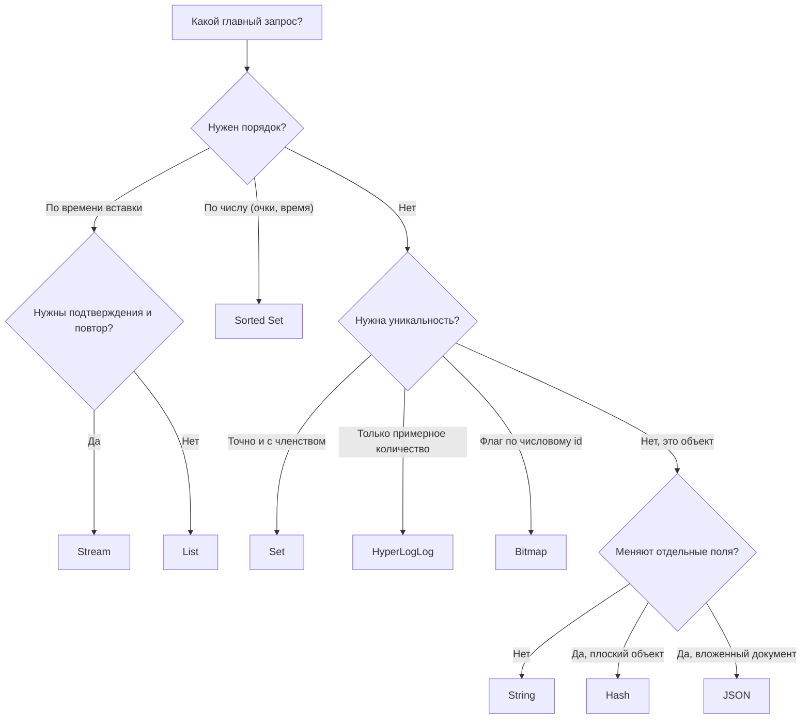

# 03. Структуры данных Redis

**Зачем это знать backend-разработчику.** Redis — не «хэш-таблица строк», а сервер структур данных. Одна и та же задача решается в нём и за 1 команду, и за 10 000 — всё зависит от выбора типа. Таблица лидеров на String требует прочитать всех игроков и отсортировать их в Java; на Sorted Set это один `ZRANGE … REV`. Подсчёт уникальных посетителей на Set съест гигабайты, на HyperLogLog — 12 КБ на ключ. Чтобы проектировать кэши, очереди, лимитеры и рейтинги, нужно знать, что умеет каждая структура и сколько стоит каждая команда.

> **Коротко:** Каждый ключ Redis хранит значение одного типа: String, Hash, List, Set, Sorted Set, Stream, JSON и другие. Bitmap, HyperLogLog и Geo — не отдельные типы, а особые команды поверх String и Sorted Set. У каждой команды есть асимптотическая сложность, и команды O(N) на больших ключах блокируют весь сервер. Правило выбора: начинайте с запроса («что я буду спрашивать?»), а не с данных. В конце раздела есть таблица «задача → структура».

## Оглавление

- [Ключи, значения и сложность команд](#ключи-значения-и-сложность-команд)
- [String](#string)
- [Hash](#hash)
- [List](#list)
- [Set](#set)
- [Sorted Set (ZSet)](#sorted-set-zset)
- [Stream](#stream)
- [Bitmap](#bitmap)
- [HyperLogLog](#hyperloglog)
- [Geo](#geo)
- [JSON](#json)
- [Задача → структура](#задача--структура)
- [Практика в репозитории](#практика-в-репозитории)
- [Типичные ошибки и заблуждения](#типичные-ошибки-и-заблуждения)
- [Итоги](#итоги)
- [Вопросы для самопроверки](#вопросы-для-самопроверки)
- [Источники](#источники)

## Ключи, значения и сложность команд

**На пальцах.** Redis похож на камеру хранения: у каждой ячейки есть номер (ключ), а внутри лежит предмет определённой формы — коробка, папка, стопка. Инструменты для коробки к стопке не подходят.

**Ключ** (key) — бинарно-безопасная строка, по которой Redis находит значение. **Тип значения** (type) задаётся первой командой, создавшей ключ, и не меняется, пока ключ жив. Команда не того типа вернёт ошибку `WRONGTYPE`. **Сложность** (time complexity) — как растёт время команды с размером данных: O(1) — не зависит от размера, O(log N) — растёт очень медленно, O(N) — пропорционально числу элементов.

Почему сложность так важна: команды выполняются по одной в одном потоке (подробно — в [01. Архитектура](01-architecture.md)). `HGETALL` на хэше из миллиона полей займёт сотни миллисекунд, и всё это время остальные клиенты ждут.

```text
127.0.0.1:6379> SET user:42:name "Anna"
OK
127.0.0.1:6379> TYPE user:42:name
string
127.0.0.1:6379> LPUSH user:42:name "x"
(error) WRONGTYPE Operation against a key holding the wrong kind of value
```

Соглашение об именах: части ключа разделяют двоеточием — `объект:id:поле` (`product:1001`, `rate:user:42:2026-09-22T10:15`). Redis это не проверяет, но так ключи читаемы и удобны для `SCAN MATCH`.

Во всех Java-фрагментах ниже используется одно подключение Lettuce:

```java
RedisClient client = RedisClient.create("redis://localhost:6379");
StatefulRedisConnection<String, String> connection = client.connect();
RedisCommands<String, String> redis = connection.sync(); // синхронный API
```

Как устроены значения внутри (listpack, quicklist, skiplist), разобрано в [02. Внутренние кодировки](02-internal-encodings.md).

## String

**На пальцах.** Одна ячейка — одна вещь: текст, число или байты картинки.

**String** — последовательность байтов до 512 МБ. Если содержимое — целое число, над ним работают атомарные счётчики. **Атомарность** (atomicity) здесь значит: команда выполняется целиком, и никакая другая команда не «вклинится» в её середину.

| Команда | Что делает | Сложность |
|---|---|---|
| `SET key value [EX s] [NX]` | записать; `EX` — TTL, `NX` — только если ключа нет | O(1) |
| `GET key` | прочитать | O(1) |
| `INCR` / `INCRBY` | атомарно увеличить целое | O(1) |
| `MGET k1 k2 …` | прочитать несколько ключей | O(N) по числу ключей |
| `GETRANGE` / `SETRANGE` | часть строки | O(N) по длине диапазона |

**Пример из заданий.** Лимитер с фиксированным окном (задание 03) — `INCR` счётчика окна плюс `EXPIRE`. Лок (задание 04) — `SET lock:{name} token NX PX 30000`, например `lock:orders`. Карточка товара из задания 01 на самом деле хранится Hash'ем, а не String (раздел Hash ниже) — код дальше лишь иллюстрирует API String на похожем примере.

```text
127.0.0.1:6379> SET rate:user:42:1015 0 EX 60 NX
OK
127.0.0.1:6379> INCR rate:user:42:1015
(integer) 1
127.0.0.1:6379> INCR rate:user:42:1015
(integer) 2
```

```java
redis.set("product:1001", "{\"name\":\"Кофе\",\"price\":450}", SetArgs.Builder.ex(300));
long hits = redis.incr("rate:user:42:1015"); // 1, 2, 3... без гонок между клиентами
String cached = redis.get("product:1001");   // null, если ключа нет или TTL истёк
```

Почему `INCR` лучше, чем `GET` + `+1` + `SET` в Java: между `GET` и `SET` другой клиент может записать своё значение, и одно увеличение потеряется (**lost update** — «потерянное обновление»). `INCR` делает всё за одну команду.

## Hash

**На пальцах.** Папка с подписанными листками: «имя», «email», «город». Можно достать или поменять один листок, не вынимая остальные.

**Hash** — отображение «поле → значение» внутри одного ключа. Поля и значения — строки. Подходит для объектов, у которых читают и меняют отдельные поля.

| Команда | Сложность |
|---|---|
| `HSET key f1 v1 [f2 v2 …]` | O(1) на поле |
| `HGET` / `HMGET` | O(1) на поле |
| `HINCRBY key field n` | O(1) |
| `HGETALL` / `HKEYS` / `HVALS` | O(N) по числу полей |
| `HEXPIRE key s FIELDS n f…` | O(1) на поле (Redis 7.4+) |

**Пример из заданий.** Сессия пользователя (задание 06) — Hash `session:<id>` с обязательным полем `userId` и произвольными атрибутами, которые передал вызывающий код (например, `role`, `device`); скользящий TTL продлевает срок при каждом успешном чтении, не трогая сами поля.

```text
127.0.0.1:6379> HSET session:abc userId 42 role admin
(integer) 2
127.0.0.1:6379> HGET session:abc role
"admin"
127.0.0.1:6379> HGETALL session:abc
1) "userId"
2) "42"
3) "role"
4) "admin"
```

```java
redis.hset("session:abc", Map.of("userId", "42", "role", "admin"));
String role = redis.hget("session:abc", "role");
Map<String, String> session = redis.hgetall("session:abc");
```

**Hash или String с JSON?** String с JSON проще, если объект читают и пишут целиком. Hash выгоднее, если часто меняют одно поле (не надо читать, парсить и записывать весь объект) и маленькие хэши хранятся компактно. Минус Hash: нет вложенности, все значения — строки.

🔬 **Глубже.** До Redis 7.4 TTL ставился только на ключ целиком. Начиная с 7.4 есть TTL на отдельные поля хэша (`HEXPIRE`, `HTTL`, `HPERSIST`). Это удобно, например, для набора одноразовых токенов в одном хэше.

## List

**На пальцах.** Очередь в магазине или стопка тарелок: добавлять и забирать быстро с краёв, искать кого-то в середине — долго.

**List** — упорядоченная последовательность строк; порядок — порядок вставки. Внутри это двусвязный список блоков (quicklist), поэтому операции на концах дешёвые, а доступ по индексу — нет.

| Команда | Сложность |
|---|---|
| `LPUSH` / `RPUSH` / `LPOP` / `RPOP` | O(1) на элемент |
| `BLPOP` / `BRPOP` / `BLMOVE` | O(1); блокирует клиента, пока список пуст |
| `LRANGE key start stop` | O(S+N): S — смещение от края, N — длина диапазона |
| `LINDEX` / `LINSERT` | O(N) |
| `LTRIM key 0 99` | O(N) по числу удаляемых |

**Блокирующая команда** (blocking command) — клиент ждёт на сервере, пока не появится элемент или не истечёт таймаут. Сервер при этом не блокируется: ждёт только это соединение.

**Пример.** Простая очередь задач: продюсер делает `LPUSH`, воркер — `BRPOP`. Лента «последние 100 событий» — `LPUSH` + `LTRIM 0 99`. В задании 07 очередь строится на Stream, потому что List не умеет подтверждений: если воркер забрал задачу через `BRPOP` и упал, задача потеряна. Паттерн `BLMOVE` в «список в обработке» частично решает это, но Stream делает это из коробки.

```java
redis.lpush("jobs", "send-email:42");
KeyValue<String, String> job = redis.brpop(5, "jobs"); // ждём до 5 секунд
if (job != null && job.hasValue()) {
    System.out.println("Взяли задачу: " + job.getValue());
}
```

## Set

**На пальцах.** Мешок с жетонами без номеров: каждый жетон есть или его нет, дубликатов не бывает, порядка нет.

**Set** — неупорядоченное множество уникальных строк. Умеет пересечения, объединения и разности.

| Команда | Сложность |
|---|---|
| `SADD` / `SREM` / `SISMEMBER` | O(1) на элемент |
| `SCARD` | O(1) |
| `SMEMBERS` | O(N) |
| `SINTER k1 k2 …` | O(N·M): N — размер наименьшего, M — число множеств |
| `SUNION` / `SDIFF` | O(N) по сумме элементов |
| `SRANDMEMBER` / `SPOP` | O(1) на элемент |

**Пример.** Теги товара, «кто лайкнул пост», общие друзья (`SINTER friends:1 friends:2`). Точный подсчёт уникальных посетителей за день через `SADD visitors:2026-09-22 userId` + `SCARD` работает, но хранит каждый id. При 10 млн посетителей это сотни мегабайт на один день. В задании 06 то же самое делается через HyperLogLog.

```text
127.0.0.1:6379> SADD product:1001:tags coffee arabica
(integer) 2
127.0.0.1:6379> SADD product:1002:tags coffee robusta
(integer) 2
127.0.0.1:6379> SINTER product:1001:tags product:1002:tags
1) "coffee"
```

```java
redis.sadd("post:7:likes", "user:1", "user:2", "user:1"); // дубликат не добавится
boolean liked = redis.sismember("post:7:likes", "user:2"); // true
long likes = redis.scard("post:7:likes");                  // 2
```

## Sorted Set (ZSet)

**На пальцах.** Турнирная таблица: у каждого участника есть очки, и таблица всегда отсортирована. Можно быстро узнать место игрока и топ-10.

**Sorted Set** (ZSet) — множество уникальных строк (**member**), у каждой есть число с плавающей точкой (**score**). Элементы упорядочены по score, при равных score — лексикографически по member. Внутри для больших наборов — **skiplist** (список с «лифтами» через уровни, дающий O(log N)) плюс хэш-таблица member → score.

| Команда | Сложность |
|---|---|
| `ZADD key score member` | O(log N) |
| `ZINCRBY key n member` | O(log N) |
| `ZSCORE` | O(1) |
| `ZRANK` / `ZREVRANK` | O(log N) |
| `ZRANGE key start stop [REV] [WITHSCORES]` | O(log N + M), M — число возвращённых |
| `ZRANGE key min max BYSCORE` | O(log N + M) |
| `ZREMRANGEBYSCORE` | O(log N + M) |

Команды `ZREVRANGE`, `ZRANGEBYSCORE` и родственные им объявлены устаревшими с 6.2: их заменяет `ZRANGE` с флагами `REV`, `BYSCORE`, `BYLEX`, `LIMIT`. В Lettuce им соответствуют методы `zrevrange*`, `zrangebyscore*` и `zrangebylex*`, принимающие `Range` и `Limit`.

**Пример из заданий.** Таблица лидеров (задание 05): `ZINCRBY` при каждом начислении очков, `ZRANGE … REV WITHSCORES` для топа, `ZREVRANK` для места игрока. Скользящее окно лимитера (задание 03): score = время запроса в мс, `ZREMRANGEBYSCORE` удаляет старые записи, `ZCARD` считает оставшиеся. Отложенные задачи: score = время запуска.

```text
127.0.0.1:6379> ZADD lb:season1 1500 alice 1200 bob 1800 carol
(integer) 3
127.0.0.1:6379> ZINCRBY lb:season1 400 bob
"1600"
127.0.0.1:6379> ZRANGE lb:season1 0 2 REV WITHSCORES
1) "carol"
2) "1800"
3) "bob"
4) "1600"
5) "alice"
6) "1500"
127.0.0.1:6379> ZREVRANK lb:season1 alice
(integer) 2
```

```java
redis.zincrby("lb:season1", 400, "bob");
List<ScoredValue<String>> top = redis.zrevrangeWithScores("lb:season1", 0, 9);
for (ScoredValue<String> sv : top) {
    System.out.printf("%s — %.0f%n", sv.getValue(), sv.getScore());
}
Long place = redis.zrevrank("lb:season1", "alice"); // 0-based: 2 означает третье место
```

Имена методов Lettuce повторяют старые команды (`zrevrangeWithScores`, `zrevrank`), хотя на сервере это та же выборка «с конца», что и у `ZRANGE … REV`; отдельного метода с флагом `REV` в Lettuce нет.

🔬 **Глубже.** Score — это `double`, поэтому целые больше 2^53 теряют точность. Для «равные очки — выше тот, кто набрал раньше» score кодируют составным числом, например `очки * 10^10 + (MAX_TS - timestamp)`, следя за пределом 2^53.

## Stream

**На пальцах.** Журнал в проходной: каждая запись получает номер и время, записи не вычёркиваются при чтении, а у разных служб свои закладки «до куда я дочитал».

**Stream** — журнал только для добавления (append-only log) записей вида «поле → значение». У каждой записи ID `<миллисекунды>-<номер>`. **Группа потребителей** (consumer group) делит записи между воркерами и помнит, кто что взял. **PEL** (Pending Entries List) — список выданных, но ещё не подтверждённых записей. Подробно — в [07. Pub/Sub и Streams](07-pubsub-streams.md).

| Команда | Сложность |
|---|---|
| `XADD key * f v …` | O(1) |
| `XRANGE key start end` | O(N) по числу возвращённых записей |
| `XREADGROUP GROUP g c STREAMS key >` | O(M) по числу выданных |
| `XACK key g id` | O(1) на ID |
| `XAUTOCLAIM` | передать «зависшие» записи другому воркеру |
| `XTRIM key MAXLEN ~ 10000` | ограничить длину |

**Пример из заданий.** Очередь задач (задание 07): продюсер `XADD`, воркеры `XREADGROUP`, после успешной обработки — `XACK`. Если воркер упал, запись остаётся в PEL, и другой воркер заберёт её через `XAUTOCLAIM`.

```java
String id = redis.xadd("jobs:stream", Map.of("type", "email", "userId", "42"));
redis.xgroupCreate(XReadArgs.StreamOffset.from("jobs:stream", "0"), "workers",
        XGroupCreateArgs.Builder.mkstream()); // при повторном вызове — ошибка BUSYGROUP
List<StreamMessage<String, String>> batch = redis.xreadgroup(
        Consumer.from("workers", "worker-1"),
        XReadArgs.Builder.count(10).block(Duration.ofSeconds(2)),
        XReadArgs.StreamOffset.lastConsumed("jobs:stream"));
for (StreamMessage<String, String> msg : batch) {
    // обработать msg.getBody(), затем подтвердить
    redis.xack("jobs:stream", "workers", msg.getId());
}
```

## Bitmap

**На пальцах.** Длинная полоска клеточек, пронумерованных с нуля. Клеточка закрашена (1) или нет (0).

**Bitmap** — не отдельный тип, а битовые команды над String. Номер бита — обычно числовой id пользователя. Строка длиной до 512 МБ даёт 2^32 бит.

| Команда | Сложность |
|---|---|
| `SETBIT key offset 0/1` | O(1) |
| `GETBIT` | O(1) |
| `BITCOUNT key` | O(N) по длине строки |
| `BITOP AND/OR/XOR dest k1 k2 …` | O(N) |
| `BITPOS` | O(N) |

**Пример из заданий.** «Был ли пользователь активен в день D» (задание 06): `SETBIT dau:2026-09-22 42 1`. Число активных — `BITCOUNT`. Активные все 7 дней — `BITOP AND` по семи ключам. Расход памяти: 10 млн пользователей → 10 000 000 / 8 ≈ 1,25 МБ на день, независимо от числа активных.

```text
127.0.0.1:6379> SETBIT dau:2026-09-22 42 1
(integer) 0
127.0.0.1:6379> SETBIT dau:2026-09-22 7 1
(integer) 0
127.0.0.1:6379> BITCOUNT dau:2026-09-22
(integer) 2
```

```java
redis.setbit("dau:2026-09-22", 42, 1);
long activeToday = redis.bitcount("dau:2026-09-22");
```

Ловушка: `SETBIT key 4000000000 1` сразу выделит ~500 МБ, потому что строка растягивается до нужного бита. Для редких больших id bitmap невыгоден — лучше Set или HyperLogLog.

## HyperLogLog

**На пальцах.** Вместо того чтобы переписывать паспорта всех посетителей, охранник запоминает только «самую длинную серию нулей в конце номера», которую видел. По этой статистике можно довольно точно оценить, сколько было людей.

**HyperLogLog** (HLL) — вероятностная структура для **оценки кардинальности** (cardinality — число уникальных элементов). Хранит не элементы, а статистику их хэшей. Стандартная ошибка — 0,81 %, размер — не больше 12 КБ на ключ при любом числе элементов. Узнать, был ли конкретный элемент, нельзя.

| Команда | Сложность |
|---|---|
| `PFADD key el …` | O(1) на элемент |
| `PFCOUNT key` | O(1) для одного ключа (результат кэшируется) |
| `PFCOUNT k1 k2 …` | дороже: объединяет на лету |
| `PFMERGE dest k1 k2 …` | O(N) по числу ключей |

**Пример из заданий.** Уникальные посетители за день (задание 06): `PFADD uv:2026-09-22 user:42`. За диапазон дат — не `PFMERGE` (он пишет в отдельный ключ), а многоключевой `PFCOUNT uv:2026-09-22 uv:2026-09-23 …`: он считает объединение на лету, не создавая лишний ключ. Числа: при 10 млн уникальных Set занимает сотни МБ, HLL — 12 КБ, а оценка отклонится в среднем примерно на ±81 000.

```text
127.0.0.1:6379> PFADD uv:2026-09-22 user:1 user:2 user:3 user:1
(integer) 1
127.0.0.1:6379> PFCOUNT uv:2026-09-22
(integer) 3
```

```java
redis.pfadd("uv:2026-09-22", "user:1", "user:2", "user:1");
long unique = redis.pfcount("uv:2026-09-22"); // ≈ 2
```

🔬 **Глубже.** В Redis 8 в открытой сборке есть и другие вероятностные структуры: Bloom- и Cuckoo-фильтры («был ли элемент?»), Count-Min Sketch (частоты), Top-K, t-digest (перцентили). Bloom-фильтры в общем виде разобраны в [07. Движки хранения](../../docs/00-foundations/07-storage-engines.md).

## Geo

**На пальцах.** Карта с булавками: «найди все кофейни в радиусе 2 км от меня».

**Geo** — команды поверх Sorted Set. Координаты кодируются в 52-битный **geohash** (число, у которого близкие точки обычно имеют близкие значения) и сохраняются как score. Поэтому `ZRANGE` и `ZREM` работают и с geo-ключом.

| Команда | Сложность |
|---|---|
| `GEOADD key lon lat member` | O(log N) на точку |
| `GEOPOS` / `GEODIST` | O(1) на элемент |
| `GEOSEARCH key FROMLONLAT lon lat BYRADIUS r km` | O(N + log M): N — элементы в охватывающем прямоугольнике, M — число элементов внутри самой фигуры |

`GEORADIUS` устарела с 6.2, используйте `GEOSEARCH`. Порядок аргументов — сначала долгота, потом широта.

```text
127.0.0.1:6379> GEOADD shops 37.6173 55.7558 kremlin 37.5890 55.7336 gorky-park
(integer) 2
127.0.0.1:6379> GEOSEARCH shops FROMLONLAT 37.62 55.75 BYRADIUS 3 km ASC WITHDIST
1) 1) "kremlin"
   2) "0.6674"
2) 1) "gorky-park"
   2) "2.6660"
```

(Расстояния в выводе приблизительные — зависят от точки запроса.)

```java
redis.geoadd("shops", 37.6173, 55.7558, "kremlin");
List<GeoWithin<String>> near = redis.geosearch("shops",
        GeoSearch.fromCoordinates(37.62, 55.75),
        GeoSearch.byRadius(3, GeoArgs.Unit.km),
        GeoArgs.Builder.distance().asc());
```

## JSON

**На пальцах.** Папка с вложенными папками: можно достать один лист из глубины, не вытаскивая всю папку.

**JSON** — тип для документов JSON с доступом по **JSONPath** (языку путей вида `$.price` или `$.items[0].qty`). Раньше требовал модуль RedisJSON, в Redis 8 входит в открытую сборку. В связке с Query Engine (`FT.CREATE`, `FT.SEARCH`) по JSON-документам можно строить вторичные индексы.

| Команда | Что делает |
|---|---|
| `JSON.SET key $ '{…}'` | записать документ или часть по пути |
| `JSON.GET key $.path` | прочитать часть |
| `JSON.NUMINCRBY key $.stock -1` | атомарно изменить число внутри |
| `JSON.ARRAPPEND key $.tags '"x"'` | добавить в массив |

```text
127.0.0.1:6379> JSON.SET product:1001 $ '{"name":"Кофе","price":450,"stock":10}'
OK
127.0.0.1:6379> JSON.NUMINCRBY product:1001 $.stock -1
"[9]"
127.0.0.1:6379> JSON.GET product:1001 $.price
"[450]"
```

```java
// JSON-команды доступны прямо в RedisCommands начиная с Lettuce 6.6
// (в этом репозитории — 7.5.2)
JsonParser parser = redis.getJsonParser();
redis.jsonSet("product:1001", JsonPath.ROOT_PATH,
        parser.createJsonValue("{\"name\":\"Кофе\",\"price\":450,\"stock\":10}"));
List<JsonValue> price = redis.jsonGet("product:1001", JsonPath.of("$.price"));
```

**JSON или String с JSON?** Если документ всегда читают целиком, хватит String с JSON. Hash тоже годится для целостного чтения через `HGETALL` — так сделан кэш в задании 01, где Hash заодно упрощает negative caching (`_missing` — отдельное поле) и атомарную запись одним `EVAL`. JSON нужен, когда меняют вложенные поля атомарно на сервере или ищут по ним через Query Engine.

## Задача → структура

**На пальцах.** Выбор структуры — как выбор контейнера при переезде: сначала решите, как будете доставать вещи, потом берите коробку.

Сформулируйте главный запрос и найдите его в таблице:

| Задача | Структура | Ключевые команды | Задание |
|---|---|---|---|
| Кэш объекта целиком | String/Hash | `SET … EX`, `GET`, `HSET`, `HGETALL` | 01, 02 |
| Счётчик, лимит в окне | String | `INCR`, `EXPIRE` | 03 |
| Распределённый лок | String | `SET NX PX`, Lua для снятия | 04 |
| Объект с частыми правками полей | Hash | `HSET`, `HINCRBY` | 06 |
| Простая очередь без подтверждений, лента последних N | List | `LPUSH`, `BRPOP`, `LTRIM` | — |
| Уникальные элементы, пересечения | Set | `SADD`, `SINTER` | — |
| Рейтинг, топ-N, скользящее окно | Sorted Set | `ZINCRBY`, `ZRANGE`, `ZREMRANGEBYSCORE` | 03, 05 |
| Надёжная очередь, журнал событий | Stream | `XADD`, `XREADGROUP`, `XACK` | 07 |
| Флаг «да/нет» по числовому id | Bitmap | `SETBIT`, `BITCOUNT` | 06 |
| Примерное число уникальных | HyperLogLog | `PFADD`, `PFCOUNT` | 06 |
| Поиск рядом | Geo | `GEOADD`, `GEOSEARCH` | — |
| Вложенный документ, поиск по полям | JSON (+ Query Engine) | `JSON.SET`, `FT.SEARCH` | — |



Общий принцип «модель от запросов» описан в [08. Моделирование данных](../../docs/00-foundations/08-data-modeling.md).

## Практика в репозитории

- [01. Кэш товаров](../tasks/01-product-cache.md) — String с TTL и jitter.
- [02. Cache stampede](../tasks/02-cache-stampede.md) — String-лок `SET NX` для одного пересчёта.
- [03. Rate limiter](../tasks/03-rate-limiter.md) — фиксированное окно на `INCR`, скользящее на Sorted Set.
- [04. Распределённый лок](../tasks/04-distributed-lock.md) — `SET NX PX` и fencing-токен через `INCR`.
- [05. Таблица лидеров](../tasks/05-leaderboard.md) — Sorted Set: `ZINCRBY`, топ, ранг.
- [06. Сессии и аналитика](../tasks/06-sessions-analytics.md) — Hash, HyperLogLog, Bitmap.
- [07. Очередь задач на Streams](../tasks/07-job-queue-streams.md) — группы потребителей, `XACK`, `XAUTOCLAIM`.
- [BasicsDemo](../examples/src/main/java/dev/nosqlguide/redis/examples/driver/BasicsDemo.java) — базовые команды всех основных типов через Lettuce.
- [StreamsDemo](../examples/src/main/java/dev/nosqlguide/redis/examples/driver/StreamsDemo.java) — Stream и группы потребителей.
- Foundations: [08. Моделирование данных](../../docs/00-foundations/08-data-modeling.md), [07. Движки хранения](../../docs/00-foundations/07-storage-engines.md).

## Типичные ошибки и заблуждения

- **«Всё храню в String с JSON».** Каждая правка поля — чтение, парсинг, запись всего объекта и риск lost update. Для частых правок полей — Hash или JSON.
- **`KEYS`, `SMEMBERS`, `HGETALL`, `LRANGE 0 -1` на больших ключах.** Это O(N) в одном потоке — пауза для всех клиентов. Используйте `SCAN`/`SSCAN`/`HSCAN` и ограничивайте диапазоны.
- **«Большой ключ — не проблема».** Hash на 10 млн полей нельзя разнести по нодам кластера (ключ живёт в одном слоте), его удаление через `DEL` блокирует сервер (нужен `UNLINK`), а репликация и миграция идут рывком.
- **List как надёжная очередь.** `BRPOP` удаляет элемент сразу; если воркер упал, задача потеряна. Для подтверждений — Stream.
- **Ожидать точности от HyperLogLog.** Ошибка около 0,81 %; для биллинга и денег HLL не годится.
- **Путать долготу и широту в `GEOADD`.** Порядок — `lon lat`; перепутанные координаты дают либо ошибку, либо точку не в том месте.

## Итоги

- Тип значения определяется ключом; команда не того типа вернёт `WRONGTYPE`.
- Выбирайте структуру по главному запросу, а не по форме данных.
- String — кэш и счётчики, Hash — объекты с правкой полей, List — простые очереди, Set — уникальность и пересечения, Sorted Set — рейтинги и окна по времени.
- Stream — надёжная очередь с группами потребителей и подтверждениями.
- Bitmap, HyperLogLog, Geo — компактные специализированные команды поверх String и Sorted Set; JSON в Redis 8 доступен из коробки.
- Смотрите на сложность: O(N) на большом ключе останавливает весь сервер.

## Вопросы для самопроверки

1. Почему `INCR` безопаснее, чем `GET` + `SET` из Java?
   <details><summary>Ответ</summary>`INCR` выполняется атомарно одной командой. При `GET` + `SET` другой клиент может записать значение между ними, и одно из увеличений потеряется (lost update).</details>
2. Какую структуру выбрать для топ-10 игроков и места конкретного игрока? Какова сложность?
   <details><summary>Ответ</summary>Sorted Set. `ZRANGE key 0 9 REV WITHSCORES` — O(log N + 10), `ZREVRANK` — O(log N), `ZINCRBY` — O(log N).</details>
3. Чем Stream лучше List для очереди задач?
   <details><summary>Ответ</summary>Записи не удаляются при чтении; группа потребителей распределяет их между воркерами и хранит PEL — невыполненные подтверждения. Если воркер упал, запись можно забрать через `XAUTOCLAIM`. List при `BRPOP` удаляет элемент сразу.</details>
4. Сколько памяти займёт Bitmap активности на 10 млн пользователей за день и HLL уникальных посетителей?
   <details><summary>Ответ</summary>Bitmap ≈ 10 000 000 / 8 = 1,25 МБ (если id плотные, от 0 до 10 млн). HLL — не больше 12 КБ, с ошибкой около 0,81 %.</details>
5. Почему к geo-ключу можно применять `ZRANGE` и `ZREM`?
   <details><summary>Ответ</summary>Geo хранится в Sorted Set: координаты кодируются в 52-битный geohash и лежат как score.</details>
6. Когда Hash выгоднее String с JSON, а когда нужен тип JSON?
   <details><summary>Ответ</summary>Hash — когда объект плоский и часто меняются отдельные поля. String — когда объект читают и пишут целиком. JSON — когда документ вложенный и нужно атомарно менять глубокие поля или искать по ним через Query Engine.</details>
7. Чем опасен `SETBIT key 4000000000 1`?
   <details><summary>Ответ</summary>Строка растягивается до нужного бита: будет выделено около 500 МБ, а выделение и обнуление займут заметное время в единственном потоке.</details>

## Источники

- Redis: *Understand Redis data types*. https://redis.io/docs/latest/develop/data-types/
- Redis: справочник команд (сложность указана у каждой команды). https://redis.io/docs/latest/commands/
- Redis: *Redis Streams*. https://redis.io/docs/latest/develop/data-types/streams/
- Redis: *HyperLogLog*, *Bitmaps*, *Geospatial*. https://redis.io/docs/latest/develop/data-types/probabilistic/hyperloglogs/ , https://redis.io/docs/latest/develop/data-types/bitmaps/ , https://redis.io/docs/latest/develop/data-types/geospatial/
- Redis: *JSON*. https://redis.io/docs/latest/develop/data-types/json/
- Исходники Redis: `t_string.c`, `t_zset.c`, `t_stream.c`, `hyperloglog.c`. https://github.com/redis/redis
- Lettuce Reference Guide. https://redis.github.io/lettuce/
- Flajolet P. et al. *HyperLogLog: the analysis of a near-optimal cardinality estimation algorithm*, 2007.

---

← [02. Внутренние кодировки](02-internal-encodings.md) | [оглавление](README.md) | [04. Истечение ключей и вытеснение](04-expiration-eviction.md) →
