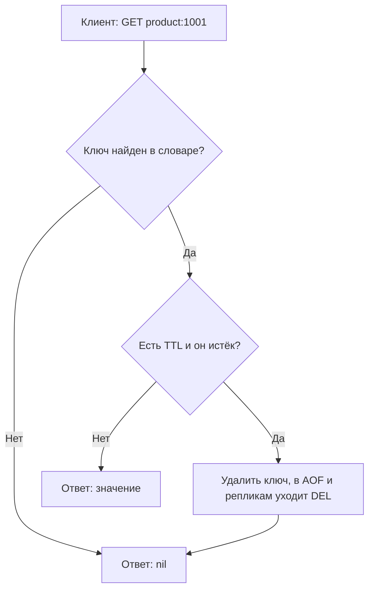
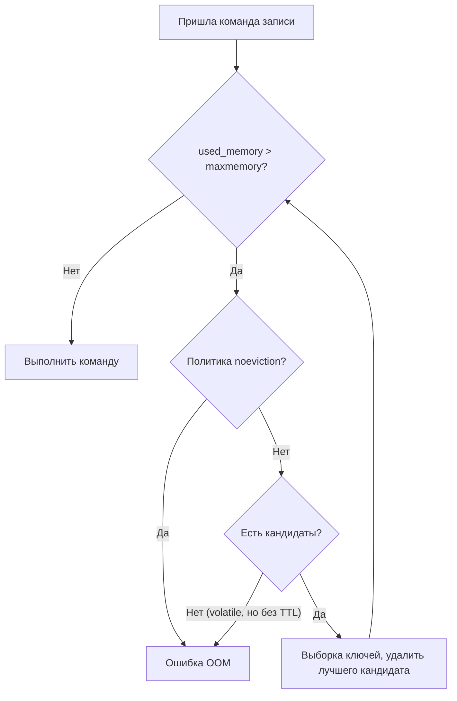

# 04. Истечение ключей и вытеснение

**Зачем это знать backend-разработчику.** Почти каждый Redis в продакшене — либо кэш, либо хранилище временных данных: сессий, токенов, счётчиков лимитера. Их жизнь управляется двумя механизмами. **TTL** удаляет ключ, когда он устарел. **Вытеснение** удаляет ключи, когда кончилась память. Если их не понимать, случаются классические аварии: Redis внезапно начинает отвечать `OOM` на все записи, пользователей массово разлогинивает, потому что сессии вытеснил кэш, или в одну секунду истекает весь прогретый кэш и база ложится под лавиной запросов.

> **Коротко:** TTL хранится как абсолютное время истечения с точностью до миллисекунды. Истёкший ключ удаляется двумя способами: лениво — при обращении к нему, и активно — фоновым циклом, который выборочно проверяет ключи с TTL. Поэтому истёкшие ключи какое-то время занимают память. Когда память достигает `maxmemory`, Redis действует по `maxmemory-policy`: по умолчанию `noeviction` (ошибки записи), для кэша обычно `allkeys-lru` или `allkeys-lfu`. LRU и LFU в Redis приближённые: они работают по случайной выборке ключей, а не по точному списку, а одинаковый TTL у множества ключей вызывает лавину промахов, которая лечится случайной добавкой к TTL — jitter.

## Оглавление

- [TTL и его точность](#ttl-и-его-точность)
- [Ленивое удаление](#ленивое-удаление)
- [Активное удаление](#активное-удаление)
- [Почему истёкшие ключи занимают память](#почему-истёкшие-ключи-занимают-память)
- [maxmemory и политики вытеснения](#maxmemory-и-политики-вытеснения)
- [Приближённый LRU](#приближённый-lru)
- [LFU: логарифмический счётчик и затухание](#lfu-логарифмический-счётчик-и-затухание)
- [Как выбрать политику](#как-выбрать-политику)
- [TTL jitter и лавина промахов](#ttl-jitter-и-лавина-промахов)
- [Практика в репозитории](#практика-в-репозитории)
- [Типичные ошибки и заблуждения](#типичные-ошибки-и-заблуждения)
- [Итоги](#итоги)
- [Вопросы для самопроверки](#вопросы-для-самопроверки)
- [Источники](#источники)

## TTL и его точность

**На пальцах.** На йогурте написано не «хранить 14 дней», а «годен до 5 октября». Неважно, сколько он пролежал в холодильнике выключенным, — дата та же.

**TTL** (time to live, «время жизни») — сколько осталось жить ключу. Устанавливается командами `EXPIRE` (секунды), `PEXPIRE` (миллисекунды), `EXPIREAT`/`PEXPIREAT` (абсолютное время Unix) или опцией `SET … EX/PX`. Внутри Redis хранит **абсолютный момент истечения** в миллисекундах, а не остаток. `TTL`/`PTTL` показывают остаток, `EXPIRETIME` (7.0+) — сам момент.

```text
127.0.0.1:6379> SET product:1001 "{...}" EX 300
OK
127.0.0.1:6379> TTL product:1001
(integer) 297
127.0.0.1:6379> PERSIST product:1001
(integer) 1
127.0.0.1:6379> TTL product:1001
(integer) -1
127.0.0.1:6379> TTL no-such-key
(integer) -2
```

`-1` — ключ есть, но без TTL; `-2` — ключа нет.

**Точность.** Документация указывает погрешность истечения от 0 до 1 мс. Но «логическое» и «физическое» истечение — разные вещи: после отметки ключ уже невидим для команд чтения, а память освобождается позже (см. следующие разделы).

Важные следствия абсолютного времени:

- если сервер был выключен, ключи, чей срок прошёл, истекут сразу после загрузки RDB/AOF;
- если перевести системные часы вперёд, ключи истекут раньше — Redis доверяет часам машины.

**Что сбрасывает TTL.** Команды, которые целиком заменяют значение, удаляют TTL: `SET` без опции `KEEPTTL` (6.0+), `GETSET`, `DEL` + новая запись. Команды, изменяющие значение «на месте», TTL сохраняют: `INCR`, `HSET`, `LPUSH`, `APPEND`. `RENAME` переносит TTL на новое имя. Начиная с 7.0 у `EXPIRE` есть флаги `NX` (ставить, только если TTL нет), `XX`, `GT`, `LT`.

```java
redis.set("session:abc", "42", SetArgs.Builder.ex(1800));
redis.set("session:abc", "43", SetArgs.Builder.keepttl()); // TTL не сбросится
redis.incr("rate:user:42:1015");
redis.expire("rate:user:42:1015", 60);   // или EXPIRE ... NX, чтобы не продлевать окно
long left = redis.ttl("session:abc");    // секунды; -1 — без TTL, -2 — нет ключа
```

Ловушка лимитера из задания 03: если делать `INCR` и затем безусловный `EXPIRE 60` на каждый запрос, окно будет постоянно продлеваться и счётчик никогда не сбросится. Ставьте TTL только при первом `INCR` (результат равен 1), используйте `EXPIRE … NX` или делайте обе операции атомарно в Lua.

## Ленивое удаление

**На пальцах.** Продавец не обходит полки каждую минуту. Он проверяет дату, когда покупатель берёт йогурт в руки, и если срок вышел — выбрасывает его и говорит «нет в наличии».

**Ленивое удаление** (lazy expiration, passive expiration) — при любом обращении к ключу Redis сначала сравнивает время истечения с текущим. Если срок прошёл, ключ удаляется, а команда ведёт себя так, будто его не было.



Плюс: проверка стоит O(1) и тратит CPU только на те ключи, к которым обращаются. Минус: ключ, к которому больше никто не обратится, так и лежал бы в памяти вечно. Для этого есть активное удаление.

**Реплики.** Реплика сама ключи не удаляет — она ждёт `DEL` от мастера, чтобы данные не разошлись. Но при чтении реплика отвечает так, будто истёкшего ключа нет (с Redis 3.2). Подробнее о репликации — в [08. Репликация и кластер](08-replication-cluster.md).

## Активное удаление

**На пальцах.** Раз в какое-то время продавец наугад берёт с полки 20 йогуртов. Если просроченных оказалось много, значит, на полке ещё полно просрочки, и он берёт следующую горсть. Если мало — возвращается к работе.

**Активное удаление** (active expiration) — фоновый цикл, который периодически проверяет выборку ключей с TTL и удаляет истёкшие. Он работает в том же главном потоке, поэтому ограничен по времени, чтобы не мешать командам.

Классическое описание из документации Redis:

1. Десять раз в секунду (частота задаётся `hz`, по умолчанию 10) взять 20 случайных ключей из множества ключей с TTL.
2. Удалить все истёкшие среди них.
3. Если истёкших больше 25 % — повторить с шага 1.

Пошаговый пример: в базе 1 000 000 ключей с TTL, из них 300 000 истекли (30 %).

| Итерация | Проверено | Истёкших в выборке | Решение |
|---|---|---|---|
| 1 | 20 | 6 (30 %) | > 25 % — ещё раз |
| 2 | 20 | 7 (35 %) | ещё раз |
| … | … | … | … |
| k | 20 | 4 (20 %) | ≤ 25 % — стоп до следующего такта |

Смысл алгоритма: доля истёкших ключей удерживается около порога, а время на очистку растёт, только когда мусора много.

🔬 **Глубже.** В исходниках (`expire.c`, функция `activeExpireCycle`) алгоритм сложнее, чем в описании. Начиная с 6.0 есть параметр `active-expire-effort` (1–10): он увеличивает число ключей в выборке и снижает допустимую долю «просрочки» ценой CPU; при усилии по умолчанию допустимая доля уже истёкших, но ещё живых ключей — около 10 %, а не 25 % из классического описания выше. Есть «медленный» цикл по таймеру и «быстрый» перед засыпанием event loop, у каждого — лимит времени. В новых версиях ключи обходятся не строго случайно, а инкрементальным сканированием словаря ключей с TTL. Точные константы зависят от версии — смотрите код своей версии.

Проверить, как работает удаление, можно по `INFO stats`:

```text
127.0.0.1:6379> INFO stats
...
expired_keys:184233
expired_stale_perc:3.12
expired_time_cap_reached_count:0
evicted_keys:0
...
```

`expired_stale_perc` — оценка доли уже истёкших, но ещё лежащих ключей. `expired_time_cap_reached_count` растёт, когда цикл упирается в лимит времени — признак, что истекающих ключей очень много.

## Почему истёкшие ключи занимают память

**На пальцах.** Даже при двух проверках — «когда берут в руки» и «выборочно раз в 100 мс» — на полке в любой момент лежит немного просрочки.

Причины:

1. **Активный цикл вероятностный.** Он останавливается, когда доля истёкших в выборке ниже порога, значит, несколько процентов истёкших ключей лежат постоянно. При 50 млн ключей с TTL даже 5 % — это 2,5 млн «мёртвых» ключей.
2. **Лимит времени.** Если за секунду истекают миллионы ключей, цикл не успевает и упирается в time cap.
3. **Освобождённая память не всегда возвращается ОС.** После удаления `used_memory` падает, а RSS процесса (resident set size — сколько памяти процессу выделила ОС) может остаться прежним из-за **фрагментации** аллокатора. Смотрите `mem_fragmentation_ratio` в `INFO memory`; `activedefrag yes` помогает.
4. **Реплики** держат ключи, пока не придёт `DEL` от мастера.

Практический вывод: `maxmemory` нужно задавать с запасом, а на истечение TTL нельзя полагаться как на точный «сборщик мусора» в момент X.

```java
// Сколько ключей удалено по TTL и вытеснено — для метрик приложения
String stats = redis.info("stats");
stats.lines()
     .filter(l -> l.startsWith("expired_keys:") || l.startsWith("evicted_keys:"))
     .forEach(System.out::println);
```

## maxmemory и политики вытеснения

**На пальцах.** Холодильник полон, а надо положить новый продукт. Можно отказаться класть (`noeviction`), выбросить то, что дольше всего не трогали (LRU), то, что реже всего берут (LFU), или что попадётся (random).

**`maxmemory`** — предел памяти под данные. По умолчанию `0`, то есть без предела на 64-битных системах: Redis растёт, пока его не убьёт OOM killer ОС. **Вытеснение** (eviction) — удаление ключей не по TTL, а потому, что память кончилась. **`maxmemory-policy`** определяет, какие ключи удалять.

| Политика | Из каких ключей выбирает | Кого удаляет |
|---|---|---|
| `noeviction` (по умолчанию) | — | никого; записи, требующие памяти, получают ошибку |
| `allkeys-lru` | все | давно не использованные |
| `allkeys-lfu` | все | редко используемые |
| `allkeys-random` | все | случайные |
| `volatile-lru` | только с TTL | давно не использованные |
| `volatile-lfu` | только с TTL | редко используемые |
| `volatile-random` | только с TTL | случайные |
| `volatile-ttl` | только с TTL | с наименьшим остатком TTL |
| `allkeys-lrm` | все | дольше всего не изменяемые |
| `volatile-lrm` | только с TTL | дольше всего не изменяемые |

Первые восемь есть во всех современных версиях, включая `redis:8.2` — тестовый образ в этом репозитории. Последние две, `allkeys-lrm`/`volatile-lrm`, — новее: на `redis:8.10.1` сервер принимает `maxmemory-policy allkeys-lrm` и запускается, а при заведомо неверном значении печатает список из уже десяти допустимых политик; на `redis:8.2` тот же список — всё ещё восемь, `allkeys-lrm`/`volatile-lrm` сервер не знает. **LRM** (least recently modified) — в отличие от LRU, чтение `GET` метку не обновляет, только запись. Если работаете не на 8.2, сверяйтесь со своим `redis.conf` и документацией по вытеснению — набор политик от версии к версии может отличаться.

**Когда срабатывает.** Перед выполнением команды Redis сравнивает используемую память с `maxmemory` и, если предел превышен, удаляет ключи по политике, пока не уложится. Под `noeviction` команды записи отклоняются, а чтение и `DEL` работают:

🔬 **Глубже.** С 6.0 вытеснение ограничено по времени параметром `maxmemory-eviction-tenacity` и при большом перерасходе продолжается в фоновом событии таймера, а не удерживает поток в одной команде.

```text
127.0.0.1:6379> CONFIG SET maxmemory 100mb
OK
127.0.0.1:6379> CONFIG SET maxmemory-policy noeviction
OK
127.0.0.1:6379> SET big:1 "..."
(error) OOM command not allowed when used memory > 'maxmemory'.
127.0.0.1:6379> GET product:1001
"{...}"
```



Замечание: буферы репликации и AOF не считаются в предел `maxmemory`, поэтому реальный RSS больше. Типичная рекомендация — оставлять запас машине (например, `maxmemory` около 60–75 % RAM, если используется RDB с `fork`; см. [05. Персистентность](05-persistence.md)).

```java
redis.configSet("maxmemory", "2gb");
redis.configSet("maxmemory-policy", "allkeys-lfu");
Map<String, String> cfg = redis.configGet("maxmemory*");
```

## Приближённый LRU

**На пальцах.** Чтобы найти «самый давно не открывавшийся» файл, можно вести идеальный журнал всех открытий — дорого. А можно взять 5 случайных файлов и выбросить самый старый из них. Почти так же хорошо и почти бесплатно.

**LRU** (least recently used) — вытеснять ключ, к которому дольше всех не обращались. Точный LRU требует двусвязного списка всех ключей и перестановки при каждом чтении: лишние 16 байт указателей на ключ и работа на каждой команде.

Redis делает иначе:

- в каждом объекте есть 24-битное поле с «временем последнего доступа» по часам LRU с разрешением около секунды;
- при вытеснении берётся случайная выборка из `maxmemory-samples` ключей (по умолчанию 5);
- кандидаты попадают в небольшой **пул вытеснения** (eviction pool, 16 мест), где хранятся лучшие кандидаты из прошлых выборок; удаляется самый «старый» из пула.

Пул улучшает качество: хороший кандидат, найденный раньше, не теряется. `maxmemory-samples 10` по графикам из документации почти неотличимо от точного LRU, но тратит больше CPU на вытеснение.

```text
127.0.0.1:6379> CONFIG SET maxmemory-samples 10
OK
127.0.0.1:6379> OBJECT IDLETIME product:1001
(integer) 42
```

`OBJECT IDLETIME` показывает секунды с последнего обращения — ту самую метку LRU (работает, когда политика не LFU).

## LFU: логарифмический счётчик и затухание

**На пальцах.** LRU смотрит «когда брали последний раз», и один случайный запрос к старому ключу делает его «свежим». LFU смотрит «как часто берут», поэтому популярная главная страница не вытеснится из-за того, что минуту её никто не открыл.

**LFU** (least frequently used, с 4.0) — вытеснять редко используемые ключи. В те же 24 бита объекта Redis кладёт:

- **8-битный логарифмический счётчик** (0–255) — оценку частоты обращений. Он растёт вероятностно: чем больше значение, тем меньше шанс увеличиться при очередном доступе. Параметр `lfu-log-factor` (по умолчанию 10) задаёт, как медленно растёт счётчик;
- **16 бит времени** последнего уменьшения в минутах — для **затухания** (decay): каждые `lfu-decay-time` минут (по умолчанию 1) без обращений счётчик уменьшается. Так ключ, который был популярен вчера, со временем теряет «заслуги».

Новый ключ получает стартовое значение 5, чтобы его не вытеснили сразу после создания.

Таблица из `redis.conf` — значение счётчика после N обращений:

| `lfu-log-factor` | 100 | 1 000 | 100 000 | 1 000 000 | 10 000 000 |
|---|---|---|---|---|---|
| 0 | 104 | 255 | 255 | 255 | 255 |
| 1 | 18 | 49 | 255 | 255 | 255 |
| 10 | 10 | 18 | 142 | 255 | 255 |
| 100 | 8 | 11 | 49 | 143 | 255 |

С фактором 10 счётчик различает ключи от сотни до примерно миллиона обращений — этого хватает, чтобы отделить горячие ключи от холодных.

```text
127.0.0.1:6379> CONFIG SET maxmemory-policy allkeys-lfu
OK
127.0.0.1:6379> OBJECT FREQ product:1001
(integer) 12
```

🔬 **Глубже.** Вероятность увеличения примерно `1 / ((counter − 5) · lfu-log-factor + 1)`. Поэтому счётчик и называется логарифмическим: чтобы поднять его на единицу вверху шкалы, нужно больше обращений, чем внизу. Горячие ключи ещё и полезно находить: `redis-cli --hotkeys` работает поверх `OBJECT FREQ` и требует LFU-политики.

## Как выбрать политику

**На пальцах.** Для кэша потеря ключа — лишний поход в базу. Для хранилища сессий — выход пользователя из аккаунта. Правила для них противоположные.

**Чистый кэш** (все данные можно восстановить из основной БД):

- `allkeys-lru` — разумный выбор по умолчанию, когда недавние данные с большой вероятностью понадобятся снова;
- `allkeys-lfu` — когда есть устойчиво горячее подмножество (популярные товары), а редкие массовые проходы (выгрузки, обход краулером) не должны выдавливать его из кэша;
- `allkeys-random` — когда обращения равномерны и важна минимальная стоимость.

TTL в кэше всё равно ставьте: он ограничивает устаревание данных, а вытеснение — объём.

**Хранилище сессий и других данных, которые нельзя терять:**

- `noeviction` + TTL на каждой сессии + алерт на `used_memory`. Лучше получить понятную ошибку записи, чем тихо разлогинить случайных пользователей;
- памяти — с запасом на пик, персистентность включена ([05. Персистентность](05-persistence.md)).

**Смешанный инстанс (кэш и сессии вместе)** — источник проблем. Частый совет «`volatile-lru`: у кэша TTL есть, у сессий нет» ломается, потому что у сессий обычно тоже есть TTL, и их тоже будут вытеснять. Надёжнее разнести кэш и сессии на разные инстансы с разными политиками.

Пример расчёта: 1 млн сессий по ~500 байт = ~500 МБ данных, плюс накладные расходы на ключи и словарь — порядка 100 байт на ключ (оценка, зависит от версии и кодировки) — итого около 600 МБ. С запасом на рост и фрагментацию разумно выставить `maxmemory` около 1 ГБ.

## TTL jitter и лавина промахов

**На пальцах.** Если всем сотрудникам сказать «обедать ровно в 13:00», в 13:00 столовая захлебнётся, а в 13:30 будет пустой. Если разрешить обедать с 12:45 до 13:15, нагрузка размажется.

**Лавина промахов** (cache avalanche) — массовое одновременное истечение многих ключей, после которого все запросы разом идут в базу. Типичная причина — прогрев кэша при деплое: 100 000 товаров записаны за минуту с одинаковым `EX 3600` и ровно через час истекают вместе.

**TTL jitter** — случайная добавка к TTL, чтобы моменты истечения разошлись во времени.

Расчёт: 100 000 ключей, TTL 3600 с.

| Вариант | Окно истечения | Промахов в секунду (примерно) |
|---|---|---|
| Без jitter, прогрев за 60 с | 60 с | ~1 700 |
| Jitter ±10 % (±360 с) | ~780 с | ~130 |

```java
// Задание 01: TTL = baseTtl + случайная добавка в [0, maxJitter] (односторонний джиттер,
// в миллисекундах — округление до секунды съело бы весь смысл добавки)
long jitterMillis(Duration maxJitter, RandomGenerator random) {
    long bound = maxJitter.toMillis();
    return bound <= 0 ? 0 : random.nextLong(bound + 1);          // [0, bound], а не только "< bound"
}

long ttlMs = baseTtl.toMillis() + jitterMillis(maxJitter, random);
```

Не путайте с **cache stampede** («давка» за одним ключом): это когда истекает один горячий ключ, и тысячи параллельных запросов одновременно пересчитывают его. Jitter тут не поможет; нужна блокировка на пересчёт или раннее вероятностное обновление — это задание 02. В Spring Cache (задание 08) общий TTL задаётся через `RedisCacheConfiguration.entryTtl(Duration)`, а для jitter есть вариант `entryTtl(RedisCacheWriter.TtlFunction)` (Spring Data Redis 3.3+; в этом репозитории — 4.1.1), который вычисляет TTL на каждую запись.

## Практика в репозитории

- [01. Кэш товаров](../tasks/01-product-cache.md) — cache-aside, TTL и jitter против лавины промахов.
- [02. Cache stampede](../tasks/02-cache-stampede.md) — защита одного горячего ключа при истечении.
- [03. Rate limiter](../tasks/03-rate-limiter.md) — TTL окна: когда ставить `EXPIRE`, чтобы окно не продлевалось.
- [06. Сессии и аналитика](../tasks/06-sessions-analytics.md) — скользящий TTL сессии.
- [08. Spring Cache](../tasks/08-spring-cache.md) — `entryTtl` в `RedisCacheConfiguration`.
- [BasicsDemo](../examples/src/main/java/dev/nosqlguide/redis/examples/driver/BasicsDemo.java) — `EXPIRE`, `TTL`, `SET … EX`.
- [UserProfileService](../examples/src/main/java/dev/nosqlguide/redis/examples/spring/UserProfileService.java) — кэширование через Spring с TTL.
- Foundations: [07. Движки хранения](../../docs/00-foundations/07-storage-engines.md) — in-memory хранилища и ограничения памяти.

## Типичные ошибки и заблуждения

- **«Ключ удаляется ровно в момент истечения».** Логически — да, для команд он пропадает сразу. Физически память освобождается позже: при обращении или в активном цикле.
- **Не задан `maxmemory`.** По умолчанию предела нет, Redis растёт до OOM killer ОС. Для кэша это означает падение вместо вытеснения.
- **Кэш с `noeviction`.** Когда память кончится, все записи в кэш начнут падать с OOM, хотя старые записи можно было просто вытеснить.
- **`volatile-lru` на кэше без TTL.** Кандидатов нет, поведение как у `noeviction`.
- **Сессии и кэш в одном инстансе.** Вытеснение не различает «важное» и «неважное» — разлогинивание пользователей под нагрузкой.
- **`SET` без `KEEPTTL` при обновлении значения.** TTL тихо сбрасывается, и ключ становится вечным.
- **Одинаковый TTL у массово записанных ключей.** Лавина промахов через ровно TTL секунд после прогрева.

## Итоги

- TTL хранится как абсолютное время в миллисекундах; `SET` без `KEEPTTL` сбрасывает его, `INCR` и `HSET` — нет.
- Истёкшие ключи удаляются лениво (при доступе) и активно (выборочная фоновая проверка), поэтому часть мусора всегда лежит в памяти.
- `maxmemory` по умолчанию не ограничен, `maxmemory-policy` по умолчанию `noeviction`.
- LRU и LFU в Redis приближённые: выборка `maxmemory-samples` ключей и пул кандидатов.
- LFU использует 8-битный логарифмический счётчик с затуханием; он устойчивее LRU к разовым массовым проходам.
- Для кэша — `allkeys-lru`/`allkeys-lfu`, для сессий — `noeviction` с запасом памяти, лучше на отдельном инстансе.
- Jitter к TTL спасает от лавины промахов; от stampede одного ключа — блокировка на пересчёт.

## Вопросы для самопроверки

1. Ключ истёк секунду назад, к нему никто не обращался. Занимает ли он память? Вернёт ли его `GET`?
   <details><summary>Ответ</summary>Может занимать, пока его не найдёт активный цикл. `GET` его не вернёт: ленивая проверка увидит истёкший TTL, удалит ключ и ответит nil.</details>
2. Как работает активное удаление по классическому описанию и почему оно не удаляет всё сразу?
   <details><summary>Ответ</summary>Около 10 раз в секунду проверяется выборка из 20 ключей с TTL, истёкшие удаляются; если их больше 25 %, выборка повторяется. Полный обход заблокировал бы единственный поток, поэтому цикл вероятностный и ограничен по времени.</details>
3. Что произойдёт при `maxmemory-policy volatile-lru`, если ни у одного ключа нет TTL, а память кончилась?
   <details><summary>Ответ</summary>Кандидатов на вытеснение нет, поэтому команды записи получат ошибку OOM, как при `noeviction`.</details>
4. Почему Redis не реализует точный LRU и чем компенсирует?
   <details><summary>Ответ</summary>Точный LRU требует списка всех ключей с перестановками на каждый доступ — память и CPU. Redis хранит 24-битную метку времени в объекте, при вытеснении берёт выборку `maxmemory-samples` ключей и держит пул лучших кандидатов; при 10 образцах результат близок к точному LRU.</details>
5. Чем LFU лучше LRU для кэша каталога, который раз в ночь обходит краулер?
   <details><summary>Ответ</summary>Краулер разово касается множества холодных товаров. При LRU они становятся «свежими» и вытесняют горячие. При LFU один доступ почти не повышает логарифмический счётчик, горячие ключи с высоким счётчиком остаются.</details>
6. Какую политику выбрать для хранилища сессий и почему не `allkeys-lru`?
   <details><summary>Ответ</summary>`noeviction` с TTL на сессиях, запасом памяти и мониторингом. `allkeys-lru` при нехватке памяти молча удалит сессии неактивных, но ещё залогиненных пользователей.</details>
7. Лимитер делает `INCR` и `EXPIRE key 60` на каждый запрос. В чём ошибка?
   <details><summary>Ответ</summary>Каждый запрос продлевает TTL, и при постоянном потоке окно никогда не заканчивается — счётчик растёт бесконечно. TTL надо ставить только при создании (`INCR` вернул 1, или `EXPIRE … NX`), лучше атомарно в Lua.</details>
8. 50 000 ключей прогреты за 30 секунд с TTL 600 с. Что случится через 10 минут и как исправить?
   <details><summary>Ответ</summary>Все они истекут примерно за 30 секунд, и около 1 700 запросов в секунду уйдут в базу — лавина промахов. Исправление — jitter, например ±10 % (±60 с): окно истечения станет около 150 с, нагрузка — около 330 запросов в секунду.</details>

## Источники

- Redis: команда `EXPIRE` (раздел «How Redis expires keys»). https://redis.io/docs/latest/commands/expire/
- Redis: *Key eviction*. https://redis.io/docs/latest/develop/reference/eviction/
- Redis: `redis.conf` с комментариями к `maxmemory-*` и `lfu-*`. https://github.com/redis/redis/blob/unstable/redis.conf
- Исходники Redis: `expire.c` (`activeExpireCycle`), `evict.c` (пул вытеснения, LFU). https://github.com/redis/redis
- Sanfilippo S. *Random notes on improving the Redis LRU algorithm*. http://antirez.com/news/109
- Redis: `INFO` (поля `expired_keys`, `evicted_keys`, `expired_stale_perc`). https://redis.io/docs/latest/commands/info/
- Spring Data Redis: *Redis Cache*. https://docs.spring.io/spring-data/redis/reference/redis/redis-cache.html

---

← [03. Структуры данных Redis](03-data-structures.md) | [оглавление](README.md) | [05. Персистентность: RDB, AOF и гибридный режим](05-persistence.md) →
