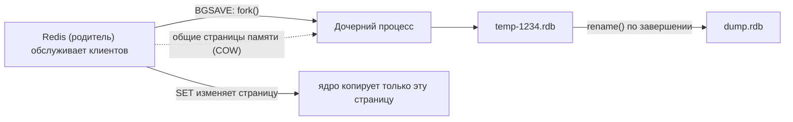
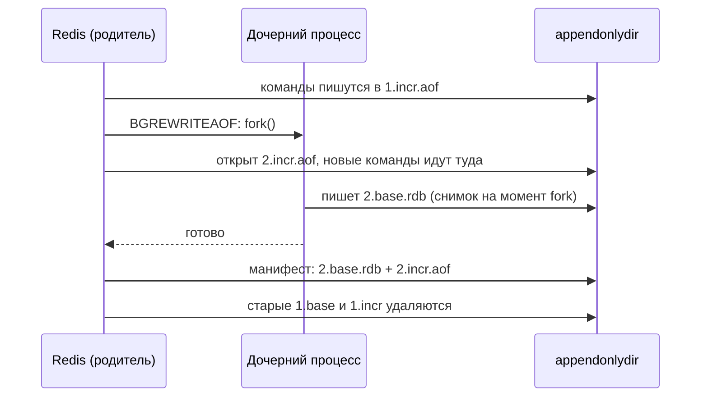

# 05. Персистентность: RDB, AOF и гибридный режим

**Зачем это знать backend-разработчику.** Redis держит все данные в оперативной памяти. Что останется после перезапуска контейнера, падения процесса или отключения питания, зависит от пары строк в `redis.conf`. От них зависит, можно ли хранить в Redis корзину покупателя или только кэш каталога, почему сервер внезапно отвечает `MISCONF` и перестаёт принимать записи и почему Redis с 10 ГБ данных иногда просит у ОС ещё 10 ГБ. Общая идея журнала (WAL) и снапшотов разобрана в [07. Движки хранения](../../docs/00-foundations/07-storage-engines.md). Здесь мы разберём, как это устроено в Redis.

> **Коротко:** В Redis два механизма сохранения на диск. **RDB** периодически делает снимок всей памяти через `fork()` и copy-on-write: файл компактный и быстро загружается, но всё, что изменилось после последнего снимка, при сбое теряется. **AOF** дописывает каждую изменяющую команду в журнал; сколько данных можно потерять, задаёт `appendfsync` (`always`, `everysec` по умолчанию, `no`). С Redis 7.0 AOF состоит из нескольких файлов (multi-part), а при `aof-use-rdb-preamble yes` базовый файл пишется в формате RDB — это и есть гибридный режим. Для кэша персистентность часто не нужна, для основного хранилища обязательны AOF, реплики и бэкапы.

## Оглавление

1. [Зачем in-memory базе диск](#1-зачем-in-memory-базе-диск)
2. [RDB: снимок через fork и copy-on-write](#2-rdb-снимок-через-fork-и-copy-on-write)
3. [AOF: журнал команд](#3-aof-журнал-команд)
4. [Гибридный режим и порядок загрузки](#4-гибридный-режим-и-порядок-загрузки)
5. [Что теряется при падении: сводная таблица](#5-что-теряется-при-падении-сводная-таблица)
6. [Redis как кэш и Redis как основное хранилище](#6-redis-как-кэш-и-redis-как-основное-хранилище)
7. [Бэкапы и восстановление](#7-бэкапы-и-восстановление)
8. [Практика в репозитории](#практика-в-репозитории)
9. [Типичные ошибки и заблуждения](#типичные-ошибки-и-заблуждения) · [Итоги](#итоги) · [Вопросы для самопроверки](#вопросы-для-самопроверки) · [Источники](#источники)

## 1. Зачем in-memory базе диск

**На пальцах.** Официант запоминает заказы в голове, и это очень быстро. Если он упадёт в обморок, заказы пропадут. Есть два способа подстраховаться: раз в час фотографировать доску со всеми заказами (снимок) или записывать в блокнот каждый новый заказ (журнал). Фото дешёвое, но теряется всё после последнего снимка. Блокнот надёжнее, но писать приходится постоянно.

**Персистентность** (persistence) — способность базы восстановить данные после перезапуска процесса или сервера. Redis всегда читает и пишет данные в RAM. Диск нужен только для того, чтобы восстановить память при старте. Поэтому персистентность в Redis почти не замедляет чтение, а на запись влияет в основном через `fsync` и `fork`.

**fsync** — системный вызов, который заставляет ОС сбросить данные файла из своего кэша страниц (page cache) на физический диск. Пока `fsync` не выполнен, «записанные» данные живут в памяти ядра и пропадут при отключении питания (но переживут падение самого процесса Redis).

Посмотреть текущие настройки можно так:

```text
127.0.0.1:6379> CONFIG GET save
1) "save"
2) "3600 1 300 100 60 10000"
127.0.0.1:6379> CONFIG GET appendonly
1) "appendonly"
2) "no"
```

Это значения по умолчанию: RDB-снимки включены, AOF выключен. В официальном Docker-образе без своего конфига поведение то же, но файл `dump.rdb` лежит внутри контейнера и пропадёт вместе с ним, если не смонтировать том в `/data`.

## 2. RDB: снимок через fork и copy-on-write

**На пальцах.** Нужно сфотографировать доску заказов, но официант не может остановиться ни на секунду. Тогда его клонируют: клон стоит неподвижно и позирует фотографу, а оригинал продолжает работать. Чтобы не рисовать вторую доску целиком, клон и оригинал смотрят на одну и ту же. Копию участка делают, только когда оригинал собирается что-то на нём исправить.

**RDB** (Redis Database file) — компактный бинарный снимок всех данных на определённый момент, по умолчанию файл `dump.rdb`. Снимок создают командой **`BGSAVE`** (в фоне) или **`SAVE`** (синхронно; блокирует сервер, в продакшене не используется).

Как работает `BGSAVE`:

1. Главный процесс вызывает **`fork()`**, системный вызов Linux, который создаёт дочерний процесс с копией адресного пространства родителя.
2. Копирования гигабайтов при этом не происходит. Используется **copy-on-write** (COW, «копирование при записи»): обе стороны разделяют одни физические страницы памяти (обычно по 4 КБ). Когда родитель меняет страницу, ядро копирует только её.
3. Дочерний процесс видит данные замороженными на момент `fork` и пишет их во временный файл `temp-<pid>.rdb`.
4. Когда запись закончена, файл атомарно переименовывается в `dump.rdb`. Поэтому на диске всегда лежит целый снимок: либо старый, либо новый.



**Правила `save`.** Строка `save 3600 1 300 100 60 10000` означает три условия: сделать `BGSAVE`, если за 3600 с было хотя бы 1 изменение, за 300 с хотя бы 100 или за 60 с хотя бы 10 000. `save ""` отключает автоматические снимки.

```text
127.0.0.1:6379> BGSAVE
Background saving started
127.0.0.1:6379> INFO persistence
# Persistence
rdb_changes_since_last_save:0
rdb_bgsave_in_progress:0
rdb_last_bgsave_status:ok
rdb_last_bgsave_time_sec:2
rdb_last_cow_size:83886080
...
```

То же из Java на Lettuce:

```java
RedisCommands<String, String> redis = client.connect().sync();

Date before = redis.lastsave();
redis.bgsave();
// ждём, пока LASTSAVE сменится: значит, снимок записан
while (!redis.lastsave().after(before)) {
    Thread.sleep(200);
}
String info = redis.info("persistence");
boolean ok = info.contains("rdb_last_bgsave_status:ok");
System.out.println("snapshot ok: " + ok);
```

### Риск по памяти

Сколько памяти займут скопированные страницы, зависит от того, сколько данных родитель успеет изменить, пока пишется снимок. Посчитаем на примере: в Redis 10 ГБ данных, снимок пишется 60 с.

| Нагрузка во время снимка | Изменённая доля страниц | Доп. память (COW) |
|---|---|---|
| Почти только чтение | ~1% | ~0,1 ГБ |
| Умеренная запись | ~20% | ~2 ГБ |
| Запись по всему пространству ключей | до 100% | до 10 ГБ |

Отсюда правило: на машине с Redis нужен запас памяти. Если данные занимают 10 ГБ, ставить Redis на машину с 12 ГБ RAM рискованно. Метрика `rdb_last_cow_size` показывает, сколько байт скопировалось в последний раз.

🔬 **Глубже.**
- Сам `fork()` не бесплатен: ядро копирует таблицы страниц, и на это время главный поток Redis останавливается. Документация Redis приводит порядок 10 мс на гигабайт (измерения 9–13 мс/ГБ на физическом железе и в VMware); в виртуальных средах бывает заметно дольше — для Xen в той же документации приводятся 239–424 мс/ГБ. Длительность последнего `fork` видна в `INFO stats` (`latest_fork_usec`).
- **Transparent Huge Pages** (THP) увеличивают страницу до 2 МБ, поэтому одна изменённая запись копирует 2 МБ вместо 4 КБ. Redis предупреждает об этом в логе при старте. Рекомендация — отключить THP.
- Linux может отказать в `fork` при `vm.overcommit_memory = 0`, если посчитает, что памяти не хватит на полную копию. Тогда в логе появится `Can't save in background: fork: Cannot allocate memory`. Рекомендуется `vm.overcommit_memory = 1`.
- Если `BGSAVE` завершился ошибкой, а `stop-writes-on-bgsave-error yes` (по умолчанию), Redis отвечает на записи ошибкой `MISCONF ...`. Так он сигнализирует, что сохранение на диск не работает. Лечить нужно причину (место на диске, права, память), а не выключать флаг.

## 3. AOF: журнал команд

**На пальцах.** Официант записывает в блокнот каждый заказ сразу после того, как его принял. После обморока он перечитывает блокнот с первой страницы и восстанавливает всё. Вопрос только в том, как часто прижимать страницы блокнота прессом (fsync): после каждой записи, раз в секунду или когда придётся.

**AOF** (Append Only File) — журнал, в который Redis дописывает каждую изменяющую команду в формате **RESP** (текстовый протокол, на котором клиенты разговаривают с Redis). При старте Redis выполняет команды из журнала заново и получает то же состояние. Это WAL в чистом виде (см. [foundations 07, раздел WAL](../../docs/00-foundations/07-storage-engines.md#2-wal-и-fsync)). Включается так: `appendonly yes`.

### appendfsync: три режима

| Режим | Когда вызывается fsync | Цена | Сколько теряется при отключении питания |
|---|---|---|---|
| `always` | перед ответом клиенту, пачкой на каждую итерацию цикла событий | самая медленная запись, упирается в задержку диска | подтверждённые записи не теряются (если диск не врёт о fsync) |
| `everysec` (по умолчанию) | раз в секунду в фоновом потоке | почти как без AOF | около 1 с; в худшем случае, при медленном диске, до ~2 с |
| `no` | когда решит ОС (в Linux обычно раз в ~30 с) | самая быстрая | до десятков секунд |

Посчитаем для `always`. Если fsync на SSD занимает 0,5 мс, а Redis группирует записи одной итерации цикла событий в один fsync, то итераций получается не больше ~2000 в секунду. Пропускная способность при этом сохраняется за счёт группировки, но каждая запись ждёт диск, и задержка растёт с ~0,1 мс до ~1 мс. С `everysec` запись ждёт только `write()` в page cache.

### Rewrite: сжатие журнала

Если счётчик увеличили миллион раз, в журнале миллион команд `INCR`, хотя для восстановления хватит одной `SET counter 1000000`. **AOF rewrite** (переписывание) строит новый компактный журнал по текущему состоянию памяти. Работает он через тот же `fork()`: дочерний процесс пишет минимальный набор команд (или RDB, см. раздел 4).

- Вручную: `BGREWRITEAOF`.
- Автоматически: `auto-aof-rewrite-percentage 100` и `auto-aof-rewrite-min-size 64mb` значат «переписать, когда AOF вырос вдвое с прошлого rewrite и стал больше 64 МБ».

### Multi-part AOF (Redis 7.0+)

До 7.0 AOF был одним файлом. Во время rewrite новые команды приходилось копить в отдельном буфере в памяти и потом доливать в новый файл, что стоило памяти и CPU. С Redis 7.0 AOF хранится в каталоге (`appenddirname`, по умолчанию `appendonlydir`) и состоит из нескольких частей:

```text
appendonlydir/
├── appendonly.aof.1.base.rdb    # базовый снимок (RDB или AOF-формат)
├── appendonly.aof.1.incr.aof    # команды после базы
├── appendonly.aof.2.incr.aof    # команды после начала последнего rewrite
└── appendonly.aof.manifest      # список частей и их порядок
```

Это снимок каталога в момент rewrite: двух `incr`-файлов одновременно в спокойном состоянии не бывает. Обычно там лежат одна база, один `incr`-файл и манифест, а второй `incr` появляется только на время переписывания.

Когда начинается rewrite, Redis открывает новый `incr`-файл и пишет новые команды туда. Дочерний процесс создаёт новую базу. После завершения манифест атомарно заменяется, а старые база и `incr`-файлы, которые новая база уже включила, удаляются.



Включить AOF на работающем сервере без перезапуска:

```java
redis.configSet("appendonly", "yes");   // Redis сам сделает первый rewrite
redis.configRewrite();                  // сохранить настройку в redis.conf
String info = redis.info("persistence");
System.out.println(info.lines()
        .filter(l -> l.startsWith("aof_enabled") || l.startsWith("aof_rewrite_in_progress"))
        .toList());
```

🔬 **Глубже.** Если процесс упал посреди записи команды, последняя команда в журнале будет обрезана. При `aof-load-truncated yes` (по умолчанию) Redis отбросит обрезанный хвост и запустится, написав предупреждение в лог. Повреждение в середине файла так не исправить. Для этого есть утилита `redis-check-aof` (с флагом `--fix`), и её стоит запускать на копии файла.

## 4. Гибридный режим и порядок загрузки

**На пальцах.** Блокнот официанта начинается с фотографии доски на первой странице, дальше идут записи новых заказов. Восстанавливаться быстро (фото считывается за секунду), а теряется мало (после фото всё записано).

**Гибридный режим** — это AOF, у которого базовая часть записана в формате RDB. Его включает `aof-use-rdb-preamble yes`, и это значение по умолчанию. Файл `*.base.rdb` в примере выше как раз такая база. Загрузка RDB в разы быстрее, чем выполнение миллионов команд: вместо разбора и исполнения каждой команды Redis восстанавливает структуры напрямую.

Порядок загрузки при старте:

| `appendonly` | Что загружается |
|---|---|
| `yes` | только AOF (база + `incr`-файлы по манифесту); `dump.rdb` игнорируется |
| `no` | `dump.rdb`, если он есть |

RDB и AOF можно включить одновременно. Это типичная продакшен-конфигурация: AOF нужен для восстановления с малыми потерями, RDB-снимки — для бэкапов, которые удобно копировать.

```text
# redis.conf для «основного хранилища»
appendonly yes
appendfsync everysec
aof-use-rdb-preamble yes
save 3600 1 300 100 60 10000
```

## 5. Что теряется при падении: сводная таблица

**На пальцах.** Падение процесса — это когда официант упал, но блокнот лежит на столе. Отключение питания — это пожар, после которого уцелело только то, что было заперто в сейфе (успело пройти fsync).

Различать эти два сценария важно. При падении процесса (`kill -9`, OOM killer, баг) данные, которые Redis уже отдал ядру через `write()`, остаются в page cache и доходят до диска. При отключении питания или падении ядра пропадает всё, что не прошло `fsync`.

| Конфигурация | Падение процесса Redis | Отключение питания / падение ОС | Время старта |
|---|---|---|---|
| Без персистентности | всё | всё | мгновенно (пустая база) |
| Только RDB (`save 3600 1 300 100 60 10000`) | всё после последнего успешного снимка: от секунд до часа | то же | быстро |
| AOF `always` | ничего подтверждённого | ничего подтверждённого | медленнее, быстрее с гибридом |
| AOF `everysec` (+гибрид) | как правило, почти ничего | около 1 с, в худшем случае ~2 с | быстро (гибрид) |
| AOF `no` | как правило, почти ничего | до ~30 с (зависит от ОС) | быстро (гибрид) |

Пример. Сервис принимает 5000 записей в секунду, включён только RDB с правилами по умолчанию. Условие `60 10000` при такой нагрузке срабатывает примерно раз в минуту, поэтому в худшем случае теряется около минуты изменений: 5000 × 60 = 300 000 записей. Если снимки настроены реже (скажем, только `save 900 1`), окно вырастает до 15 минут, то есть до 4,5 млн записей. С AOF `everysec` при отключении питания пропадёт около 5000–10 000.

Помните, что персистентность защищает от перезапуска, а не от потери диска или сервера. От этого защищают реплики (они разобраны в [08. Репликация, Sentinel и Cluster](08-replication-cluster.md)) и бэкапы на другой машине.

## 6. Redis как кэш и Redis как основное хранилище

**На пальцах.** Кэш похож на черновик. Если он потерялся, данные восстановят из оригинала (из основной БД), просто некоторое время всё будет медленнее. Основное хранилище похоже на оригинал документа, и его потеря необратима.

| Вопрос | Redis как кэш | Redis как основное хранилище |
|---|---|---|
| Где «правда» | в основной БД (PostgreSQL, MongoDB) | в Redis |
| Персистентность | часто выключена или только RDB (быстрый «прогрев» после рестарта) | AOF `everysec` (или `always`) + RDB |
| `maxmemory-policy` | `allkeys-lru` / `allkeys-lfu` (см. [04](04-expiration-eviction.md)) | `noeviction`: лучше ошибка записи, чем молча удалённые данные |
| Реплики | по желанию | обязательно, плюс автоматическое переключение на реплику при падении мастера (Sentinel или Cluster, см. [08. Репликация, Sentinel и Cluster](08-replication-cluster.md)) |
| Потеря данных | лишние промахи кэша, нагрузка на БД | потеря денег, заказов, сессий |

Пример данных для каждого варианта. Карточки товаров из задания 01 или ответы внешнего API — это кэш. Счётчики лимита запросов из задания 03 — промежуточный случай: потеря счётчиков на минуту допустима. Очередь задач на Streams из задания 07 или игровые рейтинги ближе к хранилищу.

**Холодный старт.** Если у кэша нет персистентности, после рестарта он пуст. Все запросы идут в основную БД, и она может не выдержать нагрузки. Это та же лавина промахов, что и при одновременном истечении TTL (разобрано в [04](04-expiration-eviction.md) и в задании 02). Поэтому даже для кэша RDB-снимок иногда включают, чтобы прогрев шёл быстрее.

🔬 **Глубже: надёжность записи через реплики.** Команда `WAIT numreplicas timeout` блокирует клиента, пока запись не подтвердят указанное число реплик. С Redis 7.2 есть `WAITAOF numlocal numreplicas timeout`, которая ждёт, пока запись пройдёт fsync в AOF локально и/или на репликах. Обе команды уменьшают окно потерь, но не превращают Redis в систему с консенсусом: при переключении на другую реплику подтверждённая запись всё ещё может потеряться. В Lettuce `WAIT` вызывается так:

```java
redis.set("order:42:status", "PAID");
Long acked = redis.waitForReplication(1, 100); // ждём одну реплику до 100 мс
if (acked < 1) {
    log.warn("запись пока есть только на мастере");
}
```

## 7. Бэкапы и восстановление

**На пальцах.** Фото доски, которое висит в том же кафе, сгорит вместе с кафе. Копию нужно унести домой, и время от времени проверять, что она читается.

**Бэкап** — копия данных, которая хранится отдельно от сервера и позволяет восстановить состояние на определённый момент. В Redis удобнее всего делать бэкап из RDB-файла. Копировать `dump.rdb` при работающем сервере безопасно: новый снимок пишется во временный файл и только потом атомарно подменяет старый, так что вы скопируете целый файл.

Типичная процедура:

1. Вызвать `BGSAVE` (лучше на реплике, чтобы `fork` не нагружал мастер) и дождаться, пока изменится `LASTSAVE`.
2. Скопировать `dump.rdb` с отметкой времени в имени: `dump-2026-09-22T03-00.rdb`.
3. Отправить копию за пределы машины (S3 или другое объектное хранилище).
4. Хранить набор снимков: например, почасовые за двое суток и ежедневные за месяц.
5. Регулярно проверять восстановление: поднять Redis из копии и сравнить `DBSIZE`.

Бэкап AOF в 7.0+. Копировать нужно весь каталог `appendonlydir` целиком, вместе с манифестом. Опасность в том, что rewrite во время копирования удалит старые части, и копия окажется неполной. Процедура такая:

1. Запомнить текущее значение `auto-aof-rewrite-percentage` и выключить автоматический rewrite (`0`).
2. Дождаться `aof_rewrite_in_progress:0` в `INFO persistence` и не запускать `BGREWRITEAOF` вручную, пока идёт копирование.
3. Скопировать каталог целиком.
4. Вернуть **прежнее** значение `auto-aof-rewrite-percentage`, а не жёстко `100`: в вашем конфиге могло стоять другое.

```text
127.0.0.1:6379> CONFIG GET auto-aof-rewrite-percentage
1) "auto-aof-rewrite-percentage"
2) "100"                      # запомнили прежнее значение
127.0.0.1:6379> CONFIG SET auto-aof-rewrite-percentage 0
OK
127.0.0.1:6379> INFO persistence
aof_rewrite_in_progress:0
# ... копируем appendonlydir/ целиком, BGREWRITEAOF вручную не запускаем ...
127.0.0.1:6379> CONFIG SET auto-aof-rewrite-percentage 100
OK
```

Окно, в котором rewrite запрещён, можно сделать очень коротким: сделать жёсткие ссылки (`ln`) на файлы внутри `appenddirname` в другом каталоге той же файловой системы, сразу вернуть настройку и копировать уже по ссылкам. Части AOF после завершения не меняются на месте, поэтому жёсткая ссылка удерживает содержимое, даже когда Redis удалит исходное имя.

**Восстановление** из RDB: остановить Redis, положить файл как `dump.rdb` в каталог `dir`, запустить. Если включён `appendonly yes`, Redis загрузит AOF и не будет читать RDB. Значит, нужно либо временно выключить AOF, запуститься, а потом включить его через `CONFIG SET appendonly yes`, либо восстанавливать каталог AOF.

## Практика в репозитории

- [../tasks/01-product-cache.md](../tasks/01-product-cache.md) — cache-aside с TTL и джиттером: данные, для которых персистентность необязательна.
- [../tasks/02-cache-stampede.md](../tasks/02-cache-stampede.md) — защита от лавины промахов, которая случается и после рестарта кэша без персистентности.
- [../tasks/07-job-queue-streams.md](../tasks/07-job-queue-streams.md) — очередь задач, для которой потеря данных уже критична: подумайте, какой `appendfsync` вы бы выбрали.
- [../examples/src/main/java/dev/nosqlguide/redis/examples/driver/BasicsDemo.java](../examples/src/main/java/dev/nosqlguide/redis/examples/driver/BasicsDemo.java) — подключение через Lettuce. На этом соединении можно попробовать `redis.bgsave()` и `redis.info("persistence")`.
- Foundations: [07. Движки хранения](../../docs/00-foundations/07-storage-engines.md) (WAL, fsync, снапшоты в общем виде), [04. Репликация](../../docs/00-foundations/04-replication.md) (почему диск без реплик не защищает от потери машины).

## Типичные ошибки и заблуждения

- **«Redis in-memory, значит, всё теряется при рестарте».** По умолчанию включены RDB-снимки, а при AOF `everysec` при отключении питания теряется около секунды.
- **«Включил AOF, значит, данные не потеряются».** При `everysec` окно около секунды, а от потери диска AOF не защищает совсем. Нужны реплики и внешние бэкапы.
- **Мастер без персистентности с автоперезапуском.** Мастер упал, перезапустился пустым, реплики синхронизировались с ним и тоже стали пустыми. Документация Redis прямо предупреждает об этом сценарии. Если на мастере персистентность выключена, его нельзя автоматически перезапускать.
- **Нет запаса памяти под COW.** На 10 ГБ данных при активной записи `BGSAVE` может потребовать ещё несколько гигабайт. Итог: OOM killer или отказ `fork` и ошибки `MISCONF`.
- **Смонтированный том забыли.** В Docker `dump.rdb` пишется в `/data` контейнера. Без тома при пересоздании контейнера данных не будет, хоть RDB и был включён.
- **`SAVE` вместо `BGSAVE`.** `SAVE` блокирует все команды на время записи снимка, а это секунды или минуты.
- **Включили `appendonly yes` в конфиге и перезапустили сервер с существующим `dump.rdb`.** При `appendonly yes` Redis читает только AOF. Каталога `appendonlydir` ещё нет, читать нечего — сервер стартует с пустой базой, а первый же rewrite или снимок закрепляет эту пустоту. Безопасный путь: на работающем сервере выполнить `CONFIG SET appendonly yes`, дождаться в `INFO persistence` значений `aof_rewrite_in_progress:0`, `aof_rewrite_scheduled:0` и `aof_last_bgrewrite_status:ok` (то есть первый AOF полностью создан) и только потом сохранить настройку командой `CONFIG REWRITE`.

## Итоги

- RDB — снимок всей памяти через `fork()` и copy-on-write: компактный, быстро грузится, но теряет всё после последнего снимка.
- COW требует запаса RAM, пропорционального интенсивности записи во время снимка. Следите за `rdb_last_cow_size`, отключайте THP и ставьте `vm.overcommit_memory = 1`.
- AOF — журнал команд. Окно потерь задаёт `appendfsync`: `always` (0), `everysec` (~1 с, по умолчанию), `no` (решает ОС).
- С Redis 7.0 AOF состоит из нескольких частей (база + `incr`-файлы + манифест), а при `aof-use-rdb-preamble yes` база пишется в RDB-формате (гибрид).
- При `appendonly yes` при старте загружается только AOF.
- Для кэша персистентность часто не нужна, для основного хранилища нужны AOF, `noeviction`, реплики и внешние бэкапы.
- Бэкап — это копия RDB (или каталога AOF) на другой машине, которую регулярно восстанавливают для проверки.

## Вопросы для самопроверки

1. Почему `BGSAVE` на 20 ГБ данных не требует сразу ещё 20 ГБ памяти, но может потребовать их позже?
   <details><summary>Ответ</summary>После <code>fork()</code> родитель и дочерний процесс разделяют физические страницы (copy-on-write). Копия страницы создаётся, только когда родитель её меняет. Если за время записи снимка поменяются почти все страницы, дополнительной памяти понадобится почти столько же, сколько занимают данные.</details>
2. Чем отличаются потери при `appendfsync everysec` при падении процесса и при отключении питания?
   <details><summary>Ответ</summary>При падении процесса данные, уже отданные ядру через <code>write()</code>, лежат в page cache и попадут на диск, поэтому теряется как правило почти ничего. При отключении питания пропадает всё, что не прошло fsync: около последней секунды, в худшем случае около двух.</details>
3. Что такое multi-part AOF и какую проблему он решил?
   <details><summary>Ответ</summary>С Redis 7.0 AOF — это каталог с базовым файлом, инкрементальными файлами и манифестом. Во время rewrite новые команды пишутся в новый incr-файл, а не копятся в буфере в памяти для последующего слияния. Это экономит память и CPU.</details>
4. Включены и RDB, и AOF. Какой файл Redis прочитает при старте?
   <details><summary>Ответ</summary>AOF (по манифесту: база и инкрементальные части). RDB-файл <code>dump.rdb</code> при <code>appendonly yes</code> игнорируется.</details>
5. Redis используется только как кэш каталога товаров. Какие настройки персистентности и вытеснения вы выберете?
   <details><summary>Ответ</summary>AOF не нужен. RDB по желанию, для быстрого прогрева после рестарта. <code>maxmemory</code> с политикой <code>allkeys-lru</code> или <code>allkeys-lfu</code>. Плюс защита от лавины промахов, ведь после рестарта кэш может быть пуст.</details>
6. Сервер начал отвечать на записи ошибкой <code>MISCONF</code>. Что случилось и что делать?
   <details><summary>Ответ</summary>Последний <code>BGSAVE</code> не удался, а <code>stop-writes-on-bgsave-error yes</code> запрещает записи. Нужно найти причину в логе (нет места, нет прав, fork не смог выделить память) и устранить её, а не просто выключать флаг.</details>
7. Почему бэкап лучше делать на реплике?
   <details><summary>Ответ</summary><code>fork()</code> на мастере останавливает главный поток на время копирования таблиц страниц и тратит память на COW. На реплике это не влияет на задержки записи для клиентов.</details>

## Источники

- Redis: [Persistence](https://redis.io/docs/latest/operate/oss_and_stack/management/persistence/)
- Redis: [Diagnosing latency issues (fork, THP)](https://redis.io/docs/latest/operate/oss_and_stack/management/optimization/latency/)
- Redis: [Replication — safety of replication when master has persistence turned off](https://redis.io/docs/latest/operate/oss_and_stack/management/replication/)
- Redis: [`WAITAOF`](https://redis.io/docs/latest/commands/waitaof/), [`BGSAVE`](https://redis.io/docs/latest/commands/bgsave/), [`BGREWRITEAOF`](https://redis.io/docs/latest/commands/bgrewriteaof/)
- Исходники: [redis.conf (раздел SNAPSHOTTING и APPEND ONLY MODE)](https://github.com/redis/redis/blob/unstable/redis.conf), `src/rdb.c`, `src/aof.c`
- Redis 7.0 release notes: Multi-part AOF ([PR #9788](https://github.com/redis/redis/pull/9788))
- Lettuce Reference Guide: [lettuce.io](https://redis.github.io/lettuce/)

---

← [04. Истечение ключей и вытеснение](04-expiration-eviction.md) | [оглавление](README.md) | [06. Атомарность: транзакции, Lua и pipelining](06-atomicity-scripting.md) →
