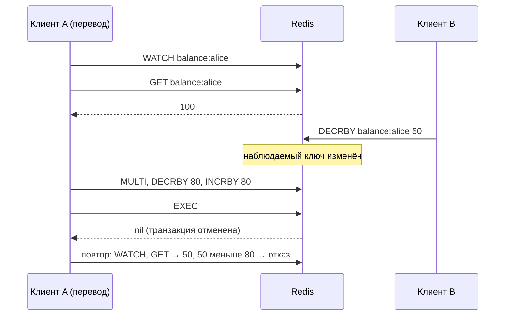
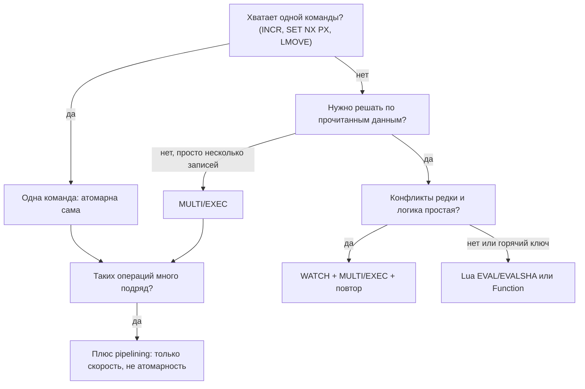

# 06. Атомарность: транзакции, Lua и pipelining

**Зачем это знать backend-разработчику.** Два запроса одновременно проверяют остаток на счёте, оба видят 100 и оба списывают по 80. Два инстанса сервиса одновременно решают, что блокировку никто не держит. Счётчик лимита запросов пропускает лишнее. Все эти ошибки появляются, когда операция из нескольких шагов выполняется не атомарно. В Redis есть четыре инструмента для работы с группами команд: атомарные одиночные команды, `MULTI/EXEC`, `WATCH` и Lua-скрипты (или Functions). Pipelining к атомарности отношения не имеет, но его постоянно с ней путают. Если выбрать не тот инструмент, код пройдёт тесты и сломается под нагрузкой.

> **Коротко:** Команды в Redis выполняются одним потоком по очереди, поэтому каждая отдельная команда атомарна. `MULTI/EXEC` ставит команды в очередь и выполняет их подряд без вклинивания чужих, но отката нет: если одна команда упала во время выполнения, остальные всё равно выполнятся. `WATCH` добавляет оптимистичную блокировку: `EXEC` отменяется, если наблюдаемый ключ изменили. Lua-скрипт (`EVAL`/`EVALSHA`, с 7.0 ещё и Functions) выполняется целиком атомарно и может принимать решения по прочитанным данным, но, пока он работает, ждут все клиенты. Pipelining отправляет много команд без ожидания ответов и экономит сетевые задержки, но атомарности не даёт.

## Оглавление

1. [Почему каждая команда атомарна](#1-почему-каждая-команда-атомарна)
2. [MULTI/EXEC: очередь без отката](#2-multiexec-очередь-без-отката)
3. [WATCH: оптимистичная блокировка](#3-watch-оптимистичная-блокировка)
4. [Lua: EVAL и EVALSHA](#4-lua-eval-и-evalsha)
5. [Functions (Redis 7.0+)](#5-functions-redis-70)
6. [Pipelining: не транзакция, а экономия RTT](#6-pipelining-не-транзакция-а-экономия-rtt)
7. [Как выбрать инструмент](#7-как-выбрать-инструмент)
8. [Практика в репозитории](#практика-в-репозитории)
9. [Типичные ошибки и заблуждения](#типичные-ошибки-и-заблуждения) · [Итоги](#итоги) · [Вопросы для самопроверки](#вопросы-для-самопроверки) · [Источники](#источники)

## 1. Почему каждая команда атомарна

**На пальцах.** В банке одно окошко и один кассир. Клиенты стоят в очереди, и кассир полностью обслуживает одного, прежде чем позвать следующего. Двое не могут оказаться у окошка одновременно.

**Атомарность** здесь означает, что операцию никто не видит «наполовину выполненной» и никакая другая команда не выполняется посередине. В Redis команды исполняет один главный поток (подробнее в [01. Архитектура Redis: один поток, event loop и латентность](01-architecture.md)). Потоки ввода-вывода, которые появились в 6.0, только читают запросы из сокетов и пишут ответы, а сами команды не выполняют. Поэтому `INCR`, `SET key value NX PX 30000`, `HINCRBY`, `ZADD`, `LMOVE` атомарны по определению.

Типичная ошибка «прочитать, изменить, записать» из приложения:

| Шаг | Клиент A | Клиент B | `counter` в Redis |
|---|---|---|---|
| 1 | `GET counter` → 10 | | 10 |
| 2 | | `GET counter` → 10 | 10 |
| 3 | `SET counter 11` | | 11 |
| 4 | | `SET counter 11` | 11 (одно увеличение потеряно) |

С `INCR counter` такое невозможно: чтение и запись происходят внутри одной команды.

```java
// плохо: гонка между get и set
long v = Long.parseLong(redis.get("counter"));
redis.set("counter", String.valueOf(v + 1));

// хорошо: одна атомарная команда
long next = redis.incr("counter");
```

Правило: сначала поищите одну команду, которая делает всё нужное. `SET NX PX` (захватить ключ с TTL), `GETDEL`, `LMOVE`, `ZADD GT` закрывают большинство случаев без транзакций и скриптов. А вот связка «`INCR`, а затем `EXPIRE NX` для нового окна» — это уже две команды: между ними клиент может упасть, и счётчик останется без TTL. Такие пары обычно объединяют в Lua-скрипт (раздел 4); исключение — fixed window rate limiter (задание 03), где номер окна — часть ключа: «осиротевший» счётчик без TTL просто протекает одним ключом, а лимитер в следующем окне уже работает с новым ключом как ни в чём не бывало.

## 2. MULTI/EXEC: очередь без отката

**На пальцах.** Вы отдаёте кассиру пачку поручений в конверте. Он складывает их в лоток, ничего не выполняя, а по слову «исполнить» выполняет все подряд и никого не пускает к окошку, пока не закончит. Но если одно поручение оказалось невыполнимым, кассир его пропускает и идёт дальше. Сделанное он не отменяет.

**Транзакция** в Redis — это группа команд между `MULTI` и `EXEC`. После `MULTI` сервер не выполняет команды, а отвечает `QUEUED` и ставит их в очередь. По `EXEC` вся очередь выполняется подряд, и чужие команды не вклиниваются. `DISCARD` очищает очередь без выполнения.

```text
127.0.0.1:6379> MULTI
OK
127.0.0.1:6379(TX)> DECRBY balance:alice 30
QUEUED
127.0.0.1:6379(TX)> INCRBY balance:bob 30
QUEUED
127.0.0.1:6379(TX)> EXEC
1) (integer) 70
2) (integer) 130
```

Главное ограничение: результат команды становится известен только после `EXEC`. Внутри транзакции нельзя прочитать баланс и в зависимости от него решить, списывать или нет. Для этого есть `WATCH` (раздел 3) или Lua (раздел 4).

### Два вида ошибок

| Когда | Пример | Что происходит |
|---|---|---|
| При постановке в очередь | неизвестная команда, неверное число аргументов | `EXEC` отвечает `EXECABORT`, не выполняется **ничего** |
| При выполнении | `INCR` по ключу, в котором лежит список (`WRONGTYPE`) | ошибка возвращается для этой команды, **остальные выполняются** |

```text
127.0.0.1:6379> SET name "alice"
OK
127.0.0.1:6379> MULTI
OK
127.0.0.1:6379(TX)> INCR counter
QUEUED
127.0.0.1:6379(TX)> LPUSH name "x"
QUEUED
127.0.0.1:6379(TX)> INCR counter
QUEUED
127.0.0.1:6379(TX)> EXEC
1) (integer) 1
2) (error) WRONGTYPE Operation against a key holding the wrong kind of value
3) (integer) 2
```

**Отката (rollback) нет.** Авторы Redis объясняют это так: ошибки выполнения — почти всегда ошибки программиста (не тот тип ключа), и откат их не исправит, а поддержка отката усложнила бы и замедлила сервер. Значит, в `MULTI/EXEC` из ACID есть «изоляция» (никто не вклинивается) и «всё или ничего» только для ошибок постановки. Надёжность записи на диск зависит от настроек из [05. Персистентность](05-persistence.md).

В Lettuce синхронный API внутри транзакции возвращает `null`, а результаты приходят в `TransactionResult`:

```java
RedisCommands<String, String> redis = txConnection.sync(); // отдельное соединение!
redis.multi();
redis.decrby("balance:alice", 30);   // вернёт null: команда только поставлена в очередь
redis.incrby("balance:bob", 30);
TransactionResult result = redis.exec();
Long alice = result.get(0);          // 70
Long bob = result.get(1);            // 130
System.out.println("exec: " + alice + ", " + bob);
```

🔬 **Глубже.** В Lettuce одно соединение (`StatefulRedisConnection`) потокобезопасно и обычно общее для всего приложения. `MULTI` же — это состояние соединения на сервере. Если другой поток отправит команду по тому же соединению между `MULTI` и `EXEC`, она попадёт в чужую транзакцию. Поэтому для транзакций берут отдельное соединение, например из пула, по одному на транзакцию. В Spring Data Redis для этого есть `SessionCallback`.

## 3. WATCH: оптимистичная блокировка

**На пальцах.** Прежде чем отдать конверт с поручениями, вы просите кассира: «Следи за счётом Алисы. Если кто-то его тронет до того, как я скажу „исполнить“, выброси мой конверт». Вы ничего не блокируете, просто проверяете в конце, не было ли конфликта. Если был, пробуете ещё раз.

**Оптимистичная блокировка** (optimistic locking) — подход, при котором данные не блокируются заранее, а перед записью проверяется, что их никто не изменил. Если изменил, операция повторяется. **`WATCH key...`** помечает ключи. Если до `EXEC` любой другой клиент изменит хотя бы один из них, `EXEC` вернёт `nil` и не выполнит ничего. `UNWATCH` снимает наблюдение, а после `EXEC` или `DISCARD` оно снимается само.



Перевод баллов с проверкой баланса на Lettuce:

```java
boolean transfer(RedisCommands<String, String> redis, String from, String to, long amount) {
    for (int attempt = 1; attempt <= 5; attempt++) {
        redis.watch(from);
        String raw = redis.get(from);
        long balance = raw == null ? 0 : Long.parseLong(raw);
        if (balance < amount) {
            redis.unwatch();
            return false;                        // не хватает средств
        }
        redis.multi();
        redis.decrby(from, amount);
        redis.incrby(to, amount);
        TransactionResult result = redis.exec();
        if (!result.wasDiscarded()) {
            return true;                         // успех
        }
        // кто-то изменил from между WATCH и EXEC: пробуем снова
    }
    throw new IllegalStateException("слишком много конфликтов");
}
```

Как это выглядит по шагам при конфликте:

| Шаг | Клиент A | Клиент B | `balance:alice` |
|---|---|---|---|
| 1 | `WATCH`, `GET` → 100 | | 100 |
| 2 | | `DECRBY 50` | 50 |
| 3 | `MULTI … EXEC` → `nil` | | 50 (A ничего не списал) |
| 4 | повтор: `GET` → 50, отказ | | 50 |

`WATCH` хорош, когда конфликты редки. При высокой конкуренции за один ключ (горячий счётчик) клиенты начинают бесконечно повторять попытки, и тогда лучше Lua, где проверка и запись происходят внутри сервера без конфликта.

## 4. Lua: EVAL и EVALSHA

**На пальцах.** Вместо конверта с поручениями вы даёте кассиру короткую инструкцию: «Посмотри баланс Алисы; если там не меньше 30, переведи 30 Бобу, иначе ничего не делай». Кассир выполняет её целиком, не отвлекаясь, и может принимать решения по ходу, чего конверт `MULTI` не позволял.

**Lua-скрипт** — программа на языке Lua, которую Redis выполняет внутри сервера командой **`EVAL script numkeys key... arg...`**. Пока скрипт работает, никакие другие команды не выполняются, поэтому скрипт атомарен. Внутри скрипта команды Redis вызываются через `redis.call(...)` (при ошибке прерывает скрипт) или `redis.pcall(...)` (возвращает ошибку как значение).

### KEYS и ARGV

Имена ключей передаются отдельно от остальных аргументов: в скрипте они доступны как таблица `KEYS`, прочие аргументы — как `ARGV`. Индексы в Lua начинаются с 1.

Зачем так делать, если имя ключа можно просто склеить в строке? Redis (и клиент в режиме Cluster) по `KEYS` узнаёт, какие ключи затронет скрипт. В **Redis Cluster** данные поделены на 16384 слота, и все ключи одного скрипта должны лежать в одном слоте, иначе сервер ответит ошибкой `CROSSSLOT`. Чтобы ключи гарантированно попали в один слот, используют **hash tag**: часть имени в фигурных скобках, например `points:{user42}` и `history:{user42}`. Слот вычисляется только по ней. Если имя ключа собрано внутри скрипта, Redis о нём не знает, и в Cluster такой скрипт может молча работать с ключом на чужой ноде или упасть. Подробнее в [08. Репликация, Sentinel и Cluster](08-replication-cluster.md).

Атомарный перевод «если хватает», как в `LuaScriptingDemo`:

```java
static final String TRANSFER = """
        local balance = tonumber(redis.call('GET', KEYS[1]) or '0')
        local amount = tonumber(ARGV[1])
        if balance < amount then
          return 0
        end
        redis.call('DECRBY', KEYS[1], amount)
        redis.call('INCRBY', KEYS[2], amount)
        return 1
        """;

Long ok = redis.eval(TRANSFER, ScriptOutputType.INTEGER,
        new String[] {"points:{alice}", "points:{bob}"}, "30");
System.out.println(ok == 1 ? "transfer ok: 30" : "transfer rejected: not enough points");
```

Здесь нет повторов и конфликтов, как с `WATCH`: проверка и запись происходят за один проход.

### EVALSHA и кэш скриптов

Каждый раз отправлять текст скрипта расточительно. `SCRIPT LOAD` сохраняет скрипт в кэше сервера и возвращает его SHA1. Потом скрипт вызывается по хэшу через `EVALSHA`:

```java
String sha = redis.scriptLoad(TRANSFER);   // например, "a42059b356c875f0717db19a51f6aaca9ae659ea"
Long ok = redis.evalsha(sha, ScriptOutputType.INTEGER,
        new String[] {"points:{alice}", "points:{bob}"}, "30");
```

Кэш скриптов не сохраняется на диск и очищается при рестарте, при переключении на реплику и после `SCRIPT FLUSH`. Тогда `EVALSHA` отвечает ошибкой `NOSCRIPT`, и клиент должен повторить вызов через `EVAL` (многие библиотеки делают это сами).

### Детерминизм и долгие скрипты

- **Детерминизм.** Раньше Redis реплицировал сам скрипт, и реплика выполняла его заново. Поэтому скрипт обязан был давать одинаковый результат на мастере и реплике: без текущего времени, случайных чисел и зависимости от порядка обхода. С Redis 5.0 репликация эффектами (на реплику уходят итоговые команды записи, а не текст скрипта) стала режимом по умолчанию — появилась она ещё в 3.2, — а в 7.0 построчная репликация скриптов удалена совсем, и ограничение ослабло. Хорошая практика осталась прежней: передавайте время и случайные значения через `ARGV` из приложения. Тогда скрипт легко тестировать и повторять.
- **Долгие скрипты блокируют всех.** Скрипт, который обходит 1 млн элементов, на это время останавливает весь сервер. Если скрипт работает дольше `busy-reply-threshold` (по умолчанию 5000 мс; до 7.0 параметр назывался `lua-time-limit`), Redis начинает отвечать остальным клиентам ошибкой `BUSY`. Остановить такой скрипт можно командой `SCRIPT KILL`, но только если он ещё ничего не записал. Иначе остаётся `SHUTDOWN NOSAVE`. Для функции, запущенной через `FCALL`, команды другие: что именно выполняется, показывает `FUNCTION STATS`, а останавливает `FUNCTION KILL` (с тем же ограничением: только пока не было записи). Поэтому скрипты должны быть короткими, O(1) или O(log N), без обхода всего пространства ключей.

🔬 **Глубже: атомарность скрипта не означает отката.** Если скрипт выполнил `DECRBY`, а потом упал на `redis.call` с ошибкой, `DECRBY` уже применён. Сначала проверяйте все условия, потом пишите.

## 5. Functions (Redis 7.0+)

**На пальцах.** Если инструкцию «перевести, если хватает» приходится давать кассиру каждый день, проще один раз повесить её на стену как официальный регламент с именем. Регламент переживёт смену кассира: он хранится в делах банка, а не в памяти конкретного сотрудника.

**Functions** — именованные серверные функции, которые появились в Redis 7.0. Их группируют в **библиотеки** (library) и загружают командой `FUNCTION LOAD`. В отличие от кэша `EVAL`, функции являются частью данных: они сохраняются в RDB и AOF и реплицируются. Вызов выполняется командой `FCALL name numkeys key... arg...`, гарантии атомарности те же, что у скриптов.

```java
String library = """
        #!lua name=points
        redis.register_function('transfer', function(keys, args)
          local balance = tonumber(redis.call('GET', keys[1]) or '0')
          local amount = tonumber(args[1])
          if balance < amount then return 0 end
          redis.call('DECRBY', keys[1], amount)
          redis.call('INCRBY', keys[2], amount)
          return 1
        end)
        """;
redis.functionLoad(library, true);   // true = REPLACE, перезаписать библиотеку
Long ok = redis.fcall("transfer", ScriptOutputType.INTEGER,
        new String[] {"points:{alice}", "points:{bob}"}, "30");
```

```text
127.0.0.1:6379> FUNCTION LIST
1) 1) "library_name"
   2) "points"
   3) "engine"
   4) "LUA"
   ...
```

Когда что выбирать: `EVAL`/`EVALSHA` подходят, если скрипт живёт в коде приложения и версионируется вместе с ним. Functions подходят, если логика общая для нескольких сервисов и должна переживать рестарты без повторной загрузки. Методы `functionLoad` и `fcall` есть в Lettuce начиная с версии 6.3; в более старых версиях используйте `EVAL`.

## 6. Pipelining: не транзакция, а экономия RTT

**На пальцах.** Нужно отправить 100 писем. Можно ходить на почту 100 раз и на каждое ждать ответа. А можно отнести всю пачку за один раз. Письма от этого не станут единым «пакетом», который доставят целиком или никак: другие люди тоже приносят письма, и их обработают вперемешку с вашими.

**RTT** (round-trip time) — время, за которое запрос доходит до сервера и возвращается ответ. **Pipelining** — отправка многих команд подряд без ожидания ответа на каждую, а ответы потом приходят пачкой. Сервер обрабатывает команды так же, как обычно, по одной. Между вашими командами могут выполниться команды других клиентов, поэтому **атомарности pipelining не даёт**.

Посчитаем на примере 10 000 команд `SET`, сервер в соседней зоне дата-центра, RTT 0,5 мс, сама команда на сервере выполняется примерно за 1 мкс:

| Способ | Сколько раз ждём RTT | Время |
|---|---|---|
| По одной, синхронно | 10 000 | ≈ 10 000 × 0,5 мс = 5 с |
| Pipeline пачками по 1000 | 10 | ≈ 10 × 0,5 мс + передача ≈ десятки мс |
| Один pipeline на 10 000 | 1 | ≈ 0,5 мс + передача и выполнение ≈ 10–30 мс |

Выигрыш в сотни раз, и он тем больше, чем дальше сервер. На localhost RTT мал, и разница меньше, но всё равно заметна: меньше системных вызовов `read`/`write`. `PipeliningDemo` печатает оба времени строками `sync:` и `pipelined:`.

В Lettuce pipelining делается через асинхронный API и ручной сброс буфера:

```java
StatefulRedisConnection<String, String> conn = client.connect(); // отдельное соединение
RedisAsyncCommands<String, String> async = conn.async();
conn.setAutoFlushCommands(false);             // копим команды в буфере клиента
List<RedisFuture<String>> futures = new ArrayList<>(10_000);
for (int i = 0; i < 10_000; i++) {
    futures.add(async.set("key:" + i, "value-" + i));
}
conn.flushCommands();                         // отправляем всё одним потоком байт
boolean done = LettuceFutures.awaitAll(Duration.ofSeconds(5),
        futures.toArray(new RedisFuture[0]));
conn.setAutoFlushCommands(true);
System.out.println("pipelined: " + done);
```

`setAutoFlushCommands(false)` меняет поведение всего соединения, поэтому на общем соединении приложения так делать нельзя. Если нужна и экономия RTT, и атомарность, `MULTI/EXEC` можно отправить внутри pipeline, а Lua-скрипт экономит RTT сам по себе: вместо нескольких запросов отправляется один.

## 7. Как выбрать инструмент

**На пальцах.** Для одного действия хватит одного окошка. Когда действий несколько, нужен конверт. Когда решение зависит от данных, нужна инструкция. А когда поручений просто много, их выгоднее принести пачкой.



| Инструмент | Атомарность | Решения по данным | Откат | Экономит RTT |
|---|---|---|---|---|
| Одна команда | да | внутри команды | не нужен | — |
| `MULTI/EXEC` | да (без вклинивания) | нет | нет | частично (если в pipeline) |
| `WATCH` + `MULTI/EXEC` | да, с отменой при конфликте | да, на стороне клиента | отмена целиком до выполнения | нет |
| Lua / Functions | да | да, на сервере | нет | да |
| Pipelining | нет | нет | нет | да |

Пример из заданий. Освобождение блокировки должно удалить ключ, только если в нём лежит наш токен. Если сделать `GET` и `DEL` двумя командами, между ними ключ может истечь и достаться другому клиенту, и мы удалим чужую блокировку. Поэтому освобождение делается Lua-скриптом:

```java
static final String RELEASE = """
        if redis.call('GET', KEYS[1]) == ARGV[1] then
          return redis.call('DEL', KEYS[1])
        end
        return 0
        """;
Long released = redis.eval(RELEASE, ScriptOutputType.INTEGER,
        new String[] {"lock:order:42"}, token);
```

## Практика в репозитории

- [../tasks/02-cache-stampede.md](../tasks/02-cache-stampede.md) — захват пересчёта одной командой `SET NX PX` и безопасное освобождение Lua-скриптом «удалить, только если мой токен».
- [../tasks/03-rate-limiter.md](../tasks/03-rate-limiter.md) — фиксированное окно на атомарном `INCR` и скользящее окно на ZSet, где проверка и добавление объединены в Lua-скрипт.
- [../tasks/04-distributed-lock.md](../tasks/04-distributed-lock.md) — Lua-скрипт захвата, который одновременно выдаёт **fencing-токен** (монотонно растущий номер владельца блокировки) через `INCR`, плюс освобождение и продление; `FencedStorage` отвергает запись со старым токеном.
- [TransactionsDemo](../examples/src/main/java/dev/nosqlguide/redis/examples/driver/TransactionsDemo.java) — `MULTI/EXEC` и конфликт `WATCH`: второе соединение меняет ключ, `EXEC` отменяется.
- [LuaScriptingDemo](../examples/src/main/java/dev/nosqlguide/redis/examples/driver/LuaScriptingDemo.java) — перевод баллов через `EVAL`, затем `SCRIPT LOAD` и `EVALSHA`.
- [PipeliningDemo](../examples/src/main/java/dev/nosqlguide/redis/examples/driver/PipeliningDemo.java) — 10 000 `SET` синхронно и через pipeline, сравнение времени.
- Foundations: [03. CAP и согласованность](../../docs/00-foundations/03-cap-consistency.md) (гарантии и их пределы), [07. Движки хранения](../../docs/00-foundations/07-storage-engines.md) (MVCC и изоляция в других СУБД для сравнения), [06. Консенсус и членство](../../docs/00-foundations/06-consensus-membership.md) (почему распределённая блокировка требует fencing-токенов).

## Типичные ошибки и заблуждения

- **«MULTI/EXEC — это транзакция как в PostgreSQL».** Отката нет: если во время выполнения одна команда упала, остальные всё равно выполнятся. И прочитать что-то внутри транзакции, чтобы по результату принять решение, тоже нельзя.
- **«Pipeline атомарен».** Нет. Между командами pipeline выполняются команды других клиентов. Pipelining ускоряет, но не изолирует.
- **Имена ключей склеены внутри Lua-скрипта.** В Cluster это приводит к `CROSSSLOT` или к работе с ключом на чужой ноде. Все ключи передавайте через `KEYS` и объединяйте hash tag.
- **Тяжёлый скрипт «ради атомарности».** `KEYS *` или обход большой коллекции в Lua блокирует весь сервер на секунды. Скрипт должен быть коротким.
- **`MULTI` или `setAutoFlushCommands(false)` на общем соединении Lettuce.** Команды других потоков попадут в вашу транзакцию или застрянут в буфере. Используйте отдельное соединение.
- **Надежда на `EVALSHA` без запасного варианта.** После рестарта или переключения на реплику кэш скриптов пуст, и `NOSCRIPT` сломает запрос. Обрабатывайте ошибку повтором через `EVAL` или используйте Functions.
- **`GET` + `DEL` для снятия блокировки.** Между двумя командами блокировка может истечь и перейти к другому клиенту. Проверка владельца и удаление должны выполняться одним скриптом.

## Итоги

- Каждая команда Redis атомарна, потому что команды выполняет один поток. Сначала ищите одну подходящую команду.
- `MULTI/EXEC` выполняет очередь команд без вклинивания чужих. Ошибка постановки в очередь отменяет всё, ошибка выполнения — только эту команду. Отката нет.
- `WATCH` — оптимистичная блокировка: `EXEC` отменяется, если ключ изменили. Нужен цикл повтора, при частых конфликтах лучше Lua.
- Lua (`EVAL`/`EVALSHA`) атомарен и умеет принимать решения по данным. Ключи передаются через `KEYS` (это важно для Cluster), скрипт должен быть коротким, иначе он блокирует всех.
- Functions (7.0+) — именованные библиотеки скриптов, которые сохраняются в RDB/AOF и реплицируются.
- Pipelining экономит RTT (5 с → десятки мс на 10 000 команд при RTT 0,5 мс), но атомарности не даёт.
- В Lettuce транзакции и ручной pipelining делайте на отдельном соединении.

## Вопросы для самопроверки

1. В транзакции три команды, вторая получила `WRONGTYPE`. Что будет с первой и третьей?
   <details><summary>Ответ</summary>Обе выполнятся: ошибка при выполнении затрагивает только свою команду, отката нет. Если бы ошибка была синтаксической (при постановке в очередь), <code>EXEC</code> вернул бы <code>EXECABORT</code> и не выполнил бы ничего.</details>
2. Почему в `MULTI/EXEC` нельзя реализовать «списать, только если баланс ≥ суммы»?
   <details><summary>Ответ</summary>Внутри транзакции команды только ставятся в очередь (<code>QUEUED</code>), их результаты приходят после <code>EXEC</code>. Прочитать баланс и принять решение в середине нельзя. Нужен <code>WATCH</code> (чтение до <code>MULTI</code> с проверкой конфликта) или Lua-скрипт.</details>
3. Что вернёт `EXEC`, если ключ под `WATCH` изменил другой клиент, и как это увидеть в Lettuce?
   <details><summary>Ответ</summary><code>EXEC</code> вернёт nil и не выполнит ни одной команды. В Lettuce <code>TransactionResult.wasDiscarded()</code> вернёт <code>true</code>, после чего операцию нужно повторить.</details>
4. Зачем передавать имена ключей в Lua через `KEYS`, а не склеивать их внутри скрипта?
   <details><summary>Ответ</summary>По <code>KEYS</code> Redis и клиент Cluster определяют слот и проверяют, что все ключи лежат на одной ноде (иначе <code>CROSSSLOT</code>). Ключи, собранные внутри скрипта, для этой проверки невидимы.</details>
5. Скрипт работает уже 6 секунд. Что видят другие клиенты и как его остановить?
   <details><summary>Ответ</summary>После <code>busy-reply-threshold</code> (5 с по умолчанию) они получают ошибку <code>BUSY</code>. Если скрипт ещё ничего не записал, помогает <code>SCRIPT KILL</code>. Если записал, остаётся <code>SHUTDOWN NOSAVE</code>, потому что прервать его посередине значит нарушить атомарность.</details>
6. Чем Functions отличаются от `EVALSHA`?
   <details><summary>Ответ</summary>У функций есть имена, они объединены в библиотеки, сохраняются в RDB/AOF и реплицируются. Кэш <code>EVALSHA</code> живёт только в памяти, пропадает при рестарте и вызывается по SHA1.</details>
7. Сервис делает 10 000 `SET` к Redis в другом ЦОД с RTT 20 мс. Сколько это займёт по одной команде и через pipeline?
   <details><summary>Ответ</summary>По одной: 10 000 × 20 мс = 200 с. Через один pipeline примерно один RTT плюс время передачи и выполнения, порядка десятков или сотен миллисекунд. Атомарности это не добавит.</details>
8. Почему снятие блокировки через `GET` и затем `DEL` небезопасно?
   <details><summary>Ответ</summary>Между двумя командами TTL может истечь, и блокировку захватит другой клиент. Тогда наш <code>DEL</code> удалит его блокировку. Проверка токена и удаление должны выполняться атомарно, одним Lua-скриптом.</details>

## Источники

- Redis: [Transactions](https://redis.io/docs/latest/develop/interact/transactions/)
- Redis: [Scripting with Lua](https://redis.io/docs/latest/develop/interact/programmability/eval-intro/), [Lua API reference](https://redis.io/docs/latest/develop/interact/programmability/lua-api/)
- Redis: [Functions](https://redis.io/docs/latest/develop/interact/programmability/functions-intro/)
- Redis: [Pipelining](https://redis.io/docs/latest/develop/use/pipelining/)
- Redis: [Distributed locks](https://redis.io/docs/latest/develop/use/patterns/distributed-locks/)
- Lettuce Reference Guide: [Transactions, Pipelining, Scripting](https://redis.github.io/lettuce/)
- M. Kleppmann. [How to do distributed locking](https://martin.kleppmann.com/2016/02/08/how-to-do-distributed-locking.html), 2016 (fencing-токены)
- Исходники: `src/multi.c`, `src/eval.c`, `src/function_lua.c` в [github.com/redis/redis](https://github.com/redis/redis)

---

← [05. Персистентность: RDB, AOF и гибридный режим](05-persistence.md) | [оглавление](README.md) | [07. Pub/Sub и Streams](07-pubsub-streams.md) →
