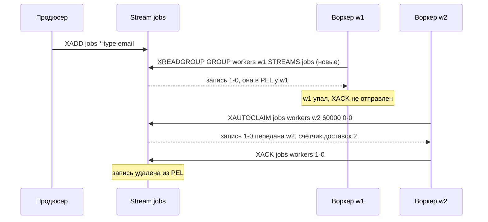

# 07. Pub/Sub и Streams

**Зачем это знать backend-разработчику.** Redis часто используют не только как кэш, но и как «почтовую систему» между сервисами: разослать событие «цена изменилась» всем экземплярам приложения, поставить в очередь отправку письма, раздать задачи воркерам. В Redis для этого есть два совершенно разных механизма — Pub/Sub и Streams. Если перепутать их, сообщения будут молча теряться: Pub/Sub ничего не хранит, и подписчик, который перезапускался 5 секунд, никогда не узнает, что пропустил. Нужно понимать, какой механизм что гарантирует, как устроены подтверждения и повторная доставка и когда пора брать Kafka или RabbitMQ.

> **Коротко:** Pub/Sub — «радиоэфир»: сообщение получают только те, кто подписан прямо сейчас, истории нет, доставка «не более одного раза». Streams — журнал только на добавление: каждая запись имеет ID вида `миллисекунды-номер`, хранится, пока её не обрежут, и читается сколько угодно раз. Consumer groups делят записи между воркерами, неподтверждённые записи живут в PEL, а `XACK`, `XPENDING` и `XAUTOCLAIM` дают доставку «хотя бы один раз». Поэтому обработчик обязан быть идемпотентным. Для огромных объёмов, долгого хранения и сложной маршрутизации лучше подходят Kafka и RabbitMQ.

## Оглавление

- [Pub/Sub: радиоэфир без записи](#pubsub-радиоэфир-без-записи)
- [Streams: журнал записей и их ID](#streams-журнал-записей-и-их-id)
- [Consumer groups и PEL](#consumer-groups-и-pel)
- [Сбой воркера: XPENDING, XCLAIM, XAUTOCLAIM, dead letter](#сбой-воркера-xpending-xclaim-xautoclaim-dead-letter)
- [Обрезка потока: MAXLEN и MINID](#обрезка-потока-maxlen-и-minid)
- [At-least-once и идемпотентный обработчик](#at-least-once-и-идемпотентный-обработчик)
- [Redis Streams, Kafka или RabbitMQ](#redis-streams-kafka-или-rabbitmq)
- [Практика в репозитории](#практика-в-репозитории)
- [Типичные ошибки и заблуждения](#типичные-ошибки-и-заблуждения)
- [Итоги](#итоги)
- [Вопросы для самопроверки](#вопросы-для-самопроверки)
- [Источники](#источники)

## Pub/Sub: радиоэфир без записи

**На пальцах.** Радиостанция вещает в эфир. Кто включил приёмник, тот слышит. Кто был в метро, пропустил передачу, и повтора не будет. Станция даже не знает, слушают ли её.

**Pub/Sub** (publish/subscribe, «издатель/подписчик») — механизм, в котором издатель отправляет сообщение в **канал** (channel, просто имя-строка), а Redis немедленно пересылает его всем клиентам, подписанным на этот канал в данный момент. Сообщение нигде не сохраняется. Это семантика **fire-and-forget** («отправил и забыл») и **at-most-once** (не более одного раза): сообщение доставлено один раз или не доставлено вовсе.

```text
# терминал 1 (подписчик)
127.0.0.1:6379> SUBSCRIBE prices
1) "subscribe"
2) "prices"
3) (integer) 1
# ... ждёт ...
1) "message"
2) "prices"
3) "sku:777=990"

# терминал 2 (издатель)
127.0.0.1:6379> PUBLISH prices "sku:777=990"
(integer) 1          # сколько подписчиков получили сообщение
127.0.0.1:6379> PUBLISH orders "o-1"
(integer) 0          # подписчиков нет — сообщение просто исчезло
```

Ответ `PUBLISH` — число получателей. `0` означает, что сообщение потеряно, и Redis не считает это ошибкой. `PSUBSCRIBE price*` подписывает на каналы по шаблону.

Особенности, которые важны в коде:

- Соединение в режиме подписки в протоколе **RESP2** (версия протокола общения клиента с Redis, до сих пор основная у многих клиентов) может выполнять только команды подписки (`SUBSCRIBE`, `UNSUBSCRIBE`, `PING`…). Поэтому для подписки берут **отдельное соединение**. В RESP3 ограничение снято, но отдельное соединение всё равно проще.
- Если подписчик читает медленно, сообщения копятся в его выходном буфере на сервере. При превышении `client-output-buffer-limit pubsub` (по умолчанию `32mb 8mb 60`) Redis **разрывает соединение**, и всё накопленное пропадает.
- Подписчик отключился на время деплоя — всё, что опубликовали за это время, пропало навсегда.

**Пример на Java (Lettuce).** Подписчик на отдельном соединении, `RedisPubSubAdapter` переопределяет только нужные методы:

```java
RedisClient client = RedisClient.create("redis://localhost:6379");
StatefulRedisPubSubConnection<String, String> sub = client.connectPubSub();
sub.addListener(new RedisPubSubAdapter<>() {
    @Override
    public void message(String channel, String message) {
        // вызывается в потоке ввода-вывода Netty: тяжёлую работу выносить в свой executor
        System.out.println("received: " + channel + " -> " + message);
    }
});
sub.sync().subscribe("prices");

try (StatefulRedisConnection<String, String> pub = client.connect()) {
    long receivers = pub.sync().publish("prices", "sku:777=990"); // 1
}
```

Где Pub/Sub уместен: сигнал «сбросьте локальный кэш» всем экземплярам сервиса, живые уведомления в чат, где потеря одного сообщения не страшна. Где нет: заказы, платежи, письма — всё, что нельзя потерять.

🔬 **Глубже: Pub/Sub в Redis Cluster.** Классический `PUBLISH` в кластере рассылается на **все** ноды через cluster bus (внутреннюю шину между нодами), потому что подписчик может сидеть на любой из них. На кластере из 30 нод каждое сообщение гоняется 30 раз. С Redis 7.0 есть **sharded pub/sub**: `SSUBSCRIBE` / `SPUBLISH`. Имя канала хешируется в слот, как ключ (см. [08. Репликация, Sentinel и Cluster](08-replication-cluster.md)), и сообщение живёт только внутри шарда, которому принадлежит слот. Нагрузка масштабируется вместе с числом шардов. Семантика та же: без хранения.

## Streams: журнал записей и их ID

**На пальцах.** Stream — это бортовой журнал корабля. Записи только дописываются в конец, у каждой есть время. Любой может открыть журнал и прочитать с любой страницы, даже если писали вчера.

**Stream** (поток) — тип данных Redis, **журнал только на добавление** (append-only log): упорядоченная последовательность **записей** (entries), каждая из которых — маленький набор пар «поле–значение», как Hash. Каждая запись получает **ID** вида `<время в мс>-<порядковый номер>`, например `1758531600000-0`. Номер различает записи, добавленные в одну миллисекунду. ID строго растут: если системные часы откатились назад, Redis продолжает от последнего ID и увеличивает номер.

Основные команды:

| Команда | Что делает |
|---|---|
| `XADD key * f v ...` | добавить запись; `*` — Redis сам назначит ID |
| `XRANGE key start end [COUNT n]` | прочитать диапазон по ID; `-` и `+` — начало и конец |
| `XREVRANGE key end start` | то же в обратном порядке |
| `XREAD [COUNT n] [BLOCK ms] STREAMS key id` | прочитать записи с ID больше `id`, при необходимости подождать новых |
| `XLEN key` | число записей |

```text
127.0.0.1:6379> XADD jobs * type email payload "user:42"
"1758531600000-0"
127.0.0.1:6379> XADD jobs * type sms payload "user:43"
"1758531600000-1"            # та же миллисекунда — номер 1
127.0.0.1:6379> XRANGE jobs - +
1) 1) "1758531600000-0"
   2) 1) "type"
      2) "email"
      3) "payload"
      4) "user:42"
2) 1) "1758531600000-1"
   2) 1) "type"
      2) "sms"
      3) "payload"
      4) "user:43"
127.0.0.1:6379> XREAD BLOCK 5000 STREAMS jobs $
# $ = «только то, что придёт после моего вызова»; ждём до 5 секунд
(nil)
```

Главное отличие от Pub/Sub: записи **остаются** в потоке после чтения. Каждый читатель сам помнит, до какого ID дочитал, и продолжает с него после перезапуска. Поскольку ID содержит время, `XRANGE jobs 1758531600000 1758535200000` — это «записи за час».

**Пример на Java (Lettuce):**

```java
RedisCommands<String, String> redis = connection.sync();
String id = redis.xadd("jobs", Map.of("type", "email", "payload", "user:42"));
List<StreamMessage<String, String>> all = redis.xrange("jobs", Range.create("-", "+"));
all.forEach(m -> System.out.println(m.getId() + " " + m.getBody()));
```

🔬 **Глубже.** Внутри stream хранится как radix-дерево (дерево с общими префиксами ключей), в узлах которого лежат listpack-и с несколькими записями. Соседние ID хранятся как разница от первого ID в узле, а одинаковые имена полей сжимаются. Поэтому поток из миллиона однотипных записей занимает заметно меньше памяти, чем миллион Hash-ей. Про listpack — в [02. Внутренние кодировки](02-internal-encodings.md).

## Consumer groups и PEL

**На пальцах.** Почта сортирует письма по курьерам. Каждое письмо получает ровно один курьер, и он расписывается в журнале: «взял». Когда письмо вручено, он ставит «доставлено». Если курьер заболел, начальник видит в журнале его невыполненные письма и передаёт их другому.

**Consumer group** (группа потребителей) — именованный «читатель» потока, который делит записи между своими **consumers** (потребителями, обычно по одному на экземпляр воркера). Каждую новую запись группа выдаёт **только одному** потребителю. Разные группы читают поток независимо: группа `mailer` и группа `analytics` получат каждая все записи.

**PEL** (Pending Entries List, список ожидающих записей) — внутренний список группы: какие записи выданы, какому потребителю, когда и сколько раз. Запись попадает в PEL при выдаче и уходит оттуда только после `XACK`.



```text
127.0.0.1:6379> XGROUP CREATE jobs workers $ MKSTREAM
OK                                  # $ — только новые записи; MKSTREAM — создать поток, если его нет
127.0.0.1:6379> XADD jobs * type email payload "user:42"
"1758531700000-0"
127.0.0.1:6379> XREADGROUP GROUP workers w1 COUNT 10 BLOCK 2000 STREAMS jobs >
1) 1) "jobs"
   2) 1) 1) "1758531700000-0"
         2) 1) "type" 2) "email" 3) "payload" 4) "user:42"
127.0.0.1:6379> XPENDING jobs workers
1) (integer) 1                      # всего в PEL
2) "1758531700000-0"                # минимальный ID
3) "1758531700000-0"                # максимальный ID
4) 1) 1) "w1"
      2) "1"                        # у w1 одна неподтверждённая
127.0.0.1:6379> XACK jobs workers 1758531700000-0
(integer) 1
```

Специальный ID `>` в `XREADGROUP` означает «дай новые записи, которых ещё никто в группе не получал». Если вместо `>` передать `0`, Redis вернёт **собственную историю** этого потребителя из PEL — так воркер после перезапуска с тем же именем дочитывает то, что взял, но не подтвердил.

**Пример на Java (Lettuce):**

```java
try {
    redis.xgroupCreate(XReadArgs.StreamOffset.from("jobs", "$"), "workers",
            XGroupCreateArgs.Builder.mkstream());
} catch (RedisBusyException e) {
    // Lettuce отображает ошибки BUSY* (в том числе BUSYGROUP) на RedisBusyException —
    // подкласс RedisCommandExecutionException. Ловить родителя тоже можно, но это менее точно.
    if (!e.getMessage().startsWith("BUSYGROUP")) throw e; // группа уже есть — это нормально
}

List<StreamMessage<String, String>> batch = redis.xreadgroup(
        Consumer.from("workers", "w1"),
        XReadArgs.Builder.count(10).block(2000),
        XReadArgs.StreamOffset.lastConsumed("jobs"));   // lastConsumed = ">"

for (StreamMessage<String, String> m : batch) {
    handle(m.getBody());                         // сначала обработать...
    redis.xack("jobs", "workers", m.getId());    // ...потом подтвердить
}
```

Порядок «обработал → `XACK`» принципиален. Если подтвердить до обработки и упасть посередине, запись потеряна. `BLOCK` держит соединение занятым до 2 секунд, поэтому в продакшене блокирующее чтение делают на **отдельном** соединении, а не на общем соединении Lettuce, которым пользуется всё приложение.

## Сбой воркера: XPENDING, XCLAIM, XAUTOCLAIM, dead letter

**На пальцах.** Курьер уволился посреди смены, письма лежат в его сумке. Начальник смотрит журнал: «письма у Иванова висят больше часа», забирает их и отдаёт Петрову. Если какое-то письмо уже пять раз пытались вручить и всё впустую, его откладывают на отдельную полку для разбора.

Если воркер упал после `XREADGROUP`, но до `XACK`, запись навсегда остаётся в PEL на его имени. Сама собой она никому не уйдёт. Инструменты:

- **`XPENDING` расширенная форма**: `XPENDING jobs workers IDLE 60000 - + 10` — до 10 записей, которые висят без подтверждения дольше 60 с. Для каждой возвращает ID, владельца, **idle time** (сколько мс прошло с последней выдачи) и **delivery count** (счётчик доставок). Опция `IDLE` доступна с 6.2.
- **`XCLAIM jobs workers w2 60000 <id> ...`** — забрать конкретные записи себе, если они висят дольше 60 с. Счётчик доставок увеличивается.
- **`XAUTOCLAIM jobs workers w2 60000 0-0 COUNT 10`** (с 6.2) — то же, но сам просматривает PEL, начиная с ID `0-0`, и возвращает курсор для следующего вызова. Это удобный «сборщик мусора»: каждый воркер периодически подбирает чужие зависшие записи.

```text
127.0.0.1:6379> XPENDING jobs workers IDLE 60000 - + 10
1) 1) "1758531800000-0"
   2) "w1"
   3) (integer) 75012          # idle, мс
   4) (integer) 1              # delivery count
127.0.0.1:6379> XAUTOCLAIM jobs workers w2 60000 0-0 COUNT 10
1) "0-0"                       # курсор: 0-0 значит «PEL просмотрен до конца»
2) 1) 1) "1758531800000-0"
      2) 1) "type" 2) "email" 3) "payload" 4) "user:42"
3) (empty array)               # ID, которых уже нет в потоке (с 7.0)
```

**Ядовитое сообщение** (poison message) — запись, на которой обработчик падает каждый раз, например из-за битого JSON. Без защиты она будет бесконечно переходить от воркера к воркеру. Решение — **dead letter stream** (поток «мёртвых писем»): если счётчик доставок ≥ порога (скажем, 5), запись копируют в отдельный поток `jobs:dlq` с полем `originalId`, а в основной группе подтверждают через `XACK`. Разбор DLQ — ручной или отдельным процессом.

| Шаг | Команда | Delivery count |
|---|---|---|
| 1. w1 получил запись и упал | `XREADGROUP ... >` | 1 |
| 2. w2 подобрал через 60 с и упал на битом JSON | `XAUTOCLAIM` | 2 |
| 3–5. то же ещё три раза | `XAUTOCLAIM` | 5 |
| 6. порог достигнут | `XADD jobs:dlq * ... originalId <id>` + `XACK` | — |

**Пример на Java (Lettuce):**

```java
ClaimedMessages<String, String> claimed = redis.xautoclaim("jobs",
        XAutoClaimArgs.Builder.xautoclaim(Consumer.from("workers", "w2"), Duration.ofSeconds(60), "0-0")
                .count(10));
for (StreamMessage<String, String> m : claimed.getMessages()) {
    handle(m.getBody());
    redis.xack("jobs", "workers", m.getId());
}
```

## Обрезка потока: MAXLEN и MINID

**На пальцах.** Бортовой журнал нельзя вести бесконечно: старые тетради выбрасывают. Можно держать «последние 100 страниц» или «всё за последнюю неделю».

Stream сам не удаляется и не обрезается: подтверждённые записи тоже остаются. Без обрезки поток съест всю память. **Обрезка** (trimming) задаётся прямо в `XADD` или отдельной `XTRIM`:

- **`MAXLEN`** — оставить не больше N последних записей: `XADD jobs MAXLEN ~ 100000 * ...`.
- **`MINID`** (с 6.2) — удалить записи с ID меньше заданного. Раз ID содержит время, это обрезка по возрасту: «всё старше 7 дней» = `MINID ~ <now − 7 суток в мс>`.
- **`~`** — приблизительная обрезка. Redis удаляет только целые узлы radix-дерева, поэтому записей может остаться чуть больше N, зато это гораздо дешевле точного `=`.

```text
127.0.0.1:6379> XADD events MINID ~ 1757926800000 * type click
"1758531900000-0"
127.0.0.1:6379> XTRIM events MAXLEN ~ 1000
(integer) 0              # удалено 0: узлы ещё не заполнились, «~» разрешает оставить лишнее
```

```java
redis.xadd("jobs", XAddArgs.Builder.maxlen(100_000).approximateTrimming(),
        Map.of("type", "email", "payload", "user:42"));
```

Важный подвох: обрезка **не смотрит на PEL**. Если записи удалили, пока они не подтверждены, в PEL останутся «висячие» ID. `XAUTOCLAIM` (с 7.0) возвращает их в третьем элементе ответа и сам убирает из PEL. Выбирайте лимит с запасом относительно возможного отставания воркеров.

🔬 **Глубже: удаление с оглядкой на PEL (8.2+).** В Redis 8.2 появились команды `XDELEX` и `XACKDEL`, а `XADD` и `XTRIM` получили параметры `KEEPREF` (по умолчанию: удалять запись, не трогая ссылки на неё в PEL), `DELREF` (удалить и вычистить ссылки из PEL всех групп) и `ACKED` (удалять только записи, подтверждённые всеми группами). Именно `ACKED` решает проблему «обрезали неподтверждённое». Подвох в синтаксисе: новый токен ставится **последним**, после порога.

```text
127.0.0.1:6379> XTRIM jobs MAXLEN ~ 100 ACKED
(integer) 0
127.0.0.1:6379> XTRIM jobs MAXLEN ACKED 100
(error) ERR ...                      # порог обязан идти перед ACKED
```

## At-least-once и идемпотентный обработчик

**На пальцах.** Курьер вручил посылку, но не успел отметиться в журнале: сел телефон. Начальник видит «не доставлено» и отправляет второго курьера. Получатель должен спокойно сказать «уже получил», а не оплачивать заказ второй раз.

Streams с группами дают **at-least-once** (хотя бы один раз): запись не теряется, пока она в PEL, но может быть обработана **дважды**. Так бывает, если воркер выполнил работу и упал до `XACK`. Семантики **exactly-once** (ровно один раз) Redis не даёт. Её эффект получают сочетанием at-least-once и **идемпотентного обработчика** — такого, у которого повторный вызов с той же записью не меняет результат.

Способы сделать обработчик идемпотентным:

1. **Ключ дедупликации**: `SET processed:{entryId} 1 NX EX 86400`. Если ответ `nil`, запись уже обработана, и её просто подтверждают.
2. **Естественная идемпотентность**: «установить статус заказа = PAID» безопасно повторять, «прибавить 100 к балансу» — нет.
3. **Уникальный ключ в основной БД**: `INSERT ... ON CONFLICT DO NOTHING` по ID записи или бизнес-ключу.

```java
void process(StreamMessage<String, String> m) {
    String dedupKey = "processed:" + m.getId();
    boolean first = "OK".equals(redis.set(dedupKey, "1", SetArgs.Builder.nx().ex(86_400)));
    if (first) {
        sendEmail(m.getBody().get("payload"));
    }
    redis.xack("jobs", "workers", m.getId());
}
```

В этом коде остаётся окно: ключ поставлен, а письмо не ушло (падение между строками). Для писем это обычно приемлемо. Для денег проверку дубля и само действие делают в одной транзакции основной БД.

## Redis Streams, Kafka или RabbitMQ

**На пальцах.** Redis Streams — удобная полка в офисе: под рукой и быстро, но небольшая. Kafka — склад-архив на годы с сотнями стеллажей. RabbitMQ — сортировочный центр с хитрыми правилами, кому какая посылка.

| Критерий | Redis Pub/Sub | Redis Streams | Kafka | RabbitMQ |
|---|---|---|---|---|
| Хранение | нет | в памяти, пока не обрезали | на диске, дни–годы | до подтверждения (очереди), в stream-очередях — дольше |
| Гарантия | at-most-once | at-least-once | at-least-once, exactly-once внутри Kafka (транзакции) | at-least-once |
| Масштаб записи | большой | один поток = один ключ = один шард | партиции на многих брокерах | очереди на нодах кластера |
| Перечитать историю | нет | да, по ID | да, по offset | классические очереди — нет |
| Маршрутизация | каналы и шаблоны | нет | топики | exchanges, routing keys, headers |
| Что уже есть | Redis | Redis | отдельный кластер | отдельный брокер |

**Когда что брать (пример).** Интернет-магазин, 200 заданий в секунду на отправку писем, Redis уже стоит: Streams с группой воркеров и DLQ — достаточно. Аналитика кликов, 200 000 событий в секунду, хранение 30 дней и несколько независимых потребителей: Kafka. Поток на 200 000 записей/с по ~500 байт — это 100 МБ/с, то есть ~360 ГБ в час и ~8,6 ТБ в сутки, и всё это в оперативной памяти одного шарда Redis. Такой объём в RAM не держат. Сложная маршрутизация по типам сообщений, приоритеты, отложенная доставка: RabbitMQ.

Помните: один stream — это один ключ, а значит в Redis Cluster он целиком живёт на одном шарде. Масштабировать запись можно, только разбив поток на несколько ключей (`jobs:0` … `jobs:7`) вручную.

## Практика в репозитории

- [07. Очередь заданий на Streams](../tasks/07-job-queue-streams.md) — `XADD`, `XGROUP CREATE ... MKSTREAM` с игнорированием `BUSYGROUP`, `XREADGROUP`, `XACK`, `XPENDING`, `XAUTOCLAIM` и перенос «ядовитых» записей в `{stream}:dlq`.
- [PubSubDemo](../examples/src/main/java/dev/nosqlguide/redis/examples/driver/PubSubDemo.java) — подписчик на отдельном соединении, публикация трёх сообщений, ожидание через `CountDownLatch`.
- [StreamsDemo](../examples/src/main/java/dev/nosqlguide/redis/examples/driver/StreamsDemo.java) — `XADD`, группа, `XREADGROUP`, `XACK` и проверка, что PEL опустел.
- Теория и основы: [04. Репликация](../../docs/00-foundations/04-replication.md) (foundations) — почему даже записи в stream могут пропасть при failover; [05. Персистентность: RDB, AOF и гибридный режим](05-persistence.md) — переживёт ли поток перезапуск сервера.

## Типичные ошибки и заблуждения

1. **«Pub/Sub — это очередь».** Нет: без подписчиков сообщение исчезает, `PUBLISH` вернёт `0`. Для заданий нужен Stream (или List с блокирующим перекладыванием `BLMOVE`, но без встроенного PEL).
2. **`XACK` до обработки.** Падение в середине — и запись потеряна. Сначала обработать, потом подтвердить.
3. **Никто не разбирает PEL.** Упавший воркер оставляет записи на своём имени навсегда. Нужен периодический `XAUTOCLAIM` и DLQ для ядовитых записей.
4. **Поток без обрезки.** Stream не очищается после `XACK`, память растёт до `maxmemory`. Всегда задавайте `MAXLEN ~` или `MINID ~`.
5. **Случайные имена потребителей при каждом старте.** Воркер `w-<uuid>` после перезапуска не видит свою историю в PEL, а старые имена копятся в группе. Используйте стабильные имена (имя пода) или удаляйте мёртвых через `XGROUP DELCONSUMER`.
6. **Неидемпотентный обработчик.** At-least-once означает, что дубли **будут**: при сбоях и при `XAUTOCLAIM` медленного, но живого воркера.
7. **Блокирующее чтение на общем соединении.** `XREADGROUP ... BLOCK` на общем соединении Lettuce задержит все остальные команды приложения.

## Итоги

- Pub/Sub — at-most-once без хранения: только для сигналов, потеря которых не страшна; в Cluster используйте sharded pub/sub (`SSUBSCRIBE`/`SPUBLISH`, 7.0+).
- Stream — журнал только на добавление с ID `мс-номер`; читается повторно через `XRANGE`/`XREAD`.
- Consumer group делит записи между потребителями; выданные, но не подтверждённые записи хранятся в PEL до `XACK`.
- Зависшие записи подбирают через `XPENDING` + `XCLAIM`/`XAUTOCLAIM`, «ядовитые» по счётчику доставок уходят в DLQ.
- Поток нужно обрезать (`MAXLEN ~`, `MINID ~`), иначе он займёт всю память.
- Гарантия — at-least-once, поэтому обработчик должен быть идемпотентным.
- Для больших объёмов и долгого хранения — Kafka, для сложной маршрутизации — RabbitMQ.

## Вопросы для самопроверки

1. Что вернёт `PUBLISH`, если подписчиков нет, и что станет с сообщением?
   <details><summary>Ответ</summary>`(integer) 0`. Сообщение исчезает, Redis его нигде не хранит и ошибкой это не считает.</details>
2. Из чего состоит ID записи stream и почему `XRANGE` по двум числам даёт выборку по времени?
   <details><summary>Ответ</summary>`<unix-время в мс>-<номер в пределах мс>`. ID растут вместе со временем, поэтому диапазон ID `t1..t2` — это записи, добавленные между моментами t1 и t2.</details>
3. Чем `XREADGROUP ... STREAMS jobs >` отличается от `... STREAMS jobs 0`?
   <details><summary>Ответ</summary>`>` — новые записи, которых ещё никто в группе не получал. `0` — записи из PEL этого потребителя, выданные ему ранее и не подтверждённые.</details>
4. Воркер взял запись и упал. Что с ней будет и как её вернуть в работу?
   <details><summary>Ответ</summary>Она останется в PEL на имени упавшего воркера. Другой воркер находит её по idle time (`XPENDING ... IDLE`) и забирает через `XCLAIM` или `XAUTOCLAIM`; счётчик доставок растёт.</details>
5. Зачем dead letter stream и как решить, что запись туда пора переложить?
   <details><summary>Ответ</summary>Чтобы запись, на которой обработчик падает всегда, не крутилась бесконечно. Критерий — delivery count из `XPENDING` ≥ порога (например, 5): запись копируют в `{stream}:dlq` и подтверждают в основной группе.</details>
6. Почему при at-least-once нужен идемпотентный обработчик? Приведите способ его сделать.
   <details><summary>Ответ</summary>Запись может быть обработана, но не подтверждена (падение до `XACK`), и её выдадут повторно. Способ: ключ дедупликации `SET processed:{id} 1 NX EX ...` или уникальный ключ в основной БД.</details>
7. Что означает `~` в `MAXLEN ~ 1000` и почему после обрезки может остаться 1100 записей?
   <details><summary>Ответ</summary>Приблизительная обрезка: Redis удаляет только целые узлы radix-дерева. Это дешевле, но записей может остаться больше порога.</details>
8. Нужно 300 000 событий/с с хранением 2 недели и несколькими независимыми потребителями. Redis Streams или Kafka?
   <details><summary>Ответ</summary>Kafka: хранение на диске дешевле оперативной памяти, партиции масштабируют запись на много брокеров. Один stream в Redis живёт на одном шарде и целиком в памяти.</details>

## Источники

- Redis: *Redis Streams* — https://redis.io/docs/latest/develop/data-types/streams/
- Redis: *Redis Pub/Sub* (включая sharded pub/sub) — https://redis.io/docs/latest/develop/interact/pubsub/
- Redis: команды `XADD`, `XREADGROUP`, `XPENDING`, `XAUTOCLAIM`, `XTRIM` — https://redis.io/docs/latest/commands/
- Redis: исходники `t_stream.c`, `pubsub.c` — https://github.com/redis/redis
- Lettuce Reference Guide: *Pub/Sub*, *Streams* — https://redis.github.io/lettuce/
- Kleppmann M. *Designing Data-Intensive Applications*, гл. 11 «Stream Processing». O'Reilly.
- Apache Kafka Documentation — https://kafka.apache.org/documentation/ ; RabbitMQ Documentation — https://www.rabbitmq.com/docs

---

← [06. Атомарность: транзакции, Lua и pipelining](06-atomicity-scripting.md) | [оглавление](README.md) | [08. Репликация, Sentinel и Cluster](08-replication-cluster.md) →
