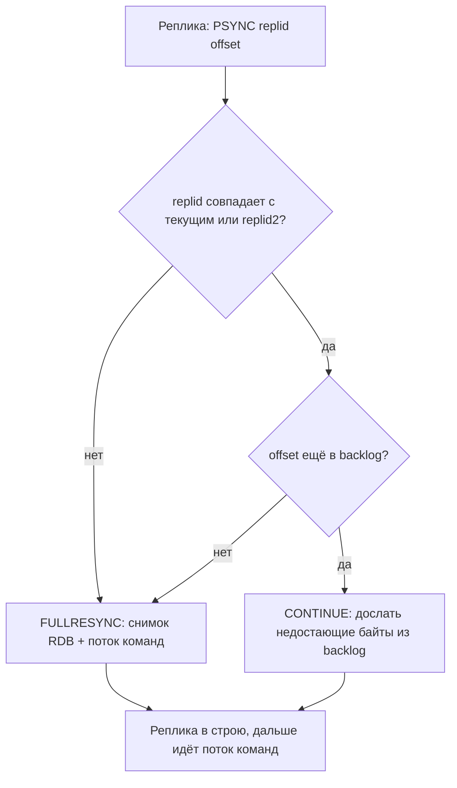
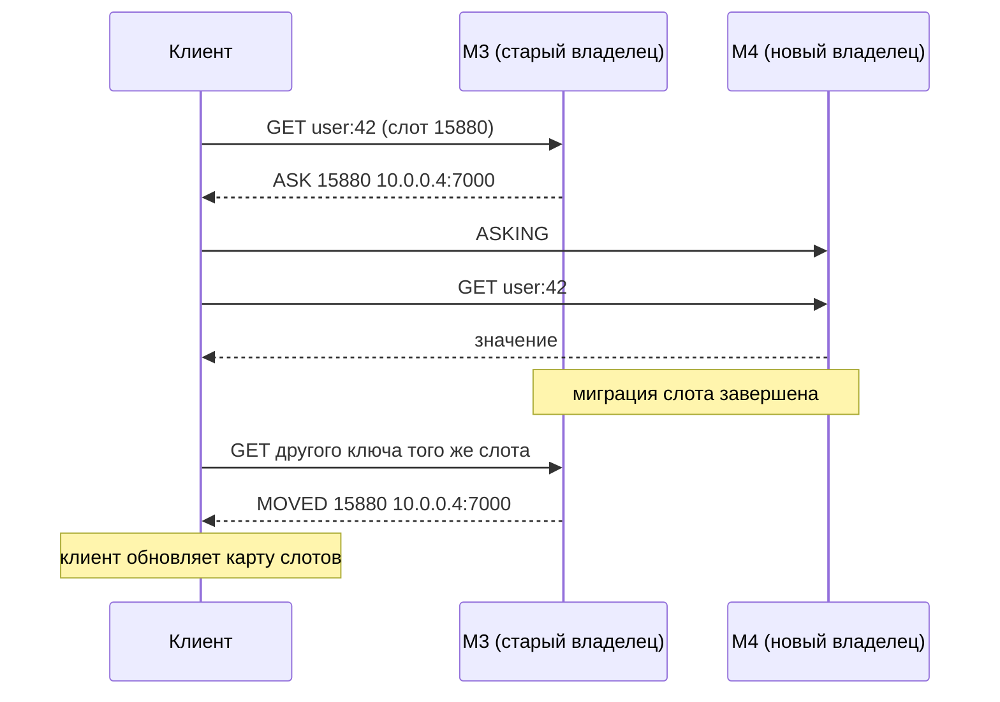

# 08. Репликация, Sentinel и Cluster

**Зачем это знать backend-разработчику.** Один сервер Redis — это единая точка отказа, и его память ограничена. В продакшене почти всегда есть реплики, Sentinel или Redis Cluster, а приложение подключается к ним через драйвер. Именно от настроек драйвера зависит, переживёт ли сервис переключение мастера за секунды или будет минуту сыпать ошибками. Нужно понимать и то, какие записи могут пропасть при сбое, и почему команда `MGET a b` вдруг падает с `CROSSSLOT`. Без этого нельзя честно ответить на вопросы «потеряем ли мы данные?» и «безопасна ли наша блокировка?».

> **Коротко:** Реплика получает от мастера полный снимок (полная синхронизация), а затем поток команд. После короткого разрыва она докачивает пропущенное из backlog по паре «replication ID + offset» (частичная синхронизация). Репликация асинхронная: мастер отвечает клиенту раньше, чем реплики получили запись, поэтому при failover подтверждённые записи могут пропасть. `WAIT`, `WAITAOF` и `min-replicas-to-write` сужают это окно, но не закрывают его. Sentinel автоматически переключает мастер в установке без шардирования, а Redis Cluster делит ключи на 16384 слота по нескольким мастерам. Клиент при этом следует редиректам `MOVED`/`ASK`, а многоключевые команды работают только в пределах одного слота.

## Оглавление

- [Репликация: replication ID, offset и backlog](#репликация-replication-id-offset-и-backlog)
- [Полная и частичная синхронизация](#полная-и-частичная-синхронизация)
- [Асинхронность и потеря записей: WAIT, WAITAOF, min-replicas](#асинхронность-и-потеря-записей-wait-waitaof-min-replicas)
- [Sentinel: автоматический failover](#sentinel-автоматический-failover)
- [Redis Cluster: слоты и hash tags](#redis-cluster-слоты-и-hash-tags)
- [MOVED, ASK и решардинг](#moved-ask-и-решардинг)
- [Failover и ограничения Cluster](#failover-и-ограничения-cluster)
- [Lettuce и Cluster](#lettuce-и-cluster)
- [Практика в репозитории](#практика-в-репозитории)
- [Типичные ошибки и заблуждения](#типичные-ошибки-и-заблуждения)
- [Итоги](#итоги)
- [Вопросы для самопроверки](#вопросы-для-самопроверки)
- [Источники](#источники)

## Репликация: replication ID, offset и backlog

**На пальцах.** Учитель диктует, ученики записывают. У диктанта есть название (какой это диктант) и номер последнего продиктованного слова. Ученик, который отошёл на минуту, говорит: «Диктант "Осень", я остановился на слове 1520». Если учитель ещё помнит последние слова, он дочитает с 1521, а если нет, придётся переписывать весь текст.

**Мастер** (master, primary) принимает записи. **Реплика** (replica) подключается к нему командой `REPLICAOF host port` и повторяет все его изменения. Реплики по умолчанию только для чтения. Общую теорию (синхронная и асинхронная репликация, лаг, топологии) см. в [04. Репликация](../../docs/00-foundations/04-replication.md). Здесь — как это устроено в Redis.

Три понятия:

- **Replication ID** — случайная строка из 40 hex-символов, «название истории данных» мастера. Две ноды с одинаковым ID и offset содержат одинаковые данные.
- **Replication offset** (смещение) — сколько байт потока репликации мастер сгенерировал. Каждая реплика тоже помнит свой offset, так что разница offset-ов показывает отставание в байтах.
- **Replication backlog** — кольцевой буфер на мастере с последними байтами потока (`repl-backlog-size`, по умолчанию 1 МБ). Из него переотправляют пропущенное после разрыва.

```text
127.0.0.1:6379> INFO replication
role:master
connected_slaves:1
slave0:ip=10.0.0.2,port=6379,state=online,offset=1520,lag=0
master_replid:8e1f3a...c2
master_replid2:0000000000000000000000000000000000000000
master_repl_offset:1520
repl_backlog_active:1
repl_backlog_size:1048576
repl_backlog_first_byte_offset:1
repl_backlog_histlen:1520
```

`offset=1520` у реплики и `master_repl_offset:1520` у мастера — реплика полностью догнала. `lag=0` — секунды с последнего подтверждения от реплики.

🔬 **Глубже: `master_replid2`.** Когда реплику повышают до мастера, она получает новый replication ID, но запоминает старый как `replid2` вместе с offset, на котором история разошлась. Поэтому другие реплики старого мастера после failover могут сделать частичную, а не полную синхронизацию с новым мастером (так работает с Redis 4.0).

## Полная и частичная синхронизация

**На пальцах.** Частичная синхронизация — «дочитать с того места, где остановился». Полная — «выбросить тетрадь и переписать учебник целиком».

При подключении реплика отправляет `PSYNC <replid> <offset>`. Мастер решает:



**Полная синхронизация** (full resync):
1. Мастер делает `fork` (создаёт копию своего процесса, которая видит данные на момент снимка) и пишет снимок **RDB** (см. [05. Персистентность: RDB, AOF и гибридный режим](05-persistence.md)).
2. Пока снимок пишется, новые команды копятся в буфере вывода для этой реплики.
3. Реплика получает RDB, удаляет свои данные, загружает снимок, затем применяет накопленный буфер.

При **diskless replication** (`repl-diskless-sync`, в новых версиях включена по умолчанию) снимок идёт прямо в сокет, минуя диск мастера. Полная синхронизация дорогая: `fork` на мастере с 20 ГБ данных, передача 20 ГБ по сети, и реплика на время загрузки не обслуживает актуальными данными.

**Частичная синхронизация** (partial resync) — мастер досылает только байты после offset реплики. Это дёшево.

**Пример расчёта backlog.** Мастер генерирует 2 МБ/с потока репликации. Реплика может отваливаться на 60 с (перезагрузка, сетевой сбой). Нужно 2 × 60 = 120 МБ. Со стандартным 1 МБ backlog перетрётся за полсекунды, и каждый короткий разрыв закончится полной синхронизацией. Разумно поставить `repl-backlog-size 256mb` с запасом.

🔬 **Глубже: буферы на время полной синхронизации.** Пока реплика качает и загружает RDB, поток новых команд где-то копится. Классический риск: буфер вывода на **мастере** превысил `client-output-buffer-limit replica` (по умолчанию `256mb 64mb 60`), мастер разорвал соединение, реплика начала полную синхронизацию заново — и так по кругу. Лимит действует и в 8.x, но в современных версиях этот сценарий менее характерен: в Redis 8.2 есть параметр `replica-full-sync-buffer-limit` (в 7.4 его ещё не было) — команды буферизуются на стороне **реплики** во время full sync, с отдельным лимитом. Конкретные значения по умолчанию проверяйте через `CONFIG GET` на своей версии.

## Асинхронность и потеря записей: WAIT, WAITAOF, min-replicas

**На пальцах.** Вы продиктовали по телефону номер заказа и положили трубку, не дождавшись «записал». Если связь оборвалась на середине, номер пропал, хотя вы уверены, что его сообщили.

Репликация в Redis **асинхронная**: мастер выполняет команду, отвечает клиенту `OK` и только потом отправляет её репликам. Если мастер упадёт в этот промежуток, а реплику повысят, подтверждённая запись **исчезнет**.

| Время | Мастер M | Реплика R | Клиент |
|---|---|---|---|
| t0 | `SET order:1 paid` | — | получил `OK` |
| t1 | упал, команда не успела уйти | `order:1` нет | уверен, что записал |
| t2 | — | повышена до мастера | `GET order:1` → `nil` |

Инструменты сужения окна:

- **`WAIT numreplicas timeout`** — блокирует клиента, пока `numreplicas` реплик не подтвердят получение всех его предыдущих записей, или пока не выйдет timeout. Возвращает число подтвердивших. Это не делает репликацию синхронной: при timeout запись остаётся на мастере, а не откатывается.
- **`WAITAOF numlocal numreplicas timeout`** (с 7.2) — ждёт, пока запись будет сброшена `fsync` в AOF локально и/или на репликах. Защищает от потери при одновременном отключении питания. Требует включённого AOF: при `appendonly no` команда возвращает ошибку.
- **`min-replicas-to-write N` + `min-replicas-max-lag S`** — мастер **отказывает** в записи (`NOREPLICAS`), если меньше N реплик отвечали за последние S секунд. Мастер, отрезанный от реплик сетью, быстро перестаёт принимать записи, которые всё равно были бы потеряны.

```text
127.0.0.1:6379> SET order:1 paid
OK
127.0.0.1:6379> WAIT 1 200
(integer) 1                 # одна реплика подтвердила за ≤ 200 мс
127.0.0.1:6379> WAITAOF 1 1 500      # только при appendonly yes
1) (integer) 1              # локальный AOF сброшен на диск
2) (integer) 1              # и на одной реплике тоже
```

```java
redis.set("order:1", "paid");
long acked = redis.waitForReplication(1, 200);      // WAIT 1 200
if (acked < 1) {
    // запись есть только на мастере: залогировать, повторить или предупредить
}
```

**Почему это важно для блокировок.** Клиент A взял блокировку `SET lock:report <token> NX PX 30000` на мастере. Мастер упал до репликации, реплику повысили, и ключа `lock:report` на ней нет. Клиент B спокойно берёт ту же блокировку. Теперь блокировкой владеют двое. `WAIT` здесь не спасает: реплика могла подтвердить запись, а повышена будет другая. Поэтому одна Redis-блокировка — это оптимизация («обычно не делаем работу дважды»), а для корректности нужен fencing token на стороне хранилища. Подробно — в [09. Паттерны](09-patterns.md) и задании 04.

## Sentinel: автоматический failover

**На пальцах.** Охранники смотрят за главным сервером. Если один охранник решил, что сервер упал, это ещё только мнение. Тревогу поднимают, когда согласны несколько (quorum), а переключение проводит старший охранник, которого выбрало большинство.

**Redis Sentinel** — отдельные процессы (обычно 3 или 5, порт 26379), которые следят за мастером и его репликами в установке **без** шардирования. Они автоматически повышают реплику и сообщают клиентам новый адрес мастера. Механика голосования разобрана в [06. Консенсус, членство и время](../../docs/00-foundations/06-consensus-membership.md#выбор-нового-мастера-в-redis-sentinel-и-redis-cluster). Кратко:

1. **SDOWN** (subjectively down) — один sentinel не получал ответа дольше `down-after-milliseconds`.
2. **ODOWN** (objectively down) — число sentinel-ов, согласных с SDOWN, достигло **quorum**. Quorum лишь фиксирует отказ.
3. Failover проводит **лидер**, избранный **большинством всех** sentinel-ов (если quorum больше большинства — то не меньше quorum голосов).
4. Лидер выбирает реплику (приоритет `replica-priority`, затем наибольший offset), выполняет на ней `REPLICAOF NO ONE` и перенастраивает остальные.

```text
# sentinel.conf
sentinel monitor mymaster 10.0.0.1 6379 2
sentinel down-after-milliseconds mymaster 5000
sentinel failover-timeout mymaster 60000

$ redis-cli -p 26379 SENTINEL get-master-addr-by-name mymaster
1) "10.0.0.1"
2) "6379"
```

**Пример.** 5 sentinel-ов, quorum = 2. Сеть разделилась: 2 sentinel-а видят, что мастер недоступен, 3 — нет связи с ними. Двое переводят мастер в ODOWN, но набрать 3 голоса (большинство из 5) не могут, и failover не происходит. Это защищает от переключения из «меньшинства».

Приложение подключается не к мастеру напрямую, а к sentinel-ам и спрашивает у них адрес:

```java
RedisURI uri = RedisURI.Builder.sentinel("sentinel-1", 26379, "mymaster")
        .withSentinel("sentinel-2", 26379)
        .withSentinel("sentinel-3", 26379)
        .build();
RedisClient client = RedisClient.create(uri);
StatefulRedisConnection<String, String> conn = client.connect(); // Lettuce узнает мастер у sentinel
```

Время переключения ≈ `down-after-milliseconds` + выборы + повышение, обычно от нескольких до десятков секунд. Всё это время записи падают с ошибками, и приложению нужны ретраи с таймаутами.

## Redis Cluster: слоты и hash tags

**На пальцах.** Большая библиотека разложила книги по 16384 пронумерованным полкам. Номер полки вычисляется по названию книги. Полки распределены между несколькими залами (мастерами). Если залов станет больше, часть полок переносят целиком, а книги с полки не перемешиваются.

**Redis Cluster** — встроенное шардирование: данные делятся между несколькими мастерами, у каждого свои реплики. Ключ попадает в **хеш-слот** (hash slot): `slot = CRC16(key) mod 16384`. Каждый мастер владеет диапазонами слотов. Общая идея фиксированных слотов объяснена в [05. Партиционирование](../../docs/00-foundations/05-partitioning.md).

| Мастер | Слоты | Реплика |
|---|---|---|
| M1 10.0.0.1:7000 | 0–5460 | R1 |
| M2 10.0.0.2:7000 | 5461–10922 | R2 |
| M3 10.0.0.3:7000 | 10923–16383 | R3 |

**Hash tag** — часть ключа в фигурных скобках. Если в ключе есть `{`, а после него `}` с непустым содержимым, хешируется только это содержимое. Так связанные ключи попадают в один слот:

```text
$ redis-cli -c -p 7000
127.0.0.1:7000> CLUSTER KEYSLOT user:42:profile
(integer) 9133
127.0.0.1:7000> CLUSTER KEYSLOT user:42:cart
(integer) 12984            # другой слот — здесь даже другой мастер (M3 вместо M2)
127.0.0.1:7000> CLUSTER KEYSLOT {user:42}:profile
(integer) 15880
127.0.0.1:7000> CLUSTER KEYSLOT {user:42}:cart
(integer) 15880            # тот же слот: хешируется только user:42
```

Hash tag — палка о двух концах. `{tenant}:...` для всех ключей крупного клиента сложит их в один слот, и один мастер станет **горячим**. Тег должен объединять ключи одной операции (один пользователь, один заказ), а не всю предметную область.

## MOVED, ASK и решардинг

**На пальцах.** Вы пришли в зал за книгой, а библиотекарь говорит: «Эта полка теперь навсегда в зале 3» (MOVED) — вы записываете это себе в план. Или: «Полку сейчас переносят, эту книгу уже унесли в зал 3, сходите туда один раз» (ASK) — план не меняется.

Клиент кластера держит **карту слотов** (какой мастер за какой слот отвечает) и отправляет команду сразу на нужную ноду. Если карта устарела:

- **`MOVED <slot> <host:port>`** — слот постоянно принадлежит другой ноде. Клиент повторяет команду там и обновляет карту.
- **`ASK <slot> <host:port>`** — слот сейчас **мигрирует**, а этого ключа на старой ноде уже нет. Клиент отправляет на новую ноду `ASKING`, затем команду, но карту **не** меняет: остальные ключи слота пока на старой ноде.



**Решардинг** (resharding) — перенос слотов между мастерами, например при добавлении четвёртого. Для каждого слота: `CLUSTER SETSLOT <slot> IMPORTING <id-источника>` на приёмнике и `CLUSTER SETSLOT <slot> MIGRATING <id-приёмника>` на источнике (обе формы требуют идентификатор ноды-партнёра), перенос ключей пачками командой `MIGRATE`, затем `CLUSTER SETSLOT <slot> NODE <id-нового-владельца>` на обеих нодах. Руками это не делают — есть `redis-cli --cluster reshard` и `redis-cli --cluster rebalance`. При переходе с 3 мастеров на 4 каждый старый мастер отдаёт ~1365 слотов, и переезжает примерно четверть ключей.

🔬 **Глубже.** Большой ключ (Hash на 2 ГБ) переносится одной командой `MIGRATE` и надолго блокирует обе ноды — ещё одна причина избегать больших ключей. В Redis 8.2 набор подкоманд прежний: `CLUSTER SETSLOT <slot> IMPORTING|MIGRATING|STABLE|NODE`. Сама механика миграции обсуждается к изменению, поэтому перед операциями на новой версии сверяйтесь с её release notes и `CLUSTER HELP`.

## Failover и ограничения Cluster

**На пальцах.** Если заведующий залом пропал, заведующие других залов голосуют, кого из его помощников назначить вместо него. Sentinel-охранники со стороны не нужны.

В Cluster ноды следят друг за другом сами через **cluster bus** (отдельный порт, по умолчанию порт данных + 10000) по протоколу **gossip** (ноды периодически пересказывают друг другу, кого видят). Нода, недоступная дольше `cluster-node-timeout` (по умолчанию 15 с), помечается **PFAIL**, а после подтверждения большинством мастеров — **FAIL**. Её реплика собирает голоса большинства мастеров и становится мастером с новым **configEpoch** (номером версии конфигурации: при споре о слоте побеждает больший). Подробности и формулу задержки — в [06. Консенсус](../../docs/00-foundations/06-consensus-membership.md). Отсюда минимум 3 мастера.

Репликация в кластере такая же асинхронная, поэтому окно потерь то же. Есть и второй источник потерь. Мастер, оказавшийся в меньшей части сети, ещё до `cluster-node-timeout` принимает записи. Потом большинство повышает его реплику, а эти записи пропадают.

**Ограничения мульти-ключевых операций.** Все ключи одной команды, транзакции `MULTI/EXEC` или Lua-скрипта должны лежать в **одном слоте**, иначе ошибка:

```text
127.0.0.1:7000> MSET user:1 a user:2 b
(error) CROSSSLOT Keys in request don't hash to the same slot
127.0.0.1:7000> MSET {user}:1 a {user}:2 b
OK
```

Ещё отличия: традиционно доступна только база 0 (`SELECT` не работает); `KEYS`/`SCAN` видят только ключи одной ноды; Lua-скрипт должен передавать все ключи через `KEYS`, чтобы кластер проверил слот (см. [06. Атомарность: транзакции, Lua и pipelining](06-atomicity-scripting.md)). По умолчанию `cluster-require-full-coverage yes`: если какой-то слот остался без живого мастера, кластер перестаёт отвечать целиком.

## Lettuce и Cluster

**На пальцах.** Хороший клиент — как курьер с навигатором: сам знает, в какой зал идти, сам перестраивает маршрут, когда полки переехали, и периодически сверяет карту.

`RedisClusterClient` получает список нескольких нод («seed»-нод), читает у них топологию командой `CLUSTER NODES` (и `CLIENT LIST`, чтобы узнать себя) и строит карту слотов. Он сам следует `MOVED`/`ASK` (по умолчанию до 5 редиректов). **Topology refresh** — обновление карты:

- **периодическое** — раз в N секунд;
- **адаптивное** — немедленно при событиях `MOVED`, `ASK`, разрыве соединения, повторных ошибках.

```java
RedisClusterClient cluster = RedisClusterClient.create(List.of(
        RedisURI.create("redis://10.0.0.1:7000"),
        RedisURI.create("redis://10.0.0.2:7000")));

ClusterTopologyRefreshOptions refresh = ClusterTopologyRefreshOptions.builder()
        .enablePeriodicRefresh(Duration.ofSeconds(30))
        // enableAllAdaptiveRefreshTriggers() объявлен deprecated в Lettuce 7.x — перечисляем явно
        .enableAdaptiveRefreshTrigger(RefreshTrigger.MOVED_REDIRECT, RefreshTrigger.ASK_REDIRECT,
                RefreshTrigger.PERSISTENT_RECONNECTS, RefreshTrigger.UNCOVERED_SLOT,
                RefreshTrigger.UNKNOWN_NODE)
        .build();
cluster.setOptions(ClusterClientOptions.builder()
        .topologyRefreshOptions(refresh)
        .build());

StatefulRedisClusterConnection<String, String> conn = cluster.connect();
conn.setReadFrom(ReadFrom.REPLICA_PREFERRED);   // чтения — с реплик (данные могут отставать)
RedisAdvancedClusterCommands<String, String> redis = conn.sync();

redis.set("{user:42}:profile", "Анна");
List<KeyValue<String, String>> values = redis.mget("user:1", "user:2"); // Lettuce разобьёт по слотам
```

Что важно знать:

- Значения по умолчанию в Lettuce 7.5.2: периодическое обновление **выключено** (`DEFAULT_PERIODIC_REFRESH_ENABLED = false`) с периодом 60 с, а набор адаптивных триггеров включает все пять (в 6.x он был пуст). Эти умолчания менялись между версиями, поэтому задавайте их явно: без refresh клиент узнаёт о failover только по ошибкам. В Spring Boot это свойства `spring.data.redis.lettuce.cluster.refresh.period` и `spring.data.redis.lettuce.cluster.refresh.adaptive`.
- `RedisAdvancedClusterCommands` умеет выполнять некоторые многоключевые команды (`MGET`, `MSET`, `DEL`, `EXISTS`…) по разным слотам, разбивая их на части. Такая операция **не атомарна**. `MULTI/EXEC` и Lua это не касается: там по-прежнему нужен один слот.
- `ReadFrom.REPLICA_PREFERRED` снимает нагрузку с мастеров, но только что записанное значение может ещё не прочитаться с реплики.

**Пример таймлайна failover глазами приложения.** t=0 падает M2. До t≈15 с (`cluster-node-timeout`) команды на слоты 5461–10922 получают таймауты. t≈16 с R2 повышена. Ближайшая команда получает ошибку соединения или `MOVED`, адаптивный refresh обновляет карту, и запросы идут на R2. Без adaptive refresh и при периоде 60 с ошибки могли бы продолжаться дольше.

## Практика в репозитории

- [04. Распределённая блокировка](../tasks/04-distributed-lock.md) — lease и fencing token. Разобранный выше сценарий потери блокировки при асинхронной репликации объясняет, зачем токен проверяется на стороне хранилища.
- [07. Очередь заданий на Streams](../tasks/07-job-queue-streams.md) — записи stream тоже реплицируются асинхронно: после failover возможна потеря последних `XADD`/`XACK`, поэтому повторная доставка и идемпотентность обязательны.
- [BasicsDemo](../examples/src/main/java/dev/nosqlguide/redis/examples/driver/BasicsDemo.java) — подключение через `RedisURI`/`RedisClient`: та же точка входа, которую в Cluster заменяет `RedisClusterClient` со списком seed-нод.
- В задании 04 Lua-скрипт трогает два ключа (блокировку и счётчик fencing-токенов). В условии задания `lock:{name}` — это шаблон, где `{name}` подставляется. В Cluster же фигурные скобки имеют особый смысл (hash tag), и ключи нужно записать так, чтобы скобки попали в итоговое имя: `lock:{report}` и `fence:{report}` — тогда оба ключа лягут в один слот и скрипт не получит `CROSSSLOT`.
- Foundations: [04. Репликация](../../docs/00-foundations/04-replication.md), [05. Партиционирование](../../docs/00-foundations/05-partitioning.md), [06. Консенсус, членство и время](../../docs/00-foundations/06-consensus-membership.md).

## Типичные ошибки и заблуждения

1. **«`WAIT` делает репликацию синхронной».** Нет: при timeout запись остаётся на мастере, и отката нет. После failover может быть повышена реплика, которая её не получила.
2. **«Quorum Sentinel — это большинство».** Quorum лишь переводит мастер в ODOWN. Для failover нужен лидер, избранный большинством всех sentinel-ов.
3. **Два sentinel-а или два мастера кластера.** Нет устойчивого большинства: падение одного узла блокирует failover.
4. **Hash tag на всё подряд.** `{app}:...` отправит все ключи в один слот, и кластер превратится в один перегруженный сервер.
5. **Маленький `repl-backlog-size` при большом потоке записи.** Каждый короткий разрыв кончается полной синхронизацией с `fork` и передачей всего набора данных.
6. **Кластерный клиент без topology refresh.** После failover или решардинга приложение долго получает ошибки и редиректы.
7. **Блокировка на одном мастере с репликой как «надёжная».** Асинхронная репликация позволяет двум клиентам владеть одной блокировкой после failover.

## Итоги

- Реплика синхронизируется по паре replication ID + offset: частично из backlog, если он не перетёрт, иначе полностью через RDB.
- Размер backlog считают как «скорость потока × допустимая длительность разрыва».
- Репликация асинхронная: подтверждённые записи могут пропасть при failover. `WAIT`, `WAITAOF` (7.2+) и `min-replicas-to-write` уменьшают окно, но не закрывают его.
- Sentinel: SDOWN → ODOWN по quorum, failover проводит лидер, избранный большинством всех sentinel-ов.
- Cluster: 16384 слота, `CRC16(key) mod 16384`, hash tags для группировки; `MOVED` меняет карту, `ASK` — одноразовый редирект во время миграции.
- Многоключевые команды, `MULTI/EXEC` и Lua — только в одном слоте.
- В Lettuce используйте `RedisClusterClient` с периодическим и адаптивным topology refresh.

## Вопросы для самопроверки

1. Реплика отключилась на 2 минуты, мастер пишет 1 МБ/с, backlog 1 МБ. Какой будет синхронизация и что поменять?
   <details><summary>Ответ</summary>Полная: за 2 минуты накопилось ~120 МБ, а backlog хранит только последний 1 МБ, и нужный offset уже перетёрт. Увеличить `repl-backlog-size` до 128–256 МБ.</details>
2. Клиент получил `OK` на `SET`, затем мастер упал. Может ли запись пропасть? Что изменит `WAIT 1 100`, вернувший 1?
   <details><summary>Ответ</summary>Может: репликация асинхронная. `WAIT`, вернувший 1, значит, что одна реплика получила запись, — шанс потери меньше, но при нескольких репликах могут повысить другую, и гарантии нет.</details>
3. Чем отличается `WAITAOF` от `WAIT`?
   <details><summary>Ответ</summary>`WAIT` ждёт, пока реплики получат запись в память. `WAITAOF` (7.2+) ждёт, пока запись будет сброшена `fsync` в AOF локально и/или на указанном числе реплик.</details>
4. 3 sentinel-а, quorum = 2, живы 2. Будет ли failover? А при 5 sentinel-ах, quorum = 2 и двух живых?
   <details><summary>Ответ</summary>В первом случае да: 2 — это большинство из 3. Во втором нет: ODOWN возможен, но лидеру нужно 3 голоса из 5.</details>
5. В чём разница между `MOVED` и `ASK`?
   <details><summary>Ответ</summary>`MOVED` — слот постоянно у другой ноды, клиент обновляет карту. `ASK` — слот мигрирует, клиенту нужно один раз сходить на новую ноду с `ASKING`, карта не меняется.</details>
6. Почему `MSET order:1 x order:1:items y` падает в Cluster и как исправить?
   <details><summary>Ответ</summary>Ключи хешируются в разные слоты — `CROSSSLOT`. Использовать hash tag: `{order:1}` и `{order:1}:items`.</details>
7. Зачем Lettuce адаптивный topology refresh, если есть периодический?
   <details><summary>Ответ</summary>Периодический обновляет карту раз в N секунд, и между обновлениями приложение живёт со старой картой. Адаптивный реагирует сразу на `MOVED`/`ASK` и разрывы соединений, сокращая время ошибок после failover и решардинга.</details>
8. Почему блокировка `SET NX PX` на мастере с репликой небезопасна при failover?
   <details><summary>Ответ</summary>Мастер подтвердил блокировку и упал до репликации. Повышенная реплика не знает о ключе, и второй клиент берёт ту же блокировку. Корректность даёт только fencing token, проверяемый хранилищем.</details>

## Источники

- Redis: *Redis replication* — https://redis.io/docs/latest/operate/oss_and_stack/management/replication/
- Redis: *High availability with Redis Sentinel* — https://redis.io/docs/latest/operate/oss_and_stack/management/sentinel/
- Redis: *Redis cluster specification* — https://redis.io/docs/latest/operate/oss_and_stack/reference/cluster-spec/
- Redis: *Scale with Redis Cluster* — https://redis.io/docs/latest/operate/oss_and_stack/management/scaling/
- Redis: команды `WAIT`, `WAITAOF`, `CLUSTER SETSLOT`, `MIGRATE` — https://redis.io/docs/latest/commands/
- Redis: исходники `replication.c`, `cluster.c`, `sentinel.c` — https://github.com/redis/redis
- Lettuce Reference Guide: *Redis Cluster*, *Redis Sentinel* — https://redis.github.io/lettuce/
- Kleppmann M. *How to do distributed locking*, 2016 — https://martin.kleppmann.com/2016/02/08/how-to-do-distributed-locking.html

---

← [07. Pub/Sub и Streams](07-pubsub-streams.md) | [оглавление](README.md) | [09. Паттерны](09-patterns.md) →
