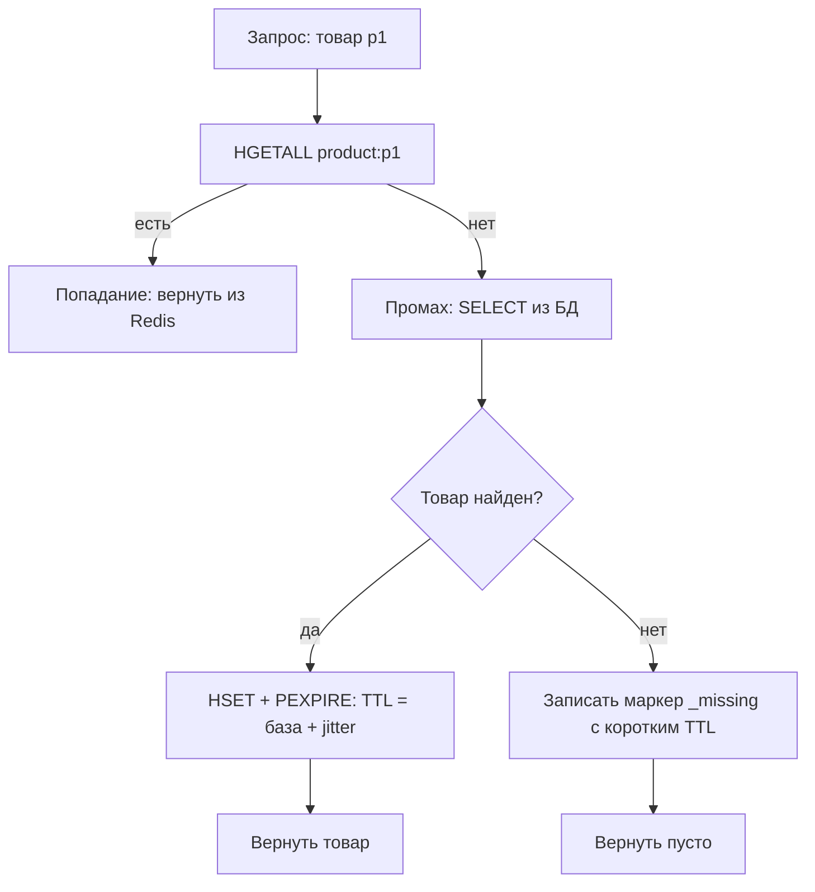
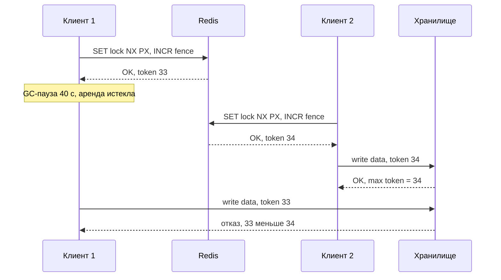

# 09. Паттерны

**Зачем это знать backend-разработчику.** Redis редко используют «просто как базу». Его берут ради готовых решений типовых задач: кэш перед медленной БД, ограничение частоты запросов, распределённая блокировка, таблица рекордов, хранилище сессий, защита от повторной оплаты. У каждого есть ловушки: устаревший кэш, тысяча одновременных промахов, два владельца одной блокировки. Здесь паттерны разобраны вместе с ловушками и связаны с практическими заданиями.

> **Коротко:** Самый частый паттерн — **cache-aside**: приложение само читает кэш, при промахе идёт в БД и кладёт результат в Redis с TTL. При изменении данных ключ удаляют, а не обновляют. От лавины промахов защищают блокировка на пересчёт и вероятностное раннее обновление, от запросов к несуществующим данным — negative caching. Rate limiting строят на счётчиках (`INCR`), отсортированных множествах или Lua-скриптах. Блокировка на Redis (`SET NX PX` + снятие Lua-скриптом) подходит для экономии работы, а для корректности данных нужен fencing token, который проверяет само хранилище.

## Оглавление

- [Стратегии кэширования](#стратегии-кэширования)
- [Инвалидация кэша](#инвалидация-кэша)
- [Cache stampede](#cache-stampede)
- [Negative caching](#negative-caching)
- [Rate limiting](#rate-limiting)
- [Распределённые блокировки](#распределённые-блокировки)
- [Лидерборды](#лидерборды)
- [Сессии](#сессии)
- [Идемпотентность](#идемпотентность)
- [Практика в репозитории](#практика-в-репозитории)
- [Типичные ошибки и заблуждения](#типичные-ошибки-и-заблуждения)
- [Итоги](#итоги)
- [Вопросы для самопроверки](#вопросы-для-самопроверки)
- [Источники](#источники)

## Стратегии кэширования

**На пальцах.** У повара под рукой миска с нарезанным луком (кэш), а мешок лука на складе (БД). Миску может пополнять сам повар, когда она пуста, или помощник; а новый лук можно класть сразу и в миску, и на склад.

**Кэш** — быстрая копия части данных из более медленного **источника истины** (system of record), то есть из основной БД. **Промах** (cache miss) — ключа в кэше нет. **Попадание** (cache hit) — ключ есть. **TTL** (time to live) — время жизни ключа, после которого Redis удаляет его сам (механика — в [04. Истечение и вытеснение](04-expiration-eviction.md)).

| Стратегия | Кто читает БД при промахе | Что происходит при записи | Где встречается |
|---|---|---|---|
| **Cache-aside** (lazy loading) | приложение | приложение пишет в БД и удаляет ключ | самый частый вариант с Redis |
| **Read-through** | библиотека кэша (loader) | как в cache-aside | Spring `@Cacheable`, Caffeine `LoadingCache` |
| **Write-through** | как в read-through | запись идёт синхронно в кэш и в БД | библиотеки, Redisson `MapLoader`/`MapWriter` |
| **Write-behind** (write-back) | как в read-through | запись в кэш, в БД позже пачкой | счётчики, аналитика; риск потерять данные |

У cache-aside и read-through одна идея. Разница в том, кто пишет код загрузки: вы вручную или фреймворк. `@Cacheable` в Spring выглядит как read-through, хотя внутри это тот же cache-aside в прокси ([08-spring-cache](../tasks/08-spring-cache.md)).



Cache-aside на Lettuce (упрощённо, так устроено [задание 01](../tasks/01-product-cache.md)):

```java
Optional<Product> get(String id) {
    String key = "product:" + id;
    Map<String, String> cached = redis.hgetall(key);
    if (!cached.isEmpty()) {
        return cached.containsKey("_missing") ? Optional.empty() : Optional.of(toProduct(cached));
    }
    Optional<Product> loaded = repository.findById(id);              // промах: идём в БД
    long ttlMs = baseTtl.toMillis() + random.nextLong(maxJitter.toMillis() + 1);
    Map<String, String> hash = loaded.map(this::toHash).orElse(Map.of("_missing", "1"));
    long ttl = loaded.isPresent() ? ttlMs : negativeTtl.toMillis();
    // HSET и PEXPIRE одним EVAL (WRITE_SCRIPT, как в ProductCache), а не MULTI/EXEC:
    // на общем соединении чужая команда между multi() и exec() уедет в нашу транзакцию
    redis.eval(WRITE_SCRIPT, ScriptOutputType.INTEGER, new String[]{key}, toArgs(hash, ttl));
    return loaded;
}
```

Подробный разбор `MULTI/EXEC` на общем соединении — в [06. Атомарность и скрипты](06-atomicity-scripting.md).

**Jitter** — случайная добавка к TTL. 10 000 карточек, загруженных за одну минуту с TTL 10 минут, истекут тоже за одну минуту и разом нагрузят БД. С TTL `10 мин + random(0..60 с)` истечения размазываются по минуте.

**Write-behind** даёт самые быстрые записи, но при падении Redis до сброса в БД теряет до ~1 секунды записей (`appendfsync everysec`, [05. Персистентность](05-persistence.md)). Redis не реализует его сам — это делает приложение, например очередью на Streams.

## Инвалидация кэша

**На пальцах.** Если в меню поменялась цена, проще снять старую табличку, чем аккуратно исправить на ней цифру: пока вы исправляете, кто-то может повесить табличку ещё старее.

**Инвалидация** — удаление или пометка устаревших записей кэша после изменения источника истины. Основные способы:

1. **TTL.** Самый простой: данные устаревают не дольше чем на TTL. Выбор TTL — компромисс между свежестью и нагрузкой на БД.
2. **Удаление при записи.** После `UPDATE` в БД выполнить `DEL product:p1`. Следующее чтение загрузит свежие данные.
3. **Событийная инвалидация.** Сервис-владелец данных публикует событие («товар p1 изменился»), остальные удаляют свои ключи. Источник событий — Pub/Sub, Streams ([07. Pub/Sub и Streams](07-pubsub-streams.md)) или **CDC** (change data capture, поток изменений из журнала БД, например через Debezium).

**Почему удалять, а не обновлять.** Два запроса обновляют цену: A ставит 100, B ставит 120. В БД они записались в порядке A, B, а до Redis дошли в порядке B, A. В БД 120, в кэше 100, и так до истечения TTL. `DEL` не зависит от порядка: оба удаления приводят к одному результату.

🔬 **Глубже: гонка и в cache-aside с удалением.** Шаг за шагом:

| Шаг | Запрос чтения R | Запрос записи W |
|---|---|---|
| 1 | промах, читает из БД цену 100 | |
| 2 | | пишет в БД 120 |
| 3 | | `DEL product:p1` |
| 4 | кладёт в кэш 100 (устаревшее) | |

Окно маленькое, но под нагрузкой срабатывает. Защиты: TTL как страховка; повторный `DEL` через небольшую задержку («delayed double delete»). Ещё один механизм — **client-side caching** (Redis 6+, `CLIENT TRACKING`): сервер сам сообщает клиенту, что ключ из его локального кэша изменился.

## Cache stampede

**На пальцах.** Открылась новая касса, и вся очередь бросилась к ней разом. Так же после истечения популярного ключа все запросы разом идут в БД.

**Cache stampede** (dog-pile, «лавина промахов») — ситуация, когда много запросов одновременно пересчитывают один и тот же ключ. Пример: 2000 запросов в секунду к главной странице, пересчёт занимает 500 мс. Без защиты за эти полсекунды в БД уйдёт до ~1000 одинаковых тяжёлых запросов.

**Защита 1: блокировка на пересчёт.** Первый промахнувшийся берёт короткую блокировку и считает значение, остальные ждут и перечитывают кэш:

```java
String lockKey = "lock:" + key;
String token = UUID.randomUUID().toString();
boolean mine = "OK".equals(redis.set(lockKey, token, SetArgs.Builder.nx().px(lockTtl.toMillis())));
if (mine) {
    try {
        String value = loader.get();
        redis.set(key, value, SetArgs.Builder.px(valueTtl.toMillis()));
        return value;
    } finally {
        redis.eval(RELEASE_IF_OWNER, ScriptOutputType.INTEGER, new String[]{lockKey}, token);
    }
}
// не взяли: несколько раз перечитываем GET key с паузой, а если так и не появилось — зовём loader сами,
// не записывая результат в кэш и не трогая чужую блокировку (держатель допишет её сам)
```

Последняя строка — **деградация**: если держатель блокировки завис, ожидающие не висят вечно, а идут в БД сами. Так устроено [задание 02](../tasks/02-cache-stampede.md). Скрипт `RELEASE_IF_OWNER` разобран ниже, в разделе о блокировках.

**Защита 2: вероятностное раннее обновление (XFetch).** Алгоритм из статьи Vattani, Chierichetti, Lowenstein (VLDB 2015). Идея: каждый запрос с небольшой вероятностью обновляет ключ *до* истечения, и вероятность растёт по мере приближения к концу TTL. Рядом со значением хранят `delta` (сколько длился пересчёт) и `expiry` (момент истечения):

```java
boolean shouldRecomputeEarly(long nowMs, long expiryMs, long deltaMs, double beta) {
    double r = 1.0 - ThreadLocalRandom.current().nextDouble();   // r в (0, 1]
    return nowMs - deltaMs * beta * Math.log(r) >= expiryMs;     // log(r) ≤ 0, сдвиг вперёд
}
```

При `beta = 1` вероятность того, что запрос решит обновить значение за `t` мс до истечения, равна `e^(−t/delta)`. Для `delta = 200 мс`:

| До истечения | Вероятность на один запрос |
|---|---|
| 1000 мс | ≈ 0,7% |
| 200 мс | ≈ 36,8% |
| 0 мс | 100% |

При 2000 запросах в секунду кто-то почти наверняка обновит ключ заранее, а остальные получат старое значение без промаха. `beta > 1` сдвигает обновление раньше.

## Negative caching

**На пальцах.** Если на складе нет товара, продавец запоминает «этого нет» и не бегает на склад каждый раз, когда о нём спрашивают.

**Negative caching** — кэширование факта отсутствия данных. Без него запрос `GET /products/does-not-exist` всегда даёт промах и всегда идёт в БД. Боты, перебирающие id, превращают кэш в бесполезную прослойку (это называют **cache penetration**). Решение — записать маркер с *коротким* TTL:

```
127.0.0.1:6379> HSET product:p404 _missing 1
(integer) 1
127.0.0.1:6379> PEXPIRE product:p404 30000
(integer) 1
```

TTL маркера короче обычного (секунды вместо минут): товар может появиться, и держать «его нет» 10 минут неприятно. При создании товара маркер удаляют так же, как при любой инвалидации. Против массового перебора случайных id помогает ещё Bloom-фильтр (`BF.ADD`/`BF.EXISTS`, в Redis 8 входит в основную поставку): он отсекает id, которых точно нет.

## Rate limiting

**На пальцах.** Турникет пропускает не больше N человек в минуту. Вопрос в том, как считать минуту.

**Rate limiting** — ограничение числа запросов клиента за период, например 100 запросов в минуту на API-ключ. Redis удобен: счётчик общий для всех экземпляров приложения, операции атомарны.

| Алгоритм | Структура в Redis | Точность | Память на клиента |
|---|---|---|---|
| **Fixed window** | String + `INCR` + `PEXPIRE` | всплеск до 2× на границе окон | 1 ключ |
| **Sliding log** | ZSet с меткой времени на каждый запрос | точный | O(limit) |
| **Sliding window counter** | 2 счётчика (текущее и прошлое окно) | приближённый | 2 ключа |
| **Token bucket** | Hash `tokens`, `ts` + Lua | допускает всплеск размером с ведро | 1 ключ |

**Fixed window.** Номер окна = `now / window`, ключ `rl:fixed:{client}:{номер}`. Проблема на границе: лимит 100 в минуту, 100 запросов в 12:00:59 и ещё 100 в 12:01:00. За две секунды прошло 200 запросов.

**Sliding log** хранит время каждого запроса в ZSet, удаляет записи старше окна (`ZREMRANGEBYSCORE`) и считает оставшиеся (`ZCARD`). Всё это делается одним Lua-скриптом, иначе два параллельных запроса оба увидят «99» и оба пройдут.

**Sliding window counter** оценивает число запросов в скользящем окне по двум соседним фиксированным: `оценка = текущее + прошлое × (1 − доля прошедшего текущего окна)`. Лимит 100 в минуту, в прошлом окне было 80, в текущем 30, прошло 15 с (25%): `30 + 80 × 0,75 = 90`, запрос разрешён.

**Token bucket** — ведро на `capacity` жетонов, которое пополняется со скоростью `rate`. Каждый запрос забирает жетон. Короткий всплеск разрешён, пока ведро не опустело. Скрипт вызывается из Java:

```java
private static final String TOKEN_BUCKET = """
        local data = redis.call('HMGET', KEYS[1], 'tokens', 'ts')
        local capacity, rate, now = tonumber(ARGV[1]), tonumber(ARGV[2]), tonumber(ARGV[3])
        local tokens = tonumber(data[1]) or capacity
        local ts = tonumber(data[2]) or now
        tokens = math.min(capacity, tokens + (now - ts) * rate)
        local allowed = 0
        if tokens >= 1 then tokens = tokens - 1; allowed = 1 end
        redis.call('HSET', KEYS[1], 'tokens', tokens, 'ts', now)
        redis.call('PEXPIRE', KEYS[1], ARGV[4])
        return allowed
        """;

boolean tryAcquire(String client) {
    // ведро на 10 жетонов, 5 жетонов в секунду = 0.005 в мс
    Long allowed = redis.eval(TOKEN_BUCKET, ScriptOutputType.INTEGER,
            new String[]{"rl:bucket:" + client}, "10", "0.005", String.valueOf(clock.millis()), "60000");
    return allowed == 1L;
}
```

Время здесь передаётся из приложения. Это удобно для тестов, но часы разных серверов расходятся. Альтернатива — `redis.call('TIME')` внутри скрипта: один источник времени, но его не подменить в тесте. Этот компромисс обсуждается в [задании 03](../tasks/03-rate-limiter.md).

## Распределённые блокировки

**На пальцах.** Ключ от переговорки висит на гвоздике. Кто взял ключ, тот и занял комнату. Но ключ «самоуничтожается» через час, чтобы забывчивый сотрудник не занял комнату навсегда. А если он заснул в переговорке на два часа, придёт второй и тоже войдёт.

**Распределённая блокировка** (distributed lock) — механизм, который разрешает только одному процессу из многих выполнять участок кода или менять ресурс. **Lease** (аренда) — блокировка с ограниченным сроком, после которого она освобождается сама, даже если владелец умер.

**Захват:** `SET lock:orders <уникальный токен> NX PX 30000`. `NX` значит «только если ключа нет», `PX` задаёт срок аренды в мс. Токен — случайный UUID владельца.

```
127.0.0.1:6379> SET lock:orders 7f3a-... NX PX 30000
OK
127.0.0.1:6379> SET lock:orders 91bc-... NX PX 30000
(nil)
```

**Безопасное снятие.** Простой `DEL` опасен. Процесс A взял блокировку, завис на 35 с, аренда истекла, блокировку взял B. A просыпается, делает `DEL` и снимает *чужую* блокировку. Поэтому удаляют только свою, проверка и удаление выполняются атомарно в Lua ([06. Атомарность и скрипты](06-atomicity-scripting.md)):

```java
private static final String RELEASE_IF_OWNER = """
        if redis.call('GET', KEYS[1]) == ARGV[1] then
            return redis.call('DEL', KEYS[1])
        end
        return 0
        """;

boolean release(String name, String ownerToken) {
    Long n = redis.eval(RELEASE_IF_OWNER, ScriptOutputType.INTEGER, new String[]{"lock:" + name}, ownerToken);
    return n == 1L;
}
```

Продление аренды (`extend`) устроено так же: «если значение моё, то `PEXPIRE`». Redisson делает это автоматически фоновым «watchdog».

**Fencing token.** Даже правильный lease не спасает от паузы. Владелец мог застыть на GC-паузе дольше срока аренды и не знать, что блокировка уже не его. **Fencing token** — номер, который строго растёт с каждым захватом (`INCR fence:orders`). Клиент передаёт номер в хранилище вместе с записью, а хранилище отвергает номер меньше или равный уже виденному (общая идея — в [04. Репликация](../../docs/00-foundations/04-replication.md#failover-split-brain-и-fencing)).



**Redlock и спор о нём.** **Redlock** — алгоритм antirez для N (обычно 5) *независимых* master-нод Redis. Клиент по очереди делает `SET NX PX` на всех нодах с коротким таймаутом. Блокировка считается взятой, если удалось получить её на большинстве (≥ 3) и на это ушло меньше срока аренды. Остаток срока минус запас на расхождение часов — время, в течение которого клиент может работать.

В 2016 году Мартин Клеппман опубликовал критику «How to do distributed locking». Его доводы:
- надо различать блокировку для **эффективности** (редкий сбой терпим) и для **корректности** (двойной владелец портит данные); для первой хватит одного Redis, Redlock избыточен;
- для корректности Redlock недостаточен: он опирается на допущения о времени (задержки сети, паузы процессов, часы без скачков), и пауза или скачок часов на ноде Redis ломают взаимное исключение;
- Redlock не выдаёт fencing token, поэтому хранилище не может отсечь опоздавшего; для корректности нужен консенсус (ZooKeeper, etcd) и fencing.

Ответ antirez, «Is Redlock safe?»:
- если хранилище умеет проверять токены и отвергать старые записи, блокировка ему почти не нужна; проверку можно построить и на случайном токене (compare-and-set), не только на монотонном номере;
- Redlock не требует синхронизации часов — только чтобы они шли *примерно с одной скоростью* (ограниченный дрейф); резкие скачки времени — ошибка эксплуатации;
- пауза *после* захвата бьёт по любой блокировке с автоосвобождением, включая ZooKeeper; паузу *во время* захвата Redlock замечает, сверяя затраченное время со сроком аренды.

**Что выбрать.** Обе стороны сходятся в главном: блокировка с арендой сама по себе не гарантирует, что владелец один в каждый момент времени.

| Цель | Решение |
|---|---|
| Не делать работу дважды (кэш, рассылка, cron) | один Redis, `SET NX PX` + снятие Lua |
| Корректность данных, ресурс умеет проверять | Redis-блокировка + fencing token, проверка в хранилище |
| Строгая корректность без проверки на ресурсе | консенсус: etcd, ZooKeeper, или транзакция и уникальный индекс в самой БД |

Учтите и репликацию: непереданный на реплику `SET` при failover даст блокировку второй раз ([08. Репликация, Sentinel и Cluster](08-replication-cluster.md)).

## Лидерборды

**На пальцах.** Табло на стадионе постоянно пересортировывается, и любой зритель может спросить: «Какое место у меня и кто рядом?»

**Лидерборд** (таблица рекордов) — рейтинг игроков по очкам. **ZSet** (sorted set, отсортированное множество) хранит пары «member → score» в порядке score ([03. Структуры данных](03-data-structures.md)). Вставка и поиск ранга выполняются за O(log N), это и нужно лидерборду.

```
127.0.0.1:6379> ZADD leaderboard:weekly 1500 alice 1320 bob 1710 carol
(integer) 3
127.0.0.1:6379> ZINCRBY leaderboard:weekly 250 bob
"1570"
127.0.0.1:6379> ZREVRANGE leaderboard:weekly 0 2 WITHSCORES
1) "carol"
2) "1710"
3) "bob"
4) "1570"
5) "alice"
6) "1500"
127.0.0.1:6379> ZREVRANK leaderboard:weekly alice
(integer) 2
```

`ZREVRANK` возвращает ранг с нуля, пользователю показывают `rank + 1`. «Соседи игрока» — это `ZREVRANK` и затем `ZREVRANGE rank-2 rank+2`. При равных очках Redis упорядочивает участников лексикографически по member, в `ZREVRANGE` — по убыванию. Если нужно «кто раньше набрал, тот выше», время кодируют в score. Помните, что score — это `double`, и целые точны только до 2^53. Недельные доски удобно держать отдельными ключами с TTL. Практика — [задание 05](../tasks/05-leaderboard.md).

## Сессии

**На пальцах.** Гардеробный номерок: у клиента только номер (cookie), а пальто хранится в гардеробе (Redis). Номерок, которым долго не пользовались, аннулируют.

**Сессия** — состояние пользователя между HTTP-запросами (id пользователя, корзина, CSRF-токен). Её хранят в Redis, чтобы любой экземпляр приложения видел одно и то же и чтобы перезапуск сервера не разлогинивал всех. Типичная схема: Hash `session:{id}` + **скользящий idle-TTL** (каждое обращение продлевает срок) + индекс `user:{userId}:sessions` (Set) для «выйти на всех устройствах».

```
127.0.0.1:6379> HSET session:9b1e userId 42 cart 3
(integer) 2
127.0.0.1:6379> EXPIRE session:9b1e 1800
(integer) 1
127.0.0.1:6379> SADD user:42:sessions 9b1e
(integer) 1
```

Id сессии должен быть непредсказуемым (UUID), иначе его подберут. В Spring это готовый модуль **Spring Session Data Redis**. Рядом с сессиями часто считают посетителей: **HyperLogLog** (`PFADD`/`PFCOUNT`) оценивает число уникальных с погрешностью ≈ 0,81 % в ≤ 12 КБ, **Bitmap** (`SETBIT`/`BITCOUNT`) даёт точный DAU для плотных числовых id. Практика — [задание 06](../tasks/06-sessions-analytics.md).

## Идемпотентность

**На пальцах.** Кнопка лифта: нажмите её пять раз, лифт всё равно приедет один раз.

**Идемпотентная операция** — операция, повторное выполнение которой не меняет результат. Сеть ненадёжна: клиент отправил «оплатить», не дождался ответа и повторил. Без защиты деньги спишутся дважды. Приём с **ключом идемпотентности** (idempotency key): клиент генерирует UUID на каждую логическую операцию и шлёт его в заголовке, сервер запоминает результат.

```java
Optional<String> startOrReplay(String idemKey) {
    String key = "idem:" + idemKey;
    String ok = redis.set(key, "PROCESSING", SetArgs.Builder.nx().ex(Duration.ofHours(24)));
    if ("OK".equals(ok)) {
        return Optional.empty();                       // первый запрос: выполняем операцию
    }
    return Optional.ofNullable(redis.get(key));        // повтор: "PROCESSING" (ответ 409) или сохранённый ответ
}
// после успеха: redis.set(key, responseJson, SetArgs.Builder.xx().keepttl());
// после ошибки: redis.del(key), чтобы клиент мог повторить
```

Здесь та же механика `SET NX`, что у блокировки. Ограничение: если Redis потеряет ключ (рестарт без AOF, failover), защита не сработает. Для денег последний рубеж — уникальный индекс по ключу идемпотентности в основной БД. Идемпотентными должны быть и обработчики очередей: Streams дают доставку at-least-once, и сообщение может прийти повторно ([задание 07](../tasks/07-job-queue-streams.md)).

## Практика в репозитории

- [01-product-cache](../tasks/01-product-cache.md) — cache-aside, TTL с jitter, negative caching, атомарная запись Hash и TTL.
- [02-cache-stampede](../tasks/02-cache-stampede.md) — блокировка `SET NX PX` на пересчёт, снятие Lua, деградация при ожидании.
- [03-rate-limiter](../tasks/03-rate-limiter.md) — fixed window на `INCR` и sliding log на ZSet + Lua.
- [04-distributed-lock](../tasks/04-distributed-lock.md) — lease, снятие и продление Lua, fencing token и `FencedStorage`.
- [05-leaderboard](../tasks/05-leaderboard.md) — топ, ранг и соседи игрока на ZSet.
- [06-sessions-analytics](../tasks/06-sessions-analytics.md) — сессии со скользящим TTL, HyperLogLog и Bitmap.
- [07-job-queue-streams](../tasks/07-job-queue-streams.md) — очередь с повторной доставкой и DLQ; зачем идемпотентные обработчики.
- [08-spring-cache](../tasks/08-spring-cache.md) — read-through через `@Cacheable`, `@CachePut`/`@CacheEvict`, TTL по кэшам.
- [LuaScriptingDemo](../examples/src/main/java/dev/nosqlguide/redis/examples/driver/LuaScriptingDemo.java) — `EVAL` и `EVALSHA` из Java, основа для блокировок и лимитеров.
- Foundations: [04. Репликация](../../docs/00-foundations/04-replication.md) — fencing и split brain; [06. Консенсус, членство и время](../../docs/00-foundations/06-consensus-membership.md) — часы и консенсус; [03. CAP и согласованность](../../docs/00-foundations/03-cap-consistency.md) — почему кэш даёт eventual consistency.

## Типичные ошибки и заблуждения

1. **`SET` значения и `EXPIRE` отдельными вызовами.** Если процесс упадёт между ними, ключ станет вечным. Используйте `SET key value PX ttl`, `MULTI/EXEC` — только на выделенном соединении — или Lua.
2. **Обновлять кэш при записи вместо удаления.** Из-за гонок в кэше останется старое значение. Удаляйте ключ, TTL оставьте страховкой.
3. **Снимать блокировку простым `DEL`.** Так снимается чужая блокировка после истечения аренды. Удаляйте Lua-скриптом с проверкой токена.
4. **Считать, что блокировка с TTL гарантирует одного владельца.** GC-пауза, задержка сети или failover дают двух владельцев. Для корректности нужен fencing token или консенсус.
5. **Одинаковый TTL у массово загружаемых ключей.** Они истекут одновременно. Добавляйте jitter.
6. **Rate limiter из `GET` + `SET` в Java.** Между чтением и записью проходят чужие запросы. Нужны `INCR` или Lua.

## Итоги

- Cache-aside — основной паттерн: читаем кэш, при промахе БД, кладём с TTL + jitter. При изменении данных удаляем ключ.
- Stampede гасят блокировкой на пересчёт с деградацией и вероятностным ранним обновлением (XFetch). Cache penetration гасят negative caching и Bloom-фильтром.
- Rate limiting: fixed window прост, но допускает всплеск 2× на границе. Sliding log точен, но дорог по памяти. Sliding counter — приближение. Token bucket разрешает управляемые всплески.
- Блокировка на Redis: `SET NX PX` с уникальным токеном, снятие и продление через Lua. Это надёжная защита для эффективности, но не для корректности.
- Спор Kleppmann и antirez сводится к допущениям о времени и к fencing. Если корректность важна, проверку выполняет само хранилище.
- Лидерборды — ZSet, сессии — Hash со скользящим TTL, идемпотентность — `SET NX` с сохранённым ответом плюс уникальный индекс в БД.

## Вопросы для самопроверки

1. Чем cache-aside отличается от read-through и write-through?
   <details><summary>Ответ</summary>В cache-aside код загрузки при промахе пишет приложение. В read-through загрузку делает библиотека кэша по заданному loader'у. Write-through при записи синхронно обновляет и кэш, и БД, а cache-aside пишет в БД и удаляет ключ.</details>
2. Почему после изменения данных ключ удаляют, а не перезаписывают?
   <details><summary>Ответ</summary>Параллельные записи могут дойти до Redis в другом порядке, чем до БД, и в кэше останется старое значение. Удаление не зависит от порядка: следующее чтение возьмёт актуальные данные из БД.</details>
3. Что такое cache stampede и какие есть две защиты?
   <details><summary>Ответ</summary>Одновременный пересчёт одного ключа многими запросами после его истечения. Защиты: блокировка на пересчёт (один считает, остальные ждут, по таймауту деградируют) и вероятностное раннее обновление XFetch, где ключ обновляется до истечения с вероятностью, растущей к концу TTL.</details>
4. Лимит 100 запросов в минуту. Сколько запросов fixed window может пропустить за 2 секунды и почему?
   <details><summary>Ответ</summary>До 200: 100 в последнюю секунду одного окна и 100 в первую секунду следующего, ведь счётчики окон независимы.</details>
5. Почему блокировку снимают Lua-скриптом, а не `DEL`?
   <details><summary>Ответ</summary>Аренда могла истечь, и блокировку уже взял другой клиент. `DEL` снял бы чужую блокировку. Скрипт атомарно проверяет, что значение равно токену владельца, и только тогда удаляет.</details>
6. Как fencing token защищает от клиента, который «проснулся» после GC-паузы?
   <details><summary>Ответ</summary>Каждый захват даёт номер больше предыдущего. Хранилище запоминает максимальный принятый номер и отвергает запись с меньшим. Опоздавший клиент приходит со старым номером и получает отказ.</details>
7. В чём суть спора Kleppmann и antirez о Redlock?
   <details><summary>Ответ</summary>Kleppmann: для корректности Redlock опирается на допущения о времени (паузы, задержки, часы) и не выдаёт fencing token, поэтому нужен консенсус и fencing; для эффективности хватит одного Redis. antirez: Redlock требует только ограниченного дрейфа часов, паузы после захвата опасны для любой блокировки с арендой, а если хранилище умеет проверять токены, ему блокировка почти не нужна.</details>

## Источники

- Redis Docs: Distributed Locks with Redis (Redlock). <https://redis.io/docs/latest/develop/clients/patterns/distributed-locks/>
- Redis Docs: `SET` (опции `NX`, `PX`, `KEEPTTL`). <https://redis.io/docs/latest/commands/set/>
- Redis Docs: Client-side caching. <https://redis.io/docs/latest/develop/reference/client-side-caching/>
- Redis Docs: Sorted sets. <https://redis.io/docs/latest/develop/data-types/sorted-sets/>
- Kleppmann M. *How to do distributed locking*, 2016. <https://martin.kleppmann.com/2016/02/08/how-to-do-distributed-locking.html>
- antirez. *Is Redlock safe?*, 2016. <https://antirez.com/news/101>
- Vattani A., Chierichetti F., Lowenstein K. *Optimal Probabilistic Cache Stampede Prevention*. VLDB 2015. <https://www.vldb.org/pvldb/vol8/p886-vattani.pdf>
- Stripe Docs: Idempotent requests. <https://docs.stripe.com/api/idempotent_requests>
- Redisson Wiki: Locks and synchronizers. <https://github.com/redisson/redisson/wiki/8.-distributed-locks-and-synchronizers>

---

← [08. Репликация, Sentinel и Cluster](08-replication-cluster.md) | [оглавление](README.md) | [10. Экосистема и Java](10-ecosystem-java.md) →
