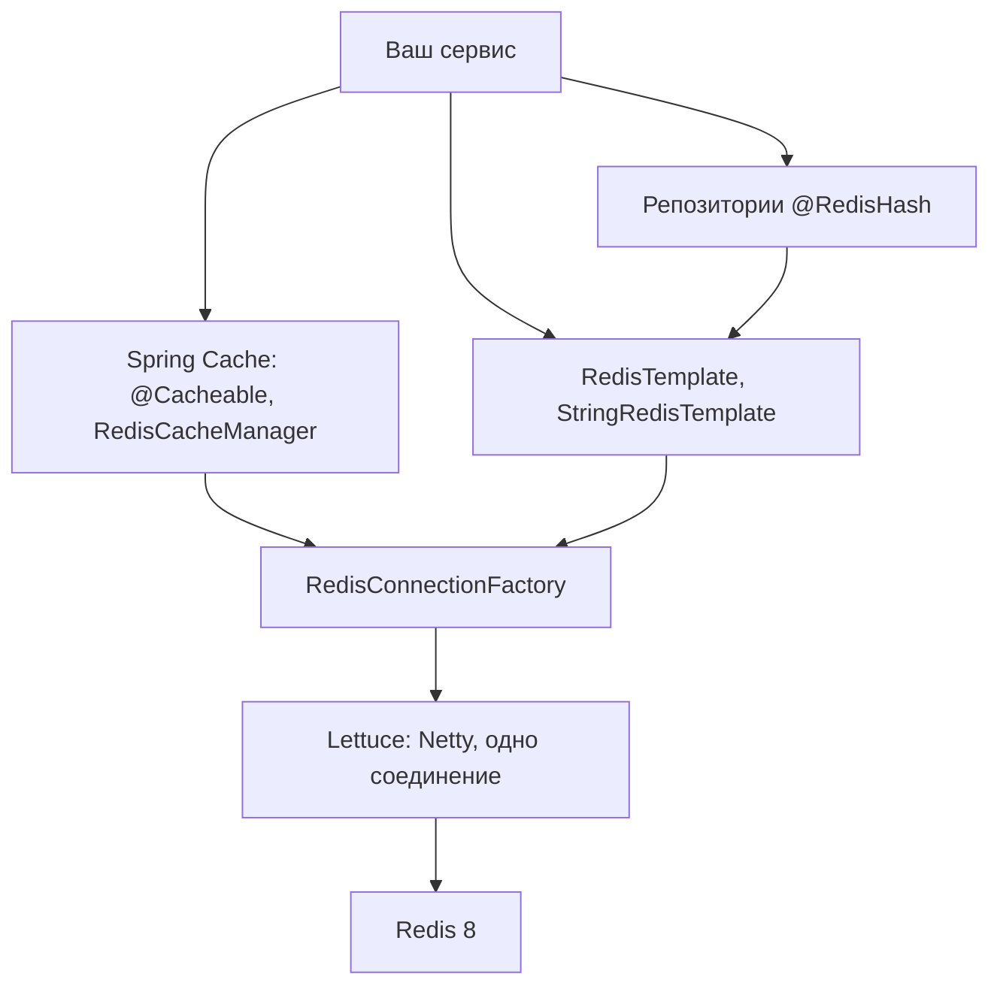

# 10. Экосистема и Java

**Зачем это знать backend-разработчику.** Знать команды Redis мало, код пишется через клиентскую библиотеку и часто через Spring. От неё зависит многое: сколько соединений откроет приложение, что случится при обрыве сети, в каком виде данные лягут в Redis и сможет ли коллега прочитать их в `redis-cli`. Кроме того, с 2024 года «Redis» — это уже несколько продуктов с разными лицензиями и совместимыми, но не одинаковыми форками. Выбор между ними — архитектурное и юридическое решение.

> **Коротко:** В 2024 году Redis сменил лицензию с BSD на RSALv2/SSPLv1, в ответ появился форк Valkey под Linux Foundation. Redis 8 добавил вариант AGPLv3 и включил в базовую поставку Query Engine, JSON, TimeSeries и вероятностные структуры. В Java стандартный клиент — Lettuce: неблокирующий, на Netty, одно соединение на все потоки, API sync/async/reactive. Jedis — простой синхронный клиент с пулом соединений, Redisson — высокоуровневые объекты (блокировки, коллекции). Поверх клиента Spring Data Redis даёт `RedisTemplate`, а Spring Cache — `@Cacheable`; тестируют с Testcontainers, наблюдают через `INFO` и Micrometer.

## Оглавление

- [Экосистема 2026: Redis, Valkey и другие](#экосистема-2026-redis-valkey-и-другие)
- [Java-клиенты: Lettuce, Jedis, Redisson](#java-клиенты-lettuce-jedis-redisson)
- [Таймауты, пулы и переподключение](#таймауты-пулы-и-переподключение)
- [Сериализация](#сериализация)
- [Spring Data Redis](#spring-data-redis)
- [Spring Cache](#spring-cache)
- [Тестирование с Testcontainers](#тестирование-с-testcontainers)
- [Наблюдаемость](#наблюдаемость)
- [Практика в репозитории](#практика-в-репозитории)
- [Типичные ошибки и заблуждения](#типичные-ошибки-и-заблуждения)
- [Итоги](#итоги)
- [Вопросы для самопроверки](#вопросы-для-самопроверки)
- [Источники](#источники)

## Экосистема 2026: Redis, Valkey и другие

**На пальцах.** Популярный рецепт долго был общим. Потом автор поменял условия использования, и часть поваров взяла последнюю «свободную» версию рецепта и стала развивать её сама. Блюда похожи, но уже расходятся в деталях.

**Лицензия** определяет, что можно делать с кодом. **BSD** — разрешительная лицензия: делай что хочешь, сохрани копирайт. **RSALv2** (Redis Source Available License) и **SSPLv1** (Server Side Public License) — «source available» лицензии: код открыт для чтения и использования, но они ограничивают продажу продукта как управляемого сервиса. **AGPLv3** — копилефт-лицензия OSI: если вы предоставляете изменённую версию по сети, исходники изменений надо открыть.

| Продукт | Что это | Лицензия | Замечания |
|---|---|---|---|
| **Redis 8.x** | оригинальный проект Redis Ltd. | RSALv2 / SSPLv1 / AGPLv3 на выбор | Query Engine, JSON, TimeSeries, Bloom/Cuckoo/Top-K и др. в базовой поставке |
| **Valkey** | форк Redis 7.2 под Linux Foundation | BSD-3 | поддержан AWS, Google Cloud, Oracle и другими; развивает многопоточный I/O |
| **Dragonfly** | новая реализация на C++, совместимая по протоколу | BSL 1.1 | многопоточная архитектура shared-nothing, не форк |
| **KeyDB** | многопоточный форк Redis | BSD-3 | принадлежит Snap; развитие заметно замедлилось, проверяйте активность перед выбором |

Хронология: до Redis 7.2 включительно — BSD. С Redis 7.4 (2024) — RSALv2/SSPLv1. В ответ сообщество создало Valkey из кода 7.2. В Redis 8 (2025) добавлен вариант AGPLv3, а бывший Redis Stack вошёл в основную сборку.

**Совместимость.** Протокол RESP и базовые команды (String, Hash, List, Set, ZSet, Streams, Lua) у Redis и Valkey общие, клиенты Lettuce и Jedis работают с обоими. Расходятся новые возможности, появившиеся после 7.2: модули Redis 8 (JSON, Query Engine), новые команды и настройки. Код, который использует только базовые команды, переносится без изменений.

**Managed-сервисы** избавляют от администрирования (реплики, failover, бэкапы, обновления): Amazon ElastiCache (Valkey и Redis OSS) и Amazon MemoryDB (с долговременным журналом), Google Cloud Memorystore (Valkey, Redis), Azure Managed Redis, Redis Cloud от Redis Ltd. Набор движков и версий у облаков меняется, поэтому сверяйтесь с их документацией.

**Как выбирать.** Для учёбы и большинства приложений подойдут и Redis 8, и Valkey. Если нужны модули Redis 8 (JSON, поиск), берите Redis. Если важна BSD-лицензия или ваш облачный провайдер продвигает Valkey, берите Valkey. Репозиторий использует образ `redis:8.2`.

## Java-клиенты: Lettuce, Jedis, Redisson

**На пальцах.** Lettuce — один телефонный провод, по которому много сотрудников диктуют заказы по очереди, не дожидаясь ответа на предыдущий. Jedis — пул телефонов: каждый сотрудник берёт свободный аппарат, звонит, ждёт ответа и возвращает. Redisson — секретарь, которому говорят «забронируй переговорку», а он сам знает, какие звонки для этого сделать.

**Мультиплексирование** — отправка команд многих потоков по одному TCP-соединению. Redis обрабатывает команды одного соединения строго по порядку ([01. Архитектура](01-architecture.md)), поэтому клиент сопоставляет ответы с командами просто по очереди.

| | Lettuce | Jedis | Redisson |
|---|---|---|---|
| Модель | неблокирующий, Netty | блокирующий, сокет на соединение | Netty, высокоуровневые объекты |
| Потокобезопасность | одно соединение на все потоки | экземпляр `Jedis` нет; `JedisPooled` да, через пул | да |
| API | sync, async (`RedisFuture`), reactive (Reactor) | sync | sync, async, reactive, RxJava |
| Сильные стороны | по умолчанию в Spring Boot, Cluster/Sentinel, авто-переподключение | простота, предсказуемость | `RLock`, `RMap`, `RRateLimiter`, локальный кэш |
| Когда нужны отдельные соединения | блокирующие команды, `MULTI/WATCH`, Pub/Sub | пул решает сам | библиотека решает сама |

Три API Lettuce на одном соединении:

```java
RedisClient client = RedisClient.create("redis://localhost:6379");
try (StatefulRedisConnection<String, String> connection = client.connect()) {
    RedisCommands<String, String> sync = connection.sync();
    sync.set("greeting", "hello");                                   // ждёт ответа

    RedisAsyncCommands<String, String> async = connection.async();
    String viaAsync = async.get("greeting").toCompletableFuture().join();  // RedisFuture

    RedisReactiveCommands<String, String> reactive = connection.reactive();
    String viaReactive = reactive.get("greeting").block();           // Mono<String>

    System.out.println(viaAsync + " " + viaReactive);                // hello hello
} finally {
    client.shutdown();
}
```

**Почему одного соединения Lettuce хватает.** Redis выполняет команды в одном потоке ([01. Архитектура](01-architecture.md)), лишние соединения не делают его быстрее. Зато одно соединение с конвейером (pipelining) не простаивает в ожидании ответа ([PipeliningDemo](../examples/src/main/java/dev/nosqlguide/redis/examples/driver/PipeliningDemo.java)).

**Исключения.** `BLPOP` или `XREADGROUP ... BLOCK` блокируют всё соединение до ответа. Тогда остальные потоки ждут в той же очереди. `MULTI` на общем соединении захватит в транзакцию чужие команды из других потоков. Pub/Sub переводит соединение в режим подписки. Для этих случаев открывают отдельное соединение или используют пул.

🔬 **Глубже: Redisson.** Redisson реализует паттерны из [09. Паттерны](09-patterns.md) в готовом виде: `RLock` с автопродлением аренды (watchdog), `RReadWriteLock`, `RSemaphore`, `RRateLimiter`, распределённые коллекции. Это удобно, но скрывает, какие ключи и скрипты создаются. `RLock` сам по себе не даёт fencing token. Для корректности данных те же оговорки, что и в разделе о блокировках.

## Таймауты, пулы и переподключение

**На пальцах.** Если официант не вернулся с кухни за 10 минут, клиент уходит, а не ждёт до закрытия. Таймаут — это «сколько ждать, прежде чем сдаться».

Три разных таймаута:
- **Connect timeout** — сколько ждать установки TCP-соединения. Обычно сотни миллисекунд.
- **Command timeout** — сколько ждать ответа на команду. **По умолчанию в Lettuce это 60 с**, и для веб-запроса это почти всегда слишком долго: при зависшем Redis потоки веб-сервера будут стоять минуту. Разумный порядок — от сотен миллисекунд до пары секунд. У Jedis по умолчанию 2 с.
- **Таймаут блокирующих команд** (`BLOCK 5000`) должен быть меньше command timeout, иначе клиент оборвёт ожидание раньше сервера.

```java
RedisURI uri = RedisURI.builder()
        .withHost("localhost").withPort(6379)
        .withTimeout(Duration.ofSeconds(1))                       // command timeout
        .build();
RedisClient client = RedisClient.create(uri);
client.setOptions(ClientOptions.builder()
        .socketOptions(SocketOptions.builder()
                .connectTimeout(Duration.ofMillis(500))
                .keepAlive(true)
                .build())
        .autoReconnect(true)                                      // по умолчанию и так true
        .disconnectedBehavior(ClientOptions.DisconnectedBehavior.REJECT_COMMANDS)
        .requestQueueSize(10_000)
        .build());
```

**Переподключение.** Lettuce при обрыве сам переподключается. По умолчанию команды, отправленные во время обрыва, копятся в очереди. Её размер по умолчанию `Integer.MAX_VALUE`, и при долгом обрыве она раздувает память. `REJECT_COMMANDS` и ограниченный `requestQueueSize` делают отказ быстрым и явным: лучше сразу пойти мимо кэша в БД, чем копить запросы.

**Пулы.** Для Jedis пул обязателен (`JedisPooled`, внутри Apache Commons Pool 2). Размер пула примерно равен числу одновременно работающих с Redis потоков. Пул на 8 соединений при 200 потоках превратит Redis в очередь ожидания пула. Для Lettuce пул нужен только ради отдельных соединений под транзакции или блокирующие команды. В Spring Boot он включается свойствами `spring.data.redis.lettuce.pool.*`, если в classpath есть `commons-pool2`.

Для Cluster Lettuce должен узнавать о переезде слотов: включают адаптивное обновление топологии (`spring.data.redis.lettuce.cluster.refresh.adaptive=true`), подробности в [08. Репликация и Cluster](08-replication-cluster.md).

## Сериализация

**На пальцах.** Redis хранит байты. Как упаковать Java-объект в байты — ваше решение. Можно написать письмо обычным языком (JSON), а можно заархивировать в формат, который откроет только конкретная версия конкретной программы (Java serialization).

**Сериализация** — превращение объекта в последовательность байт. **Десериализация** — обратный процесс. Варианты:

| Формат | Как выглядит в `redis-cli` | Плюсы | Минусы |
|---|---|---|---|
| Строки / Hash полей | `"99900"`, `HGETALL product:p1` | читаемо, `INCR`/`HINCRBY` работают | нужно раскладывать объект вручную |
| JSON | `{"id":"p1","priceCents":99900}` | читаемо, понятно любому языку | больше байт; нужна информация о типе |
| Java serialization | `"\xac\xed\x00\x05sr\x00..."` | ничего не надо настраивать | нечитаемо, только Java, ломается при изменении класса, риск RCE |
| Protobuf, Kryo, Smile | бинарь | компактно, быстро | нечитаемо, нужна схема или настройка |

**Почему не Java serialization.**
1. Данные читает только JVM с тем же классом. Сервис на Go или Python их не разберёт.
2. Переименовали поле или пакет — старые записи не десериализуются (`InvalidClassException`), кэш превращается в поток исключений после деплоя.
3. Десериализация недоверенных байт — известный класс уязвимостей (**RCE**, удалённое выполнение кода через «гаджет-цепочки»).
4. В `redis-cli` видны нечитаемые байты, и отладка превращается в мучение.

**Проблема типов в JSON.** В JSON `{"id":"p1"}` нет информации, что это `Product`. Есть два подхода. Первый — сериализатор под конкретный тип: `JacksonJsonRedisSerializer<>(Product.class)` в Spring Data Redis 4 (на Jackson 3). Второй — «универсальный» сериализатор, который пишет имя класса в JSON: `RedisSerializer.json()`, в Spring Data Redis 4 это `GenericJacksonJsonRedisSerializer`. Второй удобнее, но привязывает данные к именам классов и включает полиморфную десериализацию. Если в Redis могут писать недоверенные клиенты, это риск. Классы с `Jackson2` в имени (для Jackson 2) в Spring Data Redis 4 помечены устаревшими.

## Spring Data Redis

**На пальцах.** Lettuce — это двигатель. Spring Data Redis — руль и педали: удобные методы, общая настройка, интеграция с остальным Spring.

**Spring Data Redis** — модуль Spring поверх Lettuce или Jedis. `RedisConnectionFactory` (обычно `LettuceConnectionFactory`) управляет соединениями, остальное строится на нём.



- **`RedisTemplate<K, V>`** — центральный класс. Операции сгруппированы: `opsForValue()`, `opsForHash()`, `opsForList()`, `opsForSet()`, `opsForZSet()`, `opsForStream()`. Внимание: если сериализаторы не заданы, `RedisTemplate` использует Java serialization и для ключей. Ключ `user:1` превратится в `"\xac\xed\x00\x05t\x00\x06user:1"`.
- **`StringRedisTemplate`** — наследник для строк: ключи и значения хранятся как UTF-8. Хороший выбор по умолчанию.

```java
@Service
class ProfileService {
    private final StringRedisTemplate redis;

    ProfileService(StringRedisTemplate redis) {
        this.redis = redis;
    }

    void save(String id, String name, String city) {
        redis.opsForHash().putAll("demo:profile:" + id, Map.of("name", name, "city", city));
        redis.expire("demo:profile:" + id, Duration.ofMinutes(30));
    }

    long registerVisit(String id) {
        return redis.opsForHash().increment("demo:profile:" + id, "visits", 1);
    }
}
```

```
127.0.0.1:6379> HGETALL demo:profile:42
1) "name"
2) "Anna"
3) "city"
4) "Kazan"
5) "visits"
6) "1"
```

Транзакции делают через `execute(SessionCallback)` (все команды на одном соединении), конвейер — через `executePipelined(...)`.

**Репозитории `@RedisHash`.** Можно объявить сущность и интерфейс `CrudRepository`, и Spring сам сохранит объект в Hash:

```java
@RedisHash(value = "people", timeToLive = 3600)
record Person(@Id String id, @Indexed String city, String name) {}

interface PersonRepository extends CrudRepository<Person, String> {
    List<Person> findByCity(String city);
}
```

Выглядит как JPA, но внутри это набор ключей: Hash `people:{id}`, Set `people` со всеми id, Set `people:city:Kazan` для индекса по `city`. Ограничения:
- запросы только на равенство по полям с `@Indexed` (и их комбинации), без диапазонов, сортировки по произвольным полям и `LIKE`;
- при истечении TTL Redis удаляет Hash, но не записи во вспомогательных Set. Чтобы их чистить, Spring подписывается на keyspace-события (`enableKeyspaceEvents`), а для этого приложение должно работать постоянно. Иначе индексы «текут»;
- одно сохранение — несколько команд и ключей, что дороже одного `HSET`. Индексы и сущности попадают в разные слоты Cluster.

Для простых справочников это подходит. Если нужны настоящие запросы, используйте Query Engine Redis 8 (`FT.SEARCH`) или другую базу.

## Spring Cache

**На пальцах.** Вы вешаете на метод табличку «запоминай ответы». Spring ставит перед объектом «вахтёра» (прокси), который сначала заглядывает в кэш и только при промахе пропускает вызов к настоящему методу.

**Spring Cache** — абстракция кэширования: аннотации `@Cacheable` (читать из кэша, при промахе вызвать метод и сохранить), `@CachePut` (всегда вызвать и обновить кэш), `@CacheEvict` (удалить), `@Caching` (несколько сразу). Включается `@EnableCaching`. Хранилище задаёт `CacheManager`, для Redis это `RedisCacheManager`.

```java
@Configuration
@EnableCaching
class CacheConfig {

    @Bean
    RedisCacheManager cacheManager(RedisConnectionFactory factory) {
        // Spring Data Redis 4 по умолчанию пишет в кэш асинхронно; если значение должно быть
        // видно сразу после возврата из метода, нужен immediateWrites() (см. 🔬 ниже).
        RedisCacheWriter writer = RedisCacheWriter.create(factory, c -> c.immediateWrites());
        RedisCacheConfiguration base = RedisCacheConfiguration.defaultCacheConfig()
                .prefixCacheNameWith("catalog:")                  // ключ: catalog:products::p1
                .disableCachingNullValues()
                .serializeValuesWith(SerializationPair.fromSerializer(RedisSerializer.json()));
        return RedisCacheManager.builder(writer)
                .cacheDefaults(base.entryTtl(Duration.ofMinutes(5)))
                .withCacheConfiguration("products", base.entryTtl(Duration.ofMinutes(10)))
                .withCacheConfiguration("categories", base.entryTtl(Duration.ofMinutes(1)))
                .build();
    }
}

@Service
class CatalogService {
    @Cacheable(value = "products", unless = "#result == null")
    public Optional<Product> getProduct(String id) { /* запрос в БД */ }

    @Caching(put = @CachePut(value = "products", key = "#id"),
             evict = @CacheEvict(value = "categories", allEntries = true))
    public Product updatePrice(String id, long newPriceCents) { /* UPDATE в БД */ }
}
```

`RedisCacheConfiguration` неизменяемый: `entryTtl(...)` возвращает новую копию, поэтому из одной базы получаются разные TTL. Для `Optional` Spring кэширует развёрнутое значение, а `#result` в `unless` тоже ссылается на него.

**Прокси и self-invocation.** Аннотации работают через **прокси** — объект-обёртку, который Spring подставляет вместо вашего бина. Вызов `this.getProduct(id)` изнутри того же класса идёт мимо прокси, и кэш не срабатывает, без ошибок и предупреждений. Решения: вынести кэшируемый метод в другой бин или вызывать через внедрённую ссылку на себя. По той же причине аннотации на `private` методах не работают.

🔬 **Глубже.** `@Cacheable(sync = true)` защищает от stampede только внутри одного экземпляра приложения: потоки другой JVM всё равно пойдут в БД. `allEntries = true` удаляет ключи по шаблону через `SCAN`/`KEYS` (зависит от `BatchStrategy` в `RedisCacheWriter`) и на большом кэше это дорого. Простой TTL для всех кэшей задаётся свойством `spring.cache.redis.time-to-live`, но разные TTL по кэшам требуют кода, как выше. `RedisCacheWriter` по умолчанию пишет в фоне (не блокирует вызывающий поток), и если код сразу после `@Cacheable`-вызова читает то же значение напрямую из Redis (как в тестах), нужен `immediateWrites()`.

## Тестирование с Testcontainers

**На пальцах.** Вместо муляжа Redis в тесте поднимается настоящий Redis в одноразовом контейнере Docker. После тестов его выбрасывают.

**Testcontainers** — Java-библиотека, которая из теста запускает Docker-контейнеры и отдаёт их адрес. Почему не мок: мок не проверит Lua-скрипт, TTL, порядок в ZSet и то, как ведёт себя `SET NX` при конкуренции. Встраиваемых «Redis на Java» для современных версий нет, а контейнер с `redis:8.2` — та же версия, что в продакшене.

```java
public final class RedisContainers {
    public static final GenericContainer<?> REDIS =
            new GenericContainer<>(DockerImageName.parse("redis:8.2")).withExposedPorts(6379);

    static {
        REDIS.start();                              // один контейнер на всю JVM
    }

    public static String uri() {
        return "redis://" + REDIS.getHost() + ":" + REDIS.getMappedPort(6379);
    }
}
```

Приёмы:
- **Один контейнер на JVM** (singleton), а не на каждый класс: старт занимает около секунды.
- **Изоляция тестов** — `FLUSHALL` перед каждым тестом, а не новый контейнер.
- **Случайный порт** (`getMappedPort`): фиксированный 6379 может быть занят.
- **Spring Boot**: адрес передают через `@DynamicPropertySource` (`spring.data.redis.host`, `spring.data.redis.port`) или через `@ServiceConnection(name = "redis")` на поле с контейнером.
- **Время**: TTL в тестах проверяют короткими интервалами (сотни мс) или внедрением `Clock`, а не `sleep` на минуты.

## Наблюдаемость

**На пальцах.** Приборная панель автомобиля: скорость, температура, уровень топлива. Не глядя на неё, о перегреве узнаёшь по дыму из-под капота.

**Наблюдаемость** (observability) — возможность по метрикам, логам и трассировкам понять, что происходит внутри системы. Со стороны Redis главный источник — команда `INFO`:

```
127.0.0.1:6379> INFO stats
keyspace_hits:945120
keyspace_misses:54880
evicted_keys:0
expired_keys:120433
instantaneous_ops_per_sec:3120
127.0.0.1:6379> INFO memory
used_memory_human:1.21G
maxmemory_human:2.00G
mem_fragmentation_ratio:1.12
```

(Вывод сокращён.) Что смотреть:

| Показатель | Откуда | Тревожный сигнал |
|---|---|---|
| Hit ratio = hits / (hits + misses) | `INFO stats` | здесь 945120 / 1000000 ≈ 94,5%; падение означает проблему с TTL или ключами |
| `used_memory` / `maxmemory` | `INFO memory` | близко к 100%: начнётся вытеснение или ошибки OOM при `noeviction` |
| `evicted_keys` | `INFO stats` | растёт: памяти не хватает ([04. Истечение и вытеснение](04-expiration-eviction.md)) |
| `mem_fragmentation_ratio` | `INFO memory` | заметно больше 1,5: фрагментация |
| `connected_clients`, `blocked_clients` | `INFO clients` | резкий рост: утечка соединений или неправильный пул |
| `master_link_status`, лаг реплики | `INFO replication` | `down` или растущий лаг |
| медленные команды | `SLOWLOG GET 10` | `KEYS *`, `HGETALL` огромного Hash |

Для Prometheus обычно ставят **redis_exporter**, который превращает `INFO` в метрики. Managed-сервисы отдают те же показатели в свой мониторинг.

**Со стороны приложения.** В Spring Boot с Actuator Lettuce публикует в **Micrometer** метрики задержек команд (имена вида `lettuce.command.completion` с тегом команды), а Spring Cache при `enableStatistics()` у `RedisCacheManager` публикует hit/miss по кэшам. Задержка, измеренная клиентом, включает сеть и очередь в соединении. Если в Redis `SLOWLOG` пуст, а клиент видит 200 мс, ищите проблему в сети, пуле или GC приложения.

## Практика в репозитории

- [BasicsDemo](../examples/src/main/java/dev/nosqlguide/redis/examples/driver/BasicsDemo.java) — синхронный API Lettuce на всех базовых структурах.
- [PipeliningDemo](../examples/src/main/java/dev/nosqlguide/redis/examples/driver/PipeliningDemo.java) — async API, `setAutoFlushCommands(false)` и выигрыш от конвейера.
- [PubSubDemo](../examples/src/main/java/dev/nosqlguide/redis/examples/driver/PubSubDemo.java) — почему подписчику нужно отдельное соединение.
- [UserProfileService](../examples/src/main/java/dev/nosqlguide/redis/examples/spring/UserProfileService.java) и [RedisSpringDemoApplication](../examples/src/main/java/dev/nosqlguide/redis/examples/spring/RedisSpringDemoApplication.java) — `StringRedisTemplate`, `opsForHash`, `RedisTemplate` с JSON-сериализатором.
- [08-spring-cache](../tasks/08-spring-cache.md) — `RedisCacheManager` с разными TTL, префикс `catalog:`, JSON, `@CachePut`/`@CacheEvict`, self-invocation, `immediateWrites()`.
- [07-job-queue-streams](../tasks/07-job-queue-streams.md) — блокирующее чтение и отдельное соединение.
- Тестовая инфраструктура `redis/tasks/src/test/java/dev/nosqlguide/redis/support/` — `RedisContainers`, `RedisTestSupport`, `MutableClock`: Testcontainers, singleton-контейнер, `FLUSHALL`, управляемое время.
- Foundations: [02. Классификация NoSQL-хранилищ](../../docs/00-foundations/02-classification.md) — место Redis и Valkey среди key-value хранилищ.

## Типичные ошибки и заблуждения

1. **`RedisTemplate` без настройки сериализаторов.** Ключи и значения становятся бинарными (Java serialization), в `redis-cli` их не найти. Используйте `StringRedisTemplate` или явно задайте сериализаторы.
2. **Оставить command timeout по умолчанию.** 60 секунд ожидания при проблеме с Redis кладут весь сервис. Задайте таймаут в сотни миллисекунд или секунды и обрабатывайте ошибку, например уходом в БД.
3. **Пул Jedis «на глаз».** Слишком маленький пул становится узким местом, слишком большой исчерпывает `maxclients`. Считайте от числа конкурентных потоков.
4. **Блокирующие команды на общем соединении Lettuce.** Один `XREADGROUP BLOCK 5000` задерживает все команды других потоков. Используйте отдельное соединение.
5. **Ждать, что `@Cacheable` сработает при вызове из того же класса.** Вызов идёт мимо прокси.
6. **Считать Redis и Valkey полностью взаимозаменяемыми.** Базовые команды совпадают, модули и новые возможности Redis 8 — нет.
7. **Мокать Redis в тестах.** Мок не проверяет атомарность, TTL и Lua. Тестируйте на настоящем контейнере.

## Итоги

- С 2024 года Redis распространяется под RSALv2/SSPLv1, с Redis 8 ещё и под AGPLv3. Valkey — BSD-форк 7.2 под Linux Foundation. Базовые команды у них общие.
- Lettuce (по умолчанию в Spring Boot) мультиплексирует потоки через одно неблокирующее соединение и даёт sync/async/reactive API. Jedis требует пула, Redisson даёт готовые высокоуровневые объекты.
- Настраивайте таймауты явно, ограничивайте очередь команд при обрыве, выделяйте отдельные соединения под блокирующие команды, транзакции и Pub/Sub.
- Храните данные в читаемом формате (строки, Hash, JSON). Java serialization хрупкая и небезопасная.
- `StringRedisTemplate` — безопасный выбор по умолчанию. Репозитории `@RedisHash` подходят только для простых случаев.
- Spring Cache работает через прокси: self-invocation не кэшируется, TTL по кэшам задаётся через `RedisCacheManager.builder`.
- Тестируйте на Testcontainers с настоящим Redis, наблюдайте через `INFO`, `SLOWLOG` и метрики Micrometer.

## Вопросы для самопроверки

1. Почему Lettuce достаточно одного соединения на всё приложение, и когда нужно отдельное?
   <details><summary>Ответ</summary>Redis выполняет команды в одном потоке, а Lettuce мультиплексирует команды многих потоков по одному соединению без ожидания ответа на каждую. Отдельное соединение нужно для блокирующих команд (`BLPOP`, `XREADGROUP BLOCK`), транзакций `MULTI/WATCH` и Pub/Sub, потому что они занимают соединение или меняют его состояние.</details>
2. Чем отличаются лицензии Redis 8 и Valkey?
   <details><summary>Ответ</summary>Redis 8 предлагает на выбор RSALv2, SSPLv1 или AGPLv3. Valkey распространяется под разрешительной BSD-3. Valkey — форк кода Redis 7.2, последней версии под BSD.</details>
3. Что произойдёт, если оставить в Lettuce таймаут команд по умолчанию, а Redis зависнет?
   <details><summary>Ответ</summary>Каждый вызов будет ждать до 60 секунд. Потоки веб-сервера займутся ожиданием, и сервис перестанет отвечать целиком. Нужен короткий таймаут и обработка ошибки.</details>
4. Назовите три причины не хранить в Redis объекты в Java serialization.
   <details><summary>Ответ</summary>Данные нечитаемы в `redis-cli` и недоступны другим языкам; изменение класса ломает десериализацию старых записей; десериализация недоверенных данных — риск удалённого выполнения кода.</details>
5. Почему `@Cacheable` не срабатывает при вызове метода из того же класса?
   <details><summary>Ответ</summary>Кэширование выполняет прокси-обёртка вокруг бина. Вызов через `this` идёт напрямую к объекту, минуя прокси.</details>
6. Какие ограничения у репозиториев `@RedisHash`?
   <details><summary>Ответ</summary>Поиск только на равенство по `@Indexed`-полям; вспомогательные индексы не удаляются вместе с истёкшими сущностями без keyspace-событий; одно сохранение — несколько команд и ключей, неудобно для Cluster.</details>
7. Как по `INFO` посчитать hit ratio кэша и что значит рост `evicted_keys`?
   <details><summary>Ответ</summary>`keyspace_hits / (keyspace_hits + keyspace_misses)` из `INFO stats`. Рост `evicted_keys` значит, что Redis упирается в `maxmemory` и вытесняет ключи по политике: памяти не хватает или TTL слишком длинные.</details>

## Источники

- Redis: лицензирование. <https://redis.io/legal/licenses/>
- Redis blog: Redis 8 is now GA / AGPLv3. <https://redis.io/blog/agplv3/>
- Valkey. <https://valkey.io/>
- Dragonfly: лицензия. <https://www.dragonflydb.io/docs/about/license>
- Lettuce Reference Guide. <https://redis.github.io/lettuce/>
- Jedis. <https://github.com/redis/jedis>
- Redisson. <https://redisson.pro/docs/>
- Spring Data Redis Reference. <https://docs.spring.io/spring-data/redis/reference/>
- Spring Framework: Cache Abstraction. <https://docs.spring.io/spring-framework/reference/integration/cache.html>
- Testcontainers for Java. <https://java.testcontainers.org/>
- Redis Docs: `INFO`. <https://redis.io/docs/latest/commands/info/>
- redis_exporter для Prometheus. <https://github.com/oliver006/redis_exporter>

---

← [09. Паттерны](09-patterns.md) | [оглавление](README.md)
